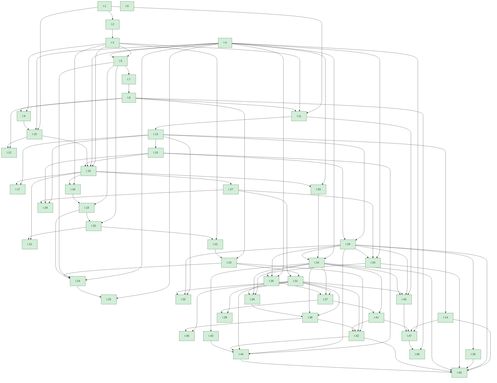

<!-- Generated by scripts/render.py. Do not edit by hand. -->

# Who uses whom

Each arrow runs from a proposition to one that cites it, following Euclid's own bracketed references in Heath's translation. Green: proved in Lean; grey: sketched.

## Book I

- [I.1](book/I/01.md): An equilateral triangle on a given line
- [I.2](book/I/02.md): Placing a given length at a point
- [I.3](book/I/03.md): Cutting off a given length
- [I.4](book/I/04.md): Side, angle, side
- [I.5](book/I/05.md): The base angles of an isosceles triangle
- [I.6](book/I/06.md): Equal base angles make equal sides
- [I.7](book/I/07.md): Only one triangle on a base with given sides
- [I.8](book/I/08.md): Side, side, side
- [I.9](book/I/09.md): Bisecting an angle
- [I.10](book/I/10.md): Bisecting a straight line
- [I.11](book/I/11.md): A perpendicular from a point on a line
- [I.12](book/I/12.md): A perpendicular from a point off a line
- [I.13](book/I/13.md): Angles on a straight line
- [I.14](book/I/14.md): When two angles make a straight line
- [I.15](book/I/15.md): Vertical angles
- [I.16](book/I/16.md): The exterior angle is greater
- [I.17](book/I/17.md): Two angles of a triangle are less than two right angles
- [I.18](book/I/18.md): The greater side subtends the greater angle
- [I.19](book/I/19.md): The greater angle is subtended by the greater side
- [I.20](book/I/20.md): Two sides exceed the third
- [I.21](book/I/21.md): Lines drawn within a triangle
- [I.22](book/I/22.md): A triangle from three given lines
- [I.23](book/I/23.md): Copying an angle
- [I.24](book/I/24.md): The wider angle has the longer base
- [I.25](book/I/25.md): The longer base has the wider angle
- [I.26](book/I/26.md): Angle, side, angle
- [I.27](book/I/27.md): Equal alternate angles make parallels
- [I.28](book/I/28.md): Equal corresponding angles make parallels
- [I.29](book/I/29.md): Parallels make equal angles
- [I.30](book/I/30.md): Parallels to the same line
- [I.31](book/I/31.md): Drawing a parallel through a point
- [I.32](book/I/32.md): The angles of a triangle make two right angles
- [I.33](book/I/33.md): Joining equal parallels
- [I.34](book/I/34.md): Opposite sides and angles of a parallelogram
- [I.35](book/I/35.md): Parallelograms on the same base
- [I.36](book/I/36.md): Parallelograms on equal bases
- [I.37](book/I/37.md): Triangles on the same base
- [I.38](book/I/38.md): Triangles on equal bases
- [I.39](book/I/39.md): Equal triangles on the same base
- [I.40](book/I/40.md): Equal triangles on equal bases
- [I.41](book/I/41.md): A parallelogram is double the triangle
- [I.42](book/I/42.md): A parallelogram equal to a triangle
- [I.43](book/I/43.md): The complements are equal
- [I.44](book/I/44.md): Applying a parallelogram to a line
- [I.45](book/I/45.md): A parallelogram equal to a rectilineal figure
- [I.46](book/I/46.md): Describing a square
- [I.47](book/I/47.md): The theorem of Pythagoras
- [I.48](book/I/48.md): Its converse
