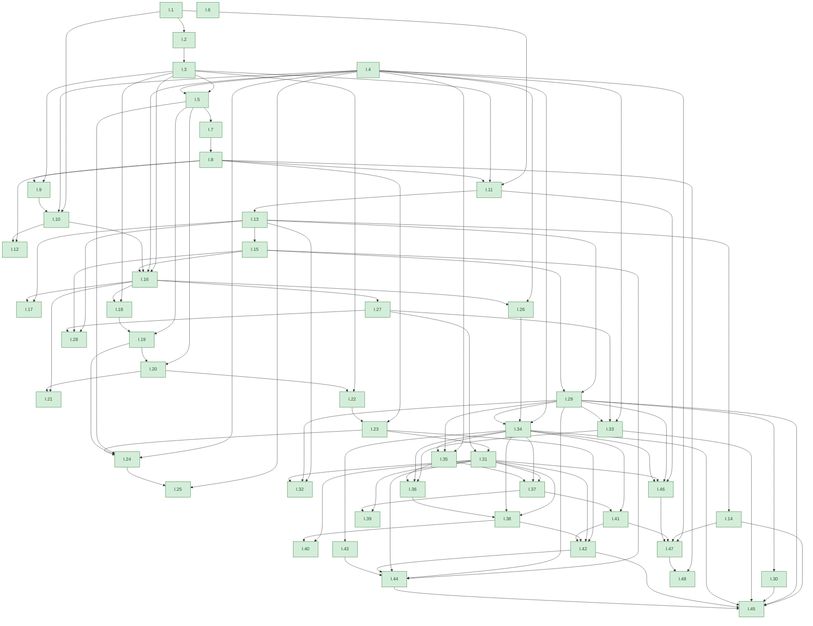

```mermaid
graph TD
  I3["I.3"]
  I5["I.5"]
  I6["I.6"]
  I11["I.11"]
  I15["I.15"]
  I29["I.29"]
  I31["I.31"]
  I32["I.32"]
  I34["I.34"]
  I36["I.36"]
  I43["I.43"]
  I45["I.45"]
  I46["I.46"]
  I47["I.47"]
  II1["II.1"]
  II2["II.2"]
  II3["II.3"]
  II4["II.4"]
  II5["II.5"]
  II6["II.6"]
  II7["II.7"]
  II8["II.8"]
  II9["II.9"]
  II10["II.10"]
  II11["II.11"]
  II12["II.12"]
  II13["II.13"]
  II14["II.14"]
  I3 --> II1
  I11 --> II1
  I31 --> II1
  I34 --> II1
  I31 --> II2
  I46 --> II2
  I31 --> II3
  I46 --> II3
  I5 --> II4
  I6 --> II4
  I29 --> II4
  I31 --> II4
  I34 --> II4
  I46 --> II4
  I31 --> II5
  I36 --> II5
  I43 --> II5
  I46 --> II5
  I31 --> II6
  I36 --> II6
  I43 --> II6
  I46 --> II6
  I43 --> II7
  I46 --> II7
  I36 --> II8
  I43 --> II8
  I6 --> II9
  I29 --> II9
  I32 --> II9
  I34 --> II9
  I47 --> II9
  I3 --> II10
  I5 --> II10
  I6 --> II10
  I11 --> II10
  I15 --> II10
  I29 --> II10
  I31 --> II10
  I32 --> II10
  I34 --> II10
  I47 --> II10
  I46 --> II11
  I47 --> II11
  II6 --> II11
  I47 --> II12
  II4 --> II12
  I47 --> II13
  II7 --> II13
  I45 --> II14
  I47 --> II14
  II5 --> II14
  classDef proved fill:#d4edda,stroke:#2e7d32,color:#1b5e20
  classDef sketched fill:#eeeeee,stroke:#9e9e9e,color:#424242
  classDef earlier fill:#ffffff,stroke:#9e9e9e,color:#424242
  class I3,I5,I6,I11,I15,I29,I31,I32,I34,I36,I43,I45,I46,I47 earlier
  class II1,II2,II3,II4,II5,II6,II7,II8,II9,II10,II11,II12,II13,II14 proved
```

<!-- Generated by scripts/render.py. Do not edit by hand. -->

# Who uses whom

Each arrow runs from a proposition to one that cites it, following Euclid's own bracketed references in Heath's translation. Green: proved in Lean; grey: stated.

## Book I

- [I.1](book/I/01.md): An equilateral triangle on a given line
- [I.2](book/I/02.md): Placing a given length at a point
- [I.3](book/I/03.md): Cutting off a given length
- [I.4](book/I/04.md): Side, angle, side
- [I.5](book/I/05.md): The base angles of an isosceles triangle
- [I.6](book/I/06.md): Equal base angles make equal sides
- [I.7](book/I/07.md): Only one triangle on a base with given sides
- [I.8](book/I/08.md): Side, side, side
- [I.9](book/I/09.md): Bisecting an angle
- [I.10](book/I/10.md): Bisecting a straight line
- [I.11](book/I/11.md): A perpendicular from a point on a line
- [I.12](book/I/12.md): A perpendicular from a point off a line
- [I.13](book/I/13.md): Angles on a straight line
- [I.14](book/I/14.md): When two angles make a straight line
- [I.15](book/I/15.md): Vertical angles
- [I.16](book/I/16.md): The exterior angle is greater
- [I.17](book/I/17.md): Two angles of a triangle are less than two right angles
- [I.18](book/I/18.md): The greater side subtends the greater angle
- [I.19](book/I/19.md): The greater angle is subtended by the greater side
- [I.20](book/I/20.md): Two sides exceed the third
- [I.21](book/I/21.md): Lines drawn within a triangle
- [I.22](book/I/22.md): A triangle from three given lines
- [I.23](book/I/23.md): Copying an angle
- [I.24](book/I/24.md): The wider angle has the longer base
- [I.25](book/I/25.md): The longer base has the wider angle
- [I.26](book/I/26.md): Angle, side, angle
- [I.27](book/I/27.md): Equal alternate angles make parallels
- [I.28](book/I/28.md): Equal corresponding angles make parallels
- [I.29](book/I/29.md): Parallels make equal angles
- [I.30](book/I/30.md): Parallels to the same line
- [I.31](book/I/31.md): Drawing a parallel through a point
- [I.32](book/I/32.md): The angles of a triangle make two right angles
- [I.33](book/I/33.md): Joining equal parallels
- [I.34](book/I/34.md): Opposite sides and angles of a parallelogram
- [I.35](book/I/35.md): Parallelograms on the same base
- [I.36](book/I/36.md): Parallelograms on equal bases
- [I.37](book/I/37.md): Triangles on the same base
- [I.38](book/I/38.md): Triangles on equal bases
- [I.39](book/I/39.md): Equal triangles on the same base
- [I.40](book/I/40.md): Equal triangles on equal bases
- [I.41](book/I/41.md): A parallelogram is double the triangle
- [I.42](book/I/42.md): A parallelogram equal to a triangle
- [I.43](book/I/43.md): The complements are equal
- [I.44](book/I/44.md): Applying a parallelogram to a line
- [I.45](book/I/45.md): A parallelogram equal to a rectilineal figure
- [I.46](book/I/46.md): Describing a square
- [I.47](book/I/47.md): The theorem of Pythagoras
- [I.48](book/I/48.md): Its converse

## Book II

White: propositions of earlier books that Book II cites.

- [II.1](book/II/01.md): A rectangle cut into rectangles
- [II.2](book/II/02.md): The square as two rectangles
- [II.3](book/II/03.md): A rectangle as a rectangle and a square
- [II.4](book/II/04.md): The square on a straight line cut in two
- [II.5](book/II/05.md): A straight line cut equally and unequally
- [II.6](book/II/06.md): A bisected straight line produced
- [II.7](book/II/07.md): The squares on the whole and a segment
- [II.8](book/II/08.md): Four rectangles and a square
- [II.9](book/II/09.md): The squares on the unequal segments
- [II.10](book/II/10.md): The squares on a bisected straight line produced
- [II.11](book/II/11.md): Cutting in extreme and mean ratio
- [II.12](book/II/12.md): The square opposite an obtuse angle
- [II.13](book/II/13.md): The square opposite an acute angle
- [II.14](book/II/14.md): A square equal to a rectilineal figure

## Book III

White: propositions of earlier books that Book III cites.

```mermaid
graph TD
  I4["I.4"]
  I5["I.5"]
  I6["I.6"]
  I8["I.8"]
  I16["I.16"]
  I17["I.17"]
  I19["I.19"]
  I20["I.20"]
  I21["I.21"]
  I23["I.23"]
  I24["I.24"]
  I26["I.26"]
  I32["I.32"]
  I47["I.47"]
  II5["II.5"]
  II6["II.6"]
  III1["III.1"]
  III2["III.2"]
  III3["III.3"]
  III4["III.4"]
  III5["III.5"]
  III6["III.6"]
  III7["III.7"]
  III8["III.8"]
  III9["III.9"]
  III10["III.10"]
  III11["III.11"]
  III12["III.12"]
  III13["III.13"]
  III14["III.14"]
  III15["III.15"]
  III16["III.16"]
  III17["III.17"]
  III18["III.18"]
  III19["III.19"]
  III20["III.20"]
  III21["III.21"]
  III22["III.22"]
  III23["III.23"]
  III24["III.24"]
  III25["III.25"]
  III26["III.26"]
  III27["III.27"]
  III28["III.28"]
  III29["III.29"]
  III30["III.30"]
  III31["III.31"]
  III32["III.32"]
  III33["III.33"]
  III34["III.34"]
  III35["III.35"]
  III36["III.36"]
  III37["III.37"]
  I8 --> III1
  I5 --> III2
  I16 --> III2
  I19 --> III2
  III1 --> III2
  I5 --> III3
  I8 --> III3
  I26 --> III3
  III1 --> III4
  III3 --> III4
  I4 --> III7
  I20 --> III7
  I23 --> III7
  I24 --> III7
  I4 --> III8
  I20 --> III8
  I21 --> III8
  I24 --> III8
  III1 --> III8
  I8 --> III9
  III1 --> III9
  III1 --> III10
  III5 --> III10
  I20 --> III12
  III2 --> III13
  III11 --> III13
  I47 --> III14
  III1 --> III14
  III3 --> III14
  I20 --> III15
  I24 --> III15
  III14 --> III15
  I5 --> III16
  I17 --> III16
  I19 --> III16
  I4 --> III17
  III1 --> III17
  III16 --> III17
  I17 --> III18
  I19 --> III18
  III18 --> III19
  I5 --> III20
  I32 --> III20
  III20 --> III21
  I32 --> III22
  III21 --> III22
  I16 --> III23
  III10 --> III24
  I6 --> III25
  III9 --> III25
  I4 --> III26
  III24 --> III26
  I23 --> III27
  III20 --> III27
  III26 --> III27
  I8 --> III28
  III26 --> III28
  I4 --> III29
  III27 --> III29
  I4 --> III30
  III28 --> III30
  I5 --> III31
  I17 --> III31
  I32 --> III31
  III22 --> III31
  I32 --> III32
  III19 --> III32
  III22 --> III32
  III31 --> III32
  I4 --> III33
  III16 --> III33
  III31 --> III33
  III32 --> III33
  I23 --> III34
  III32 --> III34
  I47 --> III35
  II5 --> III35
  III3 --> III35
  I47 --> III36
  II6 --> III36
  III3 --> III36
  III18 --> III36
  I8 --> III37
  III16 --> III37
  III18 --> III37
  III36 --> III37
  classDef proved fill:#d4edda,stroke:#2e7d32,color:#1b5e20
  classDef sketched fill:#eeeeee,stroke:#9e9e9e,color:#424242
  classDef earlier fill:#ffffff,stroke:#9e9e9e,color:#424242
  class I4,I5,I6,I8,I16,I17,I19,I20,I21,I23,I24,I26,I32,I47,II5,II6 earlier
  class III1,III2,III3,III4,III5,III6,III7,III8,III9,III10,III11,III12,III13,III14,III15,III16,III17,III18,III19 proved
  class III20,III21,III22,III23,III24,III25,III26,III27,III28,III29,III30,III31,III32,III33,III34,III35,III36,III37 sketched
```

- [III.1](book/III/01.md): Finding the centre of a circle
- [III.2](book/III/02.md): A straight line joining two points of a circle
- [III.3](book/III/03.md): A straight line through the centre bisecting another
- [III.4](book/III/04.md): Two straight lines not through the centre
- [III.5](book/III/05.md): Circles that cut one another
- [III.6](book/III/06.md): Circles that touch one another
- [III.7](book/III/07.md): Straight lines from a point within a circle
- [III.8](book/III/08.md): Straight lines from a point outside a circle
- [III.9](book/III/09.md): A point with three equal straight lines to the circle
- [III.10](book/III/10.md): Circles cut one another at two points at most
- [III.11](book/III/11.md): The centres of circles touching internally
- [III.12](book/III/12.md): The centres of circles touching externally
- [III.13](book/III/13.md): Circles touch at one point only
- [III.14](book/III/14.md): Equal straight lines are equally distant from the centre
- [III.15](book/III/15.md): The diameter is the greatest straight line in a circle
- [III.16](book/III/16.md): The straight line at right angles to a diameter at its end
- [III.17](book/III/17.md): Drawing a straight line to touch a circle
- [III.18](book/III/18.md): The radius to the point of contact
- [III.19](book/III/19.md): The perpendicular to a tangent at the point of contact
- [III.20](book/III/20.md): The angle at the centre is double the angle at the circumference
- [III.21](book/III/21.md): Angles in the same segment
- [III.22](book/III/22.md): Opposite angles of a quadrilateral in a circle
- [III.23](book/III/23.md): Similar segments on the same straight line
- [III.24](book/III/24.md): Similar segments on equal straight lines
- [III.25](book/III/25.md): Completing the circle of a segment
- [III.26](book/III/26.md): Equal angles stand on equal circumferences
- [III.27](book/III/27.md): Angles on equal circumferences are equal
- [III.28](book/III/28.md): Equal straight lines cut off equal circumferences
- [III.29](book/III/29.md): Equal circumferences have equal straight lines
- [III.30](book/III/30.md): Bisecting a circumference
- [III.31](book/III/31.md): The angle in a semicircle
- [III.32](book/III/32.md): The angle in the alternate segment
- [III.33](book/III/33.md): A segment admitting a given angle
- [III.34](book/III/34.md): Cutting off a segment admitting a given angle
- [III.35](book/III/35.md): Two straight lines cutting one another in a circle
- [III.36](book/III/36.md): The square on the tangent
- [III.37](book/III/37.md): Its converse
