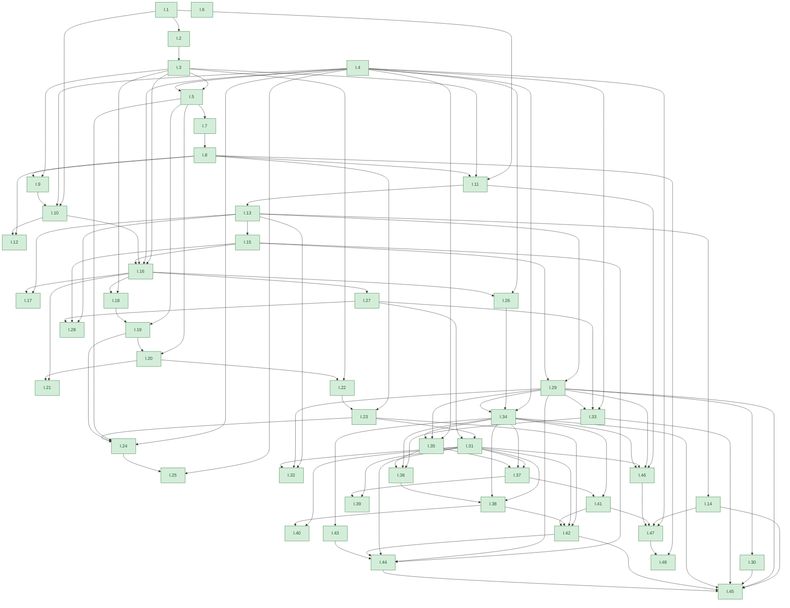
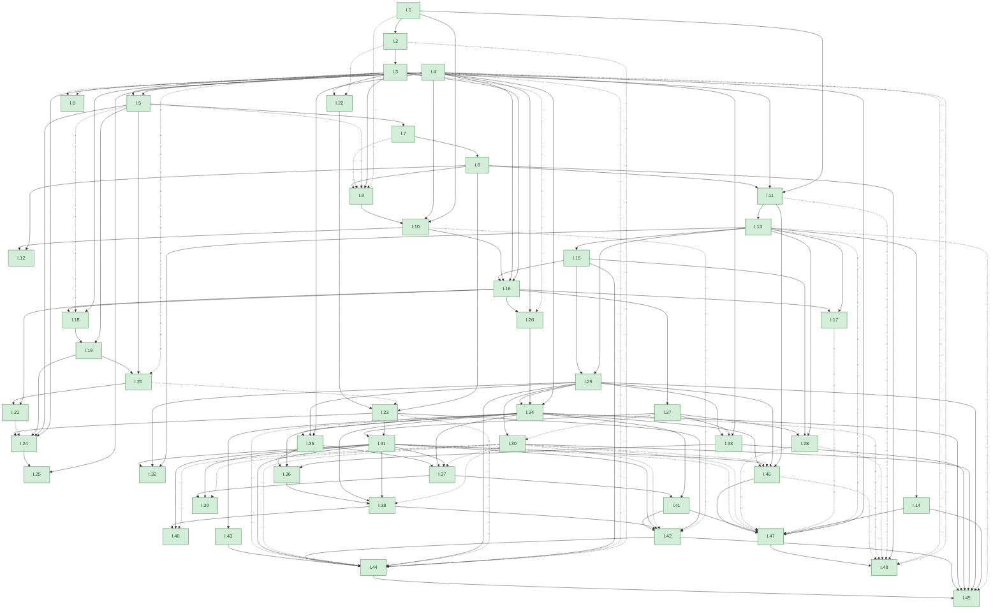
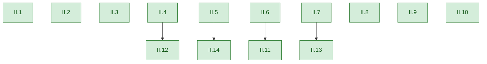

<!-- Generated by scripts/render.py. Do not edit by hand. -->

# Who uses whom

Two graphs for each book, in which each arrow runs from a proposition to one that uses it, and a porism is drawn as its proposition. Green: proved in Lean; grey: stated in Lean, not yet proved; white: a proposition of an earlier book.

- **From Heath's references.** An arrow for each earlier proposition that Heath's translation names in square brackets, such as "[I. 4]", in a proposition's enunciation or proof. The brackets are Heath's editorial references, not Euclid's words: as Heath says, "such specific quotations of earlier propositions are rare in Euclid" (vol. 1, p. 83, [scan leaf n103](https://archive.org/details/thirteenbookseu02heibgoog/page/n103)). A missing bracket does not mean that Euclid gave no reason, and a bracket is Heath's pointer, not a checked reconstruction of the argument.
- **From the Lean.** An arrow for each proposition that a proof in Lean cites, as [the certificate](CERTIFICATE.md) records it. Solid arrows are also among Heath's references; dashed ones only the Lean draws. Most dashed arrows come from shared steps, lemmas proved once and used by many proofs, which bring in the propositions they rest on ([the certificate](CERTIFICATE.md#shared-steps) says more). For each book after Book I the graph draws only the book's own propositions, and a table under it lists the earlier propositions each proof cites. A line under the graph names any of Heath's references that the Lean does not cite.

Book I: [from Heath's references](#from-heaths-references), [from the Lean](#from-the-lean) · Book II: [from Heath's references](#from-heaths-references-1), [from the Lean](#from-the-lean-1) · Book III: [from Heath's references](#from-heaths-references-2), [from the Lean](#from-the-lean-2)

## Book I

### From Heath's references

108 arrows.

### From the Lean

143 arrows: 107 also among Heath's references (solid) and 36 only in the Lean (dashed).

Heath's references that the Lean does not cite, 1 of his 108: [I.20](book/I/20.md) in [I.22](book/I/22.md).

The 48 propositions of Book I

- [I.1](book/I/01.md): An equilateral triangle on a given straight line
- [I.2](book/I/02.md): A straight line equal to a given one, placed at a given point
- [I.3](book/I/03.md): A straight line equal to the less, cut off from the greater
- [I.4](book/I/04.md): Two sides and the contained angle make the base equal
- [I.5](book/I/05.md): In isosceles triangles the angles at the base are equal
- [I.6](book/I/06.md): Equal angles are subtended by equal sides
- [I.7](book/I/07.md): Equal straight lines cannot meet in another point
- [I.8](book/I/08.md): Two sides and the base make the angles equal
- [I.9](book/I/09.md): A given rectilineal angle, bisected
- [I.10](book/I/10.md): A given finite straight line, bisected
- [I.11](book/I/11.md): A straight line at right angles from a point on a given one
- [I.12](book/I/12.md): A perpendicular straight line from a point not on a given one
- [I.13](book/I/13.md): Angles on a straight line equal two right angles
- [I.14](book/I/14.md): Angles equal to two right angles make a straight line
- [I.15](book/I/15.md): Straight lines cutting one another make the vertical angles equal
- [I.16](book/I/16.md): The exterior angle is greater than either opposite angle
- [I.17](book/I/17.md): Two angles of a triangle are less than two right angles
- [I.18](book/I/18.md): The greater side subtends the greater angle
- [I.19](book/I/19.md): The greater angle is subtended by the greater side
- [I.20](book/I/20.md): Two sides of a triangle are greater than the remaining one
- [I.21](book/I/21.md): Straight lines within a triangle are less, their angle greater
- [I.22](book/I/22.md): A triangle out of three given straight lines
- [I.23](book/I/23.md): An angle equal to a given one, on a given straight line
- [I.24](book/I/24.md): The greater angle has the greater base
- [I.25](book/I/25.md): The greater base has the greater angle
- [I.26](book/I/26.md): Two angles and one side make the remaining sides equal
- [I.27](book/I/27.md): Equal alternate angles make parallels
- [I.28](book/I/28.md): Equal exterior and interior angles make parallels
- [I.29](book/I/29.md): Parallels make the alternate angles equal
- [I.30](book/I/30.md): Parallels to the same straight line are parallel
- [I.31](book/I/31.md): A straight line parallel to a given one, through a given point
- [I.32](book/I/32.md): The three angles of a triangle equal two right angles
- [I.33](book/I/33.md): Straight lines joining equal parallels are equal and parallel
- [I.34](book/I/34.md): In parallelograms the opposite sides and angles are equal
- [I.35](book/I/35.md): Parallelograms on the same base and in the same parallels are equal
- [I.36](book/I/36.md): Parallelograms on equal bases and in the same parallels are equal
- [I.37](book/I/37.md): Triangles on the same base and in the same parallels are equal
- [I.38](book/I/38.md): Triangles on equal bases and in the same parallels are equal
- [I.39](book/I/39.md): Equal triangles on the same base are in the same parallels
- [I.40](book/I/40.md): Equal triangles on equal bases are in the same parallels
- [I.41](book/I/41.md): The parallelogram is double of the triangle
- [I.42](book/I/42.md): A parallelogram equal to a given triangle, in a given angle
- [I.43](book/I/43.md): In any parallelogram the complements are equal
- [I.44](book/I/44.md): A parallelogram applied to a given straight line
- [I.45](book/I/45.md): A parallelogram equal to a given rectilineal figure
- [I.46](book/I/46.md): A square on a given straight line
- [I.47](book/I/47.md): The square on the side subtending the right angle equals the other two
- [I.48](book/I/48.md): If the square equals the other two, the angle is right

## Book II

### From Heath's references

51 arrows.

```mermaid
graph TD
  I3["I.3"]
  I5["I.5"]
  I6["I.6"]
  I11["I.11"]
  I15["I.15"]
  I29["I.29"]
  I31["I.31"]
  I32["I.32"]
  I34["I.34"]
  I36["I.36"]
  I43["I.43"]
  I45["I.45"]
  I46["I.46"]
  I47["I.47"]
  II1["II.1"]
  II2["II.2"]
  II3["II.3"]
  II4["II.4"]
  II5["II.5"]
  II6["II.6"]
  II7["II.7"]
  II8["II.8"]
  II9["II.9"]
  II10["II.10"]
  II11["II.11"]
  II12["II.12"]
  II13["II.13"]
  II14["II.14"]
  I3 --> II1
  I11 --> II1
  I31 --> II1
  I34 --> II1
  I31 --> II2
  I46 --> II2
  I31 --> II3
  I46 --> II3
  I5 --> II4
  I6 --> II4
  I29 --> II4
  I31 --> II4
  I34 --> II4
  I46 --> II4
  I31 --> II5
  I36 --> II5
  I43 --> II5
  I46 --> II5
  I31 --> II6
  I36 --> II6
  I43 --> II6
  I46 --> II6
  I43 --> II7
  I46 --> II7
  I36 --> II8
  I43 --> II8
  I6 --> II9
  I29 --> II9
  I32 --> II9
  I34 --> II9
  I47 --> II9
  I3 --> II10
  I5 --> II10
  I6 --> II10
  I11 --> II10
  I15 --> II10
  I29 --> II10
  I31 --> II10
  I32 --> II10
  I34 --> II10
  I47 --> II10
  I46 --> II11
  I47 --> II11
  II6 --> II11
  I47 --> II12
  II4 --> II12
  I47 --> II13
  II7 --> II13
  I45 --> II14
  I47 --> II14
  II5 --> II14
  classDef proved fill:#d4edda,stroke:#2e7d32,color:#1b5e20
  classDef sketched fill:#eeeeee,stroke:#9e9e9e,color:#424242
  classDef earlier fill:#ffffff,stroke:#9e9e9e,color:#424242
  class I3,I5,I6,I11,I15,I29,I31,I32,I34,I36,I43,I45,I46,I47 earlier
  class II1,II2,II3,II4,II5,II6,II7,II8,II9,II10,II11,II12,II13,II14 proved
```

### From the Lean

145 arrows: 51 also among Heath's references and 94 only in the Lean. The graph draws the 4 arrows between propositions of Book II, 4 solid and 0 dashed; the table under it lists the other 141, to propositions of earlier books.

The propositions of earlier books that each proof cites

| Proposition | Lean cites | Of these, among Heath's references |
|---|---|---|
| [II.1](book/II/01.md) | I.2, I.3, I.4, I.11, I.13, I.29, I.30, I.31, I.34 | I.3, I.11, I.31, I.34 |
| [II.2](book/II/02.md) | I.4, I.28, I.29, I.30, I.31, I.34, I.46 | I.31, I.46 |
| [II.3](book/II/03.md) | I.4, I.13, I.28, I.29, I.30, I.31, I.34, I.46 | I.31, I.46 |
| [II.4](book/II/04.md) | I.4, I.5, I.6, I.13, I.28, I.29, I.30, I.31, I.34, I.43, I.46 | I.5, I.6, I.29, I.31, I.34, I.46 |
| [II.5](book/II/05.md) | I.4, I.5, I.6, I.13, I.28, I.29, I.30, I.31, I.34, I.36, I.43, I.46 | I.31, I.36, I.43, I.46 |
| [II.6](book/II/06.md) | I.4, I.5, I.6, I.28, I.29, I.30, I.31, I.34, I.36, I.43, I.46 | I.31, I.36, I.43, I.46 |
| [II.7](book/II/07.md) | I.4, I.5, I.6, I.28, I.29, I.30, I.31, I.34, I.43, I.46 | I.43, I.46 |
| [II.8](book/II/08.md) | I.4, I.5, I.6, I.28, I.29, I.30, I.31, I.34, I.36, I.43, I.46 | I.36, I.43 |
| [II.9](book/II/09.md) | I.4, I.5, I.6, I.11, I.13, I.28, I.29, I.30, I.31, I.32, I.34, I.46, I.47 | I.6, I.29, I.32, I.34, I.47 |
| [II.10](book/II/10.md) | I.3, I.4, I.5, I.6, I.11, I.15, I.28, I.29, I.30, I.31, I.32, I.34, I.46, I.47 | I.3, I.5, I.6, I.11, I.15, I.29, I.31, I.32, I.34, I.47 |
| [II.11](book/II/11.md) | I.4, I.10, I.13, I.17, I.19, I.20, I.28, I.29, I.30, I.34, I.46, I.47 | I.46, I.47 |
| [II.12](book/II/12.md) | I.4, I.17, I.28, I.34, I.46, I.47 | I.47 |
| [II.13](book/II/13.md) | I.4, I.13, I.17, I.28, I.34, I.46, I.47 | I.47 |
| [II.14](book/II/14.md) | I.4, I.10, I.11, I.13, I.28, I.29, I.34, I.45, I.46, I.47 | I.45, I.47 |

The Lean cites all 51 of Heath's references.

The 14 propositions of Book II

- [II.1](book/II/01.md): The rectangle contained by two straight lines, one cut
- [II.2](book/II/02.md): The rectangle contained by the whole and both segments
- [II.3](book/II/03.md): The rectangle contained by the whole and one segment
- [II.4](book/II/04.md): The squares on the whole and both segments
- [II.5](book/II/05.md): The rectangle contained by the unequal segments
- [II.6](book/II/06.md): The rectangle contained by the whole and the added straight line
- [II.7](book/II/07.md): The squares on the whole and one segment
- [II.8](book/II/08.md): Four times the rectangle contained by the whole and one segment
- [II.9](book/II/09.md): The squares on the unequal segments
- [II.10](book/II/10.md): The squares on the whole and the added straight line
- [II.11](book/II/11.md): A straight line cut so that the rectangle equals the square
- [II.12](book/II/12.md): The square on the side subtending the obtuse angle
- [II.13](book/II/13.md): The square on the side subtending the acute angle
- [II.14](book/II/14.md): A square equal to a given rectilineal figure

## Book III

### From Heath's references

86 arrows.

```mermaid
graph TD
  I4["I.4"]
  I5["I.5"]
  I6["I.6"]
  I8["I.8"]
  I16["I.16"]
  I17["I.17"]
  I19["I.19"]
  I20["I.20"]
  I21["I.21"]
  I23["I.23"]
  I24["I.24"]
  I26["I.26"]
  I32["I.32"]
  I47["I.47"]
  II5["II.5"]
  II6["II.6"]
  III1["III.1"]
  III2["III.2"]
  III3["III.3"]
  III4["III.4"]
  III5["III.5"]
  III6["III.6"]
  III7["III.7"]
  III8["III.8"]
  III9["III.9"]
  III10["III.10"]
  III11["III.11"]
  III12["III.12"]
  III13["III.13"]
  III14["III.14"]
  III15["III.15"]
  III16["III.16"]
  III17["III.17"]
  III18["III.18"]
  III19["III.19"]
  III20["III.20"]
  III21["III.21"]
  III22["III.22"]
  III23["III.23"]
  III24["III.24"]
  III25["III.25"]
  III26["III.26"]
  III27["III.27"]
  III28["III.28"]
  III29["III.29"]
  III30["III.30"]
  III31["III.31"]
  III32["III.32"]
  III33["III.33"]
  III34["III.34"]
  III35["III.35"]
  III36["III.36"]
  III37["III.37"]
  I8 --> III1
  I5 --> III2
  I16 --> III2
  I19 --> III2
  III1 --> III2
  I5 --> III3
  I8 --> III3
  I26 --> III3
  III1 --> III4
  III3 --> III4
  I4 --> III7
  I20 --> III7
  I23 --> III7
  I24 --> III7
  I4 --> III8
  I20 --> III8
  I21 --> III8
  I24 --> III8
  III1 --> III8
  I8 --> III9
  III1 --> III9
  III1 --> III10
  III5 --> III10
  I20 --> III12
  III2 --> III13
  III11 --> III13
  I47 --> III14
  III1 --> III14
  III3 --> III14
  I20 --> III15
  I24 --> III15
  III14 --> III15
  I5 --> III16
  I17 --> III16
  I19 --> III16
  I4 --> III17
  III1 --> III17
  III16 --> III17
  I17 --> III18
  I19 --> III18
  III18 --> III19
  I5 --> III20
  I32 --> III20
  III20 --> III21
  I32 --> III22
  III21 --> III22
  I16 --> III23
  III10 --> III24
  I6 --> III25
  III9 --> III25
  I4 --> III26
  III24 --> III26
  I23 --> III27
  III20 --> III27
  III26 --> III27
  I8 --> III28
  III26 --> III28
  I4 --> III29
  III27 --> III29
  I4 --> III30
  III28 --> III30
  I5 --> III31
  I17 --> III31
  I32 --> III31
  III22 --> III31
  I32 --> III32
  III19 --> III32
  III22 --> III32
  III31 --> III32
  I4 --> III33
  III16 --> III33
  III31 --> III33
  III32 --> III33
  I23 --> III34
  III32 --> III34
  I47 --> III35
  II5 --> III35
  III3 --> III35
  I47 --> III36
  II6 --> III36
  III3 --> III36
  III18 --> III36
  I8 --> III37
  III16 --> III37
  III18 --> III37
  III36 --> III37
  classDef proved fill:#d4edda,stroke:#2e7d32,color:#1b5e20
  classDef sketched fill:#eeeeee,stroke:#9e9e9e,color:#424242
  classDef earlier fill:#ffffff,stroke:#9e9e9e,color:#424242
  class I4,I5,I6,I8,I16,I17,I19,I20,I21,I23,I24,I26,I32,I47,II5,II6 earlier
  class III1,III2,III3,III4,III5,III6,III7,III8,III9,III10,III11,III12,III13,III14,III15,III16,III17,III18,III19,III20,III21,III22,III23,III24,III25,III26,III27,III28,III29,III30,III31,III32,III33,III34,III35,III36,III37 proved
```

### From the Lean

236 arrows: 79 also among Heath's references and 157 only in the Lean. The graph draws the 83 arrows between propositions of Book III, 32 solid and 51 dashed; the table under it lists the other 153, to propositions of earlier books.

```mermaid
graph TD
  III1["III.1"]
  III2["III.2"]
  III3["III.3"]
  III4["III.4"]
  III5["III.5"]
  III6["III.6"]
  III7["III.7"]
  III8["III.8"]
  III9["III.9"]
  III10["III.10"]
  III11["III.11"]
  III12["III.12"]
  III13["III.13"]
  III14["III.14"]
  III15["III.15"]
  III16["III.16"]
  III17["III.17"]
  III18["III.18"]
  III19["III.19"]
  III20["III.20"]
  III21["III.21"]
  III22["III.22"]
  III23["III.23"]
  III24["III.24"]
  III25["III.25"]
  III26["III.26"]
  III27["III.27"]
  III28["III.28"]
  III29["III.29"]
  III30["III.30"]
  III31["III.31"]
  III32["III.32"]
  III33["III.33"]
  III34["III.34"]
  III35["III.35"]
  III36["III.36"]
  III37["III.37"]
  III3 --> III4
  III2 -.-> III7
  III2 -.-> III8
  III1 --> III9
  III2 -.-> III9
  III1 --> III10
  III2 -.-> III10
  III2 -.-> III11
  III6 -.-> III11
  III6 -.-> III12
  III2 --> III13
  III11 --> III13
  III3 --> III14
  III2 -.-> III15
  III14 --> III15
  III2 -.-> III16
  III16 --> III17
  III2 -.-> III18
  III16 -.-> III18
  III18 --> III19
  III2 -.-> III20
  III20 --> III21
  III2 -.-> III22
  III21 --> III22
  III2 -.-> III23
  III10 -.-> III23
  III21 -.-> III23
  III2 -.-> III24
  III20 -.-> III24
  III21 -.-> III24
  III22 -.-> III24
  III23 -.-> III24
  III2 -.-> III25
  III9 --> III25
  III20 -.-> III25
  III21 -.-> III25
  III22 -.-> III25
  III2 -.-> III26
  III20 -.-> III26
  III21 -.-> III26
  III22 -.-> III26
  III24 --> III26
  III2 -.-> III27
  III20 --> III27
  III21 -.-> III27
  III22 -.-> III27
  III26 --> III27
  III2 -.-> III28
  III20 -.-> III28
  III21 -.-> III28
  III22 -.-> III28
  III24 -.-> III28
  III26 --> III28
  III2 -.-> III29
  III20 -.-> III29
  III21 -.-> III29
  III22 -.-> III29
  III27 --> III29
  III2 -.-> III30
  III21 -.-> III30
  III22 -.-> III30
  III28 --> III30
  III2 -.-> III31
  III22 --> III31
  III2 -.-> III32
  III19 --> III32
  III21 -.-> III32
  III22 --> III32
  III31 --> III32
  III2 -.-> III33
  III16 --> III33
  III31 --> III33
  III32 --> III33
  III2 -.-> III34
  III16 -.-> III34
  III32 --> III34
  III3 --> III35
  III3 --> III36
  III18 --> III36
  III16 --> III37
  III17 -.-> III37
  III18 --> III37
  III36 --> III37
  classDef proved fill:#d4edda,stroke:#2e7d32,color:#1b5e20
  classDef sketched fill:#eeeeee,stroke:#9e9e9e,color:#424242
  class III1,III2,III3,III4,III5,III6,III7,III8,III9,III10,III11,III12,III13,III14,III15,III16,III17,III18,III19,III20,III21,III22,III23,III24,III25,III26,III27,III28,III29,III30,III31,III32,III33,III34,III35,III36,III37 proved
```

The propositions of earlier books that each proof cites

| Proposition | Lean cites | Of these, among Heath's references |
|---|---|---|
| [III.1](book/III/01.md) | I.5, I.8, I.10, I.11, I.13, I.16, I.19 | I.8 |
| [III.2](book/III/02.md) | I.5, I.16, I.19 | I.5, I.16, I.19 |
| [III.3](book/III/03.md) | I.5, I.8, I.13, I.26 | I.5, I.8, I.26 |
| [III.7](book/III/07.md) | I.4, I.20, I.23, I.24 | I.4, I.20, I.23, I.24 |
| [III.8](book/III/08.md) | I.4, I.20, I.21, I.23, I.24 | I.4, I.20, I.21, I.24 |
| [III.9](book/III/09.md) | I.8, I.10, I.13, I.17 | I.8 |
| [III.10](book/III/10.md) | I.10, I.11, I.13, I.17 | none |
| [III.11](book/III/11.md) | I.20 | none |
| [III.12](book/III/12.md) | I.20 | I.20 |
| [III.13](book/III/13.md) | I.12, I.17, I.19, I.20, I.24 | none |
| [III.14](book/III/14.md) | I.3, I.4, I.17, I.19, I.20, I.28, I.34, I.46, I.47 | I.47 |
| [III.15](book/III/15.md) | I.3, I.11, I.13, I.17, I.19, I.20, I.24 | I.20, I.24 |
| [III.16](book/III/16.md) | I.5, I.12, I.13, I.17, I.19, I.20, I.23 | I.5, I.17, I.19 |
| [III.17](book/III/17.md) | I.4, I.11, I.13 | I.4 |
| [III.18](book/III/18.md) | I.12, I.17, I.19, I.20 | I.17, I.19 |
| [III.19](book/III/19.md) | I.13 | none |
| [III.20](book/III/20.md) | I.5, I.13, I.32 | I.5, I.32 |
| [III.22](book/III/22.md) | I.32 | I.32 |
| [III.23](book/III/23.md) | I.16, I.21 | I.16 |
| [III.24](book/III/24.md) | I.2, I.3, I.4, I.5, I.7, I.8, I.20, I.22, I.26, I.32 | none |
| [III.25](book/III/25.md) | I.4, I.5, I.6, I.10, I.11, I.13, I.17, I.23, I.32 | I.6 |
| [III.26](book/III/26.md) | I.4, I.13 | I.4 |
| [III.27](book/III/27.md) | I.5, I.23, I.32 | I.23 |
| [III.28](book/III/28.md) | I.5, I.8, I.20, I.32 | I.8 |
| [III.29](book/III/29.md) | I.4, I.5, I.32 | I.4 |
| [III.30](book/III/30.md) | I.4, I.6, I.10, I.11, I.17, I.32 | I.4 |
| [III.31](book/III/31.md) | I.5, I.12, I.13, I.17, I.19, I.20, I.32 | I.5, I.17, I.32 |
| [III.32](book/III/32.md) | I.11, I.13, I.32 | I.32 |
| [III.33](book/III/33.md) | I.4, I.10, I.11, I.23 | I.4 |
| [III.34](book/III/34.md) | I.11, I.23 | I.23 |
| [III.35](book/III/35.md) | I.4, I.12, I.17, I.19, I.28, I.34, I.46, I.47, II.5 | I.47, II.5 |
| [III.36](book/III/36.md) | I.4, I.12, I.17, I.19, I.28, I.34, I.46, I.47, II.6 | I.47, II.6 |
| [III.37](book/III/37.md) | I.3, I.4, I.8, I.20, I.28, I.34, I.46 | I.8 |

Heath's references that the Lean does not cite, 7 of his 86: [III.1](book/III/01.md) in [III.2](book/III/02.md); [III.1](book/III/01.md) in [III.4](book/III/04.md); [III.1](book/III/01.md) in [III.8](book/III/08.md); [III.5](book/III/05.md) in [III.10](book/III/10.md); [III.1](book/III/01.md) in [III.14](book/III/14.md); [III.1](book/III/01.md) in [III.17](book/III/17.md); [III.10](book/III/10.md) in [III.24](book/III/24.md).

The 37 propositions of Book III

- [III.1](book/III/01.md): The centre of a given circle
- [III.2](book/III/02.md): The straight line joining two points falls within the circle
- [III.3](book/III/03.md): Through the centre, to bisect is to cut at right angles
- [III.4](book/III/04.md): Straight lines not through the centre do not bisect one another
- [III.5](book/III/05.md): Circles cutting one another do not have the same centre
- [III.6](book/III/06.md): Circles touching one another do not have the same centre
- [III.7](book/III/07.md): Straight lines falling from a point on a diameter
- [III.8](book/III/08.md): Straight lines falling from a point outside a circle
- [III.9](book/III/09.md): More than two equal straight lines fall only from the centre
- [III.10](book/III/10.md): A circle does not cut a circle at more points than two
- [III.11](book/III/11.md): The centres of circles touching internally
- [III.12](book/III/12.md): The centres of circles touching externally
- [III.13](book/III/13.md): A circle does not touch a circle at more points than one
- [III.14](book/III/14.md): Equal straight lines are equally distant from the centre
- [III.15](book/III/15.md): Of straight lines in a circle the diameter is greatest
- [III.16](book/III/16.md): The straight line at right angles to a diameter from its extremity
- [III.17](book/III/17.md): A straight line touching a given circle, from a given point
- [III.18](book/III/18.md): The straight line from the centre is perpendicular to the tangent
- [III.19](book/III/19.md): The centre is on the straight line at right angles to the tangent
- [III.20](book/III/20.md): The angle at the centre is double of that at the circumference
- [III.21](book/III/21.md): Angles in the same segment are equal
- [III.22](book/III/22.md): Opposite angles of quadrilaterals in circles equal two right angles
- [III.23](book/III/23.md): Similar segments on the same straight line cannot be unequal
- [III.24](book/III/24.md): Similar segments on equal straight lines are equal
- [III.25](book/III/25.md): The complete circle of a given segment
- [III.26](book/III/26.md): Equal angles stand on equal circumferences
- [III.27](book/III/27.md): Angles standing on equal circumferences are equal
- [III.28](book/III/28.md): Equal straight lines cut off equal circumferences
- [III.29](book/III/29.md): Equal circumferences are subtended by equal straight lines
- [III.30](book/III/30.md): A given circumference, bisected
- [III.31](book/III/31.md): The angle in the semicircle is right
- [III.32](book/III/32.md): Angles with the tangent equal those in the alternate segments
- [III.33](book/III/33.md): A segment admitting a given angle, on a given straight line
- [III.34](book/III/34.md): A segment admitting a given angle, cut off from a given circle
- [III.35](book/III/35.md): The rectangles contained by the segments are equal
- [III.36](book/III/36.md): The rectangle equals the square on the tangent
- [III.37](book/III/37.md): If the rectangle equals the square, the straight line touches

