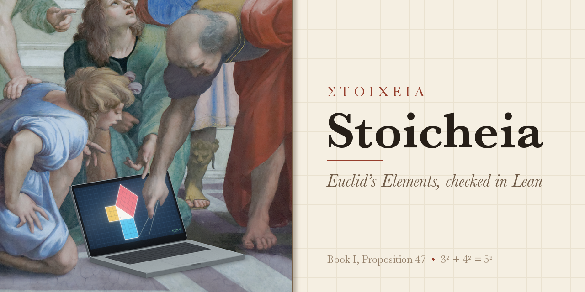

<p align="center">
  
</p>

# Stoicheia

*Euclid's Elements in Lean, sentence by sentence.*

Στοιχεῖα, *Stoicheia*, "Elements", is Euclid's title for the book that taught geometry for more than two thousand years. Abraham Lincoln, in the short autobiography he wrote in 1860, said of himself: "He studied and nearly mastered the Six-books of Euclid, since he was a member of Congress." This project carries the same book into [Lean](https://lean-lang.org), a programming language that checks mathematical proofs, so that Euclid's steps are checked by a machine that can't be talked into anything.

For every proposition of Books I to III you get:

- **Euclid's words**, in Sir Thomas Heath's 1908 translation (public domain).
- **Two figures**: one "at a glance", in the bold red, yellow and blue of Oliver Byrne's 1847 Euclid, to show the idea before you read a word; and Heath's figure, redrawn, to follow the proof by. Both carry Heath's letters, the names the Lean uses too, so you can pass from one to the other.
- **The proof in Lean**, written to follow Euclid sentence by sentence. Each of his sentences is a comment, and the Lean beneath carries it out, sometimes several sentences together. Where the Lean takes another step, or leaves a passage in Euclid's words with no Lean beneath it (as in I.4, III.16, III.25 and III.31), the page says so beside the listing; and III.24 follows a different argument altogether.
- **A certificate**, computed by Lean itself, of exactly what the proof rests on: which postulates, which common notions, and which of the many things Euclid takes for granted without saying so.
- **A mishnah**: commentary on what Euclid assumed, what Lean made us say out loud, and how the same result looks with modern tools.

The proofs use no coordinates, real numbers or complex numbers; only the last paragraph of each commentary, "The modern way", reaches for them. The geometry is the geometry Euclid wrote, the kind Lincoln would recognise. Lengths, angles and areas are *magnitudes*, which can be added and compared and nothing more, just as in the *Elements*.

## Where things stand

| | |
|---|---|
| **Book I** | <!-- scope:I -->**All 48 propositions proved in Lean**, every one as Euclid states it. 46 proofs follow Euclid's argument and 2 follow it with one step changed ([I.39](book/I/39.md), [I.40](book/I/40.md)); each page says how. In [I.23](book/I/23.md) one of our tacit rules already contains the proposition, and our proof rests on it, so the proof retraces Euclid's argument within our rules and does not establish the rule. In [I.2](book/I/02.md), [I.3](book/I/03.md) and [I.7](book/I/07.md) our tacit rules contain the propositions too, but our proofs never use those rules. [The overlap catalogue](docs/reports/overlaps.md) gives each. Our proofs of 29 propositions do not use the parallel postulate: I.1–I.28 and I.31. The first proof that does is I.29's, just where Euclid first calls on it.<!-- /scope:I --> [Read Book I →](book/I/index.md) |
| **Book II** | <!-- scope:II -->**All 14 propositions proved in Lean**, every one as Euclid states it. Every proof follows Euclid's argument, and each page notes where the Lean departs from his sentences. Every proof uses the parallel postulate: II.10's directly, where Euclid calls on it, and the others through the propositions they cite.<!-- /scope:II --> "The rectangle contained by AB, BC" and "the square on AB" are areas in our foundations, defined rather than assumed, and a rectangle drawn in a figure is proved equal to the rectangle contained by its sides. [Read Book II →](book/II/index.md) |
| **Book III** | <!-- scope:III -->**All 37 propositions proved in Lean**: 28 as Euclid states them, 6 for a restricted statement ([III.7](book/III/07.md), [III.8](book/III/08.md), [III.14](book/III/14.md), [III.15](book/III/15.md), [III.17](book/III/17.md), [III.25](book/III/25.md)) and 3 in part, leaving clauses to Euclid's words ([III.16](book/III/16.md), [III.24](book/III/24.md), [III.31](book/III/31.md)). 29 proofs follow Euclid's argument, 7 follow it with one step changed ([III.5](book/III/05.md), [III.6](book/III/06.md), [III.8](book/III/08.md), [III.21](book/III/21.md), [III.26](book/III/26.md), [III.27](book/III/27.md), [III.29](book/III/29.md)) and 1 argues differently ([III.24](book/III/24.md)); each page says how. In [III.2](book/III/02.md), [III.5](book/III/05.md) and [III.6](book/III/06.md) our tacit rules already contain the proposition (in III.6, two of them together), and our proofs rest on them, so each retraces Euclid's argument within our rules and does not establish them. [The overlap catalogue](docs/reports/overlaps.md) gives each. Our proofs of 17 propositions do not use the parallel postulate: III.1–III.13 and III.16–III.19. The first proof that does is III.14's.<!-- /scope:III --> Equal circles, a straight line touching a circle and circles touching one another are defined in Lean, not assumed, and a circumference is measured by twice the angle standing on it, a measure with no radius in it. So, as stated, III.26 and III.27 hold in any two circles, and III.24 shows equal measures rather than one segment laid on the other; arcs get a meaning of their own in a later stage. [Book III's introduction](book/III/index.md) tells how. [Read Book III →](book/III/index.md) |
| Books IV–XIII | To come, one book at a time. |

The [certificate](CERTIFICATE.md) is regenerated from the proofs on every change, and so is the [graph of who uses whom](GRAPH.md), drawn from Heath's references and from the Lean's own.

## Read it

Start with [the definitions, postulates and common notions](book/I/front.md), then [Proposition 1](book/I/01.md). Every page of Books I to III reads the same way: Euclid's statement, with a line saying what the Lean statement covers; his figure; his proof; then the Lean, what it rests on, and the mishnah.

Here is the heart of I.1. Euclid's sentences are the comments:

```lean
  -- With centre A and distance AB let the circle BCD be described; [Post. 3]
  obtain ⟨BCD, hA_BCD, hB_BCD⟩ := Postulate3 A B hAB
  -- again, with centre B and distance BA let the circle ACE be described; [Post. 3]
  obtain ⟨ACE, hB_ACE, hA_ACE⟩ := Postulate3 B A hAB.symm
  -- and from the point C, in which the circles cut one another, …
  have hmeet := circles_meet hB_BCD (centre_inside hA_BCD) (centre_inside hB_ACE) hA_ACE
  -- …
  -- Now, since the point A is the centre of the circle CDB,
  -- AC is equal to AB. [Def. 15]
  have hAC : ‖A C‖ = ‖A B‖ := Definition15 hA_BCD hC_BCD hB_BCD
```

That `circles_meet` is a step Euclid never justifies. Heath: "It is a commonplace that Euclid has no right to assume, without premising some postulate, that the two circles *will* meet in a point C." In our foundations it has to be a named rule, and so it appears on I.1's page, under "What it rests on".

To read further, a page may end with a line or three chosen for its proposition, and [the reading list](docs/reading.md) gathers books, papers and a few web pages by theme, from Proclus and Hilbert to Lean, marking the ones free online.

## What Euclid takes for granted

The foundations are in [`Elements/Foundations/`](Elements/Foundations):

- [**Postulates**](Elements/Foundations/Postulates.lean): Euclid's five, each a Lean `axiom`.
- [**Common Notions**](Elements/Foundations/CommonNotions.lean): all five turn out to be *theorems*, once we state how magnitudes add and compare.
- [**Definitions**](Elements/Foundations/Definitions.lean): the ones that do work in the proofs. Definition I.15 (all radii of a circle are equal) is really an axiom, and is treated as one. [Book II's](Elements/Foundations/DefinitionsII.lean) are the rectangle contained by two straight lines and the square on one, defined, not assumed; [Book III's](Elements/Foundations/DefinitionsIII.lean) are equal circles, touching, and a circumference measured by twice the angle that stands on it at the circumference.
- [**Tacit rules**](Elements/Foundations/Tacit): what Euclid reads off his figures without saying so, and how magnitudes add and compare. That a point lies between two others, that a line through the inside of a circle must cut it, that two triangles which match in every side and angle have the same area. Most follow, rule by rule, the System E of Jeremy Avigad, Edward Dean and John Mumma, which was designed to capture exactly how Euclid reasons from a diagram; the laws of magnitude are its §3.5, and superposition takes LeanEuclid's form.

Because every assumption is a Lean `axiom`, `#print axioms` lists exactly what a proof rests on, and [`Certificate/Facts.lean`](Certificate/Facts.lean) turns that into the certificate. One famous question has a mechanical answer: whether our proof of a proposition uses the parallel postulate. CI fails if any proof before I.29 does. Whether some other proof could do without it is a different question, which the certificate does not answer.

Proposition by proposition, the steps Euclid takes without a word, and the rule or lemma that fills each one, are gathered in catalogues for [Book I](docs/reports/gaps-book-I.md), [Book II](docs/reports/gaps-book-II.md) and [Book III](docs/reports/gaps-book-III.md), with the names of those who noticed them first, where we know.

## What the checks show

Each check answers one question and leaves others open. Here is what each one shows, and what it does not.

| Evidence | What it shows | What it does not show |
|---|---|---|
| **Lean's kernel accepts the proof** (`lake build`) | The Lean statement follows, by steps the kernel has checked, from the axioms the proof rests on | That the statement says what Euclid says, or that the axioms are true of the plane |
| **No `sorryAx`** in anything a proof rests on, as each ✅ on the [certificate](CERTIFICATE.md) says | Nothing was left unproved, in the proof or in anything it cites; and each proposition's page lists every axiom it rests on | That no other proof could rest on fewer: "this proof uses Postulate 5" is not "this proposition needs it" |
| **The fidelity check** (`scripts/check_fidelity.py`) | Each enunciation, and each sentence of Euclid's proofs, stands in the Lean word for word and in order, as Heath has them; and the house rules hold: no axiom outside the foundations, each axiom, and each definition the statements use, as [`Certificate/axioms.lock`](Certificate/axioms.lock) records it, superposition only in I.4 and I.8, Postulate 5 in no proof before I.29, and no proof citing a later proposition | That the Lean beneath a sentence does what the sentence says: it checks wording, not meaning; nor that no proof rests on a rule containing a later proposition: the [overlap catalogue](docs/reports/overlaps.md) lists where one does |
| **The review records** ([`review/`](review)) | Claude has read each Lean statement against Euclid's enunciation and recorded every departure (its scope, route, representation and any passage not plainly carried), tied to the commit read; each record names its reviewer, and CI flags a record whose statement or Lean has changed since | A machine check of meaning: a record is a careful reader's judgment, and a reader can be wrong. A full review of every passage, and one by a reviewer other than the authors, are to come |
| **The negative tests** (`scripts/negative_tests.py`) | Each of the checks above fails when a fault of its kind is planted on purpose: an edited Heath word, a wrong step, a `sorry` in a complete book, a `native_decide`, a weakened axiom, a definition given another meaning, a primitive word no longer opaque, stale and incomplete review records, and Postulate 5, superposition, a later citation or a new axiom slipped into an early proof or porism | That no fault of another kind could slip past; the style and link checks, the pages' freshness and the audit lemmas have no planted fault yet |
| **The numerical model tests** ([`tests/model/`](tests/model)) | In the ordinary plane, no configuration tested breaks any axiom, and each of 15 axioms deliberately made false is caught, so the search can find counterexamples of those kinds | That no configuration anywhere breaks one |
| **The hyperbolic check** ([`tests/model/hyperbolic.py`](tests/model/hyperbolic.py)) | Every axiom but Postulate 5 holds, numerically, in the hyperbolic plane, and Postulate 5 fails there | That the other axioms provably cannot give Postulate 5: it is numerical evidence, not a proof |
| **The model argument** ([`tests/model/MODEL.md`](tests/model/MODEL.md)) | An argument, law by law, that every axiom holds in the ordinary plane, degenerate cases included; if it is right, the axioms cannot contradict one another unless the real numbers do | A checked proof: readers must follow it for themselves |
| **The overlap audit** (`lake build Audit`) | Each overlap in the [catalogue](docs/reports/overlaps.md) is real: the proposition is proved from the rules named, with the axioms Lean reports pinned | That there are no other overlaps |
| **A formal model** (to come) | Would prove in Lean, in a separate package, that the exact axioms of the lock hold in a model of the plane, so that any change to an axiom breaks the model's proof | Nothing yet: it is a later milestone |

Each proposition's page shows, under Euclid's enunciation, what its Lean statement covers and whose argument its proof follows, from its review record.

## Run it

1. Install Lean: the easiest route is VS Code with the **Lean 4** extension, or `curl https://elan.lean-lang.org/elan-init.sh -sSf | sh`. The `lean-toolchain` file pins Lean 4.35.0. The checks and pages need Python 3.11 or later, and nothing else.
2. Check every proof:
   ```sh
   lake build
   ```
3. Rebuild the certificate and the pages, and check that the Lean still quotes Heath word for word:
   ```sh
   lake env lean Certificate/Facts.lean
   python3 scripts/check_fidelity.py
   python3 scripts/render.py
   ```
4. Run the other checks behind [What the checks show](#what-the-checks-show). The negative
   tests break files on purpose and put them back, so run them on a clean checkout:
   ```sh
   lake build Audit
   python3 scripts/check_style.py
   python3 scripts/check_links.py
   python3 scripts/negative_tests.py
   python3 -I tests/model/run.py --fast
   ```

**Try breaking it.** In [`Prop01.lean`](Elements/BookI/Prop01.lean), change `Definition15 hA_BCD hC_BCD hB_BCD` to `Definition15 hB_ACE hC_ACE hA_ACE` and run `lake build`. Lean refuses: B is the centre of the other circle, so the radii it gives are the wrong ones.

## How it's built

| Where | What |
|---|---|
| [`heath/`](heath) | Heath's translation, transcribed from the 1908 scans and checked against the page images |
| [`Elements/Foundations/`](Elements/Foundations) | Postulates, common notions, definitions, tacit rules |
| [`Elements/Figure/`](Elements/Figure) | "Book Zero": small facts every figure needs, proved once |
| [`Elements/BookI/`](Elements/BookI), [`Elements/BookII/`](Elements/BookII), [`Elements/BookIII/`](Elements/BookIII) | One file per proposition; Book II's shared ground, rectangles and squares from Book I, is in [`Rectangles.lean`](Elements/BookII/Rectangles.lean), and Book III's in [`Squares.lean`](Elements/BookIII/Squares.lean) and [`Circumferences.lean`](Elements/BookIII/Circumferences.lean) |
| [`mishnah/`](mishnah) | The commentary, and each book's introduction (`mishnah/intro/`), shown on its index page |
| [`figures/`](figures) | The figures: the "at a glance" figures in Byrne's colours, and Heath's, redrawn; both carry his letters |
| [`Certificate/`](Certificate) | [`Facts.lean`](Certificate/Facts.lean), which computes the certificate from the proofs, and [`axioms.lock`](Certificate/axioms.lock), the exact statement of every axiom and of every definition the axioms and the propositions are stated in; CI fails if one differs from the lock |
| [`review/`](review) | A review record for each proposition: what its Lean statement covers of Euclid's enunciation, whose argument the proof follows, how it represents his objects, and the commit the reviewer read ([the schema](review/SCHEMA.md)) |
| [`Audit/`](Audit) | Audit lemmas, which no proof imports: each proposition that our axioms already contain, proved from the rules that contain it; III.5, with "cut" read as crossing, proved without them; and III.24, III.26 and III.27 proved without the hypotheses our measure of circumferences leaves idle, as the [overlap catalogue](docs/reports/overlaps.md) lists |
| [`Staging/`](Staging), [`Staging.lean`](Staging.lean) | Statements that a stage adds or changes, until they move to `Elements/`, each with its proof or with `sorry` where its proof is due; nothing in the edition imports them, so no proof rests on them |
| [`tests/model/`](tests/model) | The model tests: the axioms checked numerically in the ordinary plane, with their seeds, mutations and results, and [`MODEL.md`](tests/model/MODEL.md), the argument law by law |
| [`book/`](book), [`CERTIFICATE.md`](CERTIFICATE.md), [`GRAPH.md`](GRAPH.md) | Generated pages; don't edit by hand |
| [`docs/`](docs) | The [plan](docs/briefs/0001-plan.md) the project started from, the catalogues of what Euclid takes for granted in [Book I](docs/reports/gaps-book-I.md), [Book II](docs/reports/gaps-book-II.md) and [Book III](docs/reports/gaps-book-III.md), the [logs](docs/reports/crew), and notes on [earlier work](docs/reports/0001-prior-art.md) |

A Lean proof needs only the *statements* of the propositions it cites, not their proofs. So once a book's statements are written, its propositions can be proved in any order, and many at once.

## Join in

Books I to III are proved, and Book IV, of figures inscribed in and circumscribed about circles, is next: once its statements are in Lean, pick any 🚧 proposition and prove it. There is plenty to do in [Book I](book/I/index.md), [Book II](book/II/index.md) and [Book III](book/III/index.md) as well: read a page and tell us where it could be clearer, check a quotation against Heath's scans, or improve a figure or a proof. [CONTRIBUTING.md](CONTRIBUTING.md) explains the few house rules.

## How it was made

Stoicheia is Jack Challis's project, built with Claude (Anthropic's AI) working as a crew of agents. A captain plans and merges; first mates prepare each stretch, writing the statements and testing them; sailors prove each proposition, in parallel; bosuns and first mates merge their work and review it for faithfulness to Euclid; artists drew the at-a-glance figures in Byrne's colours; inspectors audited Book I for consistency. From the third voyage OpenAI's Codex joined the crew: Codex sailors proved I.26, I.28, I.30, I.32, all of I.33–I.48 and all of Books II and III, some of them from scratch proofs Claude's first mates had written to test the statements; they drew Euclid's figure for each and wrote the first draft of its mishnah, and Claude's bosuns, first mates and captains reviewed and edited their work. Early planning also drew on conversations with ChatGPT. The crew's logs are in [docs/reports/crew](docs/reports/crew). In October 2026 Astra, an OpenAI model run in ChatGPT, read the whole work cold and wrote a careful outside review; we are very grateful, and [our response](docs/reports/outside-review-01.md) says what we are doing with it.

Lean's kernel checks every proof, and CI checks that every proof still quotes Heath word for word. Beyond that, three things rest on review rather than on a machine: the assumptions, which are all listed; whether each Lean statement says what Euclid says; and whether the Lean under each of his sentences does what it says. Each page says where either falls short of his. Every quotation in the commentary was checked against the scanned 1908 text, and [What the checks show](#what-the-checks-show) says what each kind of check establishes.

## Standing on shoulders

This project is a love letter to a long line of people who have read Euclid carefully, and it leans on all of them.

- **The text.** Euclid, of course. J. L. Heiberg, whose Greek text Heath translated. Sir Thomas L. Heath, whose 1908 translation and notes are the backbone of every page here. Proclus, whose commentary on Book I is still the first place to look, and Thomas Taylor, who translated it in 1788–89. Robert Simson, whose 1756 *Elements* Heath quotes again and again, and whose added sentence in I.24 our mishnah on that proposition builds on. John Casey, whose 1885 *First Six Books* is lovingly kept on Project Gutenberg, and Oliver Byrne, whose 1847 Euclid in colour is one of the most beautiful books ever printed; our "at a glance" figures borrow his palette and his idea that a picture can carry a proof's meaning before any letters do.
- **Readers' editions today.** David E. Joyce's [online *Elements*](https://mathcs.clarku.edu/~djoyce/elements/elements.html) and Richard Fitzpatrick's Greek–English edition, both wonderful companions.
- **The foundations of geometry.** David Hilbert and Alfred Tarski, who showed how to fill Euclid's gaps, and Robin Hartshorne, whose *Geometry: Euclid and Beyond* explains it all with great clarity. Above all, Jeremy Avigad, Edward Dean and John Mumma, whose System E is the source of our tacit rules.
- **Euclid in proof assistants.** Michael Beeson, Julien Narboux and Freek Wiedijk, whose [*Proof-checking Euclid*](https://arxiv.org/abs/1710.00787) worked through all of Book I in Coq and HOL Light, together with the [GeoCoq](https://github.com/GeoCoq/GeoCoq) team. Logan Murphy, Kaiyu Yang, Jialiang Sun, Zhaoyu Li, Anima Anandkumar and Xujie Si, whose [LeanEuclid](https://github.com/loganrjmurphy/LeanEuclid) brought System E to Lean. We kept their careful rendering of the rules open beside the paper the whole time, and borrowed their corrections and their form of superposition (see [NOTICE](NOTICE)). André Hernández-Espiet and Alex Kontorovich, whose [synthetic_euclid_4](https://github.com/ah1112/synthetic_euclid_4) proves all of Book I in Lean 4 with every diagram step spelled out. Ariel Kellison, Mark Bickford and Robert Constable, whose [*Implementing Euclid's straightedge and compass constructions in type theory*](https://doi.org/10.1007/s10472-018-9603-0) builds Euclid's constructions in the intuitionistic type theory of the Nuprl proof assistant, and from it proves I.2 in its full generality. Tadd Mao, Tianjun Zhong, Dhruva Arekar, Yuming Feng, One An, Jiani Huang, Xujie Si and Ziyang Li, whose [*Does the Proof Prove It That Way?*](https://arxiv.org/abs/2608.15432) asks exactly the question this project cares about: whether a formal proof follows Euclid's own argument.
- **Lean.** Leonardo de Moura, Sebastian Ullrich, the Lean FRO and the whole Lean community. Patrick Massot's [leanblueprint](https://github.com/PatrickMassot/leanblueprint) and the Lean FRO's [Verso](https://github.com/leanprover/verso), by David Thrane Christiansen, showed us mathematics written out in prose beside its Lean, and inspired the way these pages are laid out.
- **The keepers of the books.** The Internet Archive, Google Books and Stanford University Libraries, whose copies of Heath we read from; Cornell University Library, whose scans of Casey are the ones Project Gutenberg's edition was made from; Project Gutenberg and its Distributed Proofreaders, among them Joshua Hutchinson and Keith Edkins, who prepared that Casey, and Richard Tonsing, who revised it; the Perseus Digital Library.
- **The logo.** Raphael's *School of Athens* (1509–1511), in Marie-Lan Nguyen's photograph on Wikimedia Commons. Euclid's slate has become a laptop, and he is drawing I.47. See [assets/CREDITS.md](assets/CREDITS.md).

Full references are in [docs/references.bib](docs/references.bib).

## License

The Lean code and scripts are under the [Apache License 2.0](LICENSE). Our own prose and figures are under [CC BY 4.0](LICENSE-PROSE.md): `mishnah/`, `reading/`, `figures/`, `docs/`, our parts of `assets/`, the README, CONTRIBUTING, and the pages under `book/` apart from Heath's text and the Lean. Heath's 1908 translation and Euclid himself are in the public domain. Anyone may use any of it; we'd love to hear if you do.
