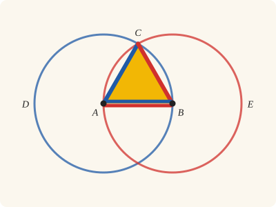
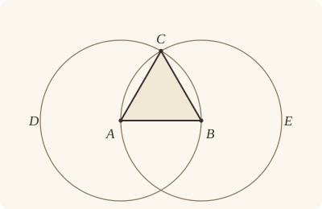
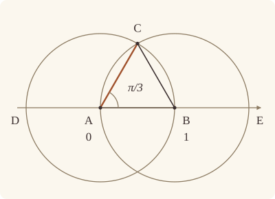

<!-- Generated by scripts/render.py. Do not edit by hand. -->

[Book I](index.md) · [I.2 →](02.md)

# Book I, Proposition 1

*An equilateral triangle on a given straight line*

[Euclid's proof](#euclids-proof) · [In Lean](#in-lean) · [What it rests on](#what-it-rests-on) · [Mishnah](#mishnah)

> On a given finite straight line to construct an equilateral triangle.

**In Lean:** ✅ proved, as Euclid states it · Euclid's argument

<p align="center"></p>

<p align="center"><em>Each side of the triangle is a radius of the circle in its colour (blue, red), and the base, drawn in both colours, is a radius of both. So all three sides are equal.</em></p>

## Euclid's proof

<p align="center"></p>

Let AB be the given finite straight line.

Thus it is required to construct an equilateral triangle on the straight line AB.

With centre A and distance AB let the circle BCD be described; [Post. 3]

again, with centre B and distance BA let the circle ACE be described; [Post. 3]

and from the point C, in which the circles cut one another, to the points A, B let the straight lines CA, CB be joined. [Post. 1]

Now, since the point A is the centre of the circle CDB,

AC is equal to AB. [Def. 15]

Again, since the point B is the centre of the circle CAE,

BC is equal to BA. [Def. 15]

But CA was also proved equal to AB;

therefore each of the straight lines CA, CB is equal to AB.

And things which are equal to the same thing are also equal to one another; [C.N. 1]

therefore CA is also equal to CB.

Therefore the three straight lines CA, AB, BC are equal to one another.

Therefore the triangle ABC is equilateral; and it has been constructed on the given finite straight line AB.

(Being) what it was required to do.

## In Lean

| | |
|---|---|
| Proof | ✅ Proved |
| Statement | The whole enunciation. The triangle may be put on the side of AB where a given point P lies, when P is off AB: a little more than Euclid asks, used in I.9 and I.11. |
| Argument | Euclid's. |
| Reviewed | The statement and every passage of the argument read against Heath's text, at commit [`b18bca18`](https://github.com/jackChallis/stoicheia/commit/b18bca18) ([the record](../../review/I/01.toml)) |

From [`Elements/BookI/Prop01.lean`](../../Elements/BookI/Prop01.lean). Euclid's sentences are the `--` comments, and our own notes are in `/- … -/`; the lines under each sentence are the Lean that carries it out. The list below marks where a lemma does a step Euclid takes for granted; the `/- … -/` notes in the listing explain smaller adjustments.

**How the Lean follows the text**

- **Done by `Tacit.circles_meet`.** "and from the point C…" Euclid takes C where the circles cut one another; the Lean uses `Tacit.circles_meet`, a tacit rule we assume in our foundations (System E, Intersection 5), since each circle passes through the other's centre and each centre lies inside its own circle. The Lean chooses C on P's side when P is off AB using `Tacit.circles_meet_same_side`, the rule for crossings on each side (System E, Intersections 8), and uses C without drawing CA and CB.
- **Done by `Prop1.figure`.** "Therefore the triangle ABC is equilateral…" Euclid takes ABC to be a triangle once its sides are equal. `Prop1.figure` proves that C is off AB, since three distinct points on one straight line with all three distances equal would make a nonzero length equal to itself taken twice.

<details><summary>Before the theorem, one lemma: <code>Prop1.figure</code> (23 lines)</summary>

```lean
/-- What Euclid sees in the figure but never says: the point C, being as far
from A and from B as they are from each other, is not on the straight line
AB. So ABC really is a triangle. -/
theorem Prop1.figure {A B C : Point} (hAB : A ≠ B) (hCA : ‖C A‖ = ‖A B‖)
    (hCB : ‖C B‖ = ‖A B‖) : Triangle A B C := by
  rintro ⟨L, hA, hB, hC⟩
  have hne : ‖A B‖ ≠ 0 := len_ne_zero hAB
  have hAC : ‖A C‖ = ‖A B‖ := (len_symm A C).trans hCA
  have hBC : ‖B C‖ = ‖A B‖ := (len_symm B C).trans hCB
  have hCA' : C ≠ A := fun h => hne (by rw [← hCA, h, len_self])
  have hCB' : C ≠ B := fun h => hne (by rw [← hCB, h, len_self])
  /- On one straight line, one of the three points would lie between the other two,
     and then a length would equal itself taken twice. -/
  rcases between_cases hAB hCB'.symm hCA'.symm hA hB hC with h | h | h
  · have := len_add_of_between h
    rw [hBC, hAC] at this
    exact Magnitude.add_self_ne hne this
  · have := len_add_of_between h
    rw [len_symm B A, hAC, hBC] at this
    exact Magnitude.add_self_ne hne this
  · have := len_add_of_between h
    rw [hAC, hCB] at this
    exact Magnitude.add_self_ne hne this
```

</details>

```lean
/-- On a given finite straight line to construct an equilateral triangle. -/
theorem Prop1 (A B : Point) (hAB : A ≠ B) (P : Point) :
    ∃ C : Point, Equilateral A B C ∧ (¬ Collinear A B P → SameSideOf C P A B) := by
  -- Let AB be the given finite straight line.
  -- Thus it is required to construct an equilateral triangle on the straight line AB.
  -- With centre A and distance AB let the circle BCD be described; [Post. 3]
  obtain ⟨BCD, hA_BCD, hB_BCD⟩ := Postulate3 A B hAB
  -- again, with centre B and distance BA let the circle ACE be described; [Post. 3]
  obtain ⟨ACE, hB_ACE, hA_ACE⟩ := Postulate3 B A hAB.symm
  -- and from the point C, in which the circles cut one another, to the points A, B let the
  -- straight lines CA, CB be joined. [Post. 1]
  /- Euclid never says why the circles cut one another. Each passes through the
     other's centre, and a centre lies inside its circle, so they must cross
     (System E, Intersection 5). They cross on both sides of AB, so C may
     be taken on whichever side we please: on P's side, when P is off AB
     (System E, Intersections 8). Our proof uses only the point C; the
     straight lines CA, CB are drawn for the eye. -/
  have hmeet := circles_meet hB_BCD (centre_inside hA_BCD) (centre_inside hB_ACE) hA_ACE
  obtain ⟨C, hC_BCD, hC_ACE, hside⟩ : ∃ C : Point, OnCircle C BCD ∧ OnCircle C ACE ∧
      (¬ Collinear A B P → SameSideOf C P A B) := by
    by_cases hP : Collinear A B P
    · obtain ⟨C, -, -, hC_BCD, hC_ACE, -⟩ := hmeet
      exact ⟨C, hC_BCD, hC_ACE, fun h => absurd hP h⟩
    · obtain ⟨AB, hA_AB, hB_AB⟩ := Postulate1 A B hAB
      obtain ⟨C, hC_BCD, hC_ACE, hCP⟩ :=
        circles_meet_same_side hmeet hA_BCD hB_ACE hA_AB hB_AB (Triangle.off_line hP hA_AB hB_AB)
      exact ⟨C, hC_BCD, hC_ACE, fun _ => SameSideOf.of_line hAB hA_AB hB_AB hCP⟩
  -- Now, since the point A is the centre of the circle CDB,
  -- AC is equal to AB. [Def. 15]
  have hAC : ‖A C‖ = ‖A B‖ := Definition15 hA_BCD hC_BCD hB_BCD
  -- Again, since the point B is the centre of the circle CAE,
  -- BC is equal to BA. [Def. 15]
  have hBC : ‖B C‖ = ‖B A‖ := Definition15 hB_ACE hC_ACE hA_ACE
  -- But CA was also proved equal to AB;
  have hCA : ‖C A‖ = ‖A B‖ := (len_symm C A).trans hAC
  -- therefore each of the straight lines CA, CB is equal to AB.
  have hCB : ‖C B‖ = ‖A B‖ := (len_symm C B).trans (hBC.trans (len_symm B A))
  -- And things which are equal to the same thing are also equal to one another; [C.N. 1]
  -- therefore CA is also equal to CB.
  have hCA_CB : ‖C A‖ = ‖C B‖ := CommonNotion1 hCA hCB
  -- Therefore the three straight lines CA, AB, BC are equal to one another.
  have hAB_BC : ‖A B‖ = ‖B C‖ := (hBC.trans (len_symm B A)).symm
  have hBC_CA : ‖B C‖ = ‖C A‖ := (len_symm B C).trans (hCA_CB.symm)
  -- Therefore the triangle ABC is equilateral; and it has been constructed on the given finite
  -- straight line AB.
  exact ⟨C, ⟨Prop1.figure hAB hCA hCB, hAB_BC, hBC_CA⟩, hside⟩
  -- (Being) what it was required to do.
```

## What it rests on

| | |
|---|---|
| Heath's references | Post. 1, 3; Def. I.15; C.N. 1 |
| Lean cites | no propositions |
| Postulates | 1, 3 |
| Definitions taken as axioms | Def. I.15 |
| Common Notions | 1, 5 |
| Tacit rules | 19 (listed below) |
| Its own Lean calls | Postulates 1 and 3; Def. I.15; 6 tacit rules |
| Through lemmas | 11 tacit rules |

_Postulates, definitions, Common Notions and tacit rules: all that this proof rests on, counting those of the propositions it cites. The last two rows say which of the postulates, definitions and tacit rules its own Lean calls, in the proof or a helper written for it, and which it does not call but reaches through lemmas, of Book Zero or shared (a proposition it cites may rest on these too); the rest come in only through the propositions it cites or the Common Notions._

<details><summary>The 19 tacit rules beneath this proof</summary>

_(used here) marks a rule this proof's own Lean calls, in the proof or a helper written for it; (through …) marks one its own Lean does not call but reaches through the lemmas named, of [Book Zero](../../Elements/Figure) or shared; and a rule with no mark comes in only through a Common Notion. The names in brackets are System E's: an Intersection rule says when straight lines and circles must meet, and an Intersections rule takes a point where they do (see [Book I's introduction](index.md))._

**Reading the figure**

- [`between_cases`](../../Elements/Foundations/Tacit/Diagram.lean#L54) (used here): Of three different points on a straight line, one is between the other two. (Between 6)
- [`circles_meet`](../../Elements/Foundations/Tacit/Diagram.lean#L94) (used here): If each circle passes through a point inside the other, the circles cut one another. This is the step Euclid takes for granted in I.1. (Intersection 5)
- [`circles_meet_same_side`](../../Elements/Foundations/Tacit/Constructions.lean#L79) (used here): Two circles that cut one another do so on each side of the straight line through their centres. (Intersections 8)
- [`exists_point_inside_circle`](../../Elements/Foundations/Tacit/Constructions.lean#L42) (through [`Tacit.centre_inside`](../../Elements/Figure/RuleBase.lean#L56)): Let a point be taken inside the circle α. (Points 8)
- [`line_circle_between`](../../Elements/Foundations/Tacit/Constructions.lean#L67) (through [`Tacit.centre_inside`](../../Elements/Figure/RuleBase.lean#L56)): A straight line through a point B inside a circle, heading out to a point C outside it, cuts the circle between B and C. (Intersections 4)
- [`line_circle_beyond`](../../Elements/Foundations/Tacit/Constructions.lean#L73) (through [`Tacit.centre_inside`](../../Elements/Figure/RuleBase.lean#L56)): A straight line through a point B inside a circle, produced beyond B away from C, cuts the circle there. (Intersections 5)
- [`line_unique`](../../Elements/Foundations/Tacit/Diagram.lean#L41) (through [`SameSideOf.of_line`](../../Elements/Figure/Sides.lean#L34)): Two points determine a straight line. (Generalities 1)
- [`not_between_of_between`](../../Elements/Foundations/Tacit/Diagram.lean#L50) (through [`Tacit.centre_inside`](../../Elements/Figure/RuleBase.lean#L56)): If B is between A and C, then A is not between B and C. (Between 1)

**Lengths, angles and areas**

- [`len_add_of_between`](../../Elements/Foundations/Tacit/Transfer.lean#L27) (used here): If B is between A and C, then AB and BC together make up AC. (Diagram-segment 1)
- [`len_self`](../../Elements/Foundations/Tacit/Metric.lean#L24) (used here): The "straight line" from a point to itself has no length. (Metric 1)
- [`len_symm`](../../Elements/Foundations/Tacit/Metric.lean#L27) (used here): The straight line AB is the straight line BA. (Metric 3)
- [`radius_ne_zero`](../../Elements/Foundations/Tacit/Metric.lean#L62) (through [`Tacit.centre_inside`](../../Elements/Figure/RuleBase.lean#L56) and [`len_ne_zero`](../../Elements/Figure/Lengths.lean#L69)): A circle's radius is not nothing: the straight line from the centre to a point on the circle has some length. A rule of our own, not one of System E's: every circle is drawn with a centre and a distance (Postulate 3).

**Laws of magnitude**

- [`add_comm`](../../Elements/Foundations/Tacit/Magnitudes.lean#L26) (through [`Tacit.centre_inside`](../../Elements/Figure/RuleBase.lean#L56)): The order of adding does not matter. (System E §3.5)
- [`add_lt_add_right`](../../Elements/Foundations/Tacit/Magnitudes.lean#L45): Adding the same thing to both sides keeps "less than". (System E §3.5)
- [`add_zero`](../../Elements/Foundations/Tacit/Magnitudes.lean#L29): Adding nothing changes nothing. (System E §3.5)
- [`lt_irrefl`](../../Elements/Foundations/Tacit/Magnitudes.lean#L32) (through [`Magnitude.add_self_ne`](../../Elements/Figure/Lengths.lean#L35) and [`Tacit.centre_inside`](../../Elements/Figure/RuleBase.lean#L56)): No magnitude is less than itself. (System E §3.5)
- [`lt_trans`](../../Elements/Foundations/Tacit/Magnitudes.lean#L35) (through [`Tacit.centre_inside`](../../Elements/Figure/RuleBase.lean#L56)): What is less than the less is less still. (System E §3.5)
- [`lt_trichotomy`](../../Elements/Foundations/Tacit/Magnitudes.lean#L39) (through [`Magnitude.add_self_ne`](../../Elements/Figure/Lengths.lean#L35) and [`Tacit.centre_inside`](../../Elements/Figure/RuleBase.lean#L56)): Of two magnitudes, one is less, or they are equal, or the other is less. (System E §3.5)
- [`not_lt_zero`](../../Elements/Foundations/Tacit/Magnitudes.lean#L42) (through [`Magnitude.add_self_ne`](../../Elements/Figure/Lengths.lean#L35) and [`Tacit.centre_inside`](../../Elements/Figure/RuleBase.lean#L56)): Nothing is less than zero. (System E §3.5)

</details>

## Mishnah

_Our commentary: what Euclid assumes, what Lean made us say out loud, and how the result looks by modern means._

**Must the circles meet?** Euclid's very first step takes for granted something none of his postulates says: that the two circles cut one another. "It is a commonplace that Euclid has no right to assume, without premising some postulate, that the two circles *will* meet in a point C" (Heath, vol. 1, p. 242). We supply it as a named rule, [`circles_meet`](../../Elements/Foundations/Tacit/Diagram.lean), from System E, a modern list of the facts Euclid reads off his figures (its Intersection 5): if each circle passes through a point inside the other, they cross. Here each passes through the other's centre.

**Could AC and BC run together?** Heath recalls Zeno's remark "that the problem is not solved unless it is taken for granted that two straight lines cannot have a common segment" (vol. 1, p. 242): AC and BC might meet short of C and run on together, and the triangle would not be equilateral. Heath's answer is Postulate 2. Our proof never meets the worry, since it uses only the point C, not the straight lines CA, CB that Euclid joins. Zeno's other doubt, that the two circumferences might have a common part, waits for III.10; meanwhile "it is enough for the purpose of this proposition if *one* equilateral triangle can be found with the given base" (Heath, vol. 1, p. 243).

**Is ABC a triangle, and on which side?** Euclid never says that C is off the straight line AB, though only that makes ABC a triangle. Lean wants it said, so `Prop1.figure` proves it: were C on AB, one of the three points would lie between the other two, and some length would equal itself taken twice, which Common Notion 5, the whole greater than the part, forbids. The circles cross on both sides of AB, and I.9 and I.11 need a particular side, so our I.1 lets the side be named. That means naming the straight line AB, by Postulate 1, and calling on the rule that the circles cross on each side of it (System E, Intersections 8).

**The modern way.** Put $\mathrm{A} = 0$ and $\mathrm{B} = 1$ in the complex plane, and $\mathrm{C} = \frac{1}{2} + \frac{\sqrt{3}}{2}i = e^{i\pi/3}$, the point reached by turning AB through $\pi/3$. Everything turns on that $\sqrt{3}$. In the plane of points with rational coordinates all five of Euclid's postulates hold, yet the two circles of I.1 slip past each other without meeting, as Robin Hartshorne's *Geometry: Euclid and Beyond* explains. So the tacit rule is doing real work: it says the plane has the square roots that ruler and compass need.

<p align="center"></p>

## Further reading

- Tristan Needham's [*Visual Complex Analysis*](https://doi.org/10.1093/oso/9780192868916.001.0001) (2023) explains complex numbers almost entirely in pictures, and its ch. 1, "Geometry and Complex Arithmetic", shows why turning AB through π/3 takes a single multiplication.
- Robin Hartshorne's [*Geometry: Euclid and Beyond*](https://doi.org/10.1007/978-0-387-22676-7) (2000), written to be read alongside the *Elements*, is where the modern way above finds the plane of rational points, in which the two circles of I.1 slip past each other.
- Our figures at a glance take their colours from Oliver Byrne's edition of 1847, which Nicholas Rougeux has rebuilt for the web, with interactive figures, as [*Byrne's Euclid*](https://www.c82.net/euclid/) (2018, free online).

[Book I](index.md) · [I.2 →](02.md)

---

<sub>Euclid's text: T. L. Heath, *The Thirteen Books of Euclid's Elements*, vol. 1 (Cambridge, 1908), pp. 241–242; [scan leaves n261–n262](https://archive.org/details/thirteenbookseu02heibgoog/page/n261); [figure on n261](https://archive.org/details/thirteenbookseu02heibgoog/page/n261). Public domain.</sub>

<sub>The tacit rules follow the System E of Jeremy Avigad, Edward Dean and John Mumma, read alongside LeanEuclid (Logan Murphy, Kaiyu Yang, Jialiang Sun, Zhaoyu Li, Anima Anandkumar and Xujie Si).</sub>
