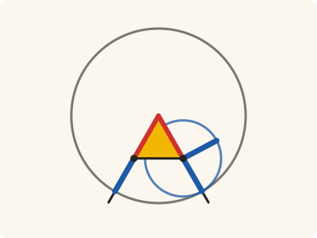
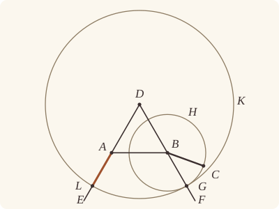
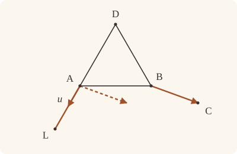

<!-- Generated by scripts/render.py. Do not edit by hand. -->

[Book I](index.md) · [← I.1](01.md) · [I.3 →](03.md)

# Book I, Proposition 2

*A straight line equal to a given one, placed at a given point*

[Euclid's proof](#euclids-proof) · [In Lean](#in-lean) · [What it rests on](#what-it-rests-on) · [Mishnah](#mishnah)

> To place at a given point (as an extremity) a straight line equal to a given straight line.

**In Lean:** ✅ proved, as Euclid states it · Euclid's argument

<p align="center"></p>

<p align="center"><em>The small circle turns the given straight line BC (blue) into BG, running on from one red side; the big circle carries it round to the given point A, as AL (blue). The red sides are equal, so the blue pieces beyond them are equal.</em></p>

## Euclid's proof

<p align="center"></p>

<p align="center"><em>Drawn for one case: A apart from B, as in Heath's figure.</em></p>

Let A be the given point, and BC the given straight line.

Thus it is required to place at the point A (as an extremity) a straight line equal to the given straight line BC.

From the point A to the point B let the straight line AB be joined; [Post. 1]

and on it let the equilateral triangle DAB be constructed. [I. 1]

Let the straight lines AE, BF be produced in a straight line with DA, DB; [Post. 2]

with centre B and distance BC let the circle CGH be described; [Post. 3]

and again, with centre D and distance DG let the circle GKL be described. [Post. 3]

Then, since the point B is the centre of the circle CGH,

BC is equal to BG.

Again, since the point D is the centre of the circle GKL,

DL is equal to DG.

And in these DA is equal to DB;

therefore the remainder AL is equal to the remainder BG. [C.N. 3]

But BC was also proved equal to BG;

therefore each of the straight lines AL, BC is equal to BG.

And things which are equal to the same thing are also equal to one another; [C.N. 1]

therefore AL is also equal to BC.

Therefore at the given point A the straight line AL is placed equal to the given straight line BC.

(Being) what it was required to do.

## In Lean

| | |
|---|---|
| Proof | ✅ Proved |
| Statement | The whole enunciation. Proved wherever the point A lies; when A is B itself, BC already serves. |
| Argument | Euclid's. |
| Reviewed | The statement and every passage of the argument read against Heath's text, at commit [`20d14b0a3`](https://github.com/jackChallis/stoicheia/commit/20d14b0a3) ([the record](../../review/I/02.toml)) |

From [`Elements/BookI/Prop02.lean`](../../Elements/BookI/Prop02.lean). Euclid's sentences are the `--` comments, and our own notes are in `/- … -/`; the lines under each sentence are the Lean that carries it out. The list below marks where a lemma does a step Euclid takes for granted, where the Lean takes a case Euclid's figure leaves aside and where the statement already gives a step; the `/- … -/` notes in the listing explain smaller adjustments.

**How the Lean follows the text**

- **A further case.** "Let A be the given point…" Euclid's construction takes A apart from B. Before the setting-out, the Lean also settles A at B itself, taking C as the other end of the required straight line.
- **Already given.** "From the point A to the point B let the straight line AB be joined…" The finite straight line AB is named by its two ends. The Lean passes A and B directly to `Prop1`, so no separate straight line is drawn here.
- **Already given.** "Let the straight lines AE, BF be produced in a straight line with DA, DB…" Our straight lines DA and DB are whole lines already, so nothing is produced and Postulate 2 is not used: G and L are where they meet the circles beyond B and A (System E, Intersections 5).
- **Done by `Tacit.line_circle_beyond`.** "with centre B and distance BC let the circle CGH be described…" Euclid leaves the meeting point G to the figure. After Postulate 3 draws CGH, the Lean takes G beyond B by `Tacit.line_circle_beyond`, a rule we assume (System E, Intersections 5), since B, the centre, lies inside the circle.
- **Done by `Tacit.line_circle_beyond`.** "and again, with centre D and distance DG let the circle GKL be described." Euclid takes L where DA produced meets GKL; the Lean first draws GKL by Postulate 3 and proves DA = DB < DG by Common Notion 5. It puts A inside by `Tacit.inside_of_len_lt` (System E, Diagram-segment 4), now proved in `Elements/Figure/Incidence.lean` from Definition I.15, circle crossings and length addition, then takes L beyond A by `Tacit.line_circle_beyond` (Intersections 5), which remains an axiom.
- **Done by `Tacit.len_add_of_between`.** "And in these DA is equal to DB…" Euclid subtracts DA and DB from DL and DG. The Lean already has DA = DB from I.1 and DB + BG = DG at the second circle; here `Tacit.len_add_of_between`, a rule we assume (System E, Diagram-segment 1), supplies DA + AL = DL from the order of D, A and L.

```lean
/-- To place at a given point (as an extremity) a straight line equal to a given straight
line. -/
theorem Prop2 (A B C : Point) (hBC : B ≠ C) :
    ∃ L : Point, ‖A L‖ = ‖B C‖ := by
  /- If the given point A is B itself, BC already does the job. Euclid's figure
     has A apart from B, and that is the case his proof treats. -/
  by_cases hAB' : A = B
  · exact ⟨C, by rw [hAB']⟩
  have hAB : A ≠ B := hAB'
  -- Let A be the given point, and BC the given straight line.
  -- Thus it is required to place at the point A (as an extremity) a straight line equal to
  -- the given straight line BC.
  -- From the point A to the point B let the straight line AB be joined; [Post. 1]
  -- and on it let the equilateral triangle DAB be constructed. [I. 1]
  /- Either side of AB will do, so no side is named: the point given for a side
     is A itself, which is on AB. -/
  obtain ⟨D, ⟨hABD, -, hBD_DA⟩, -⟩ := Prop1 A B hAB A
  have hDA_DB : ‖D A‖ = ‖D B‖ := hBD_DA.symm.trans (len_symm B D)
  have hDB : D ≠ B := hABD.ne₂₃.symm
  have hDA : D ≠ A := hABD.ne₁₃.symm
  -- Let the straight lines AE, BF be produced in a straight line with DA, DB; [Post. 2]
  obtain ⟨DF, hD_DF, hB_DF⟩ := Postulate1 D B hDB
  obtain ⟨DE, hD_DE, hA_DE⟩ := Postulate1 D A hDA
  -- with centre B and distance BC let the circle CGH be described; [Post. 3]
  obtain ⟨CGH, hB_CGH, hC_CGH⟩ := Postulate3 B C hBC
  /- Euclid's point G is where DB, produced beyond B, meets the circle CGH
     (System E, Intersections 5): B is the centre, so it lies inside. -/
  obtain ⟨G, hG_CGH, -, hGBD⟩ :=
    line_circle_beyond (centre_inside hB_CGH) hB_DF hD_DF hDB
  have hDBG : Between D B G := between_symm hGBD
  have hDG : D ≠ G := ne_of_between_ends hDBG
  -- and again, with centre D and distance DG let the circle GKL be described. [Post. 3]
  obtain ⟨GKL, hD_GKL, hG_GKL⟩ := Postulate3 D G hDG
  /- And L is where DA, produced beyond A, meets the circle GKL. That needs A
     inside GKL, which holds because DA is equal to DB, and DB is only a part
     of DG. -/
  have hDB_BG : ‖D B‖ + ‖B G‖ = ‖D G‖ := len_add_of_between hDBG
  have hA_GKL : InsideCircle A GKL := by
    apply inside_of_len_lt hD_GKL hG_GKL
    rw [hDA_DB, ← hDB_BG]
    exact CommonNotion5 (len_pos (ne_of_between hGBD).symm)
  obtain ⟨L, hL_GKL, -, hLAD⟩ := line_circle_beyond hA_GKL hA_DE hD_DE hDA
  -- Then, since the point B is the centre of the circle CGH,
  -- BC is equal to BG.
  have hBC_BG : ‖B C‖ = ‖B G‖ := Definition15 hB_CGH hC_CGH hG_CGH
  -- Again, since the point D is the centre of the circle GKL,
  -- DL is equal to DG.
  have hDL_DG : ‖D L‖ = ‖D G‖ := Definition15 hD_GKL hL_GKL hG_GKL
  -- And in these DA is equal to DB;
  have hDA_AL : ‖D A‖ + ‖A L‖ = ‖D L‖ := len_add_of_between (between_symm hLAD)
  -- therefore the remainder AL is equal to the remainder BG. [C.N. 3]
  have hAL_BG : ‖A L‖ = ‖B G‖ := by
    apply CommonNotion3 (c := ‖D A‖) (d := ‖D B‖) _ hDA_DB
    rw [add_comm, hDA_AL, hDL_DG, ← hDB_BG, add_comm]
  -- But BC was also proved equal to BG;
  -- therefore each of the straight lines AL, BC is equal to BG.
  -- And things which are equal to the same thing are also equal to one another; [C.N. 1]
  -- therefore AL is also equal to BC.
  have hAL_BC : ‖A L‖ = ‖B C‖ := CommonNotion1 hAL_BG hBC_BG
  -- Therefore at the given point A the straight line AL is placed equal to the given straight
  -- line BC.
  exact ⟨L, hAL_BC⟩
  -- (Being) what it was required to do.
```

## What it rests on

| | |
|---|---|
| Heath's references | [I.1](01.md); Post. 1, 2, 3; C.N. 1, 3 |
| Lean cites | [I.1](01.md) |
| Postulates | 1, 3 |
| Definitions taken as axioms | Def. I.15 |
| Common Notions | 1, 3, 5 |
| Tacit rules | 21 (listed below) |
| Its own Lean calls | Postulates 1 and 3; Def. I.15; 5 tacit rules |
| Through lemmas | 10 tacit rules |

_Postulates, definitions, Common Notions and tacit rules: all that this proof rests on, counting those of the propositions it cites. The last two rows say which of the postulates, definitions and tacit rules its own Lean calls, in the proof or a helper written for it, and which it does not call but reaches through lemmas, of Book Zero or shared (a proposition it cites may rest on these too); the rest come in only through the propositions it cites or the Common Notions._

<details><summary>The 21 tacit rules beneath this proof, counting those of the propositions it cites</summary>

_(used here) marks a rule this proof's own Lean calls, in the proof or a helper written for it; (through …) marks one its own Lean does not call but reaches through the lemmas named, of [Book Zero](../../Elements/Figure) or shared, though a proposition it cites may rest on it too; and a rule with no mark comes in only through a proposition it cites or a Common Notion. The names in brackets are System E's: an Intersection rule says when straight lines and circles must meet, and an Intersections rule takes a point where they do (see [Book I's introduction](index.md))._

**Reading the figure**

- [`between_cases`](../../Elements/Foundations/Tacit/Diagram.lean#L54): Of three different points on a straight line, one is between the other two. (Between 6)
- [`between_symm`](../../Elements/Foundations/Tacit/Diagram.lean#L47) (used here): If B is between A and C, it is between C and A. (Between 1)
- [`circles_meet`](../../Elements/Foundations/Tacit/Diagram.lean#L91): If each circle passes through a point inside the other, the circles cut one another. This is the step Euclid takes for granted in I.1. (Intersection 5)
- [`circles_meet_same_side`](../../Elements/Foundations/Tacit/Constructions.lean#L79): Two circles that cut one another do so on each side of the straight line through their centres. (Intersections 8)
- [`exists_point`](../../Elements/Foundations/Tacit/Constructions.lean#L35) (through [`Triangle.ne₁₃`](../../Elements/Figure/Triangles.lean#L36) and [`Triangle.ne₂₃`](../../Elements/Figure/Triangles.lean#L29)): Let a point be taken. (Points 1)
- [`exists_point_inside_circle`](../../Elements/Foundations/Tacit/Constructions.lean#L42) (through [`Tacit.centre_inside`](../../Elements/Figure/RuleBase.lean#L56) and [`Tacit.inside_of_len_lt`](../../Elements/Figure/Incidence.lean#L34)): Let a point be taken inside the circle α. (Points 8)
- [`line_circle_between`](../../Elements/Foundations/Tacit/Constructions.lean#L67) (through [`Tacit.centre_inside`](../../Elements/Figure/RuleBase.lean#L56) and [`Tacit.inside_of_len_lt`](../../Elements/Figure/Incidence.lean#L34)): A straight line through a point B inside a circle, heading out to a point C outside it, cuts the circle between B and C. (Intersections 4)
- [`line_circle_beyond`](../../Elements/Foundations/Tacit/Constructions.lean#L73) (used here): A straight line through a point B inside a circle, produced beyond B away from C, cuts the circle there. (Intersections 5)
- [`line_unique`](../../Elements/Foundations/Tacit/Diagram.lean#L41): Two points determine a straight line. (Generalities 1)
- [`not_between_of_between`](../../Elements/Foundations/Tacit/Diagram.lean#L50) (through [`Tacit.centre_inside`](../../Elements/Figure/RuleBase.lean#L56), [`Tacit.inside_of_len_lt`](../../Elements/Figure/Incidence.lean#L34), [`Tacit.ne_of_between`](../../Elements/Figure/RuleBase.lean#L146) and 1 other lemma): If B is between A and C, then A is not between B and C. (Between 1)

**Lengths, angles and areas**

- [`len_add_of_between`](../../Elements/Foundations/Tacit/Transfer.lean#L27) (used here): If B is between A and C, then AB and BC together make up AC. (Diagram-segment 1)
- [`len_self`](../../Elements/Foundations/Tacit/Metric.lean#L24) (through [`Tacit.centre_inside`](../../Elements/Figure/RuleBase.lean#L56), [`Tacit.inside_of_len_lt`](../../Elements/Figure/Incidence.lean#L34) and [`Tacit.ne_of_between_ends`](../../Elements/Figure/Incidence.lean#L66)): The "straight line" from a point to itself has no length. (Metric 1)
- [`len_symm`](../../Elements/Foundations/Tacit/Metric.lean#L27) (used here): The straight line AB is the straight line BA. (Metric 3)
- [`radius_ne_zero`](../../Elements/Foundations/Tacit/Metric.lean#L62) (through [`Tacit.centre_inside`](../../Elements/Figure/RuleBase.lean#L56), [`Tacit.inside_of_len_lt`](../../Elements/Figure/Incidence.lean#L34), [`Tacit.ne_of_between_ends`](../../Elements/Figure/Incidence.lean#L66) and 1 other lemma): A circle's radius is not nothing: the straight line from the centre to a point on the circle has some length. A rule of our own, not one of System E's: every circle is drawn with a centre and a distance (Postulate 3).

**Rules of magnitude**

- [`add_comm`](../../Elements/Foundations/Tacit/Magnitudes.lean#L26) (used here): The order of adding does not matter. (System E §3.5)
- [`add_lt_add_right`](../../Elements/Foundations/Tacit/Magnitudes.lean#L45): Adding the same thing to both sides keeps "less than". (System E §3.5)
- [`add_zero`](../../Elements/Foundations/Tacit/Magnitudes.lean#L29): Adding nothing changes nothing. (System E §3.5)
- [`lt_irrefl`](../../Elements/Foundations/Tacit/Magnitudes.lean#L32) (through [`Tacit.centre_inside`](../../Elements/Figure/RuleBase.lean#L56) and [`Tacit.inside_of_len_lt`](../../Elements/Figure/Incidence.lean#L34)): No magnitude is less than itself. (System E §3.5)
- [`lt_trans`](../../Elements/Foundations/Tacit/Magnitudes.lean#L35) (through [`Tacit.centre_inside`](../../Elements/Figure/RuleBase.lean#L56) and [`Tacit.inside_of_len_lt`](../../Elements/Figure/Incidence.lean#L34)): What is less than the less is less still. (System E §3.5)
- [`lt_trichotomy`](../../Elements/Foundations/Tacit/Magnitudes.lean#L39) (through [`Tacit.centre_inside`](../../Elements/Figure/RuleBase.lean#L56), [`Tacit.inside_of_len_lt`](../../Elements/Figure/Incidence.lean#L34), [`Tacit.ne_of_between_ends`](../../Elements/Figure/Incidence.lean#L66) and 1 other lemma): Of two magnitudes, one is less, or they are equal, or the other is less. (System E §3.5)
- [`not_lt_zero`](../../Elements/Foundations/Tacit/Magnitudes.lean#L42) (through [`Tacit.centre_inside`](../../Elements/Figure/RuleBase.lean#L56), [`Tacit.inside_of_len_lt`](../../Elements/Figure/Incidence.lean#L34), [`Tacit.ne_of_between_ends`](../../Elements/Figure/Incidence.lean#L66) and 1 other lemma): Nothing is less than zero. (System E §3.5)

</details>

## Mishnah

_Our commentary: why Euclid's proof, and ours, look as they do._

Why not simply draw a circle about A with radius BC? Postulate 3 does not allow it: it draws a circle with a given centre through a given point, and nothing more, and Proclus calls the short cut a *petitio principii*, a begging of the question (Heath, vol. 1, p. 246). Augustus De Morgan, quoted by Heath, asks us to "suppose the compasses to close of themselves the moment they cease to touch the paper. These two propositions [I. 2, 3] extend the power of construction to what it would have been if *all* the usual power of the compasses had been assumed" (vol. 1, p. 246). I.2 does its share with an equilateral triangle and two circles.

Proclus sorts the proposition into cases by where A lies. Heath answers that "Euclid's method is to give one case only, for choice the most difficult, leaving the reader to supply the rest for himself" (vol. 1, p. 246). Our proof covers every position at once, because the rules that find G and L say only that DB and DA, produced, cut their circles, wherever they lie. Nor does it produce them, as Euclid does by Postulate 2: our straight lines DA and DB are whole already, and G and L come straight from the rule that a straight line through the inside of a circle meets it (System E, Intersections 5). For L that rule wants A inside the circle GKL, which holds because DA is equal to DB, and DB is only part of DG: the whole is greater than the part, Common Notion 5, used here without a word from Euclid. One case must still be set apart, A at B itself, with no straight line AB to build on. There, as Heath says of Proclus' point at an end, "we are given what we are required to find" (vol. 1, p. 245).

**The modern way.** Sliding BC over to A, parallel to itself, gives the point $\mathrm{A} + \overrightarrow{\mathrm{BC}}$, as far from A as C is from B; but that the copy keeps the length of BC is, in Euclid's terms, I.34, whose proof uses Postulate 5. Euclid's L uses no parallels. It lies on DA produced, at $\mathrm{L} = \mathrm{A} + \mathrm{BC} \thinspace \mathbf{u}$, where $\mathbf{u}$ is the unit vector from D towards A.

<p align="center"></p>

## Further reading

- Grant Sanderson's short animated lessons, [*Essence of linear algebra*](https://www.3blue1brown.com/topics/linear-algebra) (2016, free online), make vectors as easy to see as one of Oliver Byrne's figures: begin with ch. 1, "Vectors, what even are they?", for sliding BC over to A, parallel to itself.
- I. M. Yaglom's [*Geometric Transformations I*](https://doi.org/10.5948/UPO9780883859254) (1962), a playful book written for curious school students, takes up translations and the other motions of the plane in ch. I, "Displacements", §1, "Translations".

[Book I](index.md) · [← I.1](01.md) · [I.3 →](03.md)

---

<sub>Euclid's text: T. L. Heath, *The Thirteen Books of Euclid's Elements*, vol. 1 (Cambridge, 1908), p. 244; [scan leaf n264](https://archive.org/details/thirteenbookseu02heibgoog/page/n264); [figure on n264](https://archive.org/details/thirteenbookseu02heibgoog/page/n264). Public domain.</sub>

<sub>The tacit rules follow the System E of Jeremy Avigad, Edward Dean and John Mumma, read alongside LeanEuclid (Logan Murphy, Kaiyu Yang, Jialiang Sun, Zhaoyu Li, Anima Anandkumar and Xujie Si).</sub>
