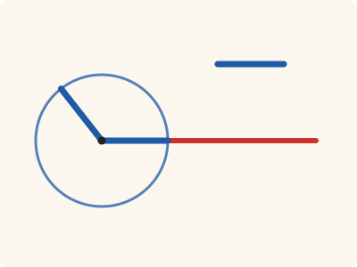
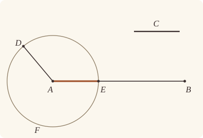

<!-- Generated by scripts/render.py. Do not edit by hand. -->

[Book I](index.md) · [← I.2](02.md) · [I.4 →](04.md)

# Book I, Proposition 3

*A straight line equal to the less, cut off from the greater*

[Euclid's proof](#euclids-proof) · [In Lean](#in-lean) · [What it rests on](#what-it-rests-on) · [Mishnah](#mishnah)

> Given two unequal straight lines, to cut off from the greater a straight line equal to the less.

**In Lean:** ✅ proved, as Euclid states it · Euclid's argument

<p align="center"></p>

<p align="center"><em>A circle about A, its radius AD placed equal to the less straight line C (blue), cuts off AE just as long (blue) from the greater, AB; the rest (red) is left over.</em></p>

## Euclid's proof

<p align="center"></p>

Let AB, C be the two given unequal straight lines, and let AB be the greater of them.

Thus it is required to cut off from AB the greater a straight line equal to C the less.

At the point A let AD be placed equal to the straight line C; [I. 2]

and with centre A and distance AD let the circle DEF be described. [Post. 3]

Now, since the point A is the centre of the circle DEF,

AE is equal to AD. [Def. 15]

But C is also equal to AD.

Therefore each of the straight lines AE, C is equal to AD; so that AE is also equal to C. [C.N. 1]

Therefore, given the two straight lines AB, C, from AB the greater AE has been cut off equal to C the less.

(Being) what it was required to do.

## In Lean

| | |
|---|---|
| Proof | ✅ Proved |
| Statement | The whole enunciation. |
| Argument | Euclid's. |
| Reviewed | The statement and every passage of the argument read against Heath's text, at commit [`bd86a7b6`](https://github.com/jackChallis/stoicheia/commit/bd86a7b6) ([the record](../../review/I/03.toml)) |

From [`Elements/BookI/Prop03.lean`](../../Elements/BookI/Prop03.lean). Euclid's sentences are the `--` comments, and our own notes are in `/- … -/`; the lines under each sentence are the Lean that carries it out. The list below marks where a lemma does a step Euclid takes for granted; the `/- … -/` notes in the listing explain smaller adjustments.

**How the Lean follows the text**

- **Done by `Tacit.line_circle_between`.** "and with centre A and distance AD let the circle DEF be described." Euclid takes E where the circle DEF cuts AB. After Postulate 3 draws the circle, the Lean puts A inside as its centre and B outside by `outside_of_len_gt`, then finds E between them by `Tacit.line_circle_between`, a rule we assume (System E, Intersections 4).

```lean
/-- Given two unequal straight lines, to cut off from the greater a straight line equal to the
less. -/
theorem Prop3 {A B C₁ C₂ : Point} (hC : C₁ ≠ C₂) (h : ‖C₁ C₂‖ < ‖A B‖) :
    ∃ E : Point, Between A E B ∧ ‖A E‖ = ‖C₁ C₂‖ := by
  -- Let AB, C be the two given unequal straight lines, and let AB be the greater of them.
  have hAB : A ≠ B := ne_of_len_gt h
  -- Thus it is required to cut off from AB the greater a straight line equal to C the less.
  -- At the point A let AD be placed equal to the straight line C; [I. 2]
  obtain ⟨D, hAD⟩ := Prop2 A C₁ C₂ hC
  have hAD' : A ≠ D := ne_of_len_eq hAD hC
  -- and with centre A and distance AD let the circle DEF be described. [Post. 3]
  obtain ⟨DEF, hA_DEF, hD_DEF⟩ := Postulate3 A D hAD'
  /- Euclid does not say where the circle DEF meets AB. B lies outside it, since
     AB is the greater, and A, the centre, lies inside; so the straight line AB
     cuts the circle at a point E between A and B (System E, Intersections 4). -/
  obtain ⟨AB, hA_AB, hB_AB⟩ := Postulate1 A B hAB
  have hB_out : OutsideCircle B DEF := outside_of_len_gt hA_DEF hD_DEF (by rw [hAD]; exact h)
  obtain ⟨E, hE_DEF, -, hAEB⟩ := line_circle_between (centre_inside hA_DEF) hA_AB hB_out hB_AB
  -- Now, since the point A is the centre of the circle DEF,
  -- AE is equal to AD. [Def. 15]
  have hAE_AD : ‖A E‖ = ‖A D‖ := Definition15 hA_DEF hE_DEF hD_DEF
  -- But C is also equal to AD.
  have hC_AD : ‖C₁ C₂‖ = ‖A D‖ := hAD.symm
  -- Therefore each of the straight lines AE, C is equal to AD; so that AE is also equal to C.
  -- [C.N. 1]
  have hAE_C : ‖A E‖ = ‖C₁ C₂‖ := CommonNotion1 hAE_AD hC_AD
  -- Therefore, given the two straight lines AB, C, from AB the greater AE has been cut off
  -- equal to C the less.
  exact ⟨E, hAEB, hAE_C⟩
  -- (Being) what it was required to do.
```

## What it rests on

| | |
|---|---|
| Heath's references | [I.2](02.md); Post. 3; Def. I.15; C.N. 1 |
| Lean cites | [I.2](02.md) |
| Postulates | 1, 3 |
| Definitions taken as axioms | Def. I.15 |
| Common Notions | 1, 3, 5 |
| Tacit rules | 22 (listed below) |
| Its own Lean calls | Postulates 1 and 3; Def. I.15; 1 tacit rule |
| Through lemmas | 15 tacit rules |

_Postulates, definitions, Common Notions and tacit rules: all that this proof rests on, counting those of the propositions it cites. The last two rows say which of the postulates, definitions and tacit rules its own Lean calls, in the proof or a helper written for it, and which it does not call but reaches through lemmas, of Book Zero or shared (a proposition it cites may rest on these too); the rest come in only through the propositions it cites or the Common Notions._

<details><summary>The 22 tacit rules beneath this proof, counting those of the propositions it cites</summary>

_(used here) marks a rule this proof's own Lean calls, in the proof or a helper written for it; (through …) marks one its own Lean does not call but reaches through the lemmas named, of [Book Zero](../../Elements/Figure) or shared, though a proposition it cites may rest on it too; and a rule with no mark comes in only through a proposition it cites or a Common Notion. The names in brackets are System E's: an Intersection rule says when straight lines and circles must meet, and an Intersections rule takes a point where they do (see [Book I's introduction](index.md))._

**Reading the figure**

- [`between_cases`](../../Elements/Foundations/Tacit/Diagram.lean#L54): Of three different points on a straight line, one is between the other two. (Between 6)
- [`between_of_inside_chord`](../../Elements/Foundations/Tacit/Diagram.lean#L81) (through [`outside_of_len_gt`](../../Elements/Figure/Circles.lean#L151)): A straight line through a point inside a circle has that point between the points where it meets the circle. (Circle 1)
- [`between_symm`](../../Elements/Foundations/Tacit/Diagram.lean#L47) (through [`outside_of_len_gt`](../../Elements/Figure/Circles.lean#L151)): If B is between A and C, it is between C and A. (Between 1)
- [`circles_meet`](../../Elements/Foundations/Tacit/Diagram.lean#L94): If each circle passes through a point inside the other, the circles cut one another. This is the step Euclid takes for granted in I.1. (Intersection 5)
- [`circles_meet_same_side`](../../Elements/Foundations/Tacit/Constructions.lean#L79): Two circles that cut one another do so on each side of the straight line through their centres. (Intersections 8)
- [`exists_point`](../../Elements/Foundations/Tacit/Constructions.lean#L35) (through [`outside_of_len_gt`](../../Elements/Figure/Circles.lean#L151)): Let a point be taken. (Points 1)
- [`exists_point_inside_circle`](../../Elements/Foundations/Tacit/Constructions.lean#L42) (through [`Tacit.centre_inside`](../../Elements/Figure/RuleBase.lean#L56) and [`outside_of_len_gt`](../../Elements/Figure/Circles.lean#L151)): Let a point be taken inside the circle α. (Points 8)
- [`line_circle_between`](../../Elements/Foundations/Tacit/Constructions.lean#L67) (used here): A straight line through a point B inside a circle, heading out to a point C outside it, cuts the circle between B and C. (Intersections 4)
- [`line_circle_beyond`](../../Elements/Foundations/Tacit/Constructions.lean#L73) (through [`Tacit.centre_inside`](../../Elements/Figure/RuleBase.lean#L56) and [`outside_of_len_gt`](../../Elements/Figure/Circles.lean#L151)): A straight line through a point B inside a circle, produced beyond B away from C, cuts the circle there. (Intersections 5)
- [`line_unique`](../../Elements/Foundations/Tacit/Diagram.lean#L41): Two points determine a straight line. (Generalities 1)
- [`not_between_of_between`](../../Elements/Foundations/Tacit/Diagram.lean#L50) (through [`Tacit.centre_inside`](../../Elements/Figure/RuleBase.lean#L56) and [`outside_of_len_gt`](../../Elements/Figure/Circles.lean#L151)): If B is between A and C, then A is not between B and C. (Between 1)

**Lengths, angles and areas**

- [`len_add_of_between`](../../Elements/Foundations/Tacit/Transfer.lean#L27) (through [`Tacit.centre_inside`](../../Elements/Figure/RuleBase.lean#L56) and [`outside_of_len_gt`](../../Elements/Figure/Circles.lean#L151)): If B is between A and C, then AB and BC together make up AC. (Diagram-segment 1)
- [`len_self`](../../Elements/Foundations/Tacit/Metric.lean#L24) (through [`Tacit.centre_inside`](../../Elements/Figure/RuleBase.lean#L56), [`ne_of_len_eq`](../../Elements/Figure/Lengths.lean#L76), [`ne_of_len_gt`](../../Elements/Figure/Lengths.lean#L83) and 1 other lemma): The "straight line" from a point to itself has no length. (Metric 1)
- [`len_symm`](../../Elements/Foundations/Tacit/Metric.lean#L27) (through [`Tacit.centre_inside`](../../Elements/Figure/RuleBase.lean#L56) and [`outside_of_len_gt`](../../Elements/Figure/Circles.lean#L151)): The straight line AB is the straight line BA. (Metric 3)
- [`radius_ne_zero`](../../Elements/Foundations/Tacit/Metric.lean#L62) (through [`Tacit.centre_inside`](../../Elements/Figure/RuleBase.lean#L56), [`ne_of_len_eq`](../../Elements/Figure/Lengths.lean#L76) and [`outside_of_len_gt`](../../Elements/Figure/Circles.lean#L151)): A circle's radius is not nothing: the straight line from the centre to a point on the circle has some length. A rule of our own, not one of System E's: every circle is drawn with a centre and a distance (Postulate 3).

**Laws of magnitude**

- [`add_comm`](../../Elements/Foundations/Tacit/Magnitudes.lean#L26) (through [`Tacit.centre_inside`](../../Elements/Figure/RuleBase.lean#L56) and [`outside_of_len_gt`](../../Elements/Figure/Circles.lean#L151)): The order of adding does not matter. (System E §3.5)
- [`add_lt_add_right`](../../Elements/Foundations/Tacit/Magnitudes.lean#L45): Adding the same thing to both sides keeps "less than". (System E §3.5)
- [`add_zero`](../../Elements/Foundations/Tacit/Magnitudes.lean#L29): Adding nothing changes nothing. (System E §3.5)
- [`lt_irrefl`](../../Elements/Foundations/Tacit/Magnitudes.lean#L32) (through [`Tacit.centre_inside`](../../Elements/Figure/RuleBase.lean#L56) and [`outside_of_len_gt`](../../Elements/Figure/Circles.lean#L151)): No magnitude is less than itself. (System E §3.5)
- [`lt_trans`](../../Elements/Foundations/Tacit/Magnitudes.lean#L35) (through [`Tacit.centre_inside`](../../Elements/Figure/RuleBase.lean#L56) and [`outside_of_len_gt`](../../Elements/Figure/Circles.lean#L151)): What is less than the less is less still. (System E §3.5)
- [`lt_trichotomy`](../../Elements/Foundations/Tacit/Magnitudes.lean#L39) (through [`Tacit.centre_inside`](../../Elements/Figure/RuleBase.lean#L56) and [`outside_of_len_gt`](../../Elements/Figure/Circles.lean#L151)): Of two magnitudes, one is less, or they are equal, or the other is less. (System E §3.5)
- [`not_lt_zero`](../../Elements/Foundations/Tacit/Magnitudes.lean#L42) (through [`Tacit.centre_inside`](../../Elements/Figure/RuleBase.lean#L56), [`ne_of_len_gt`](../../Elements/Figure/Lengths.lean#L83) and [`outside_of_len_gt`](../../Elements/Figure/Circles.lean#L151)): Nothing is less than zero. (System E §3.5)

</details>

## Mishnah

_Our commentary: what Euclid assumes, what Lean made us say out loud, and how the result looks by modern means._

Here I.2 goes to work. To cut off from AB a straight line equal to C, Euclid places AD equal to C at the point A, and lets the circle about A through D do the cutting. With that, the compasses that close of themselves, which Augustus De Morgan pictures under I.2, can do all that an ordinary pair does: carry a length and lay it off along a straight line.

Proclus finds eight figures here, but only, Heath remarks, "by practically incorporating the construction of the preceding proposition, instead of assuming it as we are entitled to do. If Prop. 2 is assumed, there is really only one 'case' of the present proposition" (vol. 1, p. 247). In Lean, citing I.2 is exactly assuming it: `Prop2` is a finished result, whatever its own figure looked like. Heath also sets aside Robert Potts' two cases, cutting from one end of AB or the other, and so do our proofs: when I.6 cuts from the end B, it cites `Prop3` with the letters exchanged.

Why should the circle DEF meet AB at all, and between A and B? Its centre A is inside it and B, farther from A than the radius, is outside; a straight line from inside a circle to outside crosses it (System E, Intersections 4). Our proof says so, after naming the straight line AB as in I.1, and our `Prop3` keeps E between A and B, as cutting off from AB means, since I.5 and I.6 rely on it. Where Euclid names the less straight line by one letter, C, our representation, which knows a finite straight line only by its two ends, gives C a pair of them.

## Further reading

- Now that I.2 and I.3 have given the compass its full power, John Stillwell's [*The Four Pillars of Geometry*](https://doi.org/10.1007/0-387-29052-4) (2005), which looks at the plane four ways, shows what a straightedge and compass can do, in ch. 1, "Straightedge and compass".

[Book I](index.md) · [← I.2](02.md) · [I.4 →](04.md)

---

<sub>Euclid's text: T. L. Heath, *The Thirteen Books of Euclid's Elements*, vol. 1 (Cambridge, 1908), pp. 246–247; [scan leaves n266–n267](https://archive.org/details/thirteenbookseu02heibgoog/page/n266); [figure on n266](https://archive.org/details/thirteenbookseu02heibgoog/page/n266). Public domain.</sub>

<sub>The tacit rules follow the System E of Jeremy Avigad, Edward Dean and John Mumma, read alongside LeanEuclid (Logan Murphy, Kaiyu Yang, Jialiang Sun, Zhaoyu Li, Anima Anandkumar and Xujie Si).</sub>
