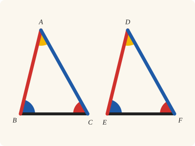
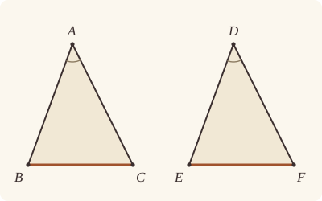

<!-- Generated by scripts/render.py. Do not edit by hand. -->

[Book I](index.md) · [← I.3](03.md) · [I.5 →](05.md)

# Book I, Proposition 4

*Two sides and the contained angle make the base equal*

[Euclid's proof](#euclids-proof) · [In Lean](#in-lean) · [What it rests on](#what-it-rests-on) · [Mishnah](#mishnah)

> If two triangles have the two sides equal to two sides respectively, and have the angles contained by the equal straight lines equal, they will also have the base equal to the base, the triangle will be equal to the triangle, and the remaining angles will be equal to the remaining angles respectively, namely those which the equal sides subtend.

**In Lean:** ✅ proved, as Euclid states it · Euclid's argument

<p align="center"></p>

<p align="center"><em>If two triangles have two sides (red and blue) and the angle they contain (yellow) equal, all the rest is equal too: the base (black), the other two angles (blue and red), and the triangles themselves.</em></p>

## Euclid's proof

<p align="center"></p>

<p align="center"><em>Heath's figure also draws the base bent below EF, the impossible case of two straight lines enclosing a space; ours leaves it out.</em></p>

Let ABC, DEF be two triangles having the two sides AB, AC equal to the two sides DE, DF respectively, namely AB to DE and AC to DF, and the angle BAC equal to the angle EDF.

I say that the base BC is also equal to the base EF, the triangle ABC will be equal to the triangle DEF, and the remaining angles will be equal to the remaining angles respectively, namely those which the equal sides subtend, that is, the angle ABC to the angle DEF, and the angle ACB to the angle DFE.

For, if the triangle ABC be applied to the triangle DEF,

and if the point A be placed on the point D

and the straight line AB on DE,

then the point B will also coincide with E, because AB is equal to DE.

Again, AB coinciding with DE,

the straight line AC will also coincide with DF, because the angle BAC is equal to the angle EDF;

hence the point C will also coincide with the point F, because AC is again equal to DF.

But B also coincided with E;

hence the base BC will coincide with the base EF.

[For if, when B coincides with E and C with F, the base BC does not coincide with the base EF, two straight lines will enclose a space: which is impossible.

Therefore the base BC will coincide with EF] and will be equal to it. [C.N. 4]

Thus the whole triangle ABC will coincide with the whole triangle DEF,

and will be equal to it.

And the remaining angles will also coincide with the remaining angles and will be equal to them,

the angle ABC to the angle DEF,

and the angle ACB to the angle DFE.

Therefore etc.

(Being) what it was required to prove.

## In Lean

| | |
|---|---|
| Proof | ✅ Proved |
| Statement | The whole enunciation. |
| Argument | Euclid's. |
| Reviewed | The statement and every passage of the argument read against Heath's text, at commit [`7103f442a`](https://github.com/dodecaplex-co/stoicheia/commit/7103f442a) ([the record](../../review/I/04.toml)) |

From [`Elements/BookI/Prop04.lean`](../../Elements/BookI/Prop04.lean). Euclid's sentences are the `--` comments, and our own notes are in `/- … -/`; the lines under each sentence are the Lean that carries it out. The list below marks where a lemma does a step Euclid takes for granted, where several sentences share one step and where the statement already gives a step; the `/- … -/` notes in the listing explain smaller adjustments.

**How the Lean follows the text**

- **Done by `Tacit.superposition`.** "For, if the triangle ABC be applied to the triangle DEF…" Postulate 1 names DE and DF before the hypothetical placement, with F off DE. `Tacit.superposition` admits a derivation over symbols for ABC laid along DE on F's side, keeping its sides, angles and laid-down side AC; only four equalities about ABC and DEF leave it.
- **Done by `Superposition.Derives.ray_unique`.** "then the point B will also coincide with E…" Inside the hypothetical placement, `Superposition.Derives.ray_unique` makes B' coincide with E because DB' equals DE on the ray from D through E. Its cited law is proved by `OnRay.eq_of_len_eq`, which rules out a point short of E or beyond it.
- **Done by `Superposition.Derives.ray_of_angle`.** "the straight line AC will also coincide with DF…" The equal angles put C' on DF by `Superposition.Derives.ray_of_angle`, whose law names all three straight lines; the placement supplies the third, the side through D and C', so the step draws no line. `Superposition.Derives.ray_of_angle_side` puts C' on F's side of D and uses no side: its law is Pasch 3, which since the second axiom retirement is proved with a construction, joining C' to a point of DE. Neither step draws a line inside the placement: citing a law draws nothing there, whatever its proof draws (brief 0009, question 4).
- **Done by `Superposition.Derives.ray_unique`.** "hence the point C will also coincide with the point F…" The kept length DC' equals AC and hence DF. `Superposition.Derives.ray_unique` therefore makes C' coincide with F on the ray from D through F.
- **Carried together.** "But B also coincided with E…" The two coincidences are already proved inside the placement. The base equality is derived beneath the sentence following the bracketed scholium, by substituting E and F for B' and C' in the kept base length.
- **Already given.** "For if, when B coincides with E and C with F…" Heiberg brackets this as an early scholium. A finite straight line enters our Lean only through its two ends, so once B is on E and C on F the base is EF, with no second one for the scholium to rule out.
- **Done by `Superposition.Derives.area_of_congruent`.** "Thus the whole triangle ABC will coincide with the whole triangle DEF…" Inside the placement, `Superposition.Derives.area_congr` identifies the area of DB'C' with that of DEF from the corner coincidences. Euclid's coincidence takes the triangle laid down to be ABC itself; beneath the next sentence the Lean makes it ABC's equal by Metric 9 (`Tacit.area_congruent`), which `Superposition.Derives.area_of_congruent` cites with the kept sides and angles: triangles equal in all their sides and angles are equal in area. So Euclid's step from coincidence to equality rests here in part on a rule that would give I.4's area clause at once, applied to ABC and DEF once their remaining sides and angles were proved; the overlap catalogue records it among its near misses.
- **Carried together.** "And the remaining angles will also coincide with the remaining angles…" The two remaining angle equalities follow inside the placement from the kept angles and the corner coincidences, with Metric 4 reversing the arms where needed. The restricted rule then exports these two equalities together with the base and area equalities, one application for each.

<details><summary>Before the theorem, 14 definitions: <code>Pt</code>, <code>Ln</code>, <code>a</code>, <code>b</code>, <code>c</code>, <code>d</code>, <code>e</code>, <code>f</code>, <code>b'</code>, <code>c'</code>, <code>de</code>, <code>df</code>, <code>ac'</code> and <code>cites</code> (75 lines)</summary>

```lean
import Elements.Figure.Basics
import Elements.Figure.Superposition

/-!
# Book I, Proposition 4

Euclid's text, in Heath's translation: [`heath/I/04.md`](../../heath/I/04.md).
Each of his sentences is a `--` comment, followed by the Lean that carries it out.

The triangle ABC is hypothetically laid on DEF, with A on D and AB along DE, on F's
side. Lower-case symbols name the figure's corners and straight lines; b′, c′ and
ac′ name the placed corners and the side AC as it falls. The valuation gives points
and straight lines only to the original figure's symbols.

Euclid's coincidences are steps of the restricted derivation: b′ is e because AB is
DE; AC falls along DF because the angles at A and D are equal; c′ is f because AC is
DF. Four equalities leave the placement: the bases, the areas and the two remaining
angles. The hypothetical corners and side stay within the derivation.
-/

namespace Elements.BookI

open Superposition hiding Triangle Collinear
open Superposition.Lit Tacit

namespace Prop4

/-- The points of I.4's figure, as symbols: the corners of the two triangles. -/
inductive Pt where
  | a | b | c | d | e | f
  deriving DecidableEq

/-- The straight lines of I.4's figure, as symbols: DE, along which ABC is laid, and DF, along
which AC will fall. -/
inductive Ln where
  | de | df
  deriving DecidableEq

instance : Symbols Pt := Symbols.ofList [.a, .b, .c, .d, .e, .f] (by intro p; cases p <;> decide)

instance : Symbols Ln := Symbols.ofList [.de, .df] (by intro l; cases l <;> decide)

/-- A, in the placement. -/
abbrev a : Name Pt := .given .a
/-- B, in the placement. -/
abbrev b : Name Pt := .given .b
/-- C, in the placement. -/
abbrev c : Name Pt := .given .c
/-- D, in the placement. -/
abbrev d : Name Pt := .given .d
/-- E, in the placement. -/
abbrev e : Name Pt := .given .e
/-- F, in the placement. -/
abbrev f : Name Pt := .given .f
/-- B′: where B comes down when ABC is laid on DEF. A symbol, with no point. -/
abbrev b' : Name Pt := .second
/-- C′: where C comes down. A symbol, with no point. -/
abbrev c' : Name Pt := .third
/-- DE, in the placement. -/
abbrev de : LineName Ln := .given .de
/-- DF, in the placement. -/
abbrev df : LineName Ln := .given .df
/-- The side AC as it falls: a straight line through D and C′. A symbol, with no straight
line. -/
abbrev ac' : LineName Ln := .side

/-- The laws the derivation cites: Metric 3, Metric 4, Metric 9, that a straight line equal to
one with distinct ends has distinct ends, one point at one distance on a ray, and one ray for
one angle. -/
abbrev cites : List Cited :=
  [.lenSymm, .angleSymm, .areaCongruent, .neOfLen, .rayUnique, .rayOfAngle, .rayOfAngleSide]

end Prop4

open Prop4 in
```

</details>

```lean
/-- If two triangles have the two sides equal to two sides respectively, and have the angles
contained by the equal straight lines equal, they will also have the base equal to the base, the
triangle will be equal to the triangle, and the remaining angles will be equal to the remaining
angles respectively, namely those which the equal sides subtend. -/
theorem Prop4 {A B C D E F : Point} (hABC : Triangle A B C) (hDEF : Triangle D E F)
    (hAB : ‖A B‖ = ‖D E‖) (hAC : ‖A C‖ = ‖D F‖) (hA : ∠ B A C = ∠ E D F) :
    ‖B C‖ = ‖E F‖ ∧ △ A B C = △ D E F ∧ ∠ A B C = ∠ D E F ∧ ∠ A C B = ∠ D F E := by
  -- Let ABC, DEF be two triangles having the two sides AB, AC equal to the two sides DE, DF
  -- respectively, namely AB to DE and AC to DF, and the angle BAC equal to the angle EDF.
  have hAB' : A ≠ B := hABC.ne₁₂
  have hBC' : B ≠ C := hABC.ne₂₃
  have hAC' : A ≠ C := hABC.ne₁₃
  have hDE : D ≠ E := hDEF.ne₁₂
  have hDF : D ≠ F := hDEF.ne₁₃
  have hEF : E ≠ F := hDEF.ne₂₃
  -- I say that the base BC is also equal to the base EF, the triangle ABC will be equal to the
  -- triangle DEF, and the remaining angles will be equal to the remaining angles respectively,
  -- namely those which the equal sides subtend, that is, the angle ABC to the angle DEF, and
  -- the angle ACB to the angle DFE.
  -- For, if the triangle ABC be applied to the triangle DEF,
  /- Euclid lays the triangle along the straight line DE, on the side where F is. The rule
     takes that line by its symbol, and F off it. The figure also has the straight line DF,
     along which AC will fall: both are drawn here, before the placement, and nothing is
     drawn inside it. -/
  obtain ⟨DE, hD_DE, hE_DE⟩ := Postulate1 D E hDE
  have hF_DE : ¬ OnLine F DE := fun hF => hDEF ⟨DE, hD_DE, hE_DE, hF⟩
  obtain ⟨DF, hD_DF, hF_DF⟩ := Postulate1 D F hDF
  /- The figure: each symbol of I.4's vocabulary stands for its point or straight line. -/
  let v : Val primitives Pt Ln :=
    ⟨fun | .a => A | .b => B | .c => C | .d => D | .e => E | .f => F,
     fun | .de => DE | .df => DF⟩
  /- The facts given, as literals over the figure's symbols. -/
  let Γ : List (Lit Pt Ln) :=
    [pos (.len .a .b .d .e), pos (.len .a .c .d .f), pos (.angle .b .a .c .e .d .f),
     pos (.onLine .d .df), pos (.onLine .f .df), neg (.eq .d .f), neg (.eq .e .f),
     neg (.eq .a .b), neg (.eq .b .c), neg (.eq .a .c)]
  have hΓ : ∀ ℓ ∈ Γ, ℓ.Holds v := by
    intro ℓ hℓ
    simp only [Γ, List.mem_cons, List.mem_nil_iff, or_false] at hℓ
    rcases hℓ with rfl | rfl | rfl | rfl | rfl | rfl | rfl | rfl | rfl | rfl
    · exact hAB
    · exact hAC
    · exact hA
    · exact hD_DF
    · exact hF_DF
    · exact hDF
    · exact hEF
    · exact hAB'
    · exact hBC'
    · exact hAC'
  -- and if the point A be placed on the point D
  -- and the straight line AB on DE,
  /- The restricted rule of superposition: the triangle ABC, laid down with A on D, is
     d b′ c′, with b′ on the ray from d through e, c′ on f's side of de, every side and angle
     kept, and the side AC laid down along ac′, through d and c′ (`kept`). Everything that
     follows, until the four equalities come out, is a derivation inside the placement:
     symbols only, and no point. -/
  /- Δ is the context of the placement: the facts given, the guards, and what the placement
     keeps (`branch`). -/
  let Δ := branch Γ .a .b .c .d .e .f .de
  have given : ∀ {ℓ : Lit Pt Ln}, ℓ ∈ Γ → Derives cites Δ (ℓ.map .given .given) :=
    fun hℓ => Branch.given hℓ
  have hAB_ : Derives cites Δ (neg (.eq a b)) := given (ℓ := neg (.eq .a .b)) (by simp [Γ])
  have hBC_ : Derives cites Δ (neg (.eq b c)) := given (ℓ := neg (.eq .b .c)) (by simp [Γ])
  have hAC_ : Derives cites Δ (neg (.eq a c)) := given (ℓ := neg (.eq .a .c)) (by simp [Γ])
  /- The corners laid down are three points: db′, b′c′, c′d are AB, BC, CA, whose ends are
     distinct. -/
  have hB'D : Derives cites Δ (neg (.eq b' d)) := .ne_of_len (.len_trans .len_comm Kept.len₁) hAB_
  have hC'D : Derives cites Δ (neg (.eq c' d)) := .ne_of_len Kept.len₃ (.ne_symm hAC_)
  have hB'C' : Derives cites Δ (neg (.eq b' c')) := .ne_of_len Kept.len₂ hBC_
  -- then the point B will also coincide with E, because AB is equal to DE.
  /- On the ray from d through e, the one point as far from d as e is, is e itself (Savile's
     argument). -/
  have hDB'_DE : Derives cites Δ (pos (.len d b' d e)) :=
    .len_trans Kept.len₁ (given (ℓ := pos (.len .a .b .d .e)) (by simp [Γ]))
  have hB'E : Derives cites Δ (pos (.eq b' e)) :=
    .ray_unique Guard.ne_DG hB'D Guard.on_D Guard.on_G Kept.on_line Kept.not_between hDB'_DE
  -- Again, AB coinciding with DE,
  have hEDC' : Derives cites Δ (pos (.angle e d c' b' d c')) :=
    .angle_congr Coincidence.step (.eq_symm hB'E) .eq_refl .eq_refl
  -- the straight line AC will also coincide with DF, because the angle BAC is equal to the
  -- angle EDF;
  /- On f's side of de only one ray from d makes this angle with de, so the side AC laid
     down, through d and c′, puts c′ on df, on f's side of d. -/
  have hEDC'_EDF : Derives cites Δ (pos (.angle e d c' e d f)) :=
    .angle_trans hEDC' <|
    .angle_trans Kept.angle₁ (given (ℓ := pos (.angle .b .a .c .e .d .f)) (by simp [Γ]))
  have hD_DF' : Derives cites Δ (pos (.onLine d df)) :=
    given (ℓ := pos (.onLine .d .df)) (by simp [Γ])
  have hF_DF' : Derives cites Δ (pos (.onLine f df)) :=
    given (ℓ := pos (.onLine .f .df)) (by simp [Γ])
  have hC'_DF : Derives cites Δ (pos (.onLine c' df)) :=
    .ray_of_angle Guard.ne_DG Guard.on_D Guard.on_G hD_DF' hF_DF' Kept.side_first
      Kept.side_third Kept.same_side hEDC'_EDF
  have hC'_ray : Derives cites Δ (neg (.between c' d f)) :=
    .ray_of_angle_side Guard.ne_DG Guard.on_D Guard.on_G hD_DF' hF_DF' Kept.side_first
      Kept.side_third Kept.same_side hEDC'_EDF
  -- hence the point C will also coincide with the point F, because AC is again equal to DF.
  have hDC'_DF : Derives cites Δ (pos (.len d c' d f)) :=
    .len_trans .len_comm <|
    .len_trans Kept.len₃ <|
    .len_trans .len_comm (given (ℓ := pos (.len .a .c .d .f)) (by simp [Γ]))
  have hC'F : Derives cites Δ (pos (.eq c' f)) :=
    .ray_unique (given (ℓ := neg (.eq .d .f)) (by simp [Γ])) hC'D hD_DF' hF_DF'
      hC'_DF hC'_ray hDC'_DF
  -- But B also coincided with E;
  -- hence the base BC will coincide with the base EF.
  -- [For if, when B coincides with E and C with F, the base BC does not coincide with the base
  -- EF, two straight lines will enclose a space: which is impossible.
  /- Heiberg brackets this passage as an early scholium. Our proof has no need of it: a
     finite straight line is fixed by its ends, so once b′ is e and c′ is f, the base b′c′
     is ef. -/
  -- Therefore the base BC will coincide with EF] and will be equal to it. [C.N. 4]
  have hBC : Derives cites Δ (pos (.len b c e f)) :=
    .len_trans (.len_symm Kept.len₂) (.len_congr Coincidence.step hB'E hC'F)
  -- Thus the whole triangle ABC will coincide with the whole triangle DEF,
  have hcoincide : Derives cites Δ (pos (.area d b' c' d e f)) :=
    .area_congr Coincidence.step .eq_refl hB'E hC'F
  -- and will be equal to it.
  /- Being moved does not change the triangle: d b′ c′ has the same sides and angles as
     ABC, so the same area (System E, Metric 9). -/
  have hmoved : Derives cites Δ (pos (.area a b c d b' c')) :=
    .area_of_congruent (.len_symm Kept.len₁) (.len_symm Kept.len₂) (.len_symm Kept.len₃)
      (.angle_trans (.angle_comm hAB_ (.ne_symm hBC_)) <|
        .angle_trans (.angle_symm Kept.angle₃) (.angle_comm (.ne_symm hB'C') (.ne_symm hB'D)))
      (.angle_trans (.angle_comm hBC_ hAC_) <|
        .angle_trans (.angle_symm Kept.angle₂) (.angle_comm (.ne_symm hC'D) hB'C'))
      (.angle_trans (.angle_comm (.ne_symm hAC_) (.ne_symm hAB_)) <|
        .angle_trans (.angle_symm Kept.angle₁) (.angle_comm hB'D hC'D))
  have harea : Derives cites Δ (pos (.area a b c d e f)) :=
    .area_trans hmoved hcoincide
  -- And the remaining angles will also coincide with the remaining angles and will be equal to
  -- them,
  -- the angle ABC to the angle DEF,
  have hB : Derives cites Δ (pos (.angle a b c d e f)) :=
    .angle_trans (.angle_comm hAB_ (.ne_symm hBC_)) <|
    .angle_trans (.angle_symm Kept.angle₃) <|
    .angle_trans (.angle_congr Coincidence.step hC'F hB'E .eq_refl) <|
      .angle_comm (.ne_symm (given (ℓ := neg (.eq .e .f)) (by simp [Γ]))) Guard.ne_DG
  -- and the angle ACB to the angle DFE.
  have hC : Derives cites Δ (pos (.angle a c b d f e)) :=
    .angle_trans (.angle_symm Kept.angle₂) (.angle_congr Coincidence.step .eq_refl hC'F hB'E)
  /- Four equalities among the figure's symbols: they leave the placement, and b′, c′ and
     ac′ stay behind. The laws cited are supplied by their proofs, one each, from Book Zero
     and the foundations; the guards are the triangle ABC, D and E on DE, D not E, and F off
     DE. -/
  have hcites : ∀ c ∈ cites, c.Holds primitives := by
    intro c hc
    simp only [cites, List.mem_cons, List.mem_nil_iff, or_false] at hc
    rcases hc with rfl | rfl | rfl | rfl | rfl | rfl | rfl
    · exact Cited.holds_lenSymm
    · exact Cited.holds_angleSymm
    · exact Cited.holds_areaCongruent
    · exact Cited.holds_neOfLen
    · exact Cited.holds_rayUnique
    · exact Cited.holds_rayOfAngle
    · exact Cited.holds_rayOfAngleSide
  have out := fun {φ : Metric Pt}
      (dφ : Derives cites Δ (pos (φ.map Name.given).toAtom)) =>
    Tacit.superposition.apply hcites dφ v hABC hD_DE hE_DE hDE hF_DE hΓ
  -- Therefore etc.
  exact ⟨out (φ := .len .b .c .e .f) hBC, out (φ := .area .a .b .c .d .e .f) harea,
    out (φ := .angle .a .b .c .d .e .f) hB, out (φ := .angle .a .c .b .d .f .e) hC⟩
  -- (Being) what it was required to prove.
```

## What it rests on

| | |
|---|---|
| Heath's references | C.N. 4 |
| Lean cites | no propositions |
| Postulates | 1, 2, 3 |
| Definitions taken as axioms | Def. I.15 |
| Common Notions | 4, 5 |
| Tacit rules | 31 (listed below) |
| Its own Lean calls | Postulate 1; 1 tacit rule |
| Through lemmas | Postulates 2 and 3; Def. I.15; 29 tacit rules |

_Postulates, definitions, Common Notions and tacit rules: all that this proof rests on, counting those of the propositions it cites. The last two rows say which of the postulates, definitions and tacit rules its own Lean calls, in the proof or a helper written for it, and which it does not call but reaches through lemmas, of Book Zero or shared (a proposition it cites may rest on these too); the rest come in only through the propositions it cites or the Common Notions._

<details><summary>The 31 tacit rules beneath this proof</summary>

_(used here) marks a rule this proof's own Lean calls, in the proof or a helper written for it; (through …) marks one its own Lean does not call but reaches through the lemmas named, of [Book Zero](../../Elements/Figure) or shared; and a rule with no mark comes in only through a Common Notion. The names in brackets are System E's: an Intersection rule says when straight lines and circles must meet, and an Intersections rule takes a point where they do (see [Book I's introduction](index.md))._

**Reading the figure**

- [`between_cases`](../../Elements/Foundations/Tacit/Diagram.lean#L54) (through [`Superposition.Cited.holds_rayOfAngle`](../../Elements/Figure/Superposition.lean#L96) and [`Superposition.Cited.holds_rayUnique`](../../Elements/Figure/Superposition.lean#L89)): Of three different points on a straight line, one is between the other two. (Between 6)
- [`between_symm`](../../Elements/Foundations/Tacit/Diagram.lean#L47) (through [`Superposition.Cited.holds_rayOfAngle`](../../Elements/Figure/Superposition.lean#L96) and [`Superposition.Cited.holds_rayOfAngleSide`](../../Elements/Figure/Superposition.lean#L105)): If B is between A and C, it is between C and A. (Between 1)
- [`circles_meet`](../../Elements/Foundations/Tacit/Diagram.lean#L91) (through [`Superposition.Cited.holds_rayOfAngle`](../../Elements/Figure/Superposition.lean#L96) and [`Superposition.Cited.holds_rayOfAngleSide`](../../Elements/Figure/Superposition.lean#L105)): If each circle passes through a point inside the other, the circles cut one another. This is the step Euclid takes for granted in I.1. (Intersection 5)
- [`circles_meet_same_side`](../../Elements/Foundations/Tacit/Constructions.lean#L79) (through [`Superposition.Cited.holds_rayOfAngle`](../../Elements/Figure/Superposition.lean#L96) and [`Superposition.Cited.holds_rayOfAngleSide`](../../Elements/Figure/Superposition.lean#L105)): Two circles that cut one another do so on each side of the straight line through their centres. (Intersections 8)
- [`exists_point`](../../Elements/Foundations/Tacit/Constructions.lean#L35) (through [`Triangle.ne₁₂`](../../Elements/Figure/Triangles.lean#L22), [`Triangle.ne₁₃`](../../Elements/Figure/Triangles.lean#L36) and [`Triangle.ne₂₃`](../../Elements/Figure/Triangles.lean#L29)): Let a point be taken. (Points 1)
- [`exists_point_inside_circle`](../../Elements/Foundations/Tacit/Constructions.lean#L42) (through [`Superposition.Cited.holds_rayOfAngle`](../../Elements/Figure/Superposition.lean#L96) and [`Superposition.Cited.holds_rayOfAngleSide`](../../Elements/Figure/Superposition.lean#L105)): Let a point be taken inside the circle α. (Points 8)
- [`exists_point_on_line`](../../Elements/Foundations/Tacit/Constructions.lean#L38) (through [`Superposition.Cited.holds_rayOfAngle`](../../Elements/Figure/Superposition.lean#L96) and [`Superposition.Cited.holds_rayOfAngleSide`](../../Elements/Figure/Superposition.lean#L105)): Let a point be taken on the straight line L. (Points 2)
- [`line_circle_between`](../../Elements/Foundations/Tacit/Constructions.lean#L67) (through [`Superposition.Cited.holds_rayOfAngle`](../../Elements/Figure/Superposition.lean#L96) and [`Superposition.Cited.holds_rayOfAngleSide`](../../Elements/Figure/Superposition.lean#L105)): A straight line through a point B inside a circle, heading out to a point C outside it, cuts the circle between B and C. (Intersections 4)
- [`line_circle_beyond`](../../Elements/Foundations/Tacit/Constructions.lean#L73) (through [`Superposition.Cited.holds_rayOfAngle`](../../Elements/Figure/Superposition.lean#L96) and [`Superposition.Cited.holds_rayOfAngleSide`](../../Elements/Figure/Superposition.lean#L105)): A straight line through a point B inside a circle, produced beyond B away from C, cuts the circle there. (Intersections 5)
- [`line_unique`](../../Elements/Foundations/Tacit/Diagram.lean#L41) (through [`Superposition.Cited.holds_rayOfAngle`](../../Elements/Figure/Superposition.lean#L96) and [`Superposition.Cited.holds_rayOfAngleSide`](../../Elements/Figure/Superposition.lean#L105)): Two points determine a straight line. (Generalities 1)
- [`lines_meet_of_opposite_sides`](../../Elements/Foundations/Tacit/Diagram.lean#L86) (through [`Superposition.Cited.holds_rayOfAngle`](../../Elements/Figure/Superposition.lean#L96)): A straight line joining points on opposite sides of L crosses L. (Intersection 1)
- [`not_between_of_between`](../../Elements/Foundations/Tacit/Diagram.lean#L50) (through [`Superposition.Cited.holds_rayOfAngle`](../../Elements/Figure/Superposition.lean#L96) and [`Superposition.Cited.holds_rayOfAngleSide`](../../Elements/Figure/Superposition.lean#L105)): If B is between A and C, then A is not between B and C. (Between 1)
- [`not_on_line_of_same_side`](../../Elements/Foundations/Tacit/Diagram.lean#L60) (through [`Superposition.Cited.holds_rayOfAngle`](../../Elements/Figure/Superposition.lean#L96) and [`Superposition.Cited.holds_rayOfAngleSide`](../../Elements/Figure/Superposition.lean#L105)): Points on one side of a straight line are not on it. (Same side 3)
- [`pasch2`](../../Elements/Foundations/Tacit/Diagram.lean#L71) (through [`Superposition.Cited.holds_rayOfAngle`](../../Elements/Figure/Superposition.lean#L96) and [`Superposition.Cited.holds_rayOfAngleSide`](../../Elements/Figure/Superposition.lean#L105)): If B is between A and C, A is on L and B is off it, then B and C are on the same side of L: a straight line that leaves L at A does not cross it again. (Pasch 2)
- [`same_side_trans`](../../Elements/Foundations/Tacit/Diagram.lean#L64) (through [`Superposition.Cited.holds_rayOfAngle`](../../Elements/Figure/Superposition.lean#L96) and [`Superposition.Cited.holds_rayOfAngleSide`](../../Elements/Figure/Superposition.lean#L105)): Two points on the same side of a straight line as a third point are on the same side as each other. (Same side 4)

**Lengths, angles and areas**

- [`angle_add_of_inside`](../../Elements/Foundations/Tacit/Transfer.lean#L47) (through [`Superposition.Cited.holds_rayOfAngle`](../../Elements/Figure/Superposition.lean#L96) and [`Superposition.Cited.holds_rayOfAngleSide`](../../Elements/Figure/Superposition.lean#L105)): If D lies within the angle BAC, then BAC is made up of BAD and DAC. (Diagram-angle 2)
- [`angle_symm`](../../Elements/Foundations/Tacit/Metric.lean#L30) (through [`Superposition.Cited.holds_angleSymm`](../../Elements/Figure/Superposition.lean#L70) and [`Superposition.Cited.holds_rayOfAngle`](../../Elements/Figure/Superposition.lean#L96)): The angle ABC is the angle CBA. (Metric 4)
- [`area_congruent`](../../Elements/Foundations/Tacit/Metric.lean#L44) (through [`Superposition.Cited.holds_areaCongruent`](../../Elements/Figure/Superposition.lean#L76)): Triangles equal in all their sides and angles are equal in area. Euclid uses this without comment once he has shown two triangles congruent. (Metric 9)
- [`len_add_of_between`](../../Elements/Foundations/Tacit/Transfer.lean#L27) (through [`Superposition.Cited.holds_rayOfAngle`](../../Elements/Figure/Superposition.lean#L96), [`Superposition.Cited.holds_rayOfAngleSide`](../../Elements/Figure/Superposition.lean#L105) and [`Superposition.Cited.holds_rayUnique`](../../Elements/Figure/Superposition.lean#L89)): If B is between A and C, then AB and BC together make up AC. (Diagram-segment 1)
- [`len_self`](../../Elements/Foundations/Tacit/Metric.lean#L24) (through [`Superposition.Cited.holds_neOfLen`](../../Elements/Figure/Superposition.lean#L83), [`Superposition.Cited.holds_rayOfAngle`](../../Elements/Figure/Superposition.lean#L96) and [`Superposition.Cited.holds_rayOfAngleSide`](../../Elements/Figure/Superposition.lean#L105)): The "straight line" from a point to itself has no length. (Metric 1)
- [`len_symm`](../../Elements/Foundations/Tacit/Metric.lean#L27) (through [`Superposition.Cited.holds_lenSymm`](../../Elements/Figure/Superposition.lean#L67), [`Superposition.Cited.holds_rayOfAngle`](../../Elements/Figure/Superposition.lean#L96) and [`Superposition.Cited.holds_rayOfAngleSide`](../../Elements/Figure/Superposition.lean#L105)): The straight line AB is the straight line BA. (Metric 3)
- [`radius_ne_zero`](../../Elements/Foundations/Tacit/Metric.lean#L62) (through [`Superposition.Cited.holds_neOfLen`](../../Elements/Figure/Superposition.lean#L83), [`Superposition.Cited.holds_rayOfAngle`](../../Elements/Figure/Superposition.lean#L96), [`Superposition.Cited.holds_rayOfAngleSide`](../../Elements/Figure/Superposition.lean#L105) and 1 other lemma): A circle's radius is not nothing: the straight line from the centre to a point on the circle has some length. A rule of our own, not one of System E's: every circle is drawn with a centre and a distance (Postulate 3).
- [`same_ray_of_angle_eq_zero`](../../Elements/Foundations/Tacit/Transfer.lean#L42) (through [`Superposition.Cited.holds_rayOfAngle`](../../Elements/Figure/Superposition.lean#L96) and [`Superposition.Cited.holds_rayOfAngleSide`](../../Elements/Figure/Superposition.lean#L105)): If the angle BAC is nothing, C lies on the ray from A through B. (Diagram-angle 1)

**Superposition**

- [`superposition`](../../Elements/Foundations/Tacit/Superposition.lean#L52) (used here): **Superposition.** A hypothetical placement of a triangle on a given ray and side permits a restricted derivation of metric equalities about the figure already given. The derivation introduces no further objects, cites each geometric law it uses, and exports no symbol of the placement.

**Rules of magnitude**

- [`add_comm`](../../Elements/Foundations/Tacit/Magnitudes.lean#L26) (through [`Superposition.Cited.holds_rayOfAngle`](../../Elements/Figure/Superposition.lean#L96) and [`Superposition.Cited.holds_rayOfAngleSide`](../../Elements/Figure/Superposition.lean#L105)): The order of adding does not matter. (System E §3.5)
- [`add_lt_add_right`](../../Elements/Foundations/Tacit/Magnitudes.lean#L45) (through [`Superposition.Cited.holds_rayOfAngle`](../../Elements/Figure/Superposition.lean#L96)): Adding the same thing to both sides keeps "less than". (System E §3.5)
- [`add_zero`](../../Elements/Foundations/Tacit/Magnitudes.lean#L29): Adding nothing changes nothing. (System E §3.5)
- [`lt_irrefl`](../../Elements/Foundations/Tacit/Magnitudes.lean#L32) (through [`Superposition.Cited.holds_rayOfAngle`](../../Elements/Figure/Superposition.lean#L96), [`Superposition.Cited.holds_rayOfAngleSide`](../../Elements/Figure/Superposition.lean#L105) and [`Superposition.Cited.holds_rayUnique`](../../Elements/Figure/Superposition.lean#L89)): No magnitude is less than itself. (System E §3.5)
- [`lt_trans`](../../Elements/Foundations/Tacit/Magnitudes.lean#L35) (through [`Superposition.Cited.holds_rayOfAngle`](../../Elements/Figure/Superposition.lean#L96) and [`Superposition.Cited.holds_rayOfAngleSide`](../../Elements/Figure/Superposition.lean#L105)): What is less than the less is less still. (System E §3.5)
- [`lt_trichotomy`](../../Elements/Foundations/Tacit/Magnitudes.lean#L39) (through [`Superposition.Cited.holds_rayOfAngle`](../../Elements/Figure/Superposition.lean#L96), [`Superposition.Cited.holds_rayOfAngleSide`](../../Elements/Figure/Superposition.lean#L105) and [`Superposition.Cited.holds_rayUnique`](../../Elements/Figure/Superposition.lean#L89)): Of two magnitudes, one is less, or they are equal, or the other is less. (System E §3.5)
- [`not_lt_zero`](../../Elements/Foundations/Tacit/Magnitudes.lean#L42) (through [`Superposition.Cited.holds_rayOfAngle`](../../Elements/Figure/Superposition.lean#L96), [`Superposition.Cited.holds_rayOfAngleSide`](../../Elements/Figure/Superposition.lean#L105) and [`Superposition.Cited.holds_rayUnique`](../../Elements/Figure/Superposition.lean#L89)): Nothing is less than zero. (System E §3.5)

</details>

**The laws cited inside the placement.** The derivation cites each law below as proved. Each is a statement about every figure, proved outside the placement, so citing it draws nothing there. The last column names the [construction rules](../../docs/FORMALIZATION.md#construction-rules) beneath its proof, as the certificate finds them (`cited_laws`).

| Law | Proved by | Construction rules beneath the proof |
|---|---|---|
| Metric 3: the straight line AB is the straight line BA. (`lenSymm`) | [`Cited.holds_lenSymm`](../../Elements/Figure/Superposition.lean#L67) | none |
| Metric 4: the angle ABC is the angle CBA. (`angleSymm`) | [`Cited.holds_angleSymm`](../../Elements/Figure/Superposition.lean#L70) | none |
| Metric 9: triangles equal in all their sides and angles are equal in area. (`areaCongruent`) | [`Cited.holds_areaCongruent`](../../Elements/Figure/Superposition.lean#L76) | none |
| A straight line equal to one with two distinct ends has two distinct ends. (`neOfLen`) | [`Cited.holds_neOfLen`](../../Elements/Figure/Superposition.lean#L83) | [`Postulate3`](../../Elements/Foundations/Postulates.lean#L40) |
| On a ray, one point lies at a given distance from its start (Savile's argument). (`rayUnique`) | [`Cited.holds_rayUnique`](../../Elements/Figure/Superposition.lean#L89) | [`Postulate3`](../../Elements/Foundations/Postulates.lean#L40) |
| On one side of a straight line, one ray from a point of it makes a given angle with it: the point lies on that ray's straight line. (`rayOfAngle`) | [`Cited.holds_rayOfAngle`](../../Elements/Figure/Superposition.lean#L96) | [`Postulate1`](../../Elements/Foundations/Postulates.lean#L23), [`Postulate2`](../../Elements/Foundations/Postulates.lean#L32), [`Postulate3`](../../Elements/Foundations/Postulates.lean#L40), [`circles_meet`](../../Elements/Foundations/Tacit/Diagram.lean#L91), [`circles_meet_same_side`](../../Elements/Foundations/Tacit/Constructions.lean#L79), [`exists_point_inside_circle`](../../Elements/Foundations/Tacit/Constructions.lean#L42), [`exists_point_on_line`](../../Elements/Foundations/Tacit/Constructions.lean#L38), [`line_circle_between`](../../Elements/Foundations/Tacit/Constructions.lean#L67), [`line_circle_beyond`](../../Elements/Foundations/Tacit/Constructions.lean#L73), [`lines_meet_of_opposite_sides`](../../Elements/Foundations/Tacit/Diagram.lean#L86) |
| The same, for the side of the point: it is not behind the corner. (`rayOfAngleSide`) | [`Cited.holds_rayOfAngleSide`](../../Elements/Figure/Superposition.lean#L105) | [`Postulate1`](../../Elements/Foundations/Postulates.lean#L23), [`Postulate3`](../../Elements/Foundations/Postulates.lean#L40), [`circles_meet`](../../Elements/Foundations/Tacit/Diagram.lean#L91), [`circles_meet_same_side`](../../Elements/Foundations/Tacit/Constructions.lean#L79), [`exists_point_inside_circle`](../../Elements/Foundations/Tacit/Constructions.lean#L42), [`exists_point_on_line`](../../Elements/Foundations/Tacit/Constructions.lean#L38), [`line_circle_between`](../../Elements/Foundations/Tacit/Constructions.lean#L67), [`line_circle_beyond`](../../Elements/Foundations/Tacit/Constructions.lean#L73) |

## Mishnah

_Our commentary: why Euclid's proof, and ours, look as they do._

Euclid proves side–angle–side by picking up the triangle ABC and laying it down on DEF, and Heath thinks he did it unwillingly: "Euclid obviously used the method of superposition with reluctance" (vol. 1, p. 249). Jacques Peletier saw the danger in 1557. If superposition were allowed as a proof, Heath reports, it "could equally well have been used in I. 2, 3 (thus in I. 2 we could simply have supposed the line taken up and *placed* at the point)" (vol. 1, p. 249).

Our rule, [`superposition`](../../Elements/Foundations/Tacit/Superposition.lean), which only I.4 and I.8 call on, meets Peletier's danger as System E does. The proof imagines ABC laid down on DEF and reasons about the copy, but nothing is drawn in the imagined figure and no point of it comes back out. Four equalities come out, about ABC and DEF themselves: the bases, the triangles and the two remaining pairs of angles. So the rule cannot do I.2's work of placing a straight line at a point.

**Why must B land on E?** Heath points to something "most editors seem to have failed to observe": Euclid assumes that "if A be placed on D, and AB on DE, the point B will coincide with E, because AB is equal to DE. That is, the *converse* of *Common Notion* 4 is assumed for straight lines" (vol. 1, p. 250). Henry Savile saw the difficulty and met it with this argument: "let B fall somewhere short of E or beyond E; and in either case it will follow that the less is equal to the greater, which is impossible" (Heath, vol. 1, p. 250). His argument assumes that B falls on DE or DE produced, which Heath says needs Postulates 1 and 2 together. In our hypothetical placement B lies on the ray from D through E. [Book Zero](../../Elements/Figure) has his argument, step for step, as `OnRay.eq_of_len_eq`.

AC falls along DF "because the angle BAC is equal to the angle EDF", which assumes that on one side of DE only one ray from D makes that angle; Book Zero proves it, since otherwise one of two equal angles would be part of the other. Nothing is drawn in the imagined figure, but the proofs of the seven laws cited in it are another matter. Four of them are proved with constructions, circles and straight lines among them: that a straight line equal to one with distinct ends has distinct ends, Savile's argument, and both halves of the law of one ray for one angle, that the corner where C falls lies on DF and that it is not behind D. The proofs of those last two may even draw a straight line through that corner. Each law asserts no existence, though, and our reading of the rule lets a proved law be cited inside the placement whatever its proof draws, as I.8 cites I.7. Only the three laws taken straight from System E's metric rules (Metric 3, 4 and 9) are proved with no construction. The placement keeps every side and angle but assumes no equality of area, so that the triangle laid down is equal to ABC takes a rule of its own, [`area_congruent`](../../Elements/Foundations/Tacit/Metric.lean) (System E, Metric 9). The bases need no rule: Euclid's text says that otherwise "two straight lines will enclose a space", but J. L. Heiberg brackets the passage, since an-Nairīzī gives it after the Q. E. D., so it is "a *scholium* only" (Heath, vol. 1, p. 249). Once B lands on E and C on F, our base is EF.

**The modern way.** Superposition is a rigid motion: in the complex plane, $z \mapsto az + b$ or $z \mapsto a\bar{z} + b$ with $|a| = 1$, carrying A to D, B to E and C to F. What it carries is fixed by the two sides and the angle: the law of cosines, $\mathrm{BC}^2 = \mathrm{AB}^2 + \mathrm{AC}^2 - 2 \thinspace \mathrm{AB} \thinspace \mathrm{AC} \cos \mathrm{A}$, gives the base, and $\frac{1}{2} \thinspace \mathrm{AB} \thinspace \mathrm{AC} \sin \mathrm{A}$ the area.

## Further reading

- George E. Martin's textbook [*Transformation Geometry*](https://doi.org/10.1007/978-1-4612-5680-9) (1982) builds congruence itself out of reflections, and its ch. 5, "Congruence", shows superposition as a rigid motion.
- Eli Maor's [*Trigonometric Delights*](https://press.princeton.edu/books/paperback/9780691202198/trigonometric-delights) (2020 paperback; first published 1998), a history of trigonometry told in stories, follows the sine and cosine of the modern way from Egyptian pyramid slopes, through Greek tables built from straight lines in a circle, to imaginary angles.

[Book I](index.md) · [← I.3](03.md) · [I.5 →](05.md)

---

<sub>Euclid's text: T. L. Heath, *The Thirteen Books of Euclid's Elements*, vol. 1 (Cambridge, 1908), pp. 247–248; [scan leaves n267–n268](https://archive.org/details/thirteenbookseu02heibgoog/page/n267); [figure on n267](https://archive.org/details/thirteenbookseu02heibgoog/page/n267). Public domain.</sub>

<sub>The tacit rules follow the System E of Jeremy Avigad, Edward Dean and John Mumma, read alongside LeanEuclid (Logan Murphy, Kaiyu Yang, Jialiang Sun, Zhaoyu Li, Anima Anandkumar and Xujie Si).</sub>
