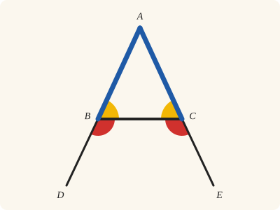
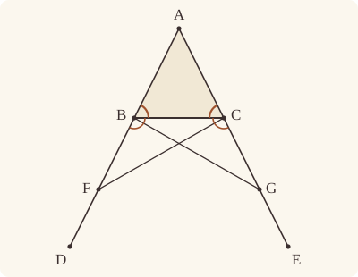
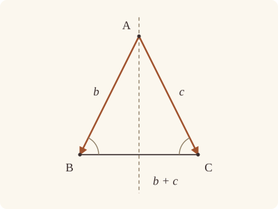

<!-- Generated by scripts/render.py. Do not edit by hand. -->

[Book I](index.md) · [← I.4](04.md) · [I.6 →](06.md)

# Book I, Proposition 5

*In isosceles triangles the angles at the base are equal*

[Euclid's proof](#euclids-proof) · [In Lean](#in-lean) · [What it rests on](#what-it-rests-on) · [Mishnah](#mishnah)

> In isosceles triangles the angles at the base are equal to one another, and, if the equal straight lines be produced further, the angles under the base will be equal to one another.

**In Lean:** ✅ proved, as Euclid states it · Euclid's argument

<p align="center"></p>

<p align="center"><em>Make two sides equal (blue), and the angles at the base are equal (yellow), and so are the angles under it (red).</em></p>

## Euclid's proof

<p align="center"></p>

Let ABC be an isosceles triangle having the side AB equal to the side AC;

and let the straight lines BD, CE be produced further in a straight line with AB, AC. [Post. 2]

I say that the angle ABC is equal to the angle ACB, and the angle CBD to the angle BCE.

Let a point F be taken at random on BD;

from AE the greater let AG be cut off equal to AF the less; [I. 3]

and let the straight lines FC, GB be joined. [Post. 1]

Then, since AF is equal to AG and AB to AC,

the two sides FA, AC are equal to the two sides GA, AB, respectively;

and they contain a common angle, the angle FAG.

Therefore the base FC is equal to the base GB,

and the triangle AFC is equal to the triangle AGB,

and the remaining angles will be equal to the remaining angles respectively, namely those which the equal sides subtend,

that is, the angle ACF to the angle ABG,

and the angle AFC to the angle AGB. [I. 4]

And, since the whole AF is equal to the whole AG,

and in these AB is equal to AC,

the remainder BF is equal to the remainder CG.

But FC was also proved equal to GB;

therefore the two sides BF, FC are equal to the two sides CG, GB respectively;

and the angle BFC is equal to the angle CGB,

while the base BC is common to them;

therefore the triangle BFC is also equal to the triangle CGB,

and the remaining angles will be equal to the remaining angles respectively, namely those which the equal sides subtend;

therefore the angle FBC is equal to the angle GCB,

and the angle BCF to the angle CBG.

Accordingly, since the whole angle ABG was proved equal to the angle ACF,

and in these the angle CBG is equal to the angle BCF,

the remaining angle ABC is equal to the remaining angle ACB;

and they are at the base of the triangle ABC.

But the angle FBC was also proved equal to the angle GCB;

and they are under the base.

Therefore etc.

Q. E. D.

## In Lean

| | |
|---|---|
| Proof | ✅ Proved |
| Statement | The whole enunciation. Both clauses are stated with the equal sides already produced to D and E, as Euclid produces them by Postulate 2; every isosceles triangle has such points. |
| Argument | Euclid's. |
| Representation | Definition I.20 distinguishes isosceles from equilateral triangles. The Lean assumes only AB = AC, so it proves both conclusions for equilateral triangles as well. |
| Reviewed | The statement and every passage of the argument read against Heath's text, at commit [`2e30aceba`](https://github.com/jackChallis/stoicheia/commit/2e30aceba) ([the record](../../review/I/05.toml)) |

From [`Elements/BookI/Prop05.lean`](../../Elements/BookI/Prop05.lean). Euclid's sentences are the `--` comments, and our own notes are in `/- … -/`; the lines under each sentence are the Lean that carries it out. The list below marks where a lemma does a step Euclid takes for granted, where the statement already gives a step and where a step needs a word of its own; the `/- … -/` notes in the listing explain smaller adjustments.

**How the Lean follows the text**

- **Already given.** "and let the straight lines BD, CE be produced further…" D and E come with the statement, already produced, so the Lean draws only AB and AC here. The proof's own Lean still rests on Postulate 2 through proved rules: the order rule `Tacit.between_of_between_right`, beneath `OnRay.between_of_len_lt`, and Metric 8, `Tacit.area_swap`; I.4, which it cites, rests on it too. `Prop5.base` produces the sides for the propositions that cite only the angles at the base.
- **Done by `exists_between_nearer`.** "Let a point F be taken at random on BD…" Euclid assumes he can find F on BD near enough to B that AF remains less than AE. The Lean applies `exists_between_nearer` to AB = AC < AE, using `len_lt_of_between` for C between A and E, and obtains F between B and D with AF < AE; it then derives the order A, B, F by `between_cut` and puts F on AB by `Tacit.on_line_of_between` (System E, Between 2), now proved in `Elements/Figure/Incidence.lean` from Postulate 1, incidence of the middle point and uniqueness of the line.
- **Already given.** "and let the straight lines FC, GB be joined." In the Lean a straight line between two points is named by its ends: FC and GB are sides of the triangles AFC and AGB, so nothing is drawn for the joins, and Postulate 1, which Heath cites, is not called for them.
- **Done by `OnRay.between_of_len_lt`.** "and they contain a common angle…" Euclid reads B between A and F and C between A and G from the figure, giving the triangles the same angle at A. The Lean uses `Tacit.ne_of_between` (System E, Between 1), now proved from the forbidden reversed order in `Elements/Figure/RuleBase.lean`, and the retained axiom `Tacit.len_add_of_between` (System E, Diagram-segment 1), with `len_pos` and `CommonNotion5` to show AB is less than AF; after substituting AC for AB and AG for AF, `OnRay.of_between` and `OnRay.between_of_len_lt` put C between A and G, and `OnRay.of_beyond` with `angle_onRay_left` identifies the angles.
- **Carried.** "and the triangle AFC is equal to the triangle AGB…" The Lean proves that the triangle AFC equals the triangle AGB here, as Euclid states it. Neither his proof nor ours uses it again: both go on with the base FC and the angles that I.4 gives.
- **Done by `Tacit.len_add_of_between`.** "And, since the whole AF is equal to the whole AG…" Euclid subtracts equal AB and AC from equal AF and AG. `Tacit.len_add_of_between`, a rule we assume (System E, Diagram-segment 1), writes AF as AB + BF and AG as AC + CG, using the point order established before the first application of I.4.
- **Already given.** "while the base BC is common to them…" BC is one straight line, the base of both triangles, so nothing is proved here; I.4, applied next, takes only the two sides and the angle between them.
- **Carried.** "therefore the triangle BFC is also equal to the triangle CGB…" The Lean proves that the triangle BFC equals the triangle CGB here, as Euclid states it. Neither his proof nor ours uses it again: both go on with only the angles that I.4 gives.
- **Done by `angle_add_of_between`.** "Accordingly, since the whole angle ABG was proved equal to the angle ACF…" Euclid reads ABG as ABC and CBG together, and ACF as ACB and BCF together. The Lean proves both sums by `angle_add_of_between`, using C between A and G and B between A and F, established before the first application of I.4.
- **Done by `between_inner`.** "and they are under the base." Euclid identifies FBC and GCB with the angles under the base. The Lean uses `between_inner` to put G between C and E, then `angle_onRay_left` and angle symmetry identify those angles with CBD and BCE.

```lean
/-- In isosceles triangles the angles at the base are equal to one another, and, if the equal
straight lines be produced further, the angles under the base will be equal to one another. -/
theorem Prop5 {A B C D E : Point} (hABC : Triangle A B C) (hAB : ‖A B‖ = ‖A C‖)
    (hD : Between A B D) (hE : Between A C E) :
    ∠ A B C = ∠ A C B ∧ ∠ C B D = ∠ B C E := by
  -- Let ABC be an isosceles triangle having the side AB equal to the side AC;
  have hA_B : A ≠ B := hABC.ne₁₂
  have hB_C : B ≠ C := hABC.ne₂₃
  have hA_C : A ≠ C := hABC.ne₁₃
  -- and let the straight lines BD, CE be produced further in a straight line with AB,
  -- AC. [Post. 2]
  /- The statement hands us D and E already produced, so this step names AB and AC
     without producing them. The proof still rests on Postulate 2 through proved rules:
     `OnRay.between_of_len_lt` below reaches it through `between_of_between_right`.
     Since ABC is a triangle, C is off AB, and B is off AC. -/
  obtain ⟨AB, hA_AB, hB_AB⟩ := Postulate1 A B hA_B
  obtain ⟨AC, hA_AC, hC_AC⟩ := Postulate1 A C hA_C
  have hC_AB : ¬ OnLine C AB := fun h => hABC ⟨AB, hA_AB, hB_AB, h⟩
  have hB_AC : ¬ OnLine B AC := fun h => hABC ⟨AC, hA_AC, h, hC_AC⟩
  have hE_AC : OnLine E AC := on_line_of_between hE hA_AC hC_AC
  -- I say that the angle ABC is equal to the angle ACB, and the angle CBD to the angle BCE.
  -- Let a point F be taken at random on BD;
  /- At random, but not too far out, for in the next breath AE is "the greater" and
     AF "the less". AB, being equal to AC, is less than AE, so F can be taken nearer
     to A than E is (`exists_between_nearer` in Book Zero, with a circle about A
     through E). Then F lies beyond B on the straight line AB. -/
  have hAB_AE : ‖A B‖ < ‖A E‖ := by
    rw [hAB]
    exact len_lt_of_between hE
  obtain ⟨F, hBFD, hAF_AE⟩ :=
    exists_between_nearer (ne_of_between (between_symm hD)).symm (Or.inr hD) hAB_AE
  have hABF : Between A B F := between_cut hD hBFD
  have hF_AB : OnLine F AB := on_line_of_between hABF hA_AB hB_AB
  have hA_F : A ≠ F := ne_of_between_ends hABF
  -- from AE the greater let AG be cut off equal to AF the less; [I. 3]
  obtain ⟨G, hAGE, hAG_AF⟩ := Prop3 hA_F hAF_AE
  have hG_AC : OnLine G AC := on_line_of_between_ends hAGE hA_AC hE_AC
  have hA_G : A ≠ G := ne_of_between hAGE
  -- and let the straight lines FC, GB be joined. [Post. 1]
  /- FC and GB are named by their ends, as sides of the triangles AFC and AGB, so
     nothing is drawn for the joins. -/
  -- Then, since AF is equal to AG and AB to AC,
  have hAF_AG : ‖A F‖ = ‖A G‖ := hAG_AF.symm
  -- the two sides FA, AC are equal to the two sides GA, AB, respectively;
  have hAC_AB : ‖A C‖ = ‖A B‖ := hAB.symm
  -- and they contain a common angle, the angle FAG.
  /- Common, because B lies on AF and C lies on AG. For C that takes a word Euclid
     does not say: AG, being equal to AF, is greater than AB, that is, than AC; so G
     lies beyond C. -/
  have hAB_AF : ‖A B‖ < ‖A F‖ := by
    rw [← len_add_of_between hABF]
    exact CommonNotion5 (len_pos (ne_of_between hBFD))
  have hACG : Between A C G :=
    (OnRay.of_between hE).between_of_len_lt (OnRay.of_between hAGE)
      (by rw [hAC_AB, ← hAF_AG]; exact hAB_AF)
  have hFAC_GAB : ∠ F A C = ∠ G A B := by
    rw [angle_onRay_left (OnRay.of_beyond hABF) hA_C.symm, angle_symm hA_B.symm hA_C.symm,
      angle_onRay_left (OnRay.of_beyond hACG) hA_B.symm]
  -- Therefore the base FC is equal to the base GB,
  have hAFC : Triangle A F C := Triangle.of_line hA_AB hF_AB hA_F hC_AB
  have hAGB : Triangle A G B := Triangle.of_line hA_AC hG_AC hA_G hB_AC
  have hI4 := Prop4 hAFC hAGB hAF_AG hAC_AB hFAC_GAB
  have hFC_GB : ‖F C‖ = ‖G B‖ := hI4.1
  -- and the triangle AFC is equal to the triangle AGB,
  have : △ A F C = △ A G B := hI4.2.1
  -- and the remaining angles will be equal to the remaining angles respectively, namely those
  -- which the equal sides subtend,
  -- that is, the angle ACF to the angle ABG,
  have hACF_ABG : ∠ A C F = ∠ A B G := hI4.2.2.2
  -- and the angle AFC to the angle AGB. [I. 4]
  have hAFC_AGB : ∠ A F C = ∠ A G B := hI4.2.2.1
  -- And, since the whole AF is equal to the whole AG,
  have hAB_BF : ‖A B‖ + ‖B F‖ = ‖A F‖ := len_add_of_between hABF
  have hAC_CG : ‖A C‖ + ‖C G‖ = ‖A G‖ := len_add_of_between hACG
  -- and in these AB is equal to AC,
  -- the remainder BF is equal to the remainder CG.
  have hBF_CG : ‖B F‖ = ‖C G‖ := by
    apply CommonNotion3 (c := ‖A B‖) (d := ‖A C‖) _ hAB
    rw [add_comm, hAB_BF, hAF_AG, ← hAC_CG, add_comm]
  -- But FC was also proved equal to GB;
  -- therefore the two sides BF, FC are equal to the two sides CG, GB respectively;
  have hFB_GC : ‖F B‖ = ‖G C‖ := by rw [len_symm F B, hBF_CG, len_symm C G]
  -- and the angle BFC is equal to the angle CGB,
  /- These are the angles AFC and AGB over again, since B lies on FA and C on GA. -/
  have hF_C : F ≠ C := fun h => hC_AB (h ▸ hF_AB)
  have hG_B : G ≠ B := fun h => hB_AC (h ▸ hG_AC)
  have hBFC_CGB : ∠ B F C = ∠ C G B := by
    rw [← angle_onRay_left (OnRay.of_beyond (between_symm hABF)) hF_C.symm,
      ← angle_onRay_left (OnRay.of_beyond (between_symm hACG)) hG_B.symm]
    exact hAFC_AGB
  -- while the base BC is common to them;
  /- Euclid is quoting I.4 ahead of time, as Heath explains: the bases are equal
     because they are one and the same base. -/
  -- therefore the triangle BFC is also equal to the triangle CGB,
  have hFBC : Triangle F B C :=
    Triangle.of_line hF_AB hB_AB (ne_of_between (between_symm hABF)) hC_AB
  have hGCB : Triangle G C B :=
    Triangle.of_line hG_AC hC_AC (ne_of_between (between_symm hACG)) hB_AC
  have hI4' := Prop4 hFBC hGCB hFB_GC hFC_GB hBFC_CGB
  have : △ B F C = △ C G B := by
    rw [← area_rotate F C B, ← area_swap F B C, hI4'.2.1, area_swap G C B, area_rotate G B C]
  -- and the remaining angles will be equal to the remaining angles respectively, namely those
  -- which the equal sides subtend;
  -- therefore the angle FBC is equal to the angle GCB,
  have hFBC_GCB : ∠ F B C = ∠ G C B := hI4'.2.2.1
  -- and the angle BCF to the angle CBG.
  have hBCF_CBG : ∠ B C F = ∠ C B G := by
    rw [angle_symm hB_C hF_C, angle_symm hB_C.symm hG_B]
    exact hI4'.2.2.2
  -- Accordingly, since the whole angle ABG was proved equal to the angle ACF,
  /- Whole, because C lies between A and G, so that BC falls within the angle ABG;
     likewise B lies between A and F, so that CB falls within the angle ACF. -/
  have hABG : ∠ A B G = ∠ A B C + ∠ C B G :=
    angle_add_of_between hAGB hACG
  have hACF : ∠ A C F = ∠ A C B + ∠ B C F :=
    angle_add_of_between hAFC hABF
  -- and in these the angle CBG is equal to the angle BCF,
  -- the remaining angle ABC is equal to the remaining angle ACB;
  have hbase : ∠ A B C = ∠ A C B := by
    apply CommonNotion3 (c := ∠ C B G) (d := ∠ B C F) _ hBCF_CBG.symm
    rw [← hABG, ← hACF, hACF_ABG]
  -- and they are at the base of the triangle ABC.
  -- But the angle FBC was also proved equal to the angle GCB;
  -- and they are under the base.
  /- Under the base: the angle CBD is the angle CBF, since F lies on BD, and the angle
     BCE is the angle BCG, since G lies between C and E. -/
  have hCGE : Between C G E := between_inner hACG hAGE
  have hunder : ∠ C B D = ∠ B C E := by
    rw [angle_symm hB_C.symm (ne_of_between (between_symm hD)),
      angle_onRay_left (OnRay.of_beyond hBFD) hB_C.symm, hFBC_GCB,
      ← angle_onRay_left (OnRay.of_beyond hCGE) hB_C,
      angle_symm (ne_of_between (between_symm hE)) hB_C]
  -- Therefore etc.
  exact ⟨hbase, hunder⟩
  -- Q. E. D.
```

## What it rests on

| | |
|---|---|
| Heath's references | [I.3](03.md), [I.4](04.md); Post. 1, 2 |
| Lean cites | [I.3](03.md), [I.4](04.md) |
| Postulates | 1, 2, 3 |
| Definitions taken as axioms | Def. I.15 |
| Common Notions | 1, 3, 4, 5 |
| Tacit rules | 37 (listed below) |
| Its own Lean calls | Postulate 1; 6 tacit rules |
| Through lemmas | Postulates 2 and 3; Def. I.15; 26 tacit rules |

_Postulates, definitions, Common Notions and tacit rules: all that this proof rests on, counting those of the propositions it cites. The last two rows say which of the postulates, definitions and tacit rules its own Lean calls, in the proof or a helper written for it, and which it does not call but reaches through lemmas, of Book Zero or shared (a proposition it cites may rest on these too); the rest come in only through the propositions it cites or the Common Notions._

<details><summary>The 37 tacit rules beneath this proof, counting those of the propositions it cites</summary>

_(used here) marks a rule this proof's own Lean calls, in the proof or a helper written for it; (through …) marks one its own Lean does not call but reaches through the lemmas named, of [Book Zero](../../Elements/Figure) or shared, though a proposition it cites may rest on it too; and a rule with no mark comes in only through a proposition it cites or a Common Notion. The names in brackets are System E's: an Intersection rule says when straight lines and circles must meet, and an Intersections rule takes a point where they do (see [Book I's introduction](index.md))._

**Reading the figure**

- [`between_cases`](../../Elements/Foundations/Tacit/Diagram.lean#L54) (through [`OnRay.between_of_len_lt`](../../Elements/Figure/Rays.lean#L123), [`Tacit.area_swap`](../../Elements/Figure/AreaRules.lean#L123), [`between_cut`](../../Elements/Figure/Lines.lean#L65) and 2 other lemmas): Of three different points on a straight line, one is between the other two. (Between 6)
- [`between_symm`](../../Elements/Foundations/Tacit/Diagram.lean#L47) (used here): If B is between A and C, it is between C and A. (Between 1)
- [`circles_meet`](../../Elements/Foundations/Tacit/Diagram.lean#L91) (through [`OnRay.between_of_len_lt`](../../Elements/Figure/Rays.lean#L123), [`OnRay.of_between`](../../Elements/Figure/Rays.lean#L34), [`OnRay.of_beyond`](../../Elements/Figure/Rays.lean#L41) and 7 other lemmas): If each circle passes through a point inside the other, the circles cut one another. This is the step Euclid takes for granted in I.1. (Intersection 5)
- [`circles_meet_same_side`](../../Elements/Foundations/Tacit/Constructions.lean#L79) (through [`OnRay.between_of_len_lt`](../../Elements/Figure/Rays.lean#L123), [`OnRay.of_between`](../../Elements/Figure/Rays.lean#L34), [`OnRay.of_beyond`](../../Elements/Figure/Rays.lean#L41) and 7 other lemmas): Two circles that cut one another do so on each side of the straight line through their centres. (Intersections 8)
- [`exists_point`](../../Elements/Foundations/Tacit/Constructions.lean#L35) (through [`Tacit.area_swap`](../../Elements/Figure/AreaRules.lean#L123), [`Triangle.ne₁₂`](../../Elements/Figure/Triangles.lean#L22), [`Triangle.ne₁₃`](../../Elements/Figure/Triangles.lean#L36) and 1 other lemma): Let a point be taken. (Points 1)
- [`exists_point_inside_circle`](../../Elements/Foundations/Tacit/Constructions.lean#L42) (through [`OnRay.between_of_len_lt`](../../Elements/Figure/Rays.lean#L123), [`OnRay.of_between`](../../Elements/Figure/Rays.lean#L34), [`OnRay.of_beyond`](../../Elements/Figure/Rays.lean#L41) and 7 other lemmas): Let a point be taken inside the circle α. (Points 8)
- [`exists_point_on_line`](../../Elements/Foundations/Tacit/Constructions.lean#L38) (through [`OnRay.between_of_len_lt`](../../Elements/Figure/Rays.lean#L123), [`OnRay.of_between`](../../Elements/Figure/Rays.lean#L34), [`OnRay.of_beyond`](../../Elements/Figure/Rays.lean#L41) and 7 other lemmas): Let a point be taken on the straight line L. (Points 2)
- [`line_circle_between`](../../Elements/Foundations/Tacit/Constructions.lean#L67) (through [`OnRay.between_of_len_lt`](../../Elements/Figure/Rays.lean#L123), [`OnRay.of_between`](../../Elements/Figure/Rays.lean#L34), [`OnRay.of_beyond`](../../Elements/Figure/Rays.lean#L41) and 7 other lemmas): A straight line through a point B inside a circle, heading out to a point C outside it, cuts the circle between B and C. (Intersections 4)
- [`line_circle_beyond`](../../Elements/Foundations/Tacit/Constructions.lean#L73) (through [`OnRay.between_of_len_lt`](../../Elements/Figure/Rays.lean#L123), [`OnRay.of_between`](../../Elements/Figure/Rays.lean#L34), [`OnRay.of_beyond`](../../Elements/Figure/Rays.lean#L41) and 7 other lemmas): A straight line through a point B inside a circle, produced beyond B away from C, cuts the circle there. (Intersections 5)
- [`line_unique`](../../Elements/Foundations/Tacit/Diagram.lean#L41) (through [`OnRay.between_of_len_lt`](../../Elements/Figure/Rays.lean#L123), [`OnRay.of_beyond`](../../Elements/Figure/Rays.lean#L41), [`Tacit.area_swap`](../../Elements/Figure/AreaRules.lean#L123) and 6 other lemmas): Two points determine a straight line. (Generalities 1)
- [`lines_meet_of_opposite_sides`](../../Elements/Foundations/Tacit/Diagram.lean#L86): A straight line joining points on opposite sides of L crosses L. (Intersection 1)
- [`not_between_of_between`](../../Elements/Foundations/Tacit/Diagram.lean#L50) (through [`OnRay.between_of_len_lt`](../../Elements/Figure/Rays.lean#L123), [`OnRay.of_between`](../../Elements/Figure/Rays.lean#L34), [`OnRay.of_beyond`](../../Elements/Figure/Rays.lean#L41) and 11 other lemmas): If B is between A and C, then A is not between B and C. (Between 1)
- [`not_on_line_of_same_side`](../../Elements/Foundations/Tacit/Diagram.lean#L60) (through [`OnRay.between_of_len_lt`](../../Elements/Figure/Rays.lean#L123), [`OnRay.of_between`](../../Elements/Figure/Rays.lean#L34), [`OnRay.of_beyond`](../../Elements/Figure/Rays.lean#L41) and 7 other lemmas): Points on one side of a straight line are not on it. (Same side 3)
- [`pasch2`](../../Elements/Foundations/Tacit/Diagram.lean#L71) (through [`OnRay.between_of_len_lt`](../../Elements/Figure/Rays.lean#L123), [`OnRay.of_between`](../../Elements/Figure/Rays.lean#L34), [`OnRay.of_beyond`](../../Elements/Figure/Rays.lean#L41) and 7 other lemmas): If B is between A and C, A is on L and B is off it, then B and C are on the same side of L: a straight line that leaves L at A does not cross it again. (Pasch 2)
- [`same_side_trans`](../../Elements/Foundations/Tacit/Diagram.lean#L64) (through [`OnRay.between_of_len_lt`](../../Elements/Figure/Rays.lean#L123), [`OnRay.of_between`](../../Elements/Figure/Rays.lean#L34), [`OnRay.of_beyond`](../../Elements/Figure/Rays.lean#L41) and 7 other lemmas): Two points on the same side of a straight line as a third point are on the same side as each other. (Same side 4)

**Lengths, angles and areas**

- [`angle_add_of_inside`](../../Elements/Foundations/Tacit/Transfer.lean#L47) (through [`angle_add_of_between`](../../Elements/Figure/Angles.lean#L85)): If D lies within the angle BAC, then BAC is made up of BAD and DAC. (Diagram-angle 2)
- [`angle_eq_of_same_rays`](../../Elements/Foundations/Tacit/Transfer.lean#L54) (through [`angle_onRay_left`](../../Elements/Figure/Angles.lean#L42)): The angle doesn't change if its arms are traced through other points on the same rays. (Diagram-angle 4)
- [`angle_symm`](../../Elements/Foundations/Tacit/Metric.lean#L30) (used here): The angle ABC is the angle CBA. (Metric 4)
- [`area_add_of_between`](../../Elements/Foundations/Tacit/Transfer.lean#L70) (through [`Tacit.area_swap`](../../Elements/Figure/AreaRules.lean#L123)): Cutting a triangle in two from a vertex adds up. (Diagram-area 2)
- [`area_congruent`](../../Elements/Foundations/Tacit/Metric.lean#L44): Triangles equal in all their sides and angles are equal in area. Euclid uses this without comment once he has shown two triangles congruent. (Metric 9)
- [`area_degenerate`](../../Elements/Foundations/Tacit/Metric.lean#L36) (through [`Tacit.area_swap`](../../Elements/Figure/AreaRules.lean#L123)): A "triangle" with a repeated corner has no area. (Metric 6)
- [`area_eq_zero_of_on_line`](../../Elements/Foundations/Tacit/Transfer.lean#L62) (through [`Tacit.area_swap`](../../Elements/Figure/AreaRules.lean#L123)): A "triangle" whose corners lie on one straight line has no area. (Diagram-area 1)
- [`area_rotate`](../../Elements/Foundations/Tacit/Metric.lean#L39) (used here): The triangle ABC is the triangle CAB. (Metric 8)
- [`len_add_of_between`](../../Elements/Foundations/Tacit/Transfer.lean#L27) (used here): If B is between A and C, then AB and BC together make up AC. (Diagram-segment 1)
- [`len_self`](../../Elements/Foundations/Tacit/Metric.lean#L24) (through [`OnRay.between_of_len_lt`](../../Elements/Figure/Rays.lean#L123), [`OnRay.of_between`](../../Elements/Figure/Rays.lean#L34), [`OnRay.of_beyond`](../../Elements/Figure/Rays.lean#L41) and 9 other lemmas): The "straight line" from a point to itself has no length. (Metric 1)
- [`len_symm`](../../Elements/Foundations/Tacit/Metric.lean#L27) (used here): The straight line AB is the straight line BA. (Metric 3)
- [`radius_ne_zero`](../../Elements/Foundations/Tacit/Metric.lean#L62) (through [`OnRay.between_of_len_lt`](../../Elements/Figure/Rays.lean#L123), [`OnRay.of_between`](../../Elements/Figure/Rays.lean#L34), [`OnRay.of_beyond`](../../Elements/Figure/Rays.lean#L41) and 11 other lemmas): A circle's radius is not nothing: the straight line from the centre to a point on the circle has some length. A rule of our own, not one of System E's: every circle is drawn with a centre and a distance (Postulate 3).
- [`same_ray_of_angle_eq_zero`](../../Elements/Foundations/Tacit/Transfer.lean#L42): If the angle BAC is nothing, C lies on the ray from A through B. (Diagram-angle 1)

**Superposition**

- [`superposition`](../../Elements/Foundations/Tacit/Superposition.lean#L52): **Superposition.** A hypothetical placement of a triangle on a given ray and side permits a restricted derivation of metric equalities about the figure already given. The derivation introduces no further objects, cites each geometric law it uses, and exports no symbol of the placement.

**Laws of magnitude**

- [`add_assoc`](../../Elements/Foundations/Tacit/Magnitudes.lean#L23) (through [`OnRay.between_of_len_lt`](../../Elements/Figure/Rays.lean#L123), [`Tacit.area_swap`](../../Elements/Figure/AreaRules.lean#L123), [`between_cut`](../../Elements/Figure/Lines.lean#L65) and 2 other lemmas): Adding three magnitudes in a row, it makes no difference whether the first two or the last two are added first. (System E §3.5)
- [`add_comm`](../../Elements/Foundations/Tacit/Magnitudes.lean#L26) (used here): The order of adding does not matter. (System E §3.5)
- [`add_lt_add_right`](../../Elements/Foundations/Tacit/Magnitudes.lean#L45) (through [`OnRay.between_of_len_lt`](../../Elements/Figure/Rays.lean#L123), [`Tacit.area_swap`](../../Elements/Figure/AreaRules.lean#L123), [`between_cut`](../../Elements/Figure/Lines.lean#L65) and 2 other lemmas): Adding the same thing to both sides keeps "less than". (System E §3.5)
- [`add_zero`](../../Elements/Foundations/Tacit/Magnitudes.lean#L29): Adding nothing changes nothing. (System E §3.5)
- [`lt_irrefl`](../../Elements/Foundations/Tacit/Magnitudes.lean#L32) (through [`OnRay.between_of_len_lt`](../../Elements/Figure/Rays.lean#L123), [`OnRay.of_between`](../../Elements/Figure/Rays.lean#L34), [`OnRay.of_beyond`](../../Elements/Figure/Rays.lean#L41) and 7 other lemmas): No magnitude is less than itself. (System E §3.5)
- [`lt_trans`](../../Elements/Foundations/Tacit/Magnitudes.lean#L35) (through [`OnRay.between_of_len_lt`](../../Elements/Figure/Rays.lean#L123), [`OnRay.of_between`](../../Elements/Figure/Rays.lean#L34), [`OnRay.of_beyond`](../../Elements/Figure/Rays.lean#L41) and 7 other lemmas): What is less than the less is less still. (System E §3.5)
- [`lt_trichotomy`](../../Elements/Foundations/Tacit/Magnitudes.lean#L39) (through [`OnRay.between_of_len_lt`](../../Elements/Figure/Rays.lean#L123), [`OnRay.of_between`](../../Elements/Figure/Rays.lean#L34), [`OnRay.of_beyond`](../../Elements/Figure/Rays.lean#L41) and 11 other lemmas): Of two magnitudes, one is less, or they are equal, or the other is less. (System E §3.5)
- [`not_lt_zero`](../../Elements/Foundations/Tacit/Magnitudes.lean#L42) (through [`OnRay.between_of_len_lt`](../../Elements/Figure/Rays.lean#L123), [`OnRay.of_between`](../../Elements/Figure/Rays.lean#L34), [`OnRay.of_beyond`](../../Elements/Figure/Rays.lean#L41) and 11 other lemmas): Nothing is less than zero. (System E §3.5)

</details>

## Mishnah

_Our commentary: what Euclid assumes, what Lean made us say out loud, and how the result looks by modern means._

**"At the very threshold."** Proclus credits the discovery to Thales, "who however is said to have spoken of the angles as being *similar*, and not as being *equal*" (Heath, vol. 1, p. 252). Aristotle sketches an older proof, which made the equal sides radii of a circle and reasoned with the mixed angles that straight lines make with its circumference. From that passage Heath infers that Euclid's proof was his own, "and it would thus appear that his innovations as regards order of propositions and methods of proof began at the very threshold of the subject" (vol. 1, p. 254). Generations of schoolchildren knew it as the *pons asinorum*, the bridge of asses.

Euclid takes F "at random" on BD, and the Greek, Heath notes, means "a chance point" (vol. 1, p. 252). Yet at once AE is "the greater" and AF "the less", so F must not lie too far out: [Book Zero](../../Elements/Figure)'s `exists_between_nearer` keeps it inside a circle about A through E that Euclid never draws. The rest of his figure quietly settles the order of its points, and Lean wants each of those facts said. G lies beyond C, since AG, equal to AF, is greater than AC; the angle FAG is "common" because B lies on AF and C on AG; and C lies between A and G, so the "whole angle ABG" is ABC and CBG together.

Pappus needed no construction at all. "Let us conceive this one triangle as two triangles," his proof says, as Proclus reports it: AB, AC are equal to AC, AB, the angle at A is common, and I.4 does the rest (Heath, vol. 1, p. 254). Heath thinks it "by far the best"; the editors' way, turning the triangle over onto itself, "supposes the triangle to be taken up and at the same time to remain where it is" (vol. 1, p. 254). Pappus says nothing of the angles under the base, which, in Proclus' explanation as Heath gives it, Euclid added "for the purpose of fore-arming the learner against a possible *objection*" to I.7 (vol. 1, p. 255), and our I.7 uses them just so. Euclid produces the sides by Postulate 2; we state I.5 with D and E already given, so this construction is part of the hypothesis. The proof still rests on Postulate 2. In its own Lean, the proved order rule beneath `OnRay.between_of_len_lt`, which puts G beyond C, produces a straight line in its own argument, and the proved Metric 8, `area_swap`, which the Lean cites to read a triangle's area with its corners in the other order, rests on it too. I.4, which it cites, rests on it as well: one half of its law of one ray for one angle, that the corner where C falls lies on DF, is proved with a rule that produces a straight line.

**The modern way.** Pappus' idea is a reflection. With A at the origin and B, C at the vectors $\mathbf{b}$, $\mathbf{c}$, of equal length, the reflection in the straight line along $\mathbf{b} + \mathbf{c}$ exchanges $\mathbf{b}$ and $\mathbf{c}$ and fixes A, so it carries the triangle ABC onto ACB, and each angle at the base onto the other.

<p align="center"></p>

## Further reading

- Pappus' idea in modern dress, the reflection that exchanges the two equal sides, is in I. M. Yaglom's [*Geometric Transformations I*](https://doi.org/10.5948/UPO9780883859254) (1962), ch. II, "Symmetry", §1, "Reflection and Glide Reflection", where reflections are put to work on construction problems (also on [I.2](02.md)).

[Book I](index.md) · [← I.4](04.md) · [I.6 →](06.md)

---

<sub>Euclid's text: T. L. Heath, *The Thirteen Books of Euclid's Elements*, vol. 1 (Cambridge, 1908), pp. 251–252; [scan leaves n271–n272](https://archive.org/details/thirteenbookseu02heibgoog/page/n271); [figure on n271](https://archive.org/details/thirteenbookseu02heibgoog/page/n271). Public domain.</sub>

<sub>The tacit rules follow the System E of Jeremy Avigad, Edward Dean and John Mumma, read alongside LeanEuclid (Logan Murphy, Kaiyu Yang, Jialiang Sun, Zhaoyu Li, Anima Anandkumar and Xujie Si).</sub>
