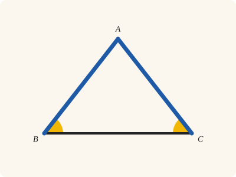
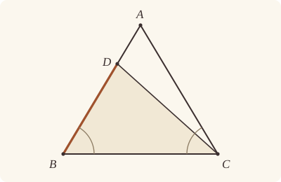
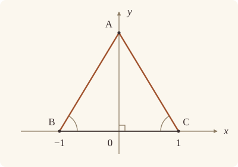

<!-- Generated by scripts/render.py. Do not edit by hand. -->

[Book I](index.md) · [← I.5](05.md) · [I.7 →](07.md)

# Book I, Proposition 6

*Equal angles are subtended by equal sides*

[Euclid's proof](#euclids-proof) · [In Lean](#in-lean) · [What it rests on](#what-it-rests-on) · [Mishnah](#mishnah)

> If in a triangle two angles be equal to one another, the sides which subtend the equal angles will also be equal to one another.

**In Lean:** ✅ proved, as Euclid states it · Euclid's argument

<p align="center"></p>

<p align="center"><em>Make the two angles at the base equal (yellow), and the sides that rise from them come out equal (blue). It is the bridge of asses turned round.</em></p>

## Euclid's proof

<p align="center"></p>

<p align="center"><em>Drawn for one case: DB cut off from AB, for the supposition that AB is greater than AC, as in Heath's figure. Like Heath's, this figure is drawn for Euclid's impossible supposition, but keeps the angles at B and C equal, so AB and AC are drawn equal: D stands on AB, and DB, supposed equal to AC, is drawn shorter.</em></p>

Let ABC be a triangle having the angle ABC equal to the angle ACB;

I say that the side AB is also equal to the side AC.

For, if AB is unequal to AC, one of them is greater.

Let AB be greater; and from AB the greater let DB be cut off equal to AC the less;

let DC be joined.

Then, since DB is equal to AC,

and BC is common,

the two sides DB, BC are equal to the two sides AC, CB respectively;

and the angle DBC is equal to the angle ACB;

therefore the base DC is equal to the base AB,

and the triangle DBC will be equal to the triangle ACB,

the less to the greater:

which is absurd.

Therefore AB is not unequal to AC;

it is therefore equal to it.

Therefore etc.

Q. E. D.

## In Lean

| | |
|---|---|
| Proof | ✅ Proved |
| Statement | The whole enunciation. |
| Argument | Euclid's. |
| Reviewed | The statement and every passage of the argument read against Heath's text, at commit [`86e935fe`](https://github.com/jackChallis/stoicheia/commit/86e935fe) ([the record](../../review/I/06.toml)) |

From [`Elements/BookI/Prop06.lean`](../../Elements/BookI/Prop06.lean). Euclid's sentences are the `--` comments, and our own notes are in `/- … -/`; the lines under each sentence are the Lean that carries it out. The list below marks where a lemma does a step Euclid takes for granted, where several sentences share one step, where the Lean takes a case Euclid's figure leaves aside and where the statement already gives a step; the `/- … -/` notes in the listing explain smaller adjustments.

**How the Lean follows the text**

- **Done by `Tacit.lt_trichotomy`.** "For, if AB is unequal to AC…" Euclid takes for granted that one of two unequal lengths is greater; the Lean uses `Tacit.lt_trichotomy`, a tacit rule of magnitude, which we assume (System E §3.5).
- **A further case.** "Let AB be greater…" Euclid supposes AB greater; the Lean also rules out AC greater by applying the same argument with B and C exchanged.
- **Done by `Prop3`.** "and from AB the greater let DB be cut off…" Euclid cuts DB from the end B of AB; the Lean uses I.3 (`Prop3`), for which Heath gives no reference here.
- **Already given.** "let DC be joined." Our triangle DBC is named by its corners, so no straight line DC is drawn: the proof uses only the points D and C.
- **Carried together, by `Prop4`.** "therefore the base DC is equal to the base AB…" Euclid obtains the equal base and the equal triangle from the two sides and their included angle. The Lean first shows that DBC is a triangle by `Prop6.figure`, then applies I.4 (`Prop4`), for which Heath gives no reference here, once for both conclusions.
- **Done by `Prop6.less`.** "the less to the greater…" Euclid takes for granted that DBC is less than ACB; the Lean proves it with areas, the whole triangle being greater than its part.

<details><summary>Before the theorem, two lemmas: <code>Prop6.figure</code> and <code>Prop6.less</code> (31 lines)</summary>

```lean
/-- What Euclid sees in the figure but never says: D, cut off on BA, is not on
the straight line BC, so DBC is a triangle (and I.4 may be applied to it). -/
theorem Prop6.figure {A B C D : Point} (hABC : Triangle A B C) (hBDA : Between B D A) :
    Triangle B D C := by
  rintro ⟨L, hB, hD, hC⟩
  /- A straight line through B and D goes on through A, and then A, B, C would
     lie on one straight line. -/
  exact hABC ⟨L, on_line_of_between hBDA hB hD, hB, hC⟩

/-- The step Heath points out: because D is between A and B, the
triangle DBC is less than the triangle ACB. The straight line CD cuts ACB
into DBC and ADC (System E, Diagram-area 2), ADC is something, since C is
not on AB (Diagram-area 1), and the whole is greater than the part (C.N. 5). -/
theorem Prop6.less {A B C D : Point} (hABC : Triangle A B C) (hBDA : Between B D A) :
    △ D B C < △ A C B := by
  obtain ⟨BA, hB, hA⟩ := Postulate1 B A hABC.ne₁₂.symm
  have hD : OnLine D BA := on_line_of_between_ends hBDA hB hA
  have hC : ¬ OnLine C BA := fun hC => hABC ⟨BA, hA, hB, hC⟩
  have hDA : D ≠ A := (ne_of_between (between_symm hBDA)).symm
  /- The two parts make up the whole. -/
  have hwhole : △ B D C + △ C D A = △ B C A :=
    area_add_of_between hB hA hD hABC.ne₁₂.symm (ne_of_between hBDA) hDA.symm hC hBDA
  /- The part ADC is something: a triangle with no area would have C on BA. -/
  have hpart : △ C D A ≠ 0 := by
    intro h0
    rw [← area_rotate D A C] at h0
    exact hC (on_line_of_area_eq_zero hD hA hDA h0)
  have := CommonNotion5 (a := △ B D C) (Magnitude.pos_of_ne_zero hpart)
  rw [hwhole, area_rotate B C A, area_swap A B C, ← area_rotate D C B, ← area_swap D B C]
    at this
  exact this
```

</details>

```lean
/-- If in a triangle two angles be equal to one another, the sides which subtend the equal angles
will also be equal to one another. -/
theorem Prop6 {A B C : Point} (hABC : Triangle A B C) (h : ∠ A B C = ∠ A C B) :
    ‖A B‖ = ‖A C‖ := by
  -- Let ABC be a triangle having the angle ABC equal to the angle ACB;
  -- I say that the side AB is also equal to the side AC.
  -- For, if AB is unequal to AC, one of them is greater.
  /- That of two unequal lengths one is the greater is a tacit rule of
     magnitude (System E §3.5), `lt_trichotomy`. -/
  have one_greater : ‖A B‖ ≠ ‖A C‖ → ‖A C‖ < ‖A B‖ ∨ ‖A B‖ < ‖A C‖ := by
    intro hne
    rcases lt_trichotomy ‖A B‖ ‖A C‖ with hlt | heq | hgt
    · exact Or.inr hlt
    · exact absurd heq hne
    · exact Or.inl hgt
  /- Euclid takes AB to be the greater. The other case is his argument again
     with B and C exchanged, so we give the argument for every triangle whose
     angles at B and C are equal, and use it twice below. -/
  have greater : ∀ {B C : Point}, Triangle A B C → ∠ A B C = ∠ A C B →
      ‖A C‖ < ‖A B‖ → False := by
    intro B C hABC h hAC_AB
    -- Let AB be greater; and from AB the greater let DB be cut off equal to AC the less;
    /- Heath gives no reference here, but cutting off is I.3, from the end B. -/
    have hAC_BA : ‖A C‖ < ‖B A‖ := by rw [len_symm B A]; exact hAC_AB
    obtain ⟨D, hBDA, hBD⟩ := Prop3 (A := B) (B := A) hABC.ne₁₃ hAC_BA
    -- let DC be joined.
    /- Our proof uses only the points D and C; the straight line DC is drawn
       for the eye. -/
    -- Then, since DB is equal to AC,
    have hDB : ‖D B‖ = ‖A C‖ := (len_symm D B).trans hBD
    -- and BC is common,
    have hBC : ‖B C‖ = ‖C B‖ := len_symm B C
    -- the two sides DB, BC are equal to the two sides AC, CB respectively;
    have hsides : ‖B D‖ = ‖C A‖ ∧ ‖B C‖ = ‖C B‖ :=
      ⟨(len_symm B D).trans (hDB.trans (len_symm A C)), hBC⟩
    -- and the angle DBC is equal to the angle ACB;
    /- The angle DBC is the angle ABC itself, since D lies on the ray from B
       through A (`angle_onRay_left` in Book Zero, from System E's Diagram-angle
       4), and ABC is equal to ACB by hypothesis. -/
    have hDBC : ∠ D B C = ∠ A C B :=
      (angle_onRay_left (OnRay.of_between hBDA) hABC.ne₂₃.symm).trans h
    -- therefore the base DC is equal to the base AB,
    /- This is I.4, applied to the triangles DBC and ACB; that DBC is a
       triangle at all is `Prop6.figure`. -/
    obtain ⟨hDC_AB, hBDC_CAB, -, -⟩ :=
      Prop4 (Prop6.figure hABC hBDA) hABC.cab hsides.1 hsides.2 hDBC
    -- and the triangle DBC will be equal to the triangle ACB,
    have hequal : △ D B C = △ A C B := by
      rw [area_swap D B C, area_rotate D C B, hBDC_CAB, ← area_rotate A B C, area_swap A B C]
    -- the less to the greater:
    /- Heath: "Euclid assumes that, because D is between A and B, the
       triangle DBC is less than the triangle ABC." We prove it, with areas:
       the whole triangle is greater than its part (`Prop6.less`). -/
    have hless : △ D B C < △ A C B := Prop6.less hABC hBDA
    -- which is absurd.
    rw [hequal] at hless
    exact lt_irrefl _ hless
  -- Therefore AB is not unequal to AC;
  have hnot : ¬ ‖A B‖ ≠ ‖A C‖ := fun hne =>
    (one_greater hne).elim (greater hABC h) (greater hABC.acb h.symm)
  -- it is therefore equal to it.
  /- Reductio ad absurdum: a length not unequal to another is equal to it. -/
  exact Classical.byContradiction hnot
  -- Therefore etc.
  -- Q. E. D.
```

## What it rests on

| | |
|---|---|
| Heath's references | none |
| Lean cites | [I.3](03.md), [I.4](04.md) |
| Postulates | 1, 2, 3 |
| Definitions taken as axioms | Def. I.15 |
| Common Notions | 1, 3, 4, 5 |
| Tacit rules | 39 (listed below) |
| Its own Lean calls | Postulate 1; 7 tacit rules |
| Through lemmas | Postulates 2 and 3; Def. I.15; 25 tacit rules |

_Postulates, definitions, Common Notions and tacit rules: all that this proof rests on, counting those of the propositions it cites. The last two rows say which of the postulates, definitions and tacit rules its own Lean calls, in the proof or a helper written for it, and which it does not call but reaches through lemmas, of Book Zero or shared (a proposition it cites may rest on these too); the rest come in only through the propositions it cites or the Common Notions._

<details><summary>The 39 tacit rules beneath this proof, counting those of the propositions it cites</summary>

_(used here) marks a rule this proof's own Lean calls, in the proof or a helper written for it; (through …) marks one its own Lean does not call but reaches through the lemmas named, of [Book Zero](../../Elements/Figure) or shared, though a proposition it cites may rest on it too; and a rule with no mark comes in only through a proposition it cites or a Common Notion. The names in brackets are System E's: an Intersection rule says when straight lines and circles must meet, and an Intersections rule takes a point where they do (see [Book I's introduction](index.md))._

**Reading the figure**

- [`between_cases`](../../Elements/Foundations/Tacit/Diagram.lean#L54) (through [`Tacit.area_swap`](../../Elements/Figure/AreaRules.lean#L123)): Of three different points on a straight line, one is between the other two. (Between 6)
- [`between_of_inside_chord`](../../Elements/Foundations/Tacit/Diagram.lean#L81) (through [`OnRay.of_between`](../../Elements/Figure/Rays.lean#L34), [`Tacit.area_swap`](../../Elements/Figure/AreaRules.lean#L123), [`Tacit.on_line_of_between`](../../Elements/Figure/Incidence.lean#L77) and 2 other lemmas): A straight line through a point inside a circle has that point between the points where it meets the circle. (Circle 1)
- [`between_symm`](../../Elements/Foundations/Tacit/Diagram.lean#L47) (used here): If B is between A and C, it is between C and A. (Between 1)
- [`circles_meet`](../../Elements/Foundations/Tacit/Diagram.lean#L94) (through [`OnRay.of_between`](../../Elements/Figure/Rays.lean#L34), [`Tacit.area_swap`](../../Elements/Figure/AreaRules.lean#L123), [`Tacit.on_line_of_between`](../../Elements/Figure/Incidence.lean#L77) and 1 other lemma): If each circle passes through a point inside the other, the circles cut one another. This is the step Euclid takes for granted in I.1. (Intersection 5)
- [`circles_meet_same_side`](../../Elements/Foundations/Tacit/Constructions.lean#L79) (through [`OnRay.of_between`](../../Elements/Figure/Rays.lean#L34), [`Tacit.area_swap`](../../Elements/Figure/AreaRules.lean#L123), [`Tacit.on_line_of_between`](../../Elements/Figure/Incidence.lean#L77) and 1 other lemma): Two circles that cut one another do so on each side of the straight line through their centres. (Intersections 8)
- [`exists_point`](../../Elements/Foundations/Tacit/Constructions.lean#L35) (through [`OnRay.of_between`](../../Elements/Figure/Rays.lean#L34), [`Tacit.area_swap`](../../Elements/Figure/AreaRules.lean#L123), [`Tacit.on_line_of_between`](../../Elements/Figure/Incidence.lean#L77) and 4 other lemmas): Let a point be taken. (Points 1)
- [`exists_point_inside_circle`](../../Elements/Foundations/Tacit/Constructions.lean#L42) (through [`OnRay.of_between`](../../Elements/Figure/Rays.lean#L34), [`Tacit.area_swap`](../../Elements/Figure/AreaRules.lean#L123), [`Tacit.on_line_of_between`](../../Elements/Figure/Incidence.lean#L77) and 2 other lemmas): Let a point be taken inside the circle α. (Points 8)
- [`exists_point_on_line`](../../Elements/Foundations/Tacit/Constructions.lean#L38) (through [`OnRay.of_between`](../../Elements/Figure/Rays.lean#L34), [`Tacit.area_swap`](../../Elements/Figure/AreaRules.lean#L123), [`Tacit.on_line_of_between`](../../Elements/Figure/Incidence.lean#L77) and 1 other lemma): Let a point be taken on the straight line L. (Points 2)
- [`line_circle_between`](../../Elements/Foundations/Tacit/Constructions.lean#L67) (through [`OnRay.of_between`](../../Elements/Figure/Rays.lean#L34), [`Tacit.area_swap`](../../Elements/Figure/AreaRules.lean#L123), [`Tacit.on_line_of_between`](../../Elements/Figure/Incidence.lean#L77) and 2 other lemmas): A straight line through a point B inside a circle, heading out to a point C outside it, cuts the circle between B and C. (Intersections 4)
- [`line_circle_beyond`](../../Elements/Foundations/Tacit/Constructions.lean#L73) (through [`OnRay.of_between`](../../Elements/Figure/Rays.lean#L34), [`Tacit.area_swap`](../../Elements/Figure/AreaRules.lean#L123), [`Tacit.on_line_of_between`](../../Elements/Figure/Incidence.lean#L77) and 2 other lemmas): A straight line through a point B inside a circle, produced beyond B away from C, cuts the circle there. (Intersections 5)
- [`line_unique`](../../Elements/Foundations/Tacit/Diagram.lean#L41) (through [`Tacit.area_swap`](../../Elements/Figure/AreaRules.lean#L123) and [`Tacit.on_line_of_between`](../../Elements/Figure/Incidence.lean#L77)): Two points determine a straight line. (Generalities 1)
- [`lines_meet_of_opposite_sides`](../../Elements/Foundations/Tacit/Diagram.lean#L89): A straight line joining points on opposite sides of L crosses L. (Intersection 1)
- [`not_between_of_between`](../../Elements/Foundations/Tacit/Diagram.lean#L50) (through [`OnRay.of_between`](../../Elements/Figure/Rays.lean#L34), [`Tacit.area_swap`](../../Elements/Figure/AreaRules.lean#L123), [`Tacit.ne_of_between`](../../Elements/Figure/RuleBase.lean#L140) and 3 other lemmas): If B is between A and C, then A is not between B and C. (Between 1)
- [`not_on_line_of_same_side`](../../Elements/Foundations/Tacit/Diagram.lean#L60) (through [`OnRay.of_between`](../../Elements/Figure/Rays.lean#L34), [`Tacit.area_swap`](../../Elements/Figure/AreaRules.lean#L123), [`Tacit.on_line_of_between`](../../Elements/Figure/Incidence.lean#L77) and 1 other lemma): Points on one side of a straight line are not on it. (Same side 3)
- [`pasch2`](../../Elements/Foundations/Tacit/Diagram.lean#L71) (through [`OnRay.of_between`](../../Elements/Figure/Rays.lean#L34), [`Tacit.area_swap`](../../Elements/Figure/AreaRules.lean#L123), [`Tacit.on_line_of_between`](../../Elements/Figure/Incidence.lean#L77) and 1 other lemma): If B is between A and C, A is on L and B is off it, then B and C are on the same side of L: a straight line that leaves L at A does not cross it again. (Pasch 2)
- [`same_side_trans`](../../Elements/Foundations/Tacit/Diagram.lean#L64) (through [`OnRay.of_between`](../../Elements/Figure/Rays.lean#L34), [`Tacit.area_swap`](../../Elements/Figure/AreaRules.lean#L123), [`Tacit.on_line_of_between`](../../Elements/Figure/Incidence.lean#L77) and 1 other lemma): Two points on the same side of a straight line as a third point are on the same side as each other. (Same side 4)

**Lengths, angles and areas**

- [`angle_add_of_inside`](../../Elements/Foundations/Tacit/Transfer.lean#L47): If D lies within the angle BAC, then BAC is made up of BAD and DAC. (Diagram-angle 2)
- [`angle_eq_of_same_rays`](../../Elements/Foundations/Tacit/Transfer.lean#L54) (through [`angle_onRay_left`](../../Elements/Figure/Angles.lean#L42)): The angle doesn't change if its arms are traced through other points on the same rays. (Diagram-angle 4)
- [`angle_symm`](../../Elements/Foundations/Tacit/Metric.lean#L30): The angle ABC is the angle CBA. (Metric 4)
- [`area_add_of_between`](../../Elements/Foundations/Tacit/Transfer.lean#L70) (used here): Cutting a triangle in two from a vertex adds up. (Diagram-area 2)
- [`area_congruent`](../../Elements/Foundations/Tacit/Metric.lean#L44): Triangles equal in all their sides and angles are equal in area. Euclid uses this without comment once he has shown two triangles congruent. (Metric 9)
- [`area_degenerate`](../../Elements/Foundations/Tacit/Metric.lean#L36) (through [`Tacit.area_swap`](../../Elements/Figure/AreaRules.lean#L123)): A "triangle" with a repeated corner has no area. (Metric 6)
- [`area_eq_zero_of_on_line`](../../Elements/Foundations/Tacit/Transfer.lean#L62) (through [`Tacit.area_swap`](../../Elements/Figure/AreaRules.lean#L123)): A "triangle" whose corners lie on one straight line has no area. (Diagram-area 1)
- [`area_rotate`](../../Elements/Foundations/Tacit/Metric.lean#L39) (used here): The triangle ABC is the triangle CAB. (Metric 8)
- [`circle_eq`](../../Elements/Foundations/Tacit/Transfer.lean#L30) (through [`OnRay.of_between`](../../Elements/Figure/Rays.lean#L34), [`Tacit.area_swap`](../../Elements/Figure/AreaRules.lean#L123), [`Tacit.on_line_of_between`](../../Elements/Figure/Incidence.lean#L77) and 2 other lemmas): A circle is fixed by its centre and its radius. (Diagram-segment 2)
- [`len_add_of_between`](../../Elements/Foundations/Tacit/Transfer.lean#L27) (through [`OnRay.of_between`](../../Elements/Figure/Rays.lean#L34), [`Tacit.area_swap`](../../Elements/Figure/AreaRules.lean#L123), [`Tacit.on_line_of_between`](../../Elements/Figure/Incidence.lean#L77) and 2 other lemmas): If B is between A and C, then AB and BC together make up AC. (Diagram-segment 1)
- [`len_self`](../../Elements/Foundations/Tacit/Metric.lean#L24) (through [`OnRay.of_between`](../../Elements/Figure/Rays.lean#L34), [`Tacit.area_swap`](../../Elements/Figure/AreaRules.lean#L123), [`Tacit.on_line_of_between`](../../Elements/Figure/Incidence.lean#L77) and 2 other lemmas): The "straight line" from a point to itself has no length. (Metric 1)
- [`len_symm`](../../Elements/Foundations/Tacit/Metric.lean#L27) (used here): The straight line AB is the straight line BA. (Metric 3)
- [`on_line_of_area_eq_zero`](../../Elements/Foundations/Tacit/Transfer.lean#L66) (used here): A triangle with no area has its corners on one straight line. (Diagram-area 1)
- [`same_ray_of_angle_eq_zero`](../../Elements/Foundations/Tacit/Transfer.lean#L42): If the angle BAC is nothing, C lies on the ray from A through B. (Diagram-angle 1)

**Superposition**

- [`superposition`](../../Elements/Foundations/Tacit/Superposition.lean#L48): **Superposition.** A hypothetical placement of a triangle on a given ray and side permits a restricted derivation of metric equalities about the figure already given. The derivation introduces no further objects, cites each geometric law it uses, and exports no symbol of the placement.

**Laws of magnitude**

- [`add_assoc`](../../Elements/Foundations/Tacit/Magnitudes.lean#L23) (through [`Tacit.area_swap`](../../Elements/Figure/AreaRules.lean#L123)): Adding three magnitudes in a row, it makes no difference whether the first two or the last two are added first. (System E §3.5)
- [`add_comm`](../../Elements/Foundations/Tacit/Magnitudes.lean#L26) (through [`OnRay.of_between`](../../Elements/Figure/Rays.lean#L34), [`Tacit.area_swap`](../../Elements/Figure/AreaRules.lean#L123), [`Tacit.on_line_of_between`](../../Elements/Figure/Incidence.lean#L77) and 2 other lemmas): The order of adding does not matter. (System E §3.5)
- [`add_lt_add_right`](../../Elements/Foundations/Tacit/Magnitudes.lean#L45) (through [`Tacit.area_swap`](../../Elements/Figure/AreaRules.lean#L123)): Adding the same thing to both sides keeps "less than". (System E §3.5)
- [`add_zero`](../../Elements/Foundations/Tacit/Magnitudes.lean#L29): Adding nothing changes nothing. (System E §3.5)
- [`lt_irrefl`](../../Elements/Foundations/Tacit/Magnitudes.lean#L32) (used here): No magnitude is less than itself. (System E §3.5)
- [`lt_trans`](../../Elements/Foundations/Tacit/Magnitudes.lean#L35) (through [`OnRay.of_between`](../../Elements/Figure/Rays.lean#L34), [`Tacit.area_swap`](../../Elements/Figure/AreaRules.lean#L123), [`Tacit.on_line_of_between`](../../Elements/Figure/Incidence.lean#L77) and 2 other lemmas): What is less than the less is less still. (System E §3.5)
- [`lt_trichotomy`](../../Elements/Foundations/Tacit/Magnitudes.lean#L39) (used here): Of two magnitudes, one is less, or they are equal, or the other is less. (System E §3.5)
- [`not_lt_zero`](../../Elements/Foundations/Tacit/Magnitudes.lean#L42) (through [`Magnitude.pos_of_ne_zero`](../../Elements/Figure/Lengths.lean#L27), [`OnRay.of_between`](../../Elements/Figure/Rays.lean#L34), [`Tacit.area_swap`](../../Elements/Figure/AreaRules.lean#L123) and 3 other lemmas): Nothing is less than zero. (System E §3.5)

</details>

## Mishnah

_Our commentary: what Euclid assumes, what Lean made us say out loud, and how the result looks by modern means._

**"Which is absurd."** Were AB the greater, cutting off DB equal to AC would make the triangle DBC equal, by I.4, to the whole ACB, "the less to the greater". "We have here used, for the first time in the *Elements*, the method of *reductio ad absurdum*," Heath notes (vol. 1, p. 256). The absurdity rests on a step Euclid does not argue: "Euclid assumes that, because D is between A and B, the triangle DBC is less than the triangle ABC. Some postulate is necessary to justify this tacit assumption" (Heath, vol. 1, p. 256). Heath sketches one, seeing the angle at C as "a cluster of rays issuing from C", each meeting AB in one point. We prove it by another road, with areas: the whole triangle is greater than its part (`Prop6.less`).

I.6 turns the first part of I.5 round, hypothesis and conclusion changing places exactly: the kind of converse Proclus calls leading. Yet Heath explains that "I. 6 is the geometrical, but not the logical, converse of I. 5" (vol. 1, p. 256), for logic alone gives only that some triangles with two equal angles are isosceles. As Augustus De Morgan points out, I.6 is all the same "a purely *logical* deduction from I. 5 and I. 18 taken together" (Heath, vol. 1, p. 256); Heath gives the general argument under I.19, where we meet it again. "Why, asks Proclus, did not Euclid convert the *second* part of I. 5 as well?" (Heath, vol. 1, p. 257). Because, he answers, that converse is not wanted even to meet an objection, and it follows from I.6 at any time after I.13. Isaac Todhunter adds that "I. 6, not being wanted till II. 4, could be postponed till later and proved by means of I. 26" (Heath, vol. 1, p. 258).

**The modern way.** Put $\mathrm{B} = (-1, 0)$, $\mathrm{C} = (1, 0)$ and $\mathrm{A} = (x, y)$, with $y \neq 0$. Equal angles at B and C make the slopes of BA and CA, $y/(x + 1)$ and $y/(x - 1)$, equal and opposite, so $x + 1 = 1 - x$ and $x = 0$. A lies on the perpendicular bisector of BC, and $\mathrm{AB} = \mathrm{AC} = \sqrt{1 + y^2}$.

<p align="center"></p>

## Further reading

- Coordinates turn the equal angles at B and C into one small equation, and H. S. M. Coxeter's [*Introduction to Geometry*](https://www.wiley-vch.de/de/fachgebiete/mathematik-und-statistik/introduction-to-geometry-978-0-471-50458-0) (1989 reprint of the 1969 second edition), a great geometer's lively textbook, teaches them in ch. 8, "Coordinates".
- Heath notes that *reductio ad absurdum* is used here for the first time in the *Elements*. Its workings are laid out in §3.2, "Proofs Involving Negations and Conditionals", of Daniel J. Velleman's [*How to Prove It*](https://doi.org/10.1017/9781108539890) (2019), a patient introduction to the logic under every proof, Euclid's included.

[Book I](index.md) · [← I.5](05.md) · [I.7 →](07.md)

---

<sub>Euclid's text: T. L. Heath, *The Thirteen Books of Euclid's Elements*, vol. 1 (Cambridge, 1908), pp. 255–256; [scan leaves n275–n276](https://archive.org/details/thirteenbookseu02heibgoog/page/n275); [figure on n275](https://archive.org/details/thirteenbookseu02heibgoog/page/n275). Public domain.</sub>

<sub>The tacit rules follow the System E of Jeremy Avigad, Edward Dean and John Mumma, read alongside LeanEuclid (Logan Murphy, Kaiyu Yang, Jialiang Sun, Zhaoyu Li, Anima Anandkumar and Xujie Si).</sub>
