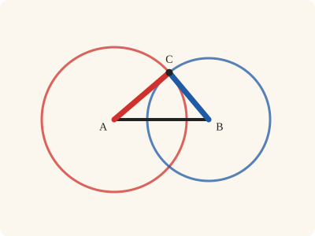
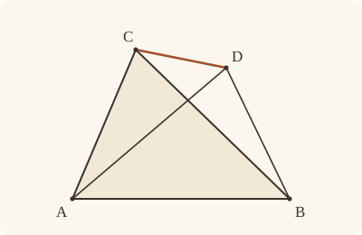
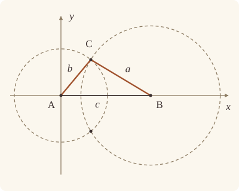

<!-- Generated by scripts/render.py. Do not edit by hand. -->

[Book I](index.md) · [← I.6](06.md) · [I.8 →](08.md)

# Book I, Proposition 7

*Equal straight lines cannot meet in another point*

[Euclid's proof](#euclids-proof) · [In Lean](#in-lean) · [What it rests on](#what-it-rests-on) · [Mishnah](#mishnah)

> Given two straight lines constructed on a straight line (from its extremities) and meeting in a point, there cannot be constructed on the same straight line (from its extremities), and on the same side of it, two other straight lines meeting in another point and equal to the former two respectively, namely each to that which has the same extremity with it.

**In Lean:** ✅ proved, as Euclid states it · Euclid's argument

<p align="center"></p>

<p align="center"><em>Keep the base and the lengths of the two sides (red and blue), and the top can only go where the two circles cross. On each side of the base there is just one such place.</em></p>

## Euclid's proof

<p align="center"></p>

<p align="center"><em>Drawn for one case: AD crossing CB, with a supposed second point D, as in Heath's figure. Like Heath's, this figure draws Euclid's impossible supposition. CA and DA, and CB and DB, are drawn unequal, although each pair is supposed equal.</em></p>

For, if possible, given two straight lines AC, CB constructed on the straight line AB and meeting at the point C, let two other straight lines AD, DB be constructed on the same straight line AB, on the same side of it, meeting in another point D and equal to the former two respectively, namely each to that which has the same extremity with it, so that CA is equal to DA which has the same extremity A with it, and CB to DB which has the same extremity B with it; and let CD be joined.

Then, since AC is equal to AD,

the angle ACD is also equal to the angle ADC; [I. 5]

therefore the angle ADC is greater than the angle DCB;

therefore the angle CDB is much greater than the angle DCB.

Again, since CB is equal to DB,

the angle CDB is also equal to the angle DCB.

But it was also proved much greater than it:

which is impossible.

Therefore etc.

Q. E. D.

## In Lean

| | |
|---|---|
| Proof | ✅ Proved |
| Statement | The whole enunciation. Stated positively: two points on one side of AB, each as far from A and from B as the other, are one and the same point. |
| Argument | Euclid's. The proof follows Euclid, by way of I.5. After it, the Lean proves a rule of System E from I.7, Definition I.15 and `Tacit.circle_eq`: Circle 4 (`Tacit.not_same_side_of_circles_meet`), that two circles do not meet at two points on one side of the straight line through their centres. So a proof of I.7 from that rule would argue in a circle. |
| Reviewed | The statement and every passage of the argument read against Heath's text, at commit [`b7b41f51`](https://github.com/dodecaplex-co/stoicheia/commit/b7b41f51) ([the record](../../review/I/07.toml)) |

From [`Elements/BookI/Prop07.lean`](../../Elements/BookI/Prop07.lean). Euclid's sentences are the `--` comments, and our own notes are in `/- … -/`; the lines under each sentence are the Lean that carries it out. The list below marks where a lemma does a step Euclid takes for granted, where the Lean takes a case Euclid's figure leaves aside and where the statement already gives a step; the `/- … -/` notes in the listing explain smaller adjustments.

**How the Lean follows the text**

- **A further case, by `Prop7.within`.** "For, if possible, given two straight lines AC, CB…" Euclid draws AD crossing CB; the Lean also takes AC crossing DB, his figure with C and D exchanged, and D within ABC or C within ABD, which `Prop7.within` answers as Proclus does, by the angles under the base of I.5. The Lean uses `Prop7.triangle` to rule out D on AC or BC, making ACD and BCD triangles, and `Prop7.cases` to prove that these four positions exhaust the possibilities.
- **Already given.** "and let CD be joined." Euclid joins C to D; the Lean names ACD and BCD by their corners, so the join needs no separate step here. `Prop7.figure` draws the straight line CD later to establish the angles' parts.
- **Done by `Prop7.figure`.** "therefore the angle ADC is greater than the angle DCB…" Euclid reads off his figure that CB falls within the angle ACD. The Lean uses `Prop7.figure` to split ACD into ACB and BCD and show that ACB is not nothing, then Common Notion 5 and the equality of ACD and ADC to compare ADC with DCB.
- **Done by `Prop7.figure`.** "therefore the angle CDB is much greater than the angle DCB." Euclid takes for granted that DA falls within the angle CDB; `Prop7.figure` above splits CDB into CDA and ADB and proves that ADB is not nothing. The Lean uses these facts with Common Notion 5 and the preceding comparison.

<details><summary>Before the theorem, five lemmas: <code>Prop7.triangle</code>, <code>Prop7.cross</code>, <code>Prop7.cases</code>, <code>Prop7.figure</code> and <code>Prop7.within</code> (230 lines)</summary>

```lean
/-! ## What Euclid reads off the figure -/

/-- D is a different point from C, on the same side of AB and as far from A. Then
D is not on the straight line AC, so ACD really is a triangle. (Heath: "The case in
which D falls on AC or BC does not require proof.") On the ray from A through C, the
point D would make one length equal to itself with something added; on the other ray, the
straight line AB would separate C from D. -/
theorem Prop7.triangle {A B C D : Point} (hCD : SameSideOf C D A B) (hCA : ‖C A‖ = ‖D A‖)
    (hne : C ≠ D) : Triangle A C D := by
  rintro ⟨N, hA, hC, hD⟩
  obtain ⟨L, hAL, hBL⟩ := Postulate1 A B hCD.1
  have hs : SameSide C D L := hCD.2 L hAL hBL
  have hAC : A ≠ C := fun h => not_on_line_of_same_side hs (h ▸ hAL)
  have hAD : A ≠ D := fun h => not_on_line_of_same_side (same_side_symm hs) (h ▸ hAL)
  have hAC_AD : ‖A C‖ = ‖A D‖ := by rw [len_symm A C, hCA, len_symm D A]
  rcases between_cases hAC hne hAD hA hC hD with h | h | h
  · have hsum := len_add_of_between h
    rw [← hAC_AD] at hsum
    have hlt := CommonNotion5 (a := ‖A C‖) (len_pos hne)
    rw [hsum] at hlt
    exact lt_irrefl _ hlt
  · exact pasch3 h hAL hs
  · have hsum := len_add_of_between h
    rw [hAC_AD] at hsum
    have hlt := CommonNotion5 (a := ‖A D‖) (len_pos hne.symm)
    rw [hsum] at hlt
    exact lt_irrefl _ hlt

/-- When D and A are on opposite sides of the straight line BC, the straight line AD
crosses BC at a point X on C's side of AB. Either X falls between B and C, and
the straight lines AD, CB cross as in Euclid's figure, or C falls between B and X,
and then C lies within the triangle ABD. -/
theorem Prop7.cross {A B C D : Point} {Q : Line} (hCD : SameSideOf C D A B)
    (hCA : ‖C A‖ = ‖D A‖) (hCB : ‖C B‖ = ‖D B‖) (hne : C ≠ D)
    (hBQ : OnLine B Q) (hCQ : OnLine C Q) (h : ¬ SameSide D A Q) :
    (∃ X : Point, Between A X D ∧ Between B X C) ∨ InsideTriangle C A B D := by
  have hACD : Triangle A C D := Prop7.triangle hCD hCA hne
  have hBCD : Triangle B C D := Prop7.triangle (SameSideOf.swap hCD) hCB hne
  obtain ⟨L, hAL, hBL⟩ := Postulate1 A B hCD.1
  have hs : SameSide C D L := hCD.2 L hAL hBL
  obtain ⟨R, hAR, hDR⟩ := Postulate1 A D hACD.ne₁₃
  have hAQ : ¬ OnLine A Q := fun hA => not_on_line_of_same_side (hCD.2 Q hA hBQ) hCQ
  have hDQ : ¬ OnLine D Q := fun hD => hBCD ⟨Q, hBQ, hCQ, hD⟩
  obtain ⟨hQR, X, hXQ, hXR⟩ := lines_meet_of_opposite_sides ⟨hDQ, hAQ, h⟩ hDR hAR
  have hDXA : Between D X A :=
    pasch4 hQR hXQ hXR hDR hAR hACD.ne₁₃.symm (fun e => hDQ (e ▸ hXQ))
      (fun e => hAQ (e ▸ hXQ)) h
  have hAXD : Between A X D := between_symm hDXA
  have hXL : ¬ OnLine X L := fun hX =>
    not_on_line_of_same_side (same_side_symm hs)
      ((line_unique (ne_of_between hAXD) hAR hXR hAL hX) ▸ hDR)
  have hXC : SameSide X C L :=
    same_side_trans (same_side_symm (pasch2 hAXD hAL hXL)) (same_side_symm hs)
  have hCR : ¬ OnLine C R := fun hC => hACD ⟨R, hAR, hC, hDR⟩
  have hXC' : X ≠ C := fun e => hCR (e ▸ hXR)
  have hBX : B ≠ X := fun e => hXL (e ▸ hBL)
  rcases between_cases hBX hXC' hBCD.ne₁₂ hBQ hXQ hCQ with h' | h' | h'
  · exact Or.inl ⟨X, hAXD, h'⟩
  · exact absurd hXC (pasch3 h' hBL)
  · refine Or.inr ⟨⟨hBCD.ne₁₃, fun S hBS hDS => ?_⟩, ⟨hACD.ne₁₃.symm, fun R' hDR' hAR' => ?_⟩,
      hCD⟩
    · have hCS : ¬ OnLine C S := fun hC => hBCD ⟨S, hBS, hC, hDS⟩
      have hXS : ¬ OnLine X S := fun hX => by
        have hRS : R = S := line_unique (ne_of_between hDXA) hDR hXR hDS hX
        have hAS : OnLine A S := hRS ▸ hAR
        exact not_on_line_of_same_side (same_side_symm (hCD.2 S hAS hBS)) hDS
      exact same_side_trans (same_side_symm (pasch2 h' hBS hCS)) (pasch2 hDXA hDS hXS)
    · have hXR' : OnLine X R' := on_line_of_between_ends hAXD hAR' hDR'
      have hCR' : ¬ OnLine C R' := fun hC => hACD ⟨R', hAR', hC, hDR'⟩
      exact pasch2 (between_symm h') hXR' hCR'

/-- Where can D be? Either it falls within the triangle ABC, or C falls within the
triangle ABD, or the straight lines AD and CB cross (Euclid's figure), or AC and
DB cross (Euclid's figure with C and D exchanged). -/
theorem Prop7.cases {A B C D : Point} (hCD : SameSideOf C D A B) (hCA : ‖C A‖ = ‖D A‖)
    (hCB : ‖C B‖ = ‖D B‖) (hne : C ≠ D) :
    InsideTriangle D A B C ∨ InsideTriangle C A B D ∨
      (∃ X : Point, Between A X D ∧ Between B X C) ∨
      (∃ X : Point, Between A X C ∧ Between B X D) := by
  have hACD : Triangle A C D := Prop7.triangle hCD hCA hne
  have hBCD : Triangle B C D := Prop7.triangle (SameSideOf.swap hCD) hCB hne
  obtain ⟨P, hAP, hCP⟩ := Postulate1 A C hACD.ne₁₂
  obtain ⟨Q, hBQ, hCQ⟩ := Postulate1 B C hBCD.ne₁₂
  by_cases h₁ : SameSide D A Q
  · by_cases h₂ : SameSide D B P
    · refine Or.inl ⟨⟨hBCD.ne₁₂, fun Q' hBQ' hCQ' => ?_⟩,
        ⟨hACD.ne₁₂.symm, fun P' hCP' hAP' => ?_⟩, SameSideOf.symm hCD⟩
      · rw [← line_unique hBCD.ne₁₂ hBQ hCQ hBQ' hCQ']
        exact h₁
      · rw [← line_unique hACD.ne₁₂ hAP hCP hAP' hCP']
        exact h₂
    · rcases Prop7.cross (SameSideOf.swap hCD) hCB hCA hne hAP hCP h₂ with
        ⟨X, hBXD, hAXC⟩ | h
      · exact Or.inr (Or.inr (Or.inr ⟨X, hAXC, hBXD⟩))
      · exact Or.inr (Or.inl ⟨SameSideOf.swap h.2.1, SameSideOf.swap h.1,
          SameSideOf.swap h.2.2⟩)
  · rcases Prop7.cross hCD hCA hCB hne hBQ hCQ h₁ with h | h
    · exact Or.inr (Or.inr (Or.inl h))
    · exact Or.inr (Or.inl h)

/-- Euclid's figure. When the straight lines AD and CB cross (at X), the straight line
CB falls within the angle ACD, and DA within the angle CDB. So each of those angles is
made up of two angles, and neither part is nothing. -/
theorem Prop7.figure {A B C D X : Point} (hCD : SameSideOf C D A B) (hCA : ‖C A‖ = ‖D A‖)
    (hCB : ‖C B‖ = ‖D B‖) (hne : C ≠ D) (hAXD : Between A X D) (hBXC : Between B X C) :
    ∠ A C D = ∠ A C B + ∠ B C D ∧ ∠ C D B = ∠ C D A + ∠ A D B ∧
      0 < ∠ A C B ∧ 0 < ∠ A D B := by
  have hACD : Triangle A C D := Prop7.triangle hCD hCA hne
  have hBCD : Triangle B C D := Prop7.triangle (SameSideOf.swap hCD) hCB hne
  obtain ⟨P, hAP, hCP⟩ := Postulate1 A C hACD.ne₁₂
  obtain ⟨Q, hBQ, hCQ⟩ := Postulate1 B C hBCD.ne₁₂
  obtain ⟨M, hCM, hDM⟩ := Postulate1 C D hne
  obtain ⟨R, hAR, hDR⟩ := Postulate1 A D hACD.ne₁₃
  obtain ⟨S, hBS, hDS⟩ := Postulate1 B D hBCD.ne₁₃
  have hXQ : OnLine X Q := on_line_of_between_ends hBXC hBQ hCQ
  have hXR : OnLine X R := on_line_of_between_ends hAXD hAR hDR
  /- First we say which points lie off which straight lines. -/
  have hAM : ¬ OnLine A M := fun h => hACD ⟨M, h, hCM, hDM⟩
  have hBP : ¬ OnLine B P := fun h => not_on_line_of_same_side (hCD.2 P hAP h) hCP
  have hDP : ¬ OnLine D P := fun h => hACD ⟨P, hAP, hCP, h⟩
  have hAS : ¬ OnLine A S := fun h =>
    not_on_line_of_same_side (same_side_symm (hCD.2 S h hBS)) hDS
  have hCS : ¬ OnLine C S := fun h => hBCD ⟨S, hBS, h, hDS⟩
  have hBR : ¬ OnLine B R := fun h =>
    not_on_line_of_same_side (same_side_symm (hCD.2 R hAR h)) hDR
  have hBM : ¬ OnLine B M := fun h => hBCD ⟨M, h, hCM, hDM⟩
  have hXM : ¬ OnLine X M := fun h =>
    hBCD ⟨Q, hBQ, hCQ, (line_unique (ne_of_between (between_symm hBXC)) hCQ hXQ hCM h) ▸ hDM⟩
  have hXP : ¬ OnLine X P := fun h =>
    hDP ((line_unique (ne_of_between hAXD) hAR hXR hAP h) ▸ hDR)
  have hXS : ¬ OnLine X S := fun h =>
    hAS ((line_unique (ne_of_between (between_symm hAXD)) hDR hXR hDS h) ▸ hAR)
  /- A and B are on the same side of CD, D and B of AC, and C and A of BD:
     each pair is joined to X without crossing the straight line. -/
  have hABM : SameSide A B M :=
    same_side_trans (pasch2 (between_symm hAXD) hDM hXM) (pasch2 (between_symm hBXC) hCM hXM)
  have hDBP : SameSide D B P :=
    same_side_trans (pasch2 hAXD hAP hXP) (pasch2 (between_symm hBXC) hCP hXP)
  have hCAS : SameSide C A S :=
    same_side_trans (pasch2 hBXC hBS hXS) (pasch2 (between_symm hAXD) hDS hXS)
  have hPM : P ≠ M := fun h => hDP (h ▸ hDM)
  have hMS : M ≠ S := fun h => hCS (h ▸ hCM)
  refine ⟨angle_add_of_inside hCP hCM hAP hDM hACD.ne₁₂.symm hne hBP hBM hPM hABM hDBP,
    angle_add_of_inside hDM hDS hCM hBS hne.symm hBCD.ne₁₃.symm hAM hAS hMS hCAS
      (same_side_symm hABM), ?_, ?_⟩
  · exact (Triangle.of_line hAP hCP hACD.ne₁₂ hBP).angle_pos
  · exact (Triangle.of_line hAR hDR hACD.ne₁₃ hBR).angle_pos

/-- The case Euclid leaves out, answered as Proclus answers it (Heath, vol. 1, p. 260). If
D falls within the triangle ABC, produce AC, AD to E, F. Since AC is equal to
AD, the angles ECD, FDC under the base of the triangle ACD are equal [I. 5]. But the
angle ECD is greater than the angle BCD, so the angle BDC is greater by far than the
angle BCD; and, since DB is equal to CB, it is also equal to it [I. 5]. -/
theorem Prop7.within {A B C D : Point} (hCD : SameSideOf C D A B) (hCA : ‖C A‖ = ‖D A‖)
    (hCB : ‖C B‖ = ‖D B‖) (hne : C ≠ D) (hD : InsideTriangle D A B C) : False := by
  have hACD : Triangle A C D := Prop7.triangle hCD hCA hne
  have hBCD : Triangle B C D := Prop7.triangle (SameSideOf.swap hCD) hCB hne
  obtain ⟨L, hAL, hBL⟩ := Postulate1 A B hCD.1
  obtain ⟨P, hAP, hCP⟩ := Postulate1 A C hACD.ne₁₂
  obtain ⟨Q, hBQ, hCQ⟩ := Postulate1 B C hBCD.ne₁₂
  obtain ⟨M, hCM, hDM⟩ := Postulate1 C D hne
  obtain ⟨R, hAR, hDR⟩ := Postulate1 A D hACD.ne₁₃
  obtain ⟨S, hBS, hDS⟩ := Postulate1 B D hBCD.ne₁₃
  have hDAQ : SameSide D A Q := hD.1.2 Q hBQ hCQ
  have hDBP : SameSide D B P := hD.2.1.2 P hCP hAP
  have hDCL : SameSide D C L := same_side_symm (hCD.2 L hAL hBL)
  /- We produce AC, AD to E and F. [Post. 2] -/
  obtain ⟨E, hEP, hACE, -⟩ := Postulate2 hAP hCP hACD.ne₁₂ []
  obtain ⟨F, hFR, hADF, -⟩ := Postulate2 hAR hDR hACD.ne₁₃ []
  have hEC : E ≠ C := ne_of_between (between_symm hACE)
  have hFD : F ≠ D := ne_of_between (between_symm hADF)
  /- First we say which points lie off which straight lines. -/
  have hAM : ¬ OnLine A M := fun h => hACD ⟨M, h, hCM, hDM⟩
  have hBM : ¬ OnLine B M := fun h => hBCD ⟨M, h, hCM, hDM⟩
  have hBP : ¬ OnLine B P := fun h => not_on_line_of_same_side (hCD.2 P hAP h) hCP
  have hDP : ¬ OnLine D P := fun h => hACD ⟨P, hAP, hCP, h⟩
  have hAS : ¬ OnLine A S := fun h =>
    not_on_line_of_same_side (same_side_symm (hCD.2 S h hBS)) hDS
  have hCS : ¬ OnLine C S := fun h => hBCD ⟨S, hBS, h, hDS⟩
  have hEM : ¬ OnLine E M := fun h => hDP ((line_unique hEC hEP hCP h hCM) ▸ hDM)
  have hFM : ¬ OnLine F M := fun h => hAM ((line_unique hFD hFR hDR h hDM) ▸ hAR)
  have hFS : ¬ OnLine F S := fun h => hAS ((line_unique hFD hFR hDR h hDS) ▸ hAR)
  /- With D within the angle ACB, the straight line CD separates A from B; with
     D within the angle ABC, the straight line BD separates A from C. (System E,
     Triple incidence 1.) -/
  have hABM : ¬ SameSide A B M :=
    triple_incidence1 hCP hCM hCQ hAP hDM hBQ hDBP (same_side_symm hDAQ)
  have hACS : ¬ SameSide A C S :=
    triple_incidence1 hBL hBS hBQ hAL hDS hCQ hDCL (same_side_symm hDAQ)
  /- So E, beyond C, is on B's side of CD; and F, beyond D, is on B's side of
     CD and on C's side of BD. -/
  have hEBM : SameSide E B M :=
    same_side_of_opposite_sides ⟨hAM, hEM, pasch3 hACE hCM⟩ ⟨hAM, hBM, hABM⟩
  have hBFM : SameSide B F M :=
    same_side_of_opposite_sides ⟨hAM, hBM, hABM⟩ ⟨hAM, hFM, pasch3 hADF hDM⟩
  have hCFS : SameSide C F S :=
    same_side_of_opposite_sides ⟨hAS, hCS, hACS⟩ ⟨hAS, hFS, pasch3 hADF hDS⟩
  have hPM : P ≠ M := fun h => hDP (h ▸ hDM)
  have hSM : S ≠ M := fun h => hCS (h ▸ hCM)
  /- CB falls within the angle ECD, and DF within the angle BDC. -/
  have hECD : ∠ E C D = ∠ E C B + ∠ B C D :=
    angle_add_of_inside hCP hCM hEP hDM hEC.symm hne hBP hBM hPM hEBM hDBP
  have hBDC : ∠ B D C = ∠ B D F + ∠ F D C :=
    angle_add_of_inside hDS hDM hBS hCM hBCD.ne₁₃.symm hne.symm hFS hFM hSM hBFM hCFS
  have hECB : 0 < ∠ E C B := (Triangle.of_line hEP hCP hEC hBP).angle_pos
  have hBDF : 0 < ∠ B D F := (Triangle.of_line hBS hDS hBCD.ne₁₃ hFS).angle_pos
  /- Since AC is equal to AD, the angles ECD, FDC under the base are equal. [I. 5] -/
  have hAC_AD : ‖A C‖ = ‖A D‖ := by rw [len_symm A C, hCA, len_symm D A]
  have hunder : ∠ D C E = ∠ C D F := (Prop5 hACD hAC_AD hACE hADF).2
  /- But the angle ECD is greater than the angle BCD; [C.N. 5] -/
  have h₁ : ∠ B C D < ∠ E C D := by
    rw [hECD, add_comm]
    exact CommonNotion5 hECB
  /- therefore the angle FDC is also greater than the angle BCD. -/
  have h₂ : ∠ B C D < ∠ F D C := by
    rw [← angle_symm hne hFD, ← hunder, ← angle_symm hEC hne.symm]
    exact h₁
  /- Therefore the angle BDC is greater by far than the angle BCD. [C.N. 5] -/
  have h₃ : ∠ B C D < ∠ B D C := by
    refine lt_trans h₂ ?_
    rw [hBDC, add_comm]
    exact CommonNotion5 hBDF
  /- Again, since DB is equal to CB, the angles at the base of the triangle BDC are equal:
     the angle BDC is equal to the angle BCD. [I. 5] -/
  have hBC_BD : ‖B C‖ = ‖B D‖ := by rw [len_symm B C, hCB, len_symm D B]
  have hbase : ∠ B C D = ∠ B D C := Prop5.base hBCD hBC_BD
  /- Therefore the same angle BDC is both greater than and equal to the angle BCD: which is
     impossible. -/
  rw [hbase] at h₃
  exact lt_irrefl _ h₃
```

</details>

```lean
/-- Given two straight lines constructed on a straight line (from its extremities) and meeting in a
point, there cannot be constructed on the same straight line (from its extremities), and on the
same side of it, two other straight lines meeting in another point and equal to the former two
respectively, namely each to that which has the same extremity with it. -/
theorem Prop7 {A B C D : Point} (hCD : SameSideOf C D A B) (hCA : ‖C A‖ = ‖D A‖)
    (hCB : ‖C B‖ = ‖D B‖) :
    C = D := by
  -- For, if possible, given two straight lines AC, CB constructed on the straight line AB and
  -- meeting at the point C, let two other straight lines AD, DB be constructed on the same
  -- straight line AB, on the same side of it, meeting in another point D and equal to the
  -- former two respectively, namely each to that which has the same extremity with it, so that
  -- CA is equal to DA which has the same extremity A with it, and CB to DB which has the same
  -- extremity B with it; and let CD be joined.
  apply Classical.byContradiction
  intro hne
  /- Euclid draws one figure, in which the straight lines AD and CB cross. Three others are
     possible (`Prop7.cases`). If AC and DB cross instead, it is Euclid's figure with the
     letters C and D exchanged, so we exchange them. If D falls within the triangle ABC, or C
     within the triangle ABD, Euclid's argument does not apply as it stands: that is the case
     Proclus answers with the second part of I. 5, proved in `Prop7.within`. From here on, C
     and D are named as in Euclid's figure, and X is the point where AD and CB cross.
     Our proof draws no straight line CD here: `Prop7.figure` draws its own. -/
  obtain ⟨C, D, hCD, hCA, hCB, hne, X, hAXD, hBXC⟩ :
      ∃ C D : Point, SameSideOf C D A B ∧ ‖C A‖ = ‖D A‖ ∧ ‖C B‖ = ‖D B‖ ∧ C ≠ D ∧
        ∃ X : Point, Between A X D ∧ Between B X C := by
    rcases Prop7.cases hCD hCA hCB hne with h | h | h | h
    · exact (Prop7.within hCD hCA hCB hne h).elim
    · exact (Prop7.within (SameSideOf.symm hCD) hCA.symm hCB.symm (Ne.symm hne) h).elim
    · exact ⟨C, D, hCD, hCA, hCB, hne, h⟩
    · exact ⟨D, C, SameSideOf.symm hCD, hCA.symm, hCB.symm, Ne.symm hne, h⟩
  have hACD : Triangle A C D := Prop7.triangle hCD hCA hne
  have hBCD : Triangle B C D := Prop7.triangle (SameSideOf.swap hCD) hCB hne
  -- Then, since AC is equal to AD,
  have hAC_AD : ‖A C‖ = ‖A D‖ := by rw [len_symm A C, hCA, len_symm D A]
  -- the angle ACD is also equal to the angle ADC; [I. 5]
  /- I.5 is stated with the equal sides produced, so `Prop5.base` produces AC, AD
     [Post. 2] and keeps only the angles at the base. -/
  have hACD_ADC : ∠ A C D = ∠ A D C := Prop5.base hACD hAC_AD
  -- therefore the angle ADC is greater than the angle DCB;
  /- Heath: "It would be natural to insert here the step 'but the angle ACD is greater than
     the angle BCD. [C. N. 5.]'" It rests on what the figure shows: CB falls within the
     angle ACD, so the angle ACD is made up of the angles ACB, BCD. -/
  obtain ⟨hACD_sum, hCDB_sum, hACB, hADB⟩ := Prop7.figure hCD hCA hCB hne hAXD hBXC
  have hDCB_ADC : ∠ D C B < ∠ A D C := by
    rw [← hACD_ADC, hACD_sum, angle_symm (Ne.symm hne) hBCD.ne₁₂, add_comm]
    exact CommonNotion5 hACB
  -- therefore the angle CDB is much greater than the angle DCB.
  /- DA falls within the angle CDB, so the angle CDB is greater than the angle CDA. [C.N. 5] -/
  have hDCB_CDB : ∠ D C B < ∠ C D B := by
    refine lt_trans hDCB_ADC ?_
    rw [hCDB_sum, angle_symm hACD.ne₁₃ hne]
    exact CommonNotion5 hADB
  -- Again, since CB is equal to DB,
  have hBC_BD : ‖B C‖ = ‖B D‖ := by rw [len_symm B C, hCB, len_symm D B]
  -- the angle CDB is also equal to the angle DCB.
  have hCDB_DCB : ∠ C D B = ∠ D C B := by
    rw [angle_symm hne hBCD.ne₁₃, ← Prop5.base hBCD hBC_BD, angle_symm hBCD.ne₁₂ (Ne.symm hne)]
  -- But it was also proved much greater than it:
  rw [hCDB_DCB] at hDCB_CDB
  -- which is impossible.
  exact lt_irrefl _ hDCB_CDB
  -- Therefore etc.
  -- Q. E. D.
```

<details><summary>After the theorem, one lemma beside the proposition, <code>_root_.Elements.Tacit.not_same_side_of_circles_meet</code> (19 lines)</summary>

```lean
/-- Two distinct common points of two distinct circles cannot lie on the same side of
the straight line through their centres (System E, Circle 4). We prove it from I.7,
Definition I.15 and `Tacit.circle_eq`. The centres differ, since circles with the same
centre and a common point coincide. The common points have equal distances from each
centre, so I.7 excludes their lying on the same side. -/
theorem _root_.Elements.Tacit.not_same_side_of_circles_meet
    {A B C D : Point} {L : Line} {α β : Circle}
    (hαβ : α ≠ β) (hCα : OnCircle C α) (hCβ : OnCircle C β)
    (hDα : OnCircle D α) (hDβ : OnCircle D β) (hCD : C ≠ D) (hA : Centre A α)
    (hB : Centre B β) (hAL : OnLine A L) (hBL : OnLine B L) : ¬ SameSide C D L := by
  intro hs
  have hAB : A ≠ B := by
    intro e
    subst B
    exact hαβ (circle_eq hA hB hCα hCβ rfl)
  apply hCD
  exact Prop7 (SameSideOf.of_line hAB hAL hBL hs)
    (by rw [len_symm C A, len_symm D A]; exact Definition15 hA hCα hDα)
    (by rw [len_symm C B, len_symm D B]; exact Definition15 hB hCβ hDβ)
```

</details>

## What it rests on

| | |
|---|---|
| Heath's references | [I.5](05.md) |
| Lean cites | [I.5](05.md) |
| Postulates | 1, 2, 3 |
| Definitions taken as axioms | Def. I.15 |
| Common Notions | 1, 3, 4, 5 |
| Tacit rules | 37 (listed below) |
| Its own Lean calls | Postulates 1 and 2; 14 tacit rules |
| Through lemmas | Postulate 3; Def. I.15; 14 tacit rules |

Some of these come in through lemmas [shared](../../CERTIFICATE.md#shared-steps) by many proofs: [`Prop5.base`](../../Elements/BookI/Helpers.lean#L27) (I.5).

_Postulates, definitions, Common Notions and tacit rules: all that this proof rests on, counting those of the propositions it cites. The last two rows say which of the postulates, definitions and tacit rules its own Lean calls, in the proof or a helper written for it, and which it does not call but reaches through lemmas, of Book Zero or shared (a proposition it cites may rest on these too); the rest come in only through the propositions it cites or the Common Notions._

<details><summary>The 37 tacit rules beneath this proof, counting those of the propositions it cites</summary>

_(used here) marks a rule this proof's own Lean calls, in the proof or a helper written for it; (through …) marks one its own Lean does not call but reaches through the lemmas named, of [Book Zero](../../Elements/Figure) or shared, though a proposition it cites may rest on it too; and a rule with no mark comes in only through a proposition it cites or a Common Notion. The names in brackets are System E's: an Intersection rule says when straight lines and circles must meet, and an Intersections rule takes a point where they do (see [Book I's introduction](index.md))._

**Reading the figure**

- [`between_cases`](../../Elements/Foundations/Tacit/Diagram.lean#L54) (used here): Of three different points on a straight line, one is between the other two. (Between 6)
- [`between_symm`](../../Elements/Foundations/Tacit/Diagram.lean#L47) (used here): If B is between A and C, it is between C and A. (Between 1)
- [`circles_meet`](../../Elements/Foundations/Tacit/Diagram.lean#L91) (through [`SameSideOf.symm`](../../Elements/Figure/Sides.lean#L51), [`Tacit.on_line_of_between_ends`](../../Elements/Figure/RuleBase.lean#L153), [`Tacit.pasch3`](../../Elements/Figure/RuleBase.lean#L225) and 4 other lemmas): If each circle passes through a point inside the other, the circles cut one another. This is the step Euclid takes for granted in I.1. (Intersection 5)
- [`circles_meet_same_side`](../../Elements/Foundations/Tacit/Constructions.lean#L79) (through [`SameSideOf.symm`](../../Elements/Figure/Sides.lean#L51), [`Tacit.on_line_of_between_ends`](../../Elements/Figure/RuleBase.lean#L153), [`Tacit.pasch3`](../../Elements/Figure/RuleBase.lean#L225) and 4 other lemmas): Two circles that cut one another do so on each side of the straight line through their centres. (Intersections 8)
- [`exists_point`](../../Elements/Foundations/Tacit/Constructions.lean#L35) (through [`Prop5.base`](../../Elements/BookI/Helpers.lean#L27), [`Triangle.angle_pos`](../../Elements/Figure/Angles.lean#L58), [`Triangle.ne₁₂`](../../Elements/Figure/Triangles.lean#L22) and 1 other lemma): Let a point be taken. (Points 1)
- [`exists_point_inside_circle`](../../Elements/Foundations/Tacit/Constructions.lean#L42) (through [`SameSideOf.symm`](../../Elements/Figure/Sides.lean#L51), [`Tacit.on_line_of_between_ends`](../../Elements/Figure/RuleBase.lean#L153), [`Tacit.pasch3`](../../Elements/Figure/RuleBase.lean#L225) and 4 other lemmas): Let a point be taken inside the circle α. (Points 8)
- [`exists_point_on_line`](../../Elements/Foundations/Tacit/Constructions.lean#L38) (through [`SameSideOf.symm`](../../Elements/Figure/Sides.lean#L51), [`Tacit.on_line_of_between_ends`](../../Elements/Figure/RuleBase.lean#L153), [`Tacit.pasch3`](../../Elements/Figure/RuleBase.lean#L225) and 4 other lemmas): Let a point be taken on the straight line L. (Points 2)
- [`line_circle_between`](../../Elements/Foundations/Tacit/Constructions.lean#L67) (through [`SameSideOf.symm`](../../Elements/Figure/Sides.lean#L51), [`Tacit.on_line_of_between_ends`](../../Elements/Figure/RuleBase.lean#L153), [`Tacit.pasch3`](../../Elements/Figure/RuleBase.lean#L225) and 4 other lemmas): A straight line through a point B inside a circle, heading out to a point C outside it, cuts the circle between B and C. (Intersections 4)
- [`line_circle_beyond`](../../Elements/Foundations/Tacit/Constructions.lean#L73) (through [`SameSideOf.symm`](../../Elements/Figure/Sides.lean#L51), [`Tacit.on_line_of_between_ends`](../../Elements/Figure/RuleBase.lean#L153), [`Tacit.pasch3`](../../Elements/Figure/RuleBase.lean#L225) and 4 other lemmas): A straight line through a point B inside a circle, produced beyond B away from C, cuts the circle there. (Intersections 5)
- [`line_unique`](../../Elements/Foundations/Tacit/Diagram.lean#L41) (used here): Two points determine a straight line. (Generalities 1)
- [`lines_meet_of_opposite_sides`](../../Elements/Foundations/Tacit/Diagram.lean#L86) (used here): A straight line joining points on opposite sides of L crosses L. (Intersection 1)
- [`not_between_of_between`](../../Elements/Foundations/Tacit/Diagram.lean#L50) (through [`SameSideOf.symm`](../../Elements/Figure/Sides.lean#L51), [`Tacit.ne_of_between`](../../Elements/Figure/RuleBase.lean#L146), [`Tacit.on_line_of_between_ends`](../../Elements/Figure/RuleBase.lean#L153) and 5 other lemmas): If B is between A and C, then A is not between B and C. (Between 1)
- [`not_on_line_of_same_side`](../../Elements/Foundations/Tacit/Diagram.lean#L60) (used here): Points on one side of a straight line are not on it. (Same side 3)
- [`pasch2`](../../Elements/Foundations/Tacit/Diagram.lean#L71) (used here): If B is between A and C, A is on L and B is off it, then B and C are on the same side of L: a straight line that leaves L at A does not cross it again. (Pasch 2)
- [`same_side_trans`](../../Elements/Foundations/Tacit/Diagram.lean#L64) (used here): Two points on the same side of a straight line as a third point are on the same side as each other. (Same side 4)

**Lengths, angles and areas**

- [`angle_add_of_inside`](../../Elements/Foundations/Tacit/Transfer.lean#L47) (used here): If D lies within the angle BAC, then BAC is made up of BAD and DAC. (Diagram-angle 2)
- [`angle_eq_of_same_rays`](../../Elements/Foundations/Tacit/Transfer.lean#L54): The angle doesn't change if its arms are traced through other points on the same rays. (Diagram-angle 4)
- [`angle_symm`](../../Elements/Foundations/Tacit/Metric.lean#L30) (used here): The angle ABC is the angle CBA. (Metric 4)
- [`area_add_of_between`](../../Elements/Foundations/Tacit/Transfer.lean#L70): Cutting a triangle in two from a vertex adds up. (Diagram-area 2)
- [`area_congruent`](../../Elements/Foundations/Tacit/Metric.lean#L44): Triangles equal in all their sides and angles are equal in area. Euclid uses this without comment once he has shown two triangles congruent. (Metric 9)
- [`area_degenerate`](../../Elements/Foundations/Tacit/Metric.lean#L36): A "triangle" with a repeated corner has no area. (Metric 6)
- [`area_eq_zero_of_on_line`](../../Elements/Foundations/Tacit/Transfer.lean#L62): A "triangle" whose corners lie on one straight line has no area. (Diagram-area 1)
- [`area_rotate`](../../Elements/Foundations/Tacit/Metric.lean#L39): The triangle ABC is the triangle CAB. (Metric 8)
- [`len_add_of_between`](../../Elements/Foundations/Tacit/Transfer.lean#L27) (used here): If B is between A and C, then AB and BC together make up AC. (Diagram-segment 1)
- [`len_self`](../../Elements/Foundations/Tacit/Metric.lean#L24) (through [`SameSideOf.symm`](../../Elements/Figure/Sides.lean#L51), [`Tacit.on_line_of_between_ends`](../../Elements/Figure/RuleBase.lean#L153), [`Tacit.pasch3`](../../Elements/Figure/RuleBase.lean#L225) and 4 other lemmas): The "straight line" from a point to itself has no length. (Metric 1)
- [`len_symm`](../../Elements/Foundations/Tacit/Metric.lean#L27) (used here): The straight line AB is the straight line BA. (Metric 3)
- [`radius_ne_zero`](../../Elements/Foundations/Tacit/Metric.lean#L62) (through [`SameSideOf.symm`](../../Elements/Figure/Sides.lean#L51), [`Tacit.on_line_of_between_ends`](../../Elements/Figure/RuleBase.lean#L153), [`Tacit.pasch3`](../../Elements/Figure/RuleBase.lean#L225) and 5 other lemmas): A circle's radius is not nothing: the straight line from the centre to a point on the circle has some length. A rule of our own, not one of System E's: every circle is drawn with a centre and a distance (Postulate 3).
- [`same_ray_of_angle_eq_zero`](../../Elements/Foundations/Tacit/Transfer.lean#L42) (through [`Tacit.pasch3`](../../Elements/Figure/RuleBase.lean#L225), [`Tacit.triple_incidence1`](../../Elements/Figure/RuleBase.lean#L195), [`Triangle.angle_pos`](../../Elements/Figure/Angles.lean#L58) and 1 other lemma): If the angle BAC is nothing, C lies on the ray from A through B. (Diagram-angle 1)

**Superposition**

- [`superposition`](../../Elements/Foundations/Tacit/Superposition.lean#L52): **Superposition.** A hypothetical placement of a triangle on a given ray and side permits a restricted derivation of metric equalities about the figure already given. The derivation introduces no further objects, cites each geometric law it uses, and exports no symbol of the placement.

**Laws of magnitude**

- [`add_assoc`](../../Elements/Foundations/Tacit/Magnitudes.lean#L23): Adding three magnitudes in a row, it makes no difference whether the first two or the last two are added first. (System E §3.5)
- [`add_comm`](../../Elements/Foundations/Tacit/Magnitudes.lean#L26) (used here): The order of adding does not matter. (System E §3.5)
- [`add_lt_add_right`](../../Elements/Foundations/Tacit/Magnitudes.lean#L45) (through [`same_side_of_opposite_sides`](../../Elements/Figure/Sides.lean#L113)): Adding the same thing to both sides keeps "less than". (System E §3.5)
- [`add_zero`](../../Elements/Foundations/Tacit/Magnitudes.lean#L29): Adding nothing changes nothing. (System E §3.5)
- [`lt_irrefl`](../../Elements/Foundations/Tacit/Magnitudes.lean#L32) (used here): No magnitude is less than itself. (System E §3.5)
- [`lt_trans`](../../Elements/Foundations/Tacit/Magnitudes.lean#L35) (used here): What is less than the less is less still. (System E §3.5)
- [`lt_trichotomy`](../../Elements/Foundations/Tacit/Magnitudes.lean#L39) (through [`SameSideOf.symm`](../../Elements/Figure/Sides.lean#L51), [`Tacit.on_line_of_between_ends`](../../Elements/Figure/RuleBase.lean#L153), [`Tacit.pasch3`](../../Elements/Figure/RuleBase.lean#L225) and 6 other lemmas): Of two magnitudes, one is less, or they are equal, or the other is less. (System E §3.5)
- [`not_lt_zero`](../../Elements/Foundations/Tacit/Magnitudes.lean#L42) (through [`SameSideOf.symm`](../../Elements/Figure/Sides.lean#L51), [`Tacit.on_line_of_between_ends`](../../Elements/Figure/RuleBase.lean#L153), [`Tacit.pasch3`](../../Elements/Figure/RuleBase.lean#L225) and 6 other lemmas): Nothing is less than zero. (System E §3.5)

</details>

## Mishnah

_Our commentary: what Euclid assumes, what Lean made us say out loud, and how the result looks by modern means._

Euclid's enunciation is hard going, and the words in parentheses are Heath's, put in "in order to make it intelligible" (vol. 1, p. 259). Euclid could write so, Heath explains, because "the phraseology was traditional and therefore, vague as it was, had a conventional meaning which the contemporary geometer well understood" (vol. 1, p. 259). The meaning is plain enough: given the base and the two sides, "only one triangle satisfying these conditions can be constructed on one and the same side of the given base" (Heath, vol. 1, p. 261). I.1 and I.22 build such a triangle, and I.7 says there is just one on each side.

I.7 seems to be wanted only for I.8, and some editors, "ill-advised" in Heath's judgment (vol. 1, p. 261), drop it altogether and rely on Philo's proof of I.8. Charles Dodgson saw more in it, and Heath quotes him: "of all plane figures that can be made by hingeing rods together, the *three*-sided ones (and these only) are *rigid*" (vol. 1, p. 261). Proclus has a story too, as Heath tells it: "It was said that astronomers used it to prove that three successive eclipses could not occur at equal intervals of time" (vol. 1, p. 261).

Euclid draws one figure, with AD crossing CB. The second case that Robert Simson and the textbooks add "is not in the original text", Heath explains (vol. 1, p. 260): as under I.2, Euclid gives one case and leaves the rest to the reader. Proclus answered that case with the angles under the base, which I.5 proved for just this purpose.

**Four places for D.** A proof that leaves no case to its reader must find D in four places. AD may cross CB, as in Euclid's figure, or AC may cross DB, his figure with C and D exchanged; or D or C falls within the triangle the other makes with AB, and that we answer as Proclus does. Our proof must also show that there is no fifth (`Prop7.cases`). Where BC separates D from A, AD crosses BC on C's side of AB, either within CB, as in Euclid's figure, or beyond C, and then C lies within the triangle ABD; where AC separates D from B, the same holds with A and B exchanged; where neither does, D lies within the triangle ABC. Euclid had no call to count the places. His figure shows a D that cannot exist, drawn to be refuted, and he refutes it where he draws it; a reader who drew it elsewhere had that case to answer, as Proclus answered one. For Euclid's figure Heath asks for "Postulates which shall satisfy us as to the relative positions" of the straight lines at C and at D (vol. 1, p. 260). The point where AD and CB cross does that work: it puts CB within the angle ACD, and DA within the angle CDB, so that each angle is made up of two.

**The modern way.** Put $\mathrm{A} = (0, 0)$ and $\mathrm{B} = (c, 0)$. A point $(x, y)$ at distance $b$ from A and $a$ from B has $x^2 + y^2 = b^2$ and $(x - c)^2 + y^2 = a^2$, so $x = (b^2 + c^2 - a^2)/(2c)$ and $y = \pm\sqrt{b^2 - x^2}$: two answers, mirror images in AB, one on each side.

<p align="center"></p>

## Further reading

- René Descartes turned problems of ruler and compass into equations, as the modern way turns I.7's two circles, and David Eugene Smith and Marcia L. Latham's translation, [*The Geometry of René Descartes*](https://archive.org/details/geometryofrenede0000davi_t0j4) (1925, free online), sets the French of 1637 beside it in facsimile, page by page.
- The hinged rods Heath quotes come from Charles L. Dodgson's [*Euclid and His Modern Rivals*](https://archive.org/details/euclidandhismode000469mbp) (1879, free online), in which Lewis Carroll puts Euclid's modern rivals on trial in a comic dialogue: great fun to read.

[Book I](index.md) · [← I.6](06.md) · [I.8 →](08.md)

---

<sub>Euclid's text: T. L. Heath, *The Thirteen Books of Euclid's Elements*, vol. 1 (Cambridge, 1908), pp. 258–259; [scan leaves n278–n279](https://archive.org/details/thirteenbookseu02heibgoog/page/n278); [figure on n278](https://archive.org/details/thirteenbookseu02heibgoog/page/n278). Public domain.</sub>

<sub>The tacit rules follow the System E of Jeremy Avigad, Edward Dean and John Mumma, read alongside LeanEuclid (Logan Murphy, Kaiyu Yang, Jialiang Sun, Zhaoyu Li, Anima Anandkumar and Xujie Si).</sub>
