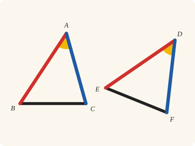
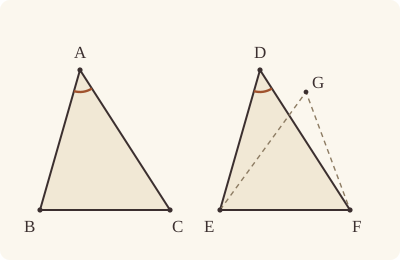

<!-- Generated by scripts/render.py. Do not edit by hand. -->

[Book I](index.md) · [← I.7](07.md) · [I.9 →](09.md)

# Book I, Proposition 8

*Two sides and the base make the angles equal*

[Euclid's proof](#euclids-proof) · [In Lean](#in-lean) · [What it rests on](#what-it-rests-on) · [Mishnah](#mishnah)

> If two triangles have the two sides equal to two sides respectively, and have also the base equal to the base, they will also have the angles equal which are contained by the equal straight lines.

**In Lean:** ✅ proved, as Euclid states it · Euclid's argument

<p align="center"></p>

<p align="center"><em>If all three sides match (red, blue and black), the angle between the red and blue sides matches too (yellow), however the triangle is turned.</em></p>

## Euclid's proof

<p align="center"></p>

<p align="center"><em>This figure draws the impossible supposition: G distinct from D on the same side of EF, with EG supposed equal to ED and GF supposed equal to DF. I.7 rules out such a point.</em></p>

Let ABC, DEF be two triangles having the two sides AB, AC equal to the two sides DE, DF respectively, namely AB to DE, and AC to DF; and let them have the base BC equal to the base EF;

I say that the angle BAC is also equal to the angle EDF.

For, if the triangle ABC be applied to the triangle DEF, and if the point B be placed on the point E and the straight line BC on EF,

the point C will also coincide with F,

because BC is equal to EF.

Then, BC coinciding with EF,

BA, AC will also coincide with ED, DF;

for, if the base BC coincides with the base EF, and the sides BA, AC do not coincide with ED, DF but fall beside them as EG, GF,

then, given two straight lines constructed on a straight line (from its extremities) and meeting in a point, there will have been constructed on the same straight line (from its extremities), and on the same side of it, two other straight lines meeting in another point and equal to the former two respectively, namely each to that which has the same extremity with it.

But they cannot be so constructed. [I. 7]

Therefore it is not possible that, if the base BC be applied to the base EF, the sides BA, AC should not coincide with ED, DF;

they will therefore coincide,

so that the angle BAC will also coincide with the angle EDF, and will be equal to it.

If therefore etc.

Q. E. D.

## In Lean

| | |
|---|---|
| Proof | ✅ Proved |
| Statement | The whole enunciation. |
| Argument | Euclid's. I.7 is cited inside the hypothetical placement as a proved statement asserting no existence, although its proof uses constructions. |
| Reviewed | The statement and every passage of the argument read against Heath's text, at commit [`0328bcb6`](https://github.com/dodecaplex-co/stoicheia/commit/0328bcb6) ([the record](../../review/I/08.toml)) |

From [`Elements/BookI/Prop08.lean`](../../Elements/BookI/Prop08.lean). Euclid's sentences are the `--` comments, and our own notes are in `/- … -/`; the lines under each sentence are the Lean that carries it out. The list below marks where a lemma does a step Euclid takes for granted, where several sentences share one step and where a step needs a word of its own; the `/- … -/` notes in the listing explain smaller adjustments.

**How the Lean follows the text**

- **Done by `Tacit.superposition`.** "For, if the triangle ABC be applied to the triangle DEF…" After naming EF and proving D off it, the Lean reasons over symbols for the hypothetical placement of BCA, with B on E, C' on the ray from E through F and G on D's side of EF. `Tacit.superposition` keeps every side and angle there and exports only the angle equality about the given triangles, with no constructed point.
- **Done by `Superposition.Derives.ray_unique`.** "the point C will also coincide with F…" Inside the placement, EC' equals BC and hence EF. `Superposition.Derives.ray_unique`, using the law proved by `OnRay.eq_of_len_eq`, makes C' coincide with F.
- **Carried together.** "Then, BC coinciding with EF…" The kept sides and the coincidence of C' with F give GE equal to DE and GF equal to DF. These are the two length premises for the following use of I.7; coincidence of the other sides is concluded there.
- **Carried together, by `Prop8.holds_prop7`.** "But they cannot be so constructed." The placement puts G and D on the same side of EF, and `Prop8.holds_prop7` supplies I.7 for this named straight line. Our I.7 is stated positively, so its cited law makes G coincide with D in one step, carrying Euclid's reduction to the impossible and its conclusion together.
- **Carried.** "so that the angle BAC will also coincide with the angle EDF…" The kept angle at G equals BAC, and the coincidences G with D and C' with F identify it with EDF. This equality alone leaves the hypothetical placement.

<details><summary>Before the theorem, 12 definitions and one lemma: <code>Pt</code>, <code>Ln</code>, <code>a</code>, <code>b</code>, <code>c</code>, <code>d</code>, <code>e</code>, <code>f</code>, <code>c'</code>, <code>g</code>, <code>ef</code>, <code>cites</code> and <code>holds_prop7</code> (78 lines)</summary>

```lean
import Elements.Figure.Basics
import Elements.Figure.Superposition
import Elements.BookI.Prop07

/-!
# Book I, Proposition 8

Euclid's text, in Heath's translation: [`heath/I/08.md`](../../heath/I/08.md).
Each of his sentences is a `--` comment, followed by the Lean that carries it out.

The triangle ABC is hypothetically laid on DEF, with B on E and BC along EF, on D's
side. The symbols c′ and g name where C and A come down; g is Euclid's G. The
restricted derivation first makes c′ coincide with f, then uses I.7 to make g
coincide with d. Only the equality of the angles BAC and EDF leaves the placement.

I.7 is cited as a proved law whose statement asserts no existence. Its own proof
draws: it joins its points with straight lines, produces two of them and cites I.5,
which draws circles through I.3. Those dependencies remain in this proof, and the
certificate records the construction rules beneath each cited law's proof
(`cited_laws`). Applying the law introduces no new symbol into the hypothetical
placement.
-/

namespace Elements.BookI

open Superposition hiding Triangle Collinear
open Superposition.Lit Tacit

namespace Prop8

/-- The points of I.8's figure, as symbols: the corners of the two triangles. -/
inductive Pt where
  | a | b | c | d | e | f
  deriving DecidableEq

/-- The straight line of I.8's figure, as a symbol: EF, along which BC is laid. -/
inductive Ln where
  | ef
  deriving DecidableEq

instance : Symbols Pt := Symbols.ofList [.a, .b, .c, .d, .e, .f] (by intro p; cases p <;> decide)

instance : Symbols Ln := Symbols.ofList [.ef] (by intro l; cases l <;> decide)

/-- A, in the placement. -/
abbrev a : Name Pt := .given .a
/-- B, in the placement. -/
abbrev b : Name Pt := .given .b
/-- C, in the placement. -/
abbrev c : Name Pt := .given .c
/-- D, in the placement. -/
abbrev d : Name Pt := .given .d
/-- E, in the placement. -/
abbrev e : Name Pt := .given .e
/-- F, in the placement. -/
abbrev f : Name Pt := .given .f
/-- C′: where C comes down when BC is laid along EF. A symbol, with no point. -/
abbrev c' : Name Pt := .second
/-- G: where A comes down; Euclid calls it G. A symbol, with no point. -/
abbrev g : Name Pt := .third
/-- EF, in the placement. -/
abbrev ef : LineName Ln := .given .ef

/-- The laws the derivation cites: Metric 3, that a straight line equal to one with two
distinct ends has two distinct ends, one point at one distance on a ray, and I.7. -/
abbrev cites : List Cited := [.lenSymm, .neOfLen, .rayUnique, .prop7]

/-- I.7 gives the law used at Euclid's hypothetical G: the same side of AB is
that of any named straight line through its distinct ends. -/
theorem holds_prop7 : Cited.prop7.Holds primitives := by
  intro v h
  simp only [Cited.law, List.forall_mem_cons] at h
  obtain ⟨hAB, hA, hB, hside, hCA, hCB, -⟩ := h
  exact Prop7 (SameSideOf.of_line hAB hA hB hside) hCA hCB

end Prop8

open Prop8 in
```

</details>

```lean
/-- If two triangles have the two sides equal to two sides respectively, and have also the base
equal to the base, they will also have the angles equal which are contained by the equal
straight lines. -/
theorem Prop8 {A B C D E F : Point} (hABC : Triangle A B C) (hDEF : Triangle D E F)
    (hAB : ‖A B‖ = ‖D E‖) (hAC : ‖A C‖ = ‖D F‖) (hBC : ‖B C‖ = ‖E F‖) :
    ∠ B A C = ∠ E D F := by
  -- Let ABC, DEF be two triangles having the two sides AB, AC equal to the two sides DE, DF
  -- respectively, namely AB to DE, and AC to DF; and let them have the base BC equal to the
  -- base EF;
  /- To lay BC along EF we need the straight line EF itself (Postulate 1), and D off it, for
     the side on which A comes down. -/
  have hEF : E ≠ F := hDEF.ne₂₃
  obtain ⟨EF, hE_EF, hF_EF⟩ := Postulate1 E F hEF
  have hD_EF : ¬ OnLine D EF := fun hD => hDEF ⟨EF, hD, hE_EF, hF_EF⟩
  /- The figure: each symbol of I.8's vocabulary stands for its point or straight line. -/
  let v : Val primitives Pt Ln :=
    ⟨fun | .a => A | .b => B | .c => C | .d => D | .e => E | .f => F, fun | .ef => EF⟩
  /- The facts given, as literals over the figure's symbols. -/
  let Γ : List (Lit Pt Ln) := [pos (.len .a .b .d .e), pos (.len .a .c .d .f), pos (.len .b .c .e .f)]
  have hΓ : ∀ ℓ ∈ Γ, ℓ.Holds v := by
    intro ℓ hℓ
    simp only [Γ, List.mem_cons, List.mem_nil_iff, or_false] at hℓ
    rcases hℓ with rfl | rfl | rfl
    · exact hAB
    · exact hAC
    · exact hBC
  -- I say that the angle BAC is also equal to the angle EDF.
  -- For, if the triangle ABC be applied to the triangle DEF, and if the point B be placed on
  -- the point E and the straight line BC on EF,
  /- The placement is of the triangle BCA, with B on E, C along the ray from E through F, and
     A on D's side: everything that follows, until the angle comes out, is a derivation
     inside it, on symbols only. -/
  /- Δ is the context of the placement: the facts given, the guards, and what the placement
     keeps (`branch`). -/
  let Δ := branch Γ .b .c .a .e .f .d .ef
  have given : ∀ {ℓ : Lit Pt Ln}, ℓ ∈ Γ → Derives cites Δ (ℓ.map .given .given) :=
    fun hℓ => Branch.given hℓ
  -- the point C will also coincide with F,
  -- because BC is equal to EF.
  /- c′ is on the ray from e through f, as far from e as f is; on a ray only one point is at
     that distance (Savile's argument). -/
  have hEC'_EF : Derives cites Δ (pos (.len e c' e f)) :=
    .len_trans Kept.len₁ (given (ℓ := pos (.len .b .c .e .f)) (by simp [Γ]))
  have hC'F : Derives cites Δ (pos (.eq c' f)) :=
    .ray_unique Guard.ne_DG (.ne_symm (.ne_of_len hEC'_EF Guard.ne_DG)) Guard.on_D Guard.on_G
      Kept.on_line Kept.not_between hEC'_EF
  -- Then, BC coinciding with EF,
  -- BA, AC will also coincide with ED, DF;
  /- The sides BA, AC have been carried to ge, gc′, that is gf, and they are equal to ED,
     DF. -/
  have hGE_DE : Derives cites Δ (pos (.len g e d e)) :=
    .len_trans Kept.len₃ (given (ℓ := pos (.len .a .b .d .e)) (by simp [Γ]))
  have hGF_DF : Derives cites Δ (pos (.len g f d f)) :=
    .len_trans .len_comm <|
    .len_trans (.len_congr Coincidence.step (.eq_symm hC'F) .eq_refl) <|
    .len_trans Kept.len₂ <|
    .len_trans .len_comm (given (ℓ := pos (.len .a .c .d .f)) (by simp [Γ]))
  -- for, if the base BC coincides with the base EF, and the sides BA, AC do not coincide with
  -- ED, DF but fall beside them as EG, GF,
  -- then, given two straight lines constructed on a straight line (from its extremities) and
  -- meeting in a point, there will have been constructed on the same straight line (from its
  -- extremities), and on the same side of it, two other straight lines meeting in another
  -- point and equal to the former two respectively, namely each to that which has the same
  -- extremity with it.
  /- g and d are on the same side of ef: the placement put g there (`Kept.same_side`). -/
  have hGD_side : Derives cites Δ (pos (.sameSide g d ef)) := Kept.same_side
  -- But they cannot be so constructed. [I. 7]
  -- Therefore it is not possible that, if the base BC be applied to the base EF, the sides BA,
  -- AC should not coincide with ED, DF;
  -- they will therefore coincide,
  /- I.7, cited inside the placement: two points on one side of ef, each as far from e and
     from f as the other, are one point. Our I.7 is stated positively, so Euclid's reduction
     to the impossible is this one step. -/
  have hGD : Derives cites Δ (pos (.eq g d)) :=
    .prop7 Guard.ne_DG Guard.on_D Guard.on_G hGD_side hGE_DE hGF_DF
  -- so that the angle BAC will also coincide with the angle EDF, and will be equal to it.
  /- The angle BAC was carried to the angle e g c′, and g is d, c′ is f. This equality of
     angles names only the figure's symbols, so it leaves the placement. -/
  have hBAC : Derives cites Δ (pos (.angle b a c e d f)) :=
    .angle_trans (.angle_symm Kept.angle₂) (.angle_congr Coincidence.step .eq_refl hGD hC'F)
  /- The laws cited, each from its proof: three from Book Zero and the foundations, and I.7.
     The guards are the triangle BCA, E and F on EF, E not F, and D off EF. -/
  have hcites : ∀ c ∈ cites, c.Holds primitives := by
    intro c hc
    simp only [cites, List.mem_cons, List.mem_nil_iff, or_false] at hc
    rcases hc with rfl | rfl | rfl | rfl
    · exact Cited.holds_lenSymm
    · exact Cited.holds_neOfLen
    · exact Cited.holds_rayUnique
    · exact Prop8.holds_prop7
  have out := Tacit.superposition.apply hcites (φ := .angle .b .a .c .e .d .f) hBAC v
  exact out hABC.bca hE_EF hF_EF hEF hD_EF hΓ
  -- If therefore etc.
  -- Q. E. D.
```

<details><summary>After the theorem, one lemma beside the proposition, <code>_root_.Elements.Superposition.Cited.holds_all</code> (13 lines)</summary>

```lean
/-- **Every law a derivation may cite holds**, each from its own proof: the seven of Book Zero
(`Elements/Figure/Superposition.lean`) and I.7, by `Prop8.holds_prop7`. Through I.7 it rests
on `Tacit.superposition`, the restricted rule itself, since I.7 cites I.5, which rests on I.4.
I.8's proof does not use it: it proves the four laws it cites, case by case. -/
theorem _root_.Elements.Superposition.Cited.holds_all : ∀ c : Cited, c.Holds primitives
  | .lenSymm => Cited.holds_lenSymm
  | .angleSymm => Cited.holds_angleSymm
  | .areaCongruent => Cited.holds_areaCongruent
  | .neOfLen => Cited.holds_neOfLen
  | .rayUnique => Cited.holds_rayUnique
  | .rayOfAngle => Cited.holds_rayOfAngle
  | .rayOfAngleSide => Cited.holds_rayOfAngleSide
  | .prop7 => Prop8.holds_prop7
```

</details>

## What it rests on

| | |
|---|---|
| Heath's references | [I.7](07.md) |
| Lean cites | [I.7](07.md) |
| Postulates | 1, 2, 3 |
| Definitions taken as axioms | Def. I.15 |
| Common Notions | 1, 3, 4, 5 |
| Tacit rules | 37 (listed below) |
| Its own Lean calls | Postulate 1; 1 tacit rule |
| Through lemmas | Postulate 3; 10 tacit rules |

_Postulates, definitions, Common Notions and tacit rules: all that this proof rests on, counting those of the propositions it cites. The last two rows say which of the postulates, definitions and tacit rules its own Lean calls, in the proof or a helper written for it, and which it does not call but reaches through lemmas, of Book Zero or shared (a proposition it cites may rest on these too); the rest come in only through the propositions it cites or the Common Notions._

<details><summary>The 37 tacit rules beneath this proof, counting those of the propositions it cites</summary>

_(used here) marks a rule this proof's own Lean calls, in the proof or a helper written for it; (through …) marks one its own Lean does not call but reaches through the lemmas named, of [Book Zero](../../Elements/Figure) or shared, though a proposition it cites may rest on it too; and a rule with no mark comes in only through a proposition it cites or a Common Notion. The names in brackets are System E's: an Intersection rule says when straight lines and circles must meet, and an Intersections rule takes a point where they do (see [Book I's introduction](index.md))._

**Reading the figure**

- [`between_cases`](../../Elements/Foundations/Tacit/Diagram.lean#L54) (through [`Superposition.Cited.holds_rayUnique`](../../Elements/Figure/Superposition.lean#L89)): Of three different points on a straight line, one is between the other two. (Between 6)
- [`between_symm`](../../Elements/Foundations/Tacit/Diagram.lean#L47): If B is between A and C, it is between C and A. (Between 1)
- [`circles_meet`](../../Elements/Foundations/Tacit/Diagram.lean#L91): If each circle passes through a point inside the other, the circles cut one another. This is the step Euclid takes for granted in I.1. (Intersection 5)
- [`circles_meet_same_side`](../../Elements/Foundations/Tacit/Constructions.lean#L79): Two circles that cut one another do so on each side of the straight line through their centres. (Intersections 8)
- [`exists_point`](../../Elements/Foundations/Tacit/Constructions.lean#L35) (through [`Triangle.ne₂₃`](../../Elements/Figure/Triangles.lean#L29)): Let a point be taken. (Points 1)
- [`exists_point_inside_circle`](../../Elements/Foundations/Tacit/Constructions.lean#L42): Let a point be taken inside the circle α. (Points 8)
- [`exists_point_on_line`](../../Elements/Foundations/Tacit/Constructions.lean#L38): Let a point be taken on the straight line L. (Points 2)
- [`line_circle_between`](../../Elements/Foundations/Tacit/Constructions.lean#L67): A straight line through a point B inside a circle, heading out to a point C outside it, cuts the circle between B and C. (Intersections 4)
- [`line_circle_beyond`](../../Elements/Foundations/Tacit/Constructions.lean#L73): A straight line through a point B inside a circle, produced beyond B away from C, cuts the circle there. (Intersections 5)
- [`line_unique`](../../Elements/Foundations/Tacit/Diagram.lean#L41) (through [`SameSideOf.of_line`](../../Elements/Figure/Sides.lean#L34)): Two points determine a straight line. (Generalities 1)
- [`lines_meet_of_opposite_sides`](../../Elements/Foundations/Tacit/Diagram.lean#L86): A straight line joining points on opposite sides of L crosses L. (Intersection 1)
- [`not_between_of_between`](../../Elements/Foundations/Tacit/Diagram.lean#L50): If B is between A and C, then A is not between B and C. (Between 1)
- [`not_on_line_of_same_side`](../../Elements/Foundations/Tacit/Diagram.lean#L60): Points on one side of a straight line are not on it. (Same side 3)
- [`pasch2`](../../Elements/Foundations/Tacit/Diagram.lean#L71): If B is between A and C, A is on L and B is off it, then B and C are on the same side of L: a straight line that leaves L at A does not cross it again. (Pasch 2)
- [`same_side_trans`](../../Elements/Foundations/Tacit/Diagram.lean#L64): Two points on the same side of a straight line as a third point are on the same side as each other. (Same side 4)

**Lengths, angles and areas**

- [`angle_add_of_inside`](../../Elements/Foundations/Tacit/Transfer.lean#L47): If D lies within the angle BAC, then BAC is made up of BAD and DAC. (Diagram-angle 2)
- [`angle_eq_of_same_rays`](../../Elements/Foundations/Tacit/Transfer.lean#L54): The angle doesn't change if its arms are traced through other points on the same rays. (Diagram-angle 4)
- [`angle_symm`](../../Elements/Foundations/Tacit/Metric.lean#L30): The angle ABC is the angle CBA. (Metric 4)
- [`area_add_of_between`](../../Elements/Foundations/Tacit/Transfer.lean#L70): Cutting a triangle in two from a vertex adds up. (Diagram-area 2)
- [`area_congruent`](../../Elements/Foundations/Tacit/Metric.lean#L44): Triangles equal in all their sides and angles are equal in area. Euclid uses this without comment once he has shown two triangles congruent. (Metric 9)
- [`area_degenerate`](../../Elements/Foundations/Tacit/Metric.lean#L36): A "triangle" with a repeated corner has no area. (Metric 6)
- [`area_eq_zero_of_on_line`](../../Elements/Foundations/Tacit/Transfer.lean#L62): A "triangle" whose corners lie on one straight line has no area. (Diagram-area 1)
- [`area_rotate`](../../Elements/Foundations/Tacit/Metric.lean#L39): The triangle ABC is the triangle CAB. (Metric 8)
- [`len_add_of_between`](../../Elements/Foundations/Tacit/Transfer.lean#L27) (through [`Superposition.Cited.holds_rayUnique`](../../Elements/Figure/Superposition.lean#L89)): If B is between A and C, then AB and BC together make up AC. (Diagram-segment 1)
- [`len_self`](../../Elements/Foundations/Tacit/Metric.lean#L24) (through [`Superposition.Cited.holds_neOfLen`](../../Elements/Figure/Superposition.lean#L83)): The "straight line" from a point to itself has no length. (Metric 1)
- [`len_symm`](../../Elements/Foundations/Tacit/Metric.lean#L27) (through [`Superposition.Cited.holds_lenSymm`](../../Elements/Figure/Superposition.lean#L67)): The straight line AB is the straight line BA. (Metric 3)
- [`radius_ne_zero`](../../Elements/Foundations/Tacit/Metric.lean#L62) (through [`Superposition.Cited.holds_neOfLen`](../../Elements/Figure/Superposition.lean#L83) and [`Superposition.Cited.holds_rayUnique`](../../Elements/Figure/Superposition.lean#L89)): A circle's radius is not nothing: the straight line from the centre to a point on the circle has some length. A rule of our own, not one of System E's: every circle is drawn with a centre and a distance (Postulate 3).
- [`same_ray_of_angle_eq_zero`](../../Elements/Foundations/Tacit/Transfer.lean#L42): If the angle BAC is nothing, C lies on the ray from A through B. (Diagram-angle 1)

**Superposition**

- [`superposition`](../../Elements/Foundations/Tacit/Superposition.lean#L52) (used here): **Superposition.** A hypothetical placement of a triangle on a given ray and side permits a restricted derivation of metric equalities about the figure already given. The derivation introduces no further objects, cites each geometric law it uses, and exports no symbol of the placement.

**Rules of magnitude**

- [`add_assoc`](../../Elements/Foundations/Tacit/Magnitudes.lean#L23): Adding three magnitudes in a row, it makes no difference whether the first two or the last two are added first. (System E §3.5)
- [`add_comm`](../../Elements/Foundations/Tacit/Magnitudes.lean#L26): The order of adding does not matter. (System E §3.5)
- [`add_lt_add_right`](../../Elements/Foundations/Tacit/Magnitudes.lean#L45): Adding the same thing to both sides keeps "less than". (System E §3.5)
- [`add_zero`](../../Elements/Foundations/Tacit/Magnitudes.lean#L29): Adding nothing changes nothing. (System E §3.5)
- [`lt_irrefl`](../../Elements/Foundations/Tacit/Magnitudes.lean#L32) (through [`Superposition.Cited.holds_rayUnique`](../../Elements/Figure/Superposition.lean#L89)): No magnitude is less than itself. (System E §3.5)
- [`lt_trans`](../../Elements/Foundations/Tacit/Magnitudes.lean#L35): What is less than the less is less still. (System E §3.5)
- [`lt_trichotomy`](../../Elements/Foundations/Tacit/Magnitudes.lean#L39) (through [`Superposition.Cited.holds_rayUnique`](../../Elements/Figure/Superposition.lean#L89)): Of two magnitudes, one is less, or they are equal, or the other is less. (System E §3.5)
- [`not_lt_zero`](../../Elements/Foundations/Tacit/Magnitudes.lean#L42) (through [`Superposition.Cited.holds_rayUnique`](../../Elements/Figure/Superposition.lean#L89)): Nothing is less than zero. (System E §3.5)

</details>

**The laws cited inside the placement.** The derivation cites each law below as proved. Each is a statement about every figure, proved outside the placement, so citing it draws nothing there. The last column names the [construction rules](../../docs/FORMALIZATION.md#construction-rules) beneath its proof, as the certificate finds them (`cited_laws`).

| Law | Proved by | Construction rules beneath the proof |
|---|---|---|
| Metric 3: the straight line AB is the straight line BA. (`lenSymm`) | [`Cited.holds_lenSymm`](../../Elements/Figure/Superposition.lean#L67) | none |
| A straight line equal to one with two distinct ends has two distinct ends. (`neOfLen`) | [`Cited.holds_neOfLen`](../../Elements/Figure/Superposition.lean#L83) | [`Postulate3`](../../Elements/Foundations/Postulates.lean#L40) |
| On a ray, one point lies at a given distance from its start (Savile's argument). (`rayUnique`) | [`Cited.holds_rayUnique`](../../Elements/Figure/Superposition.lean#L89) | [`Postulate3`](../../Elements/Foundations/Postulates.lean#L40) |
| I.7: two points on one side of a straight line, as far from each of its ends as one another, are one point. Euclid's I.8 uses it inside the placement. (`prop7`) | [`Prop8.holds_prop7`](../../Elements/BookI/Prop08.lean#L70) | [`Postulate1`](../../Elements/Foundations/Postulates.lean#L23), [`Postulate2`](../../Elements/Foundations/Postulates.lean#L32), [`Postulate3`](../../Elements/Foundations/Postulates.lean#L40), [`circles_meet`](../../Elements/Foundations/Tacit/Diagram.lean#L91), [`circles_meet_same_side`](../../Elements/Foundations/Tacit/Constructions.lean#L79), [`exists_point`](../../Elements/Foundations/Tacit/Constructions.lean#L35), [`exists_point_inside_circle`](../../Elements/Foundations/Tacit/Constructions.lean#L42), [`exists_point_on_line`](../../Elements/Foundations/Tacit/Constructions.lean#L38), [`line_circle_between`](../../Elements/Foundations/Tacit/Constructions.lean#L67), [`line_circle_beyond`](../../Elements/Foundations/Tacit/Constructions.lean#L73), [`lines_meet_of_opposite_sides`](../../Elements/Foundations/Tacit/Diagram.lean#L86) |

## Mishnah

_Our commentary: why Euclid's proof, and ours, look as they do._

Heath calls I.8 "a *partial* converse of I. 4" (vol. 1, p. 262): the equal bases, which I.4 proves, are given here, and the angle is proved instead. Euclid goes no further than the angles at the vertices A and D, because, as Heath explains after Proclus and Henry Savile, "when once the vertical angles are proved equal, the rest follows from I. 4, and there is no object in proving again what has been proved already" (vol. 1, p. 262).

For the second time Euclid picks up a triangle and lays it on another. Our rule, [`superposition`](../../Elements/Foundations/Tacit/Superposition.lean), lets the proof imagine it here too. We suppose ABC laid down with B on E, C on the ray from E through F, and A on D's side of EF, keeping every side and angle. Euclid never says which side A comes down on, but I.7 needs to know, since D and its mirror image in EF are each as far from E and from F as the other; we read "applied" as putting A on D's side. C lands on F "because BC is equal to EF", and because BC was laid along EF, as in I.4. Then Euclid's reduction to the impossible, in which BA, AC "fall beside" ED, DF, becomes a citation of `Prop7` inside the placement: G, the hypothetical place where A comes down, is D. The Greek verb, Heath notes, means "to pass by without touching," "to miss" or "to deviate" (vol. 1, p. 262).

I.7's own proof draws and produces straight lines, and through I.5 and I.3 uses circles, but its statement builds nothing: it says only that two points such as G and D, on one side of EF, with GE equal to DE and GF to DF, are one point. On our reading a placement may cite such a statement, and citing it brings none of that construction into the placement. The same is true of two of the three other laws I.8 cites, that a straight line equal to one with distinct ends has distinct ends, and Savile's argument from I.4 that on a ray only one point lies at a given distance from its start: their proofs draw a circle too (Postulate 3), and only Metric 3 is proved with no construction. So nothing is drawn in the placement, and all that comes out is the equality of the angles BAC and EDF.

I.8 may once have said more. Aristotle, speaking of the rainbow, concludes that "*the triangles are equal*", and J. L. Heiberg took this for a trace of an older I.8: "we see here therefore, in a clear example, how the stones of the ancient fabric were recut for the rigid structure of his *Elements*" (Heath, vol. 1, pp. 262–263). Heath doubts the inference is safe. Proclus also preserves a proof by Philo that lays ABC on the far side of EF and uses I.5 in place of I.7, and Heath finds that "it is elegant; but it is inconvenient in one respect, since three cases have to be distinguished" (vol. 1, p. 263). David Hilbert takes as an axiom only the remaining angles of side, angle, side, proves the rest of it, and then proves side, side, side, with no moving of figures.

## Further reading

- David Hilbert's [*The Foundations of Geometry*](https://www.gutenberg.org/ebooks/17384) (1902, free online), in E. J. Townsend's translation, writes down the axioms Euclid took for granted, and reads surprisingly easily. In ch. I, "The Five Groups of Axioms", axiom IV, 6 gives just the remaining angles of side, angle, side; Theorem 10 proves the bases equal, and Theorem 16 is side, side, side.
- To see superposition as a motion of the plane, read Felix Klein's Erlangen Programme of 1872, ["A comparative review of recent researches in geometry"](https://arxiv.org/abs/0807.3161) (1893, free online), in M. W. Haskell's translation: the short manifesto behind the idea that a geometry is defined by the transformations it allows, the motions of superposition among them.

[Book I](index.md) · [← I.7](07.md) · [I.9 →](09.md)

---

<sub>Euclid's text: T. L. Heath, *The Thirteen Books of Euclid's Elements*, vol. 1 (Cambridge, 1908), pp. 261–262; [scan leaves n281–n282](https://archive.org/details/thirteenbookseu02heibgoog/page/n281); [figure on n281](https://archive.org/details/thirteenbookseu02heibgoog/page/n281). Public domain.</sub>

<sub>The tacit rules follow the System E of Jeremy Avigad, Edward Dean and John Mumma, read alongside LeanEuclid (Logan Murphy, Kaiyu Yang, Jialiang Sun, Zhaoyu Li, Anima Anandkumar and Xujie Si).</sub>
