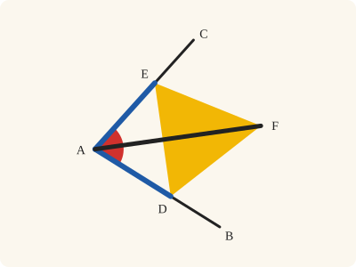
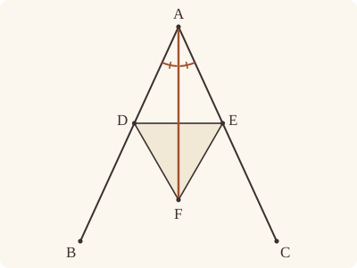

<!-- Generated by scripts/render.py. Do not edit by hand. -->

[Book I](index.md) · [← I.8](08.md) · [I.10 →](10.md)

# Book I, Proposition 9

*A given rectilineal angle, bisected*

[Euclid's proof](#euclids-proof) · [In Lean](#in-lean) · [What it rests on](#what-it-rests-on) · [Mishnah](#mishnah)

> To bisect a given rectilineal angle.

**In Lean:** ✅ proved, as Euclid states it · Euclid's argument

<p align="center"></p>

<p align="center"><em>Mark equal lengths on the two arms (blue) and build an equilateral triangle on the gap (yellow): the line from the corner to its tip splits the angle into equal halves (red).</em></p>

## Euclid's proof

<p align="center"></p>

Let the angle BAC be the given rectilineal angle.

It is then required to bisect it.

Let a point D be taken at random on AB;

let AE be cut off from AC equal to AD; [I. 3]

let DE be joined, and on DE let the equilateral triangle DEF be constructed;

let AF be joined.

I say that the angle BAC has been bisected by the straight line AF.

For, since AD is equal to AE,

and AF is common,

the two sides DA, AF are equal to the two sides EA, AF respectively.

And the base DF is equal to the base EF;

therefore the angle DAF is equal to the angle EAF. [I. 8]

Therefore the given rectilineal angle BAC has been bisected by the straight line AF.

Q. E. F.

## In Lean

| | |
|---|---|
| Proof | ✅ Proved |
| Statement | The whole enunciation. The angle is given as the triangle BAC, its arms not in one straight line, as Definition 8 asks; the bisector AF is proved to fall within it. |
| Argument | Euclid's. |
| Reviewed | [for exceptions](../../review/I/09.toml), at commit [`dcb1767`](https://github.com/jackChallis/stoicheia/commit/dcb1767) |

From [`Elements/BookI/Prop09.lean`](../../Elements/BookI/Prop09.lean). Euclid's sentences are the `--` comments, and our own notes are in `/- … -/`; the lines under each sentence are the Lean that carries it out. Where the Lean follows the text otherwise, the notes below say how.

**How the Lean follows the text**

- "let AF be joined." Euclid reads off his figure that AF falls within the angle; the Lean proves it as Proclus answers his objector, by I.5 and I.7: AF crosses DE between D and E. _(by `Prop9.crossing`)_

<details><summary>Before the theorem, three lemmas: <code>Prop9.not_on_arm</code>, <code>Prop9.crossing</code> and <code>Prop9.side</code> (106 lines)</summary>

```lean
/-! ## What Euclid reads off the figure -/

/-- Proclus' objector has a first case: F might fall on AB itself, beyond D. Proclus
answers him with the second part of I.5 (Heath, vol. 1, p. 265). Since FD is equal
to FE, the angle FDE is equal to the angle FED [I. 5]. Since AD is equal to
AE, the angles EDF, DEC under the base of the triangle ADE are equal [I. 5].
So the angle DEF is equal to the angle DEC, with F and C on the same side of
DE; then F lies on the straight line EC (`onRay_of_angle_eq`), that is, on AC.
But AB and AC meet only at A. -/
theorem Prop9.not_on_arm {A B C D E F : Point} (hBAC : Triangle B A C) (hADB : Between A D B)
    (hAEC : Between A E C) (hAD_AE : ‖A D‖ = ‖A E‖) (hFD_FE : ‖F D‖ = ‖F E‖)
    (hF : OppositeSidesOf F A D E) : ¬ Between A D F := by
  intro hADF
  have hDE : D ≠ E := hF.1
  obtain ⟨AB, hA_AB, hB_AB⟩ := Postulate1 A B hBAC.ne₁₂.symm
  obtain ⟨AC, hA_AC, hC_AC⟩ := Postulate1 A C hBAC.ne₂₃
  obtain ⟨DE, hD_DE, hE_DE⟩ := Postulate1 D E hDE
  have hFA : OppositeSides F A DE := hF.2 DE hD_DE hE_DE
  have hD_AB : OnLine D AB := on_line_of_between_ends hADB hA_AB hB_AB
  have hE_AC : OnLine E AC := on_line_of_between_ends hAEC hA_AC hC_AC
  have hADE : Triangle A D E := hF.symm.triangle.cab
  have hFDE : Triangle F D E := hF.triangle.cab
  have hFD : F ≠ D := hFDE.ne₁₂
  have hFE : F ≠ E := hFDE.ne₁₃
  /- Since FD is equal to FE, the angle FDE is equal to the angle FED. [I. 5] -/
  have hbase : ∠ F D E = ∠ F E D := Prop5.base hFDE hFD_FE
  /- Since AD is equal to AE, and AD, AE are produced to F, C, the angles
     EDF, DEC under the base are equal. [I. 5] -/
  have hunder : ∠ E D F = ∠ D E C := (Prop5 hADE hAD_AE hADF hAEC).2
  have hDEC_DEF : ∠ D E C = ∠ D E F :=
    hunder.symm.trans ((angle_symm hDE.symm hFD).trans (hbase.trans (angle_symm hFE hDE)))
  /- C, beyond E from A, is on the other side of DE from A (Pasch 3), as F is;
     so C and F are on the same side of DE. -/
  have hCE : C ≠ E := ne_of_between (between_symm hAEC)
  have hC_DE : ¬ OnLine C DE := fun hC =>
    hFA.2.1 ((line_unique hCE hC hE_DE hC_AC hE_AC) ▸ hA_AC)
  have hCF : SameSide C F DE :=
    same_side_of_opposite_sides ⟨hFA.2.1, hC_DE, pasch3 hAEC hE_DE⟩
      (hF.symm.oppositeSides hD_DE hE_DE)
  have hray : OnRay C E F :=
    onRay_of_angle_eq (SameSideOf.of_line hDE.symm hE_DE hD_DE hCF) hDEC_DEF
  /- So F is on AC, and on AB; and these meet only at A. -/
  have hF_AC : OnLine F AC := hray.symm.onLine hE_AC hC_AC
  have hF_AB : OnLine F AB := on_line_of_between hADF hA_AB hD_AB
  have hAB_AC : AB = AC := line_unique (ne_of_between_ends hADF) hA_AB hF_AB hA_AC hF_AC
  exact hBAC.off_line hB_AB hA_AB (hAB_AC ▸ hC_AC)

/-- Where does the straight line AF cross DE? Since F is on the other side of DE
from A, the straight line AF crosses DE at a point M (Intersection 1, Pasch
4). And M falls between D and E. It is not D or E: that is Proclus' first
case, `Prop9.not_on_arm`. Nor is it beyond D or beyond E: then D and E would
be on the same side of AF, and I.7 would make them one point, since AD is equal
to AE and FD to FE. -/
theorem Prop9.crossing {A B C D E F : Point} (hBAC : Triangle B A C) (hADB : Between A D B)
    (hAEC : Between A E C) (hAD_AE : ‖A D‖ = ‖A E‖) (hFD_FE : ‖F D‖ = ‖F E‖)
    (hF : OppositeSidesOf F A D E) : ∃ M : Point, Between A M F ∧ Between D M E := by
  have hDE : D ≠ E := hF.1
  obtain ⟨L, hD_L, hE_L⟩ := Postulate1 D E hDE
  have hFA : OppositeSides F A L := hF.2 L hD_L hE_L
  have hAF : A ≠ F := by
    intro h
    subst h
    exact hFA.2.2 (same_side_refl hFA.2.1)
  obtain ⟨N, hA_N, hF_N⟩ := Postulate1 A F hAF
  obtain ⟨hLN, M, hM_L, hM_N⟩ := lines_meet_of_opposite_sides hFA hF_N hA_N
  have hMA : M ≠ A := fun h => hFA.2.1 (h ▸ hM_L)
  have hMF : M ≠ F := fun h => hFA.1 (h ▸ hM_L)
  have hAMF : Between A M F :=
    pasch4 hLN hM_L hM_N hA_N hF_N hAF hMA.symm hMF.symm (fun h => hFA.2.2 (same_side_symm h))
  refine ⟨M, hAMF, ?_⟩
  /- M is not D, nor E: Proclus' first case, on either arm. -/
  have hDM : D ≠ M := by
    intro h
    rw [← h] at hAMF
    exact Prop9.not_on_arm hBAC hADB hAEC hAD_AE hFD_FE hF hAMF
  have hME : M ≠ E := by
    intro h
    rw [h] at hAMF
    exact Prop9.not_on_arm hBAC.cba hAEC hADB hAD_AE.symm hFD_FE.symm hF.swap hAMF
  /- D and E are not on the same side of AF, or I.7 would make them one point. -/
  have hD_N : ¬ OnLine D N := fun hD => hLN (line_unique hDM hD_L hM_L hD hM_N)
  have hE_N : ¬ OnLine E N := fun hE => hLN (line_unique hME.symm hE_L hM_L hE hM_N)
  have hI7 : ¬ SameSide D E N := fun hs =>
    hDE (Prop7 (SameSideOf.of_line hAF hA_N hF_N hs)
      (by rw [len_symm D A, hAD_AE, len_symm A E]) (by rw [len_symm D F, hFD_FE, len_symm F E]))
  rcases between_cases hDM hME hDE hD_L hM_L hE_L with h | h | h
  · exact h
  · exact absurd (pasch2 h hM_N hD_N) hI7
  · exact absurd (same_side_symm (pasch2 (between_symm h) hM_N hE_N)) hI7

/-- Where AF crosses DE tells the side of AB: M, between D and E, is on
E's side of AB, and F, beyond M from A, is on M's side; and E, between
A and C, is on C's side (Pasch 2). So F is on C's side of AB. -/
theorem Prop9.side {A B C D E F M : Point} (hBAC : Triangle B A C) (hADB : Between A D B)
    (hAEC : Between A E C) (hDME : Between D M E) (hAMF : Between A M F) :
    SameSideOf F C A B := by
  obtain ⟨AB, hA_AB, hB_AB⟩ := Postulate1 A B hBAC.ne₁₂.symm
  have hD_AB : OnLine D AB := on_line_of_between_ends hADB hA_AB hB_AB
  have hC_AB : ¬ OnLine C AB := hBAC.off_line hB_AB hA_AB
  have hE_AB : ¬ OnLine E AB := fun h => hC_AB (on_line_of_between hAEC hA_AB h)
  have hM_AB : ¬ OnLine M AB := fun h => hE_AB (on_line_of_between hDME hD_AB h)
  have hME : SameSide M E AB := pasch2 hDME hD_AB hM_AB
  have hMF : SameSide M F AB := pasch2 hAMF hA_AB hM_AB
  have hEC : SameSide E C AB := pasch2 hAEC hA_AB hE_AB
  exact SameSideOf.of_line hBAC.ne₁₂.symm hA_AB hB_AB
    (same_side_trans (same_side_trans hME hMF) hEC)
```

</details>

```lean
/-- To bisect a given rectilineal angle. -/
theorem Prop9 {A B C : Point} (hBAC : Triangle B A C) :
    ∃ F : Point, SameSideOf F C A B ∧ SameSideOf F B A C ∧
      ∠ B A F = ∠ F A C ∧ ∠ B A F + ∠ F A C = ∠ B A C := by
  -- Let the angle BAC be the given rectilineal angle.
  have hAB : A ≠ B := hBAC.ne₁₂.symm
  have hAC : A ≠ C := hBAC.ne₂₃
  obtain ⟨AB, hA_AB, hB_AB⟩ := Postulate1 A B hAB
  obtain ⟨AC, hA_AC, hC_AC⟩ := Postulate1 A C hAC
  have hC_AB : ¬ OnLine C AB := hBAC.off_line hB_AB hA_AB
  -- It is then required to bisect it.
  -- Let a point D be taken at random on AB;
  /- At random, but not too far out, since AD is about to be cut off from AC: D is
     taken nearer to A than C is (`exists_between_nearer` in Book Zero, with a
     circle about A through C). -/
  have hAA_AC : ‖A A‖ < ‖A C‖ := by
    rw [len_self]
    exact len_pos hAC
  obtain ⟨D, hADB, hAD_AC⟩ := exists_between_nearer hAB hAA_AC
  have hAD : A ≠ D := ne_of_between hADB
  have hD_AB : OnLine D AB := on_line_of_between_ends hADB hA_AB hB_AB
  -- let AE be cut off from AC equal to AD; [I. 3]
  obtain ⟨E, hAEC, hAE_AD⟩ := Prop3 hAD hAD_AC
  have hAE : A ≠ E := ne_of_between hAEC
  have hE_AC : OnLine E AC := on_line_of_between_ends hAEC hA_AC hC_AC
  -- let DE be joined, and on DE let the equilateral triangle DEF be constructed;
  /- E is off AB, or C would be on it; so ADE is a triangle. The equilateral triangle
     goes on the side of DE away from A, which Euclid leaves to his figure: we take a
     point Q on that side (System E, Points 6) and ask I.1 for Q's side. -/
  have hE_AB : ¬ OnLine E AB := fun h => hC_AB (on_line_of_between hAEC hA_AB h)
  have hADE : Triangle A D E := Triangle.of_line hA_AB hD_AB hAD hE_AB
  have hDE : D ≠ E := hADE.ne₂₃
  obtain ⟨Q, hQA, -⟩ := exists_oppositeSidesOf hADE.bca []
  obtain ⟨F, ⟨-, -, hEF_FD⟩, hside⟩ := Prop1 D E hDE Q
  have hFA : OppositeSidesOf F A D E := (hside hQA.triangle).trans_opposite hQA
  -- let AF be joined.
  /- Joined, AF falls within the angle BAC. That is Proclus' objector answered: AF
     crosses DE between D and E (`Prop9.crossing`, by I.5 and I.7), and from there F is
     on C's side of AB and on B's side of AC (`Prop9.side`). -/
  have hFD_FE : ‖F D‖ = ‖F E‖ := hEF_FD.symm.trans (len_symm E F)
  obtain ⟨M, hAMF, hDME⟩ := Prop9.crossing hBAC hADB hAEC hAE_AD.symm hFD_FE hFA
  have hFC : SameSideOf F C A B := Prop9.side hBAC hADB hAEC hDME hAMF
  have hFB : SameSideOf F B A C := Prop9.side hBAC.cba hAEC hADB (between_symm hDME) hAMF
  have hF_AB : ¬ OnLine F AB := hFC.triangle.off_line hA_AB hB_AB
  have hF_AC : ¬ OnLine F AC := hFB.triangle.off_line hA_AC hC_AC
  have hAF : A ≠ F := fun h => hF_AB (h ▸ hA_AB)
  -- I say that the angle BAC has been bisected by the straight line AF.
  -- For, since AD is equal to AE,
  have hAD_AE : ‖A D‖ = ‖A E‖ := hAE_AD.symm
  -- and AF is common,
  have hAF_AF : ‖A F‖ = ‖A F‖ := rfl
  -- the two sides DA, AF are equal to the two sides EA, AF respectively.
  -- And the base DF is equal to the base EF;
  have hDF_EF : ‖D F‖ = ‖E F‖ := (len_symm D F).trans hEF_FD.symm
  -- therefore the angle DAF is equal to the angle EAF. [I. 8]
  /- ADF and AEF are triangles, since F is off AB and off AC. -/
  have hADF : Triangle A D F := Triangle.of_line hA_AB hD_AB hAD hF_AB
  have hAEF : Triangle A E F := Triangle.of_line hA_AC hE_AC hAE hF_AC
  have hDAF_EAF : ∠ D A F = ∠ E A F := Prop8 hADF hAEF hAD_AE hAF_AF hDF_EF
  -- Therefore the given rectilineal angle BAC has been bisected by the straight line AF.
  /- The angle DAF is the angle BAF, since D lies on AB, and the angle EAF is the angle
     CAF, that is, FAC, since E lies on AC (an angle depends only on its rays). And
     since F lies within the angle BAC, that angle is made up of BAF and FAC
     (System E, Diagram-angle 2). -/
  have hbisect : ∠ B A F = ∠ F A C := by
    rw [← angle_onRay_left (OnRay.of_between hADB) hAF.symm, hDAF_EAF,
      angle_onRay_left (OnRay.of_between hAEC) hAF.symm, angle_symm hAC.symm hAF.symm]
  have hAB_AC : AB ≠ AC := fun h => hC_AB (h ▸ hC_AC)
  have hwhole : ∠ B A C = ∠ B A F + ∠ F A C :=
    angle_add_of_inside hA_AB hA_AC hB_AB hC_AC hAB hAC hF_AB hF_AC hAB_AC
      (same_side_symm (hFB.2 AC hA_AC hC_AC)) (same_side_symm (hFC.2 AB hA_AB hB_AB))
  exact ⟨F, hFC, hFB, hbisect, hwhole.symm⟩
  -- Q. E. F.
```

## What it rests on

| | |
|---|---|
| Heath's references | [I.3](03.md), [I.8](08.md) |
| Lean cites | [I.1](01.md), [I.3](03.md), [I.5](05.md), [I.7](07.md), [I.8](08.md) |
| Postulates | 1, 2, 3 |
| Definitions | 15 |
| Common Notions | 1, 3, 4, 5 |
| Tacit rules | 52 (listed below) |

Brought in by shared steps: [`Prop5.base`](../../Elements/BookI/Helpers.lean#L27) (I.5).

_Postulates, definitions, Common Notions and tacit rules: all that this proof rests on, counting those of the propositions it cites._

<details><summary>The 52 tacit rules beneath this proof, counting those of the propositions it cites</summary>

**Reading the figure**

- [`between_cases`](../../Elements/Foundations/Tacit/Diagram.lean#L74) (used here): Of three different points on a straight line, one is between the other two. (Between 6)
- [`between_of_between_left`](../../Elements/Foundations/Tacit/Diagram.lean#L66) (used here): If B is between A and C, and D is between A and B, then D is between A and C. (Between 4)
- [`between_of_between_right`](../../Elements/Foundations/Tacit/Diagram.lean#L70): If B is between A and C, and C is between B and D, then B is between A and D. (Between 5)
- [`between_symm`](../../Elements/Foundations/Tacit/Diagram.lean#L43) (used here): If B is between A and C, it is between C and A. (Between 1)
- [`centre_inside`](../../Elements/Foundations/Tacit/Diagram.lean#L35): The centre of a circle is inside it. (Generalities 3)
- [`circles_meet`](../../Elements/Foundations/Tacit/Diagram.lean#L201): If each circle passes through a point inside the other, the circles cut one another. This is the step Euclid takes for granted in I.1. (Intersection 5)
- [`circles_meet_same_side`](../../Elements/Foundations/Tacit/Constructions.lean#L81): Two circles that cut one another do so on each side of the straight line through their centres. (Intersections 8)
- [`exists_point`](../../Elements/Foundations/Tacit/Constructions.lean#L26) (used here): Let a point be taken. (Points 1)
- [`exists_point_between`](../../Elements/Foundations/Tacit/Constructions.lean#L38) (used here): Let a point be taken between B and C. (Points 3)
- [`exists_point_opposite_side`](../../Elements/Foundations/Tacit/Constructions.lean#L46) (used here): Let a point be taken on the other side of L from B. (Points 6)
- [`inside_of_between`](../../Elements/Foundations/Tacit/Diagram.lean#L161) (used here): A circle is "convex": between two points on or inside it, every point is inside. (Circle 2)
- [`line_circle_between`](../../Elements/Foundations/Tacit/Constructions.lean#L69) (used here): A straight line through a point B inside a circle, heading out to a point C outside it, cuts the circle between B and C. (Intersections 4)
- [`line_circle_beyond`](../../Elements/Foundations/Tacit/Constructions.lean#L75): A straight line through a point B inside a circle, produced beyond B away from C, cuts the circle there. (Intersections 5)
- [`line_unique`](../../Elements/Foundations/Tacit/Diagram.lean#L28) (used here): Two points determine a straight line. (Generalities 1)
- [`lines_meet_of_opposite_sides`](../../Elements/Foundations/Tacit/Diagram.lean#L179) (used here): A straight line joining points on opposite sides of L crosses L. (Intersection 1)
- [`ne_of_between`](../../Elements/Foundations/Tacit/Diagram.lean#L46) (used here): A point between two others differs from the first. (Between 1)
- [`ne_of_between_ends`](../../Elements/Foundations/Tacit/Diagram.lean#L49) (used here): The ends of a finite straight line differ. (Between 1)
- [`not_between_of_between`](../../Elements/Foundations/Tacit/Diagram.lean#L52) (used here): If B is between A and C, then A is not between B and C. (Between 1)
- [`not_between_of_between_between`](../../Elements/Foundations/Tacit/Diagram.lean#L79): If B is between A and C, and also between A and D, then B is not between C and D: C and D lie on the same side of B. (Between 7)
- [`not_on_line_of_same_side`](../../Elements/Foundations/Tacit/Diagram.lean#L92) (used here): Points on one side of a straight line are not on it. (Same side 3)
- [`on_line_of_between`](../../Elements/Foundations/Tacit/Diagram.lean#L56) (used here): A straight line through A and B, with B between A and C, passes through C. (Between 2)
- [`on_line_of_between_ends`](../../Elements/Foundations/Tacit/Diagram.lean#L61) (used here): A straight line through A and C passes through every point between them. (Between 3)
- [`pasch2`](../../Elements/Foundations/Tacit/Diagram.lean#L111) (used here): If B is between A and C, A is on L and B is off it, then B and C are on the same side of L: a straight line that leaves L at A does not cross it again. (Pasch 2)
- [`pasch3`](../../Elements/Foundations/Tacit/Diagram.lean#L114) (used here): A straight line through a point between A and C separates them. (Pasch 3)
- [`pasch4`](../../Elements/Foundations/Tacit/Diagram.lean#L119) (used here): If two different straight lines L and M meet at B, and A and C are points of M, different from each other and from B, that are not on the same side of L, then B is between A and C. (Pasch 4)
- [`same_side_or`](../../Elements/Foundations/Tacit/Diagram.lean#L99) (used here): A straight line has only two sides. (Same side 5)
- [`same_side_refl`](../../Elements/Foundations/Tacit/Diagram.lean#L85) (used here): A point off a straight line is on the same side of it as itself. (Same side 1)
- [`same_side_symm`](../../Elements/Foundations/Tacit/Diagram.lean#L89) (used here): If A is on the same side of a straight line as B, then B is on the same side as A. (Same side 2)
- [`same_side_trans`](../../Elements/Foundations/Tacit/Diagram.lean#L96) (used here): Two points on the same side of a straight line as a third point are on the same side as each other. (Same side 4)
- [`triple_incidence1`](../../Elements/Foundations/Tacit/Diagram.lean#L131): Take B on L, C on M and D on N, three straight lines through A. If C lies within the angle BAD (on D's side of L and on B's side of N), then B and D are not on the same side of M: the straight line AC separates them. (Triple incidence 1)
- [`triple_incidence2`](../../Elements/Foundations/Tacit/Diagram.lean#L139) (used here): Take B on L, C on M and D on N, three straight lines through A, with B other than A and D off M. If C and D are on the same side of L, and B and D are not on the same side of M, then B and C are on the same side of N: C lies within the angle BAD. (Triple incidence 2)

**Lengths, angles and areas**

- [`angle_add_of_inside`](../../Elements/Foundations/Tacit/Transfer.lean#L54) (used here): If D lies within the angle BAC, then BAC is made up of BAD and DAC. (Diagram-angle 2)
- [`angle_eq_of_same_rays`](../../Elements/Foundations/Tacit/Transfer.lean#L72) (used here): The angle doesn't change if its arms are traced through other points on the same rays. (Diagram-angle 4)
- [`angle_symm`](../../Elements/Foundations/Tacit/Metric.lean#L26) (used here): The angle ABC is the angle CBA. (Metric 4)
- [`area_congruent`](../../Elements/Foundations/Tacit/Metric.lean#L43): Triangles equal in all their sides and angles are equal in area. Euclid uses this without comment once he has shown two triangles congruent. (Metric 9)
- [`area_rotate`](../../Elements/Foundations/Tacit/Metric.lean#L35): The triangle ABC is the triangle CAB. (Metric 8)
- [`area_swap`](../../Elements/Foundations/Tacit/Metric.lean#L38): The triangle ABC is the triangle ACB. (Metric 8)
- [`eq_of_len_eq_zero`](../../Elements/Foundations/Tacit/Metric.lean#L17) (used here): A finite straight line with distinct ends has length. (Metric 1)
- [`inside_of_len_lt`](../../Elements/Foundations/Tacit/Transfer.lean#L33) (used here): A point nearer the centre than the circumference is inside. (Diagram-segment 4)
- [`len_add_of_between`](../../Elements/Foundations/Tacit/Transfer.lean#L21): If B is between A and C, then AB and BC together make up AC. (Diagram-segment 1)
- [`len_lt_of_inside`](../../Elements/Foundations/Tacit/Transfer.lean#L37) (used here): A point inside is nearer the centre than the circumference. (Diagram-segment 4)
- [`len_self`](../../Elements/Foundations/Tacit/Metric.lean#L20) (used here): The "straight line" from a point to itself has no length. (Metric 1)
- [`len_symm`](../../Elements/Foundations/Tacit/Metric.lean#L23) (used here): The straight line AB is the straight line BA. (Metric 3)
- [`same_ray_of_angle_eq_zero`](../../Elements/Foundations/Tacit/Transfer.lean#L49) (used here): If the angle BAC is nothing, C lies on the ray from A through B. (Diagram-angle 1)

**Superposition**

- [`superposition`](../../Elements/Foundations/Tacit/Superposition.lean#L30): **Superposition.** The triangle ABC can be applied to the straight line L with A on D, B on the ray from D through G, and C on the side of L where H is, without changing any side or angle.

**Laws of magnitude**

- [`add_comm`](../../Elements/Foundations/Tacit/Magnitudes.lean#L26): The order of adding does not matter. (System E §3.5)
- [`add_lt_add_right`](../../Elements/Foundations/Tacit/Magnitudes.lean#L45): Adding the same thing to both sides keeps "less than". (System E §3.5)
- [`add_zero`](../../Elements/Foundations/Tacit/Magnitudes.lean#L29): Adding nothing changes nothing. (System E §3.5)
- [`lt_irrefl`](../../Elements/Foundations/Tacit/Magnitudes.lean#L32) (used here): No magnitude is less than itself. (System E §3.5)
- [`lt_trans`](../../Elements/Foundations/Tacit/Magnitudes.lean#L35): What is less than the less is less still. (System E §3.5)
- [`lt_trichotomy`](../../Elements/Foundations/Tacit/Magnitudes.lean#L39) (used here): Of two magnitudes, one is less, or they are equal, or the other is less. (System E §3.5)
- [`not_lt_zero`](../../Elements/Foundations/Tacit/Magnitudes.lean#L42) (used here): Nothing is less than zero. (System E §3.5)

</details>

## Mishnah

**Which side of DE?** Euclid builds the equilateral triangle on DE by I.1, though Heath gives no bracket for it. As Heath observes, "Euclid does not say, in his description of the construction, that the equilateral triangle should be constructed on the side of DE opposite to A; he leaves this to be inferred from his figure" (vol. 1, p. 264). Proclus even provides for a reader who "could not recognise the existence of any space below DE": he builds on A's side, and the vertex may then fall on A, above A or below it (Heath, vol. 1, p. 264). We grant that space by a rule of System E (Points 6), which gives a point beyond DE from A, and our I.1 builds on that point's side.

**Does F fall within the angle?** Proclus also imagined an objector for whom F might fall on an arm of the angle BAC, or outside it (Heath, vol. 1, p. 265). We are that objector, for I.10 will want AF within the angle. Were F on AB, the angles under the base of I.5 would put it on AC as well: "Here then is the second case in which, in Proclus' view, the second part of I. 5 is useful for refuting objections" (Heath, vol. 1, p. 265). Were AF to cross DE beyond D or E, I.7 would make D and E one point.

**Why "rectilineal"?** Proclus stresses the word, for "it is difficult to say whether it is possible to bisect the so-called *horn-like* angle" between a circle and a straight line touching it (Heath, vol. 1, p. 265), the angle that III.16 meets. Here too he gives "his valuable historical note about the *trisection* of any acute angle, which (as well as the division of an angle in any given ratio) requires resort to other curves than circles" (Heath, vol. 1, p. 265): the conchoid of Nicomedes, the quadratrix of Hippias, the spiral of Archimedes. In 1837 Pierre Wantzel proved that straight lines and circles alone cannot trisect every angle.

**The modern way.** Put A at the origin, with unit vectors u and v along AB and AC: then u + v, the diagonal of the rhombus on u and v, points along the bisector, as the diagonal AF of Euclid's kite ADFE does. As complex numbers, the argument of u + v is the average of those of u and v, taken less than π apart.

## Further reading

- For angles bisected and turned with complex numbers, as in the modern way, Liang-shin Hahn's [*Complex Numbers and Geometry*](https://doi.org/10.1090/text/052) (1994), a short, gentle book that assumes nothing about complex numbers and then gives quick, clean proofs of classical theorems with them.
- For why no ruler and compass can trisect every angle, Felix Klein's [*Famous Problems of Elementary Geometry*](https://archive.org/details/famousproblemsof00kleiiala) (1897, free online), in Wooster Woodruff Beman and David Eugene Smith's translation, about eighty friendly pages that also explain why the cube cannot be doubled or the circle squared.
- For the conchoid, the quadratrix and the spiral, and Pierre Wantzel's proof of 1837, David S. Richeson's [*Tales of Impossibility*](https://doi.org/10.1515/9780691194233) (2019), the chapters "Curves" and "Pierre Wantzel", a tour full of history and short tangents.

[Book I](index.md) · [← I.8](08.md) · [I.10 →](10.md)

---

<sub>Euclid's text: T. L. Heath, *The Thirteen Books of Euclid's Elements*, vol. 1 (Cambridge, 1908), p. 264; [scan leaf n284](https://archive.org/details/thirteenbookseu02heibgoog/page/n284); [figure on n284](https://archive.org/details/thirteenbookseu02heibgoog/page/n284). Public domain.</sub>

<sub>The tacit rules follow the System E of Jeremy Avigad, Edward Dean and John Mumma, read alongside LeanEuclid (Logan Murphy, Kaiyu Yang, Jialiang Sun, Zhaoyu Li, Anima Anandkumar and Xujie Si).</sub>
