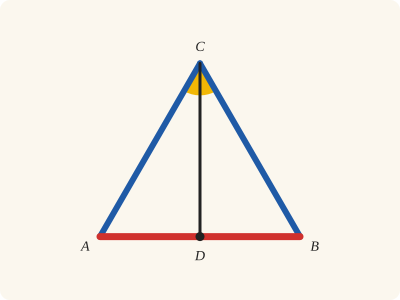
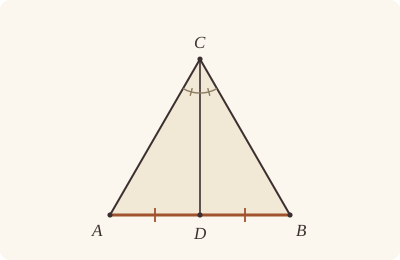

<!-- Generated by scripts/render.py. Do not edit by hand. -->

[Book I](index.md) · [← I.9](09.md) · [I.11 →](11.md)

# Book I, Proposition 10

*A given finite straight line, bisected*

[Euclid's proof](#euclids-proof) · [In Lean](#in-lean) · [What it rests on](#what-it-rests-on) · [Mishnah](#mishnah)

> To bisect a given finite straight line.

**In Lean:** ✅ proved, as Euclid states it · Euclid's argument

<p align="center"></p>

<p align="center"><em>Stand a triangle with equal sides (blue) on the straight line and split its top angle into two equal parts (yellow): the dividing line cuts the base in half (red).</em></p>

## Euclid's proof

<p align="center"></p>

Let AB be the given finite straight line.

Thus it is required to bisect the finite straight line AB.

Let the equilateral triangle ABC be constructed on it, [I. 1]

and let the angle ACB be bisected by the straight line CD; [I. 9]

I say that the straight line AB has been bisected at the point D.

For, since AC is equal to CB,

and CD is common,

the two sides AC, CD are equal to the two sides BC, CD respectively;

and the angle ACD is equal to the angle BCD;

therefore the base AD is equal to the base BD. [I. 4]

Therefore the given finite straight line AB has been bisected at D.

Q. E. F.

## In Lean

| | |
|---|---|
| Proof | ✅ Proved |
| Statement | The whole enunciation. |
| Argument | Euclid's. |
| Reviewed | [for exceptions](../../review/I/10.toml), at commit [`dcb1767`](https://github.com/jackChallis/stoicheia/commit/dcb1767) |

From [`Elements/BookI/Prop10.lean`](../../Elements/BookI/Prop10.lean). Euclid's sentences are the `--` comments, and our own notes are in `/- … -/`; the lines under each sentence are the Lean that carries it out.

```lean
/-- To bisect a given finite straight line. -/
theorem Prop10 {A B : Point} (hAB : A ≠ B) :
    ∃ D : Point, Between A D B ∧ ‖A D‖ = ‖D B‖ := by
  -- Let AB be the given finite straight line.
  /- Lean needs the straight line itself, by name, to say later that D is on
     it and C is off it. -/
  obtain ⟨L, hA_L, hB_L⟩ := Postulate1 A B hAB
  -- Thus it is required to bisect the finite straight line AB.
  -- Let the equilateral triangle ABC be constructed on it, [I. 1]
  /- No side of AB matters here, so I.1 is given a point of AB itself, A,
     as the point whose side the triangle is to be on. -/
  obtain ⟨C, ⟨hABC, hAB_BC, hBC_CA⟩, -⟩ := Prop1 A B hAB A
  have hC_L : ¬ OnLine C L := hABC.off_line hA_L hB_L
  -- and let the angle ACB be bisected by the straight line CD; [I. 9]
  /- I.9 bisects the angle ACB by a straight line CF, with F within the
     angle: on B's side of CA and on A's side of CB. Euclid's D is the
     point where that straight line meets AB. He draws it there without a
     word; it is the crossbar (Book Zero, `crossbar`) that makes the bisector,
     falling within the angle, cross the base between A and B. -/
  obtain ⟨F, hF_CA, hF_CB, hACF_FCB, -⟩ := Prop9 hABC.acb
  obtain ⟨D, hADB, hD_CF⟩ := crossbar hF_CA hF_CB
  have hD_L : OnLine D L := on_line_of_between_ends hADB hA_L hB_L
  have hDC : D ≠ C := hD_CF.2.1
  -- I say that the straight line AB has been bisected at the point D.
  -- For, since AC is equal to CB,
  have hAC_CB : ‖A C‖ = ‖C B‖ :=
    (len_symm A C).trans (hBC_CA.symm.trans (len_symm B C))
  -- and CD is common,
  have hCD : ‖C D‖ = ‖C D‖ := rfl
  -- the two sides AC, CD are equal to the two sides BC, CD respectively;
  have hCA_CB : ‖C A‖ = ‖C B‖ := (len_symm C A).trans hAC_CB
  -- and the angle ACD is equal to the angle BCD;
  /- The angles ACD and BCD are the halves ACF and FCB that I.9 made equal,
     since D is on the ray from C through F (`angle_onRay_right`,
     `angle_onRay_left`); the second is then read the other way round. -/
  have hACD_BCD : ∠ A C D = ∠ B C D := by
    rw [angle_onRay_right hD_CF hABC.ne₁₃, hACF_FCB,
      ← angle_onRay_left hD_CF hABC.ne₂₃, angle_symm hDC hABC.ne₂₃]
  -- therefore the base AD is equal to the base BD. [I. 4]
  /- The two triangles are CAD and CBD: D is on AB, and C is off it. -/
  have hCAD : Triangle C A D := (Triangle.of_line hA_L hD_L (ne_of_between hADB) hC_L).cab
  have hCBD : Triangle C B D :=
    (Triangle.of_line hB_L hD_L (ne_of_between (between_symm hADB)) hC_L).cab
  have hAD_BD : ‖A D‖ = ‖B D‖ := (Prop4 hCAD hCBD hCA_CB hCD hACD_BCD).1
  -- Therefore the given finite straight line AB has been bisected at D.
  exact ⟨D, hADB, hAD_BD.trans (len_symm B D)⟩
  -- Q. E. F.
```

## What it rests on

| | |
|---|---|
| Heath's references | [I.1](01.md), [I.4](04.md), [I.9](09.md) |
| Lean cites | [I.1](01.md), [I.4](04.md), [I.9](09.md) |
| Postulates | 1, 2, 3 |
| Definitions | 15 |
| Common Notions | 1, 3, 4, 5 |
| Tacit rules | 52 (listed below) |

_Postulates, definitions, Common Notions and tacit rules: all that this proof rests on, counting those of the propositions it cites._

<details><summary>The 52 tacit rules beneath this proof, counting those of the propositions it cites</summary>

**Reading the figure**

- [`between_cases`](../../Elements/Foundations/Tacit/Diagram.lean#L74): Of three different points on a straight line, one is between the other two. (Between 6)
- [`between_of_between_left`](../../Elements/Foundations/Tacit/Diagram.lean#L66): If B is between A and C, and D is between A and B, then D is between A and C. (Between 4)
- [`between_of_between_right`](../../Elements/Foundations/Tacit/Diagram.lean#L70): If B is between A and C, and C is between B and D, then B is between A and D. (Between 5)
- [`between_symm`](../../Elements/Foundations/Tacit/Diagram.lean#L43) (used here): If B is between A and C, it is between C and A. (Between 1)
- [`centre_inside`](../../Elements/Foundations/Tacit/Diagram.lean#L35): The centre of a circle is inside it. (Generalities 3)
- [`circles_meet`](../../Elements/Foundations/Tacit/Diagram.lean#L201): If each circle passes through a point inside the other, the circles cut one another. This is the step Euclid takes for granted in I.1. (Intersection 5)
- [`circles_meet_same_side`](../../Elements/Foundations/Tacit/Constructions.lean#L81): Two circles that cut one another do so on each side of the straight line through their centres. (Intersections 8)
- [`exists_point`](../../Elements/Foundations/Tacit/Constructions.lean#L26) (used here): Let a point be taken. (Points 1)
- [`exists_point_between`](../../Elements/Foundations/Tacit/Constructions.lean#L38): Let a point be taken between B and C. (Points 3)
- [`exists_point_opposite_side`](../../Elements/Foundations/Tacit/Constructions.lean#L46): Let a point be taken on the other side of L from B. (Points 6)
- [`inside_of_between`](../../Elements/Foundations/Tacit/Diagram.lean#L161): A circle is "convex": between two points on or inside it, every point is inside. (Circle 2)
- [`line_circle_between`](../../Elements/Foundations/Tacit/Constructions.lean#L69): A straight line through a point B inside a circle, heading out to a point C outside it, cuts the circle between B and C. (Intersections 4)
- [`line_circle_beyond`](../../Elements/Foundations/Tacit/Constructions.lean#L75): A straight line through a point B inside a circle, produced beyond B away from C, cuts the circle there. (Intersections 5)
- [`line_unique`](../../Elements/Foundations/Tacit/Diagram.lean#L28) (used here): Two points determine a straight line. (Generalities 1)
- [`lines_meet_of_opposite_sides`](../../Elements/Foundations/Tacit/Diagram.lean#L179) (used here): A straight line joining points on opposite sides of L crosses L. (Intersection 1)
- [`ne_of_between`](../../Elements/Foundations/Tacit/Diagram.lean#L46) (used here): A point between two others differs from the first. (Between 1)
- [`ne_of_between_ends`](../../Elements/Foundations/Tacit/Diagram.lean#L49) (used here): The ends of a finite straight line differ. (Between 1)
- [`not_between_of_between`](../../Elements/Foundations/Tacit/Diagram.lean#L52): If B is between A and C, then A is not between B and C. (Between 1)
- [`not_between_of_between_between`](../../Elements/Foundations/Tacit/Diagram.lean#L79): If B is between A and C, and also between A and D, then B is not between C and D: C and D lie on the same side of B. (Between 7)
- [`not_on_line_of_same_side`](../../Elements/Foundations/Tacit/Diagram.lean#L92) (used here): Points on one side of a straight line are not on it. (Same side 3)
- [`on_line_of_between`](../../Elements/Foundations/Tacit/Diagram.lean#L56): A straight line through A and B, with B between A and C, passes through C. (Between 2)
- [`on_line_of_between_ends`](../../Elements/Foundations/Tacit/Diagram.lean#L61) (used here): A straight line through A and C passes through every point between them. (Between 3)
- [`pasch2`](../../Elements/Foundations/Tacit/Diagram.lean#L111) (used here): If B is between A and C, A is on L and B is off it, then B and C are on the same side of L: a straight line that leaves L at A does not cross it again. (Pasch 2)
- [`pasch3`](../../Elements/Foundations/Tacit/Diagram.lean#L114) (used here): A straight line through a point between A and C separates them. (Pasch 3)
- [`pasch4`](../../Elements/Foundations/Tacit/Diagram.lean#L119) (used here): If two different straight lines L and M meet at B, and A and C are points of M, different from each other and from B, that are not on the same side of L, then B is between A and C. (Pasch 4)
- [`same_side_or`](../../Elements/Foundations/Tacit/Diagram.lean#L99): A straight line has only two sides. (Same side 5)
- [`same_side_refl`](../../Elements/Foundations/Tacit/Diagram.lean#L85): A point off a straight line is on the same side of it as itself. (Same side 1)
- [`same_side_symm`](../../Elements/Foundations/Tacit/Diagram.lean#L89) (used here): If A is on the same side of a straight line as B, then B is on the same side as A. (Same side 2)
- [`same_side_trans`](../../Elements/Foundations/Tacit/Diagram.lean#L96) (used here): Two points on the same side of a straight line as a third point are on the same side as each other. (Same side 4)
- [`triple_incidence1`](../../Elements/Foundations/Tacit/Diagram.lean#L131) (used here): Take B on L, C on M and D on N, three straight lines through A. If C lies within the angle BAD (on D's side of L and on B's side of N), then B and D are not on the same side of M: the straight line AC separates them. (Triple incidence 1)
- [`triple_incidence2`](../../Elements/Foundations/Tacit/Diagram.lean#L139): Take B on L, C on M and D on N, three straight lines through A, with B other than A and D off M. If C and D are on the same side of L, and B and D are not on the same side of M, then B and C are on the same side of N: C lies within the angle BAD. (Triple incidence 2)

**Lengths, angles and areas**

- [`angle_add_of_inside`](../../Elements/Foundations/Tacit/Transfer.lean#L54): If D lies within the angle BAC, then BAC is made up of BAD and DAC. (Diagram-angle 2)
- [`angle_eq_of_same_rays`](../../Elements/Foundations/Tacit/Transfer.lean#L72) (used here): The angle doesn't change if its arms are traced through other points on the same rays. (Diagram-angle 4)
- [`angle_symm`](../../Elements/Foundations/Tacit/Metric.lean#L26) (used here): The angle ABC is the angle CBA. (Metric 4)
- [`area_congruent`](../../Elements/Foundations/Tacit/Metric.lean#L43): Triangles equal in all their sides and angles are equal in area. Euclid uses this without comment once he has shown two triangles congruent. (Metric 9)
- [`area_rotate`](../../Elements/Foundations/Tacit/Metric.lean#L35): The triangle ABC is the triangle CAB. (Metric 8)
- [`area_swap`](../../Elements/Foundations/Tacit/Metric.lean#L38): The triangle ABC is the triangle ACB. (Metric 8)
- [`eq_of_len_eq_zero`](../../Elements/Foundations/Tacit/Metric.lean#L17): A finite straight line with distinct ends has length. (Metric 1)
- [`inside_of_len_lt`](../../Elements/Foundations/Tacit/Transfer.lean#L33): A point nearer the centre than the circumference is inside. (Diagram-segment 4)
- [`len_add_of_between`](../../Elements/Foundations/Tacit/Transfer.lean#L21): If B is between A and C, then AB and BC together make up AC. (Diagram-segment 1)
- [`len_lt_of_inside`](../../Elements/Foundations/Tacit/Transfer.lean#L37): A point inside is nearer the centre than the circumference. (Diagram-segment 4)
- [`len_self`](../../Elements/Foundations/Tacit/Metric.lean#L20): The "straight line" from a point to itself has no length. (Metric 1)
- [`len_symm`](../../Elements/Foundations/Tacit/Metric.lean#L23) (used here): The straight line AB is the straight line BA. (Metric 3)
- [`same_ray_of_angle_eq_zero`](../../Elements/Foundations/Tacit/Transfer.lean#L49): If the angle BAC is nothing, C lies on the ray from A through B. (Diagram-angle 1)

**Superposition**

- [`superposition`](../../Elements/Foundations/Tacit/Superposition.lean#L30): **Superposition.** The triangle ABC can be applied to the straight line L with A on D, B on the ray from D through G, and C on the side of L where H is, without changing any side or angle.

**Laws of magnitude**

- [`add_comm`](../../Elements/Foundations/Tacit/Magnitudes.lean#L26): The order of adding does not matter. (System E §3.5)
- [`add_lt_add_right`](../../Elements/Foundations/Tacit/Magnitudes.lean#L45): Adding the same thing to both sides keeps "less than". (System E §3.5)
- [`add_zero`](../../Elements/Foundations/Tacit/Magnitudes.lean#L29): Adding nothing changes nothing. (System E §3.5)
- [`lt_irrefl`](../../Elements/Foundations/Tacit/Magnitudes.lean#L32): No magnitude is less than itself. (System E §3.5)
- [`lt_trans`](../../Elements/Foundations/Tacit/Magnitudes.lean#L35): What is less than the less is less still. (System E §3.5)
- [`lt_trichotomy`](../../Elements/Foundations/Tacit/Magnitudes.lean#L39): Of two magnitudes, one is less, or they are equal, or the other is less. (System E §3.5)
- [`not_lt_zero`](../../Elements/Foundations/Tacit/Magnitudes.lean#L42): Nothing is less than zero. (System E §3.5)

</details>

## Mishnah

**Must the bisector reach AB?** Euclid bisects the angle ACB by the straight line CD and at once treats D as a point of AB, between A and B. Our I.9 hands back a bisector that falls within the angle, for just this use, and Book Zero's [`crossbar`](../../Elements/Figure/Angles.lean), the crossbar theorem of the geometry books that follow David Hilbert, does the rest: the bisector's straight line separates A from B, so it crosses AB, and Pasch's rules put the crossing between them, on the ray from C along the bisector. Otherwise the proof is Euclid's.

**"A step further back."** Apollonius, Proclus reports, "bisected a straight line AB by a construction like that of I. 1" (Heath, vol. 1, p. 268): two circles about A and B with radius AB meet at C and D, and CD, joined, bisects the angle ACB by I.8 and then AB by I.4. It is the construction taught with ruler and compass today. Heath's complaint is one of method. Instead of assuming the bisection of the angle, done already in I.9, Apollonius "unnecessarily does over again what has been done before, which is open to objection from a theoretical point of view" (Heath, vol. 1, p. 268). We take Euclid's way, and cite I.9. Under I.11 Heath finds a kinder word for Apollonius.

**Can a line always be halved?** Proclus "warns us against being moved by this proposition to conclude that geometers assumed, as a preliminary hypothesis, that a line is not made up of indivisible parts" (Heath, vol. 1, p. 268). A line of an odd number of indivisibles could not be halved at all. Following Geminus, Proclus answers that geometers assumed only that a continuous magnitude is divisible. "But *infinite* divisibility was not assumed by them" (Heath, vol. 1, p. 268): they proved it, in showing that some magnitudes are incommensurable. He adds that I.10 may serve to refute the indivisible lines of Xenocrates. Our I.10 assumes nothing of the kind: its D is simply where two straight lines cross.

**The modern way.** The midpoint of AB is (A + B)/2. Euclid's figure agrees: with A at −1 and B at 1 in the complex plane, C is √3 i, the bisector of the angle ACB is the imaginary axis, and it meets AB at 0, halfway between −1 and 1.

## Further reading

- For the crossbar theorem that finds D, and Pasch's axiom behind it, Marvin Jay Greenberg's [*Euclidean and Non-Euclidean Geometries*](https://store.macmillanlearning.com/us/product/Euclidean-and-Non-Euclidean-Geometries/p/0716799480) (2008), ch. 3, "Hilbert's Axioms", a friendly textbook on the rules of order that Euclid leaves unsaid.
- For why those rules of "between" matter, Felix Klein's [*Elementary Mathematics from a Higher Standpoint, Volume II: Geometry*](https://doi.org/10.1007/978-3-662-49445-5) (2016), in Gert Schubring's translation of his lectures of 1908, whose section on the *Elements* points out that Euclid has no axioms of betweenness, the gap through which the old geometric sophisms slip.

[Book I](index.md) · [← I.9](09.md) · [I.11 →](11.md)

---

<sub>Euclid's text: T. L. Heath, *The Thirteen Books of Euclid's Elements*, vol. 1 (Cambridge, 1908), p. 267; [scan leaf n287](https://archive.org/details/thirteenbookseu02heibgoog/page/n287); [figure on n287](https://archive.org/details/thirteenbookseu02heibgoog/page/n287). Public domain.</sub>

<sub>The tacit rules follow the System E of Jeremy Avigad, Edward Dean and John Mumma, read alongside LeanEuclid (Logan Murphy, Kaiyu Yang, Jialiang Sun, Zhaoyu Li, Anima Anandkumar and Xujie Si).</sub>
