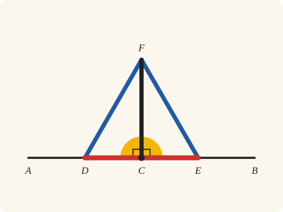
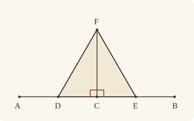
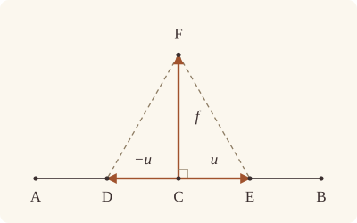

<!-- Generated by scripts/render.py. Do not edit by hand. -->

[Book I](index.md) · [← I.10](10.md) · [I.12 →](12.md)

# Book I, Proposition 11

*A straight line at right angles from a point on a given one*

[Euclid's proof](#euclids-proof) · [In Lean](#in-lean) · [What it rests on](#what-it-rests-on) · [Mishnah](#mishnah)

> To draw a straight line at right angles to a given straight line from a given point on it.

**In Lean:** ✅ proved, as Euclid states it · Euclid's argument

<p align="center"></p>

<p align="center"><em>Mark off equal lengths either side of the point (red) and join their ends with equal lines to a peak (blue): the line from the peak down to the point stands at right angles (yellow).</em></p>

## Euclid's proof

<p align="center"></p>

<p align="center"><em>Drawn for one case: C between A and B, as in Heath's figure.</em></p>

Let AB be the given straight line, and C the given point on it.

Thus it is required to draw from the point C a straight line at right angles to the straight line AB.

Let a point D be taken at random on AC;

let CE be made equal to CD; [I. 3]

on DE let the equilateral triangle FDE be constructed, [I. 1]

and let FC be joined;

I say that the straight line FC has been drawn at right angles to the given straight line AB from C the given point on it.

For, since DC is equal to CE,

and CF is common,

the two sides DC, CF are equal to the two sides EC, CF respectively;

and the base DF is equal to the base FE;

therefore the angle DCF is equal to the angle ECF; [I. 8]

and they are adjacent angles.

But, when a straight line set up on a straight line makes the adjacent angles equal to one another, each of the equal angles is right; [Def. 10]

therefore each of the angles DCF, FCE is right.

Therefore the straight line CF has been drawn at right angles to the given straight line AB from the given point C on it.

Q. E. F.

## In Lean

| | |
|---|---|
| Proof | ✅ Proved |
| Statement | The whole enunciation. Proved for any point C of AB, with F on the side of a given point Q; the angle PCF is the right angle ∟ for every point P of AB other than C. |
| Argument | Euclid's. |
| Reviewed | The statement and every passage of the argument read against Heath's text, at commit [`a9bca05`](https://github.com/jackChallis/stoicheia/commit/a9bca05) ([the record](../../review/I/11.toml)) |

From [`Elements/BookI/Prop11.lean`](../../Elements/BookI/Prop11.lean). Euclid's sentences are the `--` comments, and our own notes are in `/- … -/`; the lines under each sentence are the Lean that carries it out. The list below marks where a lemma does a step Euclid takes for granted and where the Lean takes a case Euclid's figure leaves aside; the `/- … -/` notes in the listing explain smaller adjustments.

**How the Lean follows the text**

- **A further case.** "Let a point D be taken at random on AC…" Euclid takes D on AC, with C between A and B in his figure. The Lean also admits C at A, when there is no AC to take D on, so it takes D to be B; otherwise `Tacit.exists_point_between`, the rule we assume as System E's Points 3, supplies D between A and C.
- **Done by `produce_longer`.** "let CE be made equal to CD…" Euclid cuts off CE equal to CD, taking for granted a straight line beyond C greater than CD, although CB may be shorter than CD or C may be B. The Lean uses `produce_longer` to extend DC beyond C far enough for I.3 and, after the cut, `between_cut` to put C between D and E; with F off DE, this makes DCF and FCE adjacent, as Euclid later says in "and they are adjacent angles".
- **Done by `OnRay.cases_of_between`.** "Therefore the straight line CF has been drawn at right angles…" Euclid concludes that CF is at right angles to AB from the two right angles at C. For every other point P of AB, `OnRay.cases_of_between` puts P on the ray from C through D or E, and `angle_onRay_left` carries the corresponding right angle to PCF.

```lean
/-- To draw a straight line at right angles to a given straight line from a given point on it. -/
theorem Prop11 {A B C Q : Point} (hAB : A ≠ B) (hC : Collinear A B C) (hQ : ¬ Collinear A B Q) :
    ∃ F : Point, SameSideOf F Q A B ∧ ∀ P : Point, Collinear A B P → P ≠ C → ∠ P C F = ∟ := by
  -- Let AB be the given straight line, and C the given point on it.
  /- Our proof names the straight line AB (Post. 1), with C on it and Q off it. -/
  obtain ⟨AB, hA_AB, hB_AB⟩ := Postulate1 A B hAB
  have on_AB : ∀ {P : Point}, Collinear A B P → OnLine P AB := by
    rintro P ⟨M, hA_M, hB_M, hP_M⟩
    rw [line_unique hAB hA_AB hB_AB hA_M hB_M]
    exact hP_M
  have hC_AB : OnLine C AB := on_AB hC
  have hQ_AB : ¬ OnLine Q AB := fun h => hQ ⟨AB, hA_AB, hB_AB, h⟩
  -- Thus it is required to draw from the point C a straight line at right angles to the
  -- straight line AB.
  -- Let a point D be taken at random on AC;
  /- Euclid's figure has C between A and B. In Lean C may be any point of the
     straight line AB, even A itself, and then there is no AC to take D on: B
     will do. All the proof needs is a point D of AB other than C (System E,
     Points 3). -/
  obtain ⟨D, hD_AB, hDC⟩ : ∃ D : Point, OnLine D AB ∧ D ≠ C := by
    by_cases hCA : C = A
    · exact ⟨B, hB_AB, by rw [hCA]; exact hAB.symm⟩
    · obtain ⟨D, hD_AB, hADC, -⟩ := exists_point_between hA_AB hC_AB (Ne.symm hCA) []
      exact ⟨D, hD_AB, (ne_of_between (between_symm hADC)).symm⟩
  -- let CE be made equal to CD; [I. 3]
  /- CE is cut off from DC produced beyond C, far enough for I.3 to have a
     greater straight line to cut it from (`produce_longer` in Book Zero). So C
     lies between D and E (`between_cut`): the figure's D, C, E in a row. -/
  obtain ⟨G, hDCG, hCD_CG⟩ := produce_longer hDC hDC.symm
  obtain ⟨E, hCEG, hCE_CD⟩ := Prop3 hDC.symm hCD_CG
  have hDCE : Between D C E := between_cut hDCG hCEG
  have hE_AB : OnLine E AB := on_line_of_between hDCE hD_AB hC_AB
  have hDE : D ≠ E := ne_of_between_ends hDCE
  have hEC : E ≠ C := ne_of_between (between_symm hDCE)
  -- on DE let the equilateral triangle FDE be constructed, [I. 1]
  /- On Q's side of DE, which is Q's side of AB: one straight line passes
     through D and E. -/
  obtain ⟨F, ⟨-, hDE_EF, hEF_FD⟩, hFQ⟩ := Prop1 D E hDE Q
  have hF_Q : SameSide F Q AB :=
    (hFQ (Triangle.of_line hD_AB hE_AB hDE hQ_AB)).sameSide hD_AB hE_AB
  have hF_AB : ¬ OnLine F AB := not_on_line_of_same_side hF_Q
  -- and let FC be joined;
  have hFC : F ≠ C := fun h => hF_AB (h ▸ hC_AB)
  obtain ⟨FC, -, -⟩ := Postulate1 F C hFC
  -- I say that the straight line FC has been drawn at right angles to the given straight line
  -- AB from C the given point on it.
  -- For, since DC is equal to CE,
  have hDC_CE : ‖D C‖ = ‖C E‖ := (len_symm D C).trans hCE_CD.symm
  -- and CF is common,
  have hCF : ‖C F‖ = ‖C F‖ := rfl
  -- the two sides DC, CF are equal to the two sides EC, CF respectively;
  have hCD_CE : ‖C D‖ = ‖C E‖ := (len_symm C D).trans hDC_CE
  -- and the base DF is equal to the base FE;
  have hDF_EF : ‖D F‖ = ‖E F‖ := (len_symm D F).trans (hEF_FD.symm)
  -- therefore the angle DCF is equal to the angle ECF; [I. 8]
  have hCDF : Triangle C D F := Triangle.of_line hC_AB hD_AB hDC.symm hF_AB
  have hCEF : Triangle C E F := Triangle.of_line hC_AB hE_AB hEC.symm hF_AB
  have hDCF_ECF : ∠ D C F = ∠ E C F := Prop8 hCDF hCEF hCD_CE hCF hDF_EF
  -- and they are adjacent angles.
  /- Adjacent: C lies between D and E, and F is off the straight line DE. -/
  have hDCF_FCE : ∠ D C F = ∠ F C E := hDCF_ECF.trans (angle_symm hEC hFC)
  -- But, when a straight line set up on a straight line makes the adjacent angles equal to one
  -- another, each of the equal angles is right; [Def. 10]
  /- Definition 10 says what a right angle is, and Postulate 4 that every right
     angle is the right angle `∟`. -/
  have hDCF_right : IsRightAngle D C F := ⟨E, hDCE, hCDF.bac, hDCF_FCE⟩
  have hECF_right : IsRightAngle E C F :=
    ⟨D, between_symm hDCE, hCEF.bac, hDCF_ECF.symm.trans (angle_symm hDC hFC)⟩
  -- therefore each of the angles DCF, FCE is right.
  have hDCF : ∠ D C F = ∟ := Postulate4 hDCF_right
  have hFCE : ∠ F C E = ∟ := (angle_symm hFC hEC).trans (Postulate4 hECF_right)
  -- Therefore the straight line CF has been drawn at right angles to the given straight line
  -- AB from the given point C on it.
  /- Every other point P of AB lies on the ray from C through D, or on the ray
     from C through E (`OnRay.cases_of_between`), and the angle PCF is the angle
     DCF or the angle ECF (`angle_onRay_left`; both are in Book Zero). -/
  refine ⟨F, SameSideOf.of_line hAB hA_AB hB_AB hF_Q, fun P hP hPC => ?_⟩
  rcases OnRay.cases_of_between hDCE hD_AB hE_AB (on_AB hP) hPC with hPD | hPE
  · rw [angle_onRay_left hPD hFC]
    exact hDCF
  · rw [angle_onRay_left hPE hFC, angle_symm hEC hFC]
    exact hFCE
  -- Q. E. F.
```

## What it rests on

| | |
|---|---|
| Heath's references | [I.1](01.md), [I.3](03.md), [I.8](08.md); Def. I.10 |
| Lean cites | [I.1](01.md), [I.3](03.md), [I.8](08.md) |
| Postulates | 1, 2, 3, 4 |
| Definitions taken as axioms | Def. I.15 |
| Common Notions | 1, 3, 4, 5 |
| Tacit rules | 49 (listed below) |
| Its own Lean calls | Postulates 1 and 4; 9 tacit rules |
| Through lemmas | Postulates 2 and 3; Def. I.15; 13 tacit rules |

_Postulates, definitions, Common Notions and tacit rules: all that this proof rests on, counting those of the propositions it cites. The last two rows say which of the postulates, definitions and tacit rules its own Lean calls, in the proof or a helper written for it, and which it does not call but reaches through lemmas, of Book Zero or shared (a proposition it cites may rest on these too); the rest come in only through the propositions it cites or the Common Notions._

_Euclid's Def. I.10 is `IsRightAngle` in Lean, a definition rather than an assumption, so the row of definitions taken as axioms does not count it._

<details><summary>The 49 tacit rules beneath this proof, counting those of the propositions it cites</summary>

_(used here) marks a rule this proof's own Lean calls, in the proof or a helper written for it; (through …) marks one its own Lean does not call but reaches through the lemmas named, of [Book Zero](../../Elements/Figure) or shared, though a proposition it cites may rest on it too; and a rule with no mark comes in only through a proposition it cites or a Common Notion. The names in brackets are System E's: an Intersection rule says when straight lines and circles must meet, and an Intersections rule takes a point where they do (see [Book I's introduction](index.md))._

**Reading the figure**

- [`between_cases`](../../Elements/Foundations/Tacit/Diagram.lean#L73) (through [`between_cut`](../../Elements/Figure/Lines.lean#L63)): Of three different points on a straight line, one is between the other two. (Between 6)
- [`between_of_between_left`](../../Elements/Foundations/Tacit/Diagram.lean#L65) (through [`between_cut`](../../Elements/Figure/Lines.lean#L63)): If B is between A and C, and D is between A and B, then D is between A and C. (Between 4)
- [`between_of_between_right`](../../Elements/Foundations/Tacit/Diagram.lean#L69) (through [`produce_longer`](../../Elements/Figure/Lines.lean#L80)): If B is between A and C, and C is between B and D, then B is between A and D. (Between 5)
- [`between_symm`](../../Elements/Foundations/Tacit/Diagram.lean#L42) (used here): If B is between A and C, it is between C and A. (Between 1)
- [`centre_inside`](../../Elements/Foundations/Tacit/Diagram.lean#L34) (through [`produce_longer`](../../Elements/Figure/Lines.lean#L80)): The centre of a circle is inside it. (Generalities 3)
- [`circles_meet`](../../Elements/Foundations/Tacit/Diagram.lean#L176): If each circle passes through a point inside the other, the circles cut one another. This is the step Euclid takes for granted in I.1. (Intersection 5)
- [`circles_meet_same_side`](../../Elements/Foundations/Tacit/Constructions.lean#L78): Two circles that cut one another do so on each side of the straight line through their centres. (Intersections 8)
- [`exists_point`](../../Elements/Foundations/Tacit/Constructions.lean#L27): Let a point be taken. (Points 1)
- [`exists_point_between`](../../Elements/Foundations/Tacit/Constructions.lean#L39) (used here): Let a point be taken between B and C. (Points 3)
- [`line_circle_between`](../../Elements/Foundations/Tacit/Constructions.lean#L66): A straight line through a point B inside a circle, heading out to a point C outside it, cuts the circle between B and C. (Intersections 4)
- [`line_circle_beyond`](../../Elements/Foundations/Tacit/Constructions.lean#L72) (through [`produce_longer`](../../Elements/Figure/Lines.lean#L80)): A straight line through a point B inside a circle, produced beyond B away from C, cuts the circle there. (Intersections 5)
- [`line_unique`](../../Elements/Foundations/Tacit/Diagram.lean#L30) (used here): Two points determine a straight line. (Generalities 1)
- [`lines_meet_of_opposite_sides`](../../Elements/Foundations/Tacit/Diagram.lean#L159): A straight line joining points on opposite sides of L crosses L. (Intersection 1)
- [`ne_of_between`](../../Elements/Foundations/Tacit/Diagram.lean#L45) (used here): A point between two others differs from the first. (Between 1)
- [`ne_of_between_ends`](../../Elements/Foundations/Tacit/Diagram.lean#L48) (used here): The ends of a finite straight line differ. (Between 1)
- [`not_between_of_between`](../../Elements/Foundations/Tacit/Diagram.lean#L51) (through [`between_cut`](../../Elements/Figure/Lines.lean#L63)): If B is between A and C, then A is not between B and C. (Between 1)
- [`not_between_of_between_between`](../../Elements/Foundations/Tacit/Diagram.lean#L78) (through [`OnRay.cases_of_between`](../../Elements/Figure/Rays.lean#L54) and [`between_cut`](../../Elements/Figure/Lines.lean#L63)): If B is between A and C, and also between A and D, then B is not between C and D: C and D lie on the same side of B. (Between 7)
- [`not_on_line_of_same_side`](../../Elements/Foundations/Tacit/Diagram.lean#L91) (used here): Points on one side of a straight line are not on it. (Same side 3)
- [`on_line_of_between`](../../Elements/Foundations/Tacit/Diagram.lean#L55) (used here): A straight line through A and B, with B between A and C, passes through C. (Between 2)
- [`on_line_of_between_ends`](../../Elements/Foundations/Tacit/Diagram.lean#L60) (through [`OnRay.cases_of_between`](../../Elements/Figure/Rays.lean#L54) and [`between_cut`](../../Elements/Figure/Lines.lean#L63)): A straight line through A and C passes through every point between them. (Between 3)
- [`pasch2`](../../Elements/Foundations/Tacit/Diagram.lean#L110): If B is between A and C, A is on L and B is off it, then B and C are on the same side of L: a straight line that leaves L at A does not cross it again. (Pasch 2)
- [`pasch3`](../../Elements/Foundations/Tacit/Diagram.lean#L113): A straight line through a point between A and C separates them. (Pasch 3)
- [`pasch4`](../../Elements/Foundations/Tacit/Diagram.lean#L118): If two different straight lines L and M meet at B, and A and C are points of M, different from each other and from B, that are not on the same side of L, then B is between A and C. (Pasch 4)
- [`same_side_or`](../../Elements/Foundations/Tacit/Diagram.lean#L98): A straight line has only two sides. (Same side 5)
- [`same_side_symm`](../../Elements/Foundations/Tacit/Diagram.lean#L88): If A is on the same side of a straight line as B, then B is on the same side as A. (Same side 2)
- [`same_side_trans`](../../Elements/Foundations/Tacit/Diagram.lean#L95): Two points on the same side of a straight line as a third point are on the same side as each other. (Same side 4)
- [`triple_incidence1`](../../Elements/Foundations/Tacit/Diagram.lean#L130): Take B on L, C on M and D on N, three straight lines through A. If C lies within the angle BAD (on D's side of L and on B's side of N), then B and D are not on the same side of M: the straight line AC separates them. (Triple incidence 1)
- [`triple_incidence2`](../../Elements/Foundations/Tacit/Diagram.lean#L138): Take B on L, C on M and D on N, three straight lines through A, with B other than A and D off M. If C and D are on the same side of L, and B and D are not on the same side of M, then B and C are on the same side of N: C lies within the angle BAD. (Triple incidence 2)

**Lengths, angles and areas**

- [`angle_add_of_inside`](../../Elements/Foundations/Tacit/Transfer.lean#L55): If D lies within the angle BAC, then BAC is made up of BAD and DAC. (Diagram-angle 2)
- [`angle_eq_of_same_rays`](../../Elements/Foundations/Tacit/Transfer.lean#L62) (through [`angle_onRay_left`](../../Elements/Figure/Angles.lean#L40)): The angle doesn't change if its arms are traced through other points on the same rays. (Diagram-angle 4)
- [`angle_symm`](../../Elements/Foundations/Tacit/Metric.lean#L26) (used here): The angle ABC is the angle CBA. (Metric 4)
- [`area_congruent`](../../Elements/Foundations/Tacit/Metric.lean#L43): Triangles equal in all their sides and angles are equal in area. Euclid uses this without comment once he has shown two triangles congruent. (Metric 9)
- [`area_rotate`](../../Elements/Foundations/Tacit/Metric.lean#L35): The triangle ABC is the triangle CAB. (Metric 8)
- [`area_swap`](../../Elements/Foundations/Tacit/Metric.lean#L38): The triangle ABC is the triangle ACB. (Metric 8)
- [`eq_of_len_eq_zero`](../../Elements/Foundations/Tacit/Metric.lean#L17) (through [`produce_longer`](../../Elements/Figure/Lines.lean#L80)): A finite straight line with distinct ends has length. (Metric 1)
- [`inside_of_len_lt`](../../Elements/Foundations/Tacit/Transfer.lean#L34): A point nearer the centre than the circumference is inside. (Diagram-segment 4)
- [`len_add_of_between`](../../Elements/Foundations/Tacit/Transfer.lean#L22) (through [`produce_longer`](../../Elements/Figure/Lines.lean#L80)): If B is between A and C, then AB and BC together make up AC. (Diagram-segment 1)
- [`len_lt_of_inside`](../../Elements/Foundations/Tacit/Transfer.lean#L38): A point inside is nearer the centre than the circumference. (Diagram-segment 4)
- [`len_self`](../../Elements/Foundations/Tacit/Metric.lean#L20): The "straight line" from a point to itself has no length. (Metric 1)
- [`len_symm`](../../Elements/Foundations/Tacit/Metric.lean#L23) (used here): The straight line AB is the straight line BA. (Metric 3)
- [`same_ray_of_angle_eq_zero`](../../Elements/Foundations/Tacit/Transfer.lean#L50): If the angle BAC is nothing, C lies on the ray from A through B. (Diagram-angle 1)

**Superposition**

- [`superposition`](../../Elements/Foundations/Tacit/Superposition.lean#L30): **Superposition.** The triangle ABC can be applied to the straight line L with A on D, B on the ray from D through G, and C on the side of L where H is, without changing any side or angle.

**Laws of magnitude**

- [`add_comm`](../../Elements/Foundations/Tacit/Magnitudes.lean#L26): The order of adding does not matter. (System E §3.5)
- [`add_lt_add_right`](../../Elements/Foundations/Tacit/Magnitudes.lean#L45): Adding the same thing to both sides keeps "less than". (System E §3.5)
- [`add_zero`](../../Elements/Foundations/Tacit/Magnitudes.lean#L29): Adding nothing changes nothing. (System E §3.5)
- [`lt_irrefl`](../../Elements/Foundations/Tacit/Magnitudes.lean#L32): No magnitude is less than itself. (System E §3.5)
- [`lt_trans`](../../Elements/Foundations/Tacit/Magnitudes.lean#L35): What is less than the less is less still. (System E §3.5)
- [`lt_trichotomy`](../../Elements/Foundations/Tacit/Magnitudes.lean#L39) (through [`produce_longer`](../../Elements/Figure/Lines.lean#L80)): Of two magnitudes, one is less, or they are equal, or the other is less. (System E §3.5)
- [`not_lt_zero`](../../Elements/Foundations/Tacit/Magnitudes.lean#L42) (through [`produce_longer`](../../Elements/Figure/Lines.lean#L80)): Nothing is less than zero. (System E §3.5)

</details>

## Mishnah

_Our commentary: what Euclid assumes, what Lean made us say out loud, and how the result looks by modern means._

Heath's reference for "let CE be made equal to CD" is I.3. But I.3 cuts a less straight line off a greater, and nothing says CB is longer than CD; C might even be B. Postulate 2 produces a straight line "continuously", but never says how far. So [Book Zero](../../Elements/Figure)'s [`produce_longer`](../../Elements/Figure/Lines.lean) makes room: DC, produced beyond C, cuts the circle about C through D again, and a little further on it is greater than CD. I.3 cuts CE off it, and C then lies between D and E, which is what makes the angles at C adjacent. Euclid then stops at "each of the angles DCF, FCE is right", with Definition I.10: an angle equal to its neighbour is right. Our statement goes one step further, to `∟`, the one size that all right angles share, and here Postulate 4, that all right angles are equal, does its first work. From now on two right angles are `∟ + ∟` in the Lean, whoever drew them, which answers Isaac Todhunter's worry under I.14.

Augustus De Morgan remarks that this proposition, which is "to bisect the angle made by a straight line and its continuation", should be a particular case of I.9. Heath agrees, with a doubt: "This is certainly worth noting, though I doubt the advantage of rearranging the propositions in consequence" (vol. 1, pp. 269–270). For us the rearrangement is not on offer, since our I.9 asks for a triangle BAC, and a straight line with its continuation makes none. Apollonius drew circles "in the manner of I. 1 meeting at F" (Heath, vol. 1, p. 270), and so had to prove DF equal to FE all over again. Heath, sterner under I.10, is generous here: "While however the substitution of Apollonius' constructions for I. 10 and 11 would show faulty arrangement in a theoretical treatise like Euclid's, they are entirely suitable for what we call *practical* geometry" (vol. 1, p. 270).

**The modern way.** Put C at the origin and let $\mathbf{u}$ point along AB, so that D and E are $-\mathbf{u}$ and $\mathbf{u}$. F, at $\mathbf{f}$, is as far from one as from the other, $|\mathbf{f} + \mathbf{u}|^2 = |\mathbf{f} - \mathbf{u}|^2$, and that simplifies to $\mathbf{f} \cdot \mathbf{u} = 0$: CF is at right angles to AB. In the complex plane it is shorter still, since multiplying by $i$ turns a direction through $\pi/2$.

<p align="center"></p>

## Further reading

- The dot product, which is zero exactly when two directions are at right angles, has its own lesson in Grant Sanderson's animated [*Essence of linear algebra*](https://www.3blue1brown.com/topics/linear-algebra) (2016, free online), ch. 9, "Dot products and duality" (also on [I.2](02.md)).
- How did mathematicians come to draw √−1 as a quarter turn? Paul J. Nahin tells the story with real enthusiasm in [*An Imaginary Tale: The Story of √−1*](https://doi.org/10.1515/9781400833894) (1998).

[Book I](index.md) · [← I.10](10.md) · [I.12 →](12.md)

---

<sub>Euclid's text: T. L. Heath, *The Thirteen Books of Euclid's Elements*, vol. 1 (Cambridge, 1908), p. 269; [scan leaf n289](https://archive.org/details/thirteenbookseu02heibgoog/page/n289); [figure on n289](https://archive.org/details/thirteenbookseu02heibgoog/page/n289). Public domain.</sub>

<sub>The tacit rules follow the System E of Jeremy Avigad, Edward Dean and John Mumma, read alongside LeanEuclid (Logan Murphy, Kaiyu Yang, Jialiang Sun, Zhaoyu Li, Anima Anandkumar and Xujie Si).</sub>
