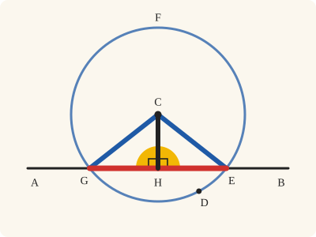
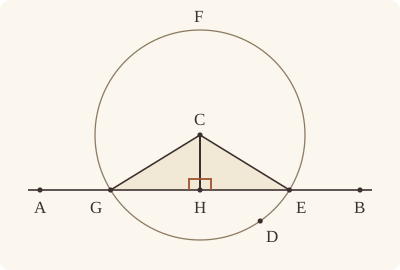
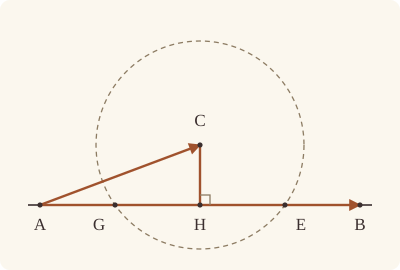

<!-- Generated by scripts/render.py. Do not edit by hand. -->

[Book I](index.md) · [← I.11](11.md) · [I.13 →](13.md)

# Book I, Proposition 12

*A perpendicular straight line from a point not on a given one*

[Euclid's proof](#euclids-proof) · [In Lean](#in-lean) · [What it rests on](#what-it-rests-on) · [Mishnah](#mishnah)

> To a given infinite straight line, from a given point which is not on it, to draw a perpendicular straight line.

**In Lean:** ✅ proved, as Euclid states it · Euclid's argument

<p align="center"></p>

<p align="center"><em>Swing a circle round the point so that it cuts the straight line twice (blue), halve the piece between the cuts (red), and the straight line from the point to that middle stands on it at right angles (yellow).</em></p>

## Euclid's proof

<p align="center"></p>

Let AB be the given infinite straight line, and C the given point which is not on it;

thus it is required to draw to the given infinite straight line AB, from the given point C which is not on it, a perpendicular straight line.

For let a point D be taken at random on the other side of the straight line AB, and with centre C and distance CD let the circle EFG be described; [Post. 3]

let the straight line EG be bisected at H, [I. 10]

and let the straight lines CG, CH, CE be joined. [Post. 1]

I say that CH has been drawn perpendicular to the given infinite straight line AB from the given point C which is not on it.

For, since GH is equal to HE,

and HC is common,

the two sides GH, HC are equal to the two sides EH, HC respectively;

and the base CG is equal to the base CE;

therefore the angle CHG is equal to the angle EHC. [I. 8]

And they are adjacent angles.

But, when a straight line set up on a straight line makes the adjacent angles equal to one another, each of the equal angles is right, and the straight line standing on the other is called a perpendicular to that on which it stands. [Def. 10]

Therefore CH has been drawn perpendicular to the given infinite straight line AB from the given point C which is not on it.

Q. E. F.

## In Lean

| | |
|---|---|
| Proof | ✅ Proved |
| Statement | The whole enunciation. |
| Argument | Euclid's. |
| Reviewed | The statement and every passage of the argument read against Heath's text, at commit [`f2195c72`](https://github.com/jackChallis/stoicheia/commit/f2195c72) ([the record](../../review/I/12.toml)) |

From [`Elements/BookI/Prop12.lean`](../../Elements/BookI/Prop12.lean). Euclid's sentences are the `--` comments, and our own notes are in `/- … -/`; the lines under each sentence are the Lean that carries it out. The list below marks where a lemma does a step Euclid takes for granted, where the statement already gives a step and where a step needs a word of its own; the `/- … -/` notes in the listing explain smaller adjustments.

**How the Lean follows the text**

- **Done by `Tacit.line_meets_circle_of_inside`.** "For let a point D be taken at random on the other side of the straight line AB…" Euclid takes the circle's crossings E and G with AB for granted. After choosing D by `exists_oppositeSidesOf` and drawing the circle by Postulate 3, `OppositeSides.exists_between` finds X on AB between C and D; `InsideCircle.of_between_centre` puts X inside by the radius comparison, and `Tacit.line_meets_circle_of_inside` (System E, Intersection 3), now proved in `Elements/Figure/Incidence.lean` by applying `line_circle_beyond` in both directions, supplies E and G.
- **Already given.** "and let the straight lines CG, CH, CE be joined." Euclid joins CG, CH and CE; our triangles are named by their corners, so no separate straight lines are needed. The Lean checks that HGC and HEC are triangles by `Triangle.of_line`, since H, G and E lie on AB and C is off it.
- **Done by `Definition15`.** "and the base CG is equal to the base CE…" Euclid uses the equal radii CG and CE without naming a reason. The Lean applies `Definition15`, Euclid's definition of a circle, as a rule we assume.
- **Carried.** "therefore the angle CHG is equal to the angle EHC." The Lean states that the angle CHG equals EHC in Euclid's letters; the later steps use the same equality as I.8 gives it, with the angle read as GHC, and do not use this form again.
- **Done by `OnRay.cases_of_between`.** "Therefore CH has been drawn perpendicular to the given infinite straight line AB…" Euclid concludes that CH is perpendicular to AB from the two right angles at H. For every other point P of AB, `OnRay.cases_of_between` puts P on the ray from H through G or E, and `angle_onRay_right` carries the corresponding right angle to CHP.

```lean
/-- To a given infinite straight line, from a given point which is not on it, to draw a
perpendicular straight line. -/
theorem Prop12 {A B C : Point} (hAB : A ≠ B) (hC : ¬ Collinear A B C) :
    ∃ H : Point, Collinear A B H ∧ ∀ P : Point, Collinear A B P → P ≠ H → ∠ C H P = ∟ := by
  -- Let AB be the given infinite straight line, and C the given point which is not on it;
  /- The infinite straight line AB is the straight line through A and B
     (Postulate 1), and C is off it, so ABC is a triangle. -/
  obtain ⟨AB, hA_AB, hB_AB⟩ := Postulate1 A B hAB
  have hABC : Triangle A B C := hC
  have hC_AB : ¬ OnLine C AB := hABC.off_line hA_AB hB_AB
  -- thus it is required to draw to the given infinite straight line AB, from the given point C
  -- which is not on it, a perpendicular straight line.
  -- For let a point D be taken at random on the other side of the straight line AB, and with
  -- centre C and distance CD let the circle EFG be described; [Post. 3]
  /- "At random on the other side" is System E, Points 6, which Book Zero gives
     as `exists_oppositeSidesOf`. D is not C, since C is not on the other
     side of AB from itself. -/
  obtain ⟨D, hDC, -⟩ := exists_oppositeSidesOf hABC []
  have hCD_AB : OppositeSides C D AB := hDC.symm.oppositeSides hA_AB hB_AB
  have hCD : C ≠ D := by
    rintro rfl
    exact hCD_AB.2.2 (same_side_refl hC_AB)
  obtain ⟨EFG, hC_EFG, hD_EFG⟩ := Postulate3 C D hCD
  /- C and D lie on opposite sides of AB, so CD crosses AB at a point X between
     them. X lies between the centre C and the point D on the circle, so it is
     within the circle, and AB, passing through it, cuts the circle in two points
     (Intersection 3). Heath's figure calls them G and E. F, the third letter of
     the circle's name, is only a name: the proof never uses it. -/
  obtain ⟨X, hX_AB, hCXD⟩ := hCD_AB.exists_between
  obtain ⟨E, G, hEG, hE_AB, hE_EFG, hG_AB, hG_EFG⟩ :=
    line_meets_circle_of_inside (InsideCircle.of_between_centre hC_EFG hD_EFG hCXD) hX_AB
  -- let the straight line EG be bisected at H, [I. 10]
  obtain ⟨H, hEHG, hEH_HG⟩ := Prop10 hEG
  have hH_AB : OnLine H AB := on_line_of_between_ends hEHG hE_AB hG_AB
  have hHG : H ≠ G := (ne_of_between (between_symm hEHG)).symm
  have hHE : H ≠ E := (ne_of_between hEHG).symm
  have hCH : C ≠ H := fun e => hC_AB (e ▸ hH_AB)
  -- and let the straight lines CG, CH, CE be joined. [Post. 1]
  /- Our proof uses only the points; the straight lines are drawn for the eye.
     It does use the two triangles they make with HG and HE: C is off AB, and H,
     G, E are on it. -/
  have hHGC : Triangle H G C := Triangle.of_line hH_AB hG_AB hHG hC_AB
  have hHEC : Triangle H E C := Triangle.of_line hH_AB hE_AB hHE hC_AB
  -- I say that CH has been drawn perpendicular to the given infinite straight line AB from the
  -- given point C which is not on it.
  -- For, since GH is equal to HE,
  have hGH_HE : ‖G H‖ = ‖H E‖ := (len_symm G H).trans (hEH_HG.symm.trans (len_symm E H))
  -- and HC is common,
  have hHC : ‖H C‖ = ‖H C‖ := rfl
  -- the two sides GH, HC are equal to the two sides EH, HC respectively;
  have hHG_HE : ‖H G‖ = ‖H E‖ := (len_symm H G).trans hGH_HE
  -- and the base CG is equal to the base CE;
  /- Both are radii of the circle EFG. [Def. 15] -/
  have hCG_CE : ‖C G‖ = ‖C E‖ := Definition15 hC_EFG hG_EFG hE_EFG
  -- therefore the angle CHG is equal to the angle EHC. [I. 8]
  have hGHC_EHC : ∠ G H C = ∠ E H C :=
    Prop8 hHGC hHEC hHG_HE hHC ((len_symm G C).trans (hCG_CE.trans (len_symm C E)))
  have hCHG_EHC : ∠ C H G = ∠ E H C := (angle_symm hCH hHG.symm).trans hGHC_EHC
  -- And they are adjacent angles.
  /- Adjacent: H lies between G and E, so HG and HE make one straight line. -/
  have hGHE : Between G H E := between_symm hEHG
  -- But, when a straight line set up on a straight line makes the adjacent angles equal to one
  -- another, each of the equal angles is right, and the straight line standing on the other is
  -- called a perpendicular to that on which it stands. [Def. 10]
  /- Definition I.10 is `IsRightAngle`: the angle GHC is right, its neighbour being
     CHE, and so is EHC, its neighbour being CHG. Each is then the right angle `∟`
     (Post. 4, as in I.11). -/
  have hGHC_right : IsRightAngle G H C :=
    ⟨E, hGHE, hHGC.bac, hGHC_EHC.trans (angle_symm hHE.symm hCH)⟩
  have hEHC_right : IsRightAngle E H C :=
    ⟨G, hEHG, hHEC.bac, hGHC_EHC.symm.trans (angle_symm hHG.symm hCH)⟩
  have hCHG : ∠ C H G = ∟ := (angle_symm hCH hHG.symm).trans (Postulate4 hGHC_right)
  have hCHE : ∠ C H E = ∟ := (angle_symm hCH hHE.symm).trans (Postulate4 hEHC_right)
  -- Therefore CH has been drawn perpendicular to the given infinite straight line AB from the
  -- given point C which is not on it.
  /- Perpendicular to the whole infinite straight line: any other point P of AB
     lies on the ray from H through G or on the ray from H through E
     (`OnRay.cases_of_between`), and then the angle CHP is the angle CHG or the
     angle CHE (`angle_onRay_right`). -/
  refine ⟨H, ⟨AB, hA_AB, hB_AB, hH_AB⟩, fun P hP hPH => ?_⟩
  obtain ⟨L, hA_L, hB_L, hP_L⟩ := hP
  rw [line_unique hAB hA_L hB_L hA_AB hB_AB] at hP_L
  rcases OnRay.cases_of_between hGHE hG_AB hE_AB hP_L hPH with hPG | hPE
  · exact (angle_onRay_right hPG hCH).trans hCHG
  · exact (angle_onRay_right hPE hCH).trans hCHE
  -- Q. E. F.
```

## What it rests on

| | |
|---|---|
| Heath's references | [I.8](08.md), [I.10](10.md); Post. 1, 3; Def. I.10 |
| Lean cites | [I.8](08.md), [I.10](10.md) |
| Postulates | 1, 2, 3, 4 |
| Definitions taken as axioms | Def. I.15 |
| Common Notions | 1, 3, 4, 5 |
| Tacit rules | 38 (listed below) |
| Its own Lean calls | Postulates 1, 3 and 4; Def. I.15; 4 tacit rules |
| Through lemmas | Postulate 2; 25 tacit rules |

_Postulates, definitions, Common Notions and tacit rules: all that this proof rests on, counting those of the propositions it cites. The last two rows say which of the postulates, definitions and tacit rules its own Lean calls, in the proof or a helper written for it, and which it does not call but reaches through lemmas, of Book Zero or shared (a proposition it cites may rest on these too); the rest come in only through the propositions it cites or the Common Notions._

_Euclid's Def. I.10 is `IsRightAngle` in Lean, a definition rather than an assumption, so the row of definitions taken as axioms does not count it._

<details><summary>The 38 tacit rules beneath this proof, counting those of the propositions it cites</summary>

_(used here) marks a rule this proof's own Lean calls, in the proof or a helper written for it; (through …) marks one its own Lean does not call but reaches through the lemmas named, of [Book Zero](../../Elements/Figure) or shared, though a proposition it cites may rest on it too; and a rule with no mark comes in only through a proposition it cites or a Common Notion. The names in brackets are System E's: an Intersection rule says when straight lines and circles must meet, and an Intersections rule takes a point where they do (see [Book I's introduction](index.md))._

**Reading the figure**

- [`between_cases`](../../Elements/Foundations/Tacit/Diagram.lean#L54) (through [`OnRay.cases_of_between`](../../Elements/Figure/Rays.lean#L56) and [`OppositeSides.exists_between`](../../Elements/Figure/Sides.lean#L119)): Of three different points on a straight line, one is between the other two. (Between 6)
- [`between_of_inside_chord`](../../Elements/Foundations/Tacit/Diagram.lean#L81): A straight line through a point inside a circle has that point between the points where it meets the circle. (Circle 1)
- [`between_symm`](../../Elements/Foundations/Tacit/Diagram.lean#L47) (used here): If B is between A and C, it is between C and A. (Between 1)
- [`circles_meet`](../../Elements/Foundations/Tacit/Diagram.lean#L94) (through [`OnRay.cases_of_between`](../../Elements/Figure/Rays.lean#L56), [`OppositeSides.exists_between`](../../Elements/Figure/Sides.lean#L119), [`OppositeSidesOf.symm`](../../Elements/Figure/Sides.lean#L87) and 3 other lemmas): If each circle passes through a point inside the other, the circles cut one another. This is the step Euclid takes for granted in I.1. (Intersection 5)
- [`circles_meet_same_side`](../../Elements/Foundations/Tacit/Constructions.lean#L79) (through [`OnRay.cases_of_between`](../../Elements/Figure/Rays.lean#L56), [`OppositeSides.exists_between`](../../Elements/Figure/Sides.lean#L119), [`OppositeSidesOf.symm`](../../Elements/Figure/Sides.lean#L87) and 3 other lemmas): Two circles that cut one another do so on each side of the straight line through their centres. (Intersections 8)
- [`exists_point`](../../Elements/Foundations/Tacit/Constructions.lean#L35) (through [`exists_oppositeSidesOf`](../../Elements/Figure/Sides.lean#L179)): Let a point be taken. (Points 1)
- [`exists_point_inside_circle`](../../Elements/Foundations/Tacit/Constructions.lean#L42) (through [`InsideCircle.of_between_centre`](../../Elements/Figure/Circles.lean#L164), [`OnRay.cases_of_between`](../../Elements/Figure/Rays.lean#L56), [`OppositeSides.exists_between`](../../Elements/Figure/Sides.lean#L119) and 4 other lemmas): Let a point be taken inside the circle α. (Points 8)
- [`exists_point_on_line`](../../Elements/Foundations/Tacit/Constructions.lean#L38) (through [`OnRay.cases_of_between`](../../Elements/Figure/Rays.lean#L56), [`OppositeSides.exists_between`](../../Elements/Figure/Sides.lean#L119), [`OppositeSidesOf.symm`](../../Elements/Figure/Sides.lean#L87) and 4 other lemmas): Let a point be taken on the straight line L. (Points 2)
- [`line_circle_between`](../../Elements/Foundations/Tacit/Constructions.lean#L67) (through [`InsideCircle.of_between_centre`](../../Elements/Figure/Circles.lean#L164), [`OnRay.cases_of_between`](../../Elements/Figure/Rays.lean#L56), [`OppositeSides.exists_between`](../../Elements/Figure/Sides.lean#L119) and 4 other lemmas): A straight line through a point B inside a circle, heading out to a point C outside it, cuts the circle between B and C. (Intersections 4)
- [`line_circle_beyond`](../../Elements/Foundations/Tacit/Constructions.lean#L73) (through [`InsideCircle.of_between_centre`](../../Elements/Figure/Circles.lean#L164), [`OnRay.cases_of_between`](../../Elements/Figure/Rays.lean#L56), [`OppositeSides.exists_between`](../../Elements/Figure/Sides.lean#L119) and 5 other lemmas): A straight line through a point B inside a circle, produced beyond B away from C, cuts the circle there. (Intersections 5)
- [`line_unique`](../../Elements/Foundations/Tacit/Diagram.lean#L41) (used here): Two points determine a straight line. (Generalities 1)
- [`lines_meet_of_opposite_sides`](../../Elements/Foundations/Tacit/Diagram.lean#L89) (through [`OppositeSides.exists_between`](../../Elements/Figure/Sides.lean#L119)): A straight line joining points on opposite sides of L crosses L. (Intersection 1)
- [`not_between_of_between`](../../Elements/Foundations/Tacit/Diagram.lean#L50) (through [`InsideCircle.of_between_centre`](../../Elements/Figure/Circles.lean#L164), [`OnRay.cases_of_between`](../../Elements/Figure/Rays.lean#L56), [`OppositeSides.exists_between`](../../Elements/Figure/Sides.lean#L119) and 7 other lemmas): If B is between A and C, then A is not between B and C. (Between 1)
- [`not_on_line_of_same_side`](../../Elements/Foundations/Tacit/Diagram.lean#L60) (through [`OnRay.cases_of_between`](../../Elements/Figure/Rays.lean#L56), [`OppositeSides.exists_between`](../../Elements/Figure/Sides.lean#L119), [`OppositeSidesOf.symm`](../../Elements/Figure/Sides.lean#L87) and 3 other lemmas): Points on one side of a straight line are not on it. (Same side 3)
- [`pasch2`](../../Elements/Foundations/Tacit/Diagram.lean#L71) (through [`OnRay.cases_of_between`](../../Elements/Figure/Rays.lean#L56), [`OppositeSides.exists_between`](../../Elements/Figure/Sides.lean#L119), [`Tacit.on_line_of_between_ends`](../../Elements/Figure/RuleBase.lean#L153) and 2 other lemmas): If B is between A and C, A is on L and B is off it, then B and C are on the same side of L: a straight line that leaves L at A does not cross it again. (Pasch 2)
- [`same_side_trans`](../../Elements/Foundations/Tacit/Diagram.lean#L64) (through [`OnRay.cases_of_between`](../../Elements/Figure/Rays.lean#L56), [`OppositeSides.exists_between`](../../Elements/Figure/Sides.lean#L119), [`OppositeSidesOf.symm`](../../Elements/Figure/Sides.lean#L87) and 3 other lemmas): Two points on the same side of a straight line as a third point are on the same side as each other. (Same side 4)

**Lengths, angles and areas**

- [`angle_add_of_inside`](../../Elements/Foundations/Tacit/Transfer.lean#L47) (through [`exists_oppositeSidesOf`](../../Elements/Figure/Sides.lean#L179)): If D lies within the angle BAC, then BAC is made up of BAD and DAC. (Diagram-angle 2)
- [`angle_eq_of_same_rays`](../../Elements/Foundations/Tacit/Transfer.lean#L54) (through [`angle_onRay_right`](../../Elements/Figure/Angles.lean#L49)): The angle doesn't change if its arms are traced through other points on the same rays. (Diagram-angle 4)
- [`angle_symm`](../../Elements/Foundations/Tacit/Metric.lean#L30) (used here): The angle ABC is the angle CBA. (Metric 4)
- [`area_add_of_between`](../../Elements/Foundations/Tacit/Transfer.lean#L70): Cutting a triangle in two from a vertex adds up. (Diagram-area 2)
- [`area_congruent`](../../Elements/Foundations/Tacit/Metric.lean#L44): Triangles equal in all their sides and angles are equal in area. Euclid uses this without comment once he has shown two triangles congruent. (Metric 9)
- [`area_degenerate`](../../Elements/Foundations/Tacit/Metric.lean#L36): A "triangle" with a repeated corner has no area. (Metric 6)
- [`area_eq_zero_of_on_line`](../../Elements/Foundations/Tacit/Transfer.lean#L62): A "triangle" whose corners lie on one straight line has no area. (Diagram-area 1)
- [`area_rotate`](../../Elements/Foundations/Tacit/Metric.lean#L39): The triangle ABC is the triangle CAB. (Metric 8)
- [`len_add_of_between`](../../Elements/Foundations/Tacit/Transfer.lean#L27) (through [`InsideCircle.of_between_centre`](../../Elements/Figure/Circles.lean#L164), [`OnRay.cases_of_between`](../../Elements/Figure/Rays.lean#L56), [`OppositeSides.exists_between`](../../Elements/Figure/Sides.lean#L119) and 6 other lemmas): If B is between A and C, then AB and BC together make up AC. (Diagram-segment 1)
- [`len_self`](../../Elements/Foundations/Tacit/Metric.lean#L24) (through [`InsideCircle.of_between_centre`](../../Elements/Figure/Circles.lean#L164), [`OnRay.cases_of_between`](../../Elements/Figure/Rays.lean#L56), [`OppositeSides.exists_between`](../../Elements/Figure/Sides.lean#L119) and 6 other lemmas): The "straight line" from a point to itself has no length. (Metric 1)
- [`len_symm`](../../Elements/Foundations/Tacit/Metric.lean#L27) (used here): The straight line AB is the straight line BA. (Metric 3)
- [`radius_ne_zero`](../../Elements/Foundations/Tacit/Metric.lean#L62) (through [`InsideCircle.of_between_centre`](../../Elements/Figure/Circles.lean#L164), [`OnRay.cases_of_between`](../../Elements/Figure/Rays.lean#L56), [`OppositeSides.exists_between`](../../Elements/Figure/Sides.lean#L119) and 6 other lemmas): A circle's radius is not nothing: the straight line from the centre to a point on the circle has some length. A rule of our own, not one of System E's: every circle is drawn with a centre and a distance (Postulate 3).
- [`same_ray_of_angle_eq_zero`](../../Elements/Foundations/Tacit/Transfer.lean#L42) (through [`exists_oppositeSidesOf`](../../Elements/Figure/Sides.lean#L179)): If the angle BAC is nothing, C lies on the ray from A through B. (Diagram-angle 1)

**Superposition**

- [`superposition`](../../Elements/Foundations/Tacit/Superposition.lean#L52): **Superposition.** A hypothetical placement of a triangle on a given ray and side permits a restricted derivation of metric equalities about the figure already given. The derivation introduces no further objects, cites each geometric law it uses, and exports no symbol of the placement.

**Laws of magnitude**

- [`add_assoc`](../../Elements/Foundations/Tacit/Magnitudes.lean#L23): Adding three magnitudes in a row, it makes no difference whether the first two or the last two are added first. (System E §3.5)
- [`add_comm`](../../Elements/Foundations/Tacit/Magnitudes.lean#L26) (through [`InsideCircle.of_between_centre`](../../Elements/Figure/Circles.lean#L164), [`OnRay.cases_of_between`](../../Elements/Figure/Rays.lean#L56), [`OppositeSides.exists_between`](../../Elements/Figure/Sides.lean#L119) and 6 other lemmas): The order of adding does not matter. (System E §3.5)
- [`add_lt_add_right`](../../Elements/Foundations/Tacit/Magnitudes.lean#L45) (through [`OnRay.cases_of_between`](../../Elements/Figure/Rays.lean#L56)): Adding the same thing to both sides keeps "less than". (System E §3.5)
- [`add_zero`](../../Elements/Foundations/Tacit/Magnitudes.lean#L29): Adding nothing changes nothing. (System E §3.5)
- [`lt_irrefl`](../../Elements/Foundations/Tacit/Magnitudes.lean#L32) (through [`InsideCircle.of_between_centre`](../../Elements/Figure/Circles.lean#L164), [`OnRay.cases_of_between`](../../Elements/Figure/Rays.lean#L56), [`OppositeSides.exists_between`](../../Elements/Figure/Sides.lean#L119) and 4 other lemmas): No magnitude is less than itself. (System E §3.5)
- [`lt_trans`](../../Elements/Foundations/Tacit/Magnitudes.lean#L35) (through [`InsideCircle.of_between_centre`](../../Elements/Figure/Circles.lean#L164), [`OnRay.cases_of_between`](../../Elements/Figure/Rays.lean#L56), [`OppositeSides.exists_between`](../../Elements/Figure/Sides.lean#L119) and 4 other lemmas): What is less than the less is less still. (System E §3.5)
- [`lt_trichotomy`](../../Elements/Foundations/Tacit/Magnitudes.lean#L39) (through [`InsideCircle.of_between_centre`](../../Elements/Figure/Circles.lean#L164), [`OnRay.cases_of_between`](../../Elements/Figure/Rays.lean#L56), [`OppositeSides.exists_between`](../../Elements/Figure/Sides.lean#L119) and 6 other lemmas): Of two magnitudes, one is less, or they are equal, or the other is less. (System E §3.5)
- [`not_lt_zero`](../../Elements/Foundations/Tacit/Magnitudes.lean#L42) (through [`InsideCircle.of_between_centre`](../../Elements/Figure/Circles.lean#L164), [`OnRay.cases_of_between`](../../Elements/Figure/Rays.lean#L56), [`OppositeSides.exists_between`](../../Elements/Figure/Sides.lean#L119) and 6 other lemmas): Nothing is less than zero. (System E §3.5)

</details>

## Mishnah

_Our commentary: what Euclid assumes, what Lean made us say out loud, and how the result looks by modern means._

Euclid's phrase, Heath explains, is "the full expression for a *perpendicular*, κάθετος meaning *let fall* or *let down*, so that the expression corresponds to our *plumb-line*" (vol. 1, p. 271). Proclus says the problem "was first investigated by Oenopides [5th cent. B.C.], who thought it useful for astronomy" (Heath, vol. 1, p. 271), and that Oenopides called the perpendicular "*gnomon-wise*", "because the gnomon is also at right angles to the horizon" (Heath, vol. 1, p. 272): the gnomon was a sundial's upright staff.

Euclid never says why the circle meets AB, let alone twice. For that, Heath writes, "we need, as in I. 1, some postulate of continuity", such as Wilhelm Killing's: "If a point [here the point describing the circle] moves in a figure which is divided into two parts [by the straight line], and if it belongs at the beginning of the motion to one part and at another stage of the motion to the other part, it must during the motion cut the boundary between the two parts" (vol. 1, p. 272). Going both ways from D, the point crosses AB twice. Our proof first finds where CD crosses AB, at a point X between C and D. Since CX is less than the radius CD, X lies within the circle (`InsideCircle.of_between_centre`). The theorem System E calls Intersection 3, [`line_meets_circle_of_inside`](../../Elements/Figure/Incidence.lean), then gives two distinct points E and G where AB cuts the circle. Book Zero proves it by producing the straight line from an interior point to the circumference in both directions (`line_circle_beyond`).

Most editors miss a harder question, Heath says: "How do we know, says the supposed critic, that the circle does not cut AB in *three* or more points, in which case there would be not *one* perpendicular but *three* or more?" (vol. 1, p. 272). Proclus' three answers, Heath finds, are inconclusive. On a sphere it happens: "It is not possible in Euclidean space, but it is possible, under the Riemann hypothesis (where a straight line is a 'closed series' and returns on itself), in the case where C is the pole of the straight line AB" (Heath, vol. 1, p. 273). Heath's "Riemann hypothesis" is the sphere-like geometry now called elliptic, not the famous conjecture about prime numbers. Like Euclid's, our I.12 asks only for a straight line at right angles to the whole infinite straight line AB, so our proof does not depend on whether the circle meets AB anywhere else.

**The modern way.** The foot H of the perpendicular from C to the straight line AB has $\overrightarrow{\mathrm{AH}} = t \thinspace \overrightarrow{\mathrm{AB}}$, where $t = \overrightarrow{\mathrm{AC}} \cdot \overrightarrow{\mathrm{AB}} / \mathrm{AB}^2$, chosen so that $\overrightarrow{\mathrm{HC}} \cdot \overrightarrow{\mathrm{AB}} = 0$. Euclid's H, the middle point of EG, is the same point.

<p align="center"></p>

## Further reading

- The dot product that finds the foot of a perpendicular is set out in ch. 4, "Vectors and Euclidean spaces", of John Stillwell's [*The Four Pillars of Geometry*](https://doi.org/10.1007/0-387-29052-4) (2005) (also on [I.3](03.md)).
- On a sphere every great circle through a pole is perpendicular to its equator, as in Heath's note. To walk about on one, try the chapter "Exploring the Sphere" of Glen Van Brummelen's [*Heavenly Mathematics*](https://doi.org/10.1515/9781400844807) (2013), a hands-on introduction to spherical trigonometry.

[Book I](index.md) · [← I.11](11.md) · [I.13 →](13.md)

---

<sub>Euclid's text: T. L. Heath, *The Thirteen Books of Euclid's Elements*, vol. 1 (Cambridge, 1908), pp. 270–271; [scan leaves n290–n291](https://archive.org/details/thirteenbookseu02heibgoog/page/n290); [figure on n291](https://archive.org/details/thirteenbookseu02heibgoog/page/n291). Public domain.</sub>

<sub>The tacit rules follow the System E of Jeremy Avigad, Edward Dean and John Mumma, read alongside LeanEuclid (Logan Murphy, Kaiyu Yang, Jialiang Sun, Zhaoyu Li, Anima Anandkumar and Xujie Si).</sub>
