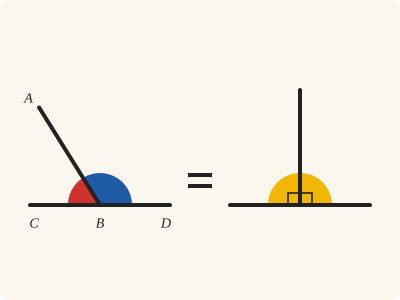
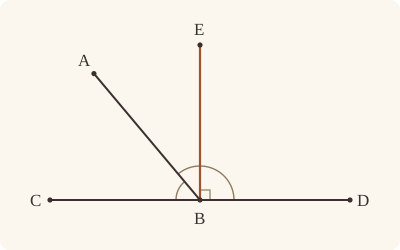
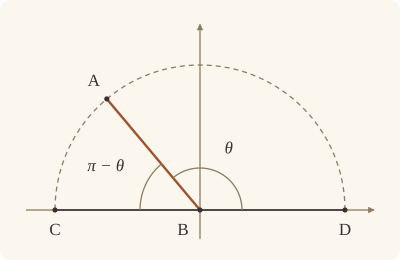

<!-- Generated by scripts/render.py. Do not edit by hand. -->

[Book I](index.md) · [← I.12](12.md) · [I.14 →](14.md)

# Book I, Proposition 13

*Angles on a straight line equal two right angles*

[Euclid's proof](#euclids-proof) · [In Lean](#in-lean) · [What it rests on](#what-it-rests-on) · [Mishnah](#mishnah)

> If a straight line set up on a straight line make angles, it will make either two right angles or angles equal to two right angles.

**In Lean:** ✅ proved, as Euclid states it · Euclid's argument

<p align="center"></p>

<p align="center"><em>However one straight line stands on another, the two angles it makes (red and blue) together equal two right angles (yellow). On the right, drawn apart from B and unlettered, are Heath's right angles CBE and EBD.</em></p>

## Euclid's proof

<p align="center"></p>

<p align="center"><em>Drawn for one case: AB leaning towards C, as in Heath's figure.</em></p>

For let any straight line AB set up on the straight line CD make the angles CBA, ABD;

I say that the angles CBA, ABD are either two right angles or equal to two right angles.

Now, if the angle CBA is equal to the angle ABD,

they are two right angles. [Def. 10]

But, if not, let BE be drawn from the point B at right angles to CD; [I. 11]

therefore the angles CBE, EBD are two right angles.

Then, since the angle CBE is equal to the two angles CBA, ABE,

let the angle EBD be added to each;

therefore the angles CBE, EBD are equal to the three angles CBA, ABE, EBD. [C.N. 2]

Again, since the angle DBA is equal to the two angles DBE, EBA,

let the angle ABC be added to each;

therefore the angles DBA, ABC are equal to the three angles DBE, EBA, ABC. [C.N. 2]

But the angles CBE, EBD were also proved equal to the same three angles;

and things which are equal to the same thing are also equal to one another; [C.N. 1]

therefore the angles CBE, EBD are also equal to the angles DBA, ABC.

But the angles CBE, EBD are two right angles;

therefore the angles DBA, ABC are also equal to two right angles.

Therefore etc.

Q. E. D.

## In Lean

| | |
|---|---|
| Proof | ✅ Proved |
| Statement | The whole enunciation. Concludes that the two angles together are ∟ + ∟, Euclid's second form; his first, each angle right, is the case of equal angles, by Postulate 4. |
| Argument | Euclid's. After I.13, the Lean proves two rules of System E from it: `Tacit.adjacent_eq_of_right`, that a right angle is equal to the angle adjacent to it, from I.13 and Common Notion 3; and `Tacit.inside_of_angle_add`, that if the angles BAD and DAC make up the angle BAC then D lies within it, from I.13, the adding of angles, the fact that an angle of a triangle is greater than nothing (`Triangle.angle_pos`), and the rules for the sides of a straight line. |
| Reviewed | The statement and every passage of the argument read against Heath's text, at commit [`5afb1d6a4`](https://github.com/dodecaplex-co/stoicheia/commit/5afb1d6a4) ([the record](../../review/I/13.toml)) |

From [`Elements/BookI/Prop13.lean`](../../Elements/BookI/Prop13.lean). Euclid's sentences are the `--` comments, and our own notes are in `/- … -/`; the lines under each sentence are the Lean that carries it out. The list below marks where a lemma does a step Euclid takes for granted, where the Lean takes a case Euclid's figure leaves aside and where the statement already gives a step; the `/- … -/` notes in the listing explain smaller adjustments.

**How the Lean follows the text**

- **Already given.** "I say that the angles CBA, ABD are either two right angles…" The statement gives the goal, in Euclid's second form, as the table above says.
- **Done by `angle_add_of_within`.** "Then, since the angle CBE is equal to the two angles CBA, ABE…" Euclid reads off his figure that BA falls within the right angle CBE. In the Lean, A lies on E's side of BC because I.11 puts E on A's side of CD, of which BC is a part. `Prop13.cases` proves that A lies on C's side of BE in the case Euclid draws; with both facts, `angle_add_of_within` gives the sum.
- **Done by `Prop13.within`.** "Again, since the angle DBA is equal to the two angles DBE, EBA…" Euclid reads off his figure that BE falls within the angle DBA. `Prop13.within` proves this from BA's place within CBE, and `angle_add_of_within` gives the sum.
- **A further case.** "Therefore etc." Euclid's figure has AB leaning towards C; leaning towards D is his figure with C and D exchanged (`Prop13.cases`), so one argument serves for both. The Lean also proves in `Prop13.cases` that A cannot lie on BE itself: since A and E lie on the same side of CD, A would lie on the ray from B through E and make CBA and ABD the equal right angles CBE and EBD, contrary to the unequal case, so AB leans towards C or towards D.

<details><summary>Before the theorem, two lemmas: <code>Prop13.within</code> and <code>Prop13.cases</code> (74 lines)</summary>

```lean
/-! ## What Euclid reads off the figure -/

/-- Euclid's figure, seen from the other end of CD. If BA falls within the angle
CBE (A on E's side of BC, and on C's side of BE), and CB is produced to
D, then BE falls within the angle DBA: E is on A's side of BD, and on
D's side of BA.

The first is the same side of the same straight line. For the second, the three
straight lines BC, BA, BE through B divide the plane into six regions, and
since A lies between C and E as seen from B, the straight line BA separates
C from E (System E, Triple incidence 1); it also separates C from D (Pasch 3),
and a straight line has only two sides (Same side 5). -/
theorem Prop13.within {A B C D E : Point} (hCBD : Between C B D) (hAE : SameSideOf A E B C)
    (hAC : SameSideOf A C B E) : SameSideOf E A B D ∧ SameSideOf E D B A := by
  have hBC : B ≠ C := hAE.1
  have hBD : B ≠ D := (ne_of_between (between_symm hCBD)).symm
  have hBE : B ≠ E := hAC.1
  have hBA : B ≠ A := hAC.triangle.ne₁₃
  obtain ⟨L, hB_L, hC_L⟩ := Postulate1 B C hBC
  have hD_L : OnLine D L := on_line_of_between hCBD hC_L hB_L
  obtain ⟨M, hB_M, hE_M⟩ := Postulate1 B E hBE
  obtain ⟨N, hB_N, hA_N⟩ := Postulate1 B A hBA
  have hAE_L : SameSide A E L := hAE.sameSide hB_L hC_L
  have hAC_M : SameSide A C M := hAC.sameSide hB_M hE_M
  have hA_L : ¬ OnLine A L := not_on_line_of_same_side hAE_L
  have hA_M : ¬ OnLine A M := not_on_line_of_same_side hAC_M
  refine ⟨SameSideOf.of_line hBD hB_L hD_L (same_side_symm hAE_L), ?_⟩
  /- BA separates C from E (Triple incidence 1). -/
  have hCE_N : ¬ SameSide C E N :=
    triple_incidence1 hB_L hB_N hB_M hC_L hA_N hE_M hAE_L (same_side_symm hAC_M)
  /- It also separates C from D (Pasch 3). -/
  have hCD_N : ¬ SameSide C D N := pasch3 hCBD hB_N
  /- None of C, D, E is on BA: else BA would be BC, or BE, and A would be on it. -/
  have hC_N : ¬ OnLine C N := fun hC => hA_L (line_unique hBC hB_N hC hB_L hC_L ▸ hA_N)
  have hD_N : ¬ OnLine D N := fun hD => hA_L (line_unique hBD hB_N hD hB_L hD_L ▸ hA_N)
  have hE_N : ¬ OnLine E N := fun hE => hA_M (line_unique hBE hB_N hE hB_M hE_M ▸ hA_N)
  /- So E, not on C's side of BA, is on D's (Same side 5). -/
  have hDE_N : SameSide D E N :=
    same_side_of_opposite_sides ⟨hC_N, hD_N, hCD_N⟩ ⟨hC_N, hE_N, hCE_N⟩
  exact SameSideOf.of_line hBA hB_N hA_N (same_side_symm hDE_N)

/-- Which way AB leans. With BE at right angles to CD, on A's side of it, and
the angles CBA, ABD unequal, A lies on C's side of BE or on D's.

It is not on BE itself: being on E's side of CD, it would lie on the ray from
B through E, and then the angles CBA, ABD would be the right angles CBE,
EBD themselves, and equal (Diagram-angle 4). C and D are on opposite sides of
BE (Pasch 3), and a straight line has only two sides (Same side 5). -/
theorem Prop13.cases {A B C D E : Point} (hCBD : Between C B D) (hEA : SameSideOf E A C D)
    (hCBE : ∠ C B E = ∟) (hEBD : ∠ E B D = ∟) (hne : ∠ C B A ≠ ∠ A B D) :
    SameSideOf A C B E ∨ SameSideOf A D B E := by
  have hCB : C ≠ B := ne_of_between hCBD
  have hDB : D ≠ B := ne_of_between (between_symm hCBD)
  obtain ⟨L, hC_L, hD_L⟩ := Postulate1 C D hEA.1
  have hB_L : OnLine B L := on_line_of_between_ends hCBD hC_L hD_L
  have hEA_L : SameSide E A L := hEA.sameSide hC_L hD_L
  have hE_L : ¬ OnLine E L := not_on_line_of_same_side hEA_L
  have hBE : B ≠ E := fun e => hE_L (e ▸ hB_L)
  obtain ⟨M, hB_M, hE_M⟩ := Postulate1 B E hBE
  have hC_M : ¬ OnLine C M := fun hC => hE_L (line_unique hCB hC hB_M hC_L hB_L ▸ hE_M)
  have hD_M : ¬ OnLine D M := fun hD => hE_L (line_unique hDB hD hB_M hD_L hB_L ▸ hE_M)
  have hA_M : ¬ OnLine A M := by
    intro hA
    have hAB : A ≠ B := fun e => not_on_line_of_same_side (same_side_symm hEA_L) (e ▸ hB_L)
    /- A would be on the ray from B through E, not behind B (Pasch 3,
       `OnRay.of_sameSideOf`). -/
    have hA_ray : OnRay A B E :=
      OnRay.of_sameSideOf (SameSideOf.of_line hCB.symm hB_L hC_L (same_side_symm hEA_L))
        ⟨M, hB_M, hE_M, hA⟩ hAB
    apply hne
    rw [angle_onRay_right hA_ray hCB, angle_onRay_left hA_ray hDB, hCBE, hEBD]
  rcases same_side_or hC_M hD_M hA_M (pasch3 hCBD hB_M) with h | h
  · exact Or.inl (SameSideOf.of_line hBE hB_M hE_M (same_side_symm h))
  · exact Or.inr (SameSideOf.of_line hBE hB_M hE_M (same_side_symm h))
```

</details>

```lean
/-- If a straight line set up on a straight line make angles, it will make either two right angles
or angles equal to two right angles. -/
theorem Prop13 {A B C D : Point} (hCBD : Between C B D) (hA : ¬ Collinear C D A) :
    ∠ C B A + ∠ A B D = ∟ + ∟ := by
  -- For let any straight line AB set up on the straight line CD make the angles CBA, ABD;
  /- The straight line CD, with B on it between C and D, and A off it. -/
  have hCB : C ≠ B := ne_of_between hCBD
  have hDB : D ≠ B := ne_of_between (between_symm hCBD)
  have hCD : C ≠ D := ne_of_between_ends hCBD
  obtain ⟨CD, hC_CD, hD_CD⟩ := Postulate1 C D hCD
  have hB_CD : OnLine B CD := on_line_of_between_ends hCBD hC_CD hD_CD
  have hA_CD : ¬ OnLine A CD := fun h => hA ⟨CD, hC_CD, hD_CD, h⟩
  have hAB : A ≠ B := fun e => hA_CD (e ▸ hB_CD)
  -- I say that the angles CBA, ABD are either two right angles or equal to two right angles.
  /- "Two right angles": each of them is right. "Equal to two right angles": together
     they make two. Our Postulate 4 makes every right angle the one `∟`, as in I.11, so
     the first is a case of the second, and the statement asks only for the second. -/
  -- Now, if the angle CBA is equal to the angle ABD,
  by_cases heq : ∠ C B A = ∠ A B D
  -- they are two right angles. [Def. 10]
  /- Definition I.10 says each is right, for they are adjacent angles (A is off the
     straight line CD); each is then `∟` (Post. 4, as in I.11). -/
  · have hCBA : ∠ C B A = ∟ :=
      Postulate4 ⟨D, hCBD, Triangle.of_line hC_CD hB_CD hCB hA_CD, heq⟩
    have hABD : ∠ A B D = ∟ := heq.symm.trans hCBA
    rw [hCBA, hABD]
  -- But, if not, let BE be drawn from the point B at right angles to CD; [I. 11]
  /- I.11 draws BE on whichever side of CD we ask; we ask for A's side. -/
  obtain ⟨E, hEA, hperp⟩ := Prop11 (A := C) (B := D) (C := B) (Q := A) hCD
    ⟨CD, hC_CD, hD_CD, hB_CD⟩ hA
  have hEB : E ≠ B := fun e => hEA.triangle.off_line hC_CD hD_CD (e ▸ hB_CD)
  -- therefore the angles CBE, EBD are two right angles.
  have hCBE : ∠ C B E = ∟ := hperp C ⟨CD, hC_CD, hD_CD, hC_CD⟩ hCB
  have hDBE : ∠ D B E = ∟ := hperp D ⟨CD, hC_CD, hD_CD, hD_CD⟩ hDB
  have hEBD : ∠ E B D = ∟ := by rw [angle_symm hEB hDB]; exact hDBE
  have hEBC : ∠ E B C = ∟ := by rw [angle_symm hEB hCB]; exact hCBE
  /- In Euclid's figure BA falls within the angle CBE: A is on E's side of BC, and on
     C's side of BE. If A is on D's side of BE instead, the figure is Euclid's with C
     and D exchanged (`Prop13.cases`), so we give his argument for either naming of
     the ends of CD, and use it below. A is on E's side of CD, as I.11 put it, and so
     of BC and of BD, which are the same straight line. -/
  have hAE_BC : SameSideOf A E B C :=
    SameSideOf.of_line hCB.symm hB_CD hC_CD (same_side_symm (hEA.sameSide hC_CD hD_CD))
  have hAE_BD : SameSideOf A E B D :=
    SameSideOf.of_line hDB.symm hB_CD hD_CD (same_side_symm (hEA.sameSide hC_CD hD_CD))
  have two_right : ∀ {C D : Point}, Between C B D → ∠ C B E = ∟ → ∠ E B D = ∟ →
      SameSideOf A E B C → SameSideOf A C B E → ∠ D B A + ∠ A B C = ∟ + ∟ := by
    intro C D hCBD hCBE hEBD hAE hAC
    have hCB : C ≠ B := ne_of_between hCBD
    have hDB : D ≠ B := ne_of_between (between_symm hCBD)
    -- Then, since the angle CBE is equal to the two angles CBA, ABE,
    /- BA falls within the angle CBE. -/
    have hCBE_sum : ∠ C B E = ∠ C B A + ∠ A B E := angle_add_of_within hAE hAC
    -- let the angle EBD be added to each;
    -- therefore the angles CBE, EBD are equal to the three angles CBA, ABE, EBD. [C.N. 2]
    have hthree : ∠ C B E + ∠ E B D = ∠ C B A + ∠ A B E + ∠ E B D :=
      CommonNotion2 hCBE_sum rfl
    -- Again, since the angle DBA is equal to the two angles DBE, EBA,
    /- And so BE falls within the angle DBA (`Prop13.within`). -/
    obtain ⟨hEA', hED⟩ := Prop13.within hCBD hAE hAC
    have hDBA_sum : ∠ D B A = ∠ D B E + ∠ E B A := angle_add_of_within hEA' hED
    -- let the angle ABC be added to each;
    -- therefore the angles DBA, ABC are equal to the three angles DBE, EBA, ABC. [C.N. 2]
    have hthree' : ∠ D B A + ∠ A B C = ∠ D B E + ∠ E B A + ∠ A B C :=
      CommonNotion2 hDBA_sum rfl
    -- But the angles CBE, EBD were also proved equal to the same three angles;
    /- The same three, named from the other end and added in the other order: the
       angle CBA is the angle ABC (System E, Metric 4), and the order of adding does
       not matter (a tacit rule of magnitude). -/
    have hsame : ∠ C B E + ∠ E B D = ∠ D B E + ∠ E B A + ∠ A B C := by
      rw [hthree, angle_symm hCB hAB, angle_symm hAB hEB, angle_symm hEB hDB,
        add_comm (∠ A B C + ∠ E B A), add_comm (∠ A B C), ← add_assoc]
    -- and things which are equal to the same thing are also equal to one another; [C.N. 1]
    -- therefore the angles CBE, EBD are also equal to the angles DBA, ABC.
    have hequal : ∠ C B E + ∠ E B D = ∠ D B A + ∠ A B C := CommonNotion1 hsame hthree'
    -- But the angles CBE, EBD are two right angles;
    have hright : ∠ C B E + ∠ E B D = ∟ + ∟ := by rw [hCBE, hEBD]
    -- therefore the angles DBA, ABC are also equal to two right angles.
    exact hequal.symm.trans hright
  -- Therefore etc.
  rcases Prop13.cases hCBD hEA hCBE hEBD heq with hAC | hAD
  · /- This is Euclid's figure. -/
    rw [angle_symm hCB hAB, angle_symm hAB hDB, add_comm (∠ A B C)]
    exact two_right hCBD hCBE hEBD hAE_BC hAC
  · /- This is Euclid's figure with C and D exchanged. -/
    exact two_right (between_symm hCBD) hDBE hEBC hAE_BD hAD
  -- Q. E. D.
```

<details><summary>After the theorem, two theorems later propositions use, <code>_root_.Elements.Tacit.adjacent_eq_of_right</code> and <code>Prop13.angle_lt_two_right</code>; and one lemma beside the proposition, <code>_root_.Elements.Tacit.inside_of_angle_add</code> (114 lines)</summary>

```lean
/-- A right angle is equal to the angle adjacent to it (System E, Diagram-angle 3).
We prove it from I.13 and Common Notion 3: the two adjacent angles together equal two
right angles, and taking the given right angle away leaves one right angle. -/
theorem _root_.Elements.Tacit.adjacent_eq_of_right
    {A B C D : Point} {L : Line}
    (hA : OnLine A L) (hB : OnLine B L) (h : Between A C B)
    (hD : ¬ OnLine D L) (hright : ∠ A C D = ∟) : ∠ A C D = ∠ D C B := by
  have hABD : Triangle A B D :=
    Triangle.of_line hA hB (ne_of_between_ends h) hD
  have h13 := Prop13 h hABD
  rw [hright, add_comm ∟] at h13
  rw [hright]
  exact (CommonNotion3 h13 rfl).symm

/-- When one side condition holds, so does the other. Were it to fail, C would lie within
the angle BAD; and since the angle DAC is greater than nothing, each of the angles BAC,
BAD would then be less than the other. -/
private theorem inside_of_angle_add_one_side {A B C D : Point} {L M : Line}
    (hAL : OnLine A L) (hAM : OnLine A M) (hB : OnLine B L)
    (hC : OnLine C M) (hAB : A ≠ B) (hAC : A ≠ C)
    (hDL : ¬ OnLine D L) (hDM : ¬ OnLine D M) (hLM : L ≠ M)
    (h : ∠ B A C = ∠ B A D + ∠ D A C) (hCD : SameSide C D L) :
    SameSide B D M := by
  apply Classical.byContradiction
  intro hn
  have hAD : A ≠ D := fun e => hDL (e ▸ hAL)
  obtain ⟨N, hAN, hDN⟩ := Postulate1 A D hAD
  have hCL : ¬ OnLine C L := fun hc => hLM (line_unique hAC hAL hc hAM hC)
  have hCN : ¬ OnLine C N := fun hc =>
    hDM (line_unique hAC hAN hc hAM hC ▸ hDN)
  have hLN : L ≠ N := fun e => hDL (e ▸ hDN)
  have hBC : SameSide B C N :=
    triple_incidence2 hAL hAM hAN hB hC hDN hCD hn hDM hAB.symm
  have hadd := angle_add_of_inside hAL hAN hB hDN hAB hAD hCL hCN hLN
    hBC (same_side_symm hCD)
  have hp : 0 < ∠ D A C := (Triangle.of_line hC hAM hAC.symm hDM).cba.angle_pos
  rw [angle_symm hAC.symm hAD.symm] at hadd
  have hlt := CommonNotion5 (a := ∠ B A C) hp
  rw [← hadd] at hlt
  have hlt' := CommonNotion5 (a := ∠ B A D) hp
  rw [← h] at hlt'
  exact lt_irrefl _ (lt_trans hlt hlt')

/-- An angle of a triangle is less than two right angles. Produce BA beyond A to E: by
I.13 the angles BAC, CAE make two right angles, and CAE is greater than nothing. -/
theorem Prop13.angle_lt_two_right {A B C : Point} (h : Triangle B A C) :
    ∠ B A C < ∟ + ∟ := by
  obtain ⟨L, hB, hA⟩ := Postulate1 B A h.ne₁₂
  obtain ⟨E, hE, hBAE, _⟩ := Postulate2 hB hA h.ne₁₂ []
  have hC := h.off_line hB hA
  have h13 := Prop13 hBAE
    (Triangle.of_line hB hE (ne_of_between_ends hBAE) hC)
  have hp : 0 < ∠ C A E :=
    (Triangle.of_line hE hA (ne_of_between (between_symm hBAE)) hC).cba.angle_pos
  have hlt := CommonNotion5 (a := ∠ B A C) hp
  rw [h13] at hlt
  exact hlt

/-- If the angle BAC is made up of BAD and DAC, then D lies within it (System E,
Diagram-angle 2, converse). We prove it from I.13, the adding of angles, the fact
that an angle of a triangle is greater than nothing, and the rules for the sides of a
straight line. If just one side condition fails, one angle would be less than itself.
If both fail, producing DA through A gives two decompositions whose sum forces BAC
to equal two right angles, contrary to I.13, for the angle adjacent to BAC is greater
than nothing. -/
theorem _root_.Elements.Tacit.inside_of_angle_add {A B C D : Point} {L M : Line}
    (hAL : OnLine A L) (hAM : OnLine A M) (hB : OnLine B L)
    (hC : OnLine C M) (hAB : A ≠ B) (hAC : A ≠ C) (hDL : ¬ OnLine D L) (hDM : ¬ OnLine D M)
    (hLM : L ≠ M) (h : ∠ B A C = ∠ B A D + ∠ D A C) : SameSide B D M ∧ SameSide C D L := by
  have hAD : A ≠ D := fun e => hDL (e ▸ hAL)
  have hflip : ∠ C A B = ∠ C A D + ∠ D A B := by
    rw [angle_symm hAC.symm hAB.symm, angle_symm hAC.symm hAD.symm,
      angle_symm hAD.symm hAB.symm, add_comm]
    exact h
  by_cases hCD : SameSide C D L
  · exact ⟨inside_of_angle_add_one_side hAL hAM hB hC hAB hAC hDL hDM hLM h hCD, hCD⟩
  by_cases hBD : SameSide B D M
  · exact ⟨hBD, inside_of_angle_add_one_side hAM hAL hC hB hAC hAB hDM hDL
      hLM.symm hflip hBD⟩
  have hCL : ¬ OnLine C L := fun hc => hLM (line_unique hAC hAL hc hAM hC)
  have hBM : ¬ OnLine B M := fun hb => hLM (line_unique hAB hAL hB hAM hb)
  obtain ⟨N, hAN, hDN⟩ := Postulate1 A D hAD
  obtain ⟨E, hEN, hDAE, _⟩ := Postulate2 hDN hAN hAD.symm []
  have hEL : ¬ OnLine E L := fun he =>
    hDL (on_line_of_between (between_symm hDAE) he hAL)
  have hEM : ¬ OnLine E M := fun he =>
    hDM (on_line_of_between (between_symm hDAE) he hAM)
  have hCE : SameSide C E L := by
    rcases same_side_or hCL hDL hEL hCD with hs | hs
    · exact hs
    · exact False.elim (pasch3 hDAE hAL hs)
  have hBE : SameSide B E M := by
    rcases same_side_or hBM hDM hEM hBD with hs | hs
    · exact hs
    · exact False.elim (pasch3 hDAE hAM hs)
  have he := angle_add_of_inside hAL hAM hB hC hAB hAC hEL hEM hLM hBE hCE
  have hBN : ¬ OnLine B N := fun hb =>
    hDL (line_unique hAB hAN hb hAL hB ▸ hDN)
  have hCN : ¬ OnLine C N := fun hc =>
    hDM (line_unique hAC hAN hc hAM hC ▸ hDN)
  have hb13 := Prop13 hDAE
    (Triangle.of_line hDN hEN (ne_of_between_ends hDAE) hBN)
  have hc13 := Prop13 hDAE
    (Triangle.of_line hDN hEN (ne_of_between_ends hDAE) hCN)
  rw [angle_symm hAD.symm hAB.symm] at hb13
  rw [angle_symm hAC.symm (ne_of_between (between_symm hDAE))] at hc13
  have heq : ∠ B A C + ∠ B A C = (∟ + ∟) + (∟ + ∟) := calc
    ∠ B A C + ∠ B A C =
        (∠ B A D + ∠ D A C) + (∠ B A E + ∠ E A C) := CommonNotion2 h he
    _ = (∠ B A D + ∠ B A E) + (∠ D A C + ∠ E A C) := by ac_rfl
    _ = (∟ + ∟) + (∟ + ∟) := CommonNotion2 hb13 hc13
  have hequal := Magnitude.eq_of_add_self_eq heq
  have hlt := Prop13.angle_lt_two_right (Triangle.of_line hB hAL hAB.symm hCL)
  exact False.elim (Magnitude.ne_of_lt hlt hequal)
```

</details>

## What it rests on

| | |
|---|---|
| Heath's references | [I.11](11.md); Def. I.10; C.N. 1, 2 |
| Lean cites | [I.11](11.md) |
| Postulates | 1, 2, 3, 4 |
| Definitions taken as axioms | Def. I.15 |
| Common Notions | 1, 2, 3, 4, 5 |
| Tacit rules | 37 (listed below) |
| Its own Lean calls | Postulates 1 and 4; 6 tacit rules |
| Through lemmas | Postulates 2 and 3; Def. I.15; 24 tacit rules |

_Postulates, definitions, Common Notions and tacit rules: all that this proof rests on, counting those of the propositions it cites. The last two rows say which of the postulates, definitions and tacit rules its own Lean calls, in the proof or a helper written for it, and which it does not call but reaches through lemmas, of Book Zero or shared (a proposition it cites may rest on these too); the rest come in only through the propositions it cites or the Common Notions._

_Euclid's Def. I.10 is `IsRightAngle` in Lean, a definition rather than an assumption, so the row of definitions taken as axioms does not count it._

<details><summary>The 37 tacit rules beneath this proof, counting those of the propositions it cites</summary>

_(used here) marks a rule this proof's own Lean calls, in the proof or a helper written for it; (through …) marks one its own Lean does not call but reaches through the lemmas named, of [Book Zero](../../Elements/Figure) or shared, though a proposition it cites may rest on it too; and a rule with no mark comes in only through a proposition it cites or a Common Notion. The names in brackets are System E's: an Intersection rule says when straight lines and circles must meet, and an Intersections rule takes a point where they do (see [Book I's introduction](index.md))._

**Reading the figure**

- [`between_cases`](../../Elements/Foundations/Tacit/Diagram.lean#L54) (through [`Tacit.same_side_or`](../../Elements/Figure/Incidence.lean#L444) and [`same_side_of_opposite_sides`](../../Elements/Figure/Sides.lean#L113)): Of three different points on a straight line, one is between the other two. (Between 6)
- [`between_symm`](../../Elements/Foundations/Tacit/Diagram.lean#L47) (used here): If B is between A and C, it is between C and A. (Between 1)
- [`circles_meet`](../../Elements/Foundations/Tacit/Diagram.lean#L91) (through [`OnRay.of_sameSideOf`](../../Elements/Figure/Angles.lean#L188), [`Tacit.on_line_of_between`](../../Elements/Figure/Incidence.lean#L78), [`Tacit.on_line_of_between_ends`](../../Elements/Figure/RuleBase.lean#L153) and 6 other lemmas): If each circle passes through a point inside the other, the circles cut one another. This is the step Euclid takes for granted in I.1. (Intersection 5)
- [`circles_meet_same_side`](../../Elements/Foundations/Tacit/Constructions.lean#L79) (through [`OnRay.of_sameSideOf`](../../Elements/Figure/Angles.lean#L188), [`Tacit.on_line_of_between`](../../Elements/Figure/Incidence.lean#L78), [`Tacit.on_line_of_between_ends`](../../Elements/Figure/RuleBase.lean#L153) and 6 other lemmas): Two circles that cut one another do so on each side of the straight line through their centres. (Intersections 8)
- [`exists_point`](../../Elements/Foundations/Tacit/Constructions.lean#L35) (through [`Triangle.ne₁₃`](../../Elements/Figure/Triangles.lean#L36)): Let a point be taken. (Points 1)
- [`exists_point_inside_circle`](../../Elements/Foundations/Tacit/Constructions.lean#L42) (through [`OnRay.of_sameSideOf`](../../Elements/Figure/Angles.lean#L188), [`Tacit.on_line_of_between`](../../Elements/Figure/Incidence.lean#L78), [`Tacit.on_line_of_between_ends`](../../Elements/Figure/RuleBase.lean#L153) and 6 other lemmas): Let a point be taken inside the circle α. (Points 8)
- [`exists_point_on_line`](../../Elements/Foundations/Tacit/Constructions.lean#L38) (through [`OnRay.of_sameSideOf`](../../Elements/Figure/Angles.lean#L188), [`Tacit.on_line_of_between`](../../Elements/Figure/Incidence.lean#L78), [`Tacit.on_line_of_between_ends`](../../Elements/Figure/RuleBase.lean#L153) and 6 other lemmas): Let a point be taken on the straight line L. (Points 2)
- [`line_circle_between`](../../Elements/Foundations/Tacit/Constructions.lean#L67) (through [`OnRay.of_sameSideOf`](../../Elements/Figure/Angles.lean#L188), [`Tacit.on_line_of_between`](../../Elements/Figure/Incidence.lean#L78), [`Tacit.on_line_of_between_ends`](../../Elements/Figure/RuleBase.lean#L153) and 6 other lemmas): A straight line through a point B inside a circle, heading out to a point C outside it, cuts the circle between B and C. (Intersections 4)
- [`line_circle_beyond`](../../Elements/Foundations/Tacit/Constructions.lean#L73) (through [`OnRay.of_sameSideOf`](../../Elements/Figure/Angles.lean#L188), [`Tacit.on_line_of_between`](../../Elements/Figure/Incidence.lean#L78), [`Tacit.on_line_of_between_ends`](../../Elements/Figure/RuleBase.lean#L153) and 6 other lemmas): A straight line through a point B inside a circle, produced beyond B away from C, cuts the circle there. (Intersections 5)
- [`line_unique`](../../Elements/Foundations/Tacit/Diagram.lean#L41) (used here): Two points determine a straight line. (Generalities 1)
- [`lines_meet_of_opposite_sides`](../../Elements/Foundations/Tacit/Diagram.lean#L86) (through [`Tacit.same_side_or`](../../Elements/Figure/Incidence.lean#L444) and [`same_side_of_opposite_sides`](../../Elements/Figure/Sides.lean#L113)): A straight line joining points on opposite sides of L crosses L. (Intersection 1)
- [`not_between_of_between`](../../Elements/Foundations/Tacit/Diagram.lean#L50) (through [`OnRay.of_sameSideOf`](../../Elements/Figure/Angles.lean#L188), [`Tacit.ne_of_between`](../../Elements/Figure/RuleBase.lean#L146), [`Tacit.ne_of_between_ends`](../../Elements/Figure/Incidence.lean#L66) and 10 other lemmas): If B is between A and C, then A is not between B and C. (Between 1)
- [`not_on_line_of_same_side`](../../Elements/Foundations/Tacit/Diagram.lean#L60) (used here): Points on one side of a straight line are not on it. (Same side 3)
- [`pasch2`](../../Elements/Foundations/Tacit/Diagram.lean#L71) (through [`OnRay.of_sameSideOf`](../../Elements/Figure/Angles.lean#L188), [`Tacit.on_line_of_between`](../../Elements/Figure/Incidence.lean#L78), [`Tacit.on_line_of_between_ends`](../../Elements/Figure/RuleBase.lean#L153) and 3 other lemmas): If B is between A and C, A is on L and B is off it, then B and C are on the same side of L: a straight line that leaves L at A does not cross it again. (Pasch 2)
- [`same_side_trans`](../../Elements/Foundations/Tacit/Diagram.lean#L64) (through [`OnRay.of_sameSideOf`](../../Elements/Figure/Angles.lean#L188), [`Tacit.on_line_of_between`](../../Elements/Figure/Incidence.lean#L78), [`Tacit.on_line_of_between_ends`](../../Elements/Figure/RuleBase.lean#L153) and 6 other lemmas): Two points on the same side of a straight line as a third point are on the same side as each other. (Same side 4)

**Lengths, angles and areas**

- [`angle_add_of_inside`](../../Elements/Foundations/Tacit/Transfer.lean#L47) (through [`OnRay.of_sameSideOf`](../../Elements/Figure/Angles.lean#L188), [`Tacit.pasch3`](../../Elements/Figure/RuleBase.lean#L225), [`Tacit.same_side_or`](../../Elements/Figure/Incidence.lean#L444) and 3 other lemmas): If D lies within the angle BAC, then BAC is made up of BAD and DAC. (Diagram-angle 2)
- [`angle_eq_of_same_rays`](../../Elements/Foundations/Tacit/Transfer.lean#L54) (through [`angle_onRay_left`](../../Elements/Figure/Angles.lean#L42) and [`angle_onRay_right`](../../Elements/Figure/Angles.lean#L49)): The angle doesn't change if its arms are traced through other points on the same rays. (Diagram-angle 4)
- [`angle_symm`](../../Elements/Foundations/Tacit/Metric.lean#L30) (used here): The angle ABC is the angle CBA. (Metric 4)
- [`area_add_of_between`](../../Elements/Foundations/Tacit/Transfer.lean#L70): Cutting a triangle in two from a vertex adds up. (Diagram-area 2)
- [`area_congruent`](../../Elements/Foundations/Tacit/Metric.lean#L44): Triangles equal in all their sides and angles are equal in area. Euclid uses this without comment once he has shown two triangles congruent. (Metric 9)
- [`area_degenerate`](../../Elements/Foundations/Tacit/Metric.lean#L36): A "triangle" with a repeated corner has no area. (Metric 6)
- [`area_eq_zero_of_on_line`](../../Elements/Foundations/Tacit/Transfer.lean#L62): A "triangle" whose corners lie on one straight line has no area. (Diagram-area 1)
- [`area_rotate`](../../Elements/Foundations/Tacit/Metric.lean#L39): The triangle ABC is the triangle CAB. (Metric 8)
- [`len_add_of_between`](../../Elements/Foundations/Tacit/Transfer.lean#L27) (through [`OnRay.of_sameSideOf`](../../Elements/Figure/Angles.lean#L188), [`Tacit.ne_of_between_ends`](../../Elements/Figure/Incidence.lean#L66), [`Tacit.on_line_of_between`](../../Elements/Figure/Incidence.lean#L78) and 9 other lemmas): If B is between A and C, then AB and BC together make up AC. (Diagram-segment 1)
- [`len_self`](../../Elements/Foundations/Tacit/Metric.lean#L24) (through [`OnRay.of_sameSideOf`](../../Elements/Figure/Angles.lean#L188), [`Tacit.ne_of_between_ends`](../../Elements/Figure/Incidence.lean#L66), [`Tacit.on_line_of_between`](../../Elements/Figure/Incidence.lean#L78) and 9 other lemmas): The "straight line" from a point to itself has no length. (Metric 1)
- [`len_symm`](../../Elements/Foundations/Tacit/Metric.lean#L27) (through [`OnRay.of_sameSideOf`](../../Elements/Figure/Angles.lean#L188), [`Tacit.on_line_of_between`](../../Elements/Figure/Incidence.lean#L78), [`Tacit.on_line_of_between_ends`](../../Elements/Figure/RuleBase.lean#L153) and 6 other lemmas): The straight line AB is the straight line BA. (Metric 3)
- [`radius_ne_zero`](../../Elements/Foundations/Tacit/Metric.lean#L62) (through [`OnRay.of_sameSideOf`](../../Elements/Figure/Angles.lean#L188), [`Tacit.ne_of_between_ends`](../../Elements/Figure/Incidence.lean#L66), [`Tacit.on_line_of_between`](../../Elements/Figure/Incidence.lean#L78) and 9 other lemmas): A circle's radius is not nothing: the straight line from the centre to a point on the circle has some length. A rule of our own, not one of System E's: every circle is drawn with a centre and a distance (Postulate 3).
- [`same_ray_of_angle_eq_zero`](../../Elements/Foundations/Tacit/Transfer.lean#L42) (through [`OnRay.of_sameSideOf`](../../Elements/Figure/Angles.lean#L188), [`Tacit.pasch3`](../../Elements/Figure/RuleBase.lean#L225), [`Tacit.same_side_or`](../../Elements/Figure/Incidence.lean#L444) and 2 other lemmas): If the angle BAC is nothing, C lies on the ray from A through B. (Diagram-angle 1)

**Superposition**

- [`superposition`](../../Elements/Foundations/Tacit/Superposition.lean#L52): **Superposition.** A hypothetical placement of a triangle on a given ray and side permits a restricted derivation of metric equalities about the figure already given. The derivation introduces no further objects, cites each geometric law it uses, and exports no symbol of the placement.

**Laws of magnitude**

- [`add_assoc`](../../Elements/Foundations/Tacit/Magnitudes.lean#L23) (used here): Adding three magnitudes in a row, it makes no difference whether the first two or the last two are added first. (System E §3.5)
- [`add_comm`](../../Elements/Foundations/Tacit/Magnitudes.lean#L26) (used here): The order of adding does not matter. (System E §3.5)
- [`add_lt_add_right`](../../Elements/Foundations/Tacit/Magnitudes.lean#L45) (through [`Tacit.same_side_or`](../../Elements/Figure/Incidence.lean#L444) and [`same_side_of_opposite_sides`](../../Elements/Figure/Sides.lean#L113)): Adding the same thing to both sides keeps "less than". (System E §3.5)
- [`add_zero`](../../Elements/Foundations/Tacit/Magnitudes.lean#L29): Adding nothing changes nothing. (System E §3.5)
- [`lt_irrefl`](../../Elements/Foundations/Tacit/Magnitudes.lean#L32) (through [`OnRay.of_sameSideOf`](../../Elements/Figure/Angles.lean#L188), [`Tacit.on_line_of_between`](../../Elements/Figure/Incidence.lean#L78), [`Tacit.on_line_of_between_ends`](../../Elements/Figure/RuleBase.lean#L153) and 6 other lemmas): No magnitude is less than itself. (System E §3.5)
- [`lt_trans`](../../Elements/Foundations/Tacit/Magnitudes.lean#L35) (through [`OnRay.of_sameSideOf`](../../Elements/Figure/Angles.lean#L188), [`Tacit.on_line_of_between`](../../Elements/Figure/Incidence.lean#L78), [`Tacit.on_line_of_between_ends`](../../Elements/Figure/RuleBase.lean#L153) and 6 other lemmas): What is less than the less is less still. (System E §3.5)
- [`lt_trichotomy`](../../Elements/Foundations/Tacit/Magnitudes.lean#L39) (through [`OnRay.of_sameSideOf`](../../Elements/Figure/Angles.lean#L188), [`Tacit.ne_of_between_ends`](../../Elements/Figure/Incidence.lean#L66), [`Tacit.on_line_of_between`](../../Elements/Figure/Incidence.lean#L78) and 9 other lemmas): Of two magnitudes, one is less, or they are equal, or the other is less. (System E §3.5)
- [`not_lt_zero`](../../Elements/Foundations/Tacit/Magnitudes.lean#L42) (through [`OnRay.of_sameSideOf`](../../Elements/Figure/Angles.lean#L188), [`Tacit.ne_of_between_ends`](../../Elements/Figure/Incidence.lean#L66), [`Tacit.on_line_of_between`](../../Elements/Figure/Incidence.lean#L78) and 9 other lemmas): Nothing is less than zero. (System E §3.5)

</details>

## Mishnah

_Our commentary: what Euclid assumes, what Lean made us say out loud, and how the result looks by modern means._

Two right angles enter the propositions here, and stay: I.14, I.15 and I.32 all turn on this one. Euclid offers a choice, "either two right angles or angles equal to two right angles", and the first is Definition I.10's case, where the two angles are equal and so each is right. In our representation every right angle is the one `∟`, as in I.11, so our statement keeps only the second form, and to bring Euclid's first case under it our proof takes one step more, by Postulate 4: each of his two right angles is `∟`. His figure has AB leaning towards C, and both his sums of angles read off it that BA falls within the right angle CBE and BE within the angle DBA; we prove each. In the unequal case, AB cannot lie along BE, or the angles CBA, ABD would be the right angles CBE, EBD over again, and equal. Leaning towards D, it gives his figure with C and D trading places, and his one argument serves again.

**"Not common before it is added."** Euclid's "let the angle EBD be added to each" is, Heath explains, "literally 'let the angle EBD be added (so as to be) common,' κοινὴ προσκείσθω ἡ ὑπὸ ΕΒΔ", and "'Let the common angle EBD be added' is clearly an inaccurate translation, for the angle is not common before it is added, i.e. the κοινή is proleptic" (vol. 1, p. 276): it calls the angle common before it has become so. So Heath says simply "to each", and "from each" for taking away. Our Lean says it the Greek way: `CommonNotion2` adds the angle EBD to both sides, and `rfl`, which proves a thing equal to itself, says that it is one angle, common to both.

**The modern way.** Put $\mathrm{B} = 0$, $\mathrm{D} = 1$, $\mathrm{C} = -1$ and $\mathrm{A} = e^{i\theta}$ in the complex plane, with $0 \lt \theta \lt \pi$. The angle ABD is $\theta$, the angle CBA is $\arg(\mathrm{C/A}) = \arg e^{i(\pi - \theta)} = \pi - \theta$, and together they make $\pi$: the two right angles of I.13, in radians.

<p align="center"></p>

## Further reading

- In Tristan Needham's [*Visual Complex Analysis*](https://doi.org/10.1093/oso/9780192868916.001.0001) (2023), ch. 1, "Geometry and Complex Arithmetic", an angle is the argument of a complex number and multiplying is turning and stretching, so two angles on a straight line make π (also on [I.1](01.md)).

[Book I](index.md) · [← I.12](12.md) · [I.14 →](14.md)

---

<sub>Euclid's text: T. L. Heath, *The Thirteen Books of Euclid's Elements*, vol. 1 (Cambridge, 1908), pp. 275–276; [scan leaves n295–n296](https://archive.org/details/thirteenbookseu02heibgoog/page/n295); [figure on n295](https://archive.org/details/thirteenbookseu02heibgoog/page/n295). Public domain.</sub>

<sub>The tacit rules follow the System E of Jeremy Avigad, Edward Dean and John Mumma, read alongside LeanEuclid (Logan Murphy, Kaiyu Yang, Jialiang Sun, Zhaoyu Li, Anima Anandkumar and Xujie Si).</sub>
