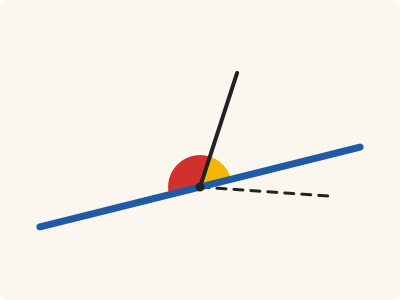
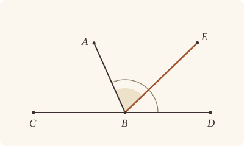
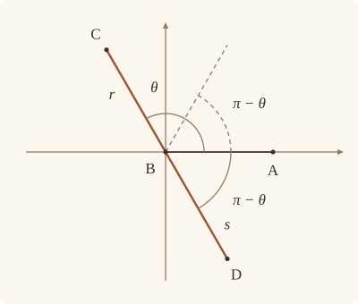

<!-- Generated by scripts/render.py. Do not edit by hand. -->

[Book I](index.md) · [← I.13](13.md) · [I.15 →](15.md)

# Book I, Proposition 14

*Angles equal to two right angles make a straight line*

[Euclid's proof](#euclids-proof) · [In Lean](#in-lean) · [What it rests on](#what-it-rests-on) · [Mishnah](#mishnah)

> If with any straight line, and at a point on it, two straight lines not lying on the same side make the adjacent angles equal to two right angles, the two straight lines will be in a straight line with one another.

**In Lean:** ✅ proved, as Euclid states it · Euclid's argument

<p align="center"></p>

<p align="center"><em>If two angles side by side (red and yellow) together make two right angles, their outer arms (blue) join up into one straight line, never a bent one (dashed).</em></p>

## Euclid's proof

<p align="center"></p>

<p align="center"><em>Drawn for one case: BE within the angle ABD, as in Heath's figure. Like Heath's, this figure is drawn for the impossible supposition that BE, not BD, is in a straight line with CB: it draws CBD straight, and BE rising from it, standing for CB produced.</em></p>

For with any straight line AB, and at the point B on it, let the two straight lines BC, BD not lying on the same side make the adjacent angles ABC, ABD equal to two right angles;

I say that BD is in a straight line with CB.

For, if BD is not in a straight line with BC, let BE be in a straight line with CB.

Then, since the straight line AB stands on the straight line CBE,

the angles ABC, ABE are equal to two right angles. [I. 13]

But the angles ABC, ABD are also equal to two right angles;

therefore the angles CBA, ABE are equal to the angles CBA, ABD. [Post. 4 and C.N. 1]

Let the angle CBA be subtracted from each;

therefore the remaining angle ABE is equal to the remaining angle ABD, [C.N. 3]

the less to the greater: which is impossible.

Therefore BE is not in a straight line with CB.

Similarly we can prove that neither is any other straight line except BD.

Therefore CB is in a straight line with BD.

Therefore etc.

Q. E. D.

## In Lean

| | |
|---|---|
| Proof | ✅ Proved |
| Statement | The whole enunciation. |
| Argument | Euclid's. |
| Reviewed | The statement and every passage of the argument read against Heath's text, at commit [`b18bca18`](https://github.com/dodecaplex-co/stoicheia/commit/b18bca18) ([the record](../../review/I/14.toml)) |

From [`Elements/BookI/Prop14.lean`](../../Elements/BookI/Prop14.lean). Euclid's sentences are the `--` comments, and our own notes are in `/- … -/`; the lines under each sentence are the Lean that carries it out. The list below marks where a lemma does a step Euclid takes for granted, where several sentences share one step and where the statement already gives a step; the `/- … -/` notes in the listing explain smaller adjustments.

**How the Lean follows the text**

- **Already given.** "I say that BD is in a straight line with CB." The statement gives the goal; the note under the sentence says how our Lean puts it.
- **Done by `onRay_of_angle_eq`.** "the less to the greater…" Euclid reads off his figure that the angle ABE is a part of the angle ABD; the Lean also takes BD within ABE. `OppositeSidesOf.of_between` and `OppositeSidesOf.sameSideOf` put E and D on one side of AB, and `onRay_of_angle_eq` rules out either placement by making an angle equal to a proper part of itself.
- **Carried together.** "Similarly we can prove that neither is any other straight line…" No second argument is needed: E was any point on CB produced, and the one argument already puts D on CB produced, beyond B.
- **Done by `OnRay.between`.** "Therefore CB is in a straight line with BD." Euclid concludes that CB and BD form one straight line; `OnRay.between` turns D's lying on the ray from B through E, with B between C and E, into B's lying between C and D.

```lean
/-- If with any straight line, and at a point on it, two straight lines not lying on the same side
make the adjacent angles equal to two right angles, the two straight lines will be in a straight
line with one another. -/
theorem Prop14 {A B C D : Point} (hCD : OppositeSidesOf C D A B) (h : ∠ A B C + ∠ A B D = ∟ + ∟) :
    Between C B D := by
  -- For with any straight line AB, and at the point B on it, let the two straight lines BC, BD
  -- not lying on the same side make the adjacent angles ABC, ABD equal to two right angles;
  /- "Not lying on the same side": C and D are on opposite sides of AB. So C is
     off AB, and ABC is a triangle. -/
  have hABC : Triangle A B C := hCD.triangle
  have hA_B : A ≠ B := hABC.ne₁₂
  have hC_B : C ≠ B := hABC.ne₂₃.symm
  -- I say that BD is in a straight line with CB.
  /- In Lean, this says that B lies between C and D. -/
  -- For, if BD is not in a straight line with BC, let BE be in a straight line with CB.
  /- CB is produced beyond B to E [Post. 1, Post. 2], which is `produce` in Book
     Zero. Euclid's supposition then says that BE is another straight line than
     BD: that D is not on the ray from B through E. We follow his argument
     under that supposition, as far as the impossible. -/
  obtain ⟨E, hCBE⟩ := produce hC_B
  have other : ¬ OnRay D B E → False := by
    intro hD_BE
    -- Then, since the straight line AB stands on the straight line CBE,
    /- Stands on it, and is not part of it: A is off the straight line CE, for
       that line passes through B, and A, B, C are not on one straight line. -/
    have hA_CE : ¬ Collinear C E A := by
      rintro ⟨L, hC, hE, hA⟩
      exact hABC ⟨L, hA, on_line_of_between_ends hCBE hC hE, hC⟩
    -- the angles ABC, ABE are equal to two right angles. [I. 13]
    have hCBA_ABE : ∠ C B A + ∠ A B E = ∟ + ∟ := Prop13 hCBE hA_CE
    -- But the angles ABC, ABD are also equal to two right angles;
    have hCBA_ABD : ∠ C B A + ∠ A B D = ∟ + ∟ := by
      rw [← angle_symm hA_B hC_B]
      exact h
    -- therefore the angles CBA, ABE are equal to the angles CBA, ABD. [Post. 4 and C.N. 1]
    /- Post. 4 has done its work already, as in I.11: I.13 hands its two right
       angles back as `∟ + ∟`. So the step itself is C.N. 1 alone. -/
    have hsum : ∠ C B A + ∠ A B E = ∠ C B A + ∠ A B D := CommonNotion1 hCBA_ABE hCBA_ABD
    -- Let the angle CBA be subtracted from each;
    -- therefore the remaining angle ABE is equal to the remaining angle ABD, [C.N. 3]
    have hABE_ABD : ∠ A B E = ∠ A B D :=
      CommonNotion3 (c := ∠ C B A) (d := ∠ C B A) (by rw [add_comm, hsum, add_comm]) rfl
    -- the less to the greater: which is impossible.
    /- In Euclid's figure BE falls within the angle ABD, so that ABE is a part
       of ABD; his supposition allows BD to fall within ABE as well, and our
       proof takes that figure too. Both figures are settled by
       `onRay_of_angle_eq` in Book Zero: on one side of a straight line, only
       one ray from a point of it makes a given angle with it, for
       otherwise one of two equal angles would be a part of the other, the less
       equal to the greater. E and D are on the same side of AB, both being on
       the other side from C (`OppositeSidesOf.of_between`,
       `OppositeSidesOf.sameSideOf`); so D would lie on the ray from B through E,
       against the supposition. -/
    have hDE : SameSideOf D E A B := hCD.sameSideOf (OppositeSidesOf.of_between hABC hCBE)
    exact hD_BE (onRay_of_angle_eq hDE.swap hABE_ABD.symm)
  -- Therefore BE is not in a straight line with CB.
  /- That is, BE is not another straight line than BD: the supposition has
     failed, so D lies on the ray from B through E. -/
  have hD_BE : OnRay D B E := Classical.byContradiction other
  -- Similarly we can prove that neither is any other straight line except BD.
  /- Our proof gives no second argument for "similarly": E was any point on CB
     produced, and the argument never asked which. -/
  -- Therefore CB is in a straight line with BD.
  /- So D lies beyond B from C: a point of the ray from B through E does
     (`OnRay.between`, in Book Zero). -/
  exact hD_BE.between hCBE
  -- Therefore etc.
  -- Q. E. D.
```

## What it rests on

| | |
|---|---|
| Heath's references | [I.13](13.md); Post. 4; C.N. 1, 3 |
| Lean cites | [I.13](13.md) |
| Postulates | 1, 2, 3, 4 |
| Definitions taken as axioms | Def. I.15 |
| Common Notions | 1, 2, 3, 4, 5 |
| Tacit rules | 37 (listed below) |
| Its own Lean calls | 2 tacit rules |
| Through lemmas | Postulates 1, 2 and 3; Def. I.15; 27 tacit rules |

_Postulates, definitions, Common Notions and tacit rules: all that this proof rests on, counting those of the propositions it cites. The last two rows say which of the postulates, definitions and tacit rules its own Lean calls, in the proof or a helper written for it, and which it does not call but reaches through lemmas, of Book Zero or shared (a proposition it cites may rest on these too); the rest come in only through the propositions it cites or the Common Notions._

<details><summary>The 37 tacit rules beneath this proof, counting those of the propositions it cites</summary>

_(used here) marks a rule this proof's own Lean calls, in the proof or a helper written for it; (through …) marks one its own Lean does not call but reaches through the lemmas named, of [Book Zero](../../Elements/Figure) or shared, though a proposition it cites may rest on it too; and a rule with no mark comes in only through a proposition it cites or a Common Notion. The names in brackets are System E's: an Intersection rule says when straight lines and circles must meet, and an Intersections rule takes a point where they do (see [Book I's introduction](index.md))._

**Reading the figure**

- [`between_cases`](../../Elements/Foundations/Tacit/Diagram.lean#L54) (through [`OnRay.between`](../../Elements/Figure/Rays.lean#L72), [`OppositeSidesOf.sameSideOf`](../../Elements/Figure/Sides.lean#L129) and [`onRay_of_angle_eq`](../../Elements/Figure/Angles.lean#L206)): Of three different points on a straight line, one is between the other two. (Between 6)
- [`between_symm`](../../Elements/Foundations/Tacit/Diagram.lean#L47) (through [`OnRay.between`](../../Elements/Figure/Rays.lean#L72), [`OppositeSidesOf.of_between`](../../Elements/Figure/Sides.lean#L100), [`OppositeSidesOf.sameSideOf`](../../Elements/Figure/Sides.lean#L129) and 1 other lemma): If B is between A and C, it is between C and A. (Between 1)
- [`circles_meet`](../../Elements/Foundations/Tacit/Diagram.lean#L91) (through [`OnRay.between`](../../Elements/Figure/Rays.lean#L72), [`OppositeSidesOf.of_between`](../../Elements/Figure/Sides.lean#L100), [`OppositeSidesOf.sameSideOf`](../../Elements/Figure/Sides.lean#L129) and 2 other lemmas): If each circle passes through a point inside the other, the circles cut one another. This is the step Euclid takes for granted in I.1. (Intersection 5)
- [`circles_meet_same_side`](../../Elements/Foundations/Tacit/Constructions.lean#L79) (through [`OnRay.between`](../../Elements/Figure/Rays.lean#L72), [`OppositeSidesOf.of_between`](../../Elements/Figure/Sides.lean#L100), [`OppositeSidesOf.sameSideOf`](../../Elements/Figure/Sides.lean#L129) and 2 other lemmas): Two circles that cut one another do so on each side of the straight line through their centres. (Intersections 8)
- [`exists_point`](../../Elements/Foundations/Tacit/Constructions.lean#L35) (through [`OppositeSidesOf.of_between`](../../Elements/Figure/Sides.lean#L100), [`Triangle.ne₁₂`](../../Elements/Figure/Triangles.lean#L22), [`Triangle.ne₂₃`](../../Elements/Figure/Triangles.lean#L29) and 1 other lemma): Let a point be taken. (Points 1)
- [`exists_point_inside_circle`](../../Elements/Foundations/Tacit/Constructions.lean#L42) (through [`OnRay.between`](../../Elements/Figure/Rays.lean#L72), [`OppositeSidesOf.of_between`](../../Elements/Figure/Sides.lean#L100), [`OppositeSidesOf.sameSideOf`](../../Elements/Figure/Sides.lean#L129) and 2 other lemmas): Let a point be taken inside the circle α. (Points 8)
- [`exists_point_on_line`](../../Elements/Foundations/Tacit/Constructions.lean#L38) (through [`OnRay.between`](../../Elements/Figure/Rays.lean#L72), [`OppositeSidesOf.of_between`](../../Elements/Figure/Sides.lean#L100), [`OppositeSidesOf.sameSideOf`](../../Elements/Figure/Sides.lean#L129) and 2 other lemmas): Let a point be taken on the straight line L. (Points 2)
- [`line_circle_between`](../../Elements/Foundations/Tacit/Constructions.lean#L67) (through [`OnRay.between`](../../Elements/Figure/Rays.lean#L72), [`OppositeSidesOf.of_between`](../../Elements/Figure/Sides.lean#L100), [`OppositeSidesOf.sameSideOf`](../../Elements/Figure/Sides.lean#L129) and 2 other lemmas): A straight line through a point B inside a circle, heading out to a point C outside it, cuts the circle between B and C. (Intersections 4)
- [`line_circle_beyond`](../../Elements/Foundations/Tacit/Constructions.lean#L73) (through [`OnRay.between`](../../Elements/Figure/Rays.lean#L72), [`OppositeSidesOf.of_between`](../../Elements/Figure/Sides.lean#L100), [`OppositeSidesOf.sameSideOf`](../../Elements/Figure/Sides.lean#L129) and 2 other lemmas): A straight line through a point B inside a circle, produced beyond B away from C, cuts the circle there. (Intersections 5)
- [`line_unique`](../../Elements/Foundations/Tacit/Diagram.lean#L41) (through [`OnRay.between`](../../Elements/Figure/Rays.lean#L72), [`OppositeSidesOf.of_between`](../../Elements/Figure/Sides.lean#L100), [`OppositeSidesOf.sameSideOf`](../../Elements/Figure/Sides.lean#L129) and 1 other lemma): Two points determine a straight line. (Generalities 1)
- [`lines_meet_of_opposite_sides`](../../Elements/Foundations/Tacit/Diagram.lean#L86) (through [`OppositeSidesOf.sameSideOf`](../../Elements/Figure/Sides.lean#L129) and [`onRay_of_angle_eq`](../../Elements/Figure/Angles.lean#L206)): A straight line joining points on opposite sides of L crosses L. (Intersection 1)
- [`not_between_of_between`](../../Elements/Foundations/Tacit/Diagram.lean#L50) (through [`OnRay.between`](../../Elements/Figure/Rays.lean#L72), [`OppositeSidesOf.of_between`](../../Elements/Figure/Sides.lean#L100), [`OppositeSidesOf.sameSideOf`](../../Elements/Figure/Sides.lean#L129) and 2 other lemmas): If B is between A and C, then A is not between B and C. (Between 1)
- [`not_on_line_of_same_side`](../../Elements/Foundations/Tacit/Diagram.lean#L60) (through [`OnRay.between`](../../Elements/Figure/Rays.lean#L72), [`OppositeSidesOf.of_between`](../../Elements/Figure/Sides.lean#L100), [`OppositeSidesOf.sameSideOf`](../../Elements/Figure/Sides.lean#L129) and 2 other lemmas): Points on one side of a straight line are not on it. (Same side 3)
- [`pasch2`](../../Elements/Foundations/Tacit/Diagram.lean#L71) (through [`OnRay.between`](../../Elements/Figure/Rays.lean#L72), [`OppositeSidesOf.of_between`](../../Elements/Figure/Sides.lean#L100), [`OppositeSidesOf.sameSideOf`](../../Elements/Figure/Sides.lean#L129) and 2 other lemmas): If B is between A and C, A is on L and B is off it, then B and C are on the same side of L: a straight line that leaves L at A does not cross it again. (Pasch 2)
- [`same_side_trans`](../../Elements/Foundations/Tacit/Diagram.lean#L64) (through [`OnRay.between`](../../Elements/Figure/Rays.lean#L72), [`OppositeSidesOf.of_between`](../../Elements/Figure/Sides.lean#L100), [`OppositeSidesOf.sameSideOf`](../../Elements/Figure/Sides.lean#L129) and 2 other lemmas): Two points on the same side of a straight line as a third point are on the same side as each other. (Same side 4)

**Lengths, angles and areas**

- [`angle_add_of_inside`](../../Elements/Foundations/Tacit/Transfer.lean#L47) (through [`OppositeSidesOf.of_between`](../../Elements/Figure/Sides.lean#L100), [`OppositeSidesOf.sameSideOf`](../../Elements/Figure/Sides.lean#L129) and [`onRay_of_angle_eq`](../../Elements/Figure/Angles.lean#L206)): If D lies within the angle BAC, then BAC is made up of BAD and DAC. (Diagram-angle 2)
- [`angle_eq_of_same_rays`](../../Elements/Foundations/Tacit/Transfer.lean#L54): The angle doesn't change if its arms are traced through other points on the same rays. (Diagram-angle 4)
- [`angle_symm`](../../Elements/Foundations/Tacit/Metric.lean#L30) (used here): The angle ABC is the angle CBA. (Metric 4)
- [`area_add_of_between`](../../Elements/Foundations/Tacit/Transfer.lean#L70): Cutting a triangle in two from a vertex adds up. (Diagram-area 2)
- [`area_congruent`](../../Elements/Foundations/Tacit/Metric.lean#L44): Triangles equal in all their sides and angles are equal in area. Euclid uses this without comment once he has shown two triangles congruent. (Metric 9)
- [`area_degenerate`](../../Elements/Foundations/Tacit/Metric.lean#L36): A "triangle" with a repeated corner has no area. (Metric 6)
- [`area_eq_zero_of_on_line`](../../Elements/Foundations/Tacit/Transfer.lean#L62): A "triangle" whose corners lie on one straight line has no area. (Diagram-area 1)
- [`area_rotate`](../../Elements/Foundations/Tacit/Metric.lean#L39): The triangle ABC is the triangle CAB. (Metric 8)
- [`len_add_of_between`](../../Elements/Foundations/Tacit/Transfer.lean#L27) (through [`OnRay.between`](../../Elements/Figure/Rays.lean#L72), [`OppositeSidesOf.of_between`](../../Elements/Figure/Sides.lean#L100), [`OppositeSidesOf.sameSideOf`](../../Elements/Figure/Sides.lean#L129) and 2 other lemmas): If B is between A and C, then AB and BC together make up AC. (Diagram-segment 1)
- [`len_self`](../../Elements/Foundations/Tacit/Metric.lean#L24) (through [`OnRay.between`](../../Elements/Figure/Rays.lean#L72), [`OppositeSidesOf.of_between`](../../Elements/Figure/Sides.lean#L100), [`OppositeSidesOf.sameSideOf`](../../Elements/Figure/Sides.lean#L129) and 2 other lemmas): The "straight line" from a point to itself has no length. (Metric 1)
- [`len_symm`](../../Elements/Foundations/Tacit/Metric.lean#L27) (through [`OnRay.between`](../../Elements/Figure/Rays.lean#L72), [`OppositeSidesOf.of_between`](../../Elements/Figure/Sides.lean#L100), [`OppositeSidesOf.sameSideOf`](../../Elements/Figure/Sides.lean#L129) and 2 other lemmas): The straight line AB is the straight line BA. (Metric 3)
- [`radius_ne_zero`](../../Elements/Foundations/Tacit/Metric.lean#L62) (through [`OnRay.between`](../../Elements/Figure/Rays.lean#L72), [`OppositeSidesOf.of_between`](../../Elements/Figure/Sides.lean#L100), [`OppositeSidesOf.sameSideOf`](../../Elements/Figure/Sides.lean#L129) and 2 other lemmas): A circle's radius is not nothing: the straight line from the centre to a point on the circle has some length. A rule of our own, not one of System E's: every circle is drawn with a centre and a distance (Postulate 3).
- [`same_ray_of_angle_eq_zero`](../../Elements/Foundations/Tacit/Transfer.lean#L42) (through [`OppositeSidesOf.of_between`](../../Elements/Figure/Sides.lean#L100), [`OppositeSidesOf.sameSideOf`](../../Elements/Figure/Sides.lean#L129) and [`onRay_of_angle_eq`](../../Elements/Figure/Angles.lean#L206)): If the angle BAC is nothing, C lies on the ray from A through B. (Diagram-angle 1)

**Superposition**

- [`superposition`](../../Elements/Foundations/Tacit/Superposition.lean#L52): **Superposition.** A hypothetical placement of a triangle on a given ray and side permits a restricted derivation of metric equalities about the figure already given. The derivation introduces no further objects, cites each geometric law it uses, and exports no symbol of the placement.

**Rules of magnitude**

- [`add_assoc`](../../Elements/Foundations/Tacit/Magnitudes.lean#L23) (through [`OnRay.between`](../../Elements/Figure/Rays.lean#L72)): Adding three magnitudes in a row, it makes no difference whether the first two or the last two are added first. (System E §3.5)
- [`add_comm`](../../Elements/Foundations/Tacit/Magnitudes.lean#L26) (used here): The order of adding does not matter. (System E §3.5)
- [`add_lt_add_right`](../../Elements/Foundations/Tacit/Magnitudes.lean#L45) (through [`OnRay.between`](../../Elements/Figure/Rays.lean#L72), [`OppositeSidesOf.sameSideOf`](../../Elements/Figure/Sides.lean#L129) and [`onRay_of_angle_eq`](../../Elements/Figure/Angles.lean#L206)): Adding the same thing to both sides keeps "less than". (System E §3.5)
- [`add_zero`](../../Elements/Foundations/Tacit/Magnitudes.lean#L29): Adding nothing changes nothing. (System E §3.5)
- [`lt_irrefl`](../../Elements/Foundations/Tacit/Magnitudes.lean#L32) (through [`OnRay.between`](../../Elements/Figure/Rays.lean#L72), [`OppositeSidesOf.of_between`](../../Elements/Figure/Sides.lean#L100), [`OppositeSidesOf.sameSideOf`](../../Elements/Figure/Sides.lean#L129) and 2 other lemmas): No magnitude is less than itself. (System E §3.5)
- [`lt_trans`](../../Elements/Foundations/Tacit/Magnitudes.lean#L35) (through [`OnRay.between`](../../Elements/Figure/Rays.lean#L72), [`OppositeSidesOf.of_between`](../../Elements/Figure/Sides.lean#L100), [`OppositeSidesOf.sameSideOf`](../../Elements/Figure/Sides.lean#L129) and 2 other lemmas): What is less than the less is less still. (System E §3.5)
- [`lt_trichotomy`](../../Elements/Foundations/Tacit/Magnitudes.lean#L39) (through [`OnRay.between`](../../Elements/Figure/Rays.lean#L72), [`OppositeSidesOf.of_between`](../../Elements/Figure/Sides.lean#L100), [`OppositeSidesOf.sameSideOf`](../../Elements/Figure/Sides.lean#L129) and 2 other lemmas): Of two magnitudes, one is less, or they are equal, or the other is less. (System E §3.5)
- [`not_lt_zero`](../../Elements/Foundations/Tacit/Magnitudes.lean#L42) (through [`OnRay.between`](../../Elements/Figure/Rays.lean#L72), [`OppositeSidesOf.of_between`](../../Elements/Figure/Sides.lean#L100), [`OppositeSidesOf.sameSideOf`](../../Elements/Figure/Sides.lean#L129) and 2 other lemmas): Nothing is less than zero. (System E §3.5)

</details>

## Mishnah

_Our commentary: why Euclid's proof, and ours, look as they do._

Euclid now turns I.13 round, and this converse is how he will know that straight lines run straight on: in I.47 it lines up CA and AG, a side of the triangle and a side of a square, and in I.45 the sides of parallelograms set side by side. He argues by *reductio ad absurdum*, producing CB to E and finding the angle ABE equal to ABD, "the less to the greater: which is impossible." Our proof follows him under the supposition as far as the impossible, and then concludes with him that CB is in a straight line with BD.

Proclus observes, as Heath reports him, why the words "not lying on the same side" are needed: "two straight lines on the *same* side of another straight line … may make … two angles which are together equal to two right angles, in which case however the two straight lines would not be in a straight line with one another" (vol. 1, p. 277). Our proof needs the condition once, at "the less to the greater": E and D, both across AB from C, lie on one side of it, where just one ray from B makes a given angle with BA (`onRay_of_angle_eq`, in Book Zero). So D lies along BE, whether BE falls within the angle ABD, as Euclid draws it, or BD within ABE.

Of the step marked [Post. 4 and C.N. 1], Isaac Todhunter, Heath reports, "points out that for the inference in this line Post. 4, that all right angles are equal, is necessary as well as the Common Notion that things which are equal to the same thing (or rather, here, to *equal things*) are equal. A similar remark applies to steps in the proofs of I. 15 and I. 28" (vol. 1, p. 277): the two right angles of I.13 are not, on their face, the two of the hypothesis. Our Postulate 4 makes every right angle the one `∟`, as I.11 explains, so the step is Common Notion 1 alone, and the subtraction after it Common Notion 3.

**The modern way.** Put $\mathrm{B} = 0$ and $\mathrm{A} = 1$ in the complex plane, and $\mathrm{C} = re^{i\theta}$ above the real axis, with $r \gt 0$ and $0 \lt \theta \lt \pi$. The point $\mathrm{D} = -se^{i\theta}$, with $s \gt 0$, lies below the axis, makes the angle $\pi - \theta$ with BA, and has B between it and C. Its mirror image in the axis makes the same angle, and the two angles at B still add up to $\pi$, but it is not in a straight line with CB: Proclus' warning.

<p align="center"></p>

## Further reading

- More of the complex-number geometry the modern way uses is in the chapter "Applications to Geometry" of Liang-shin Hahn's [*Complex Numbers and Geometry*](https://doi.org/10.1090/text/052) (2019) (also on [I.9](09.md)).
- Lean's proof by contradiction, `Classical.byContradiction`, and the classical axioms behind it are explained in ch. 3, "Propositions and Proofs", and ch. 12, "Axioms and Computation", of [*Theorem Proving in Lean 4*](https://lean-lang.org/theorem_proving_in_lean4/) (free online), by Jeremy Avigad, Leonardo de Moura, Soonho Kong and Sebastian Ullrich: the official guide to how Lean thinks.

[Book I](index.md) · [← I.13](13.md) · [I.15 →](15.md)

---

<sub>Euclid's text: T. L. Heath, *The Thirteen Books of Euclid's Elements*, vol. 1 (Cambridge, 1908), pp. 276–277; [scan leaves n296–n297](https://archive.org/details/thirteenbookseu02heibgoog/page/n296); [figure on n296](https://archive.org/details/thirteenbookseu02heibgoog/page/n296). Public domain.</sub>

<sub>The tacit rules follow the System E of Jeremy Avigad, Edward Dean and John Mumma, read alongside LeanEuclid (Logan Murphy, Kaiyu Yang, Jialiang Sun, Zhaoyu Li, Anima Anandkumar and Xujie Si).</sub>
