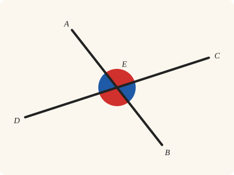
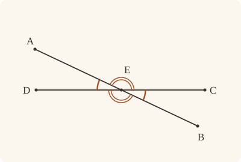
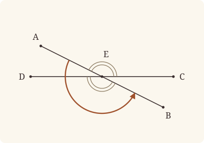

<!-- Generated by scripts/render.py. Do not edit by hand. -->

[Book I](index.md) · [← I.14](14.md) · [I.16 →](16.md)

# Book I, Proposition 15

*Straight lines cutting one another make the vertical angles equal*

[Euclid's proof](#euclids-proof) · [In Lean](#in-lean) · [What it rests on](#what-it-rests-on) · [Mishnah](#mishnah)

> If two straight lines cut one another, they make the vertical angles equal to one another.

**In Lean:** ✅ proved, as Euclid states it · Euclid's argument

<p align="center"></p>

<p align="center"><em>When two straight lines cross, the angles opposite each other are equal: red matches red, and blue matches blue.</em></p>

## Euclid's proof

<p align="center"></p>

For let the straight lines AB, CD cut one another at the point E;

I say that the angle AEC is equal to the angle DEB,

and the angle CEB to the angle AED.

For, since the straight line AE stands on the straight line CD, making the angles CEA, AED,

the angles CEA, AED are equal to two right angles. [I. 13]

Again, since the straight line DE stands on the straight line AB, making the angles AED, DEB,

the angles AED, DEB are equal to two right angles. [I. 13]

But the angles CEA, AED were also proved equal to two right angles;

therefore the angles CEA, AED are equal to the angles AED, DEB. [Post. 4 and C.N. 1]

Let the angle AED be subtracted from each;

therefore the remaining angle CEA is equal to the remaining angle BED. [C.N. 3]

Similarly it can be proved that the angles CEB, DEA are also equal.

Therefore etc.

Q. E. D.

<a name="porism"></a>[PORISM. From this it is manifest that, if two straight lines cut one another, they will make the angles at the point of section equal to four right angles.]

## In Lean

| | |
|---|---|
| Proof | ✅ Proved, and its porism, [I.15 Por.](15.md#porism) |
| Statement | The whole enunciation. |
| Argument | Euclid's. |
| Reviewed | The statement and every passage of the argument read against Heath's text, at commit [`01e0fe54`](https://github.com/jackChallis/stoicheia/commit/01e0fe54) ([the record](../../review/I/15.toml)) |

From [`Elements/BookI/Prop15.lean`](../../Elements/BookI/Prop15.lean). Euclid's sentences are the `--` comments, and our own notes are in `/- … -/`; the lines under each sentence are the Lean that carries it out. The list below marks where a lemma does a step Euclid takes for granted and where a porism is proved as a theorem of its own; the `/- … -/` notes in the listing explain smaller adjustments.

**How the Lean follows the text**

- **Done by `Prop15.figure`.** "For let the straight lines AB, CD cut one another at the point E…" Euclid reads off the crossing lines that A is off CD and D is off AB. Beneath the setting-out, the Lean proves this with `Prop15.figure`, so that AE stands on CD and DE on AB for the two later applications of I.13.
- **Proved separately, as `Prop15.porism`.** "PORISM. From this it is manifest…" Heath brackets the Porism, after J. L. Heiberg. It is proved as its own theorem, with its own certificate entry, I.15 Por.

<details><summary>Before the theorem, one lemma: <code>Prop15.figure</code> (26 lines)</summary>

```lean
/-! ## What Euclid reads off the figure -/

/-- Two straight lines that cut one another at E are two different straight
lines, so an end of one, other than E, is off the other. If E lies between A
and B and between C and D, and C is off the straight line AB, then A is
off CD and D is off AB. That is what I.13 asks when Euclid says that AE
"stands on" CD, and DE on AB.

Euclid's figure shows it at a glance. In Lean: a second point that AB and CD
shared besides E would make them one straight line (System E, Generalities 1),
and then C would be on AB. -/
theorem Prop15.figure {A B C D E : Point} (hAEB : Between A E B) (hCED : Between C E D)
    (hC : ¬ Collinear A B C) : Triangle C D A ∧ Triangle A B D := by
  obtain ⟨AB, hA_AB, hB_AB⟩ := Postulate1 A B (ne_of_between_ends hAEB)
  obtain ⟨CD, hC_CD, hD_CD⟩ := Postulate1 C D (ne_of_between_ends hCED)
  have hE_AB : OnLine E AB := on_line_of_between_ends hAEB hA_AB hB_AB
  have hE_CD : OnLine E CD := on_line_of_between_ends hCED hC_CD hD_CD
  have hC_AB : ¬ OnLine C AB := fun h => hC ⟨AB, hA_AB, hB_AB, h⟩
  /- The two straight lines meet only at E. -/
  have only_E : ∀ {P : Point}, P ≠ E → OnLine P AB → ¬ OnLine P CD := fun hPE hP_AB hP_CD =>
    hC_AB (line_unique hPE hP_CD hE_CD hP_AB hE_AB ▸ hC_CD)
  have hA_CD : ¬ OnLine A CD := only_E (ne_of_between hAEB) hA_AB
  have hD_AB : ¬ OnLine D AB := fun hD_AB =>
    only_E (ne_of_between (between_symm hCED)) hD_AB hD_CD
  exact ⟨Triangle.of_line hC_CD hD_CD (ne_of_between_ends hCED) hA_CD,
    Triangle.of_line hA_AB hB_AB (ne_of_between_ends hAEB) hD_AB⟩
```

</details>

```lean
/-- If two straight lines cut one another, they make the vertical angles equal to one another. -/
theorem Prop15 {A B C D E : Point} (hAEB : Between A E B) (hCED : Between C E D)
    (hC : ¬ Collinear A B C) :
    ∠ A E C = ∠ D E B ∧ ∠ C E B = ∠ A E D := by
  -- For let the straight lines AB, CD cut one another at the point E;
  /- That the two straight lines really cross, so that A is off CD and D is off
     AB, is what Euclid sees in his figure (`Prop15.figure`). -/
  obtain ⟨hCDA, hABD⟩ := Prop15.figure hAEB hCED hC
  have hA_E : A ≠ E := ne_of_between hAEB
  have hB_E : B ≠ E := ne_of_between (between_symm hAEB)
  have hC_E : C ≠ E := ne_of_between hCED
  have hD_E : D ≠ E := ne_of_between (between_symm hCED)
  -- I say that the angle AEC is equal to the angle DEB,
  -- and the angle CEB to the angle AED.
  -- For, since the straight line AE stands on the straight line CD, making the angles CEA,
  -- AED,
  -- the angles CEA, AED are equal to two right angles. [I. 13]
  have hCEA_AED : ∠ C E A + ∠ A E D = ∟ + ∟ := Prop13 hCED hCDA
  -- Again, since the straight line DE stands on the straight line AB, making the angles AED,
  -- DEB,
  -- the angles AED, DEB are equal to two right angles. [I. 13]
  have hAED_DEB : ∠ A E D + ∠ D E B = ∟ + ∟ := Prop13 hAEB hABD
  -- But the angles CEA, AED were also proved equal to two right angles;
  -- therefore the angles CEA, AED are equal to the angles AED, DEB. [Post. 4 and C.N. 1]
  /- Post. 4 has done its work already, as in I.11, so only C.N. 1 is left to
     cite. -/
  have hsums : ∠ C E A + ∠ A E D = ∠ A E D + ∠ D E B := CommonNotion1 hCEA_AED hAED_DEB
  -- Let the angle AED be subtracted from each;
  -- therefore the remaining angle CEA is equal to the remaining angle BED. [C.N. 3]
  /- The angle DEB is the angle BED, read the other way round (`angle_symm`). -/
  have hCEA_BED : ∠ C E A = ∠ B E D := by
    apply CommonNotion3 (c := ∠ A E D) (d := ∠ A E D) _ rfl
    rw [hsums, add_comm (∠ A E D), angle_symm hD_E hB_E]
  -- Similarly it can be proved that the angles CEB, DEA are also equal.
  /- Euclid's "similarly": this time CE stands on AB, making the angles AEC,
     CEB, which are equal to two right angles [I. 13]; so are the angles CEA,
     AED, as proved; and the angle AEC, which is the angle CEA, is subtracted
     from each [C.N. 1, C.N. 3]. -/
  have hAEC_CEB : ∠ A E C + ∠ C E B = ∟ + ∟ := Prop13 hAEB hC
  have hCEB_DEA : ∠ C E B = ∠ D E A := by
    apply CommonNotion3 (c := ∠ A E C) (d := ∠ C E A) _ (angle_symm hA_E hC_E)
    rw [add_comm (∠ C E B), hAEC_CEB, ← hCEA_AED, add_comm (∠ D E A), angle_symm hD_E hA_E]
  -- Therefore etc.
  /- Euclid's angles CEA and BED are the angles AEC and DEB of the enunciation,
     and DEA is AED, each read the other way round. -/
  exact ⟨by rw [angle_symm hA_E hC_E, hCEA_BED, angle_symm hB_E hD_E],
    by rw [hCEB_DEA, angle_symm hD_E hA_E]⟩
  -- Q. E. D.
  -- [PORISM. From this it is manifest that, if two straight lines cut one another, they will
  -- make the angles at the point of section equal to four right angles.]
  /- Heath, after Heiberg, brackets the Porism as probably not Euclid's, and the
     enunciation does not ask for it, so it is not part of `Prop15`. It is proved just
     below all the same, as `Prop15.porism`: the four angles at E are the two pairs
     that I.13 has just shown to be equal to two right angles each. -/
```

<details><summary>After the theorem, its porism, <code>Prop15.porism</code> (16 lines)</summary>

```lean
/-- The Porism to I.15: if two straight lines cut one another, the four angles at the point
of section, AEC, CEB, BED and DEA, are together equal to four right angles. It falls
out of I.13, used twice as in I.15 itself, with C.N. 2 to add the two pairs. -/
theorem Prop15.porism {A B C D E : Point} (hAEB : Between A E B) (hCED : Between C E D)
    (hC : ¬ Collinear A B C) :
    ∠ A E C + ∠ C E B + (∠ B E D + ∠ D E A) = ∟ + ∟ + (∟ + ∟) := by
  obtain ⟨-, hABD⟩ := Prop15.figure hAEB hCED hC
  have hA_E : A ≠ E := ne_of_between hAEB
  have hB_E : B ≠ E := ne_of_between (between_symm hAEB)
  have hD_E : D ≠ E := ne_of_between (between_symm hCED)
  /- CE stands on AB, and so does DE [I. 13]. -/
  have hAEC_CEB : ∠ A E C + ∠ C E B = ∟ + ∟ := Prop13 hAEB hC
  have hBED_DEA : ∠ B E D + ∠ D E A = ∟ + ∟ := by
    rw [add_comm (∠ B E D), angle_symm hD_E hA_E, angle_symm hB_E hD_E]
    exact Prop13 hAEB hABD
  exact CommonNotion2 hAEC_CEB hBED_DEA
```

</details>

## What it rests on

| | Proposition | Porism |
|---|---|---|
| Heath's references | [I.13](13.md); Post. 4; C.N. 1, 3 | none |
| Lean cites | [I.13](13.md) | [I.13](13.md) |
| Postulates | 1, 2, 3, 4 | 1, 2, 3, 4 |
| Definitions taken as axioms | Def. I.15 | Def. I.15 |
| Common Notions | 1, 2, 3, 4, 5 | 1, 2, 3, 4, 5 |
| Tacit rules | 37 (listed below) | 37 (listed below) |
| Its own Lean calls | Postulate 1; 4 tacit rules | Postulate 1; 4 tacit rules |
| Through lemmas | Postulate 3; Def. I.15; 18 tacit rules | Postulate 3; Def. I.15; 18 tacit rules |

_Postulates, definitions, Common Notions and tacit rules: all that each proof rests on, counting those of the propositions it cites. The last two rows say which of the postulates, definitions and tacit rules its own Lean calls, in the proof or a helper written for it, and which it does not call but reaches through lemmas, of Book Zero or shared (a proposition it cites may rest on these too); the rest come in only through the propositions it cites or the Common Notions._

<details><summary>The 37 tacit rules beneath this proof, counting those of the propositions it cites</summary>

_(used here) marks a rule this proof's own Lean calls, in the proof or a helper written for it; (through …) marks one its own Lean does not call but reaches through the lemmas named, of [Book Zero](../../Elements/Figure) or shared, though a proposition it cites may rest on it too; and a rule with no mark comes in only through a proposition it cites or a Common Notion. The names in brackets are System E's: an Intersection rule says when straight lines and circles must meet, and an Intersections rule takes a point where they do (see [Book I's introduction](index.md))._

**Reading the figure**

- [`between_cases`](../../Elements/Foundations/Tacit/Diagram.lean#L54): Of three different points on a straight line, one is between the other two. (Between 6)
- [`between_symm`](../../Elements/Foundations/Tacit/Diagram.lean#L47) (used here): If B is between A and C, it is between C and A. (Between 1)
- [`circles_meet`](../../Elements/Foundations/Tacit/Diagram.lean#L91) (through [`Tacit.on_line_of_between_ends`](../../Elements/Figure/RuleBase.lean#L142)): If each circle passes through a point inside the other, the circles cut one another. This is the step Euclid takes for granted in I.1. (Intersection 5)
- [`circles_meet_same_side`](../../Elements/Foundations/Tacit/Constructions.lean#L79) (through [`Tacit.on_line_of_between_ends`](../../Elements/Figure/RuleBase.lean#L142)): Two circles that cut one another do so on each side of the straight line through their centres. (Intersections 8)
- [`exists_point`](../../Elements/Foundations/Tacit/Constructions.lean#L35): Let a point be taken. (Points 1)
- [`exists_point_inside_circle`](../../Elements/Foundations/Tacit/Constructions.lean#L42) (through [`Tacit.on_line_of_between_ends`](../../Elements/Figure/RuleBase.lean#L142)): Let a point be taken inside the circle α. (Points 8)
- [`exists_point_on_line`](../../Elements/Foundations/Tacit/Constructions.lean#L38) (through [`Tacit.on_line_of_between_ends`](../../Elements/Figure/RuleBase.lean#L142)): Let a point be taken on the straight line L. (Points 2)
- [`line_circle_between`](../../Elements/Foundations/Tacit/Constructions.lean#L67) (through [`Tacit.on_line_of_between_ends`](../../Elements/Figure/RuleBase.lean#L142)): A straight line through a point B inside a circle, heading out to a point C outside it, cuts the circle between B and C. (Intersections 4)
- [`line_circle_beyond`](../../Elements/Foundations/Tacit/Constructions.lean#L73) (through [`Tacit.on_line_of_between_ends`](../../Elements/Figure/RuleBase.lean#L142)): A straight line through a point B inside a circle, produced beyond B away from C, cuts the circle there. (Intersections 5)
- [`line_unique`](../../Elements/Foundations/Tacit/Diagram.lean#L41) (used here): Two points determine a straight line. (Generalities 1)
- [`lines_meet_of_opposite_sides`](../../Elements/Foundations/Tacit/Diagram.lean#L86): A straight line joining points on opposite sides of L crosses L. (Intersection 1)
- [`not_between_of_between`](../../Elements/Foundations/Tacit/Diagram.lean#L50) (through [`Tacit.ne_of_between`](../../Elements/Figure/RuleBase.lean#L135), [`Tacit.ne_of_between_ends`](../../Elements/Figure/Incidence.lean#L66) and [`Tacit.on_line_of_between_ends`](../../Elements/Figure/RuleBase.lean#L142)): If B is between A and C, then A is not between B and C. (Between 1)
- [`not_on_line_of_same_side`](../../Elements/Foundations/Tacit/Diagram.lean#L60) (through [`Tacit.on_line_of_between_ends`](../../Elements/Figure/RuleBase.lean#L142)): Points on one side of a straight line are not on it. (Same side 3)
- [`pasch2`](../../Elements/Foundations/Tacit/Diagram.lean#L71) (through [`Tacit.on_line_of_between_ends`](../../Elements/Figure/RuleBase.lean#L142)): If B is between A and C, A is on L and B is off it, then B and C are on the same side of L: a straight line that leaves L at A does not cross it again. (Pasch 2)
- [`same_side_trans`](../../Elements/Foundations/Tacit/Diagram.lean#L64) (through [`Tacit.on_line_of_between_ends`](../../Elements/Figure/RuleBase.lean#L142)): Two points on the same side of a straight line as a third point are on the same side as each other. (Same side 4)

**Lengths, angles and areas**

- [`angle_add_of_inside`](../../Elements/Foundations/Tacit/Transfer.lean#L47): If D lies within the angle BAC, then BAC is made up of BAD and DAC. (Diagram-angle 2)
- [`angle_eq_of_same_rays`](../../Elements/Foundations/Tacit/Transfer.lean#L54): The angle doesn't change if its arms are traced through other points on the same rays. (Diagram-angle 4)
- [`angle_symm`](../../Elements/Foundations/Tacit/Metric.lean#L30) (used here): The angle ABC is the angle CBA. (Metric 4)
- [`area_add_of_between`](../../Elements/Foundations/Tacit/Transfer.lean#L70): Cutting a triangle in two from a vertex adds up. (Diagram-area 2)
- [`area_congruent`](../../Elements/Foundations/Tacit/Metric.lean#L44): Triangles equal in all their sides and angles are equal in area. Euclid uses this without comment once he has shown two triangles congruent. (Metric 9)
- [`area_degenerate`](../../Elements/Foundations/Tacit/Metric.lean#L36): A "triangle" with a repeated corner has no area. (Metric 6)
- [`area_eq_zero_of_on_line`](../../Elements/Foundations/Tacit/Transfer.lean#L62): A "triangle" whose corners lie on one straight line has no area. (Diagram-area 1)
- [`area_rotate`](../../Elements/Foundations/Tacit/Metric.lean#L39): The triangle ABC is the triangle CAB. (Metric 8)
- [`len_add_of_between`](../../Elements/Foundations/Tacit/Transfer.lean#L27) (through [`Tacit.ne_of_between_ends`](../../Elements/Figure/Incidence.lean#L66) and [`Tacit.on_line_of_between_ends`](../../Elements/Figure/RuleBase.lean#L142)): If B is between A and C, then AB and BC together make up AC. (Diagram-segment 1)
- [`len_self`](../../Elements/Foundations/Tacit/Metric.lean#L24) (through [`Tacit.ne_of_between_ends`](../../Elements/Figure/Incidence.lean#L66) and [`Tacit.on_line_of_between_ends`](../../Elements/Figure/RuleBase.lean#L142)): The "straight line" from a point to itself has no length. (Metric 1)
- [`len_symm`](../../Elements/Foundations/Tacit/Metric.lean#L27) (through [`Tacit.on_line_of_between_ends`](../../Elements/Figure/RuleBase.lean#L142)): The straight line AB is the straight line BA. (Metric 3)
- [`radius_ne_zero`](../../Elements/Foundations/Tacit/Metric.lean#L62) (through [`Tacit.ne_of_between_ends`](../../Elements/Figure/Incidence.lean#L66) and [`Tacit.on_line_of_between_ends`](../../Elements/Figure/RuleBase.lean#L142)): A circle's radius is not nothing: the straight line from the centre to a point on the circle has some length. A rule of our own, not one of System E's: every circle is drawn with a centre and a distance (Postulate 3).
- [`same_ray_of_angle_eq_zero`](../../Elements/Foundations/Tacit/Transfer.lean#L42): If the angle BAC is nothing, C lies on the ray from A through B. (Diagram-angle 1)

**Superposition**

- [`superposition`](../../Elements/Foundations/Tacit/Superposition.lean#L52): **Superposition.** A hypothetical placement of a triangle on a given ray and side permits a restricted derivation of metric equalities about the figure already given. The derivation introduces no further objects, cites each geometric law it uses, and exports no symbol of the placement.

**Laws of magnitude**

- [`add_assoc`](../../Elements/Foundations/Tacit/Magnitudes.lean#L23): Adding three magnitudes in a row, it makes no difference whether the first two or the last two are added first. (System E §3.5)
- [`add_comm`](../../Elements/Foundations/Tacit/Magnitudes.lean#L26) (used here): The order of adding does not matter. (System E §3.5)
- [`add_lt_add_right`](../../Elements/Foundations/Tacit/Magnitudes.lean#L45): Adding the same thing to both sides keeps "less than". (System E §3.5)
- [`add_zero`](../../Elements/Foundations/Tacit/Magnitudes.lean#L29): Adding nothing changes nothing. (System E §3.5)
- [`lt_irrefl`](../../Elements/Foundations/Tacit/Magnitudes.lean#L32) (through [`Tacit.on_line_of_between_ends`](../../Elements/Figure/RuleBase.lean#L142)): No magnitude is less than itself. (System E §3.5)
- [`lt_trans`](../../Elements/Foundations/Tacit/Magnitudes.lean#L35) (through [`Tacit.on_line_of_between_ends`](../../Elements/Figure/RuleBase.lean#L142)): What is less than the less is less still. (System E §3.5)
- [`lt_trichotomy`](../../Elements/Foundations/Tacit/Magnitudes.lean#L39) (through [`Tacit.ne_of_between_ends`](../../Elements/Figure/Incidence.lean#L66) and [`Tacit.on_line_of_between_ends`](../../Elements/Figure/RuleBase.lean#L142)): Of two magnitudes, one is less, or they are equal, or the other is less. (System E §3.5)
- [`not_lt_zero`](../../Elements/Foundations/Tacit/Magnitudes.lean#L42) (through [`Tacit.ne_of_between_ends`](../../Elements/Figure/Incidence.lean#L66) and [`Tacit.on_line_of_between_ends`](../../Elements/Figure/RuleBase.lean#L142)): Nothing is less than zero. (System E §3.5)

</details>

## Mishnah

_Our commentary: what Euclid assumes, what Lean made us say out loud, and how the result looks by modern means._

Where two straight lines cross, the opposite angles are equal, and I.16 needs this at once. "This theorem, according to Eudemus, was first discovered by Thales, but found its scientific demonstration in Euclid (Proclus, p. 299, 3–6)" (Heath, vol. 1, p. 278). The name "vertical" has nothing to do with up and down. Proclus explains it, as Heath reports him: two straight lines that cross "make two pairs of *vertical* angles …, and which are so called because their convergence is from opposite directions to one point (the intersection of the lines) as vertex (κορυφή)" (vol. 1, p. 278). Where one only meets the other, the angles are adjacent, as in I.14.

Each use of I.13 needs a straight line standing on another, with its far end off it: A off CD, and D off AB. Euclid's figure shows it, and we prove it from the rule that two points fix one straight line. His "similarly" hides a third use of I.13, for the angles AEC, CEB, and there Common Notion 3 must be told that the angle AEC is the angle CEA. Where Heath's reference is to Postulate 4 and Common Notion 1, Common Notion 1 is enough for our proof, as in I.14.

Is the Porism Euclid's? Heath, after Heiberg, brackets it, weighing the manuscripts: "The balance of MS. authority seems to be against the genuineness of this *Porism*, but Proclus and Psellus both have it" (Heath, vol. 1, p. 278). A porism here is a corollary, "appearing as it were by chance without any additional labour, and constituting, as Proclus says, a sort of *windfall* (ἕρμαιον) and *bonus* (κέρδος)" (Heath, vol. 1, p. 278). Proclus says it underlies "that paradoxical theorem" of the Pythagoreans: of regular figures, only six equilateral triangles, four squares or three hexagons fill the space round a point (Heath, vol. 1, p. 279). We prove it apart from `Prop15`, as `Prop15.porism`, adding I.13's two pairs by Common Notion 2.

**The modern way.** With E at $0$ in the complex plane, the half-turn $z \mapsto -z$ about E carries A to a point of EB, C to a point of ED, and so the angle AEC onto DEB.

<p align="center"></p>

## Further reading

- The half-turn about E, which carries each angle onto the one vertically opposite it, has its chapter, ch. 3, "Translations and Halfturns", in George E. Martin's [*Transformation Geometry*](https://doi.org/10.1007/978-1-4612-5680-9) (1982) (also on [I.4](04.md)).
- Thomas L. Heath's own [*A History of Greek Mathematics*](https://archive.org/details/cu31924008704219) (1921, free online) tells of Thales, and of Eudemus' history of the earliest Greek geometry, in its first volume, which runs from Thales to Euclid.

[Book I](index.md) · [← I.14](14.md) · [I.16 →](16.md)

---

<sub>Euclid's text: T. L. Heath, *The Thirteen Books of Euclid's Elements*, vol. 1 (Cambridge, 1908), pp. 277–278; [scan leaves n297–n298](https://archive.org/details/thirteenbookseu02heibgoog/page/n297); [figure on n297](https://archive.org/details/thirteenbookseu02heibgoog/page/n297). Public domain.</sub>

<sub>The tacit rules follow the System E of Jeremy Avigad, Edward Dean and John Mumma, read alongside LeanEuclid (Logan Murphy, Kaiyu Yang, Jialiang Sun, Zhaoyu Li, Anima Anandkumar and Xujie Si).</sub>
