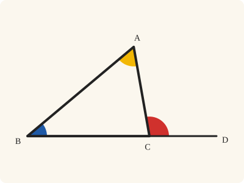
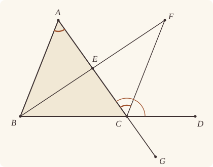
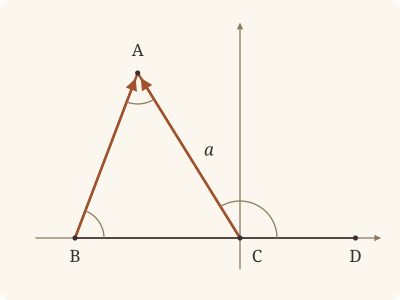

<!-- Generated by scripts/render.py. Do not edit by hand. -->

[Book I](index.md) · [← I.15](15.md) · [I.17 →](17.md)

# Book I, Proposition 16

*The exterior angle is greater than either opposite angle*

[Euclid's proof](#euclids-proof) · [In Lean](#in-lean) · [What it rests on](#what-it-rests-on) · [Mishnah](#mishnah)

> In any triangle, if one of the sides be produced, the exterior angle is greater than either of the interior and opposite angles.

**In Lean:** ✅ proved, as Euclid states it · Euclid's argument

<p align="center"></p>

<p align="center"><em>Produce one side of a triangle: the exterior angle (red) is greater than either of the interior and opposite angles (yellow and blue).</em></p>

## Euclid's proof

<p align="center"></p>

Let ABC be a triangle, and let one side of it BC be produced to D;

I say that the exterior angle ACD is greater than either of the interior and opposite angles CBA, BAC.

Let AC be bisected at E [I. 10], and let BE be joined and produced in a straight line to F;

let EF be made equal to BE [I. 3], let FC be joined [Post. 1], and let AC be drawn through to G [Post. 2].

Then, since AE is equal to EC, and BE to EF,

the two sides AE, EB are equal to the two sides CE, EF respectively;

and the angle AEB is equal to the angle FEC,

for they are vertical angles. [I. 15]

Therefore the base AB is equal to the base FC,

and the triangle ABE is equal to the triangle CFE,

and the remaining angles are equal to the remaining angles respectively, namely those which the equal sides subtend; [I. 4]

therefore the angle BAE is equal to the angle ECF.

But the angle ECD is greater than the angle ECF; [C.N. 5]

therefore the angle ACD is greater than the angle BAE.

Similarly also, if BC be bisected, the angle BCG, that is, the angle ACD [I. 15], can be proved greater than the angle ABC as well.

Therefore etc.

Q. E. D.

## In Lean

| | |
|---|---|
| Proof | ✅ Proved |
| Statement | The whole enunciation. |
| Argument | Euclid's. |
| Reviewed | The statement and every passage of the argument read against Heath's text, at commit [`ece9c2d71`](https://github.com/jackChallis/stoicheia/commit/ece9c2d71) ([the record](../../review/I/16.toml)) |

From [`Elements/BookI/Prop16.lean`](../../Elements/BookI/Prop16.lean). Euclid's sentences are the `--` comments, and our own notes are in `/- … -/`; the lines under each sentence are the Lean that carries it out. The list below marks where a lemma does a step Euclid takes for granted, where several sentences share one step and where a step needs a word of its own; the `/- … -/` notes in the listing explain smaller adjustments.

**How the Lean follows the text**

- **Done by `produce_longer`.** "Let AC be bisected at E…" Euclid bisects AC and produces BE; the Lean uses I.10 for E and `produce_longer` to extend BE beyond E far enough for I.3 to cut off EF.
- **Done by `between_cut`.** "let EF be made equal to BE…" Euclid cuts off EF equal to BE and joins FC, then produces AC to G. After I.3 chooses F, `between_cut` proves that E lies between B and F; Postulates 1 and 2 make the join and the production.
- **Carried.** "Therefore the base AB is equal to the base FC…" The Lean proves that the base AB equals FC here, as Euclid states it; the argument goes on by the angles, and does not use it again.
- **Carried.** "and the triangle ABE is equal to the triangle CFE…" The equal triangles ABE and CFE are proved here too, as Euclid states them, and are not needed after.
- **Carried.** "and the remaining angles are equal to the remaining angles respectively…" The Lean states one pair here, the angles EBA and EFC; the next step takes the other pair, BAE and ECF, from I.4 directly, and EBA and EFC are not used again.
- **Done by `Prop16.within`.** "But the angle ECD is greater than the angle ECF…" Euclid treats ECF as part of ECD; `Prop16.within` puts F on D's side of AC and E's side of BC. The Lean then uses `angle_add_of_within` and `Triangle.angle_pos` to apply Common Notion 5.
- **Carried together.** "Similarly also, if BC be bisected…" Euclid leaves the argument for the other interior angle to the reader, with BC bisected. The Lean proves his argument once over any letters and applies it again to the triangle BAC with AC produced to G, then uses I.15 to identify BCG with ACD.

<details><summary>Before the theorem, one lemma: <code>Prop16.within</code> (34 lines)</summary>

```lean
/-! ## What Euclid reads off the figure -/

/-- What Euclid sees in his figure: F lies within the angle ECD, on D's side of AC
and on E's side of BC (System E, Pasch 2 and 3, Same side 5). -/
theorem Prop16.within {A B C D E F : Point} (hABC : Triangle A B C) (hBCD : Between B C D)
    (hAEC : Between A E C) (hBEF : Between B E F) :
    SameSideOf F D C E ∧ SameSideOf F E C D := by
  obtain ⟨AC, hA_AC, hC_AC⟩ := Postulate1 A C hABC.ne₁₃
  obtain ⟨BC, hB_BC, hC_BC⟩ := Postulate1 B C hABC.ne₂₃
  obtain ⟨BE, hB_BE, hE_BE⟩ := Postulate1 B E (ne_of_between hBEF)
  have hE_AC : OnLine E AC := on_line_of_between_ends hAEC hA_AC hC_AC
  have hD_BC : OnLine D BC := on_line_of_between hBCD hB_BC hC_BC
  have hF_BE : OnLine F BE := on_line_of_between hBEF hB_BE hE_BE
  have hE_C : E ≠ C := (ne_of_between (between_symm hAEC)).symm
  have hC_D : C ≠ D := (ne_of_between (between_symm hBCD)).symm
  have hE_F : E ≠ F := (ne_of_between (between_symm hBEF)).symm
  /- First we say which points lie off which straight lines: B and A, because ABC
     is a triangle, and E, D and F from them. -/
  have hB_AC : ¬ OnLine B AC := hABC.acb.off_line hA_AC hC_AC
  have hA_BC : ¬ OnLine A BC := hABC.bca.off_line hB_BC hC_BC
  have hE_BC : ¬ OnLine E BC := fun h =>
    hA_BC ((line_unique hE_C hE_AC hC_AC h hC_BC) ▸ hA_AC)
  have hD_AC : ¬ OnLine D AC := fun h =>
    hB_AC ((line_unique hC_D hC_BC hD_BC hC_AC h) ▸ hB_BC)
  have hF_AC : ¬ OnLine F AC := fun h =>
    hB_AC ((line_unique hE_F hE_BE hF_BE hE_AC h) ▸ hB_BE)
  /- AC separates B from F, and B from D; so F and D are on one side. -/
  have hFD : SameSide F D AC :=
    same_side_of_opposite_sides ⟨hB_AC, hF_AC, pasch3 hBEF hE_AC⟩
      ⟨hB_AC, hD_AC, pasch3 hBCD hC_AC⟩
  /- E and F are on one side of BC. -/
  have hEF : SameSide E F BC := pasch2 hBEF hB_BC hE_BC
  exact ⟨SameSideOf.of_line hE_C.symm hC_AC hE_AC hFD,
    SameSideOf.of_line hC_D hC_BC hD_BC (same_side_symm hEF)⟩
```

</details>

```lean
/-- In any triangle, if one of the sides be produced, the exterior angle is greater than either of
the interior and opposite angles. -/
theorem Prop16 {A B C D : Point} (hABC : Triangle A B C) (hBCD : Between B C D) :
    ∠ C B A < ∠ A C D ∧ ∠ B A C < ∠ A C D := by
  -- Let ABC be a triangle, and let one side of it BC be produced to D;
  -- I say that the exterior angle ACD is greater than either of the interior and opposite
  -- angles CBA, BAC.
  /- Euclid proves the angle BAC less, and then says "similarly" for CBA. So we give
     his argument for every triangle with a side produced, in his letters, and use it
     twice below. It also hands back the point G on AC produced, which the "similarly"
     needs. -/
  have greater : ∀ {A B C D : Point}, Triangle A B C → Between B C D →
      ∃ G : Point, Between A C G ∧ ∠ B A C < ∠ A C D := by
    intro A B C D hABC hBCD
    have hA_C : A ≠ C := hABC.ne₁₃
    have hB_A : B ≠ A := hABC.ne₁₂.symm
    have hD_C : D ≠ C := ne_of_between (between_symm hBCD)
    obtain ⟨AC, hA_AC, hC_AC⟩ := Postulate1 A C hA_C
    have hB_AC : ¬ OnLine B AC := hABC.acb.off_line hA_AC hC_AC
    -- Let AC be bisected at E [I. 10], and let BE be joined and produced in a straight line to
    -- F;
    obtain ⟨E, hAEC, hAE_EC⟩ := Prop10 hA_C
    have hE_AC : OnLine E AC := on_line_of_between_ends hAEC hA_AC hC_AC
    have hB_E : B ≠ E := fun h => hB_AC (h ▸ hE_AC)
    obtain ⟨BE, hB_BE, hE_BE⟩ := Postulate1 B E hB_E
    /- Produced beyond E to a point X, far enough for I.3 to cut EF off from EX
       (`produce_longer`, as in I.11). -/
    obtain ⟨X, hBEX, hEB_EX⟩ := produce_longer hB_E hB_E.symm
    -- let EF be made equal to BE [I. 3], let FC be joined [Post. 1], and let AC be drawn through
    -- to G [Post. 2].
    obtain ⟨F, hEFX, hEF_BE⟩ :=
      Prop3 (A := E) (B := X) hB_E (by rw [len_symm B E]; exact hEB_EX)
    /- F lies between E and X, so E lies between B and F: BE produced reaches F
       (`between_cut`). -/
    have hBEF : Between B E F := between_cut hBEX hEFX
    have hF_BE : OnLine F BE := on_line_of_between hBEF hB_BE hE_BE
    have hE_F : E ≠ F := (ne_of_between (between_symm hBEF)).symm
    have hF_AC : ¬ OnLine F AC := fun h =>
      hB_AC ((line_unique hE_F hE_BE hF_BE hE_AC h) ▸ hB_BE)
    have hF_C : F ≠ C := fun h => hF_AC (h ▸ hC_AC)
    obtain ⟨FC, hF_FC, hC_FC⟩ := Postulate1 F C hF_C
    obtain ⟨G, -, hACG, -⟩ := Postulate2 hA_AC hC_AC hA_C []
    -- Then, since AE is equal to EC, and BE to EF,
    have hBE_EF : ‖B E‖ = ‖E F‖ := hEF_BE.symm
    -- the two sides AE, EB are equal to the two sides CE, EF respectively;
    have hEA_EC : ‖E A‖ = ‖E C‖ := (len_symm E A).trans hAE_EC
    have hEB_EF : ‖E B‖ = ‖E F‖ := (len_symm E B).trans hBE_EF
    -- and the angle AEB is equal to the angle FEC,
    -- for they are vertical angles. [I. 15]
    /- AC and BF cut one another at E, and B is off AC. -/
    have hAEB_FEC : ∠ A E B = ∠ F E C := (Prop15 hAEC hBEF hABC.acb).1
    -- Therefore the base AB is equal to the base FC,
    /- I.4, applied to the triangles EAB and ECF: E and A, and E and C, lie on AC,
       with B and F off it. -/
    have hE_A : E ≠ A := (ne_of_between hAEC).symm
    have hE_C : E ≠ C := (ne_of_between (between_symm hAEC)).symm
    have hEAB : Triangle E A B := Triangle.of_line hE_AC hA_AC hE_A hB_AC
    have hECF : Triangle E C F := Triangle.of_line hE_AC hC_AC hE_C hF_AC
    have hAEB_CEF : ∠ A E B = ∠ C E F := hAEB_FEC.trans (angle_symm hE_F.symm hE_C.symm)
    obtain ⟨hAB_CF, hEAB_ECF, hEAB_ECF', hEBA_EFC⟩ := Prop4 hEAB hECF hEA_EC hEB_EF hAEB_CEF
    have hAB_FC : ‖A B‖ = ‖F C‖ := hAB_CF.trans (len_symm C F)
    -- and the triangle ABE is equal to the triangle CFE,
    have : △ A B E = △ C F E := by
      rw [area_rotate A B E, area_rotate C F E]
      exact hEAB_ECF
    -- and the remaining angles are equal to the remaining angles respectively, namely those
    -- which the equal sides subtend; [I. 4]
    have : ∠ E B A = ∠ E F C := hEBA_EFC
    -- therefore the angle BAE is equal to the angle ECF.
    have hBAE_ECF : ∠ B A E = ∠ E C F := (angle_symm hB_A hE_A).trans hEAB_ECF'
    -- But the angle ECD is greater than the angle ECF; [C.N. 5]
    /- Heath's figure shows F within the angle ECD (`Prop16.within`), so that the
       angle ECD is made up of the angles ECF and FCD (`angle_add_of_within`), and
       FCD, an angle of the triangle FCD, is something (`Triangle.angle_pos`). The
       whole is greater than the part. -/
    obtain ⟨hFD, hFE⟩ := Prop16.within hABC hBCD hAEC hBEF
    have hECF_ECD : ∠ E C F < ∠ E C D := by
      rw [angle_add_of_within hFD hFE]
      exact CommonNotion5 hFE.triangle.cab.angle_pos
    -- therefore the angle ACD is greater than the angle BAE.
    /- The angle ECD is the angle ACD, since E lies on the ray from C through A
       (`angle_onRay_left`). -/
    have hBAE_ACD : ∠ B A E < ∠ A C D := by
      rw [hBAE_ECF, ← angle_onRay_left (OnRay.of_between (between_symm hAEC)) hD_C]
      exact hECF_ECD
    /- And the angle BAE is the angle BAC, since E lies on the ray from A through C. -/
    have hBAE_BAC : ∠ B A E = ∠ B A C := angle_onRay_right (OnRay.of_between hAEC) hB_A
    exact ⟨G, hACG, hBAE_BAC ▸ hBAE_ACD⟩
  /- Euclid's argument, in his own figure: the angle ACD is greater than the angle BAC,
     and AC is drawn through to G. -/
  obtain ⟨G, hACG, hBAC_ACD⟩ := greater hABC hBCD
  -- Similarly also, if BC be bisected, the angle BCG, that is, the angle ACD [I. 15], can be
  -- proved greater than the angle ABC as well.
  /- The same argument for the triangle BAC, with AC produced to G: now BC is bisected,
     and the exterior angle is BCG. -/
  obtain ⟨-, -, hABC_BCG⟩ := greater hABC.bac hACG
  /- AG and BD cut one another at C, and B is off AG: the vertical angles BCG and
     ACD are equal. [I. 15] -/
  obtain ⟨AC, hA_AC, hC_AC⟩ := Postulate1 A C hABC.ne₁₃
  have hAGB : Triangle A G B :=
    Triangle.of_line hA_AC (on_line_of_between hACG hA_AC hC_AC) (ne_of_between_ends hACG)
      (hABC.acb.off_line hA_AC hC_AC)
  have hBCG_ACD : ∠ B C G = ∠ A C D := (Prop15 hACG hBCD hAGB).2
  have hCBA_ACD : ∠ C B A < ∠ A C D := by
    rw [angle_symm hABC.ne₂₃.symm hABC.ne₁₂, ← hBCG_ACD]
    exact hABC_BCG
  -- Therefore etc.
  exact ⟨hCBA_ACD, hBAC_ACD⟩
  -- Q. E. D.
```

## What it rests on

| | |
|---|---|
| Heath's references | [I.3](03.md), [I.4](04.md), [I.10](10.md), [I.15](15.md); Post. 1, 2; C.N. 5 |
| Lean cites | [I.3](03.md), [I.4](04.md), [I.10](10.md), [I.15](15.md) |
| Postulates | 1, 2, 3, 4 |
| Definitions taken as axioms | Def. I.15 |
| Common Notions | 1, 2, 3, 4, 5 |
| Tacit rules | 37 (listed below) |
| Its own Lean calls | Postulates 1 and 2; 6 tacit rules |
| Through lemmas | Postulate 3; Def. I.15; 25 tacit rules |

_Postulates, definitions, Common Notions and tacit rules: all that this proof rests on, counting those of the propositions it cites. The last two rows say which of the postulates, definitions and tacit rules its own Lean calls, in the proof or a helper written for it, and which it does not call but reaches through lemmas, of Book Zero or shared (a proposition it cites may rest on these too); the rest come in only through the propositions it cites or the Common Notions._

<details><summary>The 37 tacit rules beneath this proof, counting those of the propositions it cites</summary>

_(used here) marks a rule this proof's own Lean calls, in the proof or a helper written for it; (through …) marks one its own Lean does not call but reaches through the lemmas named, of [Book Zero](../../Elements/Figure) or shared, though a proposition it cites may rest on it too; and a rule with no mark comes in only through a proposition it cites or a Common Notion. The names in brackets are System E's: an Intersection rule says when straight lines and circles must meet, and an Intersections rule takes a point where they do (see [Book I's introduction](index.md))._

**Reading the figure**

- [`between_cases`](../../Elements/Foundations/Tacit/Diagram.lean#L54) (through [`between_cut`](../../Elements/Figure/Lines.lean#L65), [`produce_longer`](../../Elements/Figure/Lines.lean#L82) and [`same_side_of_opposite_sides`](../../Elements/Figure/Sides.lean#L113)): Of three different points on a straight line, one is between the other two. (Between 6)
- [`between_symm`](../../Elements/Foundations/Tacit/Diagram.lean#L47) (used here): If B is between A and C, it is between C and A. (Between 1)
- [`circles_meet`](../../Elements/Foundations/Tacit/Diagram.lean#L91) (through [`OnRay.of_between`](../../Elements/Figure/Rays.lean#L34), [`Tacit.on_line_of_between`](../../Elements/Figure/Incidence.lean#L78), [`Tacit.on_line_of_between_ends`](../../Elements/Figure/RuleBase.lean#L153) and 6 other lemmas): If each circle passes through a point inside the other, the circles cut one another. This is the step Euclid takes for granted in I.1. (Intersection 5)
- [`circles_meet_same_side`](../../Elements/Foundations/Tacit/Constructions.lean#L79) (through [`OnRay.of_between`](../../Elements/Figure/Rays.lean#L34), [`Tacit.on_line_of_between`](../../Elements/Figure/Incidence.lean#L78), [`Tacit.on_line_of_between_ends`](../../Elements/Figure/RuleBase.lean#L153) and 6 other lemmas): Two circles that cut one another do so on each side of the straight line through their centres. (Intersections 8)
- [`exists_point`](../../Elements/Foundations/Tacit/Constructions.lean#L35) (through [`Triangle.angle_pos`](../../Elements/Figure/Angles.lean#L58), [`Triangle.ne₁₂`](../../Elements/Figure/Triangles.lean#L22), [`Triangle.ne₁₃`](../../Elements/Figure/Triangles.lean#L36) and 1 other lemma): Let a point be taken. (Points 1)
- [`exists_point_inside_circle`](../../Elements/Foundations/Tacit/Constructions.lean#L42) (through [`OnRay.of_between`](../../Elements/Figure/Rays.lean#L34), [`Tacit.on_line_of_between`](../../Elements/Figure/Incidence.lean#L78), [`Tacit.on_line_of_between_ends`](../../Elements/Figure/RuleBase.lean#L153) and 6 other lemmas): Let a point be taken inside the circle α. (Points 8)
- [`exists_point_on_line`](../../Elements/Foundations/Tacit/Constructions.lean#L38) (through [`OnRay.of_between`](../../Elements/Figure/Rays.lean#L34), [`Tacit.on_line_of_between`](../../Elements/Figure/Incidence.lean#L78), [`Tacit.on_line_of_between_ends`](../../Elements/Figure/RuleBase.lean#L153) and 6 other lemmas): Let a point be taken on the straight line L. (Points 2)
- [`line_circle_between`](../../Elements/Foundations/Tacit/Constructions.lean#L67) (through [`OnRay.of_between`](../../Elements/Figure/Rays.lean#L34), [`Tacit.on_line_of_between`](../../Elements/Figure/Incidence.lean#L78), [`Tacit.on_line_of_between_ends`](../../Elements/Figure/RuleBase.lean#L153) and 6 other lemmas): A straight line through a point B inside a circle, heading out to a point C outside it, cuts the circle between B and C. (Intersections 4)
- [`line_circle_beyond`](../../Elements/Foundations/Tacit/Constructions.lean#L73) (through [`OnRay.of_between`](../../Elements/Figure/Rays.lean#L34), [`Tacit.on_line_of_between`](../../Elements/Figure/Incidence.lean#L78), [`Tacit.on_line_of_between_ends`](../../Elements/Figure/RuleBase.lean#L153) and 6 other lemmas): A straight line through a point B inside a circle, produced beyond B away from C, cuts the circle there. (Intersections 5)
- [`line_unique`](../../Elements/Foundations/Tacit/Diagram.lean#L41) (used here): Two points determine a straight line. (Generalities 1)
- [`lines_meet_of_opposite_sides`](../../Elements/Foundations/Tacit/Diagram.lean#L86) (through [`same_side_of_opposite_sides`](../../Elements/Figure/Sides.lean#L113)): A straight line joining points on opposite sides of L crosses L. (Intersection 1)
- [`not_between_of_between`](../../Elements/Foundations/Tacit/Diagram.lean#L50) (through [`OnRay.of_between`](../../Elements/Figure/Rays.lean#L34), [`Tacit.ne_of_between`](../../Elements/Figure/RuleBase.lean#L146), [`Tacit.ne_of_between_ends`](../../Elements/Figure/Incidence.lean#L66) and 10 other lemmas): If B is between A and C, then A is not between B and C. (Between 1)
- [`not_on_line_of_same_side`](../../Elements/Foundations/Tacit/Diagram.lean#L60) (through [`OnRay.of_between`](../../Elements/Figure/Rays.lean#L34), [`SameSideOf.triangle`](../../Elements/Figure/Sides.lean#L61), [`Tacit.on_line_of_between`](../../Elements/Figure/Incidence.lean#L78) and 7 other lemmas): Points on one side of a straight line are not on it. (Same side 3)
- [`pasch2`](../../Elements/Foundations/Tacit/Diagram.lean#L71) (used here): If B is between A and C, A is on L and B is off it, then B and C are on the same side of L: a straight line that leaves L at A does not cross it again. (Pasch 2)
- [`same_side_trans`](../../Elements/Foundations/Tacit/Diagram.lean#L64) (through [`OnRay.of_between`](../../Elements/Figure/Rays.lean#L34), [`Tacit.on_line_of_between`](../../Elements/Figure/Incidence.lean#L78), [`Tacit.on_line_of_between_ends`](../../Elements/Figure/RuleBase.lean#L153) and 6 other lemmas): Two points on the same side of a straight line as a third point are on the same side as each other. (Same side 4)

**Lengths, angles and areas**

- [`angle_add_of_inside`](../../Elements/Foundations/Tacit/Transfer.lean#L47) (through [`Tacit.pasch3`](../../Elements/Figure/RuleBase.lean#L225), [`angle_add_of_within`](../../Elements/Figure/Angles.lean#L70) and [`same_side_of_opposite_sides`](../../Elements/Figure/Sides.lean#L113)): If D lies within the angle BAC, then BAC is made up of BAD and DAC. (Diagram-angle 2)
- [`angle_eq_of_same_rays`](../../Elements/Foundations/Tacit/Transfer.lean#L54) (through [`angle_onRay_left`](../../Elements/Figure/Angles.lean#L42) and [`angle_onRay_right`](../../Elements/Figure/Angles.lean#L49)): The angle doesn't change if its arms are traced through other points on the same rays. (Diagram-angle 4)
- [`angle_symm`](../../Elements/Foundations/Tacit/Metric.lean#L30) (used here): The angle ABC is the angle CBA. (Metric 4)
- [`area_add_of_between`](../../Elements/Foundations/Tacit/Transfer.lean#L70): Cutting a triangle in two from a vertex adds up. (Diagram-area 2)
- [`area_congruent`](../../Elements/Foundations/Tacit/Metric.lean#L44): Triangles equal in all their sides and angles are equal in area. Euclid uses this without comment once he has shown two triangles congruent. (Metric 9)
- [`area_degenerate`](../../Elements/Foundations/Tacit/Metric.lean#L36): A "triangle" with a repeated corner has no area. (Metric 6)
- [`area_eq_zero_of_on_line`](../../Elements/Foundations/Tacit/Transfer.lean#L62): A "triangle" whose corners lie on one straight line has no area. (Diagram-area 1)
- [`area_rotate`](../../Elements/Foundations/Tacit/Metric.lean#L39) (used here): The triangle ABC is the triangle CAB. (Metric 8)
- [`len_add_of_between`](../../Elements/Foundations/Tacit/Transfer.lean#L27) (through [`OnRay.of_between`](../../Elements/Figure/Rays.lean#L34), [`Tacit.ne_of_between_ends`](../../Elements/Figure/Incidence.lean#L66), [`Tacit.on_line_of_between`](../../Elements/Figure/Incidence.lean#L78) and 9 other lemmas): If B is between A and C, then AB and BC together make up AC. (Diagram-segment 1)
- [`len_self`](../../Elements/Foundations/Tacit/Metric.lean#L24) (through [`OnRay.of_between`](../../Elements/Figure/Rays.lean#L34), [`Tacit.ne_of_between_ends`](../../Elements/Figure/Incidence.lean#L66), [`Tacit.on_line_of_between`](../../Elements/Figure/Incidence.lean#L78) and 9 other lemmas): The "straight line" from a point to itself has no length. (Metric 1)
- [`len_symm`](../../Elements/Foundations/Tacit/Metric.lean#L27) (used here): The straight line AB is the straight line BA. (Metric 3)
- [`radius_ne_zero`](../../Elements/Foundations/Tacit/Metric.lean#L62) (through [`OnRay.of_between`](../../Elements/Figure/Rays.lean#L34), [`Tacit.ne_of_between_ends`](../../Elements/Figure/Incidence.lean#L66), [`Tacit.on_line_of_between`](../../Elements/Figure/Incidence.lean#L78) and 9 other lemmas): A circle's radius is not nothing: the straight line from the centre to a point on the circle has some length. A rule of our own, not one of System E's: every circle is drawn with a centre and a distance (Postulate 3).
- [`same_ray_of_angle_eq_zero`](../../Elements/Foundations/Tacit/Transfer.lean#L42) (through [`Tacit.pasch3`](../../Elements/Figure/RuleBase.lean#L225), [`Triangle.angle_pos`](../../Elements/Figure/Angles.lean#L58) and [`same_side_of_opposite_sides`](../../Elements/Figure/Sides.lean#L113)): If the angle BAC is nothing, C lies on the ray from A through B. (Diagram-angle 1)

**Superposition**

- [`superposition`](../../Elements/Foundations/Tacit/Superposition.lean#L52): **Superposition.** A hypothetical placement of a triangle on a given ray and side permits a restricted derivation of metric equalities about the figure already given. The derivation introduces no further objects, cites each geometric law it uses, and exports no symbol of the placement.

**Laws of magnitude**

- [`add_assoc`](../../Elements/Foundations/Tacit/Magnitudes.lean#L23) (through [`between_cut`](../../Elements/Figure/Lines.lean#L65) and [`produce_longer`](../../Elements/Figure/Lines.lean#L82)): Adding three magnitudes in a row, it makes no difference whether the first two or the last two are added first. (System E §3.5)
- [`add_comm`](../../Elements/Foundations/Tacit/Magnitudes.lean#L26) (through [`OnRay.of_between`](../../Elements/Figure/Rays.lean#L34), [`Tacit.ne_of_between_ends`](../../Elements/Figure/Incidence.lean#L66), [`Tacit.on_line_of_between`](../../Elements/Figure/Incidence.lean#L78) and 9 other lemmas): The order of adding does not matter. (System E §3.5)
- [`add_lt_add_right`](../../Elements/Foundations/Tacit/Magnitudes.lean#L45) (through [`between_cut`](../../Elements/Figure/Lines.lean#L65), [`produce_longer`](../../Elements/Figure/Lines.lean#L82) and [`same_side_of_opposite_sides`](../../Elements/Figure/Sides.lean#L113)): Adding the same thing to both sides keeps "less than". (System E §3.5)
- [`add_zero`](../../Elements/Foundations/Tacit/Magnitudes.lean#L29): Adding nothing changes nothing. (System E §3.5)
- [`lt_irrefl`](../../Elements/Foundations/Tacit/Magnitudes.lean#L32) (through [`OnRay.of_between`](../../Elements/Figure/Rays.lean#L34), [`Tacit.on_line_of_between`](../../Elements/Figure/Incidence.lean#L78), [`Tacit.on_line_of_between_ends`](../../Elements/Figure/RuleBase.lean#L153) and 6 other lemmas): No magnitude is less than itself. (System E §3.5)
- [`lt_trans`](../../Elements/Foundations/Tacit/Magnitudes.lean#L35) (through [`OnRay.of_between`](../../Elements/Figure/Rays.lean#L34), [`Tacit.on_line_of_between`](../../Elements/Figure/Incidence.lean#L78), [`Tacit.on_line_of_between_ends`](../../Elements/Figure/RuleBase.lean#L153) and 6 other lemmas): What is less than the less is less still. (System E §3.5)
- [`lt_trichotomy`](../../Elements/Foundations/Tacit/Magnitudes.lean#L39) (through [`OnRay.of_between`](../../Elements/Figure/Rays.lean#L34), [`Tacit.ne_of_between_ends`](../../Elements/Figure/Incidence.lean#L66), [`Tacit.on_line_of_between`](../../Elements/Figure/Incidence.lean#L78) and 10 other lemmas): Of two magnitudes, one is less, or they are equal, or the other is less. (System E §3.5)
- [`not_lt_zero`](../../Elements/Foundations/Tacit/Magnitudes.lean#L42) (through [`OnRay.of_between`](../../Elements/Figure/Rays.lean#L34), [`Tacit.ne_of_between_ends`](../../Elements/Figure/Incidence.lean#L66), [`Tacit.on_line_of_between`](../../Elements/Figure/Incidence.lean#L78) and 10 other lemmas): Nothing is less than zero. (System E §3.5)

</details>

## Mishnah

_Our commentary: what Euclid assumes, what Lean made us say out loud, and how the result looks by modern means._

I.17, I.18 and I.21 lean on I.16, and I.27 draws its parallels with it. Its proof rests on one step that only the figure supports: "the angle ECD is greater than the angle ECF", by Common Notion 5, the whole greater than the part. For that, Heath says, "it is necessary that CF should always fall within the angle ACD" (vol. 1, p. 280). It need not: "As is well known, this proposition is not universally true under the Riemann hypothesis of a space endless in extent but not infinite in size. On this hypothesis a straight line is a 'closed series' and returns on itself; and two straight lines which have one point of intersection have another point of intersection also" (Heath, vol. 1, p. 280). In that sphere-like geometry, met under [I.12](12.md), a long enough BE brings F round onto CD, making the exterior angle equal to the interior one, and a longer BE carries F past, making it less.

In the plane, the rules of order and sides keep F inside, the very rules that a space whose straight lines return on themselves must give up, and we prove where F falls with them (`Prop16.within`). AC separates B from F, since E lies between them, and B from D, since C does; a straight line has only two sides, so F lies on D's side of AC. And BF, setting out from B on BC, passes through E, off BC, before it reaches F, so F lies on E's side of BC.

Proclus puts the proposition to work at once: "The present proposition enables Proclus to prove what he did not succeed in establishing conclusively in his note on I. 12, namely that *from one point there cannot be drawn to the same straight line three straight lines equal in length*" (Heath, vol. 1, p. 280). Were there three, I.5 in the two isosceles triangles they make would give a triangle an exterior angle equal to an interior and opposite one.

**The modern way.** Put $\mathrm{C} = 0$ and $\mathrm{B} = -1$ in the complex plane, with A at $a$ above them, so that D lies along the positive real axis. The exterior angle ACD is $\arg a$. Then $\overrightarrow{\mathrm{BA}} = a + 1$, and the angles at B and A are $\arg(a + 1)$ and $\arg(a/(a + 1))$, all three between $0$ and $\pi$. Since $a = (a + 1) \frac{a}{a + 1}$, the first is the sum of the other two. That is I.32, which is not Euclid's route here and does not hold in the hyperbolic plane, where the parallel postulate fails; I.16 is the part of it that holds there too.

<p align="center"></p>

## Further reading

- Arguments add when complex numbers multiply, and the sphere, where I.16 fails, is drawn as vividly as the plane: both are in Tristan Needham's [*Visual Complex Analysis*](https://doi.org/10.1093/oso/9780192868916.001.0001) (2023), ch. 1, "Geometry and Complex Arithmetic", and ch. 6, "Non-Euclidean Geometry" (also on [I.1](01.md)).
- In the geometry that stands without the parallel postulate, I.16 is known as the exterior angle theorem, and ch. 4, "Neutral Geometry", of Marvin Jay Greenberg's [*Euclidean and Non-Euclidean Geometries*](https://store.macmillanlearning.com/us/product/Euclidean-and-Non-Euclidean-Geometries/p/0716799480) (2008) shows what Euclid can prove without the fifth postulate (also on [I.10](10.md)).

[Book I](index.md) · [← I.15](15.md) · [I.17 →](17.md)

---

<sub>Euclid's text: T. L. Heath, *The Thirteen Books of Euclid's Elements*, vol. 1 (Cambridge, 1908), pp. 279–280; [scan leaves n299–n300](https://archive.org/details/thirteenbookseu02heibgoog/page/n299); [figure on n299](https://archive.org/details/thirteenbookseu02heibgoog/page/n299). Public domain.</sub>

<sub>The tacit rules follow the System E of Jeremy Avigad, Edward Dean and John Mumma, read alongside LeanEuclid (Logan Murphy, Kaiyu Yang, Jialiang Sun, Zhaoyu Li, Anima Anandkumar and Xujie Si).</sub>
