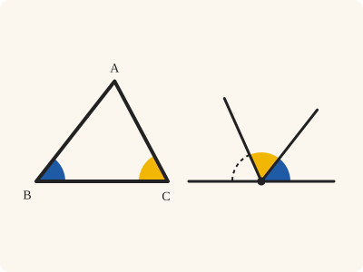
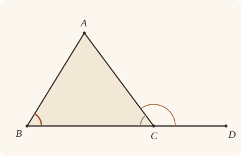

<!-- Generated by scripts/render.py. Do not edit by hand. -->

[Book I](index.md) · [← I.16](16.md) · [I.18 →](18.md)

# Book I, Proposition 17

*Two angles of a triangle are less than two right angles*

[Euclid's proof](#euclids-proof) · [In Lean](#in-lean) · [What it rests on](#what-it-rests-on) · [Mishnah](#mishnah)

> In any triangle two angles taken together in any manner are less than two right angles.

**In Lean:** ✅ proved, as Euclid states it · Euclid's argument

<p align="center"></p>

<p align="center"><em>Put any two angles of a triangle side by side (blue and yellow), and they always fall short of a straight line, which makes two right angles.</em></p>

## Euclid's proof

<p align="center"></p>

<p align="center"><em>Drawn for one case: the angles ABC, BCA, with BC produced to D, as in Heath's figure.</em></p>

Let ABC be a triangle;

I say that two angles of the triangle ABC taken together in any manner are less than two right angles.

For let BC be produced to D. [Post. 2]

Then, since the angle ACD is an exterior angle of the triangle ABC,

it is greater than the interior and opposite angle ABC. [I. 16]

Let the angle ACB be added to each;

therefore the angles ACD, ACB are greater than the angles ABC, BCA.

But the angles ACD, ACB are equal to two right angles. [I. 13]

Therefore the angles ABC, BCA are less than two right angles.

Similarly we can prove that the angles BAC, ACB are also less than two right angles, and so are the angles CAB, ABC as well.

Therefore etc.

Q. E. D.

## In Lean

| | |
|---|---|
| Proof | ✅ Proved |
| Statement | The whole enunciation. All three pairs of angles are named, as Euclid's "taken together in any manner" asks. |
| Argument | Euclid's. |
| Reviewed | The statement and every passage of the argument read against Heath's text, at commit [`b7b41f51`](https://github.com/jackChallis/stoicheia/commit/b7b41f51) ([the record](../../review/I/17.toml)) |

From [`Elements/BookI/Prop17.lean`](../../Elements/BookI/Prop17.lean). Euclid's sentences are the `--` comments, and our own notes are in `/- … -/`; the lines under each sentence are the Lean that carries it out. The list below marks where a lemma does a step Euclid takes for granted and where several sentences share one step; the `/- … -/` notes in the listing explain smaller adjustments.

**How the Lean follows the text**

- **Done by `Tacit.add_lt_add_right`.** "Let the angle ACB be added to each…" Euclid adds the same angle to a greater and a less, keeping their order. The Lean uses `Tacit.add_lt_add_right`, a tacit rule of magnitude, which we assume (System E §3.5).
- **Carried together.** "Similarly we can prove that the angles BAC, ACB…" Euclid leaves the argument for the other two pairs to the reader. The Lean proves his argument once over any letters, with BC produced in ABC, and applies it again to the triangles BAC and CAB, producing AC and AB respectively.

```lean
/-- In any triangle two angles taken together in any manner are less than two right angles. -/
theorem Prop17 {A B C : Point} (hABC : Triangle A B C) :
    ∠ A B C + ∠ B C A < ∟ + ∟ ∧ ∠ B A C + ∠ A C B < ∟ + ∟ ∧ ∠ C A B + ∠ A B C < ∟ + ∟ := by
  -- Let ABC be a triangle;
  -- I say that two angles of the triangle ABC taken together in any manner are less than two
  -- right angles.
  /- "In any manner": any two of the three angles, so three sums. Euclid's argument is
     for the angles ABC, BCA; we give it for every triangle, in his letters, and use
     it for each pair below. -/
  have less : ∀ {A B C : Point}, Triangle A B C → ∠ A B C + ∠ B C A < ∟ + ∟ := by
    intro A B C hABC
    have hA_B : A ≠ B := hABC.ne₁₂
    have hB_C : B ≠ C := hABC.ne₂₃
    have hA_C : A ≠ C := hABC.ne₁₃
    -- For let BC be produced to D. [Post. 2]
    obtain ⟨BC, hB_BC, hC_BC⟩ := Postulate1 B C hB_C
    obtain ⟨D, hD_BC, hBCD, -⟩ := Postulate2 hB_BC hC_BC hB_C []
    -- Then, since the angle ACD is an exterior angle of the triangle ABC,
    -- it is greater than the interior and opposite angle ABC. [I. 16]
    /- I.16 names the interior angle from C, as CBA; it is the angle ABC read the
       other way round (`angle_symm`). -/
    have hABC_ACD : ∠ A B C < ∠ A C D := by
      rw [angle_symm hA_B hB_C.symm]
      exact (Prop16 hABC hBCD).1
    -- Let the angle ACB be added to each;
    /- The same angle added to a greater and a less leaves the first sum greater: no
       Common Notion says so, but a tacit rule of magnitude does (`add_lt_add_right`,
       System E §3.5). -/
    have hadded : ∠ A B C + ∠ A C B < ∠ A C D + ∠ A C B := add_lt_add_right (∠ A C B) hABC_ACD
    -- therefore the angles ACD, ACB are greater than the angles ABC, BCA.
    /- The angle ACB, added to ABC, is the angle BCA read the other way round. -/
    have hgreater : ∠ A B C + ∠ B C A < ∠ A C D + ∠ A C B := by
      rw [angle_symm hB_C hA_C]
      exact hadded
    -- But the angles ACD, ACB are equal to two right angles. [I. 13]
    /- AC stands on BD, which is BC produced; A is off it, since ABC is a triangle
       (`Triangle.off_line`, `Triangle.of_line`). I.13 names the two angles BCA, ACD. -/
    have hA_BC : ¬ OnLine A BC := hABC.bca.off_line hB_BC hC_BC
    have hBDA : Triangle B D A := Triangle.of_line hB_BC hD_BC (ne_of_between_ends hBCD) hA_BC
    have htwo : ∠ A C D + ∠ A C B = ∟ + ∟ := by
      rw [add_comm (∠ A C D), angle_symm hA_C hB_C]
      exact Prop13 hBCD hBDA
    -- Therefore the angles ABC, BCA are less than two right angles.
    rw [← htwo]
    exact hgreater
  /- This is Euclid's own figure, with the angles ABC, BCA. -/
  have hABC_BCA : ∠ A B C + ∠ B C A < ∟ + ∟ := less hABC
  -- Similarly we can prove that the angles BAC, ACB are also less than two right angles, and
  -- so are the angles CAB, ABC as well.
  /- The same argument in the triangle BAC: AC is produced, and the exterior angle at C
     is greater than the angle BAC. And in the triangle CAB: AB is produced, and the
     exterior angle at B is greater than the angle CAB. -/
  have hBAC_ACB : ∠ B A C + ∠ A C B < ∟ + ∟ := less hABC.bac
  have hCAB_ABC : ∠ C A B + ∠ A B C < ∟ + ∟ := less hABC.cab
  -- Therefore etc.
  exact ⟨hABC_BCA, hBAC_ACB, hCAB_ABC⟩
  -- Q. E. D.
```

## What it rests on

| | |
|---|---|
| Heath's references | [I.13](13.md), [I.16](16.md); Post. 2 |
| Lean cites | [I.13](13.md), [I.16](16.md) |
| Postulates | 1, 2, 3, 4 |
| Definitions taken as axioms | Def. I.15 |
| Common Notions | 1, 2, 3, 4, 5 |
| Tacit rules | 37 (listed below) |
| Its own Lean calls | Postulates 1 and 2; 3 tacit rules |
| Through lemmas | Postulate 3; 8 tacit rules |

_Postulates, definitions, Common Notions and tacit rules: all that this proof rests on, counting those of the propositions it cites. The last two rows say which of the postulates, definitions and tacit rules its own Lean calls, in the proof or a helper written for it, and which it does not call but reaches through lemmas, of Book Zero or shared (a proposition it cites may rest on these too); the rest come in only through the propositions it cites or the Common Notions._

<details><summary>The 37 tacit rules beneath this proof, counting those of the propositions it cites</summary>

_(used here) marks a rule this proof's own Lean calls, in the proof or a helper written for it; (through …) marks one its own Lean does not call but reaches through the lemmas named, of [Book Zero](../../Elements/Figure) or shared, though a proposition it cites may rest on it too; and a rule with no mark comes in only through a proposition it cites or a Common Notion. The names in brackets are System E's: an Intersection rule says when straight lines and circles must meet, and an Intersections rule takes a point where they do (see [Book I's introduction](index.md))._

**Reading the figure**

- [`between_cases`](../../Elements/Foundations/Tacit/Diagram.lean#L54): Of three different points on a straight line, one is between the other two. (Between 6)
- [`between_symm`](../../Elements/Foundations/Tacit/Diagram.lean#L47): If B is between A and C, it is between C and A. (Between 1)
- [`circles_meet`](../../Elements/Foundations/Tacit/Diagram.lean#L91): If each circle passes through a point inside the other, the circles cut one another. This is the step Euclid takes for granted in I.1. (Intersection 5)
- [`circles_meet_same_side`](../../Elements/Foundations/Tacit/Constructions.lean#L79): Two circles that cut one another do so on each side of the straight line through their centres. (Intersections 8)
- [`exists_point`](../../Elements/Foundations/Tacit/Constructions.lean#L35) (through [`Triangle.ne₁₂`](../../Elements/Figure/Triangles.lean#L22), [`Triangle.ne₁₃`](../../Elements/Figure/Triangles.lean#L36) and [`Triangle.ne₂₃`](../../Elements/Figure/Triangles.lean#L29)): Let a point be taken. (Points 1)
- [`exists_point_inside_circle`](../../Elements/Foundations/Tacit/Constructions.lean#L42): Let a point be taken inside the circle α. (Points 8)
- [`exists_point_on_line`](../../Elements/Foundations/Tacit/Constructions.lean#L38): Let a point be taken on the straight line L. (Points 2)
- [`line_circle_between`](../../Elements/Foundations/Tacit/Constructions.lean#L67): A straight line through a point B inside a circle, heading out to a point C outside it, cuts the circle between B and C. (Intersections 4)
- [`line_circle_beyond`](../../Elements/Foundations/Tacit/Constructions.lean#L73): A straight line through a point B inside a circle, produced beyond B away from C, cuts the circle there. (Intersections 5)
- [`line_unique`](../../Elements/Foundations/Tacit/Diagram.lean#L41) (through [`Triangle.of_line`](../../Elements/Figure/Triangles.lean#L82)): Two points determine a straight line. (Generalities 1)
- [`lines_meet_of_opposite_sides`](../../Elements/Foundations/Tacit/Diagram.lean#L86): A straight line joining points on opposite sides of L crosses L. (Intersection 1)
- [`not_between_of_between`](../../Elements/Foundations/Tacit/Diagram.lean#L50) (through [`Tacit.ne_of_between_ends`](../../Elements/Figure/Incidence.lean#L66)): If B is between A and C, then A is not between B and C. (Between 1)
- [`not_on_line_of_same_side`](../../Elements/Foundations/Tacit/Diagram.lean#L60): Points on one side of a straight line are not on it. (Same side 3)
- [`pasch2`](../../Elements/Foundations/Tacit/Diagram.lean#L71): If B is between A and C, A is on L and B is off it, then B and C are on the same side of L: a straight line that leaves L at A does not cross it again. (Pasch 2)
- [`same_side_trans`](../../Elements/Foundations/Tacit/Diagram.lean#L64): Two points on the same side of a straight line as a third point are on the same side as each other. (Same side 4)

**Lengths, angles and areas**

- [`angle_add_of_inside`](../../Elements/Foundations/Tacit/Transfer.lean#L47): If D lies within the angle BAC, then BAC is made up of BAD and DAC. (Diagram-angle 2)
- [`angle_eq_of_same_rays`](../../Elements/Foundations/Tacit/Transfer.lean#L54): The angle doesn't change if its arms are traced through other points on the same rays. (Diagram-angle 4)
- [`angle_symm`](../../Elements/Foundations/Tacit/Metric.lean#L30) (used here): The angle ABC is the angle CBA. (Metric 4)
- [`area_add_of_between`](../../Elements/Foundations/Tacit/Transfer.lean#L70): Cutting a triangle in two from a vertex adds up. (Diagram-area 2)
- [`area_congruent`](../../Elements/Foundations/Tacit/Metric.lean#L44): Triangles equal in all their sides and angles are equal in area. Euclid uses this without comment once he has shown two triangles congruent. (Metric 9)
- [`area_degenerate`](../../Elements/Foundations/Tacit/Metric.lean#L36): A "triangle" with a repeated corner has no area. (Metric 6)
- [`area_eq_zero_of_on_line`](../../Elements/Foundations/Tacit/Transfer.lean#L62): A "triangle" whose corners lie on one straight line has no area. (Diagram-area 1)
- [`area_rotate`](../../Elements/Foundations/Tacit/Metric.lean#L39): The triangle ABC is the triangle CAB. (Metric 8)
- [`len_add_of_between`](../../Elements/Foundations/Tacit/Transfer.lean#L27) (through [`Tacit.ne_of_between_ends`](../../Elements/Figure/Incidence.lean#L66)): If B is between A and C, then AB and BC together make up AC. (Diagram-segment 1)
- [`len_self`](../../Elements/Foundations/Tacit/Metric.lean#L24) (through [`Tacit.ne_of_between_ends`](../../Elements/Figure/Incidence.lean#L66)): The "straight line" from a point to itself has no length. (Metric 1)
- [`len_symm`](../../Elements/Foundations/Tacit/Metric.lean#L27): The straight line AB is the straight line BA. (Metric 3)
- [`radius_ne_zero`](../../Elements/Foundations/Tacit/Metric.lean#L62) (through [`Tacit.ne_of_between_ends`](../../Elements/Figure/Incidence.lean#L66)): A circle's radius is not nothing: the straight line from the centre to a point on the circle has some length. A rule of our own, not one of System E's: every circle is drawn with a centre and a distance (Postulate 3).
- [`same_ray_of_angle_eq_zero`](../../Elements/Foundations/Tacit/Transfer.lean#L42): If the angle BAC is nothing, C lies on the ray from A through B. (Diagram-angle 1)

**Superposition**

- [`superposition`](../../Elements/Foundations/Tacit/Superposition.lean#L48): **Superposition.** A hypothetical placement of a triangle on a given ray and side permits a restricted derivation of metric equalities about the figure already given. The derivation introduces no further objects, cites each geometric law it uses, and exports no symbol of the placement.

**Laws of magnitude**

- [`add_assoc`](../../Elements/Foundations/Tacit/Magnitudes.lean#L23): Adding three magnitudes in a row, it makes no difference whether the first two or the last two are added first. (System E §3.5)
- [`add_comm`](../../Elements/Foundations/Tacit/Magnitudes.lean#L26) (used here): The order of adding does not matter. (System E §3.5)
- [`add_lt_add_right`](../../Elements/Foundations/Tacit/Magnitudes.lean#L45) (used here): Adding the same thing to both sides keeps "less than". (System E §3.5)
- [`add_zero`](../../Elements/Foundations/Tacit/Magnitudes.lean#L29): Adding nothing changes nothing. (System E §3.5)
- [`lt_irrefl`](../../Elements/Foundations/Tacit/Magnitudes.lean#L32): No magnitude is less than itself. (System E §3.5)
- [`lt_trans`](../../Elements/Foundations/Tacit/Magnitudes.lean#L35): What is less than the less is less still. (System E §3.5)
- [`lt_trichotomy`](../../Elements/Foundations/Tacit/Magnitudes.lean#L39) (through [`Tacit.ne_of_between_ends`](../../Elements/Figure/Incidence.lean#L66)): Of two magnitudes, one is less, or they are equal, or the other is less. (System E §3.5)
- [`not_lt_zero`](../../Elements/Foundations/Tacit/Magnitudes.lean#L42) (through [`Tacit.ne_of_between_ends`](../../Elements/Figure/Incidence.lean#L66)): Nothing is less than zero. (System E §3.5)

</details>

## Mishnah

_Our commentary: what Euclid assumes, what Lean made us say out loud, and how the result looks by modern means._

Behind Euclid's "taken together in any manner", Heath notes, is the Greek "πάντῃ μεταλαμβανόμεναι, i.e. any pair added together" (vol. 1, p. 282). So our statement names all three pairs, in Euclid's letters. Proclus draws from I.17 at once that there cannot be two perpendiculars from one point to a straight line: they would make a triangle with two right angles (Heath, vol. 1, p. 282).

Heath gives no reference for "Let the angle ACB be added to each", and no Common Notion fits: Common Notion 2 adds equals to equals, not to unequals. The manuscripts and editions add "*If equals be added to unequals, the wholes are unequal*", which J. L. Heiberg prints in brackets and Heath rejects: "(a) stands self-condemned because 'unequal' tells us nothing. It is easy to see what is wanted if we refer to I. 17, where the same angle is added to a *greater* and a *less*, and it is inferred that the first sum is greater than the second" (vol. 1, p. 223). Our proof cites instead the tacit rule from which our Common Notions 3 and 5 are proved, `add_lt_add_right` (System E §3.5): adding the same thing to both sides keeps "less than".

Postulate 5 says that straight lines making angles less than two right angles with a third will meet; I.17, that straight lines which meet make such angles. Proclus held this against the postulate: "This ought even to be struck out of the Postulates altogether; for it is a theorem involving many difficulties … And the converse of it is actually proved by Euclid himself as a theorem" (Heath, vol. 1, p. 202). But I.17 is proved without Postulate 5, and holds in the geometry of János Bolyai and Nikolai Lobachevsky, where the postulate fails. In the sphere-like geometry of Bernhard Riemann ([I.12](12.md), [I.16](16.md)), even I.17 fails: a triangle with a corner at the pole of a straight line and the other two on it has two right angles.

## Further reading

- Roberto Bonola's [*Non-Euclidean Geometry*](https://archive.org/details/noneuclideangeom00bonorich) (1912, free online), in H. S. Carslaw's translation, tells the long story of the parallel postulate, from the old commentators, Proclus among them, through Girolamo Saccheri to Bolyai and Lobachevsky, and tells it like someone who loved it.
- The geometry of Bolyai and Lobachevsky, where I.17 still holds, is the last stop of John Stillwell's [*The Four Pillars of Geometry*](https://doi.org/10.1007/0-387-29052-4) (2005), ch. 8, "Non-Euclidean geometry" (also on [I.3](03.md)).

[Book I](index.md) · [← I.16](16.md) · [I.18 →](18.md)

---

<sub>Euclid's text: T. L. Heath, *The Thirteen Books of Euclid's Elements*, vol. 1 (Cambridge, 1908), pp. 281–282; [scan leaves n301–n302](https://archive.org/details/thirteenbookseu02heibgoog/page/n301); [figure on n302](https://archive.org/details/thirteenbookseu02heibgoog/page/n302). Public domain.</sub>

<sub>The tacit rules follow the System E of Jeremy Avigad, Edward Dean and John Mumma, read alongside LeanEuclid (Logan Murphy, Kaiyu Yang, Jialiang Sun, Zhaoyu Li, Anima Anandkumar and Xujie Si).</sub>
