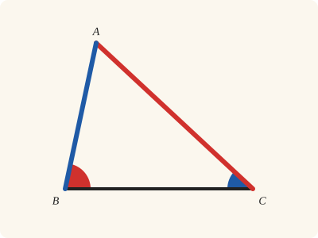
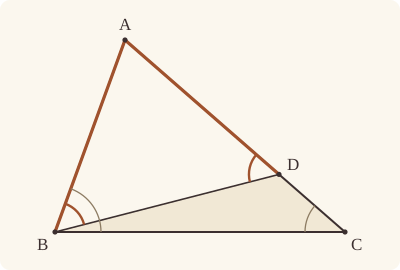

<!-- Generated by scripts/render.py. Do not edit by hand. -->

[Book I](index.md) · [← I.17](17.md) · [I.19 →](19.md)

# Book I, Proposition 18

*The greater side subtends the greater angle*

[Euclid's proof](#euclids-proof) · [In Lean](#in-lean) · [What it rests on](#what-it-rests-on) · [Mishnah](#mishnah)

> In any triangle the greater side subtends the greater angle.

**In Lean:** ✅ proved, as Euclid states it · Euclid's argument

<p align="center"></p>

<p align="center"><em>The greater side (red) always faces the greater angle (red), and the less side (blue) the less angle (blue).</em></p>

## Euclid's proof

<p align="center"></p>

For let ABC be a triangle having the side AC greater than AB;

I say that the angle ABC is also greater than the angle BCA.

For, since AC is greater than AB, let AD be made equal to AB [I. 3], and let BD be joined.

Then, since the angle ADB is an exterior angle of the triangle BCD,

it is greater than the interior and opposite angle DCB. [I. 16]

But the angle ADB is equal to the angle ABD,

since the side AB is equal to AD;

therefore the angle ABD is also greater than the angle ACB;

therefore the angle ABC is much greater than the angle ACB.

Therefore etc.

Q. E. D.

## In Lean

| | |
|---|---|
| Proof | ✅ Proved |
| Statement | The whole enunciation. |
| Argument | Euclid's. |
| Reviewed | The statement and every passage of the argument read against Heath's text, at commit [`b7b41f51`](https://github.com/jackChallis/stoicheia/commit/b7b41f51) ([the record](../../review/I/18.toml)) |

From [`Elements/BookI/Prop18.lean`](../../Elements/BookI/Prop18.lean). Euclid's sentences are the `--` comments, and our own notes are in `/- … -/`; the lines under each sentence are the Lean that carries it out. The list below marks where a lemma does a step Euclid takes for granted; the `/- … -/` notes in the listing explain smaller adjustments.

**How the Lean follows the text**

- **Done by `Prop5.base`.** "But the angle ADB is equal to the angle ABD…" Euclid infers equal angles from the equal sides AB and AD; Heath gives no reference for this step. The Lean applies I.5 (`Prop5.base`) to the triangle ABD.
- **Done by `angle_add_of_between`.** "therefore the angle ABC is much greater than the angle ACB." Euclid reads off his figure that the angle ABD is part of ABC; the Lean finds the reason in D lying between A and C, so BD falls within ABC and `angle_add_of_between` splits it into ABD and DBC. The Lean uses `Triangle.angle_pos` and Common Notion 5 to make ABC greater than ABD, then transitivity to make it greater than ACB.

```lean
/-- In any triangle the greater side subtends the greater angle. -/
theorem Prop18 {A B C : Point} (hABC : Triangle A B C) (h : ‖A B‖ < ‖A C‖) :
    ∠ B C A < ∠ A B C := by
  -- For let ABC be a triangle having the side AC greater than AB;
  have hA_B : A ≠ B := hABC.ne₁₂
  have hB_C : B ≠ C := hABC.ne₂₃
  have hA_C : A ≠ C := hABC.ne₁₃
  obtain ⟨AC, hA_AC, hC_AC⟩ := Postulate1 A C hA_C
  have hB_AC : ¬ OnLine B AC := hABC.acb.off_line hA_AC hC_AC
  -- I say that the angle ABC is also greater than the angle BCA.
  -- For, since AC is greater than AB, let AD be made equal to AB [I. 3], and let BD be joined.
  /- I.3 cuts off from AC, beginning at A, a straight line AD equal to AB; D lies
     between A and C. Joining BD is Postulate 1; our proof uses only the points. -/
  obtain ⟨D, hADC, hAD_AB⟩ := Prop3 hA_B h
  have hD_AC : OnLine D AC := on_line_of_between_ends hADC hA_AC hC_AC
  have hD_C : D ≠ C := (ne_of_between (between_symm hADC)).symm
  have hA_D : A ≠ D := ne_of_between hADC
  -- Then, since the angle ADB is an exterior angle of the triangle BCD,
  /- BCD is a triangle, since B is off the straight line AC on which C and D lie;
     and its side CD is produced to A, since D lies between C and A. -/
  have hBCD : Triangle B C D := (Triangle.of_line hC_AC hD_AC hD_C.symm hB_AC).cab
  have hCDA : Between C D A := between_symm hADC
  -- it is greater than the interior and opposite angle DCB. [I. 16]
  have hDCB_BDA : ∠ D C B < ∠ B D A := (Prop16 hBCD hCDA).1
  /- I.16 names the exterior angle BDA; read from the other arm, it is ADB. -/
  have hB_D : B ≠ D := fun e => hB_AC (e ▸ hD_AC)
  have hDCB_ADB : ∠ D C B < ∠ A D B := by
    rw [angle_symm hB_D hA_D] at hDCB_BDA
    exact hDCB_BDA
  -- But the angle ADB is equal to the angle ABD,
  -- since the side AB is equal to AD;
  /- This is I.5 (`Prop5.base`), for the isosceles triangle ABD. -/
  have hABD : Triangle A B D := (Triangle.of_line hA_AC hD_AC hA_D hB_AC).acb
  have hAB_AD : ‖A B‖ = ‖A D‖ := hAD_AB.symm
  have hABD_ADB : ∠ A B D = ∠ A D B := Prop5.base hABD hAB_AD
  -- therefore the angle ABD is also greater than the angle ACB;
  /- The angle DCB is the angle ACB, since D lies on the ray from C through A. -/
  have hDCB_ACB : ∠ D C B = ∠ A C B := angle_onRay_left (OnRay.of_between hCDA) hB_C
  have hACB_ABD : ∠ A C B < ∠ A B D := by
    rw [← hDCB_ACB, hABD_ADB]
    exact hDCB_ADB
  -- therefore the angle ABC is much greater than the angle ACB.
  /- The angle ABC is made up of ABD and DBC (`angle_add_of_between`), and DBC,
     an angle of the triangle DBC, is something (`Triangle.angle_pos`): the whole
     is greater than the part [C.N. 5]. -/
  have hABD_ABC : ∠ A B D < ∠ A B C := by
    rw [angle_add_of_between hABC.acb hADC]
    exact CommonNotion5 hBCD.cab.angle_pos
  have hACB_ABC : ∠ A C B < ∠ A B C := lt_trans hACB_ABD hABD_ABC
  -- Therefore etc.
  /- The angle ACB is the angle BCA, named from the other arm. -/
  rw [angle_symm hB_C hA_C]
  exact hACB_ABC
  -- Q. E. D.
```

## What it rests on

| | |
|---|---|
| Heath's references | [I.3](03.md), [I.16](16.md) |
| Lean cites | [I.3](03.md), [I.5](05.md), [I.16](16.md) |
| Postulates | 1, 2, 3, 4 |
| Definitions taken as axioms | Def. I.15 |
| Common Notions | 1, 2, 3, 4, 5 |
| Tacit rules | 37 (listed below) |
| Its own Lean calls | Postulate 1; 3 tacit rules |
| Through lemmas | Postulates 2 and 3; Def. I.15; 23 tacit rules |

Some of these come in through lemmas [shared](../../CERTIFICATE.md#shared-steps) by many proofs: [`Prop5.base`](../../Elements/BookI/Helpers.lean#L27) (I.5).

_Postulates, definitions, Common Notions and tacit rules: all that this proof rests on, counting those of the propositions it cites. The last two rows say which of the postulates, definitions and tacit rules its own Lean calls, in the proof or a helper written for it, and which it does not call but reaches through lemmas, of Book Zero or shared (a proposition it cites may rest on these too); the rest come in only through the propositions it cites or the Common Notions._

<details><summary>The 37 tacit rules beneath this proof, counting those of the propositions it cites</summary>

_(used here) marks a rule this proof's own Lean calls, in the proof or a helper written for it; (through …) marks one its own Lean does not call but reaches through the lemmas named, of [Book Zero](../../Elements/Figure) or shared, though a proposition it cites may rest on it too; and a rule with no mark comes in only through a proposition it cites or a Common Notion. The names in brackets are System E's: an Intersection rule says when straight lines and circles must meet, and an Intersections rule takes a point where they do (see [Book I's introduction](index.md))._

**Reading the figure**

- [`between_cases`](../../Elements/Foundations/Tacit/Diagram.lean#L54): Of three different points on a straight line, one is between the other two. (Between 6)
- [`between_symm`](../../Elements/Foundations/Tacit/Diagram.lean#L47) (used here): If B is between A and C, it is between C and A. (Between 1)
- [`circles_meet`](../../Elements/Foundations/Tacit/Diagram.lean#L94) (through [`OnRay.of_between`](../../Elements/Figure/Rays.lean#L34), [`Tacit.on_line_of_between_ends`](../../Elements/Figure/RuleBase.lean#L153) and [`angle_add_of_between`](../../Elements/Figure/Angles.lean#L85)): If each circle passes through a point inside the other, the circles cut one another. This is the step Euclid takes for granted in I.1. (Intersection 5)
- [`circles_meet_same_side`](../../Elements/Foundations/Tacit/Constructions.lean#L79) (through [`OnRay.of_between`](../../Elements/Figure/Rays.lean#L34), [`Tacit.on_line_of_between_ends`](../../Elements/Figure/RuleBase.lean#L153) and [`angle_add_of_between`](../../Elements/Figure/Angles.lean#L85)): Two circles that cut one another do so on each side of the straight line through their centres. (Intersections 8)
- [`exists_point`](../../Elements/Foundations/Tacit/Constructions.lean#L35) (through [`Prop5.base`](../../Elements/BookI/Helpers.lean#L27), [`Triangle.angle_pos`](../../Elements/Figure/Angles.lean#L58), [`Triangle.ne₁₂`](../../Elements/Figure/Triangles.lean#L22) and 2 other lemmas): Let a point be taken. (Points 1)
- [`exists_point_inside_circle`](../../Elements/Foundations/Tacit/Constructions.lean#L42) (through [`OnRay.of_between`](../../Elements/Figure/Rays.lean#L34), [`Tacit.on_line_of_between_ends`](../../Elements/Figure/RuleBase.lean#L153) and [`angle_add_of_between`](../../Elements/Figure/Angles.lean#L85)): Let a point be taken inside the circle α. (Points 8)
- [`exists_point_on_line`](../../Elements/Foundations/Tacit/Constructions.lean#L38) (through [`OnRay.of_between`](../../Elements/Figure/Rays.lean#L34), [`Tacit.on_line_of_between_ends`](../../Elements/Figure/RuleBase.lean#L153) and [`angle_add_of_between`](../../Elements/Figure/Angles.lean#L85)): Let a point be taken on the straight line L. (Points 2)
- [`line_circle_between`](../../Elements/Foundations/Tacit/Constructions.lean#L67) (through [`OnRay.of_between`](../../Elements/Figure/Rays.lean#L34), [`Tacit.on_line_of_between_ends`](../../Elements/Figure/RuleBase.lean#L153) and [`angle_add_of_between`](../../Elements/Figure/Angles.lean#L85)): A straight line through a point B inside a circle, heading out to a point C outside it, cuts the circle between B and C. (Intersections 4)
- [`line_circle_beyond`](../../Elements/Foundations/Tacit/Constructions.lean#L73) (through [`OnRay.of_between`](../../Elements/Figure/Rays.lean#L34), [`Tacit.on_line_of_between_ends`](../../Elements/Figure/RuleBase.lean#L153) and [`angle_add_of_between`](../../Elements/Figure/Angles.lean#L85)): A straight line through a point B inside a circle, produced beyond B away from C, cuts the circle there. (Intersections 5)
- [`line_unique`](../../Elements/Foundations/Tacit/Diagram.lean#L41) (through [`Triangle.of_line`](../../Elements/Figure/Triangles.lean#L82) and [`angle_add_of_between`](../../Elements/Figure/Angles.lean#L85)): Two points determine a straight line. (Generalities 1)
- [`lines_meet_of_opposite_sides`](../../Elements/Foundations/Tacit/Diagram.lean#L89): A straight line joining points on opposite sides of L crosses L. (Intersection 1)
- [`not_between_of_between`](../../Elements/Foundations/Tacit/Diagram.lean#L50) (through [`OnRay.of_between`](../../Elements/Figure/Rays.lean#L34), [`Tacit.ne_of_between`](../../Elements/Figure/RuleBase.lean#L146), [`Tacit.on_line_of_between_ends`](../../Elements/Figure/RuleBase.lean#L153) and 2 other lemmas): If B is between A and C, then A is not between B and C. (Between 1)
- [`not_on_line_of_same_side`](../../Elements/Foundations/Tacit/Diagram.lean#L60) (through [`OnRay.of_between`](../../Elements/Figure/Rays.lean#L34), [`Tacit.on_line_of_between_ends`](../../Elements/Figure/RuleBase.lean#L153) and [`angle_add_of_between`](../../Elements/Figure/Angles.lean#L85)): Points on one side of a straight line are not on it. (Same side 3)
- [`pasch2`](../../Elements/Foundations/Tacit/Diagram.lean#L71) (through [`OnRay.of_between`](../../Elements/Figure/Rays.lean#L34), [`Tacit.on_line_of_between_ends`](../../Elements/Figure/RuleBase.lean#L153) and [`angle_add_of_between`](../../Elements/Figure/Angles.lean#L85)): If B is between A and C, A is on L and B is off it, then B and C are on the same side of L: a straight line that leaves L at A does not cross it again. (Pasch 2)
- [`same_side_trans`](../../Elements/Foundations/Tacit/Diagram.lean#L64) (through [`OnRay.of_between`](../../Elements/Figure/Rays.lean#L34), [`Tacit.on_line_of_between_ends`](../../Elements/Figure/RuleBase.lean#L153) and [`angle_add_of_between`](../../Elements/Figure/Angles.lean#L85)): Two points on the same side of a straight line as a third point are on the same side as each other. (Same side 4)

**Lengths, angles and areas**

- [`angle_add_of_inside`](../../Elements/Foundations/Tacit/Transfer.lean#L47) (through [`angle_add_of_between`](../../Elements/Figure/Angles.lean#L85)): If D lies within the angle BAC, then BAC is made up of BAD and DAC. (Diagram-angle 2)
- [`angle_eq_of_same_rays`](../../Elements/Foundations/Tacit/Transfer.lean#L54) (through [`angle_onRay_left`](../../Elements/Figure/Angles.lean#L42)): The angle doesn't change if its arms are traced through other points on the same rays. (Diagram-angle 4)
- [`angle_symm`](../../Elements/Foundations/Tacit/Metric.lean#L30) (used here): The angle ABC is the angle CBA. (Metric 4)
- [`area_add_of_between`](../../Elements/Foundations/Tacit/Transfer.lean#L70): Cutting a triangle in two from a vertex adds up. (Diagram-area 2)
- [`area_congruent`](../../Elements/Foundations/Tacit/Metric.lean#L44): Triangles equal in all their sides and angles are equal in area. Euclid uses this without comment once he has shown two triangles congruent. (Metric 9)
- [`area_degenerate`](../../Elements/Foundations/Tacit/Metric.lean#L36): A "triangle" with a repeated corner has no area. (Metric 6)
- [`area_eq_zero_of_on_line`](../../Elements/Foundations/Tacit/Transfer.lean#L62): A "triangle" whose corners lie on one straight line has no area. (Diagram-area 1)
- [`area_rotate`](../../Elements/Foundations/Tacit/Metric.lean#L39): The triangle ABC is the triangle CAB. (Metric 8)
- [`len_add_of_between`](../../Elements/Foundations/Tacit/Transfer.lean#L27) (through [`OnRay.of_between`](../../Elements/Figure/Rays.lean#L34), [`Tacit.on_line_of_between_ends`](../../Elements/Figure/RuleBase.lean#L153), [`angle_add_of_between`](../../Elements/Figure/Angles.lean#L85) and 1 other lemma): If B is between A and C, then AB and BC together make up AC. (Diagram-segment 1)
- [`len_self`](../../Elements/Foundations/Tacit/Metric.lean#L24) (through [`OnRay.of_between`](../../Elements/Figure/Rays.lean#L34), [`Tacit.on_line_of_between_ends`](../../Elements/Figure/RuleBase.lean#L153), [`angle_add_of_between`](../../Elements/Figure/Angles.lean#L85) and 1 other lemma): The "straight line" from a point to itself has no length. (Metric 1)
- [`len_symm`](../../Elements/Foundations/Tacit/Metric.lean#L27) (through [`OnRay.of_between`](../../Elements/Figure/Rays.lean#L34), [`Tacit.on_line_of_between_ends`](../../Elements/Figure/RuleBase.lean#L153) and [`angle_add_of_between`](../../Elements/Figure/Angles.lean#L85)): The straight line AB is the straight line BA. (Metric 3)
- [`radius_ne_zero`](../../Elements/Foundations/Tacit/Metric.lean#L62) (through [`OnRay.of_between`](../../Elements/Figure/Rays.lean#L34), [`Tacit.on_line_of_between_ends`](../../Elements/Figure/RuleBase.lean#L153), [`angle_add_of_between`](../../Elements/Figure/Angles.lean#L85) and 1 other lemma): A circle's radius is not nothing: the straight line from the centre to a point on the circle has some length. A rule of our own, not one of System E's: every circle is drawn with a centre and a distance (Postulate 3).
- [`same_ray_of_angle_eq_zero`](../../Elements/Foundations/Tacit/Transfer.lean#L42) (through [`Triangle.angle_pos`](../../Elements/Figure/Angles.lean#L58)): If the angle BAC is nothing, C lies on the ray from A through B. (Diagram-angle 1)

**Superposition**

- [`superposition`](../../Elements/Foundations/Tacit/Superposition.lean#L52): **Superposition.** A hypothetical placement of a triangle on a given ray and side permits a restricted derivation of metric equalities about the figure already given. The derivation introduces no further objects, cites each geometric law it uses, and exports no symbol of the placement.

**Laws of magnitude**

- [`add_assoc`](../../Elements/Foundations/Tacit/Magnitudes.lean#L23): Adding three magnitudes in a row, it makes no difference whether the first two or the last two are added first. (System E §3.5)
- [`add_comm`](../../Elements/Foundations/Tacit/Magnitudes.lean#L26) (through [`OnRay.of_between`](../../Elements/Figure/Rays.lean#L34), [`Tacit.on_line_of_between_ends`](../../Elements/Figure/RuleBase.lean#L153), [`angle_add_of_between`](../../Elements/Figure/Angles.lean#L85) and 1 other lemma): The order of adding does not matter. (System E §3.5)
- [`add_lt_add_right`](../../Elements/Foundations/Tacit/Magnitudes.lean#L45): Adding the same thing to both sides keeps "less than". (System E §3.5)
- [`add_zero`](../../Elements/Foundations/Tacit/Magnitudes.lean#L29): Adding nothing changes nothing. (System E §3.5)
- [`lt_irrefl`](../../Elements/Foundations/Tacit/Magnitudes.lean#L32) (through [`OnRay.of_between`](../../Elements/Figure/Rays.lean#L34), [`Tacit.on_line_of_between_ends`](../../Elements/Figure/RuleBase.lean#L153) and [`angle_add_of_between`](../../Elements/Figure/Angles.lean#L85)): No magnitude is less than itself. (System E §3.5)
- [`lt_trans`](../../Elements/Foundations/Tacit/Magnitudes.lean#L35) (used here): What is less than the less is less still. (System E §3.5)
- [`lt_trichotomy`](../../Elements/Foundations/Tacit/Magnitudes.lean#L39) (through [`OnRay.of_between`](../../Elements/Figure/Rays.lean#L34), [`Tacit.on_line_of_between_ends`](../../Elements/Figure/RuleBase.lean#L153), [`Triangle.angle_pos`](../../Elements/Figure/Angles.lean#L58) and 2 other lemmas): Of two magnitudes, one is less, or they are equal, or the other is less. (System E §3.5)
- [`not_lt_zero`](../../Elements/Foundations/Tacit/Magnitudes.lean#L42) (through [`OnRay.of_between`](../../Elements/Figure/Rays.lean#L34), [`Tacit.on_line_of_between_ends`](../../Elements/Figure/RuleBase.lean#L153), [`Triangle.angle_pos`](../../Elements/Figure/Angles.lean#L58) and 2 other lemmas): Nothing is less than zero. (System E §3.5)

</details>

## Mishnah

_Our commentary: what Euclid assumes, what Lean made us say out loud, and how the result looks by modern means._

I.18 and I.19 say almost the same words in a different order, and Heath gives the rule that tells them apart: "the *datum* comes first and the *quaesitum* second, the *datum* being in this proposition the greater *side* and in the next the greater *angle*" (vol. 1, p. 283), the given before the sought. Aristotle already quotes the result of I.19 "using the exact wording" (Heath, vol. 1, p. 283). To help the student remember which of the two is proved directly, Isaac Todhunter observes that "the order is similar to that in I. 5 and I. 6" (Heath, vol. 1, p. 283): I.18, like I.5, is direct; I.19, like I.6, is a *reductio*.

**"Much greater."** Euclid's two words carry two steps. One his figure settles: BD falls within the angle ABC, because I.3 put D between A and C, so the angle ABD is only a part of ABC, and we prove it. The other, that what is greater than the greater is greater still, is a tacit rule of magnitude, which we assume (`lt_trans`). The figure also spares Euclid a sentence: CD runs on to A, so the angle DCB that I.16 gives is the triangle's own angle ACB, and our proof says so. Porphyry's proof, which Heath gives from Proclus, "starts by supposing a length equal to AB cut off from the other end of AC; that is, CD and not AD is made equal to AB" (vol. 1, p. 283), and it too ends by going from greater to greater still, which Heath marks *a fortiori*.

**The modern way.** Name the sides $a = \mathrm{BC}$, $b = \mathrm{CA}$ and $c = \mathrm{AB}$. The law of cosines gives $\cos \mathrm{C} - \cos \mathrm{B} = (b - c)(b + c - a)(a + b + c)/(2abc)$, and $b + c$ is greater than $a$ (that is I.20), so when $b \gt c$, $\cos \mathrm{B} \lt \cos \mathrm{C}$ and the angle B is the greater.

## Further reading

- The law of cosines that the modern way leans on is stated in ch. 2, "Algebraic methods", of Kiran S. Kedlaya's [*Geometry Unbound*](https://kskedlaya.org/geometryunbound/) (2006, free online), a geometry book grown from notes for olympiad students, which puts trigonometry, vectors and complex numbers to work on the plane; its PDF comes without figures, so draw your own as you read.
- Heath gives no reference here for I.5, though the proof uses it. Ian Mueller's scholarly [*Philosophy of Mathematics and Deductive Structure in Euclid's Elements*](https://openlibrary.org/books/OL7640284M) (2006; first published 1981) charts, book by book, the web of propositions each proof rests on.

[Book I](index.md) · [← I.17](17.md) · [I.19 →](19.md)

---

<sub>Euclid's text: T. L. Heath, *The Thirteen Books of Euclid's Elements*, vol. 1 (Cambridge, 1908), p. 283; [scan leaf n303](https://archive.org/details/thirteenbookseu02heibgoog/page/n303); [figure on n303](https://archive.org/details/thirteenbookseu02heibgoog/page/n303). Public domain.</sub>

<sub>The tacit rules follow the System E of Jeremy Avigad, Edward Dean and John Mumma, read alongside LeanEuclid (Logan Murphy, Kaiyu Yang, Jialiang Sun, Zhaoyu Li, Anima Anandkumar and Xujie Si).</sub>
