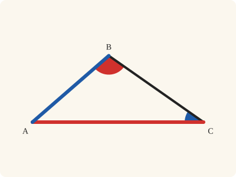
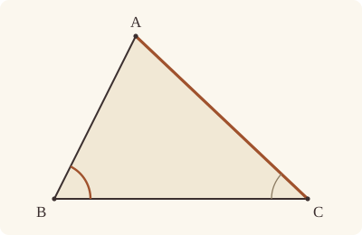
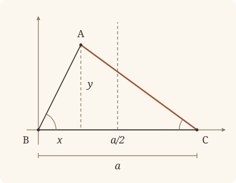

<!-- Generated by scripts/render.py. Do not edit by hand. -->

[Book I](index.md) · [← I.18](18.md) · [I.20 →](20.md)

# Book I, Proposition 19

*The greater angle is subtended by the greater side*

[Euclid's proof](#euclids-proof) · [In Lean](#in-lean) · [What it rests on](#what-it-rests-on) · [Mishnah](#mishnah)

> In any triangle the greater angle is subtended by the greater side.

**In Lean:** ✅ proved, as Euclid states it · Euclid's argument

<p align="center"></p>

<p align="center"><em>The greater angle (red) always looks across at the greater side (red), and the less angle (blue) at the less side (blue).</em></p>

## Euclid's proof

<p align="center"></p>

Let ABC be a triangle having the angle ABC greater than the angle BCA;

I say that the side AC is also greater than the side AB.

For, if not, AC is either equal to AB or less.

Now AC is not equal to AB;

for then the angle ABC would also have been equal to the angle ACB; [I. 5]

but it is not;

therefore AC is not equal to AB.

Neither is AC less than AB,

for then the angle ABC would also have been less than the angle ACB; [I. 18]

but it is not;

therefore AC is not less than AB.

And it was proved that it is not equal either.

Therefore AC is greater than AB.

Therefore etc.

Q. E. D.

## In Lean

| | |
|---|---|
| Proof | ✅ Proved |
| Statement | The whole enunciation. |
| Argument | Euclid's. |
| Reviewed | The statement and every passage of the argument read against Heath's text, at commit [`b7b41f51`](https://github.com/jackChallis/stoicheia/commit/b7b41f51) ([the record](../../review/I/19.toml)) |

From [`Elements/BookI/Prop19.lean`](../../Elements/BookI/Prop19.lean). Euclid's sentences are the `--` comments, and our own notes are in `/- … -/`; the lines under each sentence are the Lean that carries it out. The list below marks where a lemma does a step Euclid takes for granted; the `/- … -/` notes in the listing explain smaller adjustments.

**How the Lean follows the text**

- **Done by `Tacit.lt_trichotomy`.** "For, if not, AC is either equal to AB or less." Euclid takes equality and less as the only possibilities when AC is not greater than AB. The Lean obtains this division from `Tacit.lt_trichotomy`, a tacit rule of magnitude, which we assume (System E §3.5).

```lean
/-- In any triangle the greater angle is subtended by the greater side. -/
theorem Prop19 {A B C : Point} (hABC : Triangle A B C) (h : ∠ B C A < ∠ A B C) :
    ‖A B‖ < ‖A C‖ := by
  -- Let ABC be a triangle having the angle ABC greater than the angle BCA;
  /- Euclid names the less angle BCA here and ACB below. They are one angle,
     read from either arm (`angle_symm`, System E's Metric 4). -/
  have hBCA_ACB : ∠ B C A = ∠ A C B := angle_symm hABC.ne₂₃ hABC.ne₁₃
  have hACB_ABC : ∠ A C B < ∠ A B C := hBCA_ACB ▸ h
  -- I say that the side AC is also greater than the side AB.
  -- For, if not, AC is either equal to AB or less.
  /- That a length not greater than another is equal to it or less is the tacit
     rule of magnitude `lt_trichotomy` (System E §3.5). -/
  have either : ¬ ‖A B‖ < ‖A C‖ → ‖A C‖ = ‖A B‖ ∨ ‖A C‖ < ‖A B‖ := by
    intro hnot
    rcases lt_trichotomy ‖A C‖ ‖A B‖ with hlt | heq | hgt
    · exact Or.inr hlt
    · exact Or.inl heq
    · exact absurd hgt hnot
  -- Now AC is not equal to AB;
  have not_equal : ‖A C‖ ≠ ‖A B‖ := by
    intro hAC_AB
    -- for then the angle ABC would also have been equal to the angle ACB; [I. 5]
    have hABC_ACB : ∠ A B C = ∠ A C B := Prop5.base hABC hAC_AB.symm
    -- but it is not;
    /- It is greater: the hypothesis, with BCA read as ACB. -/
    have hne : ∠ A B C ≠ ∠ A C B := fun heq => Magnitude.ne_of_lt hACB_ABC heq.symm
    -- therefore AC is not equal to AB.
    exact hne hABC_ACB
  -- Neither is AC less than AB,
  have not_less : ¬ ‖A C‖ < ‖A B‖ := by
    intro hAC_AB
    -- for then the angle ABC would also have been less than the angle ACB; [I. 18]
    /- This is I.18 for the triangle ACB, whose side AB is the greater. It hands
       back the angle CBA, which is the angle ABC read from the other arm. -/
    have hABC_ACB : ∠ A B C < ∠ A C B := by
      have hI18 : ∠ C B A < ∠ A C B := Prop18 hABC.acb hAC_AB
      rw [angle_symm hABC.ne₂₃.symm hABC.ne₁₂] at hI18
      exact hI18
    -- but it is not;
    /- It is greater, and a magnitude cannot be both less and greater than
       another (`lt_trans`, `lt_irrefl`). -/
    have hnot : ¬ ∠ A B C < ∠ A C B := fun hlt => lt_irrefl _ (lt_trans hlt hACB_ABC)
    -- therefore AC is not less than AB.
    exact hnot hABC_ACB
  -- And it was proved that it is not equal either.
  /- Both ways out are closed; Euclid's division is complete. -/
  have neither : ¬ (‖A C‖ = ‖A B‖ ∨ ‖A C‖ < ‖A B‖) := fun hor =>
    hor.elim not_equal not_less
  -- Therefore AC is greater than AB.
  /- Reductio ad absurdum: were AC not greater, the division above would make it
     equal or less, and it is neither. -/
  exact Classical.byContradiction fun hnot => neither (either hnot)
  -- Therefore etc.
  -- Q. E. D.
```

## What it rests on

| | |
|---|---|
| Heath's references | [I.5](05.md), [I.18](18.md) |
| Lean cites | [I.5](05.md), [I.18](18.md) |
| Postulates | 1, 2, 3, 4 |
| Definitions taken as axioms | Def. I.15 |
| Common Notions | 1, 2, 3, 4, 5 |
| Tacit rules | 38 (listed below) |
| Its own Lean calls | 4 tacit rules |
| Through lemmas | Postulates 1 and 2; 1 tacit rule |

Some of these come in through lemmas [shared](../../CERTIFICATE.md#shared-steps) by many proofs: [`Prop5.base`](../../Elements/BookI/Helpers.lean#L27) (I.5).

_Postulates, definitions, Common Notions and tacit rules: all that this proof rests on, counting those of the propositions it cites. The last two rows say which of the postulates, definitions and tacit rules its own Lean calls, in the proof or a helper written for it, and which it does not call but reaches through lemmas, of Book Zero or shared (a proposition it cites may rest on these too); the rest come in only through the propositions it cites or the Common Notions._

<details><summary>The 38 tacit rules beneath this proof, counting those of the propositions it cites</summary>

_(used here) marks a rule this proof's own Lean calls, in the proof or a helper written for it; (through …) marks one its own Lean does not call but reaches through the lemmas named, of [Book Zero](../../Elements/Figure) or shared, though a proposition it cites may rest on it too; and a rule with no mark comes in only through a proposition it cites or a Common Notion. The names in brackets are System E's: an Intersection rule says when straight lines and circles must meet, and an Intersections rule takes a point where they do (see [Book I's introduction](index.md))._

**Reading the figure**

- [`between_cases`](../../Elements/Foundations/Tacit/Diagram.lean#L54): Of three different points on a straight line, one is between the other two. (Between 6)
- [`between_of_inside_chord`](../../Elements/Foundations/Tacit/Diagram.lean#L81): A straight line through a point inside a circle has that point between the points where it meets the circle. (Circle 1)
- [`between_symm`](../../Elements/Foundations/Tacit/Diagram.lean#L47): If B is between A and C, it is between C and A. (Between 1)
- [`circles_meet`](../../Elements/Foundations/Tacit/Diagram.lean#L94): If each circle passes through a point inside the other, the circles cut one another. This is the step Euclid takes for granted in I.1. (Intersection 5)
- [`circles_meet_same_side`](../../Elements/Foundations/Tacit/Constructions.lean#L79): Two circles that cut one another do so on each side of the straight line through their centres. (Intersections 8)
- [`exists_point`](../../Elements/Foundations/Tacit/Constructions.lean#L35) (through [`Prop5.base`](../../Elements/BookI/Helpers.lean#L27), [`Triangle.ne₁₂`](../../Elements/Figure/Triangles.lean#L22), [`Triangle.ne₁₃`](../../Elements/Figure/Triangles.lean#L36) and 1 other lemma): Let a point be taken. (Points 1)
- [`exists_point_inside_circle`](../../Elements/Foundations/Tacit/Constructions.lean#L42): Let a point be taken inside the circle α. (Points 8)
- [`exists_point_on_line`](../../Elements/Foundations/Tacit/Constructions.lean#L38): Let a point be taken on the straight line L. (Points 2)
- [`line_circle_between`](../../Elements/Foundations/Tacit/Constructions.lean#L67): A straight line through a point B inside a circle, heading out to a point C outside it, cuts the circle between B and C. (Intersections 4)
- [`line_circle_beyond`](../../Elements/Foundations/Tacit/Constructions.lean#L73): A straight line through a point B inside a circle, produced beyond B away from C, cuts the circle there. (Intersections 5)
- [`line_unique`](../../Elements/Foundations/Tacit/Diagram.lean#L41): Two points determine a straight line. (Generalities 1)
- [`lines_meet_of_opposite_sides`](../../Elements/Foundations/Tacit/Diagram.lean#L89): A straight line joining points on opposite sides of L crosses L. (Intersection 1)
- [`not_between_of_between`](../../Elements/Foundations/Tacit/Diagram.lean#L50): If B is between A and C, then A is not between B and C. (Between 1)
- [`not_on_line_of_same_side`](../../Elements/Foundations/Tacit/Diagram.lean#L60): Points on one side of a straight line are not on it. (Same side 3)
- [`pasch2`](../../Elements/Foundations/Tacit/Diagram.lean#L71): If B is between A and C, A is on L and B is off it, then B and C are on the same side of L: a straight line that leaves L at A does not cross it again. (Pasch 2)
- [`same_side_trans`](../../Elements/Foundations/Tacit/Diagram.lean#L64): Two points on the same side of a straight line as a third point are on the same side as each other. (Same side 4)

**Lengths, angles and areas**

- [`angle_add_of_inside`](../../Elements/Foundations/Tacit/Transfer.lean#L47): If D lies within the angle BAC, then BAC is made up of BAD and DAC. (Diagram-angle 2)
- [`angle_eq_of_same_rays`](../../Elements/Foundations/Tacit/Transfer.lean#L54): The angle doesn't change if its arms are traced through other points on the same rays. (Diagram-angle 4)
- [`angle_symm`](../../Elements/Foundations/Tacit/Metric.lean#L30) (used here): The angle ABC is the angle CBA. (Metric 4)
- [`area_add_of_between`](../../Elements/Foundations/Tacit/Transfer.lean#L70): Cutting a triangle in two from a vertex adds up. (Diagram-area 2)
- [`area_congruent`](../../Elements/Foundations/Tacit/Metric.lean#L44): Triangles equal in all their sides and angles are equal in area. Euclid uses this without comment once he has shown two triangles congruent. (Metric 9)
- [`area_degenerate`](../../Elements/Foundations/Tacit/Metric.lean#L36): A "triangle" with a repeated corner has no area. (Metric 6)
- [`area_eq_zero_of_on_line`](../../Elements/Foundations/Tacit/Transfer.lean#L62): A "triangle" whose corners lie on one straight line has no area. (Diagram-area 1)
- [`area_rotate`](../../Elements/Foundations/Tacit/Metric.lean#L39): The triangle ABC is the triangle CAB. (Metric 8)
- [`circle_eq`](../../Elements/Foundations/Tacit/Transfer.lean#L30): A circle is fixed by its centre and its radius. (Diagram-segment 2)
- [`len_add_of_between`](../../Elements/Foundations/Tacit/Transfer.lean#L27): If B is between A and C, then AB and BC together make up AC. (Diagram-segment 1)
- [`len_self`](../../Elements/Foundations/Tacit/Metric.lean#L24): The "straight line" from a point to itself has no length. (Metric 1)
- [`len_symm`](../../Elements/Foundations/Tacit/Metric.lean#L27): The straight line AB is the straight line BA. (Metric 3)
- [`same_ray_of_angle_eq_zero`](../../Elements/Foundations/Tacit/Transfer.lean#L42): If the angle BAC is nothing, C lies on the ray from A through B. (Diagram-angle 1)

**Superposition**

- [`superposition`](../../Elements/Foundations/Tacit/Superposition.lean#L48): **Superposition.** A hypothetical placement of a triangle on a given ray and side permits a restricted derivation of metric equalities about the figure already given. The derivation introduces no further objects, cites each geometric law it uses, and exports no symbol of the placement.

**Laws of magnitude**

- [`add_assoc`](../../Elements/Foundations/Tacit/Magnitudes.lean#L23): Adding three magnitudes in a row, it makes no difference whether the first two or the last two are added first. (System E §3.5)
- [`add_comm`](../../Elements/Foundations/Tacit/Magnitudes.lean#L26): The order of adding does not matter. (System E §3.5)
- [`add_lt_add_right`](../../Elements/Foundations/Tacit/Magnitudes.lean#L45): Adding the same thing to both sides keeps "less than". (System E §3.5)
- [`add_zero`](../../Elements/Foundations/Tacit/Magnitudes.lean#L29): Adding nothing changes nothing. (System E §3.5)
- [`lt_irrefl`](../../Elements/Foundations/Tacit/Magnitudes.lean#L32) (used here): No magnitude is less than itself. (System E §3.5)
- [`lt_trans`](../../Elements/Foundations/Tacit/Magnitudes.lean#L35) (used here): What is less than the less is less still. (System E §3.5)
- [`lt_trichotomy`](../../Elements/Foundations/Tacit/Magnitudes.lean#L39) (used here): Of two magnitudes, one is less, or they are equal, or the other is less. (System E §3.5)
- [`not_lt_zero`](../../Elements/Foundations/Tacit/Magnitudes.lean#L42): Nothing is less than zero. (System E §3.5)

</details>

## Mishnah

_Our commentary: what Euclid assumes, what Lean made us say out loud, and how the result looks by modern means._

I.19 turns I.18 round, as I.6 turns I.5 round. "Here, says Proclus (p. 318, 16–23), Euclid proves the impossibility 'by means of *division*' (ἐκ διαιρέσεως). This means simply the separation of different hypotheses, each of which is inconsistent with the truth of the theorem to be proved, and which therefore must be successively shown to be impossible" (Heath, vol. 1, p. 285). If AC is not greater than AB, it is equal to it or less; I.5 shuts the first way out and I.18 the second. The division is itself a tacit rule of magnitude, which our proof cites (`lt_trichotomy`): of two lengths, one is less, or they are equal, or the other is less.

Could logic alone do it? Augustus De Morgan thought so: I.19, "like I. 6, can be proved by merely *logical* deduction from I. 5 and I. 18 taken together" (Heath, vol. 1, p. 284). Of three assertions X, Y, Z, "one or the other must be true, *and one only*", and so too of three more, P, Q, R. If X brings P, Y brings Q and Z brings R, then "it follows that, when P is true, X is true, when Q is true, Y is true, when R is true, Z is true" (Heath, vol. 1, p. 284). Here X, Y, Z compare AC with AB, P, Q, R the angles at B and C, and I.5 and I.18 are the links. Proclus also has a direct proof, which an-Nairīzī attributes to Heron, built on a lemma about the bisector of an angle; Heath finds it "open to the slight objection of separating a theorem from its converse. But the lemma and proof are worth giving" (vol. 1, p. 285).

**The modern way.** Put $\mathrm{B} = (0, 0)$, $\mathrm{C} = (a, 0)$ and $\mathrm{A} = (x, y)$ with $a \gt 0$ and $y \gt 0$. Then $\cot \mathrm{B} = x/y$ and $\cot \mathrm{C} = (a - x)/y$, so the angle at B is the greater exactly when $x \lt a/2$; and $\mathrm{AC}^2 - \mathrm{AB}^2 = a(a - 2x)$, so AC is the greater exactly then too: I.18 and I.19 in one line.

<p align="center"></p>

## Further reading

- In coordinates I.18 and I.19 become one line, and ch. 3, "Coordinates", of John Stillwell's [*The Four Pillars of Geometry*](https://doi.org/10.1007/0-387-29052-4) (2005) shows how they are set up (also on [I.3](03.md)).
- Proof "by means of division", the separation of cases, can be tried out in Lean with Daniel J. Velleman's [*How To Prove It with Lean*](https://djvelleman.github.io/HTPIwL/) (free online), §3.5, "Proofs Involving Disjunctions": a bridge from ordinary proofs to proofs in Lean.

[Book I](index.md) · [← I.18](18.md) · [I.20 →](20.md)

---

<sub>Euclid's text: T. L. Heath, *The Thirteen Books of Euclid's Elements*, vol. 1 (Cambridge, 1908), p. 284; [scan leaf n304](https://archive.org/details/thirteenbookseu02heibgoog/page/n304); [figure on n304](https://archive.org/details/thirteenbookseu02heibgoog/page/n304). Public domain.</sub>

<sub>The tacit rules follow the System E of Jeremy Avigad, Edward Dean and John Mumma, read alongside LeanEuclid (Logan Murphy, Kaiyu Yang, Jialiang Sun, Zhaoyu Li, Anima Anandkumar and Xujie Si).</sub>
