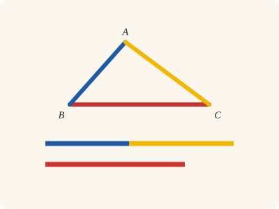
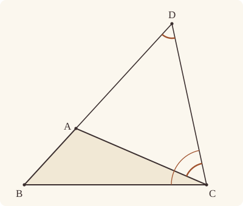
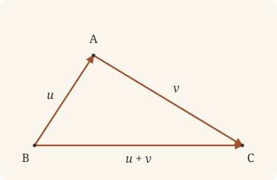

<!-- Generated by scripts/render.py. Do not edit by hand. -->

[Book I](index.md) · [← I.19](19.md) · [I.21 →](21.md)

# Book I, Proposition 20

*Two sides of a triangle are greater than the remaining one*

[Euclid's proof](#euclids-proof) · [In Lean](#in-lean) · [What it rests on](#what-it-rests-on) · [Mishnah](#mishnah)

> In any triangle two sides taken together in any manner are greater than the remaining one.

**In Lean:** ✅ proved, as Euclid states it · Euclid's argument

<p align="center"></p>

<p align="center"><em>Lay any two sides of a triangle end to end (blue and yellow), and together they are greater than the third side (red).</em></p>

## Euclid's proof

<p align="center"></p>

<p align="center"><em>Drawn for one case: BA and AC together greater than BC, as in Heath's figure.</em></p>

For let ABC be a triangle;

I say that in the triangle ABC two sides taken together in any manner are greater than the remaining one, namely

BA, AC greater than BC,

AB, BC greater than AC,

BC, CA greater than AB.

For let BA be drawn through to the point D,

let DA be made equal to CA, and let DC be joined.

Then, since DA is equal to AC,

the angle ADC is also equal to the angle ACD; [I. 5]

therefore the angle BCD is greater than the angle ADC. [C.N. 5]

And, since DCB is a triangle having the angle BCD greater than the angle BDC,

and the greater angle is subtended by the greater side, [I. 19]

therefore DB is greater than BC.

But DA is equal to AC;

therefore BA, AC are greater than BC.

Similarly we can prove that AB, BC are also greater than CA, and BC, CA than AB.

Therefore etc.

Q. E. D.

## In Lean

| | |
|---|---|
| Proof | ✅ Proved |
| Statement | The whole enunciation. |
| Argument | Euclid's. |
| Reviewed | The statement and every passage of the argument read against Heath's text, at commit [`8a3693516`](https://github.com/jackChallis/stoicheia/commit/8a3693516) ([the record](../../review/I/20.toml)) |

From [`Elements/BookI/Prop20.lean`](../../Elements/BookI/Prop20.lean). Euclid's sentences are the `--` comments, and our own notes are in `/- … -/`; the lines under each sentence are the Lean that carries it out. The list below marks where a lemma does a step Euclid takes for granted and where several sentences share one step; the `/- … -/` notes in the listing explain smaller adjustments.

**How the Lean follows the text**

- **Done by `produce_longer`.** "For let BA be drawn through to the point D…" Euclid draws BA through far enough to make DA equal to CA. The Lean first uses `produce_longer` to reach a point X beyond A with AX greater than AC, leaving room for I.3 to cut off AD. To find X, `produce_longer` describes the circle with centre A and distance AC by Postulate 3; Heath gives no reference here. The proof's own Lean draws no circle: Postulate 3 reaches it through this lemma, among others, and every proposition it cites rests on it too.
- **Done by `between_cut`.** "let DA be made equal to CA, and let DC be joined." Euclid makes DA equal to CA and takes for granted that D lies on BA produced beyond A. Heath gives no reference for the cut; the Lean uses I.3 (`Prop3`) to cut AD from AX and `between_cut` to place A between B and D. DC is named by its ends, as a side of the triangle ADC, so nothing is drawn for the join, and Postulate 1 is not called for it. The join is drawn in the text and is not needed by the formal proof.
- **Done by `angle_add_of_between`.** "therefore the angle BCD is greater than the angle ADC." Euclid reads off his figure that the angle ACD is part of BCD; the Lean finds the reason in A lying between B and D, so CA falls within BCD and `angle_add_of_between` splits it into BCA and ACD. The Lean uses `Triangle.angle_pos` and Common Notion 5 to make BCD greater than ACD, which equals ADC.
- **Done by `Tacit.len_add_of_between`.** "But DA is equal to AC…" Euclid replaces DA by AC in the whole DB, which consists of BA and AD. The Lean writes this sum using `Tacit.len_add_of_between`, a rule we assume (System E, Diagram-segment 1), then substitutes the equal length AC.
- **Carried together.** "Similarly we can prove that AB, BC are also greater than CA…" Euclid leaves the other two pairs to the same argument. The Lean proves once, for any triangle ABC, that BA and AC together are greater than BC, then applies this step to BAC and CBA as well.

```lean
/-- In any triangle two sides taken together in any manner are greater than the remaining one. -/
theorem Prop20 {A B C : Point} (hABC : Triangle A B C) :
    ‖B C‖ < ‖B A‖ + ‖A C‖ ∧ ‖A C‖ < ‖A B‖ + ‖B C‖ ∧ ‖A B‖ < ‖B C‖ + ‖C A‖ := by
  -- For let ABC be a triangle;
  -- I say that in the triangle ABC two sides taken together in any manner are greater than the
  -- remaining one, namely
  -- BA, AC greater than BC,
  -- AB, BC greater than AC,
  -- BC, CA greater than AB.
  /- Euclid proves the first, and says "similarly" for the other two. So we give his
     argument for every triangle, in his letters, and use it three times below. -/
  have greater : ∀ {A B C : Point}, Triangle A B C → ‖B C‖ < ‖B A‖ + ‖A C‖ := by
    intro A B C hABC
    have hB_A : B ≠ A := hABC.ne₁₂.symm
    have hA_C : A ≠ C := hABC.ne₁₃
    obtain ⟨BA, hB_BA, hA_BA⟩ := Postulate1 B A hB_A
    have hC_BA : ¬ OnLine C BA := hABC.bac.off_line hB_BA hA_BA
    -- For let BA be drawn through to the point D,
    /- Drawn through beyond A to a point X, far enough for I.3 to cut AD off from AX
       (`produce_longer`, as in I.11). -/
    obtain ⟨X, hBAX, hAC_AX⟩ := produce_longer hB_A hA_C
    -- let DA be made equal to CA, and let DC be joined.
    /- Heath gives no reference here, but "let DA be made equal" is I.3's work, as in
       I.11 and I.16: cut off AD from AX. Then D lies between A and X, and so A lies
       between B and D (`between_cut`): BA drawn through reaches D. DC is named by
       its ends, as a side of the triangle ADC, so nothing is drawn for the join. -/
    obtain ⟨D, hADX, hAD_CA⟩ := Prop3 (A := A) (B := X) hA_C.symm
      (by rw [len_symm C A]; exact hAC_AX)
    have hBAD : Between B A D := between_cut hBAX hADX
    have hD_BA : OnLine D BA := on_line_of_between hBAD hB_BA hA_BA
    have hA_D : A ≠ D := ne_of_between hADX
    -- Then, since DA is equal to AC,
    have hDA_AC : ‖D A‖ = ‖A C‖ := by rw [len_symm D A, hAD_CA, len_symm C A]
    -- the angle ADC is also equal to the angle ACD; [I. 5]
    have hADC : Triangle A D C := Triangle.of_line hA_BA hD_BA hA_D hC_BA
    have hADC_ACD : ∠ A D C = ∠ A C D :=
      Prop5.base hADC (by rw [← len_symm D A]; exact hDA_AC)
    -- therefore the angle BCD is greater than the angle ADC. [C.N. 5]
    /- Greater than the angle ACD, which is equal to it: CA falls within the angle
       BCD, since A lies between B and D, so that the angle BCD is made up of the
       angles BCA and ACD (`angle_add_of_between`); the angle BCA, an angle of the
       triangle ABC, is something (`Triangle.angle_pos`); and the whole is greater
       than the part. -/
    have hBDC : Triangle B D C :=
      Triangle.of_line hB_BA hD_BA (ne_of_between_ends hBAD) hC_BA
    have hADC_BCD : ∠ A D C < ∠ B C D := by
      rw [hADC_ACD, angle_add_of_between hBDC hBAD, add_comm]
      exact CommonNotion5 hABC.bca.angle_pos
    -- And, since DCB is a triangle having the angle BCD greater than the angle BDC,
    /- The angle BDC is the angle ADC, since A lies on the ray from D through B
       (`angle_onRay_left`). -/
    have hDCB : Triangle D C B := hBDC.bca
    have hD_C : D ≠ C := fun e => hC_BA (e ▸ hD_BA)
    have hBDC_BCD : ∠ B D C < ∠ B C D := by
      rw [← angle_onRay_left (OnRay.of_between (between_symm hBAD)) hD_C.symm]
      exact hADC_BCD
    -- and the greater angle is subtended by the greater side, [I. 19]
    /- I.19 for the triangle BCD, named from B: the angle at C is greater than the
       angle at D, so the side BD, opposite C, is greater than the side BC, opposite
       D. -/
    have hBC_BD : ‖B C‖ < ‖B D‖ :=
      Prop19 hDCB.cba (by rw [angle_symm hD_C.symm (ne_of_between_ends hBAD)]; exact hBDC_BCD)
    -- therefore DB is greater than BC.
    have hBC_DB : ‖B C‖ < ‖D B‖ := by rw [len_symm D B]; exact hBC_BD
    -- But DA is equal to AC;
    /- And DB is BA and AD together, since A lies between B and D (System E,
       Diagram-segment 1); so DB is BA and AC together. -/
    have hDB : ‖D B‖ = ‖B A‖ + ‖A C‖ := by
      rw [← hDA_AC, len_symm D A, len_add_of_between hBAD, len_symm D B]
    -- therefore BA, AC are greater than BC.
    rw [← hDB]
    exact hBC_DB
  /- Euclid's argument, in his own figure: BA, AC are greater than BC. -/
  have hBC : ‖B C‖ < ‖B A‖ + ‖A C‖ := greater hABC
  -- Similarly we can prove that AB, BC are also greater than CA, and BC, CA than AB.
  /- The same argument for the triangle BAC, with AB drawn through beyond B, and for
     the triangle CBA, with BC drawn through beyond C. -/
  have hAC : ‖A C‖ < ‖A B‖ + ‖B C‖ := greater hABC.bac
  have hAB : ‖A B‖ < ‖B C‖ + ‖C A‖ := by
    rw [len_symm A B]
    exact greater hABC.cba
  -- Therefore etc.
  exact ⟨hBC, hAC, hAB⟩
  -- Q. E. D.
```

## What it rests on

| | |
|---|---|
| Heath's references | [I.5](05.md), [I.19](19.md); C.N. 5 |
| Lean cites | [I.3](03.md), [I.5](05.md), [I.19](19.md) |
| Postulates | 1, 2, 3, 4 |
| Definitions taken as axioms | Def. I.15 |
| Common Notions | 1, 2, 3, 4, 5 |
| Tacit rules | 37 (listed below) |
| Its own Lean calls | Postulate 1; 5 tacit rules |
| Through lemmas | Postulates 2 and 3; Def. I.15; 24 tacit rules |

Some of these come in through lemmas [shared](../../CERTIFICATE.md#shared-steps) by many proofs: [`Prop5.base`](../../Elements/BookI/Helpers.lean#L27) (I.5).

_Postulates, definitions, Common Notions and tacit rules: all that this proof rests on, counting those of the propositions it cites. The last two rows say which of the postulates, definitions and tacit rules its own Lean calls, in the proof or a helper written for it, and which it does not call but reaches through lemmas, of Book Zero or shared (a proposition it cites may rest on these too); the rest come in only through the propositions it cites or the Common Notions._

<details><summary>The 37 tacit rules beneath this proof, counting those of the propositions it cites</summary>

_(used here) marks a rule this proof's own Lean calls, in the proof or a helper written for it; (through …) marks one its own Lean does not call but reaches through the lemmas named, of [Book Zero](../../Elements/Figure) or shared, though a proposition it cites may rest on it too; and a rule with no mark comes in only through a proposition it cites or a Common Notion. The names in brackets are System E's: an Intersection rule says when straight lines and circles must meet, and an Intersections rule takes a point where they do (see [Book I's introduction](index.md))._

**Reading the figure**

- [`between_cases`](../../Elements/Foundations/Tacit/Diagram.lean#L54) (through [`between_cut`](../../Elements/Figure/Lines.lean#L65) and [`produce_longer`](../../Elements/Figure/Lines.lean#L82)): Of three different points on a straight line, one is between the other two. (Between 6)
- [`between_symm`](../../Elements/Foundations/Tacit/Diagram.lean#L47) (used here): If B is between A and C, it is between C and A. (Between 1)
- [`circles_meet`](../../Elements/Foundations/Tacit/Diagram.lean#L91) (through [`OnRay.of_between`](../../Elements/Figure/Rays.lean#L34), [`Tacit.on_line_of_between`](../../Elements/Figure/Incidence.lean#L78), [`angle_add_of_between`](../../Elements/Figure/Angles.lean#L85) and 2 other lemmas): If each circle passes through a point inside the other, the circles cut one another. This is the step Euclid takes for granted in I.1. (Intersection 5)
- [`circles_meet_same_side`](../../Elements/Foundations/Tacit/Constructions.lean#L79) (through [`OnRay.of_between`](../../Elements/Figure/Rays.lean#L34), [`Tacit.on_line_of_between`](../../Elements/Figure/Incidence.lean#L78), [`angle_add_of_between`](../../Elements/Figure/Angles.lean#L85) and 2 other lemmas): Two circles that cut one another do so on each side of the straight line through their centres. (Intersections 8)
- [`exists_point`](../../Elements/Foundations/Tacit/Constructions.lean#L35) (through [`Prop5.base`](../../Elements/BookI/Helpers.lean#L27), [`Triangle.angle_pos`](../../Elements/Figure/Angles.lean#L58), [`Triangle.ne₁₂`](../../Elements/Figure/Triangles.lean#L22) and 1 other lemma): Let a point be taken. (Points 1)
- [`exists_point_inside_circle`](../../Elements/Foundations/Tacit/Constructions.lean#L42) (through [`OnRay.of_between`](../../Elements/Figure/Rays.lean#L34), [`Tacit.on_line_of_between`](../../Elements/Figure/Incidence.lean#L78), [`angle_add_of_between`](../../Elements/Figure/Angles.lean#L85) and 2 other lemmas): Let a point be taken inside the circle α. (Points 8)
- [`exists_point_on_line`](../../Elements/Foundations/Tacit/Constructions.lean#L38) (through [`OnRay.of_between`](../../Elements/Figure/Rays.lean#L34), [`Tacit.on_line_of_between`](../../Elements/Figure/Incidence.lean#L78), [`angle_add_of_between`](../../Elements/Figure/Angles.lean#L85) and 2 other lemmas): Let a point be taken on the straight line L. (Points 2)
- [`line_circle_between`](../../Elements/Foundations/Tacit/Constructions.lean#L67) (through [`OnRay.of_between`](../../Elements/Figure/Rays.lean#L34), [`Tacit.on_line_of_between`](../../Elements/Figure/Incidence.lean#L78), [`angle_add_of_between`](../../Elements/Figure/Angles.lean#L85) and 2 other lemmas): A straight line through a point B inside a circle, heading out to a point C outside it, cuts the circle between B and C. (Intersections 4)
- [`line_circle_beyond`](../../Elements/Foundations/Tacit/Constructions.lean#L73) (through [`OnRay.of_between`](../../Elements/Figure/Rays.lean#L34), [`Tacit.on_line_of_between`](../../Elements/Figure/Incidence.lean#L78), [`angle_add_of_between`](../../Elements/Figure/Angles.lean#L85) and 2 other lemmas): A straight line through a point B inside a circle, produced beyond B away from C, cuts the circle there. (Intersections 5)
- [`line_unique`](../../Elements/Foundations/Tacit/Diagram.lean#L41) (through [`Tacit.on_line_of_between`](../../Elements/Figure/Incidence.lean#L78), [`Triangle.of_line`](../../Elements/Figure/Triangles.lean#L82), [`angle_add_of_between`](../../Elements/Figure/Angles.lean#L85) and 2 other lemmas): Two points determine a straight line. (Generalities 1)
- [`lines_meet_of_opposite_sides`](../../Elements/Foundations/Tacit/Diagram.lean#L86): A straight line joining points on opposite sides of L crosses L. (Intersection 1)
- [`not_between_of_between`](../../Elements/Foundations/Tacit/Diagram.lean#L50) (through [`OnRay.of_between`](../../Elements/Figure/Rays.lean#L34), [`Tacit.ne_of_between`](../../Elements/Figure/RuleBase.lean#L135), [`Tacit.ne_of_between_ends`](../../Elements/Figure/Incidence.lean#L66) and 5 other lemmas): If B is between A and C, then A is not between B and C. (Between 1)
- [`not_on_line_of_same_side`](../../Elements/Foundations/Tacit/Diagram.lean#L60) (through [`OnRay.of_between`](../../Elements/Figure/Rays.lean#L34), [`Tacit.on_line_of_between`](../../Elements/Figure/Incidence.lean#L78), [`angle_add_of_between`](../../Elements/Figure/Angles.lean#L85) and 2 other lemmas): Points on one side of a straight line are not on it. (Same side 3)
- [`pasch2`](../../Elements/Foundations/Tacit/Diagram.lean#L71) (through [`OnRay.of_between`](../../Elements/Figure/Rays.lean#L34), [`Tacit.on_line_of_between`](../../Elements/Figure/Incidence.lean#L78), [`angle_add_of_between`](../../Elements/Figure/Angles.lean#L85) and 2 other lemmas): If B is between A and C, A is on L and B is off it, then B and C are on the same side of L: a straight line that leaves L at A does not cross it again. (Pasch 2)
- [`same_side_trans`](../../Elements/Foundations/Tacit/Diagram.lean#L64) (through [`OnRay.of_between`](../../Elements/Figure/Rays.lean#L34), [`Tacit.on_line_of_between`](../../Elements/Figure/Incidence.lean#L78), [`angle_add_of_between`](../../Elements/Figure/Angles.lean#L85) and 2 other lemmas): Two points on the same side of a straight line as a third point are on the same side as each other. (Same side 4)

**Lengths, angles and areas**

- [`angle_add_of_inside`](../../Elements/Foundations/Tacit/Transfer.lean#L47) (through [`angle_add_of_between`](../../Elements/Figure/Angles.lean#L85)): If D lies within the angle BAC, then BAC is made up of BAD and DAC. (Diagram-angle 2)
- [`angle_eq_of_same_rays`](../../Elements/Foundations/Tacit/Transfer.lean#L54) (through [`angle_onRay_left`](../../Elements/Figure/Angles.lean#L42)): The angle doesn't change if its arms are traced through other points on the same rays. (Diagram-angle 4)
- [`angle_symm`](../../Elements/Foundations/Tacit/Metric.lean#L30) (used here): The angle ABC is the angle CBA. (Metric 4)
- [`area_add_of_between`](../../Elements/Foundations/Tacit/Transfer.lean#L70): Cutting a triangle in two from a vertex adds up. (Diagram-area 2)
- [`area_congruent`](../../Elements/Foundations/Tacit/Metric.lean#L44): Triangles equal in all their sides and angles are equal in area. Euclid uses this without comment once he has shown two triangles congruent. (Metric 9)
- [`area_degenerate`](../../Elements/Foundations/Tacit/Metric.lean#L36): A "triangle" with a repeated corner has no area. (Metric 6)
- [`area_eq_zero_of_on_line`](../../Elements/Foundations/Tacit/Transfer.lean#L62): A "triangle" whose corners lie on one straight line has no area. (Diagram-area 1)
- [`area_rotate`](../../Elements/Foundations/Tacit/Metric.lean#L39): The triangle ABC is the triangle CAB. (Metric 8)
- [`len_add_of_between`](../../Elements/Foundations/Tacit/Transfer.lean#L27) (used here): If B is between A and C, then AB and BC together make up AC. (Diagram-segment 1)
- [`len_self`](../../Elements/Foundations/Tacit/Metric.lean#L24) (through [`OnRay.of_between`](../../Elements/Figure/Rays.lean#L34), [`Tacit.ne_of_between_ends`](../../Elements/Figure/Incidence.lean#L66), [`Tacit.on_line_of_between`](../../Elements/Figure/Incidence.lean#L78) and 4 other lemmas): The "straight line" from a point to itself has no length. (Metric 1)
- [`len_symm`](../../Elements/Foundations/Tacit/Metric.lean#L27) (used here): The straight line AB is the straight line BA. (Metric 3)
- [`radius_ne_zero`](../../Elements/Foundations/Tacit/Metric.lean#L62) (through [`OnRay.of_between`](../../Elements/Figure/Rays.lean#L34), [`Tacit.ne_of_between_ends`](../../Elements/Figure/Incidence.lean#L66), [`Tacit.on_line_of_between`](../../Elements/Figure/Incidence.lean#L78) and 4 other lemmas): A circle's radius is not nothing: the straight line from the centre to a point on the circle has some length. A rule of our own, not one of System E's: every circle is drawn with a centre and a distance (Postulate 3).
- [`same_ray_of_angle_eq_zero`](../../Elements/Foundations/Tacit/Transfer.lean#L42) (through [`Triangle.angle_pos`](../../Elements/Figure/Angles.lean#L58)): If the angle BAC is nothing, C lies on the ray from A through B. (Diagram-angle 1)

**Superposition**

- [`superposition`](../../Elements/Foundations/Tacit/Superposition.lean#L52): **Superposition.** A hypothetical placement of a triangle on a given ray and side permits a restricted derivation of metric equalities about the figure already given. The derivation introduces no further objects, cites each geometric law it uses, and exports no symbol of the placement.

**Rules of magnitude**

- [`add_assoc`](../../Elements/Foundations/Tacit/Magnitudes.lean#L23) (through [`between_cut`](../../Elements/Figure/Lines.lean#L65) and [`produce_longer`](../../Elements/Figure/Lines.lean#L82)): Adding three magnitudes in a row, it makes no difference whether the first two or the last two are added first. (System E §3.5)
- [`add_comm`](../../Elements/Foundations/Tacit/Magnitudes.lean#L26) (used here): The order of adding does not matter. (System E §3.5)
- [`add_lt_add_right`](../../Elements/Foundations/Tacit/Magnitudes.lean#L45) (through [`between_cut`](../../Elements/Figure/Lines.lean#L65) and [`produce_longer`](../../Elements/Figure/Lines.lean#L82)): Adding the same thing to both sides keeps "less than". (System E §3.5)
- [`add_zero`](../../Elements/Foundations/Tacit/Magnitudes.lean#L29): Adding nothing changes nothing. (System E §3.5)
- [`lt_irrefl`](../../Elements/Foundations/Tacit/Magnitudes.lean#L32) (through [`OnRay.of_between`](../../Elements/Figure/Rays.lean#L34), [`Tacit.on_line_of_between`](../../Elements/Figure/Incidence.lean#L78), [`angle_add_of_between`](../../Elements/Figure/Angles.lean#L85) and 2 other lemmas): No magnitude is less than itself. (System E §3.5)
- [`lt_trans`](../../Elements/Foundations/Tacit/Magnitudes.lean#L35) (through [`OnRay.of_between`](../../Elements/Figure/Rays.lean#L34), [`Tacit.on_line_of_between`](../../Elements/Figure/Incidence.lean#L78), [`angle_add_of_between`](../../Elements/Figure/Angles.lean#L85) and 2 other lemmas): What is less than the less is less still. (System E §3.5)
- [`lt_trichotomy`](../../Elements/Foundations/Tacit/Magnitudes.lean#L39) (through [`OnRay.of_between`](../../Elements/Figure/Rays.lean#L34), [`Tacit.ne_of_between_ends`](../../Elements/Figure/Incidence.lean#L66), [`Tacit.on_line_of_between`](../../Elements/Figure/Incidence.lean#L78) and 5 other lemmas): Of two magnitudes, one is less, or they are equal, or the other is less. (System E §3.5)
- [`not_lt_zero`](../../Elements/Foundations/Tacit/Magnitudes.lean#L42) (through [`OnRay.of_between`](../../Elements/Figure/Rays.lean#L34), [`Tacit.ne_of_between_ends`](../../Elements/Figure/Incidence.lean#L66), [`Tacit.on_line_of_between`](../../Elements/Figure/Incidence.lean#L78) and 5 other lemmas): Nothing is less than zero. (System E §3.5)

</details>

## Mishnah

_Our commentary: why Euclid's proof, and ours, look as they do._

"It was the habit of the Epicureans, says Proclus (p. 322), to ridicule this theorem as being evident even to an ass and requiring no proof" (Heath, vol. 1, p. 287). Put fodder at one corner of a triangle and the ass at another, and he walks the one side between them, not the other two. Henry Savile exclaimed that they were "digni ipsi, qui cum Asino foenum essent" (Heath, vol. 1, p. 287), fit to eat hay with the ass themselves. "Proclus replies truly that a mere perception of the truth of the theorem is a different thing from a scientific proof of it and a knowledge of the reason *why* it is true. Moreover, as Simson says, the number of axioms should not be increased without necessity" (Heath, vol. 1, p. 287). We take Robert Simson's side: no tacit rule of ours states the theorem, so I.20 is proved, as Euclid proves it, from I.5 and I.19.

Heath's reference for "the angle BCD is greater than the angle ADC" is Common Notion 5, the whole greater than the part: BCD is greater than ACD, which I.5 has just made equal to ADC. That needs CA to fall within the angle BCD, and we say why: A lies between B and D, where Euclid put it when he drew BA through to D. Heron and Porphyry, Heath reports from Proclus, "proved this theorem in different ways … without producing one of the sides" (vol. 1, p. 287). The first of the two Heath gives, in a figure of its own, bisects the angle BAC by AD, meeting BC at D; then AC is greater than CD, and AB than BD (I.16 and I.19), and adding gives the theorem.

**The modern way.** Put $\mathbf{u} = \mathrm{A - B}$ and $\mathbf{v} = \mathrm{C - A}$, so that $\mathbf{u} + \mathbf{v} = \mathrm{C - B}$, the vector from B to C. Then $|\mathbf{u} + \mathbf{v}|^2 = |\mathbf{u}|^2 + 2 \thinspace \mathbf{u} \cdot \mathbf{v} + |\mathbf{v}|^2$, and the Cauchy–Schwarz inequality $\mathbf{u} \cdot \mathbf{v} \le |\mathbf{u}| \thinspace |\mathbf{v}|$ makes this at most $(|\mathbf{u}| + |\mathbf{v}|)^2$, with equality exactly when one of $\mathbf{u}$ and $\mathbf{v}$ is zero or the two point the same way. In the complex plane it reads $|z + w| \le |z| + |w|$, and what Euclid proves, the theory of metric spaces takes as part of the definition of distance: the triangle inequality.

<p align="center"></p>

## Further reading

- J. Michael Steele's [*The Cauchy-Schwarz Master Class*](https://doi.org/10.1017/CBO9780511817106) (2004) starts from the Cauchy–Schwarz inequality the modern way leans on, in ch. 1, "Starting with Cauchy": a friendly master class that shows how far one good idea can travel.
- To read the Epicureans' jibe about the ass, and Proclus' reply, in full, take Glenn R. Morrow's translation of Proclus' [*A Commentary on the First Book of Euclid's Elements*](https://press.princeton.edu/books/paperback/9780691020907/proclus) (1992 paperback; first published 1970): readable, annotated English of the commentary Heath quotes on nearly every page.

[Book I](index.md) · [← I.19](19.md) · [I.21 →](21.md)

---

<sub>Euclid's text: T. L. Heath, *The Thirteen Books of Euclid's Elements*, vol. 1 (Cambridge, 1908), pp. 286–287; [scan leaves n306–n307](https://archive.org/details/thirteenbookseu02heibgoog/page/n306); [figure on n306](https://archive.org/details/thirteenbookseu02heibgoog/page/n306). Public domain.</sub>

<sub>The tacit rules follow the System E of Jeremy Avigad, Edward Dean and John Mumma, read alongside LeanEuclid (Logan Murphy, Kaiyu Yang, Jialiang Sun, Zhaoyu Li, Anima Anandkumar and Xujie Si).</sub>
