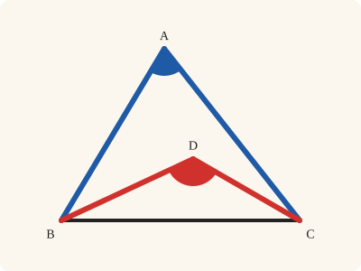
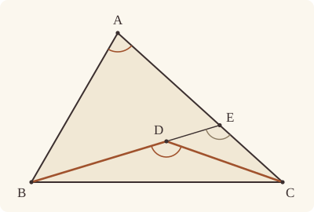
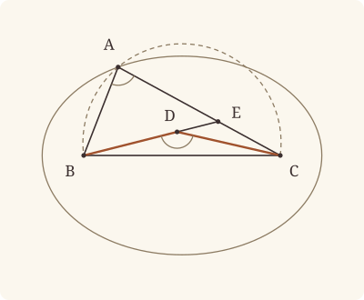

<!-- Generated by scripts/render.py. Do not edit by hand. -->

[Book I](index.md) · [← I.20](20.md) · [I.22 →](22.md)

# Book I, Proposition 21

*Straight lines within a triangle are less, their angle greater*

[Euclid's proof](#euclids-proof) · [In Lean](#in-lean) · [What it rests on](#what-it-rests-on) · [Mishnah](#mishnah)

> If on one of the sides of a triangle, from its extremities, there be constructed two straight lines meeting within the triangle, the straight lines so constructed will be less than the remaining two sides of the triangle, but will contain a greater angle.

**In Lean:** ✅ proved, as Euclid states it · Euclid's argument

<p align="center"></p>

<p align="center"><em>From the ends of the base draw two straight lines to a point within (red): together they are less than the two sides (blue), yet the angle they contain (red) is greater than the angle at the top (blue).</em></p>

## Euclid's proof

<p align="center"></p>

On BC, one of the sides of the triangle ABC, from its extremities B, C, let the two straight lines BD, DC be constructed meeting within the triangle;

I say that BD, DC are less than the remaining two sides of the triangle BA, AC, but contain an angle BDC greater than the angle BAC.

For let BD be drawn through to E.

Then, since in any triangle two sides are greater than the remaining one, [I. 20]

therefore, in the triangle ABE, the two sides AB, AE are greater than BE.

Let EC be added to each;

therefore BA, AC are greater than BE, EC.

Again, since, in the triangle CED,

the two sides CE, ED are greater than CD,

let DB be added to each;

therefore CE, EB are greater than CD, DB.

But BA, AC were proved greater than BE, EC;

therefore BA, AC are much greater than BD, DC.

Again, since in any triangle the exterior angle is greater than the interior and opposite angle, [I. 16]

therefore, in the triangle CDE,

the exterior angle BDC is greater than the angle CED.

For the same reason, moreover, in the triangle ABE also,

the exterior angle CEB is greater than the angle BAC.

But the angle BDC was proved greater than the angle CEB;

therefore the angle BDC is much greater than the angle BAC.

Therefore etc.

Q. E. D.

## In Lean

| | |
|---|---|
| Proof | ✅ Proved |
| Statement | The whole enunciation. "Within the triangle" is read as three facts: D lies on A's side of BC, on B's side of CA and on C's side of AB. |
| Argument | Euclid's. |
| Reviewed | The statement and every passage of the argument read against Heath's text, at commit [`86e935fe`](https://github.com/jackChallis/stoicheia/commit/86e935fe) ([the record](../../review/I/21.toml)) |

From [`Elements/BookI/Prop21.lean`](../../Elements/BookI/Prop21.lean). Euclid's sentences are the `--` comments, and our own notes are in `/- … -/`; the lines under each sentence are the Lean that carries it out. The list below marks where a lemma does a step Euclid takes for granted, where the statement already gives a step and where a step needs a word of its own; the `/- … -/` notes in the listing explain smaller adjustments.

**How the Lean follows the text**

- **Already given.** "On BC, one of the sides of the triangle ABC…" The statement gives the point D within the triangle, and BD and DC are named by their ends, so nothing is constructed here.
- **Done by `Prop21.through`.** "For let BD be drawn through to E." Euclid takes from his figure that BD produced meets AC beyond D; the Lean uses `crossbar` in `Prop21.through` to find E between A and C on the ray from B through D, since D lies within the angle ABC. The ray rules out B between D and E, and B and D lying on one side of AC rules out E between them (System E, Pasch 3), so D lies between B and E.
- **Done by `Tacit.add_lt_add_right`.** "Let EC be added to each…" Euclid adds EC both to the sum of AB and AE and to BE, keeping the first sum greater. The Lean uses `Tacit.add_lt_add_right`, a rule we assume (System E §3.5).
- **Done by `Tacit.len_add_of_between`.** "therefore BA, AC are greater than BE, EC." Euclid reads AE and EC together as AC because E lies between A and C. The Lean makes this replacement with `Tacit.len_add_of_between`, a rule we assume (System E, Diagram-segment 1).
- **Done by `Tacit.add_lt_add_right`.** "let DB be added to each…" Euclid adds DB both to the sum of CE and ED and to CD, keeping the first sum greater. The Lean uses the same rule, `Tacit.add_lt_add_right`, now in the triangle CED.
- **Done by `Tacit.len_add_of_between`.** "therefore CE, EB are greater than CD, DB." Euclid reads ED and DB together as EB because D lies between E and B. The Lean makes this replacement with `Tacit.len_add_of_between` again, as for AE and EC.
- **Carried.** "But BA, AC were proved greater than BE, EC…" The Lean restates here that BA, AC are greater than BE, EC, as Euclid recalls it; the next step cites the inequality where it was first proved, and does not use the restatement.

<details><summary>Before the theorem, one lemma: <code>Prop21.through</code> (28 lines)</summary>

```lean
/-! ## What Euclid reads off the figure -/

/-- "Let BD be drawn through to E." In Euclid's figure BD, produced beyond D,
meets the side AC at a point E between A and C.

It meets it because D lies within the angle ABC (on C's side of BA and on
A's side of BC), so the ray from B through D crosses AC (`crossbar`). And
D falls short of E, rather than beyond it: E is on AC, while B and D are
on one side of AC, so E cannot lie between them (System E, Pasch 3); and B is
not between D and E, since E is on the ray from B through D. Of three points
on a straight line one is between the other two (Between 6), so it is D. -/
theorem Prop21.through {A B C D : Point} (hD : InsideTriangle D A B C) :
    ∃ E : Point, Between B D E ∧ Between A E C := by
  obtain ⟨hDA, hDB, hDC⟩ := hD
  /- D lies within the angle ABC: the ray from B through D crosses AC. -/
  obtain ⟨E, hAEC, hE_ray⟩ := crossbar hDC.swap hDA
  obtain ⟨hBD, hEB, ⟨L, hB_L, hD_L, hE_L⟩, hEBD⟩ := hE_ray
  obtain ⟨AC, hA_AC, hC_AC⟩ := Postulate1 A C (ne_of_between_ends hAEC)
  have hE_AC : OnLine E AC := on_line_of_between_ends hAEC hA_AC hC_AC
  have hDB_AC : SameSide D B AC := hDB.sameSide hC_AC hA_AC
  have hDE : D ≠ E := fun e => not_on_line_of_same_side hDB_AC (e ▸ hE_AC)
  refine ⟨E, ?_, hAEC⟩
  rcases between_cases hBD hDE hEB.symm hB_L hD_L hE_L with h | h | h
  · exact h
  · /- B is not between D and E, for E is on the ray from B through D. -/
    exact absurd (between_symm h) hEBD
  · /- Nor is E between B and D, for AC does not separate B from D. -/
    exact absurd (same_side_symm hDB_AC) (pasch3 h hE_AC)
```

</details>

```lean
/-- If on one of the sides of a triangle, from its extremities, there be constructed two straight
lines meeting within the triangle, the straight lines so constructed will be less than the
remaining two sides of the triangle, but will contain a greater angle. -/
theorem Prop21 {A B C D : Point} (hABC : Triangle A B C) (hD : InsideTriangle D A B C) :
    ‖B D‖ + ‖D C‖ < ‖B A‖ + ‖A C‖ ∧ ∠ B A C < ∠ B D C := by
  -- On BC, one of the sides of the triangle ABC, from its extremities B, C, let the two
  -- straight lines BD, DC be constructed meeting within the triangle;
  /- The statement hands us D within the triangle. -/
  -- I say that BD, DC are less than the remaining two sides of the triangle BA, AC, but
  -- contain an angle BDC greater than the angle BAC.
  -- For let BD be drawn through to E.
  /- BD produced crosses AC at E, beyond D: see `Prop21.through`. -/
  obtain ⟨E, hBDE, hAEC⟩ := Prop21.through hD
  /- B is off AC, since ABC is a triangle. And C is off BE: else BE would be BC,
     and D, which is on A's side of BC, would lie on it. -/
  obtain ⟨AC, hA_AC, hC_AC⟩ := Postulate1 A C hABC.ne₁₃
  have hE_AC : OnLine E AC := on_line_of_between_ends hAEC hA_AC hC_AC
  have hB_AC : ¬ OnLine B AC := hABC.acb.off_line hA_AC hC_AC
  have hA_E : A ≠ E := ne_of_between hAEC
  have hB_E : B ≠ E := ne_of_between_ends hBDE
  have hD_E : D ≠ E := (ne_of_between (between_symm hBDE)).symm
  obtain ⟨BE, hB_BE, hE_BE⟩ := Postulate1 B E hB_E
  have hD_BE : OnLine D BE := on_line_of_between_ends hBDE hB_BE hE_BE
  have hC_BE : ¬ OnLine C BE := by
    intro hC
    obtain ⟨BC, hB_BC, hC_BC⟩ := Postulate1 B C hABC.ne₂₃
    have hD_BC : ¬ OnLine D BC := not_on_line_of_same_side (hD.1.sameSide hB_BC hC_BC)
    exact hD_BC (line_unique hABC.ne₂₃ hB_BE hC hB_BC hC_BC ▸ hD_BE)
  /- So ABE and CED are triangles. -/
  have hAEB : Triangle A E B := Triangle.of_line hA_AC hE_AC hA_E hB_AC
  have hEDC : Triangle E D C := Triangle.of_line hE_BE hD_BE hD_E.symm hC_BE
  -- Then, since in any triangle two sides are greater than the remaining one, [I. 20]
  -- therefore, in the triangle ABE, the two sides AB, AE are greater than BE.
  have hBE_lt : ‖B E‖ < ‖B A‖ + ‖A E‖ := (Prop20 hAEB.acb).1
  -- Let EC be added to each;
  have hBEC : ‖B E‖ + ‖E C‖ < ‖B A‖ + ‖A E‖ + ‖E C‖ := add_lt_add_right ‖E C‖ hBE_lt
  -- therefore BA, AC are greater than BE, EC.
  /- AE and EC together make up AC, since E lies between A and C. -/
  have hBA_AC : ‖B E‖ + ‖E C‖ < ‖B A‖ + ‖A C‖ := by
    rw [← len_add_of_between hAEC, ← add_assoc]
    exact hBEC
  -- Again, since, in the triangle CED,
  have hCED : Triangle C E D := hEDC.cab
  -- the two sides CE, ED are greater than CD,
  have hCD_lt : ‖C D‖ < ‖C E‖ + ‖E D‖ := (Prop20 hCED).2.1
  -- let DB be added to each;
  have hCDB : ‖C D‖ + ‖D B‖ < ‖C E‖ + ‖E D‖ + ‖D B‖ := add_lt_add_right ‖D B‖ hCD_lt
  -- therefore CE, EB are greater than CD, DB.
  /- ED and DB together make up EB, since D lies between E and B. -/
  have hCE_EB : ‖C D‖ + ‖D B‖ < ‖C E‖ + ‖E B‖ := by
    rw [← len_add_of_between (between_symm hBDE), ← add_assoc]
    exact hCDB
  -- But BA, AC were proved greater than BE, EC;
  have : ‖B E‖ + ‖E C‖ < ‖B A‖ + ‖A C‖ := hBA_AC
  -- therefore BA, AC are much greater than BD, DC.
  /- BD, DC are CD, DB taken the other way round, and BE, EC are CE, EB. -/
  have hsides : ‖B D‖ + ‖D C‖ < ‖B A‖ + ‖A C‖ := by
    have h₁ : ‖B D‖ + ‖D C‖ = ‖C D‖ + ‖D B‖ := by
      rw [add_comm, len_symm D C, len_symm B D]
    have h₂ : ‖C E‖ + ‖E B‖ = ‖B E‖ + ‖E C‖ := by
      rw [add_comm, len_symm C E, len_symm E B]
    rw [h₁]
    exact lt_trans (h₂ ▸ hCE_EB) hBA_AC
  -- Again, since in any triangle the exterior angle is greater than the interior and opposite
  -- angle, [I. 16]
  -- therefore, in the triangle CDE,
  /- In the triangle CDE the side ED is produced to B. -/
  have hEDB : Between E D B := between_symm hBDE
  -- the exterior angle BDC is greater than the angle CED.
  /- I.16 reads both angles the other way round, as DEC and CDB. -/
  have hCED_BDC : ∠ C E D < ∠ B D C := by
    rw [angle_symm (ne_of_between (between_symm hAEC)) hD_E,
      angle_symm (ne_of_between hBDE) hEDC.ne₂₃.symm]
    exact (Prop16 hCED hEDB).1
  -- For the same reason, moreover, in the triangle ABE also,
  /- In the triangle ABE the side AE is produced to C. -/
  have hBAE : Triangle B A E := hAEB.cab
  -- the exterior angle CEB is greater than the angle BAC.
  /- I.16 gives the angle EAB less than BEC. The angle EAB, read the other way
     round, is BAE, and that is the angle BAC, since E lies on the ray from A
     through C. -/
  have hBAC_CEB : ∠ B A C < ∠ C E B := by
    rw [← angle_onRay_right (OnRay.of_between hAEC) hABC.ne₁₂.symm,
      angle_symm hABC.ne₁₂.symm hA_E.symm,
      angle_symm (ne_of_between (between_symm hAEC)) hB_E]
    exact (Prop16 hBAE hAEC).1
  -- But the angle BDC was proved greater than the angle CEB;
  /- The angle CED is the angle CEB, since D lies on the ray from E through
     B. -/
  have hCEB_BDC : ∠ C E B < ∠ B D C := by
    rw [← angle_onRay_right (OnRay.of_between hEDB) (ne_of_between (between_symm hAEC))]
    exact hCED_BDC
  -- therefore the angle BDC is much greater than the angle BAC.
  have hangle : ∠ B A C < ∠ B D C := lt_trans hBAC_CEB hCEB_BDC
  -- Therefore etc.
  exact ⟨hsides, hangle⟩
  -- Q. E. D.
```

## What it rests on

| | |
|---|---|
| Heath's references | [I.16](16.md), [I.20](20.md) |
| Lean cites | [I.16](16.md), [I.20](20.md) |
| Postulates | 1, 2, 3, 4 |
| Definitions taken as axioms | Def. I.15 |
| Common Notions | 1, 2, 3, 4, 5 |
| Tacit rules | 38 (listed below) |
| Its own Lean calls | Postulate 1; 11 tacit rules |
| Through lemmas | Postulate 3; Def. I.15; 20 tacit rules |

_Postulates, definitions, Common Notions and tacit rules: all that this proof rests on, counting those of the propositions it cites. The last two rows say which of the postulates, definitions and tacit rules its own Lean calls, in the proof or a helper written for it, and which it does not call but reaches through lemmas, of Book Zero or shared (a proposition it cites may rest on these too); the rest come in only through the propositions it cites or the Common Notions._

<details><summary>The 38 tacit rules beneath this proof, counting those of the propositions it cites</summary>

_(used here) marks a rule this proof's own Lean calls, in the proof or a helper written for it; (through …) marks one its own Lean does not call but reaches through the lemmas named, of [Book Zero](../../Elements/Figure) or shared, though a proposition it cites may rest on it too; and a rule with no mark comes in only through a proposition it cites or a Common Notion. The names in brackets are System E's: an Intersection rule says when straight lines and circles must meet, and an Intersections rule takes a point where they do (see [Book I's introduction](index.md))._

**Reading the figure**

- [`between_cases`](../../Elements/Foundations/Tacit/Diagram.lean#L54) (used here): Of three different points on a straight line, one is between the other two. (Between 6)
- [`between_of_inside_chord`](../../Elements/Foundations/Tacit/Diagram.lean#L81) (through [`OnRay.of_between`](../../Elements/Figure/Rays.lean#L34), [`Tacit.ne_of_between_ends`](../../Elements/Figure/Incidence.lean#L65), [`Tacit.on_line_of_between_ends`](../../Elements/Figure/RuleBase.lean#L147) and 4 other lemmas): A straight line through a point inside a circle has that point between the points where it meets the circle. (Circle 1)
- [`between_symm`](../../Elements/Foundations/Tacit/Diagram.lean#L47) (used here): If B is between A and C, it is between C and A. (Between 1)
- [`circles_meet`](../../Elements/Foundations/Tacit/Diagram.lean#L94) (through [`OnRay.of_between`](../../Elements/Figure/Rays.lean#L34), [`Tacit.on_line_of_between_ends`](../../Elements/Figure/RuleBase.lean#L147), [`Tacit.pasch3`](../../Elements/Figure/RuleBase.lean#L219) and 2 other lemmas): If each circle passes through a point inside the other, the circles cut one another. This is the step Euclid takes for granted in I.1. (Intersection 5)
- [`circles_meet_same_side`](../../Elements/Foundations/Tacit/Constructions.lean#L79) (through [`OnRay.of_between`](../../Elements/Figure/Rays.lean#L34), [`Tacit.on_line_of_between_ends`](../../Elements/Figure/RuleBase.lean#L147), [`Tacit.pasch3`](../../Elements/Figure/RuleBase.lean#L219) and 2 other lemmas): Two circles that cut one another do so on each side of the straight line through their centres. (Intersections 8)
- [`exists_point`](../../Elements/Foundations/Tacit/Constructions.lean#L35) (through [`OnRay.of_between`](../../Elements/Figure/Rays.lean#L34), [`Tacit.ne_of_between_ends`](../../Elements/Figure/Incidence.lean#L65), [`Triangle.ne₁₂`](../../Elements/Figure/Triangles.lean#L22) and 4 other lemmas): Let a point be taken. (Points 1)
- [`exists_point_inside_circle`](../../Elements/Foundations/Tacit/Constructions.lean#L42) (through [`OnRay.of_between`](../../Elements/Figure/Rays.lean#L34), [`Tacit.ne_of_between_ends`](../../Elements/Figure/Incidence.lean#L65), [`Tacit.on_line_of_between_ends`](../../Elements/Figure/RuleBase.lean#L147) and 4 other lemmas): Let a point be taken inside the circle α. (Points 8)
- [`exists_point_on_line`](../../Elements/Foundations/Tacit/Constructions.lean#L38) (through [`OnRay.of_between`](../../Elements/Figure/Rays.lean#L34), [`Tacit.on_line_of_between_ends`](../../Elements/Figure/RuleBase.lean#L147), [`Tacit.pasch3`](../../Elements/Figure/RuleBase.lean#L219) and 2 other lemmas): Let a point be taken on the straight line L. (Points 2)
- [`line_circle_between`](../../Elements/Foundations/Tacit/Constructions.lean#L67) (through [`OnRay.of_between`](../../Elements/Figure/Rays.lean#L34), [`Tacit.ne_of_between_ends`](../../Elements/Figure/Incidence.lean#L65), [`Tacit.on_line_of_between_ends`](../../Elements/Figure/RuleBase.lean#L147) and 4 other lemmas): A straight line through a point B inside a circle, heading out to a point C outside it, cuts the circle between B and C. (Intersections 4)
- [`line_circle_beyond`](../../Elements/Foundations/Tacit/Constructions.lean#L73) (through [`OnRay.of_between`](../../Elements/Figure/Rays.lean#L34), [`Tacit.ne_of_between_ends`](../../Elements/Figure/Incidence.lean#L65), [`Tacit.on_line_of_between_ends`](../../Elements/Figure/RuleBase.lean#L147) and 4 other lemmas): A straight line through a point B inside a circle, produced beyond B away from C, cuts the circle there. (Intersections 5)
- [`line_unique`](../../Elements/Foundations/Tacit/Diagram.lean#L41) (used here): Two points determine a straight line. (Generalities 1)
- [`lines_meet_of_opposite_sides`](../../Elements/Foundations/Tacit/Diagram.lean#L89) (through [`crossbar`](../../Elements/Figure/Angles.lean#L132)): A straight line joining points on opposite sides of L crosses L. (Intersection 1)
- [`not_between_of_between`](../../Elements/Foundations/Tacit/Diagram.lean#L50) (through [`OnRay.of_between`](../../Elements/Figure/Rays.lean#L34), [`Tacit.ne_of_between`](../../Elements/Figure/RuleBase.lean#L140), [`Tacit.ne_of_between_ends`](../../Elements/Figure/Incidence.lean#L65) and 5 other lemmas): If B is between A and C, then A is not between B and C. (Between 1)
- [`not_on_line_of_same_side`](../../Elements/Foundations/Tacit/Diagram.lean#L60) (used here): Points on one side of a straight line are not on it. (Same side 3)
- [`pasch2`](../../Elements/Foundations/Tacit/Diagram.lean#L71) (through [`OnRay.of_between`](../../Elements/Figure/Rays.lean#L34), [`Tacit.on_line_of_between_ends`](../../Elements/Figure/RuleBase.lean#L147), [`Tacit.pasch3`](../../Elements/Figure/RuleBase.lean#L219) and 1 other lemma): If B is between A and C, A is on L and B is off it, then B and C are on the same side of L: a straight line that leaves L at A does not cross it again. (Pasch 2)
- [`same_side_trans`](../../Elements/Foundations/Tacit/Diagram.lean#L64) (through [`OnRay.of_between`](../../Elements/Figure/Rays.lean#L34), [`Tacit.on_line_of_between_ends`](../../Elements/Figure/RuleBase.lean#L147), [`Tacit.pasch3`](../../Elements/Figure/RuleBase.lean#L219) and 2 other lemmas): Two points on the same side of a straight line as a third point are on the same side as each other. (Same side 4)

**Lengths, angles and areas**

- [`angle_add_of_inside`](../../Elements/Foundations/Tacit/Transfer.lean#L47) (through [`Tacit.pasch3`](../../Elements/Figure/RuleBase.lean#L219) and [`crossbar`](../../Elements/Figure/Angles.lean#L132)): If D lies within the angle BAC, then BAC is made up of BAD and DAC. (Diagram-angle 2)
- [`angle_eq_of_same_rays`](../../Elements/Foundations/Tacit/Transfer.lean#L54) (through [`angle_onRay_right`](../../Elements/Figure/Angles.lean#L49)): The angle doesn't change if its arms are traced through other points on the same rays. (Diagram-angle 4)
- [`angle_symm`](../../Elements/Foundations/Tacit/Metric.lean#L30) (used here): The angle ABC is the angle CBA. (Metric 4)
- [`area_add_of_between`](../../Elements/Foundations/Tacit/Transfer.lean#L70): Cutting a triangle in two from a vertex adds up. (Diagram-area 2)
- [`area_congruent`](../../Elements/Foundations/Tacit/Metric.lean#L44): Triangles equal in all their sides and angles are equal in area. Euclid uses this without comment once he has shown two triangles congruent. (Metric 9)
- [`area_degenerate`](../../Elements/Foundations/Tacit/Metric.lean#L36): A "triangle" with a repeated corner has no area. (Metric 6)
- [`area_eq_zero_of_on_line`](../../Elements/Foundations/Tacit/Transfer.lean#L62): A "triangle" whose corners lie on one straight line has no area. (Diagram-area 1)
- [`area_rotate`](../../Elements/Foundations/Tacit/Metric.lean#L39): The triangle ABC is the triangle CAB. (Metric 8)
- [`circle_eq`](../../Elements/Foundations/Tacit/Transfer.lean#L30) (through [`OnRay.of_between`](../../Elements/Figure/Rays.lean#L34), [`Tacit.ne_of_between_ends`](../../Elements/Figure/Incidence.lean#L65), [`Tacit.on_line_of_between_ends`](../../Elements/Figure/RuleBase.lean#L147) and 4 other lemmas): A circle is fixed by its centre and its radius. (Diagram-segment 2)
- [`len_add_of_between`](../../Elements/Foundations/Tacit/Transfer.lean#L27) (used here): If B is between A and C, then AB and BC together make up AC. (Diagram-segment 1)
- [`len_self`](../../Elements/Foundations/Tacit/Metric.lean#L24) (through [`OnRay.of_between`](../../Elements/Figure/Rays.lean#L34), [`Tacit.ne_of_between_ends`](../../Elements/Figure/Incidence.lean#L65), [`Tacit.on_line_of_between_ends`](../../Elements/Figure/RuleBase.lean#L147) and 4 other lemmas): The "straight line" from a point to itself has no length. (Metric 1)
- [`len_symm`](../../Elements/Foundations/Tacit/Metric.lean#L27) (used here): The straight line AB is the straight line BA. (Metric 3)
- [`same_ray_of_angle_eq_zero`](../../Elements/Foundations/Tacit/Transfer.lean#L42) (through [`Tacit.pasch3`](../../Elements/Figure/RuleBase.lean#L219) and [`crossbar`](../../Elements/Figure/Angles.lean#L132)): If the angle BAC is nothing, C lies on the ray from A through B. (Diagram-angle 1)

**Superposition**

- [`superposition`](../../Elements/Foundations/Tacit/Superposition.lean#L52): **Superposition.** A hypothetical placement of a triangle on a given ray and side permits a restricted derivation of metric equalities about the figure already given. The derivation introduces no further objects, cites each geometric law it uses, and exports no symbol of the placement.

**Laws of magnitude**

- [`add_assoc`](../../Elements/Foundations/Tacit/Magnitudes.lean#L23) (used here): Adding three magnitudes in a row, it makes no difference whether the first two or the last two are added first. (System E §3.5)
- [`add_comm`](../../Elements/Foundations/Tacit/Magnitudes.lean#L26) (used here): The order of adding does not matter. (System E §3.5)
- [`add_lt_add_right`](../../Elements/Foundations/Tacit/Magnitudes.lean#L45) (used here): Adding the same thing to both sides keeps "less than". (System E §3.5)
- [`add_zero`](../../Elements/Foundations/Tacit/Magnitudes.lean#L29): Adding nothing changes nothing. (System E §3.5)
- [`lt_irrefl`](../../Elements/Foundations/Tacit/Magnitudes.lean#L32) (through [`OnRay.of_between`](../../Elements/Figure/Rays.lean#L34), [`Tacit.ne_of_between_ends`](../../Elements/Figure/Incidence.lean#L65), [`Tacit.on_line_of_between_ends`](../../Elements/Figure/RuleBase.lean#L147) and 4 other lemmas): No magnitude is less than itself. (System E §3.5)
- [`lt_trans`](../../Elements/Foundations/Tacit/Magnitudes.lean#L35) (used here): What is less than the less is less still. (System E §3.5)
- [`lt_trichotomy`](../../Elements/Foundations/Tacit/Magnitudes.lean#L39) (through [`OnRay.of_between`](../../Elements/Figure/Rays.lean#L34), [`Tacit.ne_of_between_ends`](../../Elements/Figure/Incidence.lean#L65), [`Tacit.on_line_of_between_ends`](../../Elements/Figure/RuleBase.lean#L147) and 4 other lemmas): Of two magnitudes, one is less, or they are equal, or the other is less. (System E §3.5)
- [`not_lt_zero`](../../Elements/Foundations/Tacit/Magnitudes.lean#L42) (through [`OnRay.of_between`](../../Elements/Figure/Rays.lean#L34), [`Tacit.ne_of_between_ends`](../../Elements/Figure/Incidence.lean#L65), [`Tacit.on_line_of_between_ends`](../../Elements/Figure/RuleBase.lean#L147) and 4 other lemmas): Nothing is less than zero. (System E §3.5)

</details>

## Mishnah

_Our commentary: what Euclid assumes, what Lean made us say out loud, and how the result looks by modern means._

Euclid gets both halves of the proposition from one stroke, BD drawn through to E: then I.20 twice for the lengths, and I.16 twice for the angles. Of the enunciation's "meeting", Heath notes: "The word 'meeting' is not in the Greek … but it is necessary in English to indicate that they *meet*" (vol. 1, p. 289).

"The editors generally call attention to the fact that the lines drawn within the triangle in this proposition must be drawn, as the enunciation says, from the *ends* of the side; otherwise it is not necessary that their sum should be less than that of the remaining sides of the triangle" (Heath, vol. 1, p. 290). Proclus shows it simply: in a triangle ABC right-angled at B, as Heath's figure has it, take a point D between B and C, join DA, cut off DE from DA equal to AB, and bisect AE at F; then CF, FD together are greater than CA, AB (Heath, vol. 1, p. 290). Pappus goes further, with propositions "selected apparently from 'the so-called paradoxes' of one Erycinus" (Heath, vol. 1, p. 290): in any triangle but an equilateral one, or an isosceles one with base less than one of the other sides, two straight lines on the base and within the triangle, not drawn from its ends, can together equal the other two sides. Another of them says that "the lines may be so constructed that their sum will bear to the sum of the two sides of the triangle any ratio less than 2 : 1" (Heath, vol. 1, p. 290). It cannot hold in every triangle, for neither line can be longer than the longest side, so the triangle must be chosen to suit the ratio.

Our statement reads "within the triangle" as three facts, D on the inner side of each side, and our proof needs all three: two bring BD, drawn on, to meet AC, as in I.10, and the third keeps D short of E. Euclid's figure shows the three together.

**The modern way.** The points $P$ with $|P - \mathrm{B}| + |P - \mathrm{C}| = \mathrm{AB} + \mathrm{AC}$ make an ellipse with foci B and C through A, and the triangle lies within it, where the sum is less. The points on A's side of BC that see BC under the angle BAC lie on one part of the circumference of the circle through A, B and C (III.21), and from within that circle, on A's side of BC as D is, BC is seen under a greater angle.

<p align="center"></p>

## Further reading

- What may Euclid's figures be trusted to show, such as which point lies inside which region, and what may they not? Kenneth Manders' essay ["The Euclidean Diagram (1995)"](https://doi.org/10.1093/acprof:oso/9780199296453.003.0005) (2008) draws the line, and System E, and so our tacit rules, is built on it.
- Book III will show that the angles in a segment of a circle are all equal, and the chapter "Euclid Book III: About the Circle" of Benno Artmann's [*Euclid: The Creation of Mathematics*](https://doi.org/10.1007/978-1-4612-1412-0) (1999), a mathematician's affectionate walk through all thirteen books, is a good place to look ahead.

[Book I](index.md) · [← I.20](20.md) · [I.22 →](22.md)

---

<sub>Euclid's text: T. L. Heath, *The Thirteen Books of Euclid's Elements*, vol. 1 (Cambridge, 1908), p. 289; [scan leaf n309](https://archive.org/details/thirteenbookseu02heibgoog/page/n309); [figure on n309](https://archive.org/details/thirteenbookseu02heibgoog/page/n309). Public domain.</sub>

<sub>The tacit rules follow the System E of Jeremy Avigad, Edward Dean and John Mumma, read alongside LeanEuclid (Logan Murphy, Kaiyu Yang, Jialiang Sun, Zhaoyu Li, Anima Anandkumar and Xujie Si).</sub>
