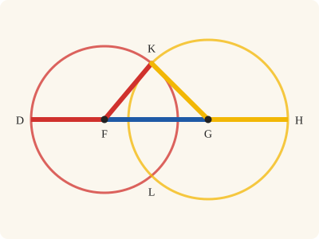
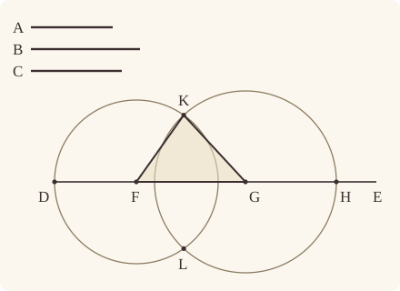
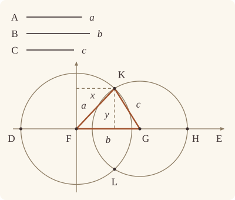

<!-- Generated by scripts/render.py. Do not edit by hand. -->

[Book I](index.md) · [← I.21](21.md) · [I.23 →](23.md)

# Book I, Proposition 22

*A triangle out of three given straight lines*

[Euclid's proof](#euclids-proof) · [In Lean](#in-lean) · [What it rests on](#what-it-rests-on) · [Mishnah](#mishnah)

> Out of three straight lines, which are equal to three given straight lines, to construct a triangle: thus it is necessary that two of the straight lines taken together in any manner should be greater than the remaining one. [I. 20]

**In Lean:** ✅ proved, as Euclid states it · Euclid's argument

<p align="center"></p>

<p align="center"><em>Lay the three straight lines end to end, and swing the outer two up on circles (red and yellow) until they meet: there is the triangle. It works only when any two of them together are greater than the third.</em></p>

## Euclid's proof

<p align="center"></p>

Let the three given straight lines be A, B, C, and of these let two taken together in any manner be greater than the remaining one,

namely A, B greater than C,

A, C greater than B,

and B, C greater than A;

thus it is required to construct a triangle out of straight lines equal to A, B, C.

Let there be set out a straight line DE, terminated at D but of infinite length in the direction of E,

and let DF be made equal to A, FG equal to B, and GH equal to C. [I. 3]

With centre F and distance FD let the circle DKL be described;

again, with centre G and distance GH let the circle KLH be described;

and let KF, KG be joined;

I say that the triangle KFG has been constructed out of three straight lines equal to A, B, C.

For, since the point F is the centre of the circle DKL,

FD is equal to FK.

But FD is equal to A;

therefore KF is also equal to A.

Again, since the point G is the centre of the circle LKH,

GH is equal to GK.

But GH is equal to C;

therefore KG is also equal to C.

And FG is also equal to B;

therefore the three straight lines KF, FG, GK are equal to the three straight lines A, B, C.

Therefore out of the three straight lines KF, FG, GK, which are equal to the three given straight lines A, B, C, the triangle KFG has been constructed.

Q. E. F.

## In Lean

| | |
|---|---|
| Proof | ✅ Proved |
| Statement | The whole enunciation. Euclid's condition is three hypotheses; the triangle has a corner at F, a side on the ray FE, and its third corner on the side of FE where a given point P lies. |
| Argument | Euclid's. |
| Reviewed | The statement and every passage of the argument read against Heath's text, at commit [`e23553ff4`](https://github.com/jackChallis/stoicheia/commit/e23553ff4) ([the record](../../review/I/22.toml)) |

From [`Elements/BookI/Prop22.lean`](../../Elements/BookI/Prop22.lean). Euclid's sentences are the `--` comments, and our own notes are in `/- … -/`; the lines under each sentence are the Lean that carries it out. The list below marks where a lemma does a step Euclid takes for granted, where several sentences share one step and where the statement already gives a step; the `/- … -/` notes in the listing explain smaller adjustments.

**How the Lean follows the text**

- **Done by `Prop22.ne_zero`.** "Let the three given straight lines be A, B, C…" Euclid gives three straight lines; `Prop22.ne_zero` uses the strict inequalities to show that none has zero length, so each pair of endpoints is distinct as I.3 requires.
- **Done by `Prop22.room`.** "and let DF be made equal to A…" Euclid's DE has an end D and extends endlessly towards E; the Lean starts with F and the ray from F through E given by the statement, takes DE through F and E, and finds its end D by cutting off FD equal to A from EF produced beyond F. For each cut, `Prop22.room` uses I.2 and `produce_longer` to find a point far enough along the produced line for I.3 to cut from a longer finite straight line. To reach so far, `produce_longer` describes a circle by Postulate 3, about F for the first two cuts and about G for the third, which Heath's bracket at this step does not name: it names only I.3. Postulate 3 is in the proof's own Lean in any case, which describes Euclid's two circles with it. `between_cut` puts D, F, G and H in order, and the Lean applies `Tacit.not_between_of_between_between` (System E, Between 7), which Book Zero proves, to the orders D, F, G and D, F, E to show that F is not between G and E, placing G on the ray from F through E as the statement asks.
- **Done by `Prop22.meet`.** "again, with centre G and distance GH let the circle KLH be described…" Euclid takes K where the circles meet without proving they meet; `Prop22.meet` finds a point of the circle about G inside the circle about F, including when that point is F itself, and H outside it. The lemma concludes that the circles cut one another by `circlesMeet_of_centre`, System E's Intersection 4 in LeanEuclid's corrected form for a circle whose centre is given, here G. Book Zero proves it from Intersection 5 and `line_circle_between`, finding the crossing from that centre, and it uses neither Circle 1 nor `Tacit.exists_centre`, our rule that every circle has a centre, from which the rule itself, `Tacit.circles_meet_of_on_inside_outside`, takes its centre. So I.22 rests on neither. Until 26 October 2026 the lemma called the rule, whose proof then used Circle 1. The main proof then chooses K on P's side of DE, as the statement asks, by `Tacit.circles_meet_same_side` (System E, Intersections 8), a rule we assume.
- **Already given.** "and let KF, KG be joined…" In the Lean a straight line between two points is named by its ends: KF and KG are sides of the triangle KFG, so nothing is drawn for the joins, and Postulate 1 is not called for them. The joins are drawn in the text and are not needed by the formal proof.
- **Carried together.** "I say that the triangle KFG has been constructed…" Euclid announces here what the steps below establish, and the Lean carries it with them. Its conclusion gives G on the ray from F through E, K on P's side of FE and the three lengths; since K is then off FE, K, F and G make a triangle.

<details><summary>Before the theorem, three lemmas: <code>Prop22.ne_zero</code>, <code>Prop22.room</code> and <code>Prop22.meet</code> (90 lines)</summary>

```lean
/-! ## What Euclid reads off the figure -/

/-- None of the three given straight lines is nothing. If `a` were nothing, the
other two would each be greater than the other: `c` less than `b` (from `a`, `b`
greater than `c`) and `b` less than `c` (from `a`, `c` greater than `b`). Euclid
calls A, B, C straight lines, so for him the question never arises; in our
foundations a finite straight line is a pair of points, which may coincide, and
I.3 wants them apart. -/
theorem Prop22.ne_zero {k : Kind} {a b c : Magnitude k} (h₁ : c < a + b) (h₂ : b < a + c) :
    a ≠ 0 := by
  intro h
  subst h
  rw [add_comm 0 b, add_zero] at h₁
  rw [add_comm 0 c, add_zero] at h₂
  exact lt_irrefl _ (lt_trans h₁ h₂)

/-- Room to cut off a given straight line. Euclid's DE is "of infinite length in
the direction of E", so that whatever is to be cut off from it, there is room.
Our `Line` is a whole straight line, with no length to cut from, and I.3 cuts off
only from a greater finite straight line; so we find a point Z on DF produced
beyond F with FZ greater than the given straight line X₁X₂. At F place a straight
line FY equal to X₁X₂ [I. 2], and produce DF beyond F further than FY
(`produce_longer`, as in I.11). -/
theorem Prop22.room {D F X₁ X₂ : Point} (hDF : D ≠ F) (hX : X₁ ≠ X₂) :
    ∃ Z : Point, Between D F Z ∧ ‖X₁ X₂‖ < ‖F Z‖ := by
  obtain ⟨Y, hFY⟩ := Prop2 F X₁ X₂ hX
  obtain ⟨Z, hDFZ, hFY_FZ⟩ := produce_longer hDF (ne_of_len_eq hFY hX)
  refine ⟨Z, hDFZ, ?_⟩
  rw [← hFY]
  exact hFY_FZ

/-- The circles meet. Euclid takes K where the circle about F and the circle
about G cut one another, and never says why they should. Heath's own argument
(vol. 1, p. 294) is that the circle about G has a point outside the circle about
F, and a point inside it.

* H is outside: FH is FG and GH together, which is greater than FD.
* The point M where GF (produced if need be) cuts the circle about G is
  inside. GM is equal to GH. If M falls between G and F, then FM and
  GH together make FG, which is less than FD and GH together, so FM is
  less than FD. If M falls beyond F, then FM and FG together make GM,
  that is GH, which is less than FD and FG together, so again FM is less
  than FD. And if M is F, it is the centre.

Then the two circles cut one another (System E, Intersection 4, in LeanEuclid's
corrected form): this is the "Principle of Continuity" that Heath invokes here, as he
does for I.1. -/
theorem Prop22.meet {D F G H : Point} {α β : Circle} (hFGH : Between F G H)
    (hF_α : Centre F α) (hD_α : OnCircle D α) (hG_β : Centre G β) (hH_β : OnCircle H β)
    (h₁ : ‖G H‖ < ‖F D‖ + ‖F G‖) (h₂ : ‖F G‖ < ‖F D‖ + ‖G H‖)
    (h₃ : ‖F D‖ < ‖F G‖ + ‖G H‖) : CirclesMeet β α := by
  /- H is outside the circle about F. -/
  have hH_out : OutsideCircle H α :=
    outside_of_len_gt hF_α hD_α (by rw [← len_add_of_between hFGH]; exact h₃)
  /- M is on the ray from G through F, at the distance GH from G: it is
     where the straight line HG, produced beyond the centre G, cuts the circle
     about G (System E, Intersections 5). -/
  have hFG : F ≠ G := ne_of_between hFGH
  obtain ⟨L, hF_L, hG_L⟩ := Postulate1 F G hFG
  have hH_L : OnLine H L := on_line_of_between hFGH hF_L hG_L
  obtain ⟨M, hM_β, hM_L, hMGH⟩ :=
    line_circle_beyond (centre_inside hG_β) hG_L hH_L (ne_of_between (between_symm hFGH))
  have hGM : ‖G M‖ = ‖G H‖ := Definition15 hG_β hM_β hH_β
  have hM_ray : OnRay M G F :=
    ⟨hFG.symm, ne_of_between hMGH, ⟨L, hG_L, hF_L, hM_L⟩,
      not_between_of_between_between (between_symm hMGH) (between_symm hFGH)⟩
  have hF_ray : OnRay F G F := OnRay.self hFG.symm
  /- M is inside the circle about F. -/
  have hM_in : InsideCircle M α := by
    rcases lt_trichotomy ‖G M‖ ‖G F‖ with h | h | h
    · /- M falls between G and F. -/
      have hGMF : Between G M F := hM_ray.between_of_len_lt hF_ray h
      have hsum : ‖F M‖ + ‖G H‖ = ‖F G‖ := by
        rw [← hGM, len_symm G M]
        exact len_add_of_between (between_symm hGMF)
      refine inside_of_len_lt hF_α hD_α (Magnitude.lt_of_add_lt_add_right (a := ‖G H‖) ?_)
      rw [hsum]
      exact h₂
    · /- M is F itself, the centre. -/
      rw [hM_ray.eq_of_len_eq h]
      exact centre_inside hF_α
    · /- M falls beyond F. -/
      have hGFM : Between G F M := hF_ray.between_of_len_lt hM_ray h
      have hsum : ‖F M‖ + ‖F G‖ = ‖G H‖ := by
        rw [← hGM, add_comm, len_symm F G]
        exact len_add_of_between hGFM
      refine inside_of_len_lt hF_α hD_α (Magnitude.lt_of_add_lt_add_right (a := ‖F G‖) ?_)
      rw [hsum]
      exact h₁
  exact circlesMeet_of_centre hG_β hM_β (Or.inr hH_β) hM_in hH_out
```

</details>

```lean
/-- Out of three straight lines, which are equal to three given straight lines, to construct a
triangle: thus it is necessary that two of the straight lines taken together in any manner
should be greater than the remaining one. [I. 20] -/
theorem Prop22 {A₁ A₂ B₁ B₂ C₁ C₂ E F P : Point}
    (hAB : ‖C₁ C₂‖ < ‖A₁ A₂‖ + ‖B₁ B₂‖) (hAC : ‖B₁ B₂‖ < ‖A₁ A₂‖ + ‖C₁ C₂‖)
    (hBC : ‖A₁ A₂‖ < ‖B₁ B₂‖ + ‖C₁ C₂‖) (hFE : F ≠ E) (hP : ¬ Collinear F E P) :
    ∃ G K : Point, OnRay G F E ∧ SameSideOf K P F E ∧
      ‖K F‖ = ‖A₁ A₂‖ ∧ ‖F G‖ = ‖B₁ B₂‖ ∧ ‖G K‖ = ‖C₁ C₂‖ := by
  -- Let the three given straight lines be A, B, C, and of these let two taken together in any
  -- manner be greater than the remaining one,
  /- Straight lines, and so none of them is nothing (`Prop22.ne_zero`): each has
     two different ends, as I.3 will want. -/
  have hA : A₁ ≠ A₂ := fun e => Prop22.ne_zero hAB hAC (by rw [e]; exact len_self A₂)
  have hB : B₁ ≠ B₂ := fun e =>
    Prop22.ne_zero (by rw [add_comm]; exact hAB) hBC (by rw [e]; exact len_self B₂)
  have hC : C₁ ≠ C₂ := fun e =>
    Prop22.ne_zero (by rw [add_comm]; exact hAC) (by rw [add_comm]; exact hBC)
      (by rw [e]; exact len_self C₂)
  -- namely A, B greater than C,
  have hAB_C : ‖C₁ C₂‖ < ‖A₁ A₂‖ + ‖B₁ B₂‖ := hAB
  -- A, C greater than B,
  have hAC_B : ‖B₁ B₂‖ < ‖A₁ A₂‖ + ‖C₁ C₂‖ := hAC
  -- and B, C greater than A;
  have hBC_A : ‖A₁ A₂‖ < ‖B₁ B₂‖ + ‖C₁ C₂‖ := hBC
  -- thus it is required to construct a triangle out of straight lines equal to A, B, C.
  -- Let there be set out a straight line DE, terminated at D but of infinite length in the
  -- direction of E,
  /- The straight line DE is the straight line through the given points F and E
     [Post. 1]. Its end D is not given: it is set out behind F, at the distance A,
     in the next breath. -/
  obtain ⟨DE, hF_DE, hE_DE⟩ := Postulate1 F E hFE
  have hP_DE : ¬ OnLine P DE := fun h => hP ⟨DE, hF_DE, hE_DE, h⟩
  -- and let DF be made equal to A, FG equal to B, and GH equal to C. [I. 3]
  /- Three times I.3, each time cutting off from a straight line produced far
     enough to cut from (`Prop22.room`): FD from EF produced beyond F, FG from DF
     produced beyond F, and GH from FG produced beyond G. So D, F, G, H lie in that
     order along DE, as in Euclid's figure (`between_cut`), and G lies on the ray
     from F through E. -/
  obtain ⟨X, hEFX, hA_FX⟩ := Prop22.room hFE.symm hA
  obtain ⟨D, hFDX, hFD⟩ := Prop3 hA hA_FX
  have hDFE : Between D F E := between_symm (between_cut hEFX hFDX)
  obtain ⟨Y, hDFY, hB_FY⟩ := Prop22.room (ne_of_between hDFE) hB
  obtain ⟨G, hFGY, hFG⟩ := Prop3 hB hB_FY
  have hDFG : Between D F G := between_cut hDFY hFGY
  obtain ⟨Z, hFGZ, hC_GZ⟩ := Prop22.room (ne_of_between hFGY) hC
  obtain ⟨H, hGHZ, hGH⟩ := Prop3 hC hC_GZ
  have hFGH : Between F G H := between_cut hFGZ hGHZ
  have hD_DE : OnLine D DE := on_line_of_between (between_symm hDFE) hE_DE hF_DE
  have hG_DE : OnLine G DE := on_line_of_between hDFG hD_DE hF_DE
  have hG_ray : OnRay G F E :=
    ⟨hFE, (ne_of_between hFGY).symm, ⟨DE, hF_DE, hE_DE, hG_DE⟩,
      not_between_of_between_between hDFG hDFE⟩
  -- With centre F and distance FD let the circle DKL be described;
  obtain ⟨DKL, hF_DKL, hD_DKL⟩ := Postulate3 F D (ne_of_between hDFE).symm
  -- again, with centre G and distance GH let the circle KLH be described;
  obtain ⟨KLH, hG_KLH, hH_KLH⟩ := Postulate3 G H (ne_of_between hGHZ)
  /- Euclid takes K where the circles cut one another, without a word on why they
     should. They do, because two of A, B, C taken together in any manner are
     greater than the remaining one (`Prop22.meet`: Heath's argument, closed by
     System E, Intersection 4). They cut one another on each side of DE, the
     straight line through their centres, and K is taken on P's side (System E,
     Intersections 8). -/
  have hmeet : CirclesMeet KLH DKL :=
    Prop22.meet hFGH hF_DKL hD_DKL hG_KLH hH_KLH
      (by rw [hGH, hFD, hFG]; exact hAB_C) (by rw [hGH, hFD, hFG]; exact hAC_B)
      (by rw [hGH, hFD, hFG]; exact hBC_A)
  obtain ⟨K, hK_KLH, hK_DKL, hKP⟩ :=
    circles_meet_same_side hmeet hG_KLH hF_DKL hG_DE hF_DE hP_DE
  -- and let KF, KG be joined;
  /- KF and KG are named by their ends, as sides of the triangle KFG, so nothing is
     drawn for the joins. -/
  -- I say that the triangle KFG has been constructed out of three straight lines equal to A,
  -- B, C.
  -- For, since the point F is the centre of the circle DKL,
  -- FD is equal to FK.
  have hFD_FK : ‖F D‖ = ‖F K‖ := Definition15 hF_DKL hD_DKL hK_DKL
  -- But FD is equal to A;
  have hFD_A : ‖F D‖ = ‖A₁ A₂‖ := hFD
  -- therefore KF is also equal to A.
  have hKF : ‖K F‖ = ‖A₁ A₂‖ := (len_symm K F).trans (hFD_FK.symm.trans hFD_A)
  -- Again, since the point G is the centre of the circle LKH,
  -- GH is equal to GK.
  have hGH_GK : ‖G H‖ = ‖G K‖ := Definition15 hG_KLH hH_KLH hK_KLH
  -- But GH is equal to C;
  have hGH_C : ‖G H‖ = ‖C₁ C₂‖ := hGH
  -- therefore KG is also equal to C.
  have hKG : ‖K G‖ = ‖C₁ C₂‖ := (len_symm K G).trans (hGH_GK.symm.trans hGH_C)
  -- And FG is also equal to B;
  have hFG_B : ‖F G‖ = ‖B₁ B₂‖ := hFG
  -- therefore the three straight lines KF, FG, GK are equal to the three straight lines A, B,
  -- C.
  have hGK : ‖G K‖ = ‖C₁ C₂‖ := (len_symm G K).trans hKG
  -- Therefore out of the three straight lines KF, FG, GK, which are equal to the three given
  -- straight lines A, B, C, the triangle KFG has been constructed.
  /- With FG along the given ray from F through E, and K on P's side of FE. -/
  exact ⟨G, K, hG_ray, SameSideOf.of_line hFE hF_DE hE_DE hKP, hKF, hFG_B, hGK⟩
  -- Q. E. F.
```

## What it rests on

| | |
|---|---|
| Heath's references | [I.3](03.md), [I.20](20.md) |
| Lean cites | [I.2](02.md), [I.3](03.md) |
| Postulates | 1, 2, 3 |
| Definitions taken as axioms | Def. I.15 |
| Common Notions | 1, 3, 5 |
| Tacit rules | 26 (listed below) |
| Its own Lean calls | Postulates 1 and 3; Def. I.15; 11 tacit rules |
| Through lemmas | Postulate 2; 14 tacit rules |

_Postulates, definitions, Common Notions and tacit rules: all that this proof rests on, counting those of the propositions it cites. The last two rows say which of the postulates, definitions and tacit rules its own Lean calls, in the proof or a helper written for it, and which it does not call but reaches through lemmas, of Book Zero or shared (a proposition it cites may rest on these too); the rest come in only through the propositions it cites or the Common Notions._

<details><summary>The 26 tacit rules beneath this proof, counting those of the propositions it cites</summary>

_(used here) marks a rule this proof's own Lean calls, in the proof or a helper written for it; (through …) marks one its own Lean does not call but reaches through the lemmas named, of [Book Zero](../../Elements/Figure) or shared, though a proposition it cites may rest on it too; and a rule with no mark comes in only through a proposition it cites or a Common Notion. The names in brackets are System E's: an Intersection rule says when straight lines and circles must meet, and an Intersections rule takes a point where they do (see [Book I's introduction](index.md))._

**Reading the figure**

- [`between_cases`](../../Elements/Foundations/Tacit/Diagram.lean#L54) (through [`OnRay.between_of_len_lt`](../../Elements/Figure/Rays.lean#L123), [`OnRay.eq_of_len_eq`](../../Elements/Figure/Rays.lean#L161), [`Tacit.not_between_of_between_between`](../../Elements/Figure/Incidence.lean#L374) and 2 other lemmas): Of three different points on a straight line, one is between the other two. (Between 6)
- [`between_symm`](../../Elements/Foundations/Tacit/Diagram.lean#L47) (used here): If B is between A and C, it is between C and A. (Between 1)
- [`circles_meet`](../../Elements/Foundations/Tacit/Diagram.lean#L91) (through [`OnRay.between_of_len_lt`](../../Elements/Figure/Rays.lean#L123), [`Tacit.not_between_of_between_between`](../../Elements/Figure/Incidence.lean#L374), [`Tacit.on_line_of_between`](../../Elements/Figure/Incidence.lean#L78) and 3 other lemmas): If each circle passes through a point inside the other, the circles cut one another. This is the step Euclid takes for granted in I.1. (Intersection 5)
- [`circles_meet_same_side`](../../Elements/Foundations/Tacit/Constructions.lean#L79) (used here): Two circles that cut one another do so on each side of the straight line through their centres. (Intersections 8)
- [`exists_point`](../../Elements/Foundations/Tacit/Constructions.lean#L35): Let a point be taken. (Points 1)
- [`exists_point_inside_circle`](../../Elements/Foundations/Tacit/Constructions.lean#L42) (through [`OnRay.between_of_len_lt`](../../Elements/Figure/Rays.lean#L123), [`Tacit.centre_inside`](../../Elements/Figure/RuleBase.lean#L56), [`Tacit.inside_of_len_lt`](../../Elements/Figure/Incidence.lean#L34) and 5 other lemmas): Let a point be taken inside the circle α. (Points 8)
- [`exists_point_on_line`](../../Elements/Foundations/Tacit/Constructions.lean#L38) (through [`OnRay.between_of_len_lt`](../../Elements/Figure/Rays.lean#L123), [`Tacit.not_between_of_between_between`](../../Elements/Figure/Incidence.lean#L374), [`Tacit.on_line_of_between`](../../Elements/Figure/Incidence.lean#L78) and 2 other lemmas): Let a point be taken on the straight line L. (Points 2)
- [`line_circle_between`](../../Elements/Foundations/Tacit/Constructions.lean#L67) (through [`OnRay.between_of_len_lt`](../../Elements/Figure/Rays.lean#L123), [`Tacit.centre_inside`](../../Elements/Figure/RuleBase.lean#L56), [`Tacit.inside_of_len_lt`](../../Elements/Figure/Incidence.lean#L34) and 5 other lemmas): A straight line through a point B inside a circle, heading out to a point C outside it, cuts the circle between B and C. (Intersections 4)
- [`line_circle_beyond`](../../Elements/Foundations/Tacit/Constructions.lean#L73) (used here): A straight line through a point B inside a circle, produced beyond B away from C, cuts the circle there. (Intersections 5)
- [`line_unique`](../../Elements/Foundations/Tacit/Diagram.lean#L41) (through [`OnRay.between_of_len_lt`](../../Elements/Figure/Rays.lean#L123), [`SameSideOf.of_line`](../../Elements/Figure/Sides.lean#L34), [`Tacit.not_between_of_between_between`](../../Elements/Figure/Incidence.lean#L374) and 3 other lemmas): Two points determine a straight line. (Generalities 1)
- [`not_between_of_between`](../../Elements/Foundations/Tacit/Diagram.lean#L50) (through [`OnRay.between_of_len_lt`](../../Elements/Figure/Rays.lean#L123), [`OnRay.self`](../../Elements/Figure/Rays.lean#L29), [`Tacit.centre_inside`](../../Elements/Figure/RuleBase.lean#L56) and 8 other lemmas): If B is between A and C, then A is not between B and C. (Between 1)
- [`not_on_line_of_same_side`](../../Elements/Foundations/Tacit/Diagram.lean#L60) (through [`OnRay.between_of_len_lt`](../../Elements/Figure/Rays.lean#L123), [`Tacit.not_between_of_between_between`](../../Elements/Figure/Incidence.lean#L374), [`Tacit.on_line_of_between`](../../Elements/Figure/Incidence.lean#L78) and 2 other lemmas): Points on one side of a straight line are not on it. (Same side 3)
- [`pasch2`](../../Elements/Foundations/Tacit/Diagram.lean#L71) (through [`OnRay.between_of_len_lt`](../../Elements/Figure/Rays.lean#L123), [`Tacit.not_between_of_between_between`](../../Elements/Figure/Incidence.lean#L374), [`Tacit.on_line_of_between`](../../Elements/Figure/Incidence.lean#L78) and 2 other lemmas): If B is between A and C, A is on L and B is off it, then B and C are on the same side of L: a straight line that leaves L at A does not cross it again. (Pasch 2)
- [`same_side_trans`](../../Elements/Foundations/Tacit/Diagram.lean#L64) (through [`OnRay.between_of_len_lt`](../../Elements/Figure/Rays.lean#L123), [`Tacit.not_between_of_between_between`](../../Elements/Figure/Incidence.lean#L374), [`Tacit.on_line_of_between`](../../Elements/Figure/Incidence.lean#L78) and 2 other lemmas): Two points on the same side of a straight line as a third point are on the same side as each other. (Same side 4)

**Lengths, angles and areas**

- [`len_add_of_between`](../../Elements/Foundations/Tacit/Transfer.lean#L27) (used here): If B is between A and C, then AB and BC together make up AC. (Diagram-segment 1)
- [`len_self`](../../Elements/Foundations/Tacit/Metric.lean#L24) (used here): The "straight line" from a point to itself has no length. (Metric 1)
- [`len_symm`](../../Elements/Foundations/Tacit/Metric.lean#L27) (used here): The straight line AB is the straight line BA. (Metric 3)
- [`radius_ne_zero`](../../Elements/Foundations/Tacit/Metric.lean#L62) (through [`OnRay.between_of_len_lt`](../../Elements/Figure/Rays.lean#L123), [`OnRay.eq_of_len_eq`](../../Elements/Figure/Rays.lean#L161), [`OnRay.self`](../../Elements/Figure/Rays.lean#L29) and 9 other lemmas): A circle's radius is not nothing: the straight line from the centre to a point on the circle has some length. A rule of our own, not one of System E's: every circle is drawn with a centre and a distance (Postulate 3).

**Rules of magnitude**

- [`add_assoc`](../../Elements/Foundations/Tacit/Magnitudes.lean#L23) (through [`OnRay.between_of_len_lt`](../../Elements/Figure/Rays.lean#L123), [`between_cut`](../../Elements/Figure/Lines.lean#L65) and [`produce_longer`](../../Elements/Figure/Lines.lean#L82)): Adding three magnitudes in a row, it makes no difference whether the first two or the last two are added first. (System E §3.5)
- [`add_comm`](../../Elements/Foundations/Tacit/Magnitudes.lean#L26) (used here): The order of adding does not matter. (System E §3.5)
- [`add_lt_add_right`](../../Elements/Foundations/Tacit/Magnitudes.lean#L45) (through [`Magnitude.lt_of_add_lt_add_right`](../../Elements/Figure/Lengths.lean#L51), [`OnRay.between_of_len_lt`](../../Elements/Figure/Rays.lean#L123), [`Tacit.not_between_of_between_between`](../../Elements/Figure/Incidence.lean#L374) and 2 other lemmas): Adding the same thing to both sides keeps "less than". (System E §3.5)
- [`add_zero`](../../Elements/Foundations/Tacit/Magnitudes.lean#L29) (used here): Adding nothing changes nothing. (System E §3.5)
- [`lt_irrefl`](../../Elements/Foundations/Tacit/Magnitudes.lean#L32) (used here): No magnitude is less than itself. (System E §3.5)
- [`lt_trans`](../../Elements/Foundations/Tacit/Magnitudes.lean#L35) (used here): What is less than the less is less still. (System E §3.5)
- [`lt_trichotomy`](../../Elements/Foundations/Tacit/Magnitudes.lean#L39) (used here): Of two magnitudes, one is less, or they are equal, or the other is less. (System E §3.5)
- [`not_lt_zero`](../../Elements/Foundations/Tacit/Magnitudes.lean#L42) (through [`OnRay.between_of_len_lt`](../../Elements/Figure/Rays.lean#L123), [`OnRay.eq_of_len_eq`](../../Elements/Figure/Rays.lean#L161), [`OnRay.self`](../../Elements/Figure/Rays.lean#L29) and 8 other lemmas): Nothing is less than zero. (System E §3.5)

</details>

## Mishnah

_Our commentary: why Euclid's proof, and ours, look as they do._

Not every three straight lines make a triangle, as the enunciation says. "This is the first case in the *Elements* of a διορισμός to a problem in the sense of a statement of the conditions or limits of the possibility of a solution. The criterion is of course supplied by the preceding proposition" (Heath, vol. 1, p. 293). We state the three conditions as hypotheses; the proof needs no I.20, which shows only that they cannot be dropped. Euclid sets out DE "terminated at D but of infinite length in the direction of E", so that I.3 has room to cut DF, FG and GH off it. But I.3 cuts only from a greater finite straight line, so we say how far to go: I.2 sets out a straight line equal to the one to be cut off, and the straight line to be cut from is produced further, as in I.11.

**"Who is so dull?"** Heath notes: "It was early observed that Euclid assumes, without giving any reason, that the circles drawn as described will meet" when the condition holds (vol. 1, p. 293). Robert Simson was impatient: "For who is so dull, though only beginning to learn the Elements, as not to perceive that the circle described from the centre F, at the distance FD, must meet FH betwixt F and H, because FD is less than FH" (Heath, vol. 1, p. 293). Lean is exactly that dull.

Heath's answer is that the circle about G has a point outside the circle about F and a point inside it. H is outside, FH being B and C together, greater than A. The point M where GF, produced if need be, meets the circle about G is inside, since taking the same thing from two unequals leaves FM less than A; our proof also takes the case he passes over, where M is F itself. Then "we have only to invoke the Principle of Continuity, as we have to do in I. 1" (Heath, vol. 1, p. 294). Our rule here is System E, Intersection 4, in the corrected form LeanEuclid gives it, and Book Zero proves it from Intersection 5, the rule I.1 calls on, with two rules for where a straight line through a circle cuts it.

**The modern way.** Let $a$, $b$, $c$ be the lengths of A, B, C. In the complex plane put $\mathrm{F} = 0$ and $\mathrm{G} = b$, and let $\mathrm{K} = x + iy$, with $x = (a^2 + b^2 - c^2)/(2b)$ and $y = \sqrt{a^2 - x^2}$. Then $|\mathrm{K}| = a$ and $|\mathrm{K} - b| = c$, and $y$ is real and positive exactly when $|a - b| \lt c \lt a + b$: the three conditions of I.22, in one line.

<p align="center"></p>

## Further reading

- When must circles and straight lines meet? Simson thought it too plain to need saying; the chapter "Hilbert's Axioms" of Robin Hartshorne's [*Geometry: Euclid and Beyond*](https://doi.org/10.1007/978-0-387-22676-7) (2000) says exactly when (also on [I.1](01.md)).
- Richard Courant and Herbert Robbins' [*What Is Mathematics?*](https://openlibrary.org/books/OL815900M) (1996, revised by Ian Stewart), a classic for curious readers since 1941, explains in ch. III, "Geometrical Constructions. The Algebra of Number Fields", why ruler and compass can always reach the square root of the modern way.

[Book I](index.md) · [← I.21](21.md) · [I.23 →](23.md)

---

<sub>Euclid's text: T. L. Heath, *The Thirteen Books of Euclid's Elements*, vol. 1 (Cambridge, 1908), pp. 292–293; [scan leaves n312–n313](https://archive.org/details/thirteenbookseu02heibgoog/page/n312); [figure on n312](https://archive.org/details/thirteenbookseu02heibgoog/page/n312). Public domain.</sub>

<sub>The tacit rules follow the System E of Jeremy Avigad, Edward Dean and John Mumma, read alongside LeanEuclid (Logan Murphy, Kaiyu Yang, Jialiang Sun, Zhaoyu Li, Anima Anandkumar and Xujie Si).</sub>
