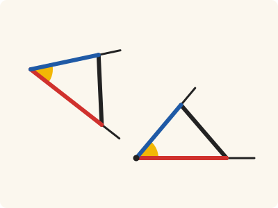
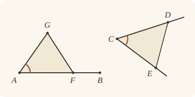

<!-- Generated by scripts/render.py. Do not edit by hand. -->

[Book I](index.md) · [← I.22](22.md) · [I.24 →](24.md)

# Book I, Proposition 23

*An angle equal to a given one, on a given straight line*

[Euclid's proof](#euclids-proof) · [In Lean](#in-lean) · [What it rests on](#what-it-rests-on) · [Mishnah](#mishnah)

> On a given straight line and at a point on it to construct a rectilineal angle equal to a given rectilineal angle.

**In Lean:** ✅ proved, as Euclid states it · Euclid's argument

<p align="center"></p>

<p align="center"><em>To copy an angle (yellow) at a point on a straight line, copy a triangle about it with the same three sides (red, blue and black), and the angle comes with it.</em></p>

## Euclid's proof

<p align="center"></p>

Let AB be the given straight line, A the point on it, and the angle DCE the given rectilineal angle;

thus it is required to construct on the given straight line AB, and at the point A on it, a rectilineal angle equal to the given rectilineal angle DCE.

On the straight lines CD, CE respectively let the points D, E be taken at random;

let DE be joined,

and out of three straight lines which are equal to the three straight lines CD, DE, CE let the triangle AFG be constructed in such a way that CD is equal to AF, CE to AG, and further DE to FG. [I. 22]

Then, since the two sides DC, CE are equal to the two sides FA, AG respectively,

and the base DE is equal to the base FG,

the angle DCE is equal to the angle FAG. [I. 8]

Therefore on the given straight line AB, and at the point A on it, the rectilineal angle FAG has been constructed equal to the given rectilineal angle DCE.

Q. E. F.

## In Lean

| | |
|---|---|
| Proof | ✅ Proved |
| Statement | The whole enunciation. The angle FAG is built with G on the ray from A through B and F on the side of AB where a given point P lies, as I.24, I.31, I.42 and I.44 need. |
| Argument | Euclid's. I.22 builds F and G, with I.20 for its condition on the three lengths, and I.8 gives the equal angle; through I.8 and I.20 the proof rests on superposition. |
| Reviewed | The statement and every passage of the argument read against Heath's text, at commit [`ece9c2d71`](https://github.com/jackChallis/stoicheia/commit/ece9c2d71) ([the record](../../review/I/23.toml)) |

From [`Elements/BookI/Prop23.lean`](../../Elements/BookI/Prop23.lean). Euclid's sentences are the `--` comments, and our own notes are in `/- … -/`; the lines under each sentence are the Lean that carries it out. The list below marks where a lemma does a step Euclid takes for granted and where the statement already gives a step; the `/- … -/` notes in the listing explain smaller adjustments.

**How the Lean follows the text**

- **Already given.** "thus it is required to construct on the given straight line AB…" The statement gives the task: an angle FAG equal to the angle DCE, with G on the ray from A through B and F on P's side of AB.
- **Already given.** "On the straight lines CD, CE respectively let the points D, E be taken at random…" The statement names a point on each arm, D on CD and E on CE, and we take those; any others would serve, for an angle depends only on its two rays.
- **Already given.** "let DE be joined…" Our triangle DCE is named by its corners, so the Lean draws no straight line DE; its three sides are the three straight lines that I.22 takes.
- **Done by `Prop20`.** "and out of three straight lines which are equal to the three straight lines CD, DE, CE…" Euclid applies I.22 without checking its condition on the three lengths. The Lean first uses I.20 (`Prop20`) on DCE for all three inequalities, then uses I.22 to place AFG at A, along AB and on P's side.

```lean
/-- On a given straight line and at a point on it to construct a rectilineal angle equal to a given
rectilineal angle. -/
theorem Prop23 {A B C D E P : Point} (hAB : A ≠ B) (hDCE : Triangle D C E) (hP : ¬ Collinear A B P) :
    ∃ F G : Point, OnRay G A B ∧ SameSideOf F P A B ∧ ∠ F A G = ∠ D C E := by
  -- Let AB be the given straight line, A the point on it, and the angle DCE the given
  -- rectilineal angle;
  /- The given angle comes as the triangle DCE: its arms CD, CE are two straight
     lines through C, not one, so it is a true rectilineal angle. We shall need the
     straight line AB itself, to see that the angle we build is not flat either. -/
  obtain ⟨AB, hA_AB, hB_AB⟩ := Postulate1 A B hAB
  -- thus it is required to construct on the given straight line AB, and at the point A on it,
  -- a rectilineal angle equal to the given rectilineal angle DCE.
  /- We build the angle on the ray from A through B, and on the side of AB where P
     is, so that later propositions can place it where they need it (I.24, I.31, I.42
     and I.44, and Book III after them). -/
  -- On the straight lines CD, CE respectively let the points D, E be taken at random;
  /- The statement already names a point on each arm, D on CD and E on CE, so we
     take those. Any others would do as well: an angle depends only on its two rays
     (`angle_eq_of_onRay` in Book Zero). -/
  -- let DE be joined,
  /- Our proof uses only the points D and E; the straight line DE is drawn for the eye.
     Joined, it closes the triangle DCE, whose three sides are the three straight
     lines that I.22 is about to take. -/
  -- and out of three straight lines which are equal to the three straight lines CD, DE, CE let
  -- the triangle AFG be constructed in such a way that CD is equal to AF, CE to AG, and
  -- further DE to FG. [I. 22]
  /- I.22 asks that two of the three taken together in any manner be greater than the
     remaining one, and points to I.20 for it. The three are the sides of the
     triangle DCE, so I.20, applied to it named from C, says just that, once each sum
     is read in I.22's order. -/
  obtain ⟨hDE_lt, hCE_lt, hCD_lt⟩ := Prop20 hDCE.bac
  have h₁ : ‖D E‖ < ‖C D‖ + ‖C E‖ := by
    rw [← len_symm D C]
    exact hDE_lt
  have h₂ : ‖C E‖ < ‖C D‖ + ‖D E‖ := hCE_lt
  have h₃ : ‖C D‖ < ‖C E‖ + ‖D E‖ := by
    rw [add_comm, len_symm C E]
    exact hCD_lt
  /- I.22 puts the corner of its triangle at A, the side AG along the ray from A
     through B, and the third corner F on P's side of AB. Its lengths, in its own
     order and Euclid's, are CD, CE and DE. Heath notes that Euclid asks more of
     I.22 here than I.22, as Euclid gives it, provides: a triangle placed on a given
     straight line at a given point (vol. 1, p. 295). Our I.22 is stated so as to
     provide it. -/
  obtain ⟨G, F, hG, hF, hFA_CD, hAG_CE, hGF_DE⟩ :=
    Prop22 (A₁ := C) (A₂ := D) (B₁ := C) (B₂ := E) (C₁ := D) (C₂ := E) h₁ h₂ h₃ hAB hP
  /- Euclid calls AFG a triangle, and I.8 will need it to be one. G is on the
     straight line AB (a point of the ray from A through B, so not A itself), and F,
     being on one side of AB, is off it (`OnRay.onLine`, `SameSideOf.triangle`,
     `Triangle.off_line`, `Triangle.of_line` in Book Zero). -/
  have hG_AB : OnLine G AB := hG.onLine hA_AB hB_AB
  have hA_G : A ≠ G := hG.2.1.symm
  have hF_AB : ¬ OnLine F AB := hF.triangle.off_line hA_AB hB_AB
  have hAFG : Triangle A F G := (Triangle.of_line hA_AB hG_AB hA_G hF_AB).acb
  -- Then, since the two sides DC, CE are equal to the two sides FA, AG respectively,
  have hCD_AF : ‖C D‖ = ‖A F‖ := hFA_CD.symm.trans (len_symm F A)
  have hCE_AG : ‖C E‖ = ‖A G‖ := hAG_CE.symm
  -- and the base DE is equal to the base FG,
  have hDE_FG : ‖D E‖ = ‖F G‖ := hGF_DE.symm.trans (len_symm G F)
  -- the angle DCE is equal to the angle FAG. [I. 8]
  have hDCE_FAG : ∠ D C E = ∠ F A G := Prop8 hDCE.bac hAFG hCD_AF hCE_AG hDE_FG
  -- Therefore on the given straight line AB, and at the point A on it, the rectilineal angle
  -- FAG has been constructed equal to the given rectilineal angle DCE.
  exact ⟨F, G, hG, hF, hDCE_FAG.symm⟩
  -- Q. E. F.
```

## What it rests on

| | |
|---|---|
| Heath's references | [I.8](08.md), [I.22](22.md) |
| Lean cites | [I.8](08.md), [I.20](20.md), [I.22](22.md) |
| Postulates | 1, 2, 3, 4 |
| Definitions taken as axioms | Def. I.15 |
| Common Notions | 1, 2, 3, 4, 5 |
| Tacit rules | 38 (listed below) |
| Its own Lean calls | Postulate 1; 2 tacit rules |
| Through lemmas | 2 tacit rules |

_Postulates, definitions, Common Notions and tacit rules: all that this proof rests on, counting those of the propositions it cites. The last two rows say which of the postulates, definitions and tacit rules its own Lean calls, in the proof or a helper written for it, and which it does not call but reaches through lemmas, of Book Zero or shared (a proposition it cites may rest on these too); the rest come in only through the propositions it cites or the Common Notions._

<details><summary>The 38 tacit rules beneath this proof, counting those of the propositions it cites</summary>

_(used here) marks a rule this proof's own Lean calls, in the proof or a helper written for it; (through …) marks one its own Lean does not call but reaches through the lemmas named, of [Book Zero](../../Elements/Figure) or shared, though a proposition it cites may rest on it too; and a rule with no mark comes in only through a proposition it cites or a Common Notion. The names in brackets are System E's: an Intersection rule says when straight lines and circles must meet, and an Intersections rule takes a point where they do (see [Book I's introduction](index.md))._

**Reading the figure**

- [`between_cases`](../../Elements/Foundations/Tacit/Diagram.lean#L54): Of three different points on a straight line, one is between the other two. (Between 6)
- [`between_of_inside_chord`](../../Elements/Foundations/Tacit/Diagram.lean#L81): A straight line through a point inside a circle has that point between the points where it meets the circle. (Circle 1)
- [`between_symm`](../../Elements/Foundations/Tacit/Diagram.lean#L47): If B is between A and C, it is between C and A. (Between 1)
- [`circles_meet`](../../Elements/Foundations/Tacit/Diagram.lean#L94): If each circle passes through a point inside the other, the circles cut one another. This is the step Euclid takes for granted in I.1. (Intersection 5)
- [`circles_meet_same_side`](../../Elements/Foundations/Tacit/Constructions.lean#L79): Two circles that cut one another do so on each side of the straight line through their centres. (Intersections 8)
- [`exists_point`](../../Elements/Foundations/Tacit/Constructions.lean#L35): Let a point be taken. (Points 1)
- [`exists_point_inside_circle`](../../Elements/Foundations/Tacit/Constructions.lean#L42): Let a point be taken inside the circle α. (Points 8)
- [`exists_point_on_line`](../../Elements/Foundations/Tacit/Constructions.lean#L38): Let a point be taken on the straight line L. (Points 2)
- [`line_circle_between`](../../Elements/Foundations/Tacit/Constructions.lean#L67): A straight line through a point B inside a circle, heading out to a point C outside it, cuts the circle between B and C. (Intersections 4)
- [`line_circle_beyond`](../../Elements/Foundations/Tacit/Constructions.lean#L73): A straight line through a point B inside a circle, produced beyond B away from C, cuts the circle there. (Intersections 5)
- [`line_unique`](../../Elements/Foundations/Tacit/Diagram.lean#L41) (through [`OnRay.onLine`](../../Elements/Figure/Rays.lean#L97) and [`Triangle.of_line`](../../Elements/Figure/Triangles.lean#L82)): Two points determine a straight line. (Generalities 1)
- [`lines_meet_of_opposite_sides`](../../Elements/Foundations/Tacit/Diagram.lean#L89): A straight line joining points on opposite sides of L crosses L. (Intersection 1)
- [`not_between_of_between`](../../Elements/Foundations/Tacit/Diagram.lean#L50): If B is between A and C, then A is not between B and C. (Between 1)
- [`not_on_line_of_same_side`](../../Elements/Foundations/Tacit/Diagram.lean#L60) (through [`SameSideOf.triangle`](../../Elements/Figure/Sides.lean#L61)): Points on one side of a straight line are not on it. (Same side 3)
- [`pasch2`](../../Elements/Foundations/Tacit/Diagram.lean#L71): If B is between A and C, A is on L and B is off it, then B and C are on the same side of L: a straight line that leaves L at A does not cross it again. (Pasch 2)
- [`same_side_trans`](../../Elements/Foundations/Tacit/Diagram.lean#L64): Two points on the same side of a straight line as a third point are on the same side as each other. (Same side 4)

**Lengths, angles and areas**

- [`angle_add_of_inside`](../../Elements/Foundations/Tacit/Transfer.lean#L47): If D lies within the angle BAC, then BAC is made up of BAD and DAC. (Diagram-angle 2)
- [`angle_eq_of_same_rays`](../../Elements/Foundations/Tacit/Transfer.lean#L54): The angle doesn't change if its arms are traced through other points on the same rays. (Diagram-angle 4)
- [`angle_symm`](../../Elements/Foundations/Tacit/Metric.lean#L30): The angle ABC is the angle CBA. (Metric 4)
- [`area_add_of_between`](../../Elements/Foundations/Tacit/Transfer.lean#L70): Cutting a triangle in two from a vertex adds up. (Diagram-area 2)
- [`area_congruent`](../../Elements/Foundations/Tacit/Metric.lean#L44): Triangles equal in all their sides and angles are equal in area. Euclid uses this without comment once he has shown two triangles congruent. (Metric 9)
- [`area_degenerate`](../../Elements/Foundations/Tacit/Metric.lean#L36): A "triangle" with a repeated corner has no area. (Metric 6)
- [`area_eq_zero_of_on_line`](../../Elements/Foundations/Tacit/Transfer.lean#L62): A "triangle" whose corners lie on one straight line has no area. (Diagram-area 1)
- [`area_rotate`](../../Elements/Foundations/Tacit/Metric.lean#L39): The triangle ABC is the triangle CAB. (Metric 8)
- [`circle_eq`](../../Elements/Foundations/Tacit/Transfer.lean#L30): A circle is fixed by its centre and its radius. (Diagram-segment 2)
- [`len_add_of_between`](../../Elements/Foundations/Tacit/Transfer.lean#L27): If B is between A and C, then AB and BC together make up AC. (Diagram-segment 1)
- [`len_self`](../../Elements/Foundations/Tacit/Metric.lean#L24): The "straight line" from a point to itself has no length. (Metric 1)
- [`len_symm`](../../Elements/Foundations/Tacit/Metric.lean#L27) (used here): The straight line AB is the straight line BA. (Metric 3)
- [`same_ray_of_angle_eq_zero`](../../Elements/Foundations/Tacit/Transfer.lean#L42): If the angle BAC is nothing, C lies on the ray from A through B. (Diagram-angle 1)

**Superposition**

- [`superposition`](../../Elements/Foundations/Tacit/Superposition.lean#L48): **Superposition.** A hypothetical placement of a triangle on a given ray and side permits a restricted derivation of metric equalities about the figure already given. The derivation introduces no further objects, cites each geometric law it uses, and exports no symbol of the placement.

**Laws of magnitude**

- [`add_assoc`](../../Elements/Foundations/Tacit/Magnitudes.lean#L23): Adding three magnitudes in a row, it makes no difference whether the first two or the last two are added first. (System E §3.5)
- [`add_comm`](../../Elements/Foundations/Tacit/Magnitudes.lean#L26) (used here): The order of adding does not matter. (System E §3.5)
- [`add_lt_add_right`](../../Elements/Foundations/Tacit/Magnitudes.lean#L45): Adding the same thing to both sides keeps "less than". (System E §3.5)
- [`add_zero`](../../Elements/Foundations/Tacit/Magnitudes.lean#L29): Adding nothing changes nothing. (System E §3.5)
- [`lt_irrefl`](../../Elements/Foundations/Tacit/Magnitudes.lean#L32): No magnitude is less than itself. (System E §3.5)
- [`lt_trans`](../../Elements/Foundations/Tacit/Magnitudes.lean#L35): What is less than the less is less still. (System E §3.5)
- [`lt_trichotomy`](../../Elements/Foundations/Tacit/Magnitudes.lean#L39): Of two magnitudes, one is less, or they are equal, or the other is less. (System E §3.5)
- [`not_lt_zero`](../../Elements/Foundations/Tacit/Magnitudes.lean#L42): Nothing is less than zero. (System E §3.5)

</details>

## Mishnah

_Our commentary: what Euclid assumes, what Lean made us say out loud, and how the result looks by modern means._

An angle is hard to carry about, but a triangle is only three lengths, which I.22 can set down anywhere: so Euclid copies the triangle DCE at A, and I.8 brings the angle with it. "This problem was, according to Eudemus (see Proclus, p. 333, 5), 'rather the discovery of Oenopides,' from which we must apparently infer, not that Oenopides was the first to find any solution of it, but that it was he who discovered the particular solution given by Euclid" (Heath, vol. 1, p. 295).

The editors, Heath notes, seem to have missed that the construction of the triangle here is "not exactly the construction given in I. 22": "We have here to construct a triangle on a certain finite straight line AG as base; in I. 22 we have only to construct a triangle with sides of given length without any restriction as to how it is to be placed" (vol. 1, p. 295). He suspects that Proclus felt it too, and so gave the construction over again "in a more instructive manner" (vol. 1, p. 295). Our I.22 is stated to close the gap, and our I.23 settles what Euclid's "on the given straight line AB" leaves open, for I.24, I.31, I.42 and I.44: as in Heath's figure, G is on the ray from A through B, and F on the side of AB where a given point P lies. Euclid's D and E, "taken at random", may be any points of the arms, since an angle depends only on its rays, and I.22's condition, which Euclid does not check, holds because the three lengths are the sides of the triangle DCE (I.20).

Proclus objects to Apollonius' way, which leans on Book III: circles of one radius about the vertex and about A, equal circumferences cut off on them, and the angles equal as standing on equal circumferences. As under I.11, Heath is kind to Apollonius: "It seems to me probable that his construction was only given from the point of view of *practical*, not theoretical, geometry" (vol. 1, p. 296). Done with compasses, as Heath reads it, the circumference cut off is measured by the straight line joining its ends, and the construction comes to Euclid's with an isosceles triangle: the way an angle is copied to this day.

Our I.8 lays one triangle on another only in thought: it hands back the equality of two angles already drawn, never a new point. So I.23 builds F and G with I.22, as Euclid does.

**The modern way.** In the complex plane, multiplying by $w$ turns every direction through the angle $\arg w$. So the point $\mathrm{A} + \mathrm{(B - A)(E - C)/(D - C)}$ makes with AB, at A, an angle equal to DCE, and its mirror image in the straight line AB makes the same angle on the other side; which of the two lies on P's side is a matter of one sign.

## Further reading

- An angle is copied with one multiplication, and its mirror image with one conjugation, in the chapter "Complex Numbers", where Liang-shin Hahn's [*Complex Numbers and Geometry*](https://doi.org/10.1090/text/052) (2019) begins (also on [I.9](09.md)).
- Here Euclid's figure settles which side and which way. Nathaniel Miller's [*Euclid and His Twentieth Century Rivals*](https://web.stanford.edu/group/cslipublications/cslipublications/site/9781575865072.shtml) (2007), a book that builds a formal system around Euclid's diagrams, complete with a computer proof checker, treats such a figure as a real part of the proof: see ch. 3, "Diagrammatic Proofs".

[Book I](index.md) · [← I.22](22.md) · [I.24 →](24.md)

---

<sub>Euclid's text: T. L. Heath, *The Thirteen Books of Euclid's Elements*, vol. 1 (Cambridge, 1908), pp. 294–295; [scan leaves n314–n315](https://archive.org/details/thirteenbookseu02heibgoog/page/n314); [figure on n314](https://archive.org/details/thirteenbookseu02heibgoog/page/n314). Public domain.</sub>

<sub>The tacit rules follow the System E of Jeremy Avigad, Edward Dean and John Mumma, read alongside LeanEuclid (Logan Murphy, Kaiyu Yang, Jialiang Sun, Zhaoyu Li, Anima Anandkumar and Xujie Si).</sub>
