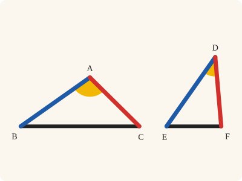
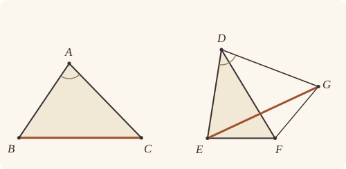
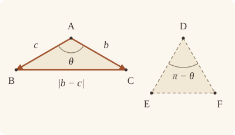

<!-- Generated by scripts/render.py. Do not edit by hand. -->

[Book I](index.md) · [← I.23](23.md) · [I.25 →](25.md)

# Book I, Proposition 24

*The greater angle has the greater base*

[Euclid's proof](#euclids-proof) · [In Lean](#in-lean) · [What it rests on](#what-it-rests-on) · [Mishnah](#mishnah)

> If two triangles have the two sides equal to two sides respectively, but have the one of the angles contained by the equal straight lines greater than the other, they will also have the base greater than the base.

**In Lean:** ✅ proved, as Euclid states it · Euclid's argument

<p align="center"></p>

<p align="center"><em>Two triangles with the same two sides (blue and red): open the angle between them (yellow) wider, and the base (black) is greater.</em></p>

## Euclid's proof

<p align="center"></p>

<p align="center"><em>Drawn for one case: F beyond EG, on the opposite side from D, as in Heath's figure.</em></p>

Let ABC, DEF be two triangles having the two sides AB, AC equal to the two sides DE, DF respectively, namely AB to DE, and AC to DF, and let the angle at A be greater than the angle at D;

I say that the base BC is also greater than the base EF.

For, since the angle BAC is greater than the angle EDF, let there be constructed, on the straight line DE, and at the point D on it, the angle EDG equal to the angle BAC; [I. 23]

let DG be made equal to either of the two straight lines AC, DF, and let EG, FG be joined.

Then, since AB is equal to DE, and AC to DG,

the two sides BA, AC are equal to the two sides ED, DG, respectively;

and the angle BAC is equal to the angle EDG;

therefore the base BC is equal to the base EG. [I. 4]

Again, since DF is equal to DG,

the angle DGF is also equal to the angle DFG; [I. 5]

therefore the angle DFG is greater than the angle EGF.

Therefore the angle EFG is much greater than the angle EGF.

And, since EFG is a triangle having the angle EFG greater than the angle EGF,

and the greater angle is subtended by the greater side, [I. 19]

the side EG is also greater than EF.

But EG is equal to BC.

Therefore BC is also greater than EF.

Therefore etc.

Q. E. D.

## In Lean

| | |
|---|---|
| Proof | ✅ Proved |
| Statement | The whole enunciation. |
| Argument | Euclid's. |
| Reviewed | The statement and every passage of the argument read against Heath's text, at commit [`b7b41f51`](https://github.com/dodecaplex-co/stoicheia/commit/b7b41f51) ([the record](../../review/I/24.toml)) |

From [`Elements/BookI/Prop24.lean`](../../Elements/BookI/Prop24.lean). Euclid's sentences are the `--` comments, and our own notes are in `/- … -/`; the lines under each sentence are the Lean that carries it out. The list below marks where a lemma does a step Euclid takes for granted and where the Lean takes a case Euclid's figure leaves aside; the `/- … -/` notes in the listing explain smaller adjustments.

**How the Lean follows the text**

- **Done by `Prop24.within`.** "let DG be made equal to either of the two straight lines AC, DF…" Euclid places G on the new arm with DG equal to DF; the Lean sets this length with `OnRay.exists_len_eq` and keeps G on F's side of DE with `SameSideOf.of_onRay`. The Lean uses `Prop24.within` to justify Euclid's placing of F within the angle EDG: the joins have distinct ends, DFG is a triangle for I.5, and `Prop24.cases` can use `crossbar` to find X on EG along the ray DF and distinguish F on EG, within the triangle DEG or beyond EG.
- **A further case, by `Prop24.cases`.** "the angle DGF is also equal to the angle DFG…" Euclid draws F beyond EG and leaves the rest to the reader. The Lean takes Proclus' other two cases (Heath, vol. 1, p. 297): F on EG, where EF is a part of EG, and F within the triangle DEG, by I.21.
- **Done by `angle_lt_of_between`.** "therefore the angle DFG is greater than the angle EGF." Euclid reads EGF as part of DGF, which equals DFG. The preceding call to `Prop24.cases` puts the crossing X of EG and DF between D and F; `angle_lt_of_between` makes XGF less than DGF, and the shared ray GE identifies XGF with EGF.
- **Done by `angle_lt_of_between`.** "Therefore the angle EFG is much greater than the angle EGF." Euclid reads DFG as part of EFG. Since X lies between E and G, `angle_lt_of_between` makes XFG less than EFG; the shared ray FD identifies XFG with DFG, and the preceding comparison gives EGF less than EFG.

<details><summary>Before the theorem, two lemmas: <code>Prop24.within</code> and <code>Prop24.cases</code> (57 lines)</summary>

```lean
/-! ## What Euclid reads off the figure -/

/-- F lies within the angle EDG. Both are on one side of DE, and the angle EDF
is the less. If F were on DG, the angle EDF would be the angle EDG
(`angle_onRay_right`); if it were beyond DG, then G would lie within the angle
EDF (System E, Triple incidence 2), and the angle EDG would be a part of it
(`angle_add_of_within`, with the angle GDF something, `Triangle.angle_pos`), so the
greater would be less than the less. -/
theorem Prop24.within {D E F G : Point} (hGF : SameSideOf G F D E) (h : ∠ E D F < ∠ E D G) :
    SameSideOf F E D G := by
  have hDE : D ≠ E := hGF.1
  obtain ⟨L, hD_L, hE_L⟩ := Postulate1 D E hDE
  have hGF_L : SameSide G F L := hGF.sameSide hD_L hE_L
  have hG_L : ¬ OnLine G L := not_on_line_of_same_side hGF_L
  have hF_L : ¬ OnLine F L := not_on_line_of_same_side (same_side_symm hGF_L)
  have hDG : D ≠ G := fun e => hG_L (e ▸ hD_L)
  have hDF : D ≠ F := fun e => hF_L (e ▸ hD_L)
  obtain ⟨M, hD_M, hG_M⟩ := Postulate1 D G hDG
  refine SameSideOf.of_line hDG hD_M hG_M (Classical.byContradiction fun hs => ?_)
  by_cases hF_M : OnLine F M
  · /- Were F on DG, it would lie on G's side of D, since both are on one side of DE. -/
    have hF_ray : OnRay F D G := OnRay.of_sameSideOf hGF.symm ⟨M, hD_M, hG_M, hF_M⟩ hDF.symm
    rw [angle_onRay_right hF_ray hDE.symm] at h
    exact lt_irrefl _ h
  · obtain ⟨N, hD_N, hF_N⟩ := Postulate1 D F hDF
    have hEG_N : SameSide E G N :=
      triple_incidence2 hD_L hD_M hD_N hE_L hG_M hF_N hGF_L
        (fun h' => hs (same_side_symm h')) hF_M hDE.symm
    have hGE : SameSideOf G E D F := SameSideOf.of_line hDF hD_N hF_N (same_side_symm hEG_N)
    have hlt := CommonNotion5 (a := ∠ E D G) hGE.triangle.cab.angle_pos
    rw [← angle_add_of_within hGF hGE] at hlt
    exact lt_irrefl _ (lt_trans hlt h)

/-- Where does F fall? Since F lies within the angle EDG, the straight line DF,
drawn on, crosses EG at some point X (`crossbar`). Then either F is X, and lies
on EG; or F is short of X, within the triangle DEG; or F is beyond X, on
the far side of EG from D, and EFG is a triangle. The last is Euclid's figure. -/
theorem Prop24.cases {D E F G : Point} (hGF : SameSideOf G F D E) (hFE : SameSideOf F E D G) :
    Between E F G ∨ InsideTriangle F G D E ∨
      ∃ X : Point, Between E X G ∧ Between D X F ∧ Triangle E G F := by
  obtain ⟨X, hEXG, hX⟩ := crossbar hGF.symm hFE
  have hDEG : Triangle D E G := hGF.triangle
  obtain ⟨N, hE_N, hG_N⟩ := Postulate1 E G hDEG.ne₂₃
  have hX_N : OnLine X N := on_line_of_between_ends hEXG hE_N hG_N
  have hD_N : ¬ OnLine D N := hDEG.bca.off_line hE_N hG_N
  by_cases hXF : X = F
  · subst hXF
    exact Or.inl hEXG
  obtain ⟨hDF, hXD, ⟨L, hD_L, hF_L, hX_L⟩, hXDF⟩ := hX
  /- F is off EG: otherwise DF and EG would be one straight line, through D. -/
  have hF_N : ¬ OnLine F N := fun hF_N => hD_N (line_unique hXF hX_L hF_L hX_N hF_N ▸ hD_L)
  rcases between_cases hXD.symm hXF hDF hD_L hX_L hF_L with hDXF | hb | hDFX
  · exact Or.inr (Or.inr ⟨X, hEXG, hDXF, Triangle.of_line hE_N hG_N hDEG.ne₂₃ hF_N⟩)
  · exact absurd hb hXDF
  · /- F is on D's side of EG (Pasch 2), and within the angle EDG. -/
    exact Or.inr (Or.inl ⟨hGF.symm,
      SameSideOf.of_line hDEG.ne₂₃ hE_N hG_N (pasch2 (between_symm hDFX) hX_N hF_N), hFE.swap⟩)
```

</details>

```lean
/-- If two triangles have the two sides equal to two sides respectively, but have the one of the
angles contained by the equal straight lines greater than the other, they will also have the
base greater than the base. -/
theorem Prop24 {A B C D E F : Point} (hABC : Triangle A B C) (hDEF : Triangle D E F)
    (hAB : ‖A B‖ = ‖D E‖) (hAC : ‖A C‖ = ‖D F‖) (h : ∠ E D F < ∠ B A C) :
    ‖E F‖ < ‖B C‖ := by
  -- Let ABC, DEF be two triangles having the two sides AB, AC equal to the two sides DE, DF
  -- respectively, namely AB to DE, and AC to DF, and let the angle at A be greater than the
  -- angle at D;
  have hDE : D ≠ E := hDEF.ne₁₂
  have hDF : D ≠ F := hDEF.ne₁₃
  -- I say that the base BC is also greater than the base EF.
  -- For, since the angle BAC is greater than the angle EDF, let there be constructed, on the
  -- straight line DE, and at the point D on it, the angle EDG equal to the angle BAC; [I. 23]
  /- I.23 builds the angle at D with one arm along the ray from D through E (it
     passes through a point E₁ of that ray) and the other through a point G₁ on
     whichever side of DE we ask for. We ask for F's side, as in Euclid's figure. -/
  obtain ⟨G₁, E₁, hE₁, hG₁F, hG₁DE₁⟩ := Prop23 hDE hABC.bac hDEF
  -- let DG be made equal to either of the two straight lines AC, DF, and let EG, FG be joined.
  /- G is laid along the arm DG₁ with a circle about D (`OnRay.exists_len_eq`). It is
     on F's side of DE, as G₁ is (`SameSideOf.of_onRay`), and the angle EDG is the angle
     E₁DG₁, its arms being the same rays (`angle_eq_of_onRay`). -/
  obtain ⟨G, hG, hDG_DF⟩ := OnRay.exists_len_eq hDF hG₁F.triangle.ne₁₃
  have hGF : SameSideOf G F D E := SameSideOf.of_onRay hG hG₁F
  have hEDG : ∠ E D G = ∠ B A C :=
    (angle_eq_of_onRay hE₁.symm hG).trans
      ((angle_symm hE₁.2.1 hG₁F.triangle.ne₁₃.symm).trans hG₁DE₁)
  /- Joining needs different points. G is off DE; and F, the angle EDF being the
     less, lies within the angle EDG (`Prop24.within`), so it is off DG. -/
  have hFE : SameSideOf F E D G := Prop24.within hGF (by rw [hEDG]; exact h)
  have hDEG : Triangle D E G := hGF.triangle
  have hDFG : Triangle D F G := hFE.triangle.acb
  -- Then, since AB is equal to DE, and AC to DG,
  have hAC_DG : ‖A C‖ = ‖D G‖ := hAC.trans hDG_DF.symm
  -- the two sides BA, AC are equal to the two sides ED, DG, respectively;
  -- and the angle BAC is equal to the angle EDG;
  have hBAC : ∠ B A C = ∠ E D G := hEDG.symm
  -- therefore the base BC is equal to the base EG. [I. 4]
  have hBC_EG : ‖B C‖ = ‖E G‖ := (Prop4 hABC hDEG hAB hAC_DG hBAC).1
  -- Again, since DF is equal to DG,
  have hDF_DG : ‖D F‖ = ‖D G‖ := hDG_DF.symm
  -- the angle DGF is also equal to the angle DFG; [I. 5]
  have hDGF : ∠ D G F = ∠ D F G := (Prop5.base hDFG hDF_DG).symm
  /- Euclid's figure has F beyond EG. Our statement, like his enunciation, covers
     every placing of F, so the proof takes as well the two cases he leaves to the
     reader (`Prop24.cases`), as Proclus does. -/
  have hEF_EG : ‖E F‖ < ‖E G‖ := by
    rcases Prop24.cases hGF hFE with hEFG | hF | ⟨X, hEXG, hDXF, hEGF⟩
    · /- F falls on EG: "it is then obvious that EG is greater than EF", the whole
         than the part. -/
      exact len_lt_of_between hEFG
    · /- F falls within the triangle DEG: "by I. 21, DF, FE are together less than
         DG, GE. But DF is equal to DG; therefore EF is less than EG." -/
      have hI21 : ‖D F‖ + ‖F E‖ < ‖D G‖ + ‖G E‖ := (Prop21 hDEG.cab hF).1
      rw [hDF_DG] at hI21
      rw [len_symm E F, len_symm E G]
      exact Magnitude.lt_of_add_lt_add_left hI21
    · /- Euclid's figure has F beyond EG, which DF crosses at X. -/
      have hFG : F ≠ G := hDFG.ne₂₃
      have hEG : E ≠ G := hDEG.ne₂₃
      -- therefore the angle DFG is greater than the angle EGF.
      /- The angle EGF is the angle XGF, a part of the angle DGF, since X lies
         between D and F (`angle_lt_of_between`). -/
      have hEGF_DGF : ∠ E G F < ∠ D G F := by
        rw [← angle_onRay_left (OnRay.of_between (between_symm hEXG)) hFG]
        exact angle_lt_of_between hDFG hDXF
      have hEGF_DFG : ∠ E G F < ∠ D F G := by
        rw [← hDGF]
        exact hEGF_DGF
      -- Therefore the angle EFG is much greater than the angle EGF.
      /- The angle DFG is the angle XFG, a part of the angle EFG, since X lies
         between E and G. -/
      have hDFG_EFG : ∠ D F G < ∠ E F G := by
        rw [← angle_onRay_left (OnRay.of_between (between_symm hDXF)) hFG.symm]
        exact angle_lt_of_between hEGF hEXG
      have hmuch : ∠ E G F < ∠ E F G := lt_trans hEGF_DFG hDFG_EFG
      -- And, since EFG is a triangle having the angle EFG greater than the angle EGF,
      have hEFG : Triangle E F G := hEGF.acb
      -- and the greater angle is subtended by the greater side, [I. 19]
      -- the side EG is also greater than EF.
      exact Prop19 hEFG (by rw [angle_symm hFG hEG]; exact hmuch)
  -- But EG is equal to BC.
  rw [hBC_EG]
  -- Therefore BC is also greater than EF.
  exact hEF_EG
  -- Therefore etc.
  -- Q. E. D.
```

## What it rests on

| | |
|---|---|
| Heath's references | [I.4](04.md), [I.5](05.md), [I.19](19.md), [I.23](23.md) |
| Lean cites | [I.4](04.md), [I.5](05.md), [I.19](19.md), [I.21](21.md), [I.23](23.md) |
| Postulates | 1, 2, 3, 4 |
| Definitions taken as axioms | Def. I.15 |
| Common Notions | 1, 2, 3, 4, 5 |
| Tacit rules | 37 (listed below) |
| Its own Lean calls | Postulate 1; 9 tacit rules |
| Through lemmas | Postulates 2 and 3; Def. I.15; 20 tacit rules |

Some of these come in through lemmas [shared](../../CERTIFICATE.md#shared-steps) by many proofs: [`Prop5.base`](../../Elements/BookI/Helpers.lean#L27) (I.5).

_Postulates, definitions, Common Notions and tacit rules: all that this proof rests on, counting those of the propositions it cites. The last two rows say which of the postulates, definitions and tacit rules its own Lean calls, in the proof or a helper written for it, and which it does not call but reaches through lemmas, of Book Zero or shared (a proposition it cites may rest on these too); the rest come in only through the propositions it cites or the Common Notions._

<details><summary>The 37 tacit rules beneath this proof, counting those of the propositions it cites</summary>

_(used here) marks a rule this proof's own Lean calls, in the proof or a helper written for it; (through …) marks one its own Lean does not call but reaches through the lemmas named, of [Book Zero](../../Elements/Figure) or shared, though a proposition it cites may rest on it too; and a rule with no mark comes in only through a proposition it cites or a Common Notion. The names in brackets are System E's: an Intersection rule says when straight lines and circles must meet, and an Intersections rule takes a point where they do (see [Book I's introduction](index.md))._

**Reading the figure**

- [`between_cases`](../../Elements/Foundations/Tacit/Diagram.lean#L54) (used here): Of three different points on a straight line, one is between the other two. (Between 6)
- [`between_symm`](../../Elements/Foundations/Tacit/Diagram.lean#L47) (used here): If B is between A and C, it is between C and A. (Between 1)
- [`circles_meet`](../../Elements/Foundations/Tacit/Diagram.lean#L91) (through [`OnRay.exists_len_eq`](../../Elements/Figure/Rays.lean#L141), [`OnRay.of_between`](../../Elements/Figure/Rays.lean#L34), [`OnRay.of_sameSideOf`](../../Elements/Figure/Angles.lean#L188) and 8 other lemmas): If each circle passes through a point inside the other, the circles cut one another. This is the step Euclid takes for granted in I.1. (Intersection 5)
- [`circles_meet_same_side`](../../Elements/Foundations/Tacit/Constructions.lean#L79) (through [`OnRay.exists_len_eq`](../../Elements/Figure/Rays.lean#L141), [`OnRay.of_between`](../../Elements/Figure/Rays.lean#L34), [`OnRay.of_sameSideOf`](../../Elements/Figure/Angles.lean#L188) and 8 other lemmas): Two circles that cut one another do so on each side of the straight line through their centres. (Intersections 8)
- [`exists_point`](../../Elements/Foundations/Tacit/Constructions.lean#L35) (through [`Prop5.base`](../../Elements/BookI/Helpers.lean#L27), [`Triangle.angle_pos`](../../Elements/Figure/Angles.lean#L58), [`Triangle.ne₁₂`](../../Elements/Figure/Triangles.lean#L22) and 4 other lemmas): Let a point be taken. (Points 1)
- [`exists_point_inside_circle`](../../Elements/Foundations/Tacit/Constructions.lean#L42) (through [`OnRay.exists_len_eq`](../../Elements/Figure/Rays.lean#L141), [`OnRay.of_between`](../../Elements/Figure/Rays.lean#L34), [`OnRay.of_sameSideOf`](../../Elements/Figure/Angles.lean#L188) and 8 other lemmas): Let a point be taken inside the circle α. (Points 8)
- [`exists_point_on_line`](../../Elements/Foundations/Tacit/Constructions.lean#L38) (through [`OnRay.exists_len_eq`](../../Elements/Figure/Rays.lean#L141), [`OnRay.of_between`](../../Elements/Figure/Rays.lean#L34), [`OnRay.of_sameSideOf`](../../Elements/Figure/Angles.lean#L188) and 8 other lemmas): Let a point be taken on the straight line L. (Points 2)
- [`line_circle_between`](../../Elements/Foundations/Tacit/Constructions.lean#L67) (through [`OnRay.exists_len_eq`](../../Elements/Figure/Rays.lean#L141), [`OnRay.of_between`](../../Elements/Figure/Rays.lean#L34), [`OnRay.of_sameSideOf`](../../Elements/Figure/Angles.lean#L188) and 8 other lemmas): A straight line through a point B inside a circle, heading out to a point C outside it, cuts the circle between B and C. (Intersections 4)
- [`line_circle_beyond`](../../Elements/Foundations/Tacit/Constructions.lean#L73) (through [`OnRay.exists_len_eq`](../../Elements/Figure/Rays.lean#L141), [`OnRay.of_between`](../../Elements/Figure/Rays.lean#L34), [`OnRay.of_sameSideOf`](../../Elements/Figure/Angles.lean#L188) and 8 other lemmas): A straight line through a point B inside a circle, produced beyond B away from C, cuts the circle there. (Intersections 5)
- [`line_unique`](../../Elements/Foundations/Tacit/Diagram.lean#L41) (used here): Two points determine a straight line. (Generalities 1)
- [`lines_meet_of_opposite_sides`](../../Elements/Foundations/Tacit/Diagram.lean#L86) (through [`Tacit.triple_incidence2`](../../Elements/Figure/Incidence.lean#L495) and [`crossbar`](../../Elements/Figure/Angles.lean#L132)): A straight line joining points on opposite sides of L crosses L. (Intersection 1)
- [`not_between_of_between`](../../Elements/Foundations/Tacit/Diagram.lean#L50) (through [`OnRay.exists_len_eq`](../../Elements/Figure/Rays.lean#L141), [`OnRay.of_between`](../../Elements/Figure/Rays.lean#L34), [`OnRay.of_sameSideOf`](../../Elements/Figure/Angles.lean#L188) and 11 other lemmas): If B is between A and C, then A is not between B and C. (Between 1)
- [`not_on_line_of_same_side`](../../Elements/Foundations/Tacit/Diagram.lean#L60) (used here): Points on one side of a straight line are not on it. (Same side 3)
- [`pasch2`](../../Elements/Foundations/Tacit/Diagram.lean#L71) (used here): If B is between A and C, A is on L and B is off it, then B and C are on the same side of L: a straight line that leaves L at A does not cross it again. (Pasch 2)
- [`same_side_trans`](../../Elements/Foundations/Tacit/Diagram.lean#L64) (through [`OnRay.exists_len_eq`](../../Elements/Figure/Rays.lean#L141), [`OnRay.of_between`](../../Elements/Figure/Rays.lean#L34), [`OnRay.of_sameSideOf`](../../Elements/Figure/Angles.lean#L188) and 8 other lemmas): Two points on the same side of a straight line as a third point are on the same side as each other. (Same side 4)

**Lengths, angles and areas**

- [`angle_add_of_inside`](../../Elements/Foundations/Tacit/Transfer.lean#L47) (through [`OnRay.of_sameSideOf`](../../Elements/Figure/Angles.lean#L188), [`Tacit.triple_incidence2`](../../Elements/Figure/Incidence.lean#L495), [`angle_add_of_within`](../../Elements/Figure/Angles.lean#L70) and 2 other lemmas): If D lies within the angle BAC, then BAC is made up of BAD and DAC. (Diagram-angle 2)
- [`angle_eq_of_same_rays`](../../Elements/Foundations/Tacit/Transfer.lean#L54) (through [`angle_eq_of_onRay`](../../Elements/Figure/Angles.lean#L33), [`angle_onRay_left`](../../Elements/Figure/Angles.lean#L42) and [`angle_onRay_right`](../../Elements/Figure/Angles.lean#L49)): The angle doesn't change if its arms are traced through other points on the same rays. (Diagram-angle 4)
- [`angle_symm`](../../Elements/Foundations/Tacit/Metric.lean#L30) (used here): The angle ABC is the angle CBA. (Metric 4)
- [`area_add_of_between`](../../Elements/Foundations/Tacit/Transfer.lean#L70): Cutting a triangle in two from a vertex adds up. (Diagram-area 2)
- [`area_congruent`](../../Elements/Foundations/Tacit/Metric.lean#L44): Triangles equal in all their sides and angles are equal in area. Euclid uses this without comment once he has shown two triangles congruent. (Metric 9)
- [`area_degenerate`](../../Elements/Foundations/Tacit/Metric.lean#L36): A "triangle" with a repeated corner has no area. (Metric 6)
- [`area_eq_zero_of_on_line`](../../Elements/Foundations/Tacit/Transfer.lean#L62): A "triangle" whose corners lie on one straight line has no area. (Diagram-area 1)
- [`area_rotate`](../../Elements/Foundations/Tacit/Metric.lean#L39): The triangle ABC is the triangle CAB. (Metric 8)
- [`len_add_of_between`](../../Elements/Foundations/Tacit/Transfer.lean#L27) (through [`OnRay.exists_len_eq`](../../Elements/Figure/Rays.lean#L141), [`OnRay.of_between`](../../Elements/Figure/Rays.lean#L34), [`OnRay.of_sameSideOf`](../../Elements/Figure/Angles.lean#L188) and 11 other lemmas): If B is between A and C, then AB and BC together make up AC. (Diagram-segment 1)
- [`len_self`](../../Elements/Foundations/Tacit/Metric.lean#L24) (through [`OnRay.exists_len_eq`](../../Elements/Figure/Rays.lean#L141), [`OnRay.of_between`](../../Elements/Figure/Rays.lean#L34), [`OnRay.of_sameSideOf`](../../Elements/Figure/Angles.lean#L188) and 10 other lemmas): The "straight line" from a point to itself has no length. (Metric 1)
- [`len_symm`](../../Elements/Foundations/Tacit/Metric.lean#L27) (used here): The straight line AB is the straight line BA. (Metric 3)
- [`radius_ne_zero`](../../Elements/Foundations/Tacit/Metric.lean#L62) (through [`OnRay.exists_len_eq`](../../Elements/Figure/Rays.lean#L141), [`OnRay.of_between`](../../Elements/Figure/Rays.lean#L34), [`OnRay.of_sameSideOf`](../../Elements/Figure/Angles.lean#L188) and 11 other lemmas): A circle's radius is not nothing: the straight line from the centre to a point on the circle has some length. A rule of our own, not one of System E's: every circle is drawn with a centre and a distance (Postulate 3).
- [`same_ray_of_angle_eq_zero`](../../Elements/Foundations/Tacit/Transfer.lean#L42) (through [`OnRay.of_sameSideOf`](../../Elements/Figure/Angles.lean#L188), [`Tacit.triple_incidence2`](../../Elements/Figure/Incidence.lean#L495), [`Triangle.angle_pos`](../../Elements/Figure/Angles.lean#L58) and 2 other lemmas): If the angle BAC is nothing, C lies on the ray from A through B. (Diagram-angle 1)

**Superposition**

- [`superposition`](../../Elements/Foundations/Tacit/Superposition.lean#L52): **Superposition.** A hypothetical placement of a triangle on a given ray and side permits a restricted derivation of metric equalities about the figure already given. The derivation introduces no further objects, cites each geometric law it uses, and exports no symbol of the placement.

**Rules of magnitude**

- [`add_assoc`](../../Elements/Foundations/Tacit/Magnitudes.lean#L23): Adding three magnitudes in a row, it makes no difference whether the first two or the last two are added first. (System E §3.5)
- [`add_comm`](../../Elements/Foundations/Tacit/Magnitudes.lean#L26) (through [`Magnitude.lt_of_add_lt_add_left`](../../Elements/Figure/Lengths.lean#L61), [`OnRay.exists_len_eq`](../../Elements/Figure/Rays.lean#L141), [`OnRay.of_between`](../../Elements/Figure/Rays.lean#L34) and 11 other lemmas): The order of adding does not matter. (System E §3.5)
- [`add_lt_add_right`](../../Elements/Foundations/Tacit/Magnitudes.lean#L45) (through [`Magnitude.lt_of_add_lt_add_left`](../../Elements/Figure/Lengths.lean#L61), [`OnRay.exists_len_eq`](../../Elements/Figure/Rays.lean#L141) and [`Tacit.triple_incidence2`](../../Elements/Figure/Incidence.lean#L495)): Adding the same thing to both sides keeps "less than". (System E §3.5)
- [`add_zero`](../../Elements/Foundations/Tacit/Magnitudes.lean#L29): Adding nothing changes nothing. (System E §3.5)
- [`lt_irrefl`](../../Elements/Foundations/Tacit/Magnitudes.lean#L32) (used here): No magnitude is less than itself. (System E §3.5)
- [`lt_trans`](../../Elements/Foundations/Tacit/Magnitudes.lean#L35) (used here): What is less than the less is less still. (System E §3.5)
- [`lt_trichotomy`](../../Elements/Foundations/Tacit/Magnitudes.lean#L39) (through [`Magnitude.lt_of_add_lt_add_left`](../../Elements/Figure/Lengths.lean#L61), [`OnRay.exists_len_eq`](../../Elements/Figure/Rays.lean#L141), [`OnRay.of_between`](../../Elements/Figure/Rays.lean#L34) and 13 other lemmas): Of two magnitudes, one is less, or they are equal, or the other is less. (System E §3.5)
- [`not_lt_zero`](../../Elements/Foundations/Tacit/Magnitudes.lean#L42) (through [`OnRay.exists_len_eq`](../../Elements/Figure/Rays.lean#L141), [`OnRay.of_between`](../../Elements/Figure/Rays.lean#L34), [`OnRay.of_sameSideOf`](../../Elements/Figure/Angles.lean#L188) and 12 other lemmas): Nothing is less than zero. (System E §3.5)

</details>

## Mishnah

_Our commentary: why Euclid's proof, and ours, look as they do._

Euclid's one figure has F below EG. Robert Simson added a sentence to make it the only case, "Of the two sides DE, DF let DE be the side which is not greater than the other", and Heath leaves it out, for Euclid's habit was "to give as a rule one case, generally the most difficult, as here, and to leave the others to the reader to work out for himself" (vol. 1, p. 297), as Heath said under [I.2](02.md).

Proclus supplies the other two, which are, says Heath, "decidedly simpler than the case taken by Euclid as typical, and could well be left to the ingenuity of the learner" (vol. 1, p. 297). If F falls on EG, EF is a part of EG; if within the triangle DEG, "by I. 21, DF, FE are together less than DG, GE. But DF is equal to DG; therefore EF is less than EG" (Heath, vol. 1, p. 297), with equals taken away from unequals by a tacit rule of magnitude, which Euclid never states. Our proof takes all three. Since the angle EDF is the less, DF, produced if need be, crosses EG, and F lies beyond the crossing, on it, or short of it. In Euclid's case the crossing lies between D and F, and that is what makes each of his comparisons the whole greater than the part: the angle EGF is a part of DGF, and DFG a part of EFG.

Why not compare the areas, as in I.4? Proclus, as Heath reports him, answers before anyone asks: unequal angles need not give unequal areas, and "the areas cannot be compared without the help of the theory of parallels" (vol. 1, p. 298). When the angles at A and D together make two right angles, the triangles are equal; when more, "*that triangle which has the greater angle is less*"; when less, greater (Heath, vol. 1, p. 299). Heath gives Heron's proof under [I.38](38.md), where an-Nairīzī places the theorem and names Heron as its author.

**The modern way.** With $\mathbf{b}$ and $\mathbf{c}$ along the two given sides from the vertex, and $\theta$ the angle between them, the base is $|\mathbf{b} - \mathbf{c}|$, and $|\mathbf{b} - \mathbf{c}|^2 = |\mathbf{b}|^2 + |\mathbf{c}|^2 - 2 \thinspace |\mathbf{b}| \thinspace |\mathbf{c}| \cos\theta$. As $\theta$ grows from $0$ to $\pi$, $\cos\theta$ falls and the base grows. The area, $\frac{1}{2} \thinspace |\mathbf{b}| \thinspace |\mathbf{c}| \sin\theta$, is the same at $\theta$ and at $\pi - \theta$: the heart of Proclus' answer.

<p align="center"></p>

## Further reading

- Glen Van Brummelen's [*The Mathematics of the Heavens and the Earth*](https://press.princeton.edu/books/hardcover/9780691129730/the-mathematics-of-the-heavens-and-the-earth) (2009), a full history of early trigonometry, follows the cosine of the modern way back to Ptolemy's table, which gave, for each angle at the centre of a circle, the straight line that subtends it, and weighs the scant evidence for an earlier table by Hipparchus.

[Book I](index.md) · [← I.23](23.md) · [I.25 →](25.md)

---

<sub>Euclid's text: T. L. Heath, *The Thirteen Books of Euclid's Elements*, vol. 1 (Cambridge, 1908), pp. 296–297; [scan leaves n316–n317](https://archive.org/details/thirteenbookseu02heibgoog/page/n316); [figure on n316](https://archive.org/details/thirteenbookseu02heibgoog/page/n316). Public domain.</sub>

<sub>The tacit rules follow the System E of Jeremy Avigad, Edward Dean and John Mumma, read alongside LeanEuclid (Logan Murphy, Kaiyu Yang, Jialiang Sun, Zhaoyu Li, Anima Anandkumar and Xujie Si).</sub>
