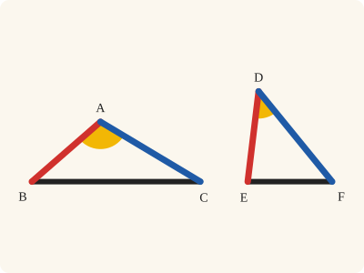
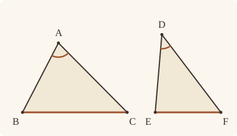

<!-- Generated by scripts/render.py. Do not edit by hand. -->

[Book I](index.md) · [← I.24](24.md) · [I.26 →](26.md)

# Book I, Proposition 25

*The greater base has the greater angle*

[Euclid's proof](#euclids-proof) · [In Lean](#in-lean) · [What it rests on](#what-it-rests-on) · [Mishnah](#mishnah)

> If two triangles have the two sides equal to two sides respectively, but have the base greater than the base, they will also have the one of the angles contained by the equal straight lines greater than the other.

**In Lean:** ✅ proved, as Euclid states it · Euclid's argument

<p align="center"></p>

<p align="center"><em>Two triangles with the same two sides (red and blue): the one with the greater base (black) has the greater angle between those sides (yellow).</em></p>

## Euclid's proof

<p align="center"></p>

Let ABC, DEF be two triangles having the two sides AB, AC equal to the two sides DE, DF respectively, namely AB to DE, and AC to DF; and let the base BC be greater than the base EF;

I say that the angle BAC is also greater than the angle EDF.

For, if not, it is either equal to it or less.

Now the angle BAC is not equal to the angle EDF;

for then the base BC would also have been equal to the base EF, [I. 4]

but it is not;

therefore the angle BAC is not equal to the angle EDF.

Neither again is the angle BAC less than the angle EDF;

for then the base BC would also have been less than the base EF, [I. 24]

but it is not;

therefore the angle BAC is not less than the angle EDF.

But it was proved that it is not equal either;

therefore the angle BAC is greater than the angle EDF.

Therefore etc.

Q. E. D.

## In Lean

| | |
|---|---|
| Proof | ✅ Proved |
| Statement | The whole enunciation. |
| Argument | Euclid's. |
| Reviewed | The statement and every passage of the argument read against Heath's text, at commit [`b7b41f51`](https://github.com/jackChallis/stoicheia/commit/b7b41f51) ([the record](../../review/I/25.toml)) |

From [`Elements/BookI/Prop25.lean`](../../Elements/BookI/Prop25.lean). Euclid's sentences are the `--` comments, and our own notes are in `/- … -/`; the lines under each sentence are the Lean that carries it out. The list below marks where a lemma does a step Euclid takes for granted; the `/- … -/` notes in the listing explain smaller adjustments.

**How the Lean follows the text**

- **Done by `Tacit.lt_trichotomy`.** "For, if not, it is either equal to it or less." Euclid divides the possibilities for the two angles into greater, equal and less. The Lean uses `Tacit.lt_trichotomy`, a tacit rule of magnitude, which we assume (System E §3.5), to obtain the equal or less alternatives when the angle BAC is not greater.

```lean
/-- If two triangles have the two sides equal to two sides respectively, but have the base greater
than the base, they will also have the one of the angles contained by the equal straight lines
greater than the other. -/
theorem Prop25 {A B C D E F : Point} (hABC : Triangle A B C) (hDEF : Triangle D E F)
    (hAB : ‖A B‖ = ‖D E‖) (hAC : ‖A C‖ = ‖D F‖) (h : ‖E F‖ < ‖B C‖) :
    ∠ E D F < ∠ B A C := by
  -- Let ABC, DEF be two triangles having the two sides AB, AC equal to the two sides DE, DF
  -- respectively, namely AB to DE, and AC to DF; and let the base BC be greater than the base
  -- EF;
  -- I say that the angle BAC is also greater than the angle EDF.
  -- For, if not, it is either equal to it or less.
  /- That an angle not greater than another is equal to it or less is the tacit
     rule of magnitude `lt_trichotomy` (System E §3.5). -/
  have either : ¬ ∠ E D F < ∠ B A C → ∠ B A C = ∠ E D F ∨ ∠ B A C < ∠ E D F := by
    intro hnot
    rcases lt_trichotomy (∠ B A C) (∠ E D F) with hlt | heq | hgt
    · exact Or.inr hlt
    · exact Or.inl heq
    · exact absurd hgt hnot
  -- Now the angle BAC is not equal to the angle EDF;
  have not_equal : ∠ B A C ≠ ∠ E D F := by
    intro hA
    -- for then the base BC would also have been equal to the base EF, [I. 4]
    /- I.4 gives the bases equal, the triangles equal and the remaining angles
       equal; only the first is wanted here. -/
    have hBC_EF : ‖B C‖ = ‖E F‖ := (Prop4 hABC hDEF hAB hAC hA).1
    -- but it is not;
    /- It is greater, and a magnitude is not equal to one it is greater than
       (`Magnitude.ne_of_lt`). -/
    have hne : ‖B C‖ ≠ ‖E F‖ := fun heq => Magnitude.ne_of_lt h heq.symm
    -- therefore the angle BAC is not equal to the angle EDF.
    exact hne hBC_EF
  -- Neither again is the angle BAC less than the angle EDF;
  have not_less : ¬ ∠ B A C < ∠ E D F := by
    intro hA
    -- for then the base BC would also have been less than the base EF, [I. 24]
    /- This is I.24 with the triangles exchanged: in DEF the angle at D is
       now the greater, and its sides DE, DF are equal to AB, AC, the
       equalities read the other way round. -/
    have hBC_EF : ‖B C‖ < ‖E F‖ := Prop24 hDEF hABC hAB.symm hAC.symm hA
    -- but it is not;
    /- It is greater, and a magnitude cannot be both less and greater than
       another (`lt_trans`, `lt_irrefl`). -/
    have hnot : ¬ ‖B C‖ < ‖E F‖ := fun hlt => lt_irrefl _ (lt_trans hlt h)
    -- therefore the angle BAC is not less than the angle EDF.
    exact hnot hBC_EF
  -- But it was proved that it is not equal either;
  /- Both ways out are closed; Euclid's division is complete. -/
  have neither : ¬ (∠ B A C = ∠ E D F ∨ ∠ B A C < ∠ E D F) := fun hor =>
    hor.elim not_equal not_less
  -- therefore the angle BAC is greater than the angle EDF.
  /- Reductio ad absurdum: were the angle BAC not greater, the division above
     would make it equal or less, and it is neither. -/
  exact Classical.byContradiction fun hnot => neither (either hnot)
  -- Therefore etc.
  -- Q. E. D.
```

## What it rests on

| | |
|---|---|
| Heath's references | [I.4](04.md), [I.24](24.md) |
| Lean cites | [I.4](04.md), [I.24](24.md) |
| Postulates | 1, 2, 3, 4 |
| Definitions taken as axioms | Def. I.15 |
| Common Notions | 1, 2, 3, 4, 5 |
| Tacit rules | 37 (listed below) |
| Its own Lean calls | 3 tacit rules |
| Through lemmas | none |

_Postulates, definitions, Common Notions and tacit rules: all that this proof rests on, counting those of the propositions it cites. The last two rows say which of the postulates, definitions and tacit rules its own Lean calls, in the proof or a helper written for it, and which it does not call but reaches through lemmas, of Book Zero or shared (a proposition it cites may rest on these too); the rest come in only through the propositions it cites or the Common Notions._

<details><summary>The 37 tacit rules beneath this proof, counting those of the propositions it cites</summary>

_(used here) marks a rule this proof's own Lean calls, in the proof or a helper written for it; (through …) marks one its own Lean does not call but reaches through the lemmas named, of [Book Zero](../../Elements/Figure) or shared, though a proposition it cites may rest on it too; and a rule with no mark comes in only through a proposition it cites or a Common Notion. The names in brackets are System E's: an Intersection rule says when straight lines and circles must meet, and an Intersections rule takes a point where they do (see [Book I's introduction](index.md))._

**Reading the figure**

- [`between_cases`](../../Elements/Foundations/Tacit/Diagram.lean#L54): Of three different points on a straight line, one is between the other two. (Between 6)
- [`between_symm`](../../Elements/Foundations/Tacit/Diagram.lean#L47): If B is between A and C, it is between C and A. (Between 1)
- [`circles_meet`](../../Elements/Foundations/Tacit/Diagram.lean#L94): If each circle passes through a point inside the other, the circles cut one another. This is the step Euclid takes for granted in I.1. (Intersection 5)
- [`circles_meet_same_side`](../../Elements/Foundations/Tacit/Constructions.lean#L79): Two circles that cut one another do so on each side of the straight line through their centres. (Intersections 8)
- [`exists_point`](../../Elements/Foundations/Tacit/Constructions.lean#L35): Let a point be taken. (Points 1)
- [`exists_point_inside_circle`](../../Elements/Foundations/Tacit/Constructions.lean#L42): Let a point be taken inside the circle α. (Points 8)
- [`exists_point_on_line`](../../Elements/Foundations/Tacit/Constructions.lean#L38): Let a point be taken on the straight line L. (Points 2)
- [`line_circle_between`](../../Elements/Foundations/Tacit/Constructions.lean#L67): A straight line through a point B inside a circle, heading out to a point C outside it, cuts the circle between B and C. (Intersections 4)
- [`line_circle_beyond`](../../Elements/Foundations/Tacit/Constructions.lean#L73): A straight line through a point B inside a circle, produced beyond B away from C, cuts the circle there. (Intersections 5)
- [`line_unique`](../../Elements/Foundations/Tacit/Diagram.lean#L41): Two points determine a straight line. (Generalities 1)
- [`lines_meet_of_opposite_sides`](../../Elements/Foundations/Tacit/Diagram.lean#L89): A straight line joining points on opposite sides of L crosses L. (Intersection 1)
- [`not_between_of_between`](../../Elements/Foundations/Tacit/Diagram.lean#L50): If B is between A and C, then A is not between B and C. (Between 1)
- [`not_on_line_of_same_side`](../../Elements/Foundations/Tacit/Diagram.lean#L60): Points on one side of a straight line are not on it. (Same side 3)
- [`pasch2`](../../Elements/Foundations/Tacit/Diagram.lean#L71): If B is between A and C, A is on L and B is off it, then B and C are on the same side of L: a straight line that leaves L at A does not cross it again. (Pasch 2)
- [`same_side_trans`](../../Elements/Foundations/Tacit/Diagram.lean#L64): Two points on the same side of a straight line as a third point are on the same side as each other. (Same side 4)

**Lengths, angles and areas**

- [`angle_add_of_inside`](../../Elements/Foundations/Tacit/Transfer.lean#L47): If D lies within the angle BAC, then BAC is made up of BAD and DAC. (Diagram-angle 2)
- [`angle_eq_of_same_rays`](../../Elements/Foundations/Tacit/Transfer.lean#L54): The angle doesn't change if its arms are traced through other points on the same rays. (Diagram-angle 4)
- [`angle_symm`](../../Elements/Foundations/Tacit/Metric.lean#L30): The angle ABC is the angle CBA. (Metric 4)
- [`area_add_of_between`](../../Elements/Foundations/Tacit/Transfer.lean#L70): Cutting a triangle in two from a vertex adds up. (Diagram-area 2)
- [`area_congruent`](../../Elements/Foundations/Tacit/Metric.lean#L44): Triangles equal in all their sides and angles are equal in area. Euclid uses this without comment once he has shown two triangles congruent. (Metric 9)
- [`area_degenerate`](../../Elements/Foundations/Tacit/Metric.lean#L36): A "triangle" with a repeated corner has no area. (Metric 6)
- [`area_eq_zero_of_on_line`](../../Elements/Foundations/Tacit/Transfer.lean#L62): A "triangle" whose corners lie on one straight line has no area. (Diagram-area 1)
- [`area_rotate`](../../Elements/Foundations/Tacit/Metric.lean#L39): The triangle ABC is the triangle CAB. (Metric 8)
- [`len_add_of_between`](../../Elements/Foundations/Tacit/Transfer.lean#L27): If B is between A and C, then AB and BC together make up AC. (Diagram-segment 1)
- [`len_self`](../../Elements/Foundations/Tacit/Metric.lean#L24): The "straight line" from a point to itself has no length. (Metric 1)
- [`len_symm`](../../Elements/Foundations/Tacit/Metric.lean#L27): The straight line AB is the straight line BA. (Metric 3)
- [`radius_ne_zero`](../../Elements/Foundations/Tacit/Metric.lean#L62): A circle's radius is not nothing: the straight line from the centre to a point on the circle has some length. A rule of our own, not one of System E's: every circle is drawn with a centre and a distance (Postulate 3).
- [`same_ray_of_angle_eq_zero`](../../Elements/Foundations/Tacit/Transfer.lean#L42): If the angle BAC is nothing, C lies on the ray from A through B. (Diagram-angle 1)

**Superposition**

- [`superposition`](../../Elements/Foundations/Tacit/Superposition.lean#L52): **Superposition.** A hypothetical placement of a triangle on a given ray and side permits a restricted derivation of metric equalities about the figure already given. The derivation introduces no further objects, cites each geometric law it uses, and exports no symbol of the placement.

**Laws of magnitude**

- [`add_assoc`](../../Elements/Foundations/Tacit/Magnitudes.lean#L23): Adding three magnitudes in a row, it makes no difference whether the first two or the last two are added first. (System E §3.5)
- [`add_comm`](../../Elements/Foundations/Tacit/Magnitudes.lean#L26): The order of adding does not matter. (System E §3.5)
- [`add_lt_add_right`](../../Elements/Foundations/Tacit/Magnitudes.lean#L45): Adding the same thing to both sides keeps "less than". (System E §3.5)
- [`add_zero`](../../Elements/Foundations/Tacit/Magnitudes.lean#L29): Adding nothing changes nothing. (System E §3.5)
- [`lt_irrefl`](../../Elements/Foundations/Tacit/Magnitudes.lean#L32) (used here): No magnitude is less than itself. (System E §3.5)
- [`lt_trans`](../../Elements/Foundations/Tacit/Magnitudes.lean#L35) (used here): What is less than the less is less still. (System E §3.5)
- [`lt_trichotomy`](../../Elements/Foundations/Tacit/Magnitudes.lean#L39) (used here): Of two magnitudes, one is less, or they are equal, or the other is less. (System E §3.5)
- [`not_lt_zero`](../../Elements/Foundations/Tacit/Magnitudes.lean#L42): Nothing is less than zero. (System E §3.5)

</details>

## Mishnah

_Our commentary: what Euclid assumes, what Lean made us say out loud, and how the result looks by modern means._

Euclid's proof constructs nothing. He argues by division, as in I.19: if the angle BAC is not greater than the angle EDF, it is equal to it or less. Equal angles would give equal bases, by I.4, and a less angle a less base, by I.24; but BC is greater than EF. So I.25 is I.24 turned round, and the two together say that when two triangles have two sides equal to two sides, the greater angle and the greater base go together.

Heath passes on Augustus De Morgan's view: "this proposition (as also I. 8) is a purely *logical* consequence of I. 4 and I. 24 in the same way as I. 19 and I. 6 are purely *logical* consequences of I. 18 and I. 5" (vol. 1, p. 300). Our proof bears him out. It builds no figure, and beyond I.4 and I.24 it uses only the three tacit rules of magnitude that carried I.19's division, `lt_trichotomy`, `lt_trans` and `lt_irrefl`. The logic covers I.8 as well, but Euclid could not have proved I.8 that way, since I.24 itself rests on I.8, through I.23. Heath also reports two direct proofs from Proclus, by Menelaus of Alexandria and by Heron, "and they are both interesting" (vol. 1, p. 300); each has to show where a new point falls before it can compare its angles, and Euclid's division never looks at a figure.

**The modern way.** With the sides $b$ and $c$ fixed, the law of cosines gives the angle $\theta$ they contain from the base $a$: $\theta = \arccos\left(\frac{b^{2} + c^{2} - a^{2}}{2bc}\right)$. As $a$ grows the fraction falls, and since the cosine falls as $\theta$ grows from $0$ to $\pi$, the angle rises: the greater base has the greater angle. Read the other way, the same formula is I.24.

## Further reading

- Long before the cosine of the modern way there were the Greek tables of the straight lines in a circle, whose story is ch. 2, "Chords", of Eli Maor's [*Trigonometric Delights*](https://press.princeton.edu/books/paperback/9780691202198/trigonometric-delights) (2020 paperback) (also on [I.4](04.md)).
- Arguing "by division" is proof by cases, and Daniel J. Velleman's [*How to Prove It*](https://doi.org/10.1017/9781108539890) (2019) takes it one step at a time in ch. 3, "Proofs" (also on [I.6](06.md)).

[Book I](index.md) · [← I.24](24.md) · [I.26 →](26.md)

---

<sub>Euclid's text: T. L. Heath, *The Thirteen Books of Euclid's Elements*, vol. 1 (Cambridge, 1908), p. 299; [scan leaf n319](https://archive.org/details/thirteenbookseu02heibgoog/page/n319); [figure on n319](https://archive.org/details/thirteenbookseu02heibgoog/page/n319). Public domain.</sub>

<sub>The tacit rules follow the System E of Jeremy Avigad, Edward Dean and John Mumma, read alongside LeanEuclid (Logan Murphy, Kaiyu Yang, Jialiang Sun, Zhaoyu Li, Anima Anandkumar and Xujie Si).</sub>
