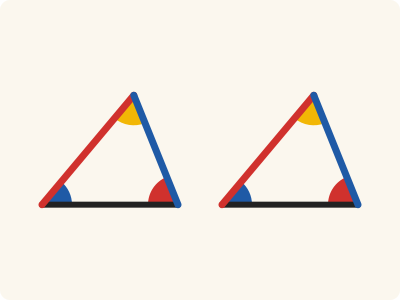
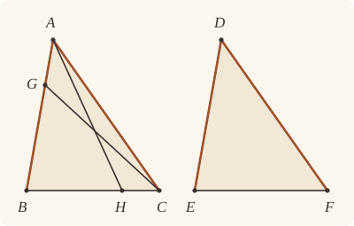

<!-- Generated by scripts/render.py. Do not edit by hand. -->

[Book I](index.md) · [← I.25](25.md) · [I.27 →](27.md)

# Book I, Proposition 26

*Two angles and one side make the remaining sides equal*

[Euclid's proof](#euclids-proof) · [In Lean](#in-lean) · [What it rests on](#what-it-rests-on) · [Mishnah](#mishnah)

> If two triangles have the two angles equal to two angles respectively, and one side equal to one side, namely, either the side adjoining the equal angles, or that subtending one of the equal angles, they will also have the remaining sides equal to the remaining sides and the remaining angle to the remaining angle.

**In Lean:** ✅ proved, as Euclid states it · Euclid's argument

<p align="center"></p>

<p align="center"><em>Make two angles (blue and red) and the side between them (black) equal, and the other sides (red and blue) and the third angle (yellow) are equal too. An equal side opposite one of those angles serves as well.</em></p>

## Euclid's proof

<p align="center"></p>

<p align="center"><em>Drawn for one case: AB supposed greater than DE, with G between B and A, and separately BC supposed greater than EF, with H between B and C; both suppositions appear on one triangle, as in Heath's figure. Like Heath's, this figure draws Euclid's impossible suppositions. BG is drawn shorter than DE and BH shorter than EF, although Euclid cuts off BG equal to DE and BH equal to EF.</em></p>

Let ABC, DEF be two triangles having the two angles ABC, BCA equal to the two angles DEF, EFD respectively, namely the angle ABC to the angle DEF, and the angle BCA to the angle EFD; and let them also have one side equal to one side, first that adjoining the equal angles, namely BC to EF;

I say that they will also have the remaining sides equal to the remaining sides respectively, namely AB to DE and AC to DF, and the remaining angle to the remaining angle, namely the angle BAC to the angle EDF.

For, if AB is unequal to DE, one of them is greater.

Let AB be greater, and let BG be made equal to DE; and let GC be joined.

Then, since BG is equal to DE, and BC to EF,

the two sides GB, BC are equal to the two sides DE, EF respectively;

and the angle GBC is equal to the angle DEF;

therefore the base GC is equal to the base DF,

and the triangle GBC is equal to the triangle DEF,

and the remaining angles will be equal to the remaining angles, namely those which the equal sides subtend; [I. 4]

therefore the angle GCB is equal to the angle DFE.

But the angle DFE is by hypothesis equal to the angle BCA;

therefore the angle BCG is equal to the angle BCA,

the less to the greater: which is impossible.

Therefore AB is not unequal to DE,

and is therefore equal to it.

But BC is also equal to EF;

therefore the two sides AB, BC are equal to the two sides DE, EF respectively,

and the angle ABC is equal to the angle DEF;

therefore the base AC is equal to the base DF,

and the remaining angle BAC is equal to the remaining angle EDF. [I. 4]

Again, let sides subtending equal angles be equal, as AB to DE;

I say again that the remaining sides will be equal to the remaining sides, namely AC to DF and BC to EF, and further the remaining angle BAC is equal to the remaining angle EDF.

For, if BC is unequal to EF, one of them is greater.

Let BC be greater, if possible, and let BH be made equal to EF; let AH be joined.

Then, since BH is equal to EF, and AB to DE,

the two sides AB, BH are equal to the two sides DE, EF respectively, and they contain equal angles;

therefore the base AH is equal to the base DF,

and the triangle ABH is equal to the triangle DEF,

and the remaining angles will be equal to the remaining angles, namely those which the equal sides subtend; [I. 4]

therefore the angle BHA is equal to the angle EFD.

But the angle EFD is equal to the angle BCA;

therefore, in the triangle AHC, the exterior angle BHA is equal to the interior and opposite angle BCA:

which is impossible. [I. 16]

Therefore BC is not unequal to EF,

and is therefore equal to it.

But AB is also equal to DE;

therefore the two sides AB, BC are equal to the two sides DE, EF respectively, and they contain equal angles;

therefore the base AC is equal to the base DF,

the triangle ABC equal to the triangle DEF,

and the remaining angle BAC equal to the remaining angle EDF. [I. 4]

Therefore etc.

Q. E. D.

## In Lean

| | |
|---|---|
| Proof | ✅ Proved |
| Statement | The whole enunciation. |
| Argument | Euclid's. |
| Reviewed | The statement and every passage of the argument read against Heath's text, at commit [`1e482112`](https://github.com/dodecaplex-co/stoicheia/commit/1e482112) ([the record](../../review/I/26.toml)) |

From [`Elements/BookI/Prop26.lean`](../../Elements/BookI/Prop26.lean). Euclid's sentences are the `--` comments, and our own notes are in `/- … -/`; the lines under each sentence are the Lean that carries it out. The list below marks where a lemma does a step Euclid takes for granted, where the Lean takes a case Euclid's figure leaves aside and where a step needs a word of its own; the `/- … -/` notes in the listing explain smaller adjustments.

**How the Lean follows the text**

- **Done by `Prop3`.** "Let AB be greater, and let BG be made equal to DE…" Euclid cuts BG equal to DE; Heath gives no reference for the cut. The Lean uses I.3, which also puts G between B and A, and joins GC by Postulate 1.
- **Carried.** "therefore the base GC is equal to the base DF…" The Lean proves that the base GC equals DF here, as Euclid states it; the argument goes on by the angles at C, and does not use it again.
- **Carried.** "and the triangle GBC is equal to the triangle DEF…" The Lean proves that the triangle GBC equals DEF here, as Euclid states it; the argument goes on by the angles at C, and does not use it again.
- **Carried.** "and the remaining angles will be equal to the remaining angles, namely those which the equal sides subtend; [I. 4] therefore the angle GCB…" The Lean states both pairs of remaining angles here, as Euclid does; the next step takes the angles GCB and DFE from I.4 directly, and the pairs are not used again.
- **Done by `angle_lt_of_between`.** "the less to the greater…" Euclid reads BCG as a part of BCA. Since G lies between B and A, `angle_lt_of_between` proves that BCG is less than BCA by adding the two parts and applying Common Notion 5.
- **A further case.** "Therefore AB is not unequal to DE…" Euclid supposes AB greater than DE; the Lean proves his argument once over any letters and applies it again with the triangles exchanged to rule out DE greater than AB. The Lean concludes that AB equals DE by `Tacit.lt_trichotomy`, a tacit rule of magnitude, which we assume (System E §3.5): of two unequal lengths, one is greater.
- **Done by `Prop3`.** "Let BC be greater, if possible, and let BH be made equal to EF…" Euclid cuts BH equal to EF; Heath gives no reference for the cut. The Lean uses I.3, which also puts H between B and C, and joins AH by Postulate 1.
- **Carried.** "therefore the base AH is equal to the base DF…" The Lean proves that the base AH equals DF here, as Euclid states it; the argument goes on by the angles at H, and does not use it again.
- **Carried.** "and the triangle ABH is equal to the triangle DEF…" The Lean proves that the triangle ABH equals DEF here, as Euclid states it; the argument goes on by the angles at H, and does not use it again.
- **Carried.** "and the remaining angles will be equal to the remaining angles, namely those which the equal sides subtend; [I. 4] therefore the angle BHA…" The Lean states both pairs of remaining angles here, as Euclid does; the next step takes the angles BHA and EFD from I.4 directly, and the pairs are not used again.
- **A further case.** "Therefore BC is not unequal to EF…" Euclid supposes BC greater than EF; the Lean proves his argument once over any letters and applies it again with the triangles exchanged to rule out EF greater than BC. The Lean concludes that BC equals EF by the same rule, `Tacit.lt_trichotomy`.
- **Carried.** "the triangle ABC equal to the triangle DEF…" The Lean proves that the triangle ABC equals DEF here, as Euclid states it; the statement asks only for the remaining sides and angle, so this is not used again.

```lean
/-- If two triangles have the two angles equal to two angles respectively, and one side equal to one
side, namely, either the side adjoining the equal angles, or that subtending one of the equal
angles, they will also have the remaining sides equal to the remaining sides and the remaining
angle to the remaining angle. -/
theorem Prop26 {A B C D E F : Point} (hABC : Triangle A B C) (hDEF : Triangle D E F)
    (hB : ∠ A B C = ∠ D E F) (hC : ∠ B C A = ∠ E F D)
    (hside : ‖B C‖ = ‖E F‖ ∨ ‖A B‖ = ‖D E‖) :
    ‖A B‖ = ‖D E‖ ∧ ‖A C‖ = ‖D F‖ ∧ ‖B C‖ = ‖E F‖ ∧ ∠ B A C = ∠ E D F := by
  -- Let ABC, DEF be two triangles having the two angles ABC, BCA equal to the two angles DEF,
  -- EFD respectively, namely the angle ABC to the angle DEF, and the angle BCA to the angle
  -- EFD; and let them also have one side equal to one side, first that adjoining the equal
  -- angles, namely BC to EF;
  rcases hside with hBC | hAB
    -- I say that they will also have the remaining sides equal to the remaining sides
    -- respectively, namely AB to DE and AC to DF, and the remaining angle to the remaining
    -- angle, namely the angle BAC to the angle EDF.
    -- For, if AB is unequal to DE, one of them is greater.
  · /- The argument for the greater side works with the triangles named either
       way round. We write it once and exchange them below. -/
    have greater : ∀ {A B C D E F : Point}, Triangle A B C → Triangle D E F →
        ∠ A B C = ∠ D E F → ∠ B C A = ∠ E F D → ‖B C‖ = ‖E F‖ →
        ‖D E‖ < ‖A B‖ → False := by
      intro A B C D E F hABC hDEF hB hC hBC hlt
      -- Let AB be greater, and let BG be made equal to DE; and let GC be joined.
      /- I.3 supplies the cut and says explicitly that G is between B and A. -/
      obtain ⟨G, hBGA, hBG⟩ := Prop3 hDEF.ne₁₂ (by rwa [len_symm B A])
      obtain ⟨AB, hA_AB, hB_AB⟩ := Postulate1 A B hABC.ne₁₂
      have hG_AB := on_line_of_between_ends hBGA hB_AB hA_AB
      have hBGC : Triangle B G C := Triangle.of_line hB_AB hG_AB
        (ne_of_between hBGA) (hABC.off_line hA_AB hB_AB)
      obtain ⟨GC, hG_GC, hC_GC⟩ := Postulate1 G C hBGC.ne₂₃
      -- Then, since BG is equal to DE, and BC to EF,
      -- the two sides GB, BC are equal to the two sides DE, EF respectively;
      have hBG_ED : ‖B G‖ = ‖E D‖ := hBG.trans (len_symm D E)
      -- and the angle GBC is equal to the angle DEF;
      have hGBC : ∠ G B C = ∠ D E F :=
        (angle_onRay_left (OnRay.of_between hBGA) hABC.ne₂₃.symm).trans hB
      -- therefore the base GC is equal to the base DF,
      obtain ⟨hGC, harea, hG, hC'⟩ := Prop4 hBGC hDEF.bac hBG_ED hBC hGBC
      -- and the triangle GBC is equal to the triangle DEF,
      have : △ G B C = △ D E F := by
        rw [area_swap G B C, area_rotate G C B, area_swap D E F, area_rotate D F E]
        exact harea
      -- and the remaining angles will be equal to the remaining angles, namely those which the
      -- equal sides subtend; [I. 4]
      have : ∠ B G C = ∠ E D F ∧ ∠ B C G = ∠ E F D := ⟨hG, hC'⟩
      -- therefore the angle GCB is equal to the angle DFE.
      have hGCB : ∠ G C B = ∠ D F E :=
        (angle_symm hBGC.ne₂₃ hBGC.ne₁₃).trans
          (hC'.trans (angle_symm hDEF.ne₂₃ hDEF.ne₁₃))
      -- But the angle DFE is by hypothesis equal to the angle BCA;
      have hDFE : ∠ D F E = ∠ B C A :=
        (angle_symm hDEF.ne₁₃ hDEF.ne₂₃).trans hC.symm
      -- therefore the angle BCG is equal to the angle BCA,
      have hBCG : ∠ B C G = ∠ B C A :=
        (angle_symm hBGC.ne₁₃ hBGC.ne₂₃).trans (hGCB.trans hDFE)
      -- the less to the greater: which is impossible.
      have hless := angle_lt_of_between hABC (between_symm hBGA)
      rw [← angle_symm hBGC.ne₁₃ hBGC.ne₂₃,
        ← angle_symm hABC.ne₂₃ hABC.ne₁₃, hBCG] at hless
      exact lt_irrefl _ hless
    -- Therefore AB is not unequal to DE,
    -- and is therefore equal to it.
    have hAB : ‖A B‖ = ‖D E‖ := by
      rcases lt_trichotomy ‖A B‖ ‖D E‖ with hlt | heq | hgt
      · exact False.elim (greater hDEF hABC hB.symm hC.symm hBC.symm hlt)
      · exact heq
      · exact False.elim (greater hABC hDEF hB hC hBC hgt)
    -- But BC is also equal to EF;
    -- therefore the two sides AB, BC are equal to the two sides DE, EF respectively,
    -- and the angle ABC is equal to the angle DEF;
    have hBA_ED : ‖B A‖ = ‖E D‖ :=
      (len_symm B A).trans (hAB.trans (len_symm D E))
    -- therefore the base AC is equal to the base DF,
    obtain ⟨hAC, -, hA, -⟩ := Prop4 hABC.bac hDEF.bac hBA_ED hBC hB
    -- and the remaining angle BAC is equal to the remaining angle EDF. [I. 4]
    exact ⟨hAB, hAC, hBC, hA⟩
    -- Again, let sides subtending equal angles be equal, as AB to DE;
    -- I say again that the remaining sides will be equal to the remaining sides, namely AC to DF
    -- and BC to EF, and further the remaining angle BAC is equal to the remaining angle EDF.
    -- For, if BC is unequal to EF, one of them is greater.
  · /- Again either triangle may have the greater side. -/
    have greater : ∀ {A B C D E F : Point}, Triangle A B C → Triangle D E F →
        ∠ A B C = ∠ D E F → ∠ B C A = ∠ E F D → ‖A B‖ = ‖D E‖ →
        ‖E F‖ < ‖B C‖ → False := by
      intro A B C D E F hABC hDEF hB hC hAB hlt
      -- Let BC be greater, if possible, and let BH be made equal to EF; let AH be joined.
      obtain ⟨H, hBHC, hBH⟩ := Prop3 hDEF.ne₂₃ hlt
      obtain ⟨BC, hB_BC, hC_BC⟩ := Postulate1 B C hABC.ne₂₃
      have hH_BC := on_line_of_between_ends hBHC hB_BC hC_BC
      have hBHA : Triangle B H A := Triangle.of_line hB_BC hH_BC
        (ne_of_between hBHC) (hABC.bca.off_line hB_BC hC_BC)
      have hCHA : Triangle C H A := Triangle.of_line hC_BC hH_BC
        (ne_of_between (between_symm hBHC)) (hABC.bca.off_line hB_BC hC_BC)
      obtain ⟨AH, hA_AH, hH_AH⟩ := Postulate1 A H hBHA.ne₂₃.symm
      -- Then, since BH is equal to EF, and AB to DE,
      -- the two sides AB, BH are equal to the two sides DE, EF respectively, and they contain
      -- equal angles;
      have hBA_ED : ‖B A‖ = ‖E D‖ :=
        (len_symm B A).trans (hAB.trans (len_symm D E))
      have hABH : ∠ A B H = ∠ D E F :=
        (angle_onRay_right (OnRay.of_between hBHC) hABC.ne₁₂).trans hB
      -- therefore the base AH is equal to the base DF,
      obtain ⟨hAH, harea, hA, hH⟩ := Prop4 hBHA.acb hDEF.bac hBA_ED hBH hABH
      -- and the triangle ABH is equal to the triangle DEF,
      have : △ A B H = △ D E F := by
        rw [area_swap A B H, area_rotate A H B, area_swap D E F, area_rotate D F E]
        exact harea
      -- and the remaining angles will be equal to the remaining angles, namely those which the
      -- equal sides subtend; [I. 4]
      have : ∠ B A H = ∠ E D F ∧ ∠ B H A = ∠ E F D := ⟨hA, hH⟩
      -- therefore the angle BHA is equal to the angle EFD.
      have hBHA_EFD : ∠ B H A = ∠ E F D := hH
      -- But the angle EFD is equal to the angle BCA;
      have hEFD : ∠ E F D = ∠ B C A := hC.symm
      -- therefore, in the triangle AHC, the exterior angle BHA is equal to the interior and
      -- opposite angle BCA:
      have hBHA_BCA : ∠ B H A = ∠ B C A := hBHA_EFD.trans hEFD
      -- which is impossible. [I. 16]
      have hless := (Prop16 hCHA.cab (between_symm hBHC)).1
      rw [angle_onRay_left (OnRay.of_between (between_symm hBHC)) hABC.ne₁₃,
        angle_symm hBHA.ne₂₃.symm hBHA.ne₁₂, hBHA_BCA] at hless
      exact lt_irrefl _ hless
    -- Therefore BC is not unequal to EF,
    -- and is therefore equal to it.
    have hBC : ‖B C‖ = ‖E F‖ := by
      rcases lt_trichotomy ‖B C‖ ‖E F‖ with hlt | heq | hgt
      · exact False.elim (greater hDEF hABC hB.symm hC.symm hAB.symm hlt)
      · exact heq
      · exact False.elim (greater hABC hDEF hB hC hAB hgt)
    -- But AB is also equal to DE;
    -- therefore the two sides AB, BC are equal to the two sides DE, EF respectively, and they
    -- contain equal angles;
    have hBA_ED : ‖B A‖ = ‖E D‖ :=
      (len_symm B A).trans (hAB.trans (len_symm D E))
    -- therefore the base AC is equal to the base DF,
    obtain ⟨hAC, harea, hA, -⟩ := Prop4 hABC.bac hDEF.bac hBA_ED hBC hB
    -- the triangle ABC equal to the triangle DEF,
    have : △ A B C = △ D E F := by
      rw [area_swap A B C, area_rotate A C B, area_swap D E F, area_rotate D F E]
      exact harea
    -- and the remaining angle BAC equal to the remaining angle EDF. [I. 4]
    have hBAC : ∠ B A C = ∠ E D F := hA
    -- Therefore etc.
    exact ⟨hAB, hAC, hBC, hBAC⟩
  -- Q. E. D.
```

## What it rests on

| | |
|---|---|
| Heath's references | [I.4](04.md), [I.16](16.md) |
| Lean cites | [I.3](03.md), [I.4](04.md), [I.16](16.md) |
| Postulates | 1, 2, 3, 4 |
| Definitions taken as axioms | Def. I.15 |
| Common Notions | 1, 2, 3, 4, 5 |
| Tacit rules | 37 (listed below) |
| Its own Lean calls | Postulate 1; 6 tacit rules |
| Through lemmas | Postulates 2 and 3; Def. I.15; 27 tacit rules |

_Postulates, definitions, Common Notions and tacit rules: all that this proof rests on, counting those of the propositions it cites. The last two rows say which of the postulates, definitions and tacit rules its own Lean calls, in the proof or a helper written for it, and which it does not call but reaches through lemmas, of Book Zero or shared (a proposition it cites may rest on these too); the rest come in only through the propositions it cites or the Common Notions._

<details><summary>The 37 tacit rules beneath this proof, counting those of the propositions it cites</summary>

_(used here) marks a rule this proof's own Lean calls, in the proof or a helper written for it; (through …) marks one its own Lean does not call but reaches through the lemmas named, of [Book Zero](../../Elements/Figure) or shared, though a proposition it cites may rest on it too; and a rule with no mark comes in only through a proposition it cites or a Common Notion. The names in brackets are System E's: an Intersection rule says when straight lines and circles must meet, and an Intersections rule takes a point where they do (see [Book I's introduction](index.md))._

**Reading the figure**

- [`between_cases`](../../Elements/Foundations/Tacit/Diagram.lean#L54) (through [`Tacit.area_swap`](../../Elements/Figure/AreaRules.lean#L123)): Of three different points on a straight line, one is between the other two. (Between 6)
- [`between_symm`](../../Elements/Foundations/Tacit/Diagram.lean#L47) (used here): If B is between A and C, it is between C and A. (Between 1)
- [`circles_meet`](../../Elements/Foundations/Tacit/Diagram.lean#L91) (through [`OnRay.of_between`](../../Elements/Figure/Rays.lean#L34), [`Tacit.area_swap`](../../Elements/Figure/AreaRules.lean#L123), [`Tacit.on_line_of_between_ends`](../../Elements/Figure/RuleBase.lean#L153) and 1 other lemma): If each circle passes through a point inside the other, the circles cut one another. This is the step Euclid takes for granted in I.1. (Intersection 5)
- [`circles_meet_same_side`](../../Elements/Foundations/Tacit/Constructions.lean#L79) (through [`OnRay.of_between`](../../Elements/Figure/Rays.lean#L34), [`Tacit.area_swap`](../../Elements/Figure/AreaRules.lean#L123), [`Tacit.on_line_of_between_ends`](../../Elements/Figure/RuleBase.lean#L153) and 1 other lemma): Two circles that cut one another do so on each side of the straight line through their centres. (Intersections 8)
- [`exists_point`](../../Elements/Foundations/Tacit/Constructions.lean#L35) (through [`Tacit.area_swap`](../../Elements/Figure/AreaRules.lean#L123), [`Triangle.ne₁₂`](../../Elements/Figure/Triangles.lean#L22), [`Triangle.ne₁₃`](../../Elements/Figure/Triangles.lean#L36) and 2 other lemmas): Let a point be taken. (Points 1)
- [`exists_point_inside_circle`](../../Elements/Foundations/Tacit/Constructions.lean#L42) (through [`OnRay.of_between`](../../Elements/Figure/Rays.lean#L34), [`Tacit.area_swap`](../../Elements/Figure/AreaRules.lean#L123), [`Tacit.on_line_of_between_ends`](../../Elements/Figure/RuleBase.lean#L153) and 1 other lemma): Let a point be taken inside the circle α. (Points 8)
- [`exists_point_on_line`](../../Elements/Foundations/Tacit/Constructions.lean#L38) (through [`OnRay.of_between`](../../Elements/Figure/Rays.lean#L34), [`Tacit.area_swap`](../../Elements/Figure/AreaRules.lean#L123), [`Tacit.on_line_of_between_ends`](../../Elements/Figure/RuleBase.lean#L153) and 1 other lemma): Let a point be taken on the straight line L. (Points 2)
- [`line_circle_between`](../../Elements/Foundations/Tacit/Constructions.lean#L67) (through [`OnRay.of_between`](../../Elements/Figure/Rays.lean#L34), [`Tacit.area_swap`](../../Elements/Figure/AreaRules.lean#L123), [`Tacit.on_line_of_between_ends`](../../Elements/Figure/RuleBase.lean#L153) and 1 other lemma): A straight line through a point B inside a circle, heading out to a point C outside it, cuts the circle between B and C. (Intersections 4)
- [`line_circle_beyond`](../../Elements/Foundations/Tacit/Constructions.lean#L73) (through [`OnRay.of_between`](../../Elements/Figure/Rays.lean#L34), [`Tacit.area_swap`](../../Elements/Figure/AreaRules.lean#L123), [`Tacit.on_line_of_between_ends`](../../Elements/Figure/RuleBase.lean#L153) and 1 other lemma): A straight line through a point B inside a circle, produced beyond B away from C, cuts the circle there. (Intersections 5)
- [`line_unique`](../../Elements/Foundations/Tacit/Diagram.lean#L41) (through [`Tacit.area_swap`](../../Elements/Figure/AreaRules.lean#L123), [`Triangle.of_line`](../../Elements/Figure/Triangles.lean#L82) and [`angle_lt_of_between`](../../Elements/Figure/Angles.lean#L110)): Two points determine a straight line. (Generalities 1)
- [`lines_meet_of_opposite_sides`](../../Elements/Foundations/Tacit/Diagram.lean#L86): A straight line joining points on opposite sides of L crosses L. (Intersection 1)
- [`not_between_of_between`](../../Elements/Foundations/Tacit/Diagram.lean#L50) (through [`OnRay.of_between`](../../Elements/Figure/Rays.lean#L34), [`Tacit.area_swap`](../../Elements/Figure/AreaRules.lean#L123), [`Tacit.ne_of_between`](../../Elements/Figure/RuleBase.lean#L146) and 4 other lemmas): If B is between A and C, then A is not between B and C. (Between 1)
- [`not_on_line_of_same_side`](../../Elements/Foundations/Tacit/Diagram.lean#L60) (through [`OnRay.of_between`](../../Elements/Figure/Rays.lean#L34), [`Tacit.area_swap`](../../Elements/Figure/AreaRules.lean#L123), [`Tacit.on_line_of_between_ends`](../../Elements/Figure/RuleBase.lean#L153) and 1 other lemma): Points on one side of a straight line are not on it. (Same side 3)
- [`pasch2`](../../Elements/Foundations/Tacit/Diagram.lean#L71) (through [`OnRay.of_between`](../../Elements/Figure/Rays.lean#L34), [`Tacit.area_swap`](../../Elements/Figure/AreaRules.lean#L123), [`Tacit.on_line_of_between_ends`](../../Elements/Figure/RuleBase.lean#L153) and 1 other lemma): If B is between A and C, A is on L and B is off it, then B and C are on the same side of L: a straight line that leaves L at A does not cross it again. (Pasch 2)
- [`same_side_trans`](../../Elements/Foundations/Tacit/Diagram.lean#L64) (through [`OnRay.of_between`](../../Elements/Figure/Rays.lean#L34), [`Tacit.area_swap`](../../Elements/Figure/AreaRules.lean#L123), [`Tacit.on_line_of_between_ends`](../../Elements/Figure/RuleBase.lean#L153) and 1 other lemma): Two points on the same side of a straight line as a third point are on the same side as each other. (Same side 4)

**Lengths, angles and areas**

- [`angle_add_of_inside`](../../Elements/Foundations/Tacit/Transfer.lean#L47) (through [`angle_lt_of_between`](../../Elements/Figure/Angles.lean#L110)): If D lies within the angle BAC, then BAC is made up of BAD and DAC. (Diagram-angle 2)
- [`angle_eq_of_same_rays`](../../Elements/Foundations/Tacit/Transfer.lean#L54) (through [`angle_onRay_left`](../../Elements/Figure/Angles.lean#L42) and [`angle_onRay_right`](../../Elements/Figure/Angles.lean#L49)): The angle doesn't change if its arms are traced through other points on the same rays. (Diagram-angle 4)
- [`angle_symm`](../../Elements/Foundations/Tacit/Metric.lean#L30) (used here): The angle ABC is the angle CBA. (Metric 4)
- [`area_add_of_between`](../../Elements/Foundations/Tacit/Transfer.lean#L70) (through [`Tacit.area_swap`](../../Elements/Figure/AreaRules.lean#L123)): Cutting a triangle in two from a vertex adds up. (Diagram-area 2)
- [`area_congruent`](../../Elements/Foundations/Tacit/Metric.lean#L44): Triangles equal in all their sides and angles are equal in area. Euclid uses this without comment once he has shown two triangles congruent. (Metric 9)
- [`area_degenerate`](../../Elements/Foundations/Tacit/Metric.lean#L36) (through [`Tacit.area_swap`](../../Elements/Figure/AreaRules.lean#L123)): A "triangle" with a repeated corner has no area. (Metric 6)
- [`area_eq_zero_of_on_line`](../../Elements/Foundations/Tacit/Transfer.lean#L62) (through [`Tacit.area_swap`](../../Elements/Figure/AreaRules.lean#L123)): A "triangle" whose corners lie on one straight line has no area. (Diagram-area 1)
- [`area_rotate`](../../Elements/Foundations/Tacit/Metric.lean#L39) (used here): The triangle ABC is the triangle CAB. (Metric 8)
- [`len_add_of_between`](../../Elements/Foundations/Tacit/Transfer.lean#L27) (through [`OnRay.of_between`](../../Elements/Figure/Rays.lean#L34), [`Tacit.area_swap`](../../Elements/Figure/AreaRules.lean#L123), [`Tacit.on_line_of_between_ends`](../../Elements/Figure/RuleBase.lean#L153) and 3 other lemmas): If B is between A and C, then AB and BC together make up AC. (Diagram-segment 1)
- [`len_self`](../../Elements/Foundations/Tacit/Metric.lean#L24) (through [`OnRay.of_between`](../../Elements/Figure/Rays.lean#L34), [`Tacit.area_swap`](../../Elements/Figure/AreaRules.lean#L123), [`Tacit.on_line_of_between_ends`](../../Elements/Figure/RuleBase.lean#L153) and 3 other lemmas): The "straight line" from a point to itself has no length. (Metric 1)
- [`len_symm`](../../Elements/Foundations/Tacit/Metric.lean#L27) (used here): The straight line AB is the straight line BA. (Metric 3)
- [`radius_ne_zero`](../../Elements/Foundations/Tacit/Metric.lean#L62) (through [`OnRay.of_between`](../../Elements/Figure/Rays.lean#L34), [`Tacit.area_swap`](../../Elements/Figure/AreaRules.lean#L123), [`Tacit.on_line_of_between_ends`](../../Elements/Figure/RuleBase.lean#L153) and 3 other lemmas): A circle's radius is not nothing: the straight line from the centre to a point on the circle has some length. A rule of our own, not one of System E's: every circle is drawn with a centre and a distance (Postulate 3).
- [`same_ray_of_angle_eq_zero`](../../Elements/Foundations/Tacit/Transfer.lean#L42) (through [`angle_lt_of_between`](../../Elements/Figure/Angles.lean#L110)): If the angle BAC is nothing, C lies on the ray from A through B. (Diagram-angle 1)

**Superposition**

- [`superposition`](../../Elements/Foundations/Tacit/Superposition.lean#L52): **Superposition.** A hypothetical placement of a triangle on a given ray and side permits a restricted derivation of metric equalities about the figure already given. The derivation introduces no further objects, cites each geometric law it uses, and exports no symbol of the placement.

**Rules of magnitude**

- [`add_assoc`](../../Elements/Foundations/Tacit/Magnitudes.lean#L23) (through [`Tacit.area_swap`](../../Elements/Figure/AreaRules.lean#L123)): Adding three magnitudes in a row, it makes no difference whether the first two or the last two are added first. (System E §3.5)
- [`add_comm`](../../Elements/Foundations/Tacit/Magnitudes.lean#L26) (through [`OnRay.of_between`](../../Elements/Figure/Rays.lean#L34), [`Tacit.area_swap`](../../Elements/Figure/AreaRules.lean#L123), [`Tacit.on_line_of_between_ends`](../../Elements/Figure/RuleBase.lean#L153) and 3 other lemmas): The order of adding does not matter. (System E §3.5)
- [`add_lt_add_right`](../../Elements/Foundations/Tacit/Magnitudes.lean#L45) (through [`Tacit.area_swap`](../../Elements/Figure/AreaRules.lean#L123)): Adding the same thing to both sides keeps "less than". (System E §3.5)
- [`add_zero`](../../Elements/Foundations/Tacit/Magnitudes.lean#L29): Adding nothing changes nothing. (System E §3.5)
- [`lt_irrefl`](../../Elements/Foundations/Tacit/Magnitudes.lean#L32) (used here): No magnitude is less than itself. (System E §3.5)
- [`lt_trans`](../../Elements/Foundations/Tacit/Magnitudes.lean#L35) (through [`OnRay.of_between`](../../Elements/Figure/Rays.lean#L34), [`Tacit.area_swap`](../../Elements/Figure/AreaRules.lean#L123), [`Tacit.on_line_of_between_ends`](../../Elements/Figure/RuleBase.lean#L153) and 1 other lemma): What is less than the less is less still. (System E §3.5)
- [`lt_trichotomy`](../../Elements/Foundations/Tacit/Magnitudes.lean#L39) (used here): Of two magnitudes, one is less, or they are equal, or the other is less. (System E §3.5)
- [`not_lt_zero`](../../Elements/Foundations/Tacit/Magnitudes.lean#L42) (through [`OnRay.of_between`](../../Elements/Figure/Rays.lean#L34), [`Tacit.area_swap`](../../Elements/Figure/AreaRules.lean#L123), [`Tacit.on_line_of_between_ends`](../../Elements/Figure/RuleBase.lean#L153) and 3 other lemmas): Nothing is less than zero. (System E §3.5)

</details>

## Mishnah

_Our commentary: why Euclid's proof, and ours, look as they do._

Euclid takes the equal side in each of its two places. When it adjoins the equal angles, he supposes AB greater than DE and cuts off BG equal to DE; I.4 then makes the angle BCG equal to BCA, "the less to the greater". When it subtends one of them, he supposes BC greater than EF and cuts off BH equal to EF; now I.4 makes the exterior angle BHA of the triangle AHC equal to the interior and opposite angle BCA, which I.16 forbids. Either way the sides are equal, and I.4 finishes.

Both contradictions want the cut point inside: BCG has to be a part of BCA, and BHA an exterior angle of the triangle AHC. I.3 gives that when it cuts BG off from BA and BH off from BC, putting G between B and A, and H between B and C. Euclid lets AB be the greater, though DE may as well be; we answer that case by exchanging the triangles.

**"The distance of ships in the sea."** Proclus tells a story: "Eudemus in his geometrical history refers this theorem to Thales. For he says that, in the method by which they say that Thales proved the distance of ships in the sea, it was necessary to make use of this theorem" (Heath, vol. 1, p. 304). Heath guesses that Thales stood on a tower with an upright stick and a cross-piece on a nail. He pointed the cross-piece at the ship, then turned the stick, still upright, until the cross-piece pointed at a mark on the shore. The two triangles share the tower and the angles at its ends, so the mark was as far off as the ship (vol. 1, p. 305).

The other way to prove I.26, by applying one triangle to the other, "was very early discovered", Heath says, at least for the side adjoining the equal angles; an-Nairīzī gives it, "observing that the proof is one which he had found, but of which he did not know the author" (vol. 1, p. 303). Euclid's proof moves nothing, and leaves superposition where it was, inside I.4.

**The modern way.** Write $\alpha$, $\beta$, $\gamma$ for the angles at A, B, C and $a$, $b$, $c$ for the sides opposite them. The sine rule, $a/\sin\alpha = b/\sin\beta = c/\sin\gamma$, settles I.26 at once: the two given angles give the third, $\alpha = \pi - \beta - \gamma$, and the one side then gives the other two. But that third angle comes from I.32, whose proof uses Postulate 5, and Euclid's proof of I.26 does without it.

## Further reading

- The sine rule of the modern way, and the sine itself, have their history in Glen Van Brummelen's [*The Mathematics of the Heavens and the Earth*](https://press.princeton.edu/books/hardcover/9780691129730/the-mathematics-of-the-heavens-and-the-earth) (2009), on the early history of trigonometry (also on [I.24](24.md)).
- What can be proved without Postulate 5, as Euclid proves I.26, is the subject of ch. 4, "Neutral Geometry", in Marvin Jay Greenberg's textbook [*Euclidean and Non-Euclidean Geometries*](https://store.macmillanlearning.com/us/product/Euclidean-and-Non-Euclidean-Geometries/p/0716799480) (2008) (also on [I.10](10.md)).

[Book I](index.md) · [← I.25](25.md) · [I.27 →](27.md)

---

<sub>Euclid's text: T. L. Heath, *The Thirteen Books of Euclid's Elements*, vol. 1 (Cambridge, 1908), pp. 301–303; [scan leaves n321–n323](https://archive.org/details/thirteenbookseu02heibgoog/page/n321); [figure on n322](https://archive.org/details/thirteenbookseu02heibgoog/page/n322). Public domain.</sub>

<sub>The tacit rules follow the System E of Jeremy Avigad, Edward Dean and John Mumma, read alongside LeanEuclid (Logan Murphy, Kaiyu Yang, Jialiang Sun, Zhaoyu Li, Anima Anandkumar and Xujie Si).</sub>
