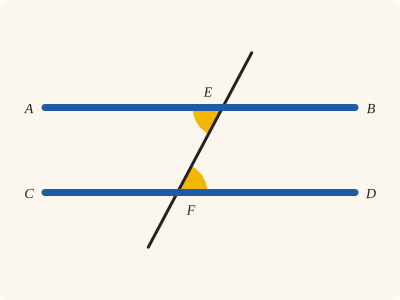
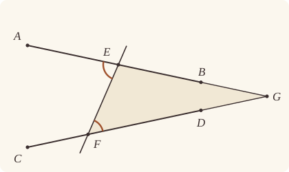
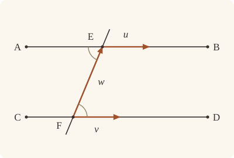

<!-- Generated by scripts/render.py. Do not edit by hand. -->

[Book I](index.md) · [← I.26](26.md) · [I.28 →](28.md)

# Book I, Proposition 27

*Equal alternate angles make parallels*

[Euclid's proof](#euclids-proof) · [In Lean](#in-lean) · [What it rests on](#what-it-rests-on) · [Mishnah](#mishnah)

> If a straight line falling on two straight lines make the alternate angles equal to one another, the straight lines will be parallel to one another.

**In Lean:** ✅ proved, as Euclid states it · Euclid's argument

<p align="center"></p>

<p align="center"><em>If a straight line falling on two others makes equal angles on opposite sides of it (yellow, in a Z), the two are parallel (blue): they never meet.</em></p>

## Euclid's proof

<p align="center"></p>

<p align="center"><em>Heath bends BG and DG to reach G; our drawing keeps them straight, so the alternate angles supposed equal appear unequal.</em></p>

For let the straight line EF falling on the two straight lines AB, CD make the alternate angles AEF, EFD equal to one another;

I say that AB is parallel to CD.

For, if not, AB, CD when produced will meet either in the direction of B, D or towards A, C.

Let them be produced and meet, in the direction of B, D, at G.

Then, in the triangle GEF,

the exterior angle AEF is equal to the interior and opposite angle EFG:

which is impossible. [I. 16]

Therefore AB, CD when produced will not meet in the direction of B, D.

Similarly it can be proved that neither will they meet towards A, C.

But straight lines which do not meet in either direction are parallel; [Def. 23]

therefore AB is parallel to CD.

Therefore etc.

Q. E. D.

## In Lean

| | |
|---|---|
| Proof | ✅ Proved |
| Statement | The whole enunciation. |
| Argument | Euclid's. |
| Reviewed | The statement and every passage of the argument read against Heath's text, at commit [`b62518e5`](https://github.com/jackChallis/stoicheia/commit/b62518e5) ([the record](../../review/I/27.toml)) |

From [`Elements/BookI/Prop27.lean`](../../Elements/BookI/Prop27.lean). Euclid's sentences are the `--` comments, and our own notes are in `/- … -/`; the lines under each sentence are the Lean that carries it out. The list below marks where a lemma does a step Euclid takes for granted and where several sentences share one step; the `/- … -/` notes in the listing explain smaller adjustments.

**How the Lean follows the text**

- **Done by `Tacit.same_side_or`.** "For, if not, AB, CD when produced will meet…" Euclid places a supposed meeting on one side of EF or the other. The Lean rules out a meeting on EF using `Tacit.line_unique` (System E, Generalities 1), then uses `Tacit.same_side_or` (System E, Same side 5); both are rules we assume, not proofs.
- **Done by `OnRay.between`.** "Then, in the triangle GEF…" Euclid next reads AEF as exterior to GEF and EFG as the given angle EFD. The Lean uses `OppositeSidesOf.sameSideOf_of_between` to put B on D's side of EF, `OnRay.of_sameSideOf` to put G on the rays EB and FD, and `OnRay.between` to put E between A and G; `angle_onRay_right` identifies EFG with EFD.
- **Carried together.** "Similarly it can be proved that neither will they meet towards A, C." Euclid leaves the second direction to the same reasoning. The Lean proves the argument once over any letters and applies it again with D, C, B, A in place of A, B, C, D and F, E in place of E, F.

```lean
/-- If a straight line falling on two straight lines make the alternate angles equal to one another,
the straight lines will be parallel to one another. -/
theorem Prop27 {A B C D E F : Point} (hAEB : Between A E B) (hCFD : Between C F D)
    (hAD : OppositeSidesOf A D E F) (h : ∠ A E F = ∠ E F D) :
    AreParallel A B C D := by
  -- For let the straight line EF falling on the two straight lines AB, CD make the alternate
  -- angles AEF, EFD equal to one another;
  /- The straight lines AB, CD and EF, drawn whole (Post. 1). EF falls on AB at E and on
     CD at F, and A and D are on opposite sides of it, so neither is on it. -/
  have hAB : A ≠ B := ne_of_between_ends hAEB
  have hCD : C ≠ D := ne_of_between_ends hCFD
  have hEF : E ≠ F := hAD.1
  obtain ⟨AB, hA_AB, hB_AB⟩ := Postulate1 A B hAB
  obtain ⟨CD, hC_CD, hD_CD⟩ := Postulate1 C D hCD
  obtain ⟨EF, hE_EF, hF_EF⟩ := Postulate1 E F hEF
  have hE_AB : OnLine E AB := on_line_of_between_ends hAEB hA_AB hB_AB
  have hF_CD : OnLine F CD := on_line_of_between_ends hCFD hC_CD hD_CD
  have hAD_EF : OppositeSides A D EF := hAD.oppositeSides hE_EF hF_EF
  -- I say that AB is parallel to CD.
  -- For, if not, AB, CD when produced will meet either in the direction of B, D or towards A,
  -- C.
  /- A point where they meet lies on D's side of EF or on A's (System E,
     Generalities 1 and Same side 5): these are Euclid's two directions, for B lies
     on D's side, and C on A's. -/
  have either : ∀ G : Point, OnLine G AB → OnLine G CD →
      SameSideOf G D E F ∨ SameSideOf G A E F := by
    intro G hG_AB hG_CD
    have hG_EF : ¬ OnLine G EF := by
      intro hG_EF
      by_cases hGE : G = E
      · rw [hGE] at hG_CD
        exact hAD_EF.2.1 (line_unique hEF hG_CD hF_CD hE_EF hF_EF ▸ hD_CD)
      · exact hAD_EF.1 (line_unique hGE hG_AB hE_AB hG_EF hE_EF ▸ hA_AB)
    rcases same_side_or hAD_EF.2.1 hAD_EF.1 hG_EF (fun hs => hAD_EF.2.2 (same_side_symm hs))
      with hs | hs
    · exact Or.inl (SameSideOf.of_line hEF hE_EF hF_EF (same_side_symm hs))
    · exact Or.inr (SameSideOf.of_line hEF hE_EF hF_EF (same_side_symm hs))
  /- Euclid's argument, given once for any letters: if EF falls on AB and CD, making
     the alternate angles AEF, EFD equal, then AB and CD do not meet on D's side of
     EF. -/
  have not_meet : ∀ {A B C D E F G : Point}, Between A E B → Between C F D →
      OppositeSidesOf A D E F → ∠ A E F = ∠ E F D → Collinear A B G → Collinear C D G →
      ¬ SameSideOf G D E F := by
    -- Let them be produced and meet, in the direction of B, D, at G.
    rintro A B C D E F G hAEB hCFD hAD h ⟨AB, hA_AB, hB_AB, hG_AB⟩ ⟨CD, hC_CD, hD_CD, hG_CD⟩
      hG
    have hE_AB : OnLine E AB := on_line_of_between_ends hAEB hA_AB hB_AB
    have hF_CD : OnLine F CD := on_line_of_between_ends hCFD hC_CD hD_CD
    -- Then, in the triangle GEF,
    /- G is on one side of EF, so it is off EF, and GEF is a triangle. -/
    have hEFG : Triangle E F G := hG.triangle
    have hE_F : E ≠ F := hEFG.ne₁₂
    have hF_G : F ≠ G := hEFG.ne₂₃
    have hE_G : E ≠ G := hEFG.ne₁₃
    /- G lies on CD, on D's side of EF, so on the ray from F through D, and the angle
       EFG is the angle EFD (`OnRay.of_sameSideOf`, `angle_onRay_right`). -/
    have hG_FD : OnRay G F D := OnRay.of_sameSideOf hG.swap ⟨CD, hF_CD, hD_CD, hG_CD⟩ hF_G.symm
    have hEFG_EFD : ∠ E F G = ∠ E F D := angle_onRay_right hG_FD hE_F
    /- B is on D's side of EF too, for E lies between A and B, and A is on the other
       side. So G lies on the ray from E through B, and E between A and G: AE is GE
       produced, and the angle AEF is exterior to the triangle GEF (`OnRay.between`). -/
    have hBD : SameSideOf B D E F := hAD.sameSideOf_of_between hAEB
    have hG_EB : OnRay G E B :=
      OnRay.of_sameSideOf (hG.trans hBD.symm) ⟨AB, hE_AB, hB_AB, hG_AB⟩ hE_G.symm
    have hAEG : Between A E G := hG_EB.between hAEB
    -- the exterior angle AEF is equal to the interior and opposite angle EFG:
    have hAEF_EFG : ∠ A E F = ∠ E F G := h.trans hEFG_EFD.symm
    -- which is impossible. [I. 16]
    /- I.16, in the triangle FGE with GE produced to A: the exterior angle FEA is
       greater than the interior and opposite angle GFE. -/
    have hGFE_FEA : ∠ G F E < ∠ F E A := (Prop16 hEFG.bca (between_symm hAEG)).2
    rw [angle_symm hF_G.symm hE_F, angle_symm hE_F.symm (ne_of_between hAEB), hAEF_EFG]
      at hGFE_FEA
    exact lt_irrefl _ hGFE_FEA
  -- Therefore AB, CD when produced will not meet in the direction of B, D.
  have hBD : ∀ G : Point, OnLine G AB → OnLine G CD → ¬ SameSideOf G D E F :=
    fun G hG_AB hG_CD =>
      not_meet hAEB hCFD hAD h ⟨AB, hA_AB, hB_AB, hG_AB⟩ ⟨CD, hC_CD, hD_CD, hG_CD⟩
  -- Similarly it can be proved that neither will they meet towards A, C.
  /- The same argument, with the figure read from the other end: EF, as FE, falls on DC
     at F and on BA at E, and the alternate angles DFE, FEA are the angles EFD, AEF. -/
  have hDFE_FEA : ∠ D F E = ∠ F E A :=
    (angle_symm (ne_of_between (between_symm hCFD)) hEF).trans
      (h.symm.trans (angle_symm (ne_of_between hAEB) hEF.symm))
  have hAC : ∀ G : Point, OnLine G AB → OnLine G CD → ¬ SameSideOf G A F E :=
    fun G hG_AB hG_CD =>
      not_meet (between_symm hCFD) (between_symm hAEB) hAD.symm.swap hDFE_FEA
        ⟨CD, hD_CD, hC_CD, hG_CD⟩ ⟨AB, hB_AB, hA_AB, hG_AB⟩
  -- But straight lines which do not meet in either direction are parallel; [Def. 23]
  have hDef23 : (∀ G : Point, OnLine G AB → ¬ OnLine G CD) → AreParallel A B C D :=
    AreParallel.of_not_meet hAB hCD hA_AB hB_AB hC_CD hD_CD
  -- therefore AB is parallel to CD.
  exact hDef23 fun G hG_AB hG_CD =>
    (either G hG_AB hG_CD).elim (hBD G hG_AB hG_CD) (fun hGA => hAC G hG_AB hG_CD hGA.swap)
  -- Therefore etc.
  -- Q. E. D.
```

## What it rests on

| | |
|---|---|
| Heath's references | [I.16](16.md); Def. I.23 |
| Lean cites | [I.16](16.md) |
| Postulates | 1, 2, 3, 4 |
| Definitions taken as axioms | Def. I.15 |
| Common Notions | 1, 2, 3, 4, 5 |
| Tacit rules | 52 (listed below) |
| Its own Lean calls | Postulate 1; 9 tacit rules |
| Through lemmas | 11 tacit rules |

_Postulates, definitions, Common Notions and tacit rules: all that this proof rests on, counting those of the propositions it cites. The last two rows say which of the postulates, definitions and tacit rules its own Lean calls, in the proof or a helper written for it, and which it does not call but reaches through lemmas, of Book Zero or shared (a proposition it cites may rest on these too); the rest come in only through the propositions it cites or the Common Notions._

_Euclid's Def. I.23 is `Parallel` in Lean, a definition rather than an assumption, so the row of definitions taken as axioms does not count it._

<details><summary>The 52 tacit rules beneath this proof, counting those of the propositions it cites</summary>

_(used here) marks a rule this proof's own Lean calls, in the proof or a helper written for it; (through …) marks one its own Lean does not call but reaches through the lemmas named, of [Book Zero](../../Elements/Figure) or shared, though a proposition it cites may rest on it too; and a rule with no mark comes in only through a proposition it cites or a Common Notion. The names in brackets are System E's: an Intersection rule says when straight lines and circles must meet, and an Intersections rule takes a point where they do (see [Book I's introduction](index.md))._

**Reading the figure**

- [`between_cases`](../../Elements/Foundations/Tacit/Diagram.lean#L73) (through [`OnRay.between`](../../Elements/Figure/Rays.lean#L70)): Of three different points on a straight line, one is between the other two. (Between 6)
- [`between_of_between_left`](../../Elements/Foundations/Tacit/Diagram.lean#L65) (through [`OnRay.between`](../../Elements/Figure/Rays.lean#L70)): If B is between A and C, and D is between A and B, then D is between A and C. (Between 4)
- [`between_of_between_right`](../../Elements/Foundations/Tacit/Diagram.lean#L69) (through [`OnRay.between`](../../Elements/Figure/Rays.lean#L70)): If B is between A and C, and C is between B and D, then B is between A and D. (Between 5)
- [`between_symm`](../../Elements/Foundations/Tacit/Diagram.lean#L42) (used here): If B is between A and C, it is between C and A. (Between 1)
- [`centre_inside`](../../Elements/Foundations/Tacit/Diagram.lean#L34): The centre of a circle is inside it. (Generalities 3)
- [`circles_meet`](../../Elements/Foundations/Tacit/Diagram.lean#L176): If each circle passes through a point inside the other, the circles cut one another. This is the step Euclid takes for granted in I.1. (Intersection 5)
- [`circles_meet_same_side`](../../Elements/Foundations/Tacit/Constructions.lean#L94): Two circles that cut one another do so on each side of the straight line through their centres. (Intersections 8)
- [`exists_point`](../../Elements/Foundations/Tacit/Constructions.lean#L29) (through [`OppositeSidesOf.sameSideOf_of_between`](../../Elements/Figure/Sides.lean#L167), [`Triangle.ne₁₂`](../../Elements/Figure/Triangles.lean#L22), [`Triangle.ne₁₃`](../../Elements/Figure/Triangles.lean#L36) and 1 other lemma): Let a point be taken. (Points 1)
- [`exists_point_between`](../../Elements/Foundations/Tacit/Constructions.lean#L41): Let a point be taken between B and C. (Points 3)
- [`exists_point_opposite_side`](../../Elements/Foundations/Tacit/Constructions.lean#L49): Let a point be taken on the other side of L from B. (Points 6)
- [`line_circle_between`](../../Elements/Foundations/Tacit/Constructions.lean#L82): A straight line through a point B inside a circle, heading out to a point C outside it, cuts the circle between B and C. (Intersections 4)
- [`line_circle_beyond`](../../Elements/Foundations/Tacit/Constructions.lean#L88): A straight line through a point B inside a circle, produced beyond B away from C, cuts the circle there. (Intersections 5)
- [`line_unique`](../../Elements/Foundations/Tacit/Diagram.lean#L30) (used here): Two points determine a straight line. (Generalities 1)
- [`lines_meet_of_opposite_sides`](../../Elements/Foundations/Tacit/Diagram.lean#L159): A straight line joining points on opposite sides of L crosses L. (Intersection 1)
- [`ne_of_between`](../../Elements/Foundations/Tacit/Diagram.lean#L45) (used here): A point between two others differs from the first. (Between 1)
- [`ne_of_between_ends`](../../Elements/Foundations/Tacit/Diagram.lean#L48) (used here): The ends of a finite straight line differ. (Between 1)
- [`not_between_of_between`](../../Elements/Foundations/Tacit/Diagram.lean#L51) (through [`OnRay.between`](../../Elements/Figure/Rays.lean#L70)): If B is between A and C, then A is not between B and C. (Between 1)
- [`not_between_of_between_between`](../../Elements/Foundations/Tacit/Diagram.lean#L78) (through [`OnRay.between`](../../Elements/Figure/Rays.lean#L70)): If B is between A and C, and also between A and D, then B is not between C and D: C and D lie on the same side of B. (Between 7)
- [`not_on_line_of_same_side`](../../Elements/Foundations/Tacit/Diagram.lean#L91) (through [`OnRay.of_sameSideOf`](../../Elements/Figure/Angles.lean#L186) and [`SameSideOf.triangle`](../../Elements/Figure/Sides.lean#L59)): Points on one side of a straight line are not on it. (Same side 3)
- [`on_line_of_between`](../../Elements/Foundations/Tacit/Diagram.lean#L55) (through [`OnRay.between`](../../Elements/Figure/Rays.lean#L70) and [`OppositeSidesOf.sameSideOf_of_between`](../../Elements/Figure/Sides.lean#L167)): A straight line through A and B, with B between A and C, passes through C. (Between 2)
- [`on_line_of_between_ends`](../../Elements/Foundations/Tacit/Diagram.lean#L60) (used here): A straight line through A and C passes through every point between them. (Between 3)
- [`pasch2`](../../Elements/Foundations/Tacit/Diagram.lean#L110): If B is between A and C, A is on L and B is off it, then B and C are on the same side of L: a straight line that leaves L at A does not cross it again. (Pasch 2)
- [`pasch3`](../../Elements/Foundations/Tacit/Diagram.lean#L113) (through [`OnRay.of_sameSideOf`](../../Elements/Figure/Angles.lean#L186) and [`OppositeSidesOf.sameSideOf_of_between`](../../Elements/Figure/Sides.lean#L167)): A straight line through a point between A and C separates them. (Pasch 3)
- [`pasch4`](../../Elements/Foundations/Tacit/Diagram.lean#L118): If two different straight lines L and M meet at B, and A and C are points of M, different from each other and from B, that are not on the same side of L, then B is between A and C. (Pasch 4)
- [`same_side_or`](../../Elements/Foundations/Tacit/Diagram.lean#L98) (used here): A straight line has only two sides. (Same side 5)
- [`same_side_refl`](../../Elements/Foundations/Tacit/Diagram.lean#L84): A point off a straight line is on the same side of it as itself. (Same side 1)
- [`same_side_symm`](../../Elements/Foundations/Tacit/Diagram.lean#L88) (used here): If A is on the same side of a straight line as B, then B is on the same side as A. (Same side 2)
- [`same_side_trans`](../../Elements/Foundations/Tacit/Diagram.lean#L95) (through [`SameSideOf.trans`](../../Elements/Figure/Sides.lean#L53)): Two points on the same side of a straight line as a third point are on the same side as each other. (Same side 4)
- [`triple_incidence1`](../../Elements/Foundations/Tacit/Diagram.lean#L130): Take B on L, C on M and D on N, three straight lines through A. If C lies within the angle BAD (on D's side of L and on B's side of N), then B and D are not on the same side of M: the straight line AC separates them. (Triple incidence 1)
- [`triple_incidence2`](../../Elements/Foundations/Tacit/Diagram.lean#L138): Take B on L, C on M and D on N, three straight lines through A, with B other than A and D off M. If C and D are on the same side of L, and B and D are not on the same side of M, then B and C are on the same side of N: C lies within the angle BAD. (Triple incidence 2)

**Lengths, angles and areas**

- [`angle_add_of_inside`](../../Elements/Foundations/Tacit/Transfer.lean#L55): If D lies within the angle BAC, then BAC is made up of BAD and DAC. (Diagram-angle 2)
- [`angle_eq_of_same_rays`](../../Elements/Foundations/Tacit/Transfer.lean#L62) (through [`angle_onRay_right`](../../Elements/Figure/Angles.lean#L47)): The angle doesn't change if its arms are traced through other points on the same rays. (Diagram-angle 4)
- [`angle_symm`](../../Elements/Foundations/Tacit/Metric.lean#L26) (used here): The angle ABC is the angle CBA. (Metric 4)
- [`area_congruent`](../../Elements/Foundations/Tacit/Metric.lean#L43): Triangles equal in all their sides and angles are equal in area. Euclid uses this without comment once he has shown two triangles congruent. (Metric 9)
- [`area_rotate`](../../Elements/Foundations/Tacit/Metric.lean#L35): The triangle ABC is the triangle CAB. (Metric 8)
- [`area_swap`](../../Elements/Foundations/Tacit/Metric.lean#L38): The triangle ABC is the triangle ACB. (Metric 8)
- [`eq_of_len_eq_zero`](../../Elements/Foundations/Tacit/Metric.lean#L17): A finite straight line with distinct ends has length. (Metric 1)
- [`inside_of_len_lt`](../../Elements/Foundations/Tacit/Transfer.lean#L34): A point nearer the centre than the circumference is inside. (Diagram-segment 4)
- [`len_add_of_between`](../../Elements/Foundations/Tacit/Transfer.lean#L22): If B is between A and C, then AB and BC together make up AC. (Diagram-segment 1)
- [`len_lt_of_inside`](../../Elements/Foundations/Tacit/Transfer.lean#L38): A point inside is nearer the centre than the circumference. (Diagram-segment 4)
- [`len_self`](../../Elements/Foundations/Tacit/Metric.lean#L20): The "straight line" from a point to itself has no length. (Metric 1)
- [`len_symm`](../../Elements/Foundations/Tacit/Metric.lean#L23): The straight line AB is the straight line BA. (Metric 3)
- [`same_ray_of_angle_eq_zero`](../../Elements/Foundations/Tacit/Transfer.lean#L50): If the angle BAC is nothing, C lies on the ray from A through B. (Diagram-angle 1)

**Superposition**

- [`superposition`](../../Elements/Foundations/Tacit/Superposition.lean#L48): **Superposition.** A hypothetical placement of a triangle on a given ray and side permits a restricted derivation of metric equalities about the figure already given. The derivation introduces no further objects, cites each geometric law it uses, and exports no symbol of the placement.

**Laws of magnitude**

- [`add_assoc`](../../Elements/Foundations/Tacit/Magnitudes.lean#L23): Adding three magnitudes in a row, it makes no difference whether the first two or the last two are added first. (System E §3.5)
- [`add_comm`](../../Elements/Foundations/Tacit/Magnitudes.lean#L26): The order of adding does not matter. (System E §3.5)
- [`add_lt_add_right`](../../Elements/Foundations/Tacit/Magnitudes.lean#L45): Adding the same thing to both sides keeps "less than". (System E §3.5)
- [`add_zero`](../../Elements/Foundations/Tacit/Magnitudes.lean#L29): Adding nothing changes nothing. (System E §3.5)
- [`lt_irrefl`](../../Elements/Foundations/Tacit/Magnitudes.lean#L32) (used here): No magnitude is less than itself. (System E §3.5)
- [`lt_trans`](../../Elements/Foundations/Tacit/Magnitudes.lean#L35): What is less than the less is less still. (System E §3.5)
- [`lt_trichotomy`](../../Elements/Foundations/Tacit/Magnitudes.lean#L39): Of two magnitudes, one is less, or they are equal, or the other is less. (System E §3.5)
- [`not_lt_zero`](../../Elements/Foundations/Tacit/Magnitudes.lean#L42): Nothing is less than zero. (System E §3.5)

</details>

## Mishnah

_Our commentary: what Euclid assumes, what Lean made us say out loud, and how the result looks by modern means._

"With this proposition begins the second section of the first Book," Heath writes (vol. 1, p. 308): the section on parallels, which the areas to come will rest on. EF falls on AB and CD and makes the alternate angles AEF, EFD equal, on opposite sides of EF and between AB and CD. Were AB and CD to meet at G, they would close a triangle GEF whose exterior angle AEF is equal to the interior and opposite angle EFG, and I.16 forbids it. So they never meet, and Definition I.23 calls them parallel.

From two passages of Aristotle Heath concludes that the proposition is older than Euclid: "It seems clear then from Aristotle that I. 27, 28 at least are pre-Euclidean, and that it was only in I. 29 that Euclid made a change by using his Postulate" (vol. 1, p. 309). Augustus De Morgan saw that I.27 "is a *logical* equivalent of I. 16" (Heath, vol. 1, p. 309), the same fact turned round.

**"In the direction of B, D."** Literally, Heath notes, it is "towards the *parts* B, D or towards A, C" (vol. 1, p. 308), and we read the parts as the two sides of EF. A point where AB and CD meet is off EF, for AB meets EF at E alone, and were it E, CD would be EF itself; so it lies on one side of EF or the other. On D's side, G lies on the rays from E through B and from F through D, so AEF is exterior to the triangle GEF, and EFG is the given angle EFD; we prove both. Heath's figure can only suggest them: it draws AB and CD as though parallel and bends BG and DG to meet at G, since no straight lines can do what the supposition asks. Ours draws the supposition straight, A, E, B, G on one straight line and C, F, D, G on another, so the angles AEF and EFD, supposed equal, plainly are not.

**The modern way.** Let $\mathbf{u}$ and $\mathbf{v}$ be the unit vectors from E towards B and from F towards D, and $\mathbf{w} = \mathrm{E - F}$. The angle AEF is the angle between $\mathbf{u}$ and $\mathbf{w}$, and EFD the angle between $\mathbf{w}$ and $\mathbf{v}$; since B and D lie on one side of EF, equal angles make $\mathbf{u} = \mathbf{v}$. A common point $\mathrm{E} + s\mathbf{u} = \mathrm{F} + t\mathbf{u}$ would make $\mathbf{w}$ a multiple of $\mathbf{u}$ and put F on AB, so that EF, which falls on AB, would be AB itself.

<p align="center"></p>

## Further reading

- David Hilbert's [*The Foundations of Geometry*](https://www.gutenberg.org/ebooks/17384) (1902, free online), the short book that wrote down the axioms Euclid took for granted, says what "between" means in ch. I, "The Five Groups of Axioms", and so what the two sides of a straight line are, which Euclid reads off his figure and our proof states.
- Directions as vectors, the language of the modern way, fill ch. 4, "Vectors and Euclidean spaces", of John Stillwell's [*The Four Pillars of Geometry*](https://doi.org/10.1007/0-387-29052-4) (2005), one plane seen four ways (also on [I.12](12.md)).

[Book I](index.md) · [← I.26](26.md) · [I.28 →](28.md)

---

<sub>Euclid's text: T. L. Heath, *The Thirteen Books of Euclid's Elements*, vol. 1 (Cambridge, 1908), pp. 307–308; [scan leaves n327–n328](https://archive.org/details/thirteenbookseu02heibgoog/page/n327); [figure on n327](https://archive.org/details/thirteenbookseu02heibgoog/page/n327). Public domain.</sub>

<sub>The tacit rules follow the System E of Jeremy Avigad, Edward Dean and John Mumma, read alongside LeanEuclid (Logan Murphy, Kaiyu Yang, Jialiang Sun, Zhaoyu Li, Anima Anandkumar and Xujie Si).</sub>
