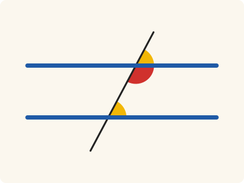
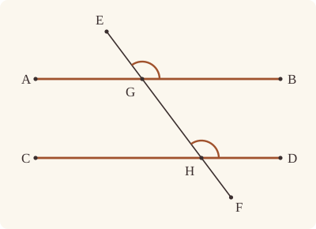

<!-- Generated by scripts/render.py. Do not edit by hand. -->

[Book I](index.md) · [← I.27](27.md) · [I.29 →](29.md)

# Book I, Proposition 28

*Equal exterior and interior angles make parallels*

[Euclid's proof](#euclids-proof) · [In Lean](#in-lean) · [What it rests on](#what-it-rests-on) · [Mishnah](#mishnah)

> If a straight line falling on two straight lines make the exterior angle equal to the interior and opposite angle on the same side, or the interior angles on the same side equal to two right angles, the straight lines will be parallel to one another.

**In Lean:** ✅ proved, as Euclid states it · Euclid's argument

<p align="center"></p>

<p align="center"><em>If a straight line falling on two others makes an outside angle equal to the inside one on the same side (yellow), or two inside angles on one side (red and yellow) together make two right angles, the two are parallel (blue).</em></p>

## Euclid's proof

<p align="center"></p>

For let the straight line EF falling on the two straight lines AB, CD make the exterior angle EGB equal to the interior and opposite angle GHD, or the interior angles on the same side, namely BGH, GHD, equal to two right angles;

I say that AB is parallel to CD.

For, since the angle EGB is equal to the angle GHD,

while the angle EGB is equal to the angle AGH, [I. 15]

the angle AGH is also equal to the angle GHD;

and they are alternate;

therefore AB is parallel to CD. [I. 27]

Again, since the angles BGH, GHD are equal to two right angles, and the angles AGH, BGH are also equal to two right angles, [I. 13]

the angles AGH, BGH are equal to the angles BGH, GHD.

Let the angle BGH be subtracted from each;

therefore the remaining angle AGH is equal to the remaining angle GHD;

and they are alternate;

therefore AB is parallel to CD. [I. 27]

Therefore etc.

Q. E. D.

## In Lean

| | |
|---|---|
| Proof | ✅ Proved |
| Statement | The whole enunciation. |
| Argument | Euclid's. |
| Reviewed | The statement and every passage of the argument read against Heath's text, at commit [`bedbba23e`](https://github.com/jackChallis/stoicheia/commit/bedbba23e) ([the record](../../review/I/28.toml)) |

From [`Elements/BookI/Prop28.lean`](../../Elements/BookI/Prop28.lean). Euclid's sentences are the `--` comments, and our own notes are in `/- … -/`; the lines under each sentence are the Lean that carries it out. The list below marks where a lemma does a step Euclid takes for granted; the `/- … -/` notes in the listing explain smaller adjustments.

**How the Lean follows the text**

- **Done by `SameSideOf.oppositeSidesOf_of_between`.** "and they are alternate; therefore AB is parallel to CD. [I. 27] Again,…" Euclid reads the angles as alternate from the figure. `SameSideOf.oppositeSidesOf_of_between` puts A and D on opposite sides of GH, since G lies between A and B, and since B and D lie on the same side of GH.
- **Done by `SameSideOf.oppositeSidesOf_of_between`.** "and they are alternate; therefore AB is parallel to CD. [I. 27] Therefore etc." Euclid again reads the angles as alternate. The Lean repeats `SameSideOf.oppositeSidesOf_of_between`, using the same sides and betweenness as in the first case.

```lean
/-- If a straight line falling on two straight lines make the exterior angle equal to the interior
and opposite angle on the same side, or the interior angles on the same side equal to two right
angles, the straight lines will be parallel to one another. -/
theorem Prop28 {A B C D E F G H : Point} (hAGB : Between A G B) (hCHD : Between C H D)
    (hEGH : Between E G H) (hGHF : Between G H F) (hBD : SameSideOf B D E F)
    (h : ∠ E G B = ∠ G H D ∨ ∠ B G H + ∠ G H D = ∟ + ∟) :
    AreParallel A B C D := by
  -- For let the straight line EF falling on the two straight lines AB, CD make the exterior
  -- angle EGB equal to the interior and opposite angle GHD, or the interior angles on the same
  -- side, namely BGH, GHD, equal to two right angles;
  /- EF is the straight line GH, so B and D lie on one side of GH too
     (`SameSideOf.inner`); and B, on one side of it, is off it, which the angles
     below will need. -/
  have hBD_GH : SameSideOf B D G H := hBD.inner hEGH hGHF
  -- I say that AB is parallel to CD.
  rcases h with hext | hint
  -- For, since the angle EGB is equal to the angle GHD,
  · have hEGB_GHD : ∠ E G B = ∠ G H D := hext
    -- while the angle EGB is equal to the angle AGH, [I. 15]
    have hEHB : Triangle E H B := by
      rintro ⟨L, hE, hH, hB⟩
      exact hBD_GH.triangle ⟨L, on_line_of_between_ends hEGH hE hH, hH, hB⟩
    have hEGB_AGH : ∠ E G B = ∠ A G H :=
      (Prop15 hEGH (between_symm hAGB) hEHB).1
    -- the angle AGH is also equal to the angle GHD;
    have hAGH_GHD : ∠ A G H = ∠ G H D := CommonNotion1 hEGB_AGH.symm hEGB_GHD.symm
    -- and they are alternate;
    have hAD : OppositeSidesOf A D G H := hBD_GH.oppositeSidesOf_of_between hAGB
    -- therefore AB is parallel to CD. [I. 27]
    exact Prop27 hAGB hCHD hAD hAGH_GHD
  -- Again, since the angles BGH, GHD are equal to two right angles, and the angles AGH, BGH
  -- are also equal to two right angles, [I. 13]
  · have hABH : Triangle A B H := by
      rintro ⟨L, hA, hB, hH⟩
      exact hBD_GH.triangle ⟨L, on_line_of_between_ends hAGB hA hB, hH, hB⟩
    have htwo : ∠ A G H + ∠ B G H = ∟ + ∟ := by
      rw [angle_symm (ne_of_between (between_symm hAGB)) (ne_of_between hGHF).symm]
      exact Prop13 hAGB hABH
    -- the angles AGH, BGH are equal to the angles BGH, GHD.
    have hsums : ∠ A G H + ∠ B G H = ∠ B G H + ∠ G H D := CommonNotion1 htwo hint
    -- Let the angle BGH be subtracted from each;
    /- Each sum is written with the angle BGH last, for Common Notion 3 to take it
       away. -/
    have hsums' : ∠ A G H + ∠ B G H = ∠ G H D + ∠ B G H := hsums.trans (add_comm _ _)
    -- therefore the remaining angle AGH is equal to the remaining angle GHD;
    have hAGH_GHD : ∠ A G H = ∠ G H D := CommonNotion3 hsums' rfl
    -- and they are alternate;
    have hAD : OppositeSidesOf A D G H := hBD_GH.oppositeSidesOf_of_between hAGB
    -- therefore AB is parallel to CD. [I. 27]
    exact Prop27 hAGB hCHD hAD hAGH_GHD
  -- Therefore etc.
  -- Q. E. D.
```

## What it rests on

| | |
|---|---|
| Heath's references | [I.13](13.md), [I.15](15.md), [I.27](27.md) |
| Lean cites | [I.13](13.md), [I.15](15.md), [I.27](27.md) |
| Postulates | 1, 2, 3, 4 |
| Definitions taken as axioms | Def. I.15 |
| Common Notions | 1, 2, 3, 4, 5 |
| Tacit rules | 37 (listed below) |
| Its own Lean calls | 3 tacit rules |
| Through lemmas | Postulates 1, 2 and 3; Def. I.15; 25 tacit rules |

_Postulates, definitions, Common Notions and tacit rules: all that this proof rests on, counting those of the propositions it cites. The last two rows say which of the postulates, definitions and tacit rules its own Lean calls, in the proof or a helper written for it, and which it does not call but reaches through lemmas, of Book Zero or shared (a proposition it cites may rest on these too); the rest come in only through the propositions it cites or the Common Notions._

<details><summary>The 37 tacit rules beneath this proof, counting those of the propositions it cites</summary>

_(used here) marks a rule this proof's own Lean calls, in the proof or a helper written for it; (through …) marks one its own Lean does not call but reaches through the lemmas named, of [Book Zero](../../Elements/Figure) or shared, though a proposition it cites may rest on it too; and a rule with no mark comes in only through a proposition it cites or a Common Notion. The names in brackets are System E's: an Intersection rule says when straight lines and circles must meet, and an Intersections rule takes a point where they do (see [Book I's introduction](index.md))._

**Reading the figure**

- [`between_cases`](../../Elements/Foundations/Tacit/Diagram.lean#L54) (through [`SameSideOf.inner`](../../Elements/Figure/Sides.lean#L147)): Of three different points on a straight line, one is between the other two. (Between 6)
- [`between_symm`](../../Elements/Foundations/Tacit/Diagram.lean#L47) (used here): If B is between A and C, it is between C and A. (Between 1)
- [`circles_meet`](../../Elements/Foundations/Tacit/Diagram.lean#L91) (through [`SameSideOf.inner`](../../Elements/Figure/Sides.lean#L147), [`SameSideOf.oppositeSidesOf_of_between`](../../Elements/Figure/Sides.lean#L159) and [`Tacit.on_line_of_between_ends`](../../Elements/Figure/RuleBase.lean#L142)): If each circle passes through a point inside the other, the circles cut one another. This is the step Euclid takes for granted in I.1. (Intersection 5)
- [`circles_meet_same_side`](../../Elements/Foundations/Tacit/Constructions.lean#L79) (through [`SameSideOf.inner`](../../Elements/Figure/Sides.lean#L147), [`SameSideOf.oppositeSidesOf_of_between`](../../Elements/Figure/Sides.lean#L159) and [`Tacit.on_line_of_between_ends`](../../Elements/Figure/RuleBase.lean#L142)): Two circles that cut one another do so on each side of the straight line through their centres. (Intersections 8)
- [`exists_point`](../../Elements/Foundations/Tacit/Constructions.lean#L35) (through [`SameSideOf.oppositeSidesOf_of_between`](../../Elements/Figure/Sides.lean#L159)): Let a point be taken. (Points 1)
- [`exists_point_inside_circle`](../../Elements/Foundations/Tacit/Constructions.lean#L42) (through [`SameSideOf.inner`](../../Elements/Figure/Sides.lean#L147), [`SameSideOf.oppositeSidesOf_of_between`](../../Elements/Figure/Sides.lean#L159) and [`Tacit.on_line_of_between_ends`](../../Elements/Figure/RuleBase.lean#L142)): Let a point be taken inside the circle α. (Points 8)
- [`exists_point_on_line`](../../Elements/Foundations/Tacit/Constructions.lean#L38) (through [`SameSideOf.inner`](../../Elements/Figure/Sides.lean#L147), [`SameSideOf.oppositeSidesOf_of_between`](../../Elements/Figure/Sides.lean#L159) and [`Tacit.on_line_of_between_ends`](../../Elements/Figure/RuleBase.lean#L142)): Let a point be taken on the straight line L. (Points 2)
- [`line_circle_between`](../../Elements/Foundations/Tacit/Constructions.lean#L67) (through [`SameSideOf.inner`](../../Elements/Figure/Sides.lean#L147), [`SameSideOf.oppositeSidesOf_of_between`](../../Elements/Figure/Sides.lean#L159) and [`Tacit.on_line_of_between_ends`](../../Elements/Figure/RuleBase.lean#L142)): A straight line through a point B inside a circle, heading out to a point C outside it, cuts the circle between B and C. (Intersections 4)
- [`line_circle_beyond`](../../Elements/Foundations/Tacit/Constructions.lean#L73) (through [`SameSideOf.inner`](../../Elements/Figure/Sides.lean#L147), [`SameSideOf.oppositeSidesOf_of_between`](../../Elements/Figure/Sides.lean#L159) and [`Tacit.on_line_of_between_ends`](../../Elements/Figure/RuleBase.lean#L142)): A straight line through a point B inside a circle, produced beyond B away from C, cuts the circle there. (Intersections 5)
- [`line_unique`](../../Elements/Foundations/Tacit/Diagram.lean#L41) (through [`SameSideOf.inner`](../../Elements/Figure/Sides.lean#L147) and [`SameSideOf.oppositeSidesOf_of_between`](../../Elements/Figure/Sides.lean#L159)): Two points determine a straight line. (Generalities 1)
- [`lines_meet_of_opposite_sides`](../../Elements/Foundations/Tacit/Diagram.lean#L86): A straight line joining points on opposite sides of L crosses L. (Intersection 1)
- [`not_between_of_between`](../../Elements/Foundations/Tacit/Diagram.lean#L50) (through [`SameSideOf.inner`](../../Elements/Figure/Sides.lean#L147), [`SameSideOf.oppositeSidesOf_of_between`](../../Elements/Figure/Sides.lean#L159), [`Tacit.ne_of_between`](../../Elements/Figure/RuleBase.lean#L135) and 1 other lemma): If B is between A and C, then A is not between B and C. (Between 1)
- [`not_on_line_of_same_side`](../../Elements/Foundations/Tacit/Diagram.lean#L60) (through [`SameSideOf.inner`](../../Elements/Figure/Sides.lean#L147), [`SameSideOf.oppositeSidesOf_of_between`](../../Elements/Figure/Sides.lean#L159), [`SameSideOf.triangle`](../../Elements/Figure/Sides.lean#L61) and 1 other lemma): Points on one side of a straight line are not on it. (Same side 3)
- [`pasch2`](../../Elements/Foundations/Tacit/Diagram.lean#L71) (through [`SameSideOf.inner`](../../Elements/Figure/Sides.lean#L147), [`SameSideOf.oppositeSidesOf_of_between`](../../Elements/Figure/Sides.lean#L159) and [`Tacit.on_line_of_between_ends`](../../Elements/Figure/RuleBase.lean#L142)): If B is between A and C, A is on L and B is off it, then B and C are on the same side of L: a straight line that leaves L at A does not cross it again. (Pasch 2)
- [`same_side_trans`](../../Elements/Foundations/Tacit/Diagram.lean#L64) (through [`SameSideOf.inner`](../../Elements/Figure/Sides.lean#L147), [`SameSideOf.oppositeSidesOf_of_between`](../../Elements/Figure/Sides.lean#L159) and [`Tacit.on_line_of_between_ends`](../../Elements/Figure/RuleBase.lean#L142)): Two points on the same side of a straight line as a third point are on the same side as each other. (Same side 4)

**Lengths, angles and areas**

- [`angle_add_of_inside`](../../Elements/Foundations/Tacit/Transfer.lean#L47) (through [`SameSideOf.oppositeSidesOf_of_between`](../../Elements/Figure/Sides.lean#L159)): If D lies within the angle BAC, then BAC is made up of BAD and DAC. (Diagram-angle 2)
- [`angle_eq_of_same_rays`](../../Elements/Foundations/Tacit/Transfer.lean#L54): The angle doesn't change if its arms are traced through other points on the same rays. (Diagram-angle 4)
- [`angle_symm`](../../Elements/Foundations/Tacit/Metric.lean#L30) (used here): The angle ABC is the angle CBA. (Metric 4)
- [`area_add_of_between`](../../Elements/Foundations/Tacit/Transfer.lean#L70): Cutting a triangle in two from a vertex adds up. (Diagram-area 2)
- [`area_congruent`](../../Elements/Foundations/Tacit/Metric.lean#L44): Triangles equal in all their sides and angles are equal in area. Euclid uses this without comment once he has shown two triangles congruent. (Metric 9)
- [`area_degenerate`](../../Elements/Foundations/Tacit/Metric.lean#L36): A "triangle" with a repeated corner has no area. (Metric 6)
- [`area_eq_zero_of_on_line`](../../Elements/Foundations/Tacit/Transfer.lean#L62): A "triangle" whose corners lie on one straight line has no area. (Diagram-area 1)
- [`area_rotate`](../../Elements/Foundations/Tacit/Metric.lean#L39): The triangle ABC is the triangle CAB. (Metric 8)
- [`len_add_of_between`](../../Elements/Foundations/Tacit/Transfer.lean#L27) (through [`SameSideOf.inner`](../../Elements/Figure/Sides.lean#L147), [`SameSideOf.oppositeSidesOf_of_between`](../../Elements/Figure/Sides.lean#L159) and [`Tacit.on_line_of_between_ends`](../../Elements/Figure/RuleBase.lean#L142)): If B is between A and C, then AB and BC together make up AC. (Diagram-segment 1)
- [`len_self`](../../Elements/Foundations/Tacit/Metric.lean#L24) (through [`SameSideOf.inner`](../../Elements/Figure/Sides.lean#L147), [`SameSideOf.oppositeSidesOf_of_between`](../../Elements/Figure/Sides.lean#L159) and [`Tacit.on_line_of_between_ends`](../../Elements/Figure/RuleBase.lean#L142)): The "straight line" from a point to itself has no length. (Metric 1)
- [`len_symm`](../../Elements/Foundations/Tacit/Metric.lean#L27) (through [`SameSideOf.inner`](../../Elements/Figure/Sides.lean#L147), [`SameSideOf.oppositeSidesOf_of_between`](../../Elements/Figure/Sides.lean#L159) and [`Tacit.on_line_of_between_ends`](../../Elements/Figure/RuleBase.lean#L142)): The straight line AB is the straight line BA. (Metric 3)
- [`radius_ne_zero`](../../Elements/Foundations/Tacit/Metric.lean#L62) (through [`SameSideOf.inner`](../../Elements/Figure/Sides.lean#L147), [`SameSideOf.oppositeSidesOf_of_between`](../../Elements/Figure/Sides.lean#L159) and [`Tacit.on_line_of_between_ends`](../../Elements/Figure/RuleBase.lean#L142)): A circle's radius is not nothing: the straight line from the centre to a point on the circle has some length. A rule of our own, not one of System E's: every circle is drawn with a centre and a distance (Postulate 3).
- [`same_ray_of_angle_eq_zero`](../../Elements/Foundations/Tacit/Transfer.lean#L42) (through [`SameSideOf.oppositeSidesOf_of_between`](../../Elements/Figure/Sides.lean#L159)): If the angle BAC is nothing, C lies on the ray from A through B. (Diagram-angle 1)

**Superposition**

- [`superposition`](../../Elements/Foundations/Tacit/Superposition.lean#L52): **Superposition.** A hypothetical placement of a triangle on a given ray and side permits a restricted derivation of metric equalities about the figure already given. The derivation introduces no further objects, cites each geometric law it uses, and exports no symbol of the placement.

**Laws of magnitude**

- [`add_assoc`](../../Elements/Foundations/Tacit/Magnitudes.lean#L23) (through [`SameSideOf.inner`](../../Elements/Figure/Sides.lean#L147)): Adding three magnitudes in a row, it makes no difference whether the first two or the last two are added first. (System E §3.5)
- [`add_comm`](../../Elements/Foundations/Tacit/Magnitudes.lean#L26) (used here): The order of adding does not matter. (System E §3.5)
- [`add_lt_add_right`](../../Elements/Foundations/Tacit/Magnitudes.lean#L45) (through [`SameSideOf.inner`](../../Elements/Figure/Sides.lean#L147)): Adding the same thing to both sides keeps "less than". (System E §3.5)
- [`add_zero`](../../Elements/Foundations/Tacit/Magnitudes.lean#L29): Adding nothing changes nothing. (System E §3.5)
- [`lt_irrefl`](../../Elements/Foundations/Tacit/Magnitudes.lean#L32) (through [`SameSideOf.inner`](../../Elements/Figure/Sides.lean#L147), [`SameSideOf.oppositeSidesOf_of_between`](../../Elements/Figure/Sides.lean#L159) and [`Tacit.on_line_of_between_ends`](../../Elements/Figure/RuleBase.lean#L142)): No magnitude is less than itself. (System E §3.5)
- [`lt_trans`](../../Elements/Foundations/Tacit/Magnitudes.lean#L35) (through [`SameSideOf.inner`](../../Elements/Figure/Sides.lean#L147), [`SameSideOf.oppositeSidesOf_of_between`](../../Elements/Figure/Sides.lean#L159) and [`Tacit.on_line_of_between_ends`](../../Elements/Figure/RuleBase.lean#L142)): What is less than the less is less still. (System E §3.5)
- [`lt_trichotomy`](../../Elements/Foundations/Tacit/Magnitudes.lean#L39) (through [`SameSideOf.inner`](../../Elements/Figure/Sides.lean#L147), [`SameSideOf.oppositeSidesOf_of_between`](../../Elements/Figure/Sides.lean#L159) and [`Tacit.on_line_of_between_ends`](../../Elements/Figure/RuleBase.lean#L142)): Of two magnitudes, one is less, or they are equal, or the other is less. (System E §3.5)
- [`not_lt_zero`](../../Elements/Foundations/Tacit/Magnitudes.lean#L42) (through [`SameSideOf.inner`](../../Elements/Figure/Sides.lean#L147), [`SameSideOf.oppositeSidesOf_of_between`](../../Elements/Figure/Sides.lean#L159) and [`Tacit.on_line_of_between_ends`](../../Elements/Figure/RuleBase.lean#L142)): Nothing is less than zero. (System E §3.5)

</details>

## Mishnah

_Our commentary: what Euclid assumes, what Lean made us say out loud, and how the result looks by modern means._

Heath counts the tests so far: "One criterion of parallelism, the equality of alternate angles, is given in I. 27; here we have two more" (vol. 1, p. 310). Euclid brings each new one back to the alternate angles AGH, GHD. If the exterior angle EGB is equal to GHD, I.15 puts its vertical angle AGH in its place. If BGH and GHD make two right angles, so do AGH and BGH, by I.13, and when BGH is taken from each, AGH is left equal to GHD. Either way I.27 finishes. Each time Euclid reads "and they are alternate" from his figure; our statement supplies it: B and D lie on one side of EF, and G lies between A and B.

Aristotle knew the proposition, and used its second hypothesis to show what a general proof is. Two straight lines at right angles to a third do not meet, but a proof of that should not rest on the angles being right: it follows, in Heath's translation, "by virtue of their being equal (to two right angles) in any way whatever" (vol. 1, p. 309). The passage, Heath judges, "certainly refers to I. 28" (vol. 1, p. 309).

Heath reports Proclus' observation that "Euclid could have stated six criteria as well as three" (vol. 1, p. 310): pairs of angles on one side of EF or on opposite sides, interior or exterior, equal or together two right angles. The three left out, Heath says, "are of course equivalent but are not quite so easily expressed" (vol. 1, p. 311), and the three Euclid chose are the ones I.29 turns round. One Aigeias (or Aineias) of Hierapolis, known, it seems, only from Proclus' note here, made I.27 and I.28 one proposition in his abridgment of the *Elements* (Heath, vol. 1, p. 311).

## Further reading

- Benno Artmann's [*Euclid: The Creation of Mathematics*](https://doi.org/10.1007/978-1-4612-1412-0) (1999) asks where Euclid's parallels and his postulate about them came from in an essay, "The Origin of Mathematics 2: Parallels and Axioms" (also on [I.21](21.md)).

[Book I](index.md) · [← I.27](27.md) · [I.29 →](29.md)

---

<sub>Euclid's text: T. L. Heath, *The Thirteen Books of Euclid's Elements*, vol. 1 (Cambridge, 1908), pp. 309–310; [scan leaves n329–n330](https://archive.org/details/thirteenbookseu02heibgoog/page/n329); [figure on n330](https://archive.org/details/thirteenbookseu02heibgoog/page/n330). Public domain.</sub>

<sub>The tacit rules follow the System E of Jeremy Avigad, Edward Dean and John Mumma, read alongside LeanEuclid (Logan Murphy, Kaiyu Yang, Jialiang Sun, Zhaoyu Li, Anima Anandkumar and Xujie Si).</sub>
