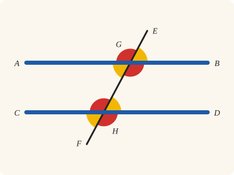
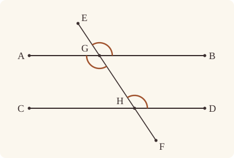
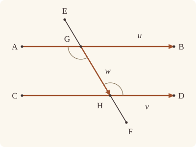

<!-- Generated by scripts/render.py. Do not edit by hand. -->

[Book I](index.md) · [← I.28](28.md) · [I.30 →](30.md)

# Book I, Proposition 29

*Parallels make the alternate angles equal*

[Euclid's proof](#euclids-proof) · [In Lean](#in-lean) · [What it rests on](#what-it-rests-on) · [Mishnah](#mishnah)

> A straight line falling on parallel straight lines makes the alternate angles equal to one another, the exterior angle equal to the interior and opposite angle, and the interior angles on the same side equal to two right angles.

**In Lean:** ✅ proved, as Euclid states it · Euclid's argument

<p align="center"></p>

<p align="center"><em>A straight line falling on two parallels (blue) makes the same angles at both crossings: the yellow angles are all equal, the red angles are all equal, and a red and a yellow together make two right angles.</em></p>

## Euclid's proof

<p align="center"></p>

<p align="center"><em>Drawn for one case: EF crosses the parallel straight lines AB and CD at G and H, with B and D on the same side of EF. The drawing marks AGH, GHD and EGB equal, as the proof establishes.</em></p>

For let the straight line EF fall on the parallel straight lines AB, CD;

I say that it makes the alternate angles AGH, GHD equal, the exterior angle EGB equal to the interior and opposite angle GHD, and the interior angles on the same side, namely BGH, GHD, equal to two right angles.

For, if the angle AGH is unequal to the angle GHD, one of them is greater.

Let the angle AGH be greater.

Let the angle BGH be added to each;

therefore the angles AGH, BGH are greater than the angles BGH, GHD.

But the angles AGH, BGH are equal to two right angles; [I. 13]

therefore the angles BGH, GHD are less than two right angles.

But straight lines produced indefinitely from angles less than two right angles meet; [Post. 5]

therefore AB, CD, if produced indefinitely, will meet;

but they do not meet, because they are by hypothesis parallel.

Therefore the angle AGH is not unequal to the angle GHD,

and is therefore equal to it.

Again, the angle AGH is equal to the angle EGB; [I. 15]

therefore the angle EGB is also equal to the angle GHD. [C.N. 1]

Let the angle BGH be added to each;

therefore the angles EGB, BGH are equal to the angles BGH, GHD. [C.N. 2]

But the angles EGB, BGH are equal to two right angles; [I. 13]

therefore the angles BGH, GHD are also equal to two right angles.

Therefore etc.

Q. E. D.

## In Lean

| | |
|---|---|
| Proof | ✅ Proved |
| Statement | The whole enunciation. |
| Argument | Euclid's. |
| Reviewed | The statement and every passage of the argument read against Heath's text, at commit [`b7b41f51`](https://github.com/jackChallis/stoicheia/commit/b7b41f51) ([the record](../../review/I/29.toml)) |

From [`Elements/BookI/Prop29.lean`](../../Elements/BookI/Prop29.lean). Euclid's sentences are the `--` comments, and our own notes are in `/- … -/`; the lines under each sentence are the Lean that carries it out. The list below marks where a lemma does a step Euclid takes for granted and where the Lean takes a case Euclid's figure leaves aside; the `/- … -/` notes in the listing explain smaller adjustments.

**How the Lean follows the text**

- **Done by `Tacit.add_lt_add_right`.** "Let the angle BGH be added to each; therefore the angles AGH…" Euclid adds BGH to both angles and keeps the strict inequality. The Lean uses `Tacit.add_lt_add_right`, a tacit rule of magnitude, which we assume (System E §3.5).
- **A further case.** "Therefore the angle AGH is not unequal to the angle GHD…" Euclid supposes AGH greater than GHD; the Lean proves his argument once over any letters and applies it again from H's end, with D, C, B, A for A, B, C, D and H, G for G, H, to rule out GHD greater than AGH. `SameSideOf.oppositeSidesOf_of_between` and `OppositeSidesOf.sameSideOf_of_between` put C and A on one side of HG for that second application.
- **Done by `Tacit.lt_trichotomy`.** "and is therefore equal to it." Euclid concludes that the angles AGH and GHD are equal. The Lean uses both refutations with `Tacit.lt_trichotomy`, a tacit rule of magnitude, which we assume (System E §3.5): of two unequal angles, one is greater.

```lean
/-- A straight line falling on parallel straight lines makes the alternate angles equal to one
another, the exterior angle equal to the interior and opposite angle, and the interior angles on
the same side equal to two right angles. -/
theorem Prop29 {A B C D E F G H : Point} (hpar : AreParallel A B C D) (hAGB : Between A G B)
    (hCHD : Between C H D) (hEGH : Between E G H) (hGHF : Between G H F)
    (hBD : SameSideOf B D E F) :
    ∠ A G H = ∠ G H D ∧ ∠ E G B = ∠ G H D ∧ ∠ B G H + ∠ G H D = ∟ + ∟ := by
  -- For let the straight line EF fall on the parallel straight lines AB, CD;
  /- It falls on AB at G and on CD at H, with B and D on one side of it, and so
     on one side of GH, which is the same straight line (`SameSideOf.inner`). -/
  have hBD_GH : SameSideOf B D G H := hBD.inner hEGH hGHF
  -- I say that it makes the alternate angles AGH, GHD equal, the exterior angle EGB equal to
  -- the interior and opposite angle GHD, and the interior angles on the same side, namely BGH,
  -- GHD, equal to two right angles.
  -- For, if the angle AGH is unequal to the angle GHD, one of them is greater.
  /- Euclid lets the angle AGH be the greater and shows that it cannot be. If the angle
     GHD is the greater, the same argument runs from H's end: with D, C, B, A
     for A, B, C, D and H, G for G, H, the angles AGH, GHD change places,
     and A, C are the two on one side of GH. So we give his argument for any two
     parallels and any straight line falling on them, in his letters, and use it twice
     below. -/
  have not_greater : ∀ {A B C D G H : Point}, AreParallel A B C D → Between A G B →
      Between C H D → SameSideOf B D G H → ¬ ∠ G H D < ∠ A G H := by
    intro A B C D G H hpar hAGB hCHD hBD
    obtain ⟨AB, hA_AB, hB_AB⟩ := Postulate1 A B hpar.1
    obtain ⟨CD, hC_CD, hD_CD⟩ := Postulate1 C D hpar.2.1
    obtain ⟨GH, hG_GH, hH_GH⟩ := Postulate1 G H hBD.1
    have hG_AB : OnLine G AB := on_line_of_between_ends hAGB hA_AB hB_AB
    have hH_CD : OnLine H CD := on_line_of_between_ends hCHD hC_CD hD_CD
    -- Let the angle AGH be greater.
    intro hGHD_AGH
    -- Let the angle BGH be added to each;
    /- Adding the same thing to both keeps "less than", a tacit rule of magnitude
       (`add_lt_add_right`), as in I.17. -/
    have hadd : ∠ G H D + ∠ B G H < ∠ A G H + ∠ B G H :=
      add_lt_add_right (∠ B G H) hGHD_AGH
    -- therefore the angles AGH, BGH are greater than the angles BGH, GHD.
    have hgreater : ∠ B G H + ∠ G H D < ∠ A G H + ∠ B G H := by
      rw [add_comm (∠ B G H)]
      exact hadd
    -- But the angles AGH, BGH are equal to two right angles; [I. 13]
    /- GH stands on AB at G: H is off AB, for otherwise G, B and H would
       be on one straight line, and B is off GH. The angle HGB of I.13 is the angle
       BGH, read the other way round. -/
    have hABH : Triangle A B H := by
      rintro ⟨L, hA, hB, hH⟩
      exact hBD.triangle.acb ⟨L, on_line_of_between_ends hAGB hA hB, hB, hH⟩
    have hAGH_BGH : ∠ A G H + ∠ B G H = ∟ + ∟ := by
      rw [← angle_symm hBD.1.symm (ne_of_between (between_symm hAGB))]
      exact Prop13 hAGB hABH
    -- therefore the angles BGH, GHD are less than two right angles.
    have hless : ∠ B G H + ∠ G H D < ∟ + ∟ := by
      rw [← hAGH_BGH]
      exact hgreater
    -- But straight lines produced indefinitely from angles less than two right angles
    -- meet; [Post. 5]
    -- therefore AB, CD, if produced indefinitely, will meet;
    /- Postulate 5 asks for what Euclid leaves to the figure: the straight lines GB and
       HD start from the points where GH meets them, and B and D lie on one side
       of GH. It also says on which side they meet, which is not needed here. -/
    have hmeet : ∃ P : Point, OnLine P AB ∧ OnLine P CD :=
      (Postulate5 hB_AB hG_AB hG_GH hH_GH hH_CD hD_CD hBD.1 (hBD.sameSide hG_GH hH_GH)
        hless).imp fun _ h => ⟨h.1, h.2.1⟩
    -- but they do not meet, because they are by hypothesis parallel.
    /- That is Definition I.23, said of the straight lines AB and CD. -/
    exact (hpar.parallel hA_AB hB_AB hC_CD hD_CD).2 hmeet
  -- Therefore the angle AGH is not unequal to the angle GHD,
  /- Neither is the greater. The angle AGH is not, by Euclid's argument. Nor is the
     angle GHD, by the same argument from H's end: DC is parallel to BA, H lies
     between D and C, G between B and A, and C and A lie on one side of
     HG. For A is across GH from B, and so from D
     (`SameSideOf.oppositeSidesOf_of_between`), and C is across it from D too
     (`OppositeSidesOf.sameSideOf_of_between`). The angles HGA, DHG are the angles
     AGH, GHD, read the other way round. -/
  have hnot_gt : ¬ ∠ G H D < ∠ A G H := not_greater hpar hAGB hCHD hBD_GH
  have hCA : SameSideOf C A H G :=
    (hBD_GH.oppositeSidesOf_of_between hAGB).symm.swap.sameSideOf_of_between
      (between_symm hCHD)
  have hnot_lt : ¬ ∠ A G H < ∠ G H D := by
    rw [angle_symm (ne_of_between hAGB) hBD_GH.1.symm,
      angle_symm hBD_GH.1 (ne_of_between (between_symm hCHD))]
    exact not_greater hpar.symm.swap_left.swap_right (between_symm hCHD) (between_symm hAGB)
      hCA
  -- and is therefore equal to it.
  have hAGH_GHD : ∠ A G H = ∠ G H D :=
    ((lt_trichotomy (∠ A G H) (∠ G H D)).resolve_left hnot_lt).resolve_right hnot_gt
  -- Again, the angle AGH is equal to the angle EGB; [I. 15]
  /- AB and HE cut one another at G, and H is off AB, as above. -/
  have hABH : Triangle A B H := by
    rintro ⟨L, hA, hB, hH⟩
    exact hBD_GH.triangle.acb ⟨L, on_line_of_between_ends hAGB hA hB, hB, hH⟩
  have hAGH_EGB : ∠ A G H = ∠ E G B := (Prop15 hAGB (between_symm hEGH) hABH).1
  -- therefore the angle EGB is also equal to the angle GHD. [C.N. 1]
  have hEGB_GHD : ∠ E G B = ∠ G H D := CommonNotion1 hAGH_EGB.symm hAGH_GHD.symm
  -- Let the angle BGH be added to each;
  -- therefore the angles EGB, BGH are equal to the angles BGH, GHD. [C.N. 2]
  have hsums : ∠ E G B + ∠ B G H = ∠ B G H + ∠ G H D := by
    rw [add_comm (∠ B G H)]
    exact CommonNotion2 hEGB_GHD rfl
  -- But the angles EGB, BGH are equal to two right angles; [I. 13]
  /- GB stands on EH at G: B is off EH, which is the straight line GH. -/
  have hEHB : Triangle E H B := by
    rintro ⟨L, hE, hH, hB⟩
    exact hBD_GH.triangle ⟨L, on_line_of_between_ends hEGH hE hH, hH, hB⟩
  have hEGB_BGH : ∠ E G B + ∠ B G H = ∟ + ∟ := Prop13 hEGH hEHB
  -- therefore the angles BGH, GHD are also equal to two right angles.
  have hBGH_GHD : ∠ B G H + ∠ G H D = ∟ + ∟ := hsums.symm.trans hEGB_BGH
  -- Therefore etc.
  exact ⟨hAGH_GHD, hEGB_GHD, hBGH_GHD⟩
  -- Q. E. D.
```

<details><summary>After the theorem, three theorems later propositions use, <code>Prop29.alternate</code>, <code>Prop29.interior</code> and <code>Prop29.exterior</code> (28 lines)</summary>

```lean
/-! ## I.29 said of any straight line falling on two parallels -/

/-- The alternate angles. If the straight line PG is parallel to HQ, and P and
Q lie on opposite sides of GH, then the alternate angles PGH, GHQ are equal.
Euclid's figure is drawn about GH, each straight line produced beyond G and H
(`AreParallel.figure_alternate`), and I.29 does the rest. [I. 29] -/
theorem Prop29.alternate {P G H Q : Point} (hpar : AreParallel P G H Q)
    (hPQ : OppositeSidesOf P Q G H) : ∠ P G H = ∠ G H Q := by
  obtain ⟨B, C, E, F, h₁, h₂, h₃, h₄, hpar', hside⟩ := hpar.figure_alternate hPQ
  exact (Prop29 hpar' h₁ h₂ h₃ h₄ hside).1

/-- The interior angles on the same side. If the straight line GP is parallel to
HQ, and P and Q lie on one side of GH, then the angles PGH, GHQ are
equal to two right angles. [I. 29] -/
theorem Prop29.interior {P G H Q : Point} (hpar : AreParallel G P H Q)
    (hPQ : SameSideOf P Q G H) : ∠ P G H + ∠ G H Q = ∟ + ∟ := by
  obtain ⟨A, C, E, F, h₁, h₂, h₃, h₄, hpar', hside⟩ := hpar.figure_interior hPQ
  exact (Prop29 hpar' h₁ h₂ h₃ h₄ hside).2.2

/-- The exterior angle. If the straight line GP is parallel to HQ, P and Q lie
on one side of GH, and E lies on HG produced beyond G, then the exterior
angle EGP is equal to the interior and opposite angle GHQ. [I. 29] -/
theorem Prop29.exterior {P G H Q E : Point} (hpar : AreParallel G P H Q)
    (hPQ : SameSideOf P Q G H) (hEGH : Between E G H) : ∠ E G P = ∠ G H Q := by
  obtain ⟨A, C, E', F, h₁, h₂, h₃, h₄, hpar', hside⟩ := hpar.figure_interior hPQ
  have hE : OnRay E G E' := OnRay.of_between_between (between_symm h₃) (between_symm hEGH)
  rw [angle_onRay_left hE hpar.1.symm]
  exact (Prop29 hpar' h₁ h₂ h₃ h₄ hside).2.1
```

</details>

## What it rests on

| | |
|---|---|
| Heath's references | [I.13](13.md), [I.15](15.md); Post. 5; C.N. 1, 2 |
| Lean cites | [I.13](13.md), [I.15](15.md) |
| Postulates | 1, 2, 3, 4, 5 |
| Definitions taken as axioms | Def. I.15 |
| Common Notions | 1, 2, 3, 4, 5 |
| Tacit rules | 38 (listed below) |
| Its own Lean calls | Postulates 1 and 5; 5 tacit rules |
| Through lemmas | Postulates 2 and 3; Def. I.15; 25 tacit rules |

_Postulates, definitions, Common Notions and tacit rules: all that this proof rests on, counting those of the propositions it cites. The last two rows say which of the postulates, definitions and tacit rules its own Lean calls, in the proof or a helper written for it, and which it does not call but reaches through lemmas, of Book Zero or shared (a proposition it cites may rest on these too); the rest come in only through the propositions it cites or the Common Notions._

<details><summary>The 38 tacit rules beneath this proof, counting those of the propositions it cites</summary>

_(used here) marks a rule this proof's own Lean calls, in the proof or a helper written for it; (through …) marks one its own Lean does not call but reaches through the lemmas named, of [Book Zero](../../Elements/Figure) or shared, though a proposition it cites may rest on it too; and a rule with no mark comes in only through a proposition it cites or a Common Notion. The names in brackets are System E's: an Intersection rule says when straight lines and circles must meet, and an Intersections rule takes a point where they do (see [Book I's introduction](index.md))._

**Reading the figure**

- [`between_cases`](../../Elements/Foundations/Tacit/Diagram.lean#L54) (through [`OppositeSidesOf.sameSideOf_of_between`](../../Elements/Figure/Sides.lean#L169) and [`SameSideOf.inner`](../../Elements/Figure/Sides.lean#L147)): Of three different points on a straight line, one is between the other two. (Between 6)
- [`between_of_inside_chord`](../../Elements/Foundations/Tacit/Diagram.lean#L81) (through [`OppositeSidesOf.sameSideOf_of_between`](../../Elements/Figure/Sides.lean#L169), [`OppositeSidesOf.symm`](../../Elements/Figure/Sides.lean#L87), [`SameSideOf.inner`](../../Elements/Figure/Sides.lean#L147) and 2 other lemmas): A straight line through a point inside a circle has that point between the points where it meets the circle. (Circle 1)
- [`between_symm`](../../Elements/Foundations/Tacit/Diagram.lean#L47) (used here): If B is between A and C, it is between C and A. (Between 1)
- [`circles_meet`](../../Elements/Foundations/Tacit/Diagram.lean#L94) (through [`OppositeSidesOf.sameSideOf_of_between`](../../Elements/Figure/Sides.lean#L169), [`OppositeSidesOf.symm`](../../Elements/Figure/Sides.lean#L87), [`SameSideOf.inner`](../../Elements/Figure/Sides.lean#L147) and 2 other lemmas): If each circle passes through a point inside the other, the circles cut one another. This is the step Euclid takes for granted in I.1. (Intersection 5)
- [`circles_meet_same_side`](../../Elements/Foundations/Tacit/Constructions.lean#L79) (through [`OppositeSidesOf.sameSideOf_of_between`](../../Elements/Figure/Sides.lean#L169), [`OppositeSidesOf.symm`](../../Elements/Figure/Sides.lean#L87), [`SameSideOf.inner`](../../Elements/Figure/Sides.lean#L147) and 2 other lemmas): Two circles that cut one another do so on each side of the straight line through their centres. (Intersections 8)
- [`exists_point`](../../Elements/Foundations/Tacit/Constructions.lean#L35) (through [`OppositeSidesOf.sameSideOf_of_between`](../../Elements/Figure/Sides.lean#L169), [`SameSideOf.inner`](../../Elements/Figure/Sides.lean#L147) and [`SameSideOf.oppositeSidesOf_of_between`](../../Elements/Figure/Sides.lean#L159)): Let a point be taken. (Points 1)
- [`exists_point_inside_circle`](../../Elements/Foundations/Tacit/Constructions.lean#L42) (through [`OppositeSidesOf.sameSideOf_of_between`](../../Elements/Figure/Sides.lean#L169), [`OppositeSidesOf.symm`](../../Elements/Figure/Sides.lean#L87), [`SameSideOf.inner`](../../Elements/Figure/Sides.lean#L147) and 2 other lemmas): Let a point be taken inside the circle α. (Points 8)
- [`exists_point_on_line`](../../Elements/Foundations/Tacit/Constructions.lean#L38) (through [`OppositeSidesOf.sameSideOf_of_between`](../../Elements/Figure/Sides.lean#L169), [`OppositeSidesOf.symm`](../../Elements/Figure/Sides.lean#L87), [`SameSideOf.inner`](../../Elements/Figure/Sides.lean#L147) and 2 other lemmas): Let a point be taken on the straight line L. (Points 2)
- [`line_circle_between`](../../Elements/Foundations/Tacit/Constructions.lean#L67) (through [`OppositeSidesOf.sameSideOf_of_between`](../../Elements/Figure/Sides.lean#L169), [`OppositeSidesOf.symm`](../../Elements/Figure/Sides.lean#L87), [`SameSideOf.inner`](../../Elements/Figure/Sides.lean#L147) and 2 other lemmas): A straight line through a point B inside a circle, heading out to a point C outside it, cuts the circle between B and C. (Intersections 4)
- [`line_circle_beyond`](../../Elements/Foundations/Tacit/Constructions.lean#L73) (through [`OppositeSidesOf.sameSideOf_of_between`](../../Elements/Figure/Sides.lean#L169), [`OppositeSidesOf.symm`](../../Elements/Figure/Sides.lean#L87), [`SameSideOf.inner`](../../Elements/Figure/Sides.lean#L147) and 2 other lemmas): A straight line through a point B inside a circle, produced beyond B away from C, cuts the circle there. (Intersections 5)
- [`line_unique`](../../Elements/Foundations/Tacit/Diagram.lean#L41) (through [`OppositeSidesOf.sameSideOf_of_between`](../../Elements/Figure/Sides.lean#L169), [`SameSideOf.inner`](../../Elements/Figure/Sides.lean#L147) and [`SameSideOf.oppositeSidesOf_of_between`](../../Elements/Figure/Sides.lean#L159)): Two points determine a straight line. (Generalities 1)
- [`lines_meet_of_opposite_sides`](../../Elements/Foundations/Tacit/Diagram.lean#L89) (through [`OppositeSidesOf.sameSideOf_of_between`](../../Elements/Figure/Sides.lean#L169)): A straight line joining points on opposite sides of L crosses L. (Intersection 1)
- [`not_between_of_between`](../../Elements/Foundations/Tacit/Diagram.lean#L50) (through [`OppositeSidesOf.sameSideOf_of_between`](../../Elements/Figure/Sides.lean#L169), [`OppositeSidesOf.symm`](../../Elements/Figure/Sides.lean#L87), [`SameSideOf.inner`](../../Elements/Figure/Sides.lean#L147) and 3 other lemmas): If B is between A and C, then A is not between B and C. (Between 1)
- [`not_on_line_of_same_side`](../../Elements/Foundations/Tacit/Diagram.lean#L60) (through [`OppositeSidesOf.sameSideOf_of_between`](../../Elements/Figure/Sides.lean#L169), [`OppositeSidesOf.symm`](../../Elements/Figure/Sides.lean#L87), [`SameSideOf.inner`](../../Elements/Figure/Sides.lean#L147) and 3 other lemmas): Points on one side of a straight line are not on it. (Same side 3)
- [`pasch2`](../../Elements/Foundations/Tacit/Diagram.lean#L71) (through [`OppositeSidesOf.sameSideOf_of_between`](../../Elements/Figure/Sides.lean#L169), [`SameSideOf.inner`](../../Elements/Figure/Sides.lean#L147), [`SameSideOf.oppositeSidesOf_of_between`](../../Elements/Figure/Sides.lean#L159) and 1 other lemma): If B is between A and C, A is on L and B is off it, then B and C are on the same side of L: a straight line that leaves L at A does not cross it again. (Pasch 2)
- [`same_side_trans`](../../Elements/Foundations/Tacit/Diagram.lean#L64) (through [`OppositeSidesOf.sameSideOf_of_between`](../../Elements/Figure/Sides.lean#L169), [`OppositeSidesOf.symm`](../../Elements/Figure/Sides.lean#L87), [`SameSideOf.inner`](../../Elements/Figure/Sides.lean#L147) and 2 other lemmas): Two points on the same side of a straight line as a third point are on the same side as each other. (Same side 4)

**Lengths, angles and areas**

- [`angle_add_of_inside`](../../Elements/Foundations/Tacit/Transfer.lean#L47) (through [`OppositeSidesOf.sameSideOf_of_between`](../../Elements/Figure/Sides.lean#L169) and [`SameSideOf.oppositeSidesOf_of_between`](../../Elements/Figure/Sides.lean#L159)): If D lies within the angle BAC, then BAC is made up of BAD and DAC. (Diagram-angle 2)
- [`angle_eq_of_same_rays`](../../Elements/Foundations/Tacit/Transfer.lean#L54): The angle doesn't change if its arms are traced through other points on the same rays. (Diagram-angle 4)
- [`angle_symm`](../../Elements/Foundations/Tacit/Metric.lean#L30) (used here): The angle ABC is the angle CBA. (Metric 4)
- [`area_add_of_between`](../../Elements/Foundations/Tacit/Transfer.lean#L70): Cutting a triangle in two from a vertex adds up. (Diagram-area 2)
- [`area_congruent`](../../Elements/Foundations/Tacit/Metric.lean#L44): Triangles equal in all their sides and angles are equal in area. Euclid uses this without comment once he has shown two triangles congruent. (Metric 9)
- [`area_degenerate`](../../Elements/Foundations/Tacit/Metric.lean#L36): A "triangle" with a repeated corner has no area. (Metric 6)
- [`area_eq_zero_of_on_line`](../../Elements/Foundations/Tacit/Transfer.lean#L62): A "triangle" whose corners lie on one straight line has no area. (Diagram-area 1)
- [`area_rotate`](../../Elements/Foundations/Tacit/Metric.lean#L39): The triangle ABC is the triangle CAB. (Metric 8)
- [`circle_eq`](../../Elements/Foundations/Tacit/Transfer.lean#L30) (through [`OppositeSidesOf.sameSideOf_of_between`](../../Elements/Figure/Sides.lean#L169), [`OppositeSidesOf.symm`](../../Elements/Figure/Sides.lean#L87), [`SameSideOf.inner`](../../Elements/Figure/Sides.lean#L147) and 2 other lemmas): A circle is fixed by its centre and its radius. (Diagram-segment 2)
- [`len_add_of_between`](../../Elements/Foundations/Tacit/Transfer.lean#L27) (through [`OppositeSidesOf.sameSideOf_of_between`](../../Elements/Figure/Sides.lean#L169), [`OppositeSidesOf.symm`](../../Elements/Figure/Sides.lean#L87), [`SameSideOf.inner`](../../Elements/Figure/Sides.lean#L147) and 2 other lemmas): If B is between A and C, then AB and BC together make up AC. (Diagram-segment 1)
- [`len_self`](../../Elements/Foundations/Tacit/Metric.lean#L24) (through [`OppositeSidesOf.sameSideOf_of_between`](../../Elements/Figure/Sides.lean#L169), [`OppositeSidesOf.symm`](../../Elements/Figure/Sides.lean#L87), [`SameSideOf.inner`](../../Elements/Figure/Sides.lean#L147) and 2 other lemmas): The "straight line" from a point to itself has no length. (Metric 1)
- [`len_symm`](../../Elements/Foundations/Tacit/Metric.lean#L27) (through [`OppositeSidesOf.sameSideOf_of_between`](../../Elements/Figure/Sides.lean#L169), [`OppositeSidesOf.symm`](../../Elements/Figure/Sides.lean#L87), [`SameSideOf.inner`](../../Elements/Figure/Sides.lean#L147) and 2 other lemmas): The straight line AB is the straight line BA. (Metric 3)
- [`same_ray_of_angle_eq_zero`](../../Elements/Foundations/Tacit/Transfer.lean#L42) (through [`OppositeSidesOf.sameSideOf_of_between`](../../Elements/Figure/Sides.lean#L169) and [`SameSideOf.oppositeSidesOf_of_between`](../../Elements/Figure/Sides.lean#L159)): If the angle BAC is nothing, C lies on the ray from A through B. (Diagram-angle 1)

**Superposition**

- [`superposition`](../../Elements/Foundations/Tacit/Superposition.lean#L48): **Superposition.** A hypothetical placement of a triangle on a given ray and side permits a restricted derivation of metric equalities about the figure already given. The derivation introduces no further objects, cites each geometric law it uses, and exports no symbol of the placement.

**Laws of magnitude**

- [`add_assoc`](../../Elements/Foundations/Tacit/Magnitudes.lean#L23) (through [`SameSideOf.inner`](../../Elements/Figure/Sides.lean#L147)): Adding three magnitudes in a row, it makes no difference whether the first two or the last two are added first. (System E §3.5)
- [`add_comm`](../../Elements/Foundations/Tacit/Magnitudes.lean#L26) (used here): The order of adding does not matter. (System E §3.5)
- [`add_lt_add_right`](../../Elements/Foundations/Tacit/Magnitudes.lean#L45) (used here): Adding the same thing to both sides keeps "less than". (System E §3.5)
- [`add_zero`](../../Elements/Foundations/Tacit/Magnitudes.lean#L29): Adding nothing changes nothing. (System E §3.5)
- [`lt_irrefl`](../../Elements/Foundations/Tacit/Magnitudes.lean#L32) (through [`OppositeSidesOf.sameSideOf_of_between`](../../Elements/Figure/Sides.lean#L169), [`OppositeSidesOf.symm`](../../Elements/Figure/Sides.lean#L87), [`SameSideOf.inner`](../../Elements/Figure/Sides.lean#L147) and 2 other lemmas): No magnitude is less than itself. (System E §3.5)
- [`lt_trans`](../../Elements/Foundations/Tacit/Magnitudes.lean#L35) (through [`OppositeSidesOf.sameSideOf_of_between`](../../Elements/Figure/Sides.lean#L169), [`OppositeSidesOf.symm`](../../Elements/Figure/Sides.lean#L87), [`SameSideOf.inner`](../../Elements/Figure/Sides.lean#L147) and 2 other lemmas): What is less than the less is less still. (System E §3.5)
- [`lt_trichotomy`](../../Elements/Foundations/Tacit/Magnitudes.lean#L39) (used here): Of two magnitudes, one is less, or they are equal, or the other is less. (System E §3.5)
- [`not_lt_zero`](../../Elements/Foundations/Tacit/Magnitudes.lean#L42) (through [`OppositeSidesOf.sameSideOf_of_between`](../../Elements/Figure/Sides.lean#L169), [`OppositeSidesOf.symm`](../../Elements/Figure/Sides.lean#L87), [`SameSideOf.inner`](../../Elements/Figure/Sides.lean#L147) and 2 other lemmas): Nothing is less than zero. (System E §3.5)

</details>

## Mishnah

_Our commentary: what Euclid assumes, what Lean made us say out loud, and how the result looks by modern means._

**"Less than two right angles."** Here Euclid calls on Postulate 5 for the first time, and our proof calls on it at the same step. Heath honours the choice: "When we consider the countless successive attempts made through more than twenty centuries to prove the Postulate, many of them by geometers of ability, we cannot but admire the genius of the man who concluded that such a hypothesis, which he found necessary to the validity of his whole system of geometry, was really indemonstrable" (vol. 1, p. 202).

Euclid restates his postulate here in fewer words than its own, and Heath spells out what they leave unsaid, "namely that the straight lines begin from points at which they meet a transversal" (vol. 1, p. 312). Our `Postulate5` says every word: straight lines meeting GH at G and H, with B and D on one side of it and the angles BGH, GHD less than two right angles. What the postulate gives, a point on both AB and CD, is just what Definition I.23 rules out. Euclid supposes AGH the greater and passes over the case where GHD is; that is his argument read from H's end, on the side of A and C, with I.13 at H, and we use it so, as in I.16. After the proof, `Prop29.alternate`, `Prop29.interior` and `Prop29.exterior` state I.29 for any straight line falling on two parallels, for later propositions to cite.

Heath also proves I.29 from John Playfair's axiom, that through a given point only one parallel can be drawn to a given straight line, as modern textbooks usually do. Charles Dodgson, better known as Lewis Carroll, argued for keeping Euclid's postulate: it puts before the beginner "clear and *positive* conceptions", not straight lines that never meet, "a *negative* conception"; and it "gives a direct criterion for judging that two straight lines meet, a criterion which is constantly required, e.g. in I. 44" (Heath, vol. 1, p. 314).

**The modern way.** The coordinate plane has Postulate 5 built in. With $\mathbf{u} = (u_{1}, u_{2})$ pointing from A to B and $\mathbf{v} = (v_{1}, v_{2})$ from C to D, the straight lines AB and CD are the points $\mathrm{A} + s\mathbf{u}$ and $\mathrm{C} + t\mathbf{v}$, and they meet whenever the two equations of $\mathrm{A} + s\mathbf{u} = \mathrm{C} + t\mathbf{v}$ can be solved for $s$ and $t$, as they always can when $u_{1}v_{2} - u_{2}v_{1} \neq 0$. So straight lines that never meet have directions that are multiples of one another. Here the direction from H to D is a positive multiple of $\mathbf{u}$, since B and D lie on one side of EF, and with $\mathbf{w}$ pointing from G to H, the angles AGH and GHD both have cosine $-\mathbf{u} \cdot \mathbf{w}/(|\mathbf{u}||\mathbf{w}|)$.

<p align="center"></p>

## Further reading

- Twenty centuries of attempts to prove Postulate 5, and the new geometry they led to, are the story of chs. 5 and 6 of Marvin Jay Greenberg's [*Euclidean and Non-Euclidean Geometries*](https://store.macmillanlearning.com/us/product/Euclidean-and-Non-Euclidean-Geometries/p/0716799480) (2008), "History of the Parallel Postulate" and "The Discovery of Non-Euclidean Geometry", told through to János Bolyai and Nikolai Lobachevsky (also on [I.10](10.md)).
- The case Heath reports for keeping Euclid's postulate rather than Playfair's axiom is made at length in Charles L. Dodgson's [*Euclid and His Modern Rivals*](https://archive.org/details/euclidandhismode000469mbp) (1879, free online), Lewis Carroll's comic trial of the textbooks of his day (also on [I.7](07.md)).

[Book I](index.md) · [← I.28](28.md) · [I.30 →](30.md)

---

<sub>Euclid's text: T. L. Heath, *The Thirteen Books of Euclid's Elements*, vol. 1 (Cambridge, 1908), pp. 311–312; [scan leaves n331–n332](https://archive.org/details/thirteenbookseu02heibgoog/page/n331); [figure on n331](https://archive.org/details/thirteenbookseu02heibgoog/page/n331). Public domain.</sub>

<sub>The tacit rules follow the System E of Jeremy Avigad, Edward Dean and John Mumma, read alongside LeanEuclid (Logan Murphy, Kaiyu Yang, Jialiang Sun, Zhaoyu Li, Anima Anandkumar and Xujie Si).</sub>
