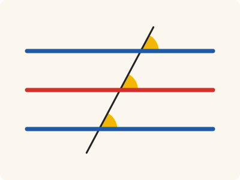
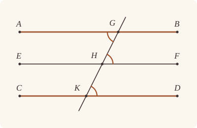

<!-- Generated by scripts/render.py. Do not edit by hand. -->

[Book I](index.md) · [← I.29](29.md) · [I.31 →](31.md)

# Book I, Proposition 30

*Parallels to the same straight line are parallel*

[Euclid's proof](#euclids-proof) · [In Lean](#in-lean) · [What it rests on](#what-it-rests-on) · [Mishnah](#mishnah)

> Straight lines parallel to the same straight line are also parallel to one another.

**In Lean:** ✅ proved, as Euclid states it · Euclid's argument

<p align="center"></p>

<p align="center"><em>Two straight lines (blue), each parallel to a third (red), are parallel to each other: a straight line falling on all three meets each at the same angle (yellow).</em></p>

## Euclid's proof

<p align="center"></p>

<p align="center"><em>Drawn for one case: EF between AB and CD, so that GK crosses it, as in Heath's figure.</em></p>

Let each of the straight lines AB, CD be parallel to EF;

I say that AB is also parallel to CD.

For let the straight line GK fall upon them.

Then, since the straight line GK has fallen on the parallel straight lines AB, EF,

the angle AGK is equal to the angle GHF. [I. 29]

Again, since the straight line GK has fallen on the parallel straight lines EF, CD,

the angle GHF is equal to the angle GKD. [I. 29]

But the angle AGK was also proved equal to the angle GHF;

therefore the angle AGK is also equal to the angle GKD; [C.N. 1]

and they are alternate.

Therefore AB is parallel to CD.

Q. E. D.

## In Lean

| | |
|---|---|
| Proof | ✅ Proved |
| Statement | The whole enunciation. |
| Argument | Euclid's. |
| Reviewed | The statement and every passage of the argument read against Heath's text, at commit [`b7b41f51`](https://github.com/jackChallis/stoicheia/commit/b7b41f51) ([the record](../../review/I/30.toml)) |

From [`Elements/BookI/Prop30.lean`](../../Elements/BookI/Prop30.lean). Euclid's sentences are the `--` comments, and our own notes are in `/- … -/`; the lines under each sentence are the Lean that carries it out. The list below marks where a lemma does a step Euclid takes for granted and where the Lean takes a case Euclid's figure leaves aside; the `/- … -/` notes in the listing explain smaller adjustments.

**How the Lean follows the text**

- **A further case.** "I say that AB is also parallel to CD." Euclid's GK crosses EF, as in his figure. When EF lies outside AB and CD it need not, and that case rests on `Prop30.unique`: two straight lines through one point, each parallel to EF, are one (from I.29).
- **Done by `OppositeSides.exists_between`.** "For let the straight line GK fall upon them." Euclid reads from his figure that GK meets EF at H, between G and K; `OppositeSides.exists_between` supplies this point when EF separates G and K. The Lean chooses A, B, C, D, E and F afresh on the given straight lines, since the conclusion concerns whole lines: it takes F on EF off GK and produces FH to E, putting E and F on opposite sides of GK, uses `Prop30.point_on_side` to put A on AB on E's side and D on CD on F's side of GK, then produces AG to B and DK to C.
- **Done by `SameSideOf.trans_opposite`.** "and they are alternate." Euclid reads the angles AGK and GKD as alternate. `SameSideOf.trans_opposite` puts A and D on opposite sides of GK from the constructed facts that A and F lie on opposite sides of GK and D is on F's side of GK.
- **Done by `Prop27`.** "Therefore AB is parallel to CD." Euclid concludes parallelism from the equal alternate angles; the Lean applies I.27 (`Prop27`), for which Heath gives no reference here.

<details><summary>Before the theorem, two lemmas: <code>Prop30.point_on_side</code> and <code>Prop30.unique</code> (53 lines)</summary>

```lean
/-- Euclid's figure puts the ends of each straight line where the proof wants
them, on one side or the other of the straight line falling on it. A straight line
L through the point G of T, other than T, has a point on whichever side of
T we name: take a point of L off T, and if it is on the wrong side, produce
it through G to the other (System E, Points 2, Pasch 3 and Same side 5). -/
theorem Prop30.point_on_side {L T : Line} {G P : Point}
    (hGL : OnLine G L) (hGT : OnLine G T) (hLT : L ≠ T) (hP : ¬ OnLine P T) :
    ∃ A : Point, OnLine A L ∧ SameSide A P T := by
  obtain ⟨A, hAL, hAT, -⟩ := exists_point_on_line_off_line hLT []
  by_cases hs : SameSide A P T
  · exact ⟨A, hAL, hs⟩
  · have hAG : A ≠ G := fun e => hAT (e ▸ hGT)
    obtain ⟨B, hAGB⟩ := produce hAG
    have hBL := on_line_of_between hAGB hAL hGL
    have hBT : ¬ OnLine B T := fun h =>
      hAT (on_line_of_between (between_symm hAGB) h hGT)
    exact ⟨B, hBL, same_side_of_opposite_sides ⟨hAT, hBT, pasch3 hAGB hGT⟩
      ⟨hAT, hP, hs⟩⟩

/-- Euclid's enunciation also covers EF lying outside AB and CD, where a
straight line from one to the other need not cross it. For that case: two straight
lines through one point, each parallel to a third, are one straight line. A
straight line from the point to the third makes, with each, interior angles equal
to two right angles (I.29); Common Notion 3 takes away the angle they share, and
`onRay_of_angle_eq` makes the two rays one. This is the uniqueness of the
parallel, often called Playfair's axiom, proved here from I.29 rather than
assumed. Later proofs cite `Prop30.meet` instead: the same uniqueness, drawn
from I.30 itself, as Heath reports Proclus drawing it under I.31. -/
theorem Prop30.unique {L M N : Line} {G H : Point}
    (hLN : Parallel L N) (hMN : Parallel M N)
    (hGL : OnLine G L) (hGM : OnLine G M) (hHN : OnLine H N) : L = M := by
  have hGH : G ≠ H := fun e => hLN.not_onLine hGL (e ▸ hHN)
  obtain ⟨T, hGT, hHT⟩ := Postulate1 G H hGH
  have hNT : N ≠ T := fun e => hLN.not_onLine hGL (e ▸ hGT)
  obtain ⟨F, hFN, hFT, -⟩ := exists_point_on_line_off_line hNT []
  have hLT : L ≠ T := fun e => hLN.not_onLine (e ▸ hHT) hHN
  have hMT : M ≠ T := fun e => hMN.not_onLine (e ▸ hHT) hHN
  obtain ⟨A, hAL, hAF⟩ := Prop30.point_on_side hGL hGT hLT hFT
  obtain ⟨D, hDM, hDF⟩ := Prop30.point_on_side hGM hGT hMT hFT
  have hAG : A ≠ G := fun e => not_on_line_of_same_side hAF (e ▸ hGT)
  have hDG : D ≠ G := fun e => not_on_line_of_same_side hDF (e ▸ hGT)
  have hHF : H ≠ F := fun e => hFT (e ▸ hHT)
  have hpar₁ := AreParallel.of_parallel hAG.symm hHF hGL hAL hHN hFN hLN
  have hpar₂ := AreParallel.of_parallel hDG.symm hHF hGM hDM hHN hFN hMN
  have ha := Prop29.interior hpar₁ (SameSideOf.of_line hGH hGT hHT hAF)
  have hd := Prop29.interior hpar₂ (SameSideOf.of_line hGH hGT hHT hDF)
  have hang : ∠ A G H = ∠ D G H := CommonNotion3 (ha.trans hd.symm) rfl
  have hAD : SameSideOf A D G H := SameSideOf.of_line hGH hGT hHT
    (same_side_trans (same_side_symm hAF) (same_side_symm hDF))
  have hray : OnRay A G D := onRay_of_angle_eq hAD (by
    rw [angle_symm hGH.symm hAG, angle_symm hGH.symm hDG]
    exact hang)
  exact line_unique hAG hAL hGL (hray.onLine hGM hDM) hGM
```

</details>

```lean
/-- Straight lines parallel to the same straight line are also parallel to one another. -/
theorem Prop30 {A B C D E F : Point} (h₁ : AreParallel A B E F) (h₂ : AreParallel C D E F)
    (hC : ¬ Collinear A B C) :
    AreParallel A B C D := by
  -- Let each of the straight lines AB, CD be parallel to EF;
  obtain ⟨AB, hA_AB, hB_AB⟩ := Postulate1 A B h₁.1
  obtain ⟨CD, hC_CD, hD_CD⟩ := Postulate1 C D h₂.1
  obtain ⟨EF, hE_EF, hF_EF⟩ := Postulate1 E F h₁.2.1
  have hAB_EF := h₁.parallel hA_AB hB_AB hE_EF hF_EF
  have hCD_EF := h₂.parallel hC_CD hD_CD hE_EF hF_EF
  -- I say that AB is also parallel to CD.
  /- Heath's case, where EF separates G and K. The given points need not
     stand where his do, so we choose ends of each straight line on the sides of
     GK his figure wants, and return to the given names at the end: parallels
     are whole straight lines. -/
  have separated : ∀ {G K : Point}, OnLine G AB → OnLine K CD →
      OppositeSides G K EF → Parallel AB CD := by
    intro G K hG_AB hK_CD hGK
    -- For let the straight line GK fall upon them.
    obtain ⟨H, hH_EF, hGHK⟩ := hGK.exists_between
    have hG_K := ne_of_between_ends hGHK
    have hG_H := ne_of_between hGHK
    have hH_K := (ne_of_between (between_symm hGHK)).symm
    obtain ⟨GK, hG_GK, hK_GK⟩ := Postulate1 G K hG_K
    have hH_GK := on_line_of_between_ends hGHK hG_GK hK_GK
    have hEF_GK : EF ≠ GK := fun e => hGK.1 (e ▸ hG_GK)
    obtain ⟨F, hF_EF, hF_GK, -⟩ := exists_point_on_line_off_line hEF_GK []
    have hF_H : F ≠ H := fun e => hF_GK (e ▸ hH_GK)
    obtain ⟨E, hFHE⟩ := produce hF_H
    have hE_GK : ¬ OnLine E GK := fun h =>
      hF_GK (on_line_of_between (between_symm hFHE) h hH_GK)
    have hEF : OppositeSides E F GK :=
      ⟨hE_GK, hF_GK, pasch3 (between_symm hFHE) hH_GK⟩
    have hAB_GK : AB ≠ GK := fun e => hAB_EF.not_onLine (e ▸ hH_GK) hH_EF
    have hCD_GK : CD ≠ GK := fun e => hCD_EF.not_onLine (e ▸ hH_GK) hH_EF
    obtain ⟨A, hA_AB, hAE⟩ := Prop30.point_on_side hG_AB hG_GK hAB_GK hE_GK
    obtain ⟨D, hD_CD, hDF⟩ := Prop30.point_on_side hK_CD hK_GK hCD_GK hF_GK
    have hA_G : A ≠ G := fun e => not_on_line_of_same_side hAE (e ▸ hG_GK)
    have hD_K : D ≠ K := fun e => not_on_line_of_same_side hDF (e ▸ hK_GK)
    obtain ⟨B, hAGB⟩ := produce hA_G
    obtain ⟨C, hDKC⟩ := produce hD_K
    have hB_AB := on_line_of_between hAGB hA_AB hG_AB
    have hC_CD := on_line_of_between hDKC hD_CD hK_CD
    have hAF : OppositeSidesOf A F G H :=
      (SameSideOf.of_line hG_H hG_GK hH_GK hAE).trans_opposite
        (OppositeSidesOf.of_line hG_H hG_GK hH_GK hEF)
    have hFD : SameSideOf F D H K :=
      SameSideOf.of_line hH_K hH_GK hK_GK (same_side_symm hDF)
    -- Then, since the straight line GK has fallen on the parallel straight lines AB, EF,
    have hpar := AreParallel.of_parallel hA_G hF_H.symm hA_AB hG_AB hH_EF hF_EF hAB_EF
    -- the angle AGK is equal to the angle GHF. [I. 29]
    have hAGH : ∠ A G H = ∠ G H F := Prop29.alternate hpar hAF
    have hAGK : ∠ A G K = ∠ G H F :=
      (angle_onRay_right (OnRay.of_between hGHK) hA_G).symm.trans hAGH
    -- Again, since the straight line GK has fallen on the parallel straight lines EF, CD,
    have hpar' := AreParallel.of_parallel hF_H.symm hD_K.symm hH_EF hF_EF hK_CD hD_CD
      hCD_EF.symm
    -- the angle GHF is equal to the angle GKD. [I. 29]
    have hGHF : ∠ G H F = ∠ G K D :=
      (Prop29.exterior hpar' hFD hGHK).trans
        (angle_onRay_left (OnRay.of_between (between_symm hGHK)) hD_K)
    -- But the angle AGK was also proved equal to the angle GHF;
    have hsame : ∠ A G K = ∠ G H F := hAGK
    -- therefore the angle AGK is also equal to the angle GKD; [C.N. 1]
    have hequal : ∠ A G K = ∠ G K D := CommonNotion1 hsame hGHF.symm
    -- and they are alternate.
    have hAF_GK : OppositeSidesOf A F G K :=
      OppositeSidesOf.of_line hG_K hG_GK hK_GK (hAF.oppositeSides hG_GK hH_GK)
    have hDF_GK : SameSideOf D F G K := SameSideOf.of_line hG_K hG_GK hK_GK hDF
    have hAD : OppositeSidesOf A D G K := (hDF_GK.trans_opposite hAF_GK.symm).symm
    -- Therefore AB is parallel to CD.
    exact (Prop27 hAGB (between_symm hDKC) hAD hequal).parallel hA_AB hB_AB hC_CD hD_CD
  /- When EF lies outside AB and CD, a straight line from one to the other
     need not cross it. Then if AB and CD met, they would be two parallels to
     EF through one point, and so one straight line (`Prop30.unique`); but C
     is off AB. -/
  have hparallel : Parallel AB CD := by
    by_cases hs : SameSide A C EF
    · apply Parallel.of_not_meet hA_AB
      intro G hG_AB hG_CD
      have heq := Prop30.unique hAB_EF hCD_EF hG_AB hG_CD hE_EF
      exact hC ⟨AB, hA_AB, hB_AB, heq ▸ hC_CD⟩
    · exact separated hA_AB hC_CD
        ⟨hAB_EF.not_onLine hA_AB, hCD_EF.not_onLine hC_CD, hs⟩
  exact AreParallel.of_parallel h₁.1 h₂.1 hA_AB hB_AB hC_CD hD_CD hparallel
  -- Q. E. D.
```

## What it rests on

| | |
|---|---|
| Heath's references | [I.29](29.md); C.N. 1 |
| Lean cites | [I.27](27.md), [I.29](29.md) |
| Postulates | 1, 2, 3, 4, 5 |
| Definitions taken as axioms | Def. I.15 |
| Common Notions | 1, 2, 3, 4, 5 |
| Tacit rules | 38 (listed below) |
| Its own Lean calls | Postulate 1; 5 tacit rules |
| Through lemmas | Postulates 2 and 3; Def. I.15; 26 tacit rules |

Some of these come in through lemmas [shared](../../CERTIFICATE.md#shared-steps) by many proofs: [`Prop29.alternate`](../../Elements/BookI/Prop29.lean#L144), [`Prop29.exterior`](../../Elements/BookI/Prop29.lean#L160), [`Prop29.interior`](../../Elements/BookI/Prop29.lean#L152) (I.29).

_Postulates, definitions, Common Notions and tacit rules: all that this proof rests on, counting those of the propositions it cites. The last two rows say which of the postulates, definitions and tacit rules its own Lean calls, in the proof or a helper written for it, and which it does not call but reaches through lemmas, of Book Zero or shared (a proposition it cites may rest on these too); the rest come in only through the propositions it cites or the Common Notions._

<details><summary>The 38 tacit rules beneath this proof, counting those of the propositions it cites</summary>

_(used here) marks a rule this proof's own Lean calls, in the proof or a helper written for it; (through …) marks one its own Lean does not call but reaches through the lemmas named, of [Book Zero](../../Elements/Figure) or shared, though a proposition it cites may rest on it too; and a rule with no mark comes in only through a proposition it cites or a Common Notion. The names in brackets are System E's: an Intersection rule says when straight lines and circles must meet, and an Intersections rule takes a point where they do (see [Book I's introduction](index.md))._

**Reading the figure**

- [`between_cases`](../../Elements/Foundations/Tacit/Diagram.lean#L54) (through [`OppositeSides.exists_between`](../../Elements/Figure/Sides.lean#L119), [`Prop29.alternate`](../../Elements/BookI/Prop29.lean#L144), [`Prop29.exterior`](../../Elements/BookI/Prop29.lean#L160) and 3 other lemmas): Of three different points on a straight line, one is between the other two. (Between 6)
- [`between_of_inside_chord`](../../Elements/Foundations/Tacit/Diagram.lean#L81) (through [`OnRay.of_between`](../../Elements/Figure/Rays.lean#L34), [`OppositeSides.exists_between`](../../Elements/Figure/Sides.lean#L119), [`OppositeSidesOf.symm`](../../Elements/Figure/Sides.lean#L87) and 12 other lemmas): A straight line through a point inside a circle has that point between the points where it meets the circle. (Circle 1)
- [`between_symm`](../../Elements/Foundations/Tacit/Diagram.lean#L47) (used here): If B is between A and C, it is between C and A. (Between 1)
- [`circles_meet`](../../Elements/Foundations/Tacit/Diagram.lean#L94) (through [`OnRay.of_between`](../../Elements/Figure/Rays.lean#L34), [`OppositeSides.exists_between`](../../Elements/Figure/Sides.lean#L119), [`OppositeSidesOf.symm`](../../Elements/Figure/Sides.lean#L87) and 9 other lemmas): If each circle passes through a point inside the other, the circles cut one another. This is the step Euclid takes for granted in I.1. (Intersection 5)
- [`circles_meet_same_side`](../../Elements/Foundations/Tacit/Constructions.lean#L79) (through [`OnRay.of_between`](../../Elements/Figure/Rays.lean#L34), [`OppositeSides.exists_between`](../../Elements/Figure/Sides.lean#L119), [`OppositeSidesOf.symm`](../../Elements/Figure/Sides.lean#L87) and 9 other lemmas): Two circles that cut one another do so on each side of the straight line through their centres. (Intersections 8)
- [`exists_point`](../../Elements/Foundations/Tacit/Constructions.lean#L35) (through [`OnRay.of_between`](../../Elements/Figure/Rays.lean#L34), [`Prop29.alternate`](../../Elements/BookI/Prop29.lean#L144), [`Prop29.exterior`](../../Elements/BookI/Prop29.lean#L160) and 7 other lemmas): Let a point be taken. (Points 1)
- [`exists_point_inside_circle`](../../Elements/Foundations/Tacit/Constructions.lean#L42) (through [`OnRay.of_between`](../../Elements/Figure/Rays.lean#L34), [`OppositeSides.exists_between`](../../Elements/Figure/Sides.lean#L119), [`OppositeSidesOf.symm`](../../Elements/Figure/Sides.lean#L87) and 12 other lemmas): Let a point be taken inside the circle α. (Points 8)
- [`exists_point_on_line`](../../Elements/Foundations/Tacit/Constructions.lean#L38) (through [`OnRay.of_between`](../../Elements/Figure/Rays.lean#L34), [`OppositeSides.exists_between`](../../Elements/Figure/Sides.lean#L119), [`OppositeSidesOf.symm`](../../Elements/Figure/Sides.lean#L87) and 10 other lemmas): Let a point be taken on the straight line L. (Points 2)
- [`line_circle_between`](../../Elements/Foundations/Tacit/Constructions.lean#L67) (through [`OnRay.of_between`](../../Elements/Figure/Rays.lean#L34), [`OppositeSides.exists_between`](../../Elements/Figure/Sides.lean#L119), [`OppositeSidesOf.symm`](../../Elements/Figure/Sides.lean#L87) and 12 other lemmas): A straight line through a point B inside a circle, heading out to a point C outside it, cuts the circle between B and C. (Intersections 4)
- [`line_circle_beyond`](../../Elements/Foundations/Tacit/Constructions.lean#L73) (through [`OnRay.of_between`](../../Elements/Figure/Rays.lean#L34), [`OppositeSides.exists_between`](../../Elements/Figure/Sides.lean#L119), [`OppositeSidesOf.symm`](../../Elements/Figure/Sides.lean#L87) and 12 other lemmas): A straight line through a point B inside a circle, produced beyond B away from C, cuts the circle there. (Intersections 5)
- [`line_unique`](../../Elements/Foundations/Tacit/Diagram.lean#L41) (used here): Two points determine a straight line. (Generalities 1)
- [`lines_meet_of_opposite_sides`](../../Elements/Foundations/Tacit/Diagram.lean#L89) (through [`OppositeSides.exists_between`](../../Elements/Figure/Sides.lean#L119), [`Prop29.alternate`](../../Elements/BookI/Prop29.lean#L144), [`onRay_of_angle_eq`](../../Elements/Figure/Angles.lean#L206) and 1 other lemma): A straight line joining points on opposite sides of L crosses L. (Intersection 1)
- [`not_between_of_between`](../../Elements/Foundations/Tacit/Diagram.lean#L50) (through [`OnRay.of_between`](../../Elements/Figure/Rays.lean#L34), [`OppositeSides.exists_between`](../../Elements/Figure/Sides.lean#L119), [`OppositeSidesOf.symm`](../../Elements/Figure/Sides.lean#L87) and 13 other lemmas): If B is between A and C, then A is not between B and C. (Between 1)
- [`not_on_line_of_same_side`](../../Elements/Foundations/Tacit/Diagram.lean#L60) (used here): Points on one side of a straight line are not on it. (Same side 3)
- [`pasch2`](../../Elements/Foundations/Tacit/Diagram.lean#L71) (through [`OnRay.of_between`](../../Elements/Figure/Rays.lean#L34), [`OppositeSides.exists_between`](../../Elements/Figure/Sides.lean#L119), [`Prop29.alternate`](../../Elements/BookI/Prop29.lean#L144) and 7 other lemmas): If B is between A and C, A is on L and B is off it, then B and C are on the same side of L: a straight line that leaves L at A does not cross it again. (Pasch 2)
- [`same_side_trans`](../../Elements/Foundations/Tacit/Diagram.lean#L64) (used here): Two points on the same side of a straight line as a third point are on the same side as each other. (Same side 4)

**Lengths, angles and areas**

- [`angle_add_of_inside`](../../Elements/Foundations/Tacit/Transfer.lean#L47) (through [`Prop29.alternate`](../../Elements/BookI/Prop29.lean#L144), [`Tacit.pasch3`](../../Elements/Figure/RuleBase.lean#L219), [`onRay_of_angle_eq`](../../Elements/Figure/Angles.lean#L206) and 1 other lemma): If D lies within the angle BAC, then BAC is made up of BAD and DAC. (Diagram-angle 2)
- [`angle_eq_of_same_rays`](../../Elements/Foundations/Tacit/Transfer.lean#L54) (through [`Prop29.exterior`](../../Elements/BookI/Prop29.lean#L160), [`angle_onRay_left`](../../Elements/Figure/Angles.lean#L42) and [`angle_onRay_right`](../../Elements/Figure/Angles.lean#L49)): The angle doesn't change if its arms are traced through other points on the same rays. (Diagram-angle 4)
- [`angle_symm`](../../Elements/Foundations/Tacit/Metric.lean#L27) (used here): The angle ABC is the angle CBA. (Metric 4)
- [`area_add_of_between`](../../Elements/Foundations/Tacit/Transfer.lean#L70): Cutting a triangle in two from a vertex adds up. (Diagram-area 2)
- [`area_congruent`](../../Elements/Foundations/Tacit/Metric.lean#L41): Triangles equal in all their sides and angles are equal in area. Euclid uses this without comment once he has shown two triangles congruent. (Metric 9)
- [`area_degenerate`](../../Elements/Foundations/Tacit/Metric.lean#L33): A "triangle" with a repeated corner has no area. (Metric 6)
- [`area_eq_zero_of_on_line`](../../Elements/Foundations/Tacit/Transfer.lean#L62): A "triangle" whose corners lie on one straight line has no area. (Diagram-area 1)
- [`area_rotate`](../../Elements/Foundations/Tacit/Metric.lean#L36): The triangle ABC is the triangle CAB. (Metric 8)
- [`circle_eq`](../../Elements/Foundations/Tacit/Transfer.lean#L30) (through [`OnRay.of_between`](../../Elements/Figure/Rays.lean#L34), [`OppositeSides.exists_between`](../../Elements/Figure/Sides.lean#L119), [`OppositeSidesOf.symm`](../../Elements/Figure/Sides.lean#L87) and 12 other lemmas): A circle is fixed by its centre and its radius. (Diagram-segment 2)
- [`len_add_of_between`](../../Elements/Foundations/Tacit/Transfer.lean#L27) (through [`OnRay.of_between`](../../Elements/Figure/Rays.lean#L34), [`OppositeSides.exists_between`](../../Elements/Figure/Sides.lean#L119), [`OppositeSidesOf.symm`](../../Elements/Figure/Sides.lean#L87) and 12 other lemmas): If B is between A and C, then AB and BC together make up AC. (Diagram-segment 1)
- [`len_self`](../../Elements/Foundations/Tacit/Metric.lean#L21) (through [`OnRay.of_between`](../../Elements/Figure/Rays.lean#L34), [`OppositeSides.exists_between`](../../Elements/Figure/Sides.lean#L119), [`OppositeSidesOf.symm`](../../Elements/Figure/Sides.lean#L87) and 12 other lemmas): The "straight line" from a point to itself has no length. (Metric 1)
- [`len_symm`](../../Elements/Foundations/Tacit/Metric.lean#L24) (through [`OnRay.of_between`](../../Elements/Figure/Rays.lean#L34), [`OppositeSides.exists_between`](../../Elements/Figure/Sides.lean#L119), [`OppositeSidesOf.symm`](../../Elements/Figure/Sides.lean#L87) and 12 other lemmas): The straight line AB is the straight line BA. (Metric 3)
- [`same_ray_of_angle_eq_zero`](../../Elements/Foundations/Tacit/Transfer.lean#L42) (through [`Prop29.alternate`](../../Elements/BookI/Prop29.lean#L144), [`Tacit.pasch3`](../../Elements/Figure/RuleBase.lean#L219), [`onRay_of_angle_eq`](../../Elements/Figure/Angles.lean#L206) and 1 other lemma): If the angle BAC is nothing, C lies on the ray from A through B. (Diagram-angle 1)

**Superposition**

- [`superposition`](../../Elements/Foundations/Tacit/Superposition.lean#L48): **Superposition.** A hypothetical placement of a triangle on a given ray and side permits a restricted derivation of metric equalities about the figure already given. The derivation introduces no further objects, cites each geometric law it uses, and exports no symbol of the placement.

**Laws of magnitude**

- [`add_assoc`](../../Elements/Foundations/Tacit/Magnitudes.lean#L23) (through [`Prop29.alternate`](../../Elements/BookI/Prop29.lean#L144), [`Prop29.exterior`](../../Elements/BookI/Prop29.lean#L160) and [`Prop29.interior`](../../Elements/BookI/Prop29.lean#L152)): Adding three magnitudes in a row, it makes no difference whether the first two or the last two are added first. (System E §3.5)
- [`add_comm`](../../Elements/Foundations/Tacit/Magnitudes.lean#L26) (through [`OnRay.of_between`](../../Elements/Figure/Rays.lean#L34), [`OppositeSides.exists_between`](../../Elements/Figure/Sides.lean#L119), [`OppositeSidesOf.symm`](../../Elements/Figure/Sides.lean#L87) and 12 other lemmas): The order of adding does not matter. (System E §3.5)
- [`add_lt_add_right`](../../Elements/Foundations/Tacit/Magnitudes.lean#L45) (through [`Prop29.alternate`](../../Elements/BookI/Prop29.lean#L144), [`Prop29.exterior`](../../Elements/BookI/Prop29.lean#L160), [`Prop29.interior`](../../Elements/BookI/Prop29.lean#L152) and 2 other lemmas): Adding the same thing to both sides keeps "less than". (System E §3.5)
- [`add_zero`](../../Elements/Foundations/Tacit/Magnitudes.lean#L29): Adding nothing changes nothing. (System E §3.5)
- [`lt_irrefl`](../../Elements/Foundations/Tacit/Magnitudes.lean#L32) (through [`OnRay.of_between`](../../Elements/Figure/Rays.lean#L34), [`OppositeSides.exists_between`](../../Elements/Figure/Sides.lean#L119), [`OppositeSidesOf.symm`](../../Elements/Figure/Sides.lean#L87) and 12 other lemmas): No magnitude is less than itself. (System E §3.5)
- [`lt_trans`](../../Elements/Foundations/Tacit/Magnitudes.lean#L35) (through [`OnRay.of_between`](../../Elements/Figure/Rays.lean#L34), [`OppositeSides.exists_between`](../../Elements/Figure/Sides.lean#L119), [`OppositeSidesOf.symm`](../../Elements/Figure/Sides.lean#L87) and 12 other lemmas): What is less than the less is less still. (System E §3.5)
- [`lt_trichotomy`](../../Elements/Foundations/Tacit/Magnitudes.lean#L39) (through [`OnRay.of_between`](../../Elements/Figure/Rays.lean#L34), [`OppositeSides.exists_between`](../../Elements/Figure/Sides.lean#L119), [`OppositeSidesOf.symm`](../../Elements/Figure/Sides.lean#L87) and 12 other lemmas): Of two magnitudes, one is less, or they are equal, or the other is less. (System E §3.5)
- [`not_lt_zero`](../../Elements/Foundations/Tacit/Magnitudes.lean#L42) (through [`OnRay.of_between`](../../Elements/Figure/Rays.lean#L34), [`OppositeSides.exists_between`](../../Elements/Figure/Sides.lean#L119), [`OppositeSidesOf.symm`](../../Elements/Figure/Sides.lean#L87) and 12 other lemmas): Nothing is less than zero. (System E §3.5)

</details>

## Mishnah

_Our commentary: what Euclid assumes, what Lean made us say out loud, and how the result looks by modern means._

Heath's figure sets EF between AB and CD, so GK crosses EF at H. I.29 makes the alternate angles AGK, GHF equal, and the exterior angle GHF equal to the interior and opposite angle GKD; Common Notion 1 joins the two, and the alternate angles AGK, GKD make AB parallel to CD. That last step is I.27, though Heath gives no reference for it. Heath notes that the usual "Therefore etc." is, "curiously enough, wanting at the end of this proposition" (vol. 1, p. 314), and our Lean goes without it too.

**What if EF lies outside?** Euclid's enunciation allows it, and then a straight line from AB to CD may miss EF. So we first prove that two straight lines through one point, each parallel to a third, are one straight line (`Prop30.unique`): join their common point to a point of the third, and by I.29 and Common Notion 3 the two make equal angles with that joining line, on one side of it, and so run along one ray. Were AB and CD to meet, they would be one. GK produced would still meet EF, and I.29 would apply again; but that meeting uses the rule that a straight line meeting one of two parallels meets the other, and our later proofs draw that rule from I.30 itself (`Prop30.meet`). To use it here would be to argue in a circle, so we use uniqueness instead.

John Playfair's axiom says that two straight lines which cut one another are never both parallel to a third; I.30 says that two straight lines parallel to a third never cut one another. Heath credits Augustus De Morgan with seeing that these are one: "The proposition is, as De Morgan points out, the *logical* equivalent of 'Playfair's' axiom" (vol. 1, p. 314). So `Prop30.unique` is that axiom, proved here from I.29. De Morgan adds that another proposition is "much wanted", and Heath supplies it: when the sides of one angle are parallel, or perpendicular, to the sides of another, the two angles are equal or together make two right angles (vol. 1, p. 315).

## Further reading

- Roberto Bonola's [*Non-Euclidean Geometry*](https://archive.org/details/noneuclideangeom00bonorich) (1912, free online) tells, with evident love, the whole story of the parallel postulate, which Playfair's axiom says in one more way (also on [I.17](17.md)).

[Book I](index.md) · [← I.29](29.md) · [I.31 →](31.md)

---

<sub>Euclid's text: T. L. Heath, *The Thirteen Books of Euclid's Elements*, vol. 1 (Cambridge, 1908), p. 314; [scan leaf n334](https://archive.org/details/thirteenbookseu02heibgoog/page/n334); [figure on n334](https://archive.org/details/thirteenbookseu02heibgoog/page/n334). Public domain.</sub>

<sub>The tacit rules follow the System E of Jeremy Avigad, Edward Dean and John Mumma, read alongside LeanEuclid (Logan Murphy, Kaiyu Yang, Jialiang Sun, Zhaoyu Li, Anima Anandkumar and Xujie Si).</sub>
