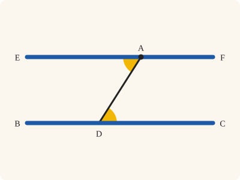
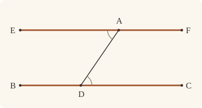
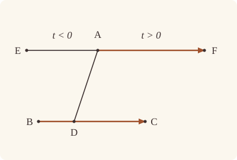

<!-- Generated by scripts/render.py. Do not edit by hand. -->

[Book I](index.md) · [← I.30](30.md) · [I.32 →](32.md)

# Book I, Proposition 31

*A straight line parallel to a given one, through a given point*

[Euclid's proof](#euclids-proof) · [In Lean](#in-lean) · [What it rests on](#what-it-rests-on) · [Mishnah](#mishnah)

> Through a given point to draw a straight line parallel to a given straight line.

**In Lean:** ✅ proved, as Euclid states it · Euclid's argument

<p align="center"></p>

<p align="center"><em>Join A to a point D of BC and copy the angle ADC (yellow) at A, on the other side of AD: the straight line EAF is parallel to BC (blue).</em></p>

## Euclid's proof

<p align="center"></p>

Let A be the given point, and BC the given straight line;

thus it is required to draw through the point A a straight line parallel to the straight line BC.

Let a point D be taken at random on BC, and let AD be joined; on the straight line DA, and at the point A on it, let the angle DAE be constructed equal to the angle ADC [I. 23]; and let the straight line AF be produced in a straight line with EA.

Then, since the straight line AD falling on the two straight lines BC, EF has made the alternate angles EAD, ADC equal to one another,

therefore EAF is parallel to BC. [I. 27]

Therefore through the given point A the straight line EAF has been drawn parallel to the given straight line BC.

Q. E. F.

## In Lean

| | |
|---|---|
| Proof | ✅ Proved |
| Statement | The whole enunciation. Draws a parallel through A, as asked; that there is no other, which Proclus remarks, is proved from I.29 as `Prop30.unique`. |
| Argument | Euclid's. |
| Reviewed | The statement and every passage of the argument read against Heath's text, at commit [`71146bf3f`](https://github.com/dodecaplex-co/stoicheia/commit/71146bf3f) ([the record](../../review/I/31.toml)) |

From [`Elements/BookI/Prop31.lean`](../../Elements/BookI/Prop31.lean). Euclid's sentences are the `--` comments, and our own notes are in `/- … -/`; the lines under each sentence are the Lean that carries it out. The list below marks where a lemma does a step Euclid takes for granted; the `/- … -/` notes in the listing explain smaller adjustments.

**How the Lean follows the text**

- **Done by `Tacit.exists_point_between`.** "Let a point D be taken at random on BC…" Euclid takes D on BC; the Lean chooses it between B and C, as in his figure. `Tacit.exists_point_between` (System E, Points 3) supplies this point, now proved in `Elements/Figure/Incidence.lean` by drawing a smaller concentric circle and using Definition I.15 and circle crossings.
- **Done by `SameSideOf.trans_opposite`.** "Then, since the straight line AD falling on the two straight lines BC, EF…" Euclid treats EAD and ADC as alternate; `SameSideOf.trans_opposite` puts E and C on opposite sides of AD. I.23 put E on B's side, and `OppositeSidesOf.of_between`, used beneath the joining of AD, put B and C on opposite sides because D is between them.

```lean
/-- Through a given point to draw a straight line parallel to a given straight line. -/
theorem Prop31 {A B C : Point} (hBC : B ≠ C) (hA : ¬ Collinear B C A) :
    ∃ E F : Point, Between E A F ∧ AreParallel E F B C := by
  -- Let A be the given point, and BC the given straight line;
  /- The given point is off the given straight line: otherwise there would be no
     parallel through it. -/
  obtain ⟨BC, hB_BC, hC_BC⟩ := Postulate1 B C hBC
  have hA_BC : ¬ OnLine A BC := fun h => hA ⟨BC, hB_BC, hC_BC, h⟩
  -- thus it is required to draw through the point A a straight line parallel to the straight
  -- line BC.
  -- Let a point D be taken at random on BC,
  /- Taken between B and C, as Euclid's figure has it. -/
  obtain ⟨D, hD_BC, hBDC, -⟩ := exists_point_between hB_BC hC_BC hBC []
  -- and let AD be joined;
  /- Our proof uses only that A and D are two points: D is on BC and A is not.
     Then ADC and ADB are triangles, and B and C lie on either side of AD,
     since D is between them (`OppositeSidesOf.of_between`). -/
  have hAD : A ≠ D := fun h => hA_BC (h ▸ hD_BC)
  have hADC : Triangle A D C :=
    (Triangle.of_line hD_BC hC_BC (ne_of_between (between_symm hBDC)).symm hA_BC).cab
  have hADB : Triangle A D B :=
    (Triangle.of_line hD_BC hB_BC (ne_of_between hBDC).symm hA_BC).cab
  have hBC_AD : OppositeSidesOf B C A D := OppositeSidesOf.of_between hADB hBDC
  -- on the straight line DA, and at the point A on it, let the angle DAE be constructed equal
  -- to the angle ADC [I. 23];
  /- I.23 builds the angle at A with one arm along the ray from A through D (it
     passes through a point D₁ of that ray) and the other through a point E on
     whichever side of AD we ask for. We ask for B's side, away from C. The angle
     D₁AE is the angle DAE, its arms being the same rays (`angle_onRay_left`). -/
  obtain ⟨E, D₁, hD₁, hEB, hEAD₁⟩ := Prop23 hAD hADC hADB
  have hAE : A ≠ E := hEB.triangle.ne₁₃
  have hDAE : ∠ D A E = ∠ A D C :=
    (angle_onRay_left hD₁ hAE.symm).symm.trans ((angle_symm hD₁.2.1 hAE.symm).trans hEAD₁)
  -- and let the straight line AF be produced in a straight line with EA.
  obtain ⟨F, hEAF⟩ := produce hAE.symm
  -- Then, since the straight line AD falling on the two straight lines BC, EF has made the
  -- alternate angles EAD, ADC equal to one another,
  /- Alternate: E is on B's side of AD, and so on the other side from C
     (`SameSideOf.trans_opposite`). -/
  have hEC : OppositeSidesOf E C A D := hEB.trans_opposite hBC_AD
  have hEAD : ∠ E A D = ∠ A D C := (angle_symm hAE.symm hAD.symm).trans hDAE
  -- therefore EAF is parallel to BC. [I. 27]
  /- I.27 with EF for its AB, BC for its CD, and AD falling on them at A
     and D. -/
  have hpar : AreParallel E F B C := Prop27 hEAF hBDC hEC hEAD
  -- Therefore through the given point A the straight line EAF has been drawn parallel to the
  -- given straight line BC.
  exact ⟨E, F, hEAF, hpar⟩
  -- Q. E. F.
```

<details><summary>After the theorem, one theorem later propositions use, <code>Prop31.line</code> (12 lines)</summary>

```lean
/-- I.31 said of straight lines drawn and named: through a point A off the
straight line L there is a straight line K parallel to L. I.31 gives two points
of it, one on either side of A, and Postulate 1 joins them. [I. 31] -/
theorem Prop31.line {A : Point} {L : Line} (hA : ¬ OnLine A L) :
    ∃ K : Line, OnLine A K ∧ Parallel K L := by
  obtain ⟨B, hB_L, -⟩ := exists_point_on_line L []
  obtain ⟨C, hC_L, hC⟩ := exists_point_on_line L [B]
  have hBC : B ≠ C := fun e => hC (e ▸ List.mem_singleton_self B)
  obtain ⟨E, F, hEAF, hpar⟩ := Prop31 hBC fun ⟨M, hB_M, hC_M, hA_M⟩ =>
    hA ((line_unique hBC hB_M hC_M hB_L hC_L) ▸ hA_M)
  obtain ⟨K, hE_K, hF_K⟩ := Postulate1 E F hpar.1
  exact ⟨K, on_line_of_between_ends hEAF hE_K hF_K, hpar.parallel hE_K hF_K hB_L hC_L⟩
```

</details>

## What it rests on

| | |
|---|---|
| Heath's references | [I.23](23.md), [I.27](27.md) |
| Lean cites | [I.23](23.md), [I.27](27.md) |
| Postulates | 1, 2, 3, 4 |
| Definitions taken as axioms | Def. I.15 |
| Common Notions | 1, 2, 3, 4, 5 |
| Tacit rules | 37 (listed below) |
| Its own Lean calls | Postulate 1; 2 tacit rules |
| Through lemmas | Postulates 2 and 3; Def. I.15; 26 tacit rules |

_Postulates, definitions, Common Notions and tacit rules: all that this proof rests on, counting those of the propositions it cites. The last two rows say which of the postulates, definitions and tacit rules its own Lean calls, in the proof or a helper written for it, and which it does not call but reaches through lemmas, of Book Zero or shared (a proposition it cites may rest on these too); the rest come in only through the propositions it cites or the Common Notions._

<details><summary>The 37 tacit rules beneath this proof, counting those of the propositions it cites</summary>

_(used here) marks a rule this proof's own Lean calls, in the proof or a helper written for it; (through …) marks one its own Lean does not call but reaches through the lemmas named, of [Book Zero](../../Elements/Figure) or shared, though a proposition it cites may rest on it too; and a rule with no mark comes in only through a proposition it cites or a Common Notion. The names in brackets are System E's: an Intersection rule says when straight lines and circles must meet, and an Intersections rule takes a point where they do (see [Book I's introduction](index.md))._

**Reading the figure**

- [`between_cases`](../../Elements/Foundations/Tacit/Diagram.lean#L54) (through [`Tacit.exists_point_between`](../../Elements/Figure/Incidence.lean#L314)): Of three different points on a straight line, one is between the other two. (Between 6)
- [`between_symm`](../../Elements/Foundations/Tacit/Diagram.lean#L47) (used here): If B is between A and C, it is between C and A. (Between 1)
- [`circles_meet`](../../Elements/Foundations/Tacit/Diagram.lean#L91) (through [`OppositeSidesOf.of_between`](../../Elements/Figure/Sides.lean#L100) and [`Tacit.exists_point_between`](../../Elements/Figure/Incidence.lean#L314)): If each circle passes through a point inside the other, the circles cut one another. This is the step Euclid takes for granted in I.1. (Intersection 5)
- [`circles_meet_same_side`](../../Elements/Foundations/Tacit/Constructions.lean#L79) (through [`OppositeSidesOf.of_between`](../../Elements/Figure/Sides.lean#L100) and [`Tacit.exists_point_between`](../../Elements/Figure/Incidence.lean#L314)): Two circles that cut one another do so on each side of the straight line through their centres. (Intersections 8)
- [`exists_point`](../../Elements/Foundations/Tacit/Constructions.lean#L35) (through [`OppositeSidesOf.of_between`](../../Elements/Figure/Sides.lean#L100) and [`Triangle.ne₁₃`](../../Elements/Figure/Triangles.lean#L36)): Let a point be taken. (Points 1)
- [`exists_point_inside_circle`](../../Elements/Foundations/Tacit/Constructions.lean#L42) (through [`OppositeSidesOf.of_between`](../../Elements/Figure/Sides.lean#L100) and [`Tacit.exists_point_between`](../../Elements/Figure/Incidence.lean#L314)): Let a point be taken inside the circle α. (Points 8)
- [`exists_point_on_line`](../../Elements/Foundations/Tacit/Constructions.lean#L38) (through [`OppositeSidesOf.of_between`](../../Elements/Figure/Sides.lean#L100) and [`Tacit.exists_point_between`](../../Elements/Figure/Incidence.lean#L314)): Let a point be taken on the straight line L. (Points 2)
- [`line_circle_between`](../../Elements/Foundations/Tacit/Constructions.lean#L67) (through [`OppositeSidesOf.of_between`](../../Elements/Figure/Sides.lean#L100) and [`Tacit.exists_point_between`](../../Elements/Figure/Incidence.lean#L314)): A straight line through a point B inside a circle, heading out to a point C outside it, cuts the circle between B and C. (Intersections 4)
- [`line_circle_beyond`](../../Elements/Foundations/Tacit/Constructions.lean#L73) (through [`OppositeSidesOf.of_between`](../../Elements/Figure/Sides.lean#L100) and [`Tacit.exists_point_between`](../../Elements/Figure/Incidence.lean#L314)): A straight line through a point B inside a circle, produced beyond B away from C, cuts the circle there. (Intersections 5)
- [`line_unique`](../../Elements/Foundations/Tacit/Diagram.lean#L41) (through [`OppositeSidesOf.of_between`](../../Elements/Figure/Sides.lean#L100) and [`Triangle.of_line`](../../Elements/Figure/Triangles.lean#L82)): Two points determine a straight line. (Generalities 1)
- [`lines_meet_of_opposite_sides`](../../Elements/Foundations/Tacit/Diagram.lean#L86): A straight line joining points on opposite sides of L crosses L. (Intersection 1)
- [`not_between_of_between`](../../Elements/Foundations/Tacit/Diagram.lean#L50) (through [`OppositeSidesOf.of_between`](../../Elements/Figure/Sides.lean#L100), [`Tacit.exists_point_between`](../../Elements/Figure/Incidence.lean#L314), [`Tacit.ne_of_between`](../../Elements/Figure/RuleBase.lean#L135) and 1 other lemma): If B is between A and C, then A is not between B and C. (Between 1)
- [`not_on_line_of_same_side`](../../Elements/Foundations/Tacit/Diagram.lean#L60) (through [`OppositeSidesOf.of_between`](../../Elements/Figure/Sides.lean#L100), [`SameSideOf.trans_opposite`](../../Elements/Figure/Sides.lean#L135), [`SameSideOf.triangle`](../../Elements/Figure/Sides.lean#L61) and 1 other lemma): Points on one side of a straight line are not on it. (Same side 3)
- [`pasch2`](../../Elements/Foundations/Tacit/Diagram.lean#L71) (through [`OppositeSidesOf.of_between`](../../Elements/Figure/Sides.lean#L100) and [`Tacit.exists_point_between`](../../Elements/Figure/Incidence.lean#L314)): If B is between A and C, A is on L and B is off it, then B and C are on the same side of L: a straight line that leaves L at A does not cross it again. (Pasch 2)
- [`same_side_trans`](../../Elements/Foundations/Tacit/Diagram.lean#L64) (through [`OppositeSidesOf.of_between`](../../Elements/Figure/Sides.lean#L100), [`SameSideOf.trans_opposite`](../../Elements/Figure/Sides.lean#L135) and [`Tacit.exists_point_between`](../../Elements/Figure/Incidence.lean#L314)): Two points on the same side of a straight line as a third point are on the same side as each other. (Same side 4)

**Lengths, angles and areas**

- [`angle_add_of_inside`](../../Elements/Foundations/Tacit/Transfer.lean#L47) (through [`OppositeSidesOf.of_between`](../../Elements/Figure/Sides.lean#L100)): If D lies within the angle BAC, then BAC is made up of BAD and DAC. (Diagram-angle 2)
- [`angle_eq_of_same_rays`](../../Elements/Foundations/Tacit/Transfer.lean#L54) (through [`angle_onRay_left`](../../Elements/Figure/Angles.lean#L42)): The angle doesn't change if its arms are traced through other points on the same rays. (Diagram-angle 4)
- [`angle_symm`](../../Elements/Foundations/Tacit/Metric.lean#L30) (used here): The angle ABC is the angle CBA. (Metric 4)
- [`area_add_of_between`](../../Elements/Foundations/Tacit/Transfer.lean#L70): Cutting a triangle in two from a vertex adds up. (Diagram-area 2)
- [`area_congruent`](../../Elements/Foundations/Tacit/Metric.lean#L44): Triangles equal in all their sides and angles are equal in area. Euclid uses this without comment once he has shown two triangles congruent. (Metric 9)
- [`area_degenerate`](../../Elements/Foundations/Tacit/Metric.lean#L36): A "triangle" with a repeated corner has no area. (Metric 6)
- [`area_eq_zero_of_on_line`](../../Elements/Foundations/Tacit/Transfer.lean#L62): A "triangle" whose corners lie on one straight line has no area. (Diagram-area 1)
- [`area_rotate`](../../Elements/Foundations/Tacit/Metric.lean#L39): The triangle ABC is the triangle CAB. (Metric 8)
- [`len_add_of_between`](../../Elements/Foundations/Tacit/Transfer.lean#L27) (through [`OppositeSidesOf.of_between`](../../Elements/Figure/Sides.lean#L100), [`Tacit.exists_point_between`](../../Elements/Figure/Incidence.lean#L314) and [`angle_onRay_left`](../../Elements/Figure/Angles.lean#L42)): If B is between A and C, then AB and BC together make up AC. (Diagram-segment 1)
- [`len_self`](../../Elements/Foundations/Tacit/Metric.lean#L24) (through [`OppositeSidesOf.of_between`](../../Elements/Figure/Sides.lean#L100), [`Tacit.exists_point_between`](../../Elements/Figure/Incidence.lean#L314) and [`angle_onRay_left`](../../Elements/Figure/Angles.lean#L42)): The "straight line" from a point to itself has no length. (Metric 1)
- [`len_symm`](../../Elements/Foundations/Tacit/Metric.lean#L27) (through [`OppositeSidesOf.of_between`](../../Elements/Figure/Sides.lean#L100) and [`Tacit.exists_point_between`](../../Elements/Figure/Incidence.lean#L314)): The straight line AB is the straight line BA. (Metric 3)
- [`radius_ne_zero`](../../Elements/Foundations/Tacit/Metric.lean#L62) (through [`OppositeSidesOf.of_between`](../../Elements/Figure/Sides.lean#L100), [`Tacit.exists_point_between`](../../Elements/Figure/Incidence.lean#L314) and [`angle_onRay_left`](../../Elements/Figure/Angles.lean#L42)): A circle's radius is not nothing: the straight line from the centre to a point on the circle has some length. A rule of our own, not one of System E's: every circle is drawn with a centre and a distance (Postulate 3).
- [`same_ray_of_angle_eq_zero`](../../Elements/Foundations/Tacit/Transfer.lean#L42) (through [`OppositeSidesOf.of_between`](../../Elements/Figure/Sides.lean#L100)): If the angle BAC is nothing, C lies on the ray from A through B. (Diagram-angle 1)

**Superposition**

- [`superposition`](../../Elements/Foundations/Tacit/Superposition.lean#L52): **Superposition.** A hypothetical placement of a triangle on a given ray and side permits a restricted derivation of metric equalities about the figure already given. The derivation introduces no further objects, cites each geometric law it uses, and exports no symbol of the placement.

**Rules of magnitude**

- [`add_assoc`](../../Elements/Foundations/Tacit/Magnitudes.lean#L23) (through [`Tacit.exists_point_between`](../../Elements/Figure/Incidence.lean#L314)): Adding three magnitudes in a row, it makes no difference whether the first two or the last two are added first. (System E §3.5)
- [`add_comm`](../../Elements/Foundations/Tacit/Magnitudes.lean#L26) (through [`OppositeSidesOf.of_between`](../../Elements/Figure/Sides.lean#L100), [`Tacit.exists_point_between`](../../Elements/Figure/Incidence.lean#L314) and [`angle_onRay_left`](../../Elements/Figure/Angles.lean#L42)): The order of adding does not matter. (System E §3.5)
- [`add_lt_add_right`](../../Elements/Foundations/Tacit/Magnitudes.lean#L45): Adding the same thing to both sides keeps "less than". (System E §3.5)
- [`add_zero`](../../Elements/Foundations/Tacit/Magnitudes.lean#L29): Adding nothing changes nothing. (System E §3.5)
- [`lt_irrefl`](../../Elements/Foundations/Tacit/Magnitudes.lean#L32) (through [`OppositeSidesOf.of_between`](../../Elements/Figure/Sides.lean#L100) and [`Tacit.exists_point_between`](../../Elements/Figure/Incidence.lean#L314)): No magnitude is less than itself. (System E §3.5)
- [`lt_trans`](../../Elements/Foundations/Tacit/Magnitudes.lean#L35) (through [`OppositeSidesOf.of_between`](../../Elements/Figure/Sides.lean#L100) and [`Tacit.exists_point_between`](../../Elements/Figure/Incidence.lean#L314)): What is less than the less is less still. (System E §3.5)
- [`lt_trichotomy`](../../Elements/Foundations/Tacit/Magnitudes.lean#L39) (through [`OppositeSidesOf.of_between`](../../Elements/Figure/Sides.lean#L100), [`Tacit.exists_point_between`](../../Elements/Figure/Incidence.lean#L314) and [`angle_onRay_left`](../../Elements/Figure/Angles.lean#L42)): Of two magnitudes, one is less, or they are equal, or the other is less. (System E §3.5)
- [`not_lt_zero`](../../Elements/Foundations/Tacit/Magnitudes.lean#L42) (through [`OppositeSidesOf.of_between`](../../Elements/Figure/Sides.lean#L100), [`Tacit.exists_point_between`](../../Elements/Figure/Incidence.lean#L314) and [`angle_onRay_left`](../../Elements/Figure/Angles.lean#L42)): Nothing is less than zero. (System E §3.5)

</details>

## Mishnah

_Our commentary: why Euclid's proof, and ours, look as they do._

Heath asks the question himself: "The construction, be it observed, depends only upon I. 27, and might therefore have come directly after that proposition. Why then did Euclid postpone it until after I. 29 and I. 30? Presumably because he considered it necessary, before giving the construction, to place beyond all doubt the fact that only one such parallel can be drawn" (vol. 1, p. 316). Our proof bears out his first sentence. Like Euclid's, it rests on I.23 and I.27 and not on Postulate 5, and in Book I it is the one proof after I.28 that does without the postulate.

**A parallel, or the parallel?** Proclus, Heath reports, draws the uniqueness from I.30: two straight lines through A, both parallel to BC, would be parallel to each other, though they meet at A. Heath thinks Euclid "deliberately determined that his own assumption was more appropriate to be made the subject of a Postulate than the assumption of the uniqueness of the parallel" (vol. 1, p. 316). That uniqueness later took John Playfair's name, though "it was of course not a new discovery. It is distinctly stated in Proclus' note to Eucl. I. 31" (Heath, vol. 1, p. 220). Our I.31 draws a parallel, as Euclid's does; that there is no other is `Prop30.unique`, proved from I.29.

**The modern way.** With coordinates no angle has to be copied: the parallel through A is the straight line of points $\mathrm{A} + t\mathrm{(C - B)}$, one for each real number $t$. Euclid's E is one of them with $t \lt 0$, on B's side of AD, and F one with $t \gt 0$.

<p align="center"></p>

## Further reading

- In a geometry where more than one straight line through A never meets BC, "a parallel" and "the parallel" part company, and Richard Courant and Herbert Robbins visit one in ch. IV, "Projective Geometry. Axiomatics. Non-Euclidean Geometries", of [*What Is Mathematics?*](https://openlibrary.org/books/OL815900M) (1996) (also on [I.22](22.md)).
- The straight line A + t(C − B) of the modern way is built from vectors, which ch. 1, "Vectors, what even are they?", of Grant Sanderson's animated [*Essence of linear algebra*](https://www.3blue1brown.com/topics/linear-algebra) (2016, free online) makes easy to see (also on [I.2](02.md)).

[Book I](index.md) · [← I.30](30.md) · [I.32 →](32.md)

---

<sub>Euclid's text: T. L. Heath, *The Thirteen Books of Euclid's Elements*, vol. 1 (Cambridge, 1908), pp. 315–316; [scan leaves n335–n336](https://archive.org/details/thirteenbookseu02heibgoog/page/n335); [figure on n336](https://archive.org/details/thirteenbookseu02heibgoog/page/n336). Public domain.</sub>

<sub>The tacit rules follow the System E of Jeremy Avigad, Edward Dean and John Mumma, read alongside LeanEuclid (Logan Murphy, Kaiyu Yang, Jialiang Sun, Zhaoyu Li, Anima Anandkumar and Xujie Si).</sub>
