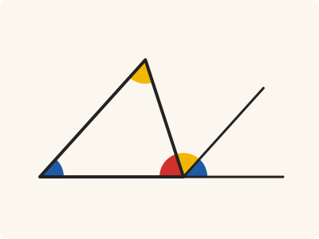
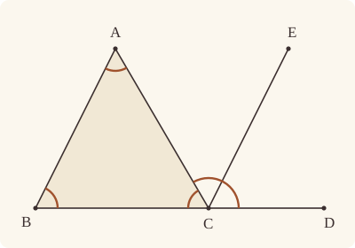

<!-- Generated by scripts/render.py. Do not edit by hand. -->

[Book I](index.md) · [← I.31](31.md) · [I.33 →](33.md)

# Book I, Proposition 32

*The three angles of a triangle equal two right angles*

[Euclid's proof](#euclids-proof) · [In Lean](#in-lean) · [What it rests on](#what-it-rests-on) · [Mishnah](#mishnah)

> In any triangle, if one of the sides be produced, the exterior angle is equal to the two interior and opposite angles, and the three interior angles of the triangle are equal to two right angles.

**In Lean:** ✅ proved, as Euclid states it · Euclid's argument

<p align="center"></p>

<p align="center"><em>The two interior and opposite angles of the triangle ABC (yellow and blue) fit exactly into the exterior angle ACD, so the three angles (yellow, blue and red), side by side at C, make two right angles.</em></p>

## Euclid's proof

<p align="center"></p>

Let ABC be a triangle, and let one side of it BC be produced to D;

I say that the exterior angle ACD is equal to the two interior and opposite angles CAB, ABC, and the three interior angles of the triangle ABC, BCA, CAB are equal to two right angles.

For let CE be drawn through the point C parallel to the straight line AB. [I. 31]

Then, since AB is parallel to CE,

and AC has fallen upon them,

the alternate angles BAC, ACE are equal to one another. [I. 29]

Again, since AB is parallel to CE,

and the straight line BD has fallen upon them,

the exterior angle ECD is equal to the interior and opposite angle ABC. [I. 29]

But the angle ACE was also proved equal to the angle BAC;

therefore the whole angle ACD is equal to the two interior and opposite angles BAC, ABC.

Let the angle ACB be added to each;

therefore the angles ACD, ACB are equal to the three angles ABC, BCA, CAB.

But the angles ACD, ACB are equal to two right angles; [I. 13]

therefore the angles ABC, BCA, CAB are also equal to two right angles.

Therefore etc.

Q. E. D.

## In Lean

| | |
|---|---|
| Proof | ✅ Proved |
| Statement | The whole enunciation. |
| Argument | Euclid's. |
| Reviewed | The statement and every passage of the argument read against Heath's text, at commit [`18e4e614`](https://github.com/dodecaplex-co/stoicheia/commit/18e4e614) ([the record](../../review/I/32.toml)) |

From [`Elements/BookI/Prop32.lean`](../../Elements/BookI/Prop32.lean). Euclid's sentences are the `--` comments, and our own notes are in `/- … -/`; the lines under each sentence are the Lean that carries it out. The list below marks where a lemma does a step Euclid takes for granted; the `/- … -/` notes in the listing explain smaller adjustments.

**How the Lean follows the text**

- **Done by `AreParallel.oppositeSidesOf`.** "and AC has fallen upon them…" Euclid treats BAC and ACE as alternate; `AreParallel.oppositeSidesOf` proves that B and E lie on opposite sides of AC, using the choice of E on A's side of BC by `Prop32.choose_end`.
- **Done by `angle_add_of_within`.** "therefore the whole angle ACD is equal to the two interior and opposite angles BAC, ABC." Euclid adds ACE and ECD to make ACD; `angle_add_of_within` justifies the sum after the Lean puts E inside ACD. `OppositeSidesOf.of_between` puts D opposite B across AC, so E and D share a side of AC, while E and A share a side of CD.

<details><summary>Before the theorem, one lemma: <code>Prop32.choose_end</code> (26 lines)</summary>

```lean
/-- Euclid's figure puts E, on the parallel through C, on A's side of BC.
The two points I.31 gives, one on either side of C, lie on opposite sides of
BC, which crosses their straight line at C; and a straight line has just two
sides, so one of them is on A's side (System E, Pasch 3 and Same side 5). It
cites no proposition. -/
theorem Prop32.choose_end {A B C P Q : Point} (hABC : Triangle A B C)
    (hPCQ : Between P C Q) (hpar : AreParallel P Q A B) :
    ∃ E : Point, AreParallel C E A B ∧ SameSideOf E A B C := by
  obtain ⟨AB, hA_AB, hB_AB⟩ := Postulate1 A B hABC.ne₁₂
  obtain ⟨BC, hB_BC, hC_BC⟩ := Postulate1 B C hABC.ne₂₃
  obtain ⟨PQ, hP_PQ, hQ_PQ⟩ := Postulate1 P Q hpar.1
  have hC_PQ : OnLine C PQ := on_line_of_between_ends hPCQ hP_PQ hQ_PQ
  have hparallel : Parallel PQ AB := hpar.parallel hP_PQ hQ_PQ hA_AB hB_AB
  have hP_BC : ¬ OnLine P BC :=
    hparallel.off_transversal hC_PQ hB_AB hC_BC hB_BC hP_PQ (ne_of_between hPCQ)
  have hQ_BC : ¬ OnLine Q BC :=
    hparallel.off_transversal hC_PQ hB_AB hC_BC hB_BC hQ_PQ
      (ne_of_between (between_symm hPCQ))
  rcases same_side_or hP_BC hQ_BC (hABC.bca.off_line hB_BC hC_BC)
      (pasch3 hPCQ hC_BC) with hPA | hQA
  · exact ⟨P, AreParallel.of_parallel (ne_of_between hPCQ).symm hABC.ne₁₂
      hC_PQ hP_PQ hA_AB hB_AB hparallel,
      SameSideOf.of_line hABC.ne₂₃ hB_BC hC_BC hPA⟩
  · exact ⟨Q, AreParallel.of_parallel (ne_of_between (between_symm hPCQ)).symm
      hABC.ne₁₂ hC_PQ hQ_PQ hA_AB hB_AB hparallel,
      SameSideOf.of_line hABC.ne₂₃ hB_BC hC_BC hQA⟩
```

</details>

```lean
/-- In any triangle, if one of the sides be produced, the exterior angle is equal to the two
interior and opposite angles, and the three interior angles of the triangle are equal to two
right angles. -/
theorem Prop32 {A B C D : Point} (hABC : Triangle A B C) (hBCD : Between B C D) :
    ∠ A C D = ∠ C A B + ∠ A B C ∧ ∠ A B C + ∠ B C A + ∠ C A B = ∟ + ∟ := by
  -- Let ABC be a triangle, and let one side of it BC be produced to D;
  obtain ⟨BC, hB_BC, hC_BC⟩ := Postulate1 B C hABC.ne₂₃
  have hD_BC : OnLine D BC := on_line_of_between hBCD hB_BC hC_BC
  have hCD : C ≠ D := (ne_of_between (between_symm hBCD)).symm
  -- I say that the exterior angle ACD is equal to the two interior and opposite angles CAB,
  -- ABC, and the three interior angles of the triangle ABC, BCA, CAB are equal to two right
  -- angles.
  -- For let CE be drawn through the point C parallel to the straight line AB. [I. 31]
  obtain ⟨P, Q, hPCQ, hPQ⟩ := Prop31 hABC.ne₁₂ hABC
  obtain ⟨E, hCE, hEA⟩ := Prop32.choose_end hABC hPCQ hPQ
  -- Then, since AB is parallel to CE,
  have hAB : AreParallel A B C E := hCE.symm
  -- and AC has fallen upon them,
  have hBE : OppositeSidesOf B E A C := hAB.swap_left.oppositeSidesOf hEA.symm
  -- the alternate angles BAC, ACE are equal to one another. [I. 29]
  have hBAC_ACE : ∠ B A C = ∠ A C E := Prop29.alternate hAB.swap_left hBE
  -- Again, since AB is parallel to CE,
  have hCE_BA : AreParallel C E B A := hCE.swap_right
  -- and the straight line BD has fallen upon them,
  -- the exterior angle ECD is equal to the interior and opposite angle ABC. [I. 29]
  have hECD_ABC : ∠ E C D = ∠ A B C := by
    have h := Prop29.exterior hCE_BA hEA.swap (between_symm hBCD)
    rw [angle_symm hCD.symm hCE.1.symm, angle_symm hABC.ne₂₃.symm hABC.ne₁₂] at h
    exact h
  -- But the angle ACE was also proved equal to the angle BAC;
  have hACE_BAC : ∠ A C E = ∠ B A C := hBAC_ACE.symm
  -- therefore the whole angle ACD is equal to the two interior and opposite angles BAC, ABC.
  /- E lies within ACD: both E and D are opposite B across AC,
     and E is on A's side of the straight line CD, which is BC. -/
  have hED : SameSideOf E D C A :=
    (hBE.sameSideOf (OppositeSidesOf.of_between hABC.acb hBCD)).swap
  have hEA_CD : SameSideOf E A C D :=
    SameSideOf.of_line hCD hC_BC hD_BC (hEA.sameSide hB_BC hC_BC)
  have hACD : ∠ A C D = ∠ C A B + ∠ A B C := by
    rw [angle_add_of_within hED hEA_CD, hACE_BAC, hECD_ABC,
      angle_symm hABC.ne₁₂.symm hABC.ne₁₃.symm]
  -- Let the angle ACB be added to each;
  have hadd := CommonNotion2 hACD (Eq.refl (∠ A C B))
  -- therefore the angles ACD, ACB are equal to the three angles ABC, BCA, CAB.
  have hthree : ∠ A C D + ∠ A C B = ∠ A B C + ∠ B C A + ∠ C A B := by
    rw [hadd, angle_symm hABC.ne₁₃ hABC.ne₂₃,
      add_comm (∠ C A B), add_assoc, add_comm (∠ C A B), ← add_assoc]
  -- But the angles ACD, ACB are equal to two right angles; [I. 13]
  have hright : ∠ A C D + ∠ A C B = ∟ + ∟ := by
    rw [add_comm, angle_symm hABC.ne₁₃ hABC.ne₂₃]
    exact Prop13 hBCD (Triangle.of_line hB_BC hD_BC (ne_of_between_ends hBCD)
      (hABC.bca.off_line hB_BC hC_BC))
  -- therefore the angles ABC, BCA, CAB are also equal to two right angles.
  have hsum : ∠ A B C + ∠ B C A + ∠ C A B = ∟ + ∟ := hthree.symm.trans hright
  -- Therefore etc.
  exact ⟨hACD, hsum⟩
  -- Q. E. D.
```

## What it rests on

| | |
|---|---|
| Heath's references | [I.13](13.md), [I.29](29.md), [I.31](31.md) |
| Lean cites | [I.13](13.md), [I.29](29.md), [I.31](31.md) |
| Postulates | 1, 2, 3, 4, 5 |
| Definitions taken as axioms | Def. I.15 |
| Common Notions | 1, 2, 3, 4, 5 |
| Tacit rules | 37 (listed below) |
| Its own Lean calls | Postulate 1; 4 tacit rules |
| Through lemmas | Postulates 2 and 3; Def. I.15; 26 tacit rules |

Some of these come in through lemmas [shared](../../CERTIFICATE.md#shared-steps) by many proofs: [`Prop29.alternate`](../../Elements/BookI/Prop29.lean#L144), [`Prop29.exterior`](../../Elements/BookI/Prop29.lean#L160) (I.29).

_Postulates, definitions, Common Notions and tacit rules: all that this proof rests on, counting those of the propositions it cites. The last two rows say which of the postulates, definitions and tacit rules its own Lean calls, in the proof or a helper written for it, and which it does not call but reaches through lemmas, of Book Zero or shared (a proposition it cites may rest on these too); the rest come in only through the propositions it cites or the Common Notions._

<details><summary>The 37 tacit rules beneath this proof, counting those of the propositions it cites</summary>

_(used here) marks a rule this proof's own Lean calls, in the proof or a helper written for it; (through …) marks one its own Lean does not call but reaches through the lemmas named, of [Book Zero](../../Elements/Figure) or shared, though a proposition it cites may rest on it too; and a rule with no mark comes in only through a proposition it cites or a Common Notion. The names in brackets are System E's: an Intersection rule says when straight lines and circles must meet, and an Intersections rule takes a point where they do (see [Book I's introduction](index.md))._

**Reading the figure**

- [`between_cases`](../../Elements/Foundations/Tacit/Diagram.lean#L54) (through [`AreParallel.oppositeSidesOf`](../../Elements/Figure/Parallels.lean#L135), [`OppositeSidesOf.sameSideOf`](../../Elements/Figure/Sides.lean#L129), [`Prop29.alternate`](../../Elements/BookI/Prop29.lean#L144) and 2 other lemmas): Of three different points on a straight line, one is between the other two. (Between 6)
- [`between_symm`](../../Elements/Foundations/Tacit/Diagram.lean#L47) (used here): If B is between A and C, it is between C and A. (Between 1)
- [`circles_meet`](../../Elements/Foundations/Tacit/Diagram.lean#L91) (through [`AreParallel.oppositeSidesOf`](../../Elements/Figure/Parallels.lean#L135), [`OppositeSidesOf.of_between`](../../Elements/Figure/Sides.lean#L100), [`OppositeSidesOf.sameSideOf`](../../Elements/Figure/Sides.lean#L129) and 8 other lemmas): If each circle passes through a point inside the other, the circles cut one another. This is the step Euclid takes for granted in I.1. (Intersection 5)
- [`circles_meet_same_side`](../../Elements/Foundations/Tacit/Constructions.lean#L79) (through [`AreParallel.oppositeSidesOf`](../../Elements/Figure/Parallels.lean#L135), [`OppositeSidesOf.of_between`](../../Elements/Figure/Sides.lean#L100), [`OppositeSidesOf.sameSideOf`](../../Elements/Figure/Sides.lean#L129) and 8 other lemmas): Two circles that cut one another do so on each side of the straight line through their centres. (Intersections 8)
- [`exists_point`](../../Elements/Foundations/Tacit/Constructions.lean#L35) (through [`AreParallel.oppositeSidesOf`](../../Elements/Figure/Parallels.lean#L135), [`OppositeSidesOf.of_between`](../../Elements/Figure/Sides.lean#L100), [`Prop29.alternate`](../../Elements/BookI/Prop29.lean#L144) and 3 other lemmas): Let a point be taken. (Points 1)
- [`exists_point_inside_circle`](../../Elements/Foundations/Tacit/Constructions.lean#L42) (through [`AreParallel.oppositeSidesOf`](../../Elements/Figure/Parallels.lean#L135), [`OppositeSidesOf.of_between`](../../Elements/Figure/Sides.lean#L100), [`OppositeSidesOf.sameSideOf`](../../Elements/Figure/Sides.lean#L129) and 8 other lemmas): Let a point be taken inside the circle α. (Points 8)
- [`exists_point_on_line`](../../Elements/Foundations/Tacit/Constructions.lean#L38) (through [`AreParallel.oppositeSidesOf`](../../Elements/Figure/Parallels.lean#L135), [`OppositeSidesOf.of_between`](../../Elements/Figure/Sides.lean#L100), [`OppositeSidesOf.sameSideOf`](../../Elements/Figure/Sides.lean#L129) and 8 other lemmas): Let a point be taken on the straight line L. (Points 2)
- [`line_circle_between`](../../Elements/Foundations/Tacit/Constructions.lean#L67) (through [`AreParallel.oppositeSidesOf`](../../Elements/Figure/Parallels.lean#L135), [`OppositeSidesOf.of_between`](../../Elements/Figure/Sides.lean#L100), [`OppositeSidesOf.sameSideOf`](../../Elements/Figure/Sides.lean#L129) and 8 other lemmas): A straight line through a point B inside a circle, heading out to a point C outside it, cuts the circle between B and C. (Intersections 4)
- [`line_circle_beyond`](../../Elements/Foundations/Tacit/Constructions.lean#L73) (through [`AreParallel.oppositeSidesOf`](../../Elements/Figure/Parallels.lean#L135), [`OppositeSidesOf.of_between`](../../Elements/Figure/Sides.lean#L100), [`OppositeSidesOf.sameSideOf`](../../Elements/Figure/Sides.lean#L129) and 8 other lemmas): A straight line through a point B inside a circle, produced beyond B away from C, cuts the circle there. (Intersections 5)
- [`line_unique`](../../Elements/Foundations/Tacit/Diagram.lean#L41) (through [`AreParallel.of_parallel`](../../Elements/Figure/Parallels.lean#L84), [`AreParallel.oppositeSidesOf`](../../Elements/Figure/Parallels.lean#L135), [`OppositeSidesOf.of_between`](../../Elements/Figure/Sides.lean#L100) and 9 other lemmas): Two points determine a straight line. (Generalities 1)
- [`lines_meet_of_opposite_sides`](../../Elements/Foundations/Tacit/Diagram.lean#L86) (through [`AreParallel.oppositeSidesOf`](../../Elements/Figure/Parallels.lean#L135), [`OppositeSidesOf.sameSideOf`](../../Elements/Figure/Sides.lean#L129), [`Prop29.alternate`](../../Elements/BookI/Prop29.lean#L144) and 1 other lemma): A straight line joining points on opposite sides of L crosses L. (Intersection 1)
- [`not_between_of_between`](../../Elements/Foundations/Tacit/Diagram.lean#L50) (through [`AreParallel.oppositeSidesOf`](../../Elements/Figure/Parallels.lean#L135), [`OppositeSidesOf.of_between`](../../Elements/Figure/Sides.lean#L100), [`OppositeSidesOf.sameSideOf`](../../Elements/Figure/Sides.lean#L129) and 10 other lemmas): If B is between A and C, then A is not between B and C. (Between 1)
- [`not_on_line_of_same_side`](../../Elements/Foundations/Tacit/Diagram.lean#L60) (through [`AreParallel.oppositeSidesOf`](../../Elements/Figure/Parallels.lean#L135), [`OppositeSidesOf.of_between`](../../Elements/Figure/Sides.lean#L100), [`OppositeSidesOf.sameSideOf`](../../Elements/Figure/Sides.lean#L129) and 8 other lemmas): Points on one side of a straight line are not on it. (Same side 3)
- [`pasch2`](../../Elements/Foundations/Tacit/Diagram.lean#L71) (through [`AreParallel.oppositeSidesOf`](../../Elements/Figure/Parallels.lean#L135), [`OppositeSidesOf.of_between`](../../Elements/Figure/Sides.lean#L100), [`OppositeSidesOf.sameSideOf`](../../Elements/Figure/Sides.lean#L129) and 6 other lemmas): If B is between A and C, A is on L and B is off it, then B and C are on the same side of L: a straight line that leaves L at A does not cross it again. (Pasch 2)
- [`same_side_trans`](../../Elements/Foundations/Tacit/Diagram.lean#L64) (through [`AreParallel.oppositeSidesOf`](../../Elements/Figure/Parallels.lean#L135), [`OppositeSidesOf.of_between`](../../Elements/Figure/Sides.lean#L100), [`OppositeSidesOf.sameSideOf`](../../Elements/Figure/Sides.lean#L129) and 8 other lemmas): Two points on the same side of a straight line as a third point are on the same side as each other. (Same side 4)

**Lengths, angles and areas**

- [`angle_add_of_inside`](../../Elements/Foundations/Tacit/Transfer.lean#L47) (through [`AreParallel.oppositeSidesOf`](../../Elements/Figure/Parallels.lean#L135), [`OppositeSidesOf.of_between`](../../Elements/Figure/Sides.lean#L100), [`OppositeSidesOf.sameSideOf`](../../Elements/Figure/Sides.lean#L129) and 4 other lemmas): If D lies within the angle BAC, then BAC is made up of BAD and DAC. (Diagram-angle 2)
- [`angle_eq_of_same_rays`](../../Elements/Foundations/Tacit/Transfer.lean#L54) (through [`Prop29.exterior`](../../Elements/BookI/Prop29.lean#L160)): The angle doesn't change if its arms are traced through other points on the same rays. (Diagram-angle 4)
- [`angle_symm`](../../Elements/Foundations/Tacit/Metric.lean#L30) (used here): The angle ABC is the angle CBA. (Metric 4)
- [`area_add_of_between`](../../Elements/Foundations/Tacit/Transfer.lean#L70): Cutting a triangle in two from a vertex adds up. (Diagram-area 2)
- [`area_congruent`](../../Elements/Foundations/Tacit/Metric.lean#L44): Triangles equal in all their sides and angles are equal in area. Euclid uses this without comment once he has shown two triangles congruent. (Metric 9)
- [`area_degenerate`](../../Elements/Foundations/Tacit/Metric.lean#L36): A "triangle" with a repeated corner has no area. (Metric 6)
- [`area_eq_zero_of_on_line`](../../Elements/Foundations/Tacit/Transfer.lean#L62): A "triangle" whose corners lie on one straight line has no area. (Diagram-area 1)
- [`area_rotate`](../../Elements/Foundations/Tacit/Metric.lean#L39): The triangle ABC is the triangle CAB. (Metric 8)
- [`len_add_of_between`](../../Elements/Foundations/Tacit/Transfer.lean#L27) (through [`AreParallel.oppositeSidesOf`](../../Elements/Figure/Parallels.lean#L135), [`OppositeSidesOf.of_between`](../../Elements/Figure/Sides.lean#L100), [`OppositeSidesOf.sameSideOf`](../../Elements/Figure/Sides.lean#L129) and 9 other lemmas): If B is between A and C, then AB and BC together make up AC. (Diagram-segment 1)
- [`len_self`](../../Elements/Foundations/Tacit/Metric.lean#L24) (through [`AreParallel.oppositeSidesOf`](../../Elements/Figure/Parallels.lean#L135), [`OppositeSidesOf.of_between`](../../Elements/Figure/Sides.lean#L100), [`OppositeSidesOf.sameSideOf`](../../Elements/Figure/Sides.lean#L129) and 9 other lemmas): The "straight line" from a point to itself has no length. (Metric 1)
- [`len_symm`](../../Elements/Foundations/Tacit/Metric.lean#L27) (through [`AreParallel.oppositeSidesOf`](../../Elements/Figure/Parallels.lean#L135), [`OppositeSidesOf.of_between`](../../Elements/Figure/Sides.lean#L100), [`OppositeSidesOf.sameSideOf`](../../Elements/Figure/Sides.lean#L129) and 8 other lemmas): The straight line AB is the straight line BA. (Metric 3)
- [`radius_ne_zero`](../../Elements/Foundations/Tacit/Metric.lean#L62) (through [`AreParallel.oppositeSidesOf`](../../Elements/Figure/Parallels.lean#L135), [`OppositeSidesOf.of_between`](../../Elements/Figure/Sides.lean#L100), [`OppositeSidesOf.sameSideOf`](../../Elements/Figure/Sides.lean#L129) and 9 other lemmas): A circle's radius is not nothing: the straight line from the centre to a point on the circle has some length. A rule of our own, not one of System E's: every circle is drawn with a centre and a distance (Postulate 3).
- [`same_ray_of_angle_eq_zero`](../../Elements/Foundations/Tacit/Transfer.lean#L42) (through [`AreParallel.oppositeSidesOf`](../../Elements/Figure/Parallels.lean#L135), [`OppositeSidesOf.of_between`](../../Elements/Figure/Sides.lean#L100), [`OppositeSidesOf.sameSideOf`](../../Elements/Figure/Sides.lean#L129) and 3 other lemmas): If the angle BAC is nothing, C lies on the ray from A through B. (Diagram-angle 1)

**Superposition**

- [`superposition`](../../Elements/Foundations/Tacit/Superposition.lean#L52): **Superposition.** A hypothetical placement of a triangle on a given ray and side permits a restricted derivation of metric equalities about the figure already given. The derivation introduces no further objects, cites each geometric law it uses, and exports no symbol of the placement.

**Laws of magnitude**

- [`add_assoc`](../../Elements/Foundations/Tacit/Magnitudes.lean#L23) (used here): Adding three magnitudes in a row, it makes no difference whether the first two or the last two are added first. (System E §3.5)
- [`add_comm`](../../Elements/Foundations/Tacit/Magnitudes.lean#L26) (used here): The order of adding does not matter. (System E §3.5)
- [`add_lt_add_right`](../../Elements/Foundations/Tacit/Magnitudes.lean#L45) (through [`OppositeSidesOf.sameSideOf`](../../Elements/Figure/Sides.lean#L129), [`Prop29.alternate`](../../Elements/BookI/Prop29.lean#L144), [`Prop29.exterior`](../../Elements/BookI/Prop29.lean#L160) and 1 other lemma): Adding the same thing to both sides keeps "less than". (System E §3.5)
- [`add_zero`](../../Elements/Foundations/Tacit/Magnitudes.lean#L29): Adding nothing changes nothing. (System E §3.5)
- [`lt_irrefl`](../../Elements/Foundations/Tacit/Magnitudes.lean#L32) (through [`AreParallel.oppositeSidesOf`](../../Elements/Figure/Parallels.lean#L135), [`OppositeSidesOf.of_between`](../../Elements/Figure/Sides.lean#L100), [`OppositeSidesOf.sameSideOf`](../../Elements/Figure/Sides.lean#L129) and 8 other lemmas): No magnitude is less than itself. (System E §3.5)
- [`lt_trans`](../../Elements/Foundations/Tacit/Magnitudes.lean#L35) (through [`AreParallel.oppositeSidesOf`](../../Elements/Figure/Parallels.lean#L135), [`OppositeSidesOf.of_between`](../../Elements/Figure/Sides.lean#L100), [`OppositeSidesOf.sameSideOf`](../../Elements/Figure/Sides.lean#L129) and 8 other lemmas): What is less than the less is less still. (System E §3.5)
- [`lt_trichotomy`](../../Elements/Foundations/Tacit/Magnitudes.lean#L39) (through [`AreParallel.oppositeSidesOf`](../../Elements/Figure/Parallels.lean#L135), [`OppositeSidesOf.of_between`](../../Elements/Figure/Sides.lean#L100), [`OppositeSidesOf.sameSideOf`](../../Elements/Figure/Sides.lean#L129) and 9 other lemmas): Of two magnitudes, one is less, or they are equal, or the other is less. (System E §3.5)
- [`not_lt_zero`](../../Elements/Foundations/Tacit/Magnitudes.lean#L42) (through [`AreParallel.oppositeSidesOf`](../../Elements/Figure/Parallels.lean#L135), [`OppositeSidesOf.of_between`](../../Elements/Figure/Sides.lean#L100), [`OppositeSidesOf.sameSideOf`](../../Elements/Figure/Sides.lean#L129) and 9 other lemmas): Nothing is less than zero. (System E §3.5)

</details>

## Mishnah

_Our commentary: what Euclid assumes, what Lean made us say out loud, and how the result looks by modern means._

Euclid draws CE through C parallel to AB, and I.29 carries the angle at A across to ACE and the angle at B up to ECD. Together they fill the exterior angle ACD; add the angle ACB to each, and I.13 makes the three angles two right angles. Without Postulate 5, I.17 lets us say only that any two of them fall short of two right angles. With it, the shortfall is exactly the third.

Euclid's figure puts E inside the angle ACD, and we prove it. Our I.31 gives a point of the parallel on either side of C, and we take the one on A's side of BC. E then lies across AC from B, for otherwise the parallel would run into the triangle and cross AB; and so it lies within the angle ACD.

Eudemus, Proclus reports, credited the theorem and its proof to the Pythagoreans, who drew the parallel to BC through A (Heath, vol. 1, p. 320): its alternate angles copy those at B and C, and with the angle at A they fill two right angles. J. L. Heiberg saw that Aristotle knew Euclid's own construction, for Aristotle writes: "If then the parallel to the side had been *drawn up* (ἀνῆκτο), the fact would at once have been clear from merely looking at the figure" (Heath, vol. 1, p. 321). Heath adds that "'drawn *upwards*' applied to the parallel to a side can only indicate Euclid's" (vol. 1, p. 321).

**A straight line that turns.** Bernhard Friedrich Thibaut turned a straight line about each corner of the triangle in turn: back on the straight line it began on, it has turned through four right angles, the three exterior angles together. Heath objects that it turns about different points: "it is necessary to assume as an axiom that the two motions are independent" (vol. 1, p. 321). Heinrich Christian Schumacher tried to make it a turning about one point, and Carl Friedrich Gauss replied that he had assumed a proposition which is, "in essence, the very proposition to be proved" (Heath, vol. 1, p. 321). Euclid moves his angles with I.29, and pays with Postulate 5.

**The modern way.** Put A, B, C anticlockwise in the complex plane. The angles at A, B, C are the arguments of $\mathrm{(C - A)/(B - A)}$, $\mathrm{(A - B)/(C - B)}$ and $\mathrm{(B - C)/(A - C)}$, each between $0$ and $\pi$, and the three numbers multiply to $-1$. So the angles add up to an odd multiple of $\pi$, and as the sum lies between $0$ and $3\pi$, to $\pi$.

## Further reading

- The modern way's three quotients multiply to −1, and their arguments are the triangle's angles; why multiplying adds the arguments is drawn in ch. 1, "Geometry and Complex Arithmetic", of Tristan Needham's [*Visual Complex Analysis*](https://doi.org/10.1093/oso/9780192868916.001.0001) (2023) (also on [I.1](01.md)).
- Freek Wiedijk's ["Formalizing 100 Theorems"](https://www.cs.ru.nl/~freek/100/) (free online) lists I.32 as no. 27, "Sum of the Angles of a Triangle", among the famous theorems checked by machine, and names the systems that have checked it.
- Closing his fourth debate with Stephen A. Douglas, at Charleston, Illinois, on 18 September 1858, Abraham Lincoln defended Lyman Trumbull's reasoning against Douglas's charge that Trumbull was a liar, and reached for I.32: "if you undertake to disprove that proposition, and to show that it is erroneous, would you prove it to be false by calling Euclid a liar?" (Roy P. Basler, ed., [*The Collected Works of Abraham Lincoln*](../../docs/lincoln.md#basler1953collected), vol. 3, p. 186). Glenn W. LaFantasie's ["Lincoln, Euclid, and the Satisfaction of Success"](https://quod.lib.umich.edu/j/jala/2629860.0041.104/--lincoln-euclid-and-the-satisfaction-of-success?rgn=main;view=fulltext), *Journal of the Abraham Lincoln Association* 41, no. 1 (2020): 24–46 (free online), takes up the passage on p. 43, and [Lincoln and Euclid](../../docs/lincoln.md) tells the whole story.

[Book I](index.md) · [← I.31](31.md) · [I.33 →](33.md)

---

<sub>Euclid's text: T. L. Heath, *The Thirteen Books of Euclid's Elements*, vol. 1 (Cambridge, 1908), pp. 316–317; [scan leaves n336–n337](https://archive.org/details/thirteenbookseu02heibgoog/page/n336); [figure on n337](https://archive.org/details/thirteenbookseu02heibgoog/page/n337). Public domain.</sub>

<sub>The tacit rules follow the System E of Jeremy Avigad, Edward Dean and John Mumma, read alongside LeanEuclid (Logan Murphy, Kaiyu Yang, Jialiang Sun, Zhaoyu Li, Anima Anandkumar and Xujie Si).</sub>
