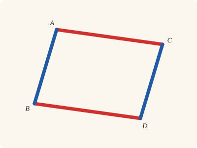
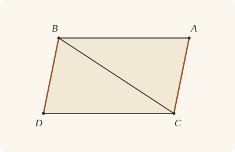

<!-- Generated by scripts/render.py. Do not edit by hand. -->

[Book I](index.md) · [← I.32](32.md) · [I.34 →](34.md)

# Book I, Proposition 33

*Straight lines joining equal parallels are equal and parallel*

[Euclid's proof](#euclids-proof) · [In Lean](#in-lean) · [What it rests on](#what-it-rests-on) · [Mishnah](#mishnah)

> The straight lines joining equal and parallel straight lines (at the extremities which are) in the same directions (respectively) are themselves also equal and parallel.

**In Lean:** ✅ proved, as Euclid states it · Euclid's argument

<p align="center"></p>

<p align="center"><em>Join the equal, parallel straight lines AB, CD (blue) end to matching end, and the joining straight lines AC, BD (red) are equal and parallel too.</em></p>

## Euclid's proof

<p align="center"></p>

Let AB, CD be equal and parallel, and let the straight lines AC, BD join them (at the extremities which are) in the same directions (respectively);

I say that AC, BD are also equal and parallel.

Let BC be joined.

Then, since AB is parallel to CD,

and BC has fallen upon them,

the alternate angles ABC, BCD are equal to one another. [I. 29]

And, since AB is equal to CD,

and BC is common,

the two sides AB, BC are equal to the two sides DC, CB;

and the angle ABC is equal to the angle BCD;

therefore the base AC is equal to the base BD,

and the triangle ABC is equal to the triangle DCB,

and the remaining angles will be equal to the remaining angles respectively, namely those which the equal sides subtend; [I. 4]

therefore the angle ACB is equal to the angle CBD.

And, since the straight line BC falling on the two straight lines AC, BD has made the alternate angles equal to one another,

AC is parallel to BD. [I. 27]

And it was also proved equal to it.

Therefore etc.

Q. E. D.

## In Lean

| | |
|---|---|
| Proof | ✅ Proved |
| Statement | The whole enunciation. "In the same directions" is stated as B and D lying on one side of AC (`SameSideOf B D A C`). |
| Argument | Euclid's. |
| Reviewed | The statement and every passage of the argument read against Heath's text, at commit [`1e482112`](https://github.com/jackChallis/stoicheia/commit/1e482112) ([the record](../../review/I/33.toml)) |

From [`Elements/BookI/Prop33.lean`](../../Elements/BookI/Prop33.lean). Euclid's sentences are the `--` comments, and our own notes are in `/- … -/`; the lines under each sentence are the Lean that carries it out. The list below marks where a lemma does a step Euclid takes for granted and where a step needs a word of its own; the `/- … -/` notes in the listing explain smaller adjustments.

**How the Lean follows the text**

- **Done by `AreParallel.oppositeSidesOf`.** "and BC has fallen upon them…" Euclid treats ABC and BCD as alternate angles; `AreParallel.oppositeSidesOf` puts A and D on opposite sides of BC. It uses the given parallels and B and D lying on one side of AC, the statement's meaning of joining in the same directions.
- **Carried.** "the two sides AB, BC are equal to the two sides DC, CB…" The Lean states the two pairs of equal sides here, as Euclid does; I.4 is then given BA equal to CD and BC equal to CB directly, and the pair is not used again.
- **Carried.** "and the triangle ABC is equal to the triangle DCB…" The Lean proves that the triangle ABC equals DCB here, as Euclid states it; the statement asks only that AC and BD be equal and parallel, so this is not used again.
- **Carried.** "and the remaining angles will be equal to the remaining angles respectively…" The Lean states both pairs of remaining angles here, as Euclid does; the next step takes the angles ACB and CBD from I.4 directly, and the pairs are not used again.
- **Carried.** "And it was also proved equal to it." The Lean restates here that AC equals BD, as Euclid recalls it; the conclusion cites the equality where it was first proved, and does not use the restatement.

```lean
/-- The straight lines joining equal and parallel straight lines (at the extremities which are) in
the same directions (respectively) are themselves also equal and parallel. -/
theorem Prop33 {A B C D : Point} (hpar : AreParallel A B C D) (heq : ‖A B‖ = ‖C D‖)
    (hdir : SameSideOf B D A C) :
    ‖A C‖ = ‖B D‖ ∧ AreParallel A C B D := by
  -- Let AB, CD be equal and parallel, and let the straight lines AC, BD join them (at the
  -- extremities which are) in the same directions (respectively);
  have hABC : Triangle A B C := hpar.triangle
  have hCDB : Triangle C D B := hpar.symm.swap_right.triangle
  have hAC : A ≠ C := hdir.1
  have hBD : B ≠ D := hCDB.ne₂₃.symm
  -- I say that AC, BD are also equal and parallel.
  -- Let BC be joined.
  have hBC : B ≠ C := hABC.ne₂₃
  -- Then, since AB is parallel to CD,
  have hAB_CD : AreParallel A B C D := hpar
  -- and BC has fallen upon them,
  /- The ends joined in the same directions leave A and D on opposite sides
     of BC (`AreParallel.oppositeSidesOf`). -/
  have hAD : OppositeSidesOf A D B C := hAB_CD.oppositeSidesOf hdir
  -- the alternate angles ABC, BCD are equal to one another. [I. 29]
  have hABC_BCD : ∠ A B C = ∠ B C D := Prop29.alternate hAB_CD hAD
  -- And, since AB is equal to CD,
  have hAB_CD_eq : ‖A B‖ = ‖C D‖ := heq
  -- and BC is common,
  have hBC_CB : ‖B C‖ = ‖C B‖ := len_symm B C
  -- the two sides AB, BC are equal to the two sides DC, CB;
  have : ‖A B‖ = ‖D C‖ ∧ ‖B C‖ = ‖C B‖ :=
    ⟨hAB_CD_eq.trans (len_symm C D), hBC_CB⟩
  -- and the angle ABC is equal to the angle BCD;
  have hABC_DCB : ∠ A B C = ∠ D C B :=
    hABC_BCD.trans (angle_symm hBC hCDB.ne₁₂.symm)
  -- therefore the base AC is equal to the base BD,
  /- I.4 takes the corner of the given angle first: BAC and CDB pair B with C,
     A with D, and C with B. -/
  obtain ⟨hAC_DB, hBAC_CDB, hBAC_CDB', hBCA_CBD⟩ :=
    Prop4 hABC.bac hCDB ((len_symm B A).trans hAB_CD_eq) hBC_CB hABC_DCB
  have hAC_BD : ‖A C‖ = ‖B D‖ := hAC_DB.trans (len_symm D B)
  -- and the triangle ABC is equal to the triangle DCB,
  have : △ A B C = △ D C B := by
    rw [area_bac A B C, hBAC_CDB, area_bac C D B]
  -- and the remaining angles will be equal to the remaining angles respectively, namely those
  -- which the equal sides subtend; [I. 4]
  have : ∠ B A C = ∠ C D B ∧ ∠ B C A = ∠ C B D := ⟨hBAC_CDB', hBCA_CBD⟩
  -- therefore the angle ACB is equal to the angle CBD.
  have hACB_CBD : ∠ A C B = ∠ C B D := (angle_symm hAC hBC).trans hBCA_CBD
  -- And, since the straight line BC falling on the two straight lines AC, BD has made the
  -- alternate angles equal to one another,
  /- Produce AC beyond C and DB beyond B (Post. 2), so BC falls between two
     points of each straight line, as I.27 asks. Heath gives these ends no letters. -/
  obtain ⟨C₁, hACC₁⟩ := produce hAC
  obtain ⟨B₁, hDBB₁⟩ := produce hBD.symm
  -- AC is parallel to BD. [I. 27]
  have h27 : AreParallel A C₁ B₁ D :=
    Prop27 hACC₁ (between_symm hDBB₁) hAD.swap hACB_CBD
  /- Parallelism belongs to the whole straight lines, whichever two points
     name each one. Postulate 1 names those through A, C and B, D. -/
  obtain ⟨L, hA_L, hC_L⟩ := Postulate1 A C hAC
  obtain ⟨M, hB_M, hD_M⟩ := Postulate1 B D hBD
  have hC₁_L : OnLine C₁ L := on_line_of_between hACC₁ hA_L hC_L
  have hB₁_M : OnLine B₁ M := on_line_of_between hDBB₁ hD_M hB_M
  have hAC_BD_par : AreParallel A C B D :=
    AreParallel.of_parallel hAC hBD hA_L hC_L hB_M hD_M
      (h27.parallel hA_L hC₁_L hB₁_M hD_M)
  -- And it was also proved equal to it.
  have : ‖A C‖ = ‖B D‖ := hAC_BD
  -- Therefore etc.
  exact ⟨hAC_BD, hAC_BD_par⟩
  -- Q. E. D.
```

## What it rests on

| | |
|---|---|
| Heath's references | [I.4](04.md), [I.27](27.md), [I.29](29.md) |
| Lean cites | [I.4](04.md), [I.27](27.md), [I.29](29.md) |
| Postulates | 1, 2, 3, 4, 5 |
| Definitions taken as axioms | Def. I.15 |
| Common Notions | 1, 2, 3, 4, 5 |
| Tacit rules | 37 (listed below) |
| Its own Lean calls | Postulate 1; 3 tacit rules |
| Through lemmas | Postulates 2 and 3; Def. I.15; 30 tacit rules |

Some of these come in through lemmas [shared](../../CERTIFICATE.md#shared-steps) by many proofs: [`Prop29.alternate`](../../Elements/BookI/Prop29.lean#L144) (I.29).

_Postulates, definitions, Common Notions and tacit rules: all that this proof rests on, counting those of the propositions it cites. The last two rows say which of the postulates, definitions and tacit rules its own Lean calls, in the proof or a helper written for it, and which it does not call but reaches through lemmas, of Book Zero or shared (a proposition it cites may rest on these too); the rest come in only through the propositions it cites or the Common Notions._

<details><summary>The 37 tacit rules beneath this proof, counting those of the propositions it cites</summary>

_(used here) marks a rule this proof's own Lean calls, in the proof or a helper written for it; (through …) marks one its own Lean does not call but reaches through the lemmas named, of [Book Zero](../../Elements/Figure) or shared, though a proposition it cites may rest on it too; and a rule with no mark comes in only through a proposition it cites or a Common Notion. The names in brackets are System E's: an Intersection rule says when straight lines and circles must meet, and an Intersections rule takes a point where they do (see [Book I's introduction](index.md))._

**Reading the figure**

- [`between_cases`](../../Elements/Foundations/Tacit/Diagram.lean#L54) (through [`AreParallel.oppositeSidesOf`](../../Elements/Figure/Parallels.lean#L135), [`Prop29.alternate`](../../Elements/BookI/Prop29.lean#L144) and [`area_bac`](../../Elements/Figure/Areas.lean#L73)): Of three different points on a straight line, one is between the other two. (Between 6)
- [`between_symm`](../../Elements/Foundations/Tacit/Diagram.lean#L47) (used here): If B is between A and C, it is between C and A. (Between 1)
- [`circles_meet`](../../Elements/Foundations/Tacit/Diagram.lean#L91) (through [`AreParallel.oppositeSidesOf`](../../Elements/Figure/Parallels.lean#L135), [`Prop29.alternate`](../../Elements/BookI/Prop29.lean#L144), [`Tacit.on_line_of_between`](../../Elements/Figure/Incidence.lean#L78) and 1 other lemma): If each circle passes through a point inside the other, the circles cut one another. This is the step Euclid takes for granted in I.1. (Intersection 5)
- [`circles_meet_same_side`](../../Elements/Foundations/Tacit/Constructions.lean#L79) (through [`AreParallel.oppositeSidesOf`](../../Elements/Figure/Parallels.lean#L135), [`Prop29.alternate`](../../Elements/BookI/Prop29.lean#L144), [`Tacit.on_line_of_between`](../../Elements/Figure/Incidence.lean#L78) and 1 other lemma): Two circles that cut one another do so on each side of the straight line through their centres. (Intersections 8)
- [`exists_point`](../../Elements/Foundations/Tacit/Constructions.lean#L35) (through [`AreParallel.oppositeSidesOf`](../../Elements/Figure/Parallels.lean#L135), [`Prop29.alternate`](../../Elements/BookI/Prop29.lean#L144), [`Triangle.ne₁₂`](../../Elements/Figure/Triangles.lean#L22) and 2 other lemmas): Let a point be taken. (Points 1)
- [`exists_point_inside_circle`](../../Elements/Foundations/Tacit/Constructions.lean#L42) (through [`AreParallel.oppositeSidesOf`](../../Elements/Figure/Parallels.lean#L135), [`Prop29.alternate`](../../Elements/BookI/Prop29.lean#L144), [`Tacit.on_line_of_between`](../../Elements/Figure/Incidence.lean#L78) and 1 other lemma): Let a point be taken inside the circle α. (Points 8)
- [`exists_point_on_line`](../../Elements/Foundations/Tacit/Constructions.lean#L38) (through [`AreParallel.oppositeSidesOf`](../../Elements/Figure/Parallels.lean#L135), [`Prop29.alternate`](../../Elements/BookI/Prop29.lean#L144), [`Tacit.on_line_of_between`](../../Elements/Figure/Incidence.lean#L78) and 1 other lemma): Let a point be taken on the straight line L. (Points 2)
- [`line_circle_between`](../../Elements/Foundations/Tacit/Constructions.lean#L67) (through [`AreParallel.oppositeSidesOf`](../../Elements/Figure/Parallels.lean#L135), [`Prop29.alternate`](../../Elements/BookI/Prop29.lean#L144), [`Tacit.on_line_of_between`](../../Elements/Figure/Incidence.lean#L78) and 1 other lemma): A straight line through a point B inside a circle, heading out to a point C outside it, cuts the circle between B and C. (Intersections 4)
- [`line_circle_beyond`](../../Elements/Foundations/Tacit/Constructions.lean#L73) (through [`AreParallel.oppositeSidesOf`](../../Elements/Figure/Parallels.lean#L135), [`Prop29.alternate`](../../Elements/BookI/Prop29.lean#L144), [`Tacit.on_line_of_between`](../../Elements/Figure/Incidence.lean#L78) and 1 other lemma): A straight line through a point B inside a circle, produced beyond B away from C, cuts the circle there. (Intersections 5)
- [`line_unique`](../../Elements/Foundations/Tacit/Diagram.lean#L41) (through [`AreParallel.of_parallel`](../../Elements/Figure/Parallels.lean#L84), [`AreParallel.oppositeSidesOf`](../../Elements/Figure/Parallels.lean#L135), [`Prop29.alternate`](../../Elements/BookI/Prop29.lean#L144) and 2 other lemmas): Two points determine a straight line. (Generalities 1)
- [`lines_meet_of_opposite_sides`](../../Elements/Foundations/Tacit/Diagram.lean#L86) (through [`AreParallel.oppositeSidesOf`](../../Elements/Figure/Parallels.lean#L135) and [`Prop29.alternate`](../../Elements/BookI/Prop29.lean#L144)): A straight line joining points on opposite sides of L crosses L. (Intersection 1)
- [`not_between_of_between`](../../Elements/Foundations/Tacit/Diagram.lean#L50) (through [`AreParallel.oppositeSidesOf`](../../Elements/Figure/Parallels.lean#L135), [`Prop29.alternate`](../../Elements/BookI/Prop29.lean#L144), [`Tacit.on_line_of_between`](../../Elements/Figure/Incidence.lean#L78) and 1 other lemma): If B is between A and C, then A is not between B and C. (Between 1)
- [`not_on_line_of_same_side`](../../Elements/Foundations/Tacit/Diagram.lean#L60) (through [`AreParallel.oppositeSidesOf`](../../Elements/Figure/Parallels.lean#L135), [`Prop29.alternate`](../../Elements/BookI/Prop29.lean#L144), [`Tacit.on_line_of_between`](../../Elements/Figure/Incidence.lean#L78) and 1 other lemma): Points on one side of a straight line are not on it. (Same side 3)
- [`pasch2`](../../Elements/Foundations/Tacit/Diagram.lean#L71) (through [`AreParallel.oppositeSidesOf`](../../Elements/Figure/Parallels.lean#L135), [`Prop29.alternate`](../../Elements/BookI/Prop29.lean#L144), [`Tacit.on_line_of_between`](../../Elements/Figure/Incidence.lean#L78) and 1 other lemma): If B is between A and C, A is on L and B is off it, then B and C are on the same side of L: a straight line that leaves L at A does not cross it again. (Pasch 2)
- [`same_side_trans`](../../Elements/Foundations/Tacit/Diagram.lean#L64) (through [`AreParallel.oppositeSidesOf`](../../Elements/Figure/Parallels.lean#L135), [`Prop29.alternate`](../../Elements/BookI/Prop29.lean#L144), [`Tacit.on_line_of_between`](../../Elements/Figure/Incidence.lean#L78) and 1 other lemma): Two points on the same side of a straight line as a third point are on the same side as each other. (Same side 4)

**Lengths, angles and areas**

- [`angle_add_of_inside`](../../Elements/Foundations/Tacit/Transfer.lean#L47) (through [`AreParallel.oppositeSidesOf`](../../Elements/Figure/Parallels.lean#L135) and [`Prop29.alternate`](../../Elements/BookI/Prop29.lean#L144)): If D lies within the angle BAC, then BAC is made up of BAD and DAC. (Diagram-angle 2)
- [`angle_eq_of_same_rays`](../../Elements/Foundations/Tacit/Transfer.lean#L54): The angle doesn't change if its arms are traced through other points on the same rays. (Diagram-angle 4)
- [`angle_symm`](../../Elements/Foundations/Tacit/Metric.lean#L30) (used here): The angle ABC is the angle CBA. (Metric 4)
- [`area_add_of_between`](../../Elements/Foundations/Tacit/Transfer.lean#L70) (through [`area_bac`](../../Elements/Figure/Areas.lean#L73)): Cutting a triangle in two from a vertex adds up. (Diagram-area 2)
- [`area_congruent`](../../Elements/Foundations/Tacit/Metric.lean#L44): Triangles equal in all their sides and angles are equal in area. Euclid uses this without comment once he has shown two triangles congruent. (Metric 9)
- [`area_degenerate`](../../Elements/Foundations/Tacit/Metric.lean#L36) (through [`area_bac`](../../Elements/Figure/Areas.lean#L73)): A "triangle" with a repeated corner has no area. (Metric 6)
- [`area_eq_zero_of_on_line`](../../Elements/Foundations/Tacit/Transfer.lean#L62) (through [`area_bac`](../../Elements/Figure/Areas.lean#L73)): A "triangle" whose corners lie on one straight line has no area. (Diagram-area 1)
- [`area_rotate`](../../Elements/Foundations/Tacit/Metric.lean#L39) (through [`area_bac`](../../Elements/Figure/Areas.lean#L73)): The triangle ABC is the triangle CAB. (Metric 8)
- [`len_add_of_between`](../../Elements/Foundations/Tacit/Transfer.lean#L27) (through [`AreParallel.oppositeSidesOf`](../../Elements/Figure/Parallels.lean#L135), [`Prop29.alternate`](../../Elements/BookI/Prop29.lean#L144), [`Tacit.on_line_of_between`](../../Elements/Figure/Incidence.lean#L78) and 1 other lemma): If B is between A and C, then AB and BC together make up AC. (Diagram-segment 1)
- [`len_self`](../../Elements/Foundations/Tacit/Metric.lean#L24) (through [`AreParallel.oppositeSidesOf`](../../Elements/Figure/Parallels.lean#L135), [`Prop29.alternate`](../../Elements/BookI/Prop29.lean#L144), [`Tacit.on_line_of_between`](../../Elements/Figure/Incidence.lean#L78) and 1 other lemma): The "straight line" from a point to itself has no length. (Metric 1)
- [`len_symm`](../../Elements/Foundations/Tacit/Metric.lean#L27) (used here): The straight line AB is the straight line BA. (Metric 3)
- [`radius_ne_zero`](../../Elements/Foundations/Tacit/Metric.lean#L62) (through [`AreParallel.oppositeSidesOf`](../../Elements/Figure/Parallels.lean#L135), [`Prop29.alternate`](../../Elements/BookI/Prop29.lean#L144), [`Tacit.on_line_of_between`](../../Elements/Figure/Incidence.lean#L78) and 1 other lemma): A circle's radius is not nothing: the straight line from the centre to a point on the circle has some length. A rule of our own, not one of System E's: every circle is drawn with a centre and a distance (Postulate 3).
- [`same_ray_of_angle_eq_zero`](../../Elements/Foundations/Tacit/Transfer.lean#L42) (through [`AreParallel.oppositeSidesOf`](../../Elements/Figure/Parallels.lean#L135) and [`Prop29.alternate`](../../Elements/BookI/Prop29.lean#L144)): If the angle BAC is nothing, C lies on the ray from A through B. (Diagram-angle 1)

**Superposition**

- [`superposition`](../../Elements/Foundations/Tacit/Superposition.lean#L52): **Superposition.** A hypothetical placement of a triangle on a given ray and side permits a restricted derivation of metric equalities about the figure already given. The derivation introduces no further objects, cites each geometric law it uses, and exports no symbol of the placement.

**Laws of magnitude**

- [`add_assoc`](../../Elements/Foundations/Tacit/Magnitudes.lean#L23) (through [`Prop29.alternate`](../../Elements/BookI/Prop29.lean#L144) and [`area_bac`](../../Elements/Figure/Areas.lean#L73)): Adding three magnitudes in a row, it makes no difference whether the first two or the last two are added first. (System E §3.5)
- [`add_comm`](../../Elements/Foundations/Tacit/Magnitudes.lean#L26) (through [`AreParallel.oppositeSidesOf`](../../Elements/Figure/Parallels.lean#L135), [`Prop29.alternate`](../../Elements/BookI/Prop29.lean#L144), [`Tacit.on_line_of_between`](../../Elements/Figure/Incidence.lean#L78) and 1 other lemma): The order of adding does not matter. (System E §3.5)
- [`add_lt_add_right`](../../Elements/Foundations/Tacit/Magnitudes.lean#L45) (through [`Prop29.alternate`](../../Elements/BookI/Prop29.lean#L144) and [`area_bac`](../../Elements/Figure/Areas.lean#L73)): Adding the same thing to both sides keeps "less than". (System E §3.5)
- [`add_zero`](../../Elements/Foundations/Tacit/Magnitudes.lean#L29): Adding nothing changes nothing. (System E §3.5)
- [`lt_irrefl`](../../Elements/Foundations/Tacit/Magnitudes.lean#L32) (through [`AreParallel.oppositeSidesOf`](../../Elements/Figure/Parallels.lean#L135), [`Prop29.alternate`](../../Elements/BookI/Prop29.lean#L144), [`Tacit.on_line_of_between`](../../Elements/Figure/Incidence.lean#L78) and 1 other lemma): No magnitude is less than itself. (System E §3.5)
- [`lt_trans`](../../Elements/Foundations/Tacit/Magnitudes.lean#L35) (through [`AreParallel.oppositeSidesOf`](../../Elements/Figure/Parallels.lean#L135), [`Prop29.alternate`](../../Elements/BookI/Prop29.lean#L144), [`Tacit.on_line_of_between`](../../Elements/Figure/Incidence.lean#L78) and 1 other lemma): What is less than the less is less still. (System E §3.5)
- [`lt_trichotomy`](../../Elements/Foundations/Tacit/Magnitudes.lean#L39) (through [`AreParallel.oppositeSidesOf`](../../Elements/Figure/Parallels.lean#L135), [`Prop29.alternate`](../../Elements/BookI/Prop29.lean#L144), [`Tacit.on_line_of_between`](../../Elements/Figure/Incidence.lean#L78) and 1 other lemma): Of two magnitudes, one is less, or they are equal, or the other is less. (System E §3.5)
- [`not_lt_zero`](../../Elements/Foundations/Tacit/Magnitudes.lean#L42) (through [`AreParallel.oppositeSidesOf`](../../Elements/Figure/Parallels.lean#L135), [`Prop29.alternate`](../../Elements/BookI/Prop29.lean#L144), [`Tacit.on_line_of_between`](../../Elements/Figure/Incidence.lean#L78) and 1 other lemma): Nothing is less than zero. (System E §3.5)

</details>

## Mishnah

_Our commentary: what Euclid assumes, what Lean made us say out loud, and how the result looks by modern means._

I.33 is, as Heath reports Proclus saying, "the connecting link between the exposition of the theory of parallels and the investigation of parallelograms", and Heath, still following Proclus, says why: it "gives, without expressing the fact, the construction or origin of the parallelogram, so that in the next proposition Euclid is able to speak of 'parallelogrammic areas' without any further explanation" (vol. 1, p. 323). Euclid joins BC, which falls on the parallels AB, CD and makes the alternate angles ABC, BCD equal (I.29); I.4 then makes AC equal to BD and the angle ACB equal to CBD, and those angles, alternate in their turn, make AC parallel to BD (I.27).

**"In the same directions."** These words are Euclid's, and everything hangs on them. Heath adds only the words in parentheses round them: "I have for clearness' sake inserted the words in brackets though they are not in the original Greek" (vol. 1, p. 323). Join A to D and B to C instead, and the joining straight lines cross, so they are never parallel. Our statement gives the words their force with `SameSideOf`: B and D lie on one side of AC. The same words put A and D on opposite sides of BC, and so make the angles there alternate.

Heath writes DC, CB and DCB where the Greek has BC, CD and BCD, for "Euclid is not always careful to write in corresponding order the letters denoting corresponding points in congruent figures. On the contrary, he evidently prefers the alphabetical order, and seems to disdain to alter it for the sake of beginners or others who might be confused by it" (vol. 1, p. 323). Our I.4 has no such freedom. It pairs corners by their places, the given angle's corner first, so the triangles go in as BAC and CDB, and the angle BCA it hands back, read from the other arm, is Euclid's ACB.

**The modern way.** As vectors, AB and CD, equal, parallel and running the same way, give $\mathrm{B - A = D - C}$. Then $\mathrm{C - A = D - B}$, so AC and BD are equal and parallel too; and $\mathrm{A + D = B + C}$, so the diagonals AD and BC of the parallelogram ABDC bisect one another.

## Further reading

- B − A = D − C says that one motion, a translation, carries AB onto CD, and George E. Martin's [*Transformation Geometry*](https://doi.org/10.1007/978-1-4612-5680-9) (1982) studies such motions in ch. 3, "Translations and Halfturns" (also on [I.4](04.md)).
- What each part of Book I is for, the parallels and the parallelograms among them, is the theme of the chapter "Euclid Book I: Basic Geometry" in Benno Artmann's [*Euclid: The Creation of Mathematics*](https://doi.org/10.1007/978-1-4612-1412-0) (1999) (also on [I.21](21.md)).

[Book I](index.md) · [← I.32](32.md) · [I.34 →](34.md)

---

<sub>Euclid's text: T. L. Heath, *The Thirteen Books of Euclid's Elements*, vol. 1 (Cambridge, 1908), pp. 322–323; [scan leaves n342–n343](https://archive.org/details/thirteenbookseu02heibgoog/page/n342); [figure on n343](https://archive.org/details/thirteenbookseu02heibgoog/page/n343). Public domain.</sub>

<sub>The tacit rules follow the System E of Jeremy Avigad, Edward Dean and John Mumma, read alongside LeanEuclid (Logan Murphy, Kaiyu Yang, Jialiang Sun, Zhaoyu Li, Anima Anandkumar and Xujie Si).</sub>
