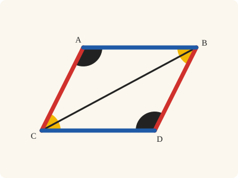
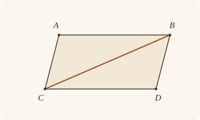
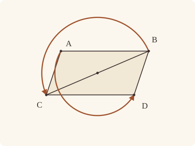

<!-- Generated by scripts/render.py. Do not edit by hand. -->

[Book I](index.md) · [← I.33](33.md) · [I.35 →](35.md)

# Book I, Proposition 34

*In parallelograms the opposite sides and angles are equal*

[Euclid's proof](#euclids-proof) · [In Lean](#in-lean) · [What it rests on](#what-it-rests-on) · [Mishnah](#mishnah)

> In parallelogrammic areas the opposite sides and angles are equal to one another, and the diameter bisects the areas.

**In Lean:** ✅ proved, as Euclid states it · Euclid's argument

<p align="center"></p>

<p align="center"><em>In the parallelogram ACDB the opposite sides are equal (blue, red), the opposite angles are equal (yellow, black), and the diameter BC cuts it in half.</em></p>

## Euclid's proof

<p align="center"></p>

Let ACDB be a parallelogrammic area, and BC its diameter;

I say that the opposite sides and angles of the parallelogram ACDB are equal to one another, and the diameter BC bisects it.

For, since AB is parallel to CD,

and the straight line BC has fallen upon them,

the alternate angles ABC, BCD are equal to one another. [I. 29]

Again, since AC is parallel to BD,

and BC has fallen upon them,

the alternate angles ACB, CBD are equal to one another. [I. 29]

Therefore ABC, DCB are two triangles having the two angles ABC, BCA equal to the two angles DCB, CBD respectively, and one side equal to one side, namely that adjoining the equal angles and common to both of them, BC;

therefore they will also have the remaining sides equal to the remaining sides respectively, and the remaining angle to the remaining angle; [I. 26]

therefore the side AB is equal to CD,

and AC to BD,

and further the angle BAC is equal to the angle CDB.

And, since the angle ABC is equal to the angle BCD,

and the angle CBD to the angle ACB,

the whole angle ABD is equal to the whole angle ACD. [C.N. 2]

And the angle BAC was also proved equal to the angle CDB.

Therefore in parallelogrammic areas the opposite sides and angles are equal to one another.

I say, next, that the diameter also bisects the areas.

For, since AB is equal to CD,

and BC is common,

the two sides AB, BC are equal to the two sides DC, CB respectively;

and the angle ABC is equal to the angle BCD;

therefore the base AC is also equal to DB,

and the triangle ABC is equal to the triangle DCB. [I. 4]

Therefore the diameter BC bisects the parallelogram ACDB.

Q. E. D.

## In Lean

| | |
|---|---|
| Proof | ✅ Proved |
| Statement | The whole enunciation. Euclid's diameter bisects the area; the Lean equates triangles ABC and DCB in area, and `Prop34.bisect` gives the parallelogram as twice either triangle. |
| Argument | Euclid's. |
| Reviewed | The statement and every passage of the argument read against Heath's text, at commit [`bedbba23e`](https://github.com/jackChallis/stoicheia/commit/bedbba23e) ([the record](../../review/I/34.toml)) |

From [`Elements/BookI/Prop34.lean`](../../Elements/BookI/Prop34.lean). Euclid's sentences are the `--` comments, and our own notes are in `/- … -/`; the lines under each sentence are the Lean that carries it out. The list below marks where a lemma does a step Euclid takes for granted and where a step needs a word of its own; the `/- … -/` notes in the listing explain smaller adjustments.

**How the Lean follows the text**

- **Done by `AreParallel.oppositeSidesOf`.** "and the straight line BC has fallen upon them…" Euclid reads A and D on opposite sides of BC, so the angles ABC and BCD are alternate. `AreParallel.oppositeSidesOf` proves this from AB parallel to CD and B and D on one side of AC, which `Parallelogram.sameSideOf` gives because AC is parallel to BD.
- **Done by `Parallelogram.sameSideOf`.** "the whole angle ABD is equal to the whole angle ACD." Euclid takes BC to run within the angles ABD and ACD. `Parallelogram.sameSideOf`, with the corners named in turn, locates C and B within those angles, and `angle_add_of_within` gives their parts before Common Notion 2 adds the equal angles.
- **Carried.** "the two sides AB, BC are equal to the two sides DC, CB respectively…" The Lean states the two pairs of equal sides here, as Euclid does; I.4 is then given BA equal to CD and BC equal to CB directly, and the pair is not used again.
- **Carried.** "and the angle ABC is equal to the angle BCD…" The Lean restates that the angle ABC equals BCD, as the first part proved it; I.4 cites the equality where it was first proved, and does not use the restatement.
- **Carried.** "therefore the base AC is also equal to DB…" The Lean proves that the base AC equals DB here, as Euclid states it; this part of the proof is about the areas, and the equality is not used again.

```lean
/-- In parallelogrammic areas the opposite sides and angles are equal to one another, and the
diameter bisects the areas. -/
theorem Prop34 {A B C D : Point} (h : Parallelogram A C D B) :
    ‖A B‖ = ‖C D‖ ∧ ‖A C‖ = ‖B D‖ ∧ ∠ B A C = ∠ C D B ∧ ∠ A B D = ∠ A C D ∧
      △ A B C = △ D C B := by
  -- Let ACDB be a parallelogrammic area, and BC its diameter;
  have hBC : B ≠ C := h.2.symm.triangle.ne₁₃
  -- I say that the opposite sides and angles of the parallelogram ACDB are equal to one
  -- another, and the diameter BC bisects it.
  -- For, since AB is parallel to CD,
  have hpar₁ : AreParallel A B C D := h.2.symm.swap_left
  -- and the straight line BC has fallen upon them,
  have hAD : OppositeSidesOf A D B C := hpar₁.oppositeSidesOf h.sameSideOf.symm
  -- the alternate angles ABC, BCD are equal to one another. [I. 29]
  have hABC_BCD : ∠ A B C = ∠ B C D := Prop29.alternate hpar₁ hAD
  -- Again, since AC is parallel to BD,
  have hpar₂ : AreParallel A C B D := h.1.swap_right
  -- and BC has fallen upon them,
  have hAD_CB : OppositeSidesOf A D C B := hAD.swap
  -- the alternate angles ACB, CBD are equal to one another. [I. 29]
  have hACB_CBD : ∠ A C B = ∠ C B D := Prop29.alternate hpar₂ hAD_CB
  -- Therefore ABC, DCB are two triangles having the two angles ABC, BCA equal to the two
  -- angles DCB, CBD respectively, and one side equal to one side, namely that adjoining the
  -- equal angles and common to both of them, BC;
  have hABC : Triangle A B C := hpar₁.triangle
  have hDCB : Triangle D C B := hpar₁.symm.swap_left.swap_right.triangle
  have hDC : D ≠ C := hpar₁.2.1.symm
  have hAC : A ≠ C := hpar₂.1
  have hB : ∠ A B C = ∠ D C B := hABC_BCD.trans (angle_symm hBC hDC)
  have hC : ∠ B C A = ∠ C B D := (angle_symm hBC hAC).trans hACB_CBD
  -- therefore they will also have the remaining sides equal to the remaining sides
  -- respectively, and the remaining angle to the remaining angle; [I. 26]
  obtain ⟨hAB_DC, hAC_DB, -, hBAC_CDB⟩ :=
    Prop26 hABC hDCB hB hC (Or.inl (len_symm B C))
  -- therefore the side AB is equal to CD,
  have hAB_CD : ‖A B‖ = ‖C D‖ := hAB_DC.trans (len_symm D C)
  -- and AC to BD,
  have hAC_BD : ‖A C‖ = ‖B D‖ := hAC_DB.trans (len_symm D B)
  -- and further the angle BAC is equal to the angle CDB.
  have hBAC : ∠ B A C = ∠ C D B := hBAC_CDB
  -- And, since the angle ABC is equal to the angle BCD,
  -- and the angle CBD to the angle ACB,
  -- the whole angle ABD is equal to the whole angle ACD. [C.N. 2]
  /- BC falls within both angles: C within the angle ABD, and B within the
     angle ACD, as `Parallelogram.sameSideOf` says of the parallelogram named
     from each corner. -/
  have hABD : ∠ A B D = ∠ A B C + ∠ C B D :=
    angle_add_of_within h.rotate.rotate.rotate.sameSideOf h.rotate.rotate.sameSideOf.symm.swap
  have hACD : ∠ A C D = ∠ A C B + ∠ B C D :=
    angle_add_of_within h.sameSideOf.symm.swap h.rotate.sameSideOf
  have hABD_ACD : ∠ A B D = ∠ A C D := by
    rw [hABD, hACD, add_comm (∠ A C B)]
    exact CommonNotion2 hABC_BCD hACB_CBD.symm
  -- And the angle BAC was also proved equal to the angle CDB.
  -- Therefore in parallelogrammic areas the opposite sides and angles are equal to one
  -- another.
  refine ⟨hAB_CD, hAC_BD, hBAC, hABD_ACD, ?_⟩
  -- I say, next, that the diameter also bisects the areas.
  -- For, since AB is equal to CD,
  have hBA_CD : ‖B A‖ = ‖C D‖ := (len_symm B A).trans hAB_CD
  -- and BC is common,
  have hBC_CB : ‖B C‖ = ‖C B‖ := len_symm B C
  -- the two sides AB, BC are equal to the two sides DC, CB respectively;
  have : ‖A B‖ = ‖D C‖ ∧ ‖B C‖ = ‖C B‖ := ⟨hAB_DC, hBC_CB⟩
  -- and the angle ABC is equal to the angle BCD;
  have : ∠ A B C = ∠ D C B := hB
  -- therefore the base AC is also equal to DB,
  /- I.4 takes the corner of the given angle first: BAC and CDB, as in I.33. -/
  obtain ⟨hAC_DB', hBAC_CDB_area, -, -⟩ := Prop4 hABC.bac hDCB.bac hBA_CD hBC_CB hB
  -- and the triangle ABC is equal to the triangle DCB. [I. 4]
  have harea : △ A B C = △ D C B := by
    rw [area_bac A B C, hBAC_CDB_area, area_bac C D B]
  -- Therefore the diameter BC bisects the parallelogram ACDB.
  exact harea
  -- Q. E. D.
```

<details><summary>After the theorem, one theorem later propositions use, <code>Prop34.bisect</code> (13 lines)</summary>

```lean
/-- The diameter bisects the parallelogram, said of its area: the parallelogram
ABCD, measured by its diameter AC, is double the triangle ABC. From I.37 on, Heath's
reference for this halving is I.34 (I.37: "the triangle ABC is half of the
parallelogram EBCA; for the diameter AB bisects it"), and the Lean uses this form of
it in I.37, I.38, I.41, I.44 and I.46, and in Book II's rectangles. To halve by the
other diameter, name the parallelogram from the next corner (`Parallelogram.rotate`)
and turn its area round with `Parallelogram.quadArea_rotate`. [I. 34] -/
theorem Prop34.bisect {A B C D : Point} (h : Parallelogram A B C D) :
    quadArea A B C D = △ A B C + △ A B C := by
  have hhalf : △ B A C = △ D C A :=
    (Prop34 (A := B) (B := A) (C := C) (D := D) h.rotate).2.2.2.2
  unfold quadArea
  rw [area_cba A C D, ← hhalf, ← area_bac A B C]
```

</details>

## What it rests on

| | |
|---|---|
| Heath's references | [I.4](04.md), [I.26](26.md), [I.29](29.md); C.N. 2 |
| Lean cites | [I.4](04.md), [I.26](26.md), [I.29](29.md) |
| Postulates | 1, 2, 3, 4, 5 |
| Definitions taken as axioms | Def. I.15 |
| Common Notions | 1, 2, 3, 4, 5 |
| Tacit rules | 38 (listed below) |
| Its own Lean calls | 3 tacit rules |
| Through lemmas | Postulates 1, 2 and 3; Def. I.15; 31 tacit rules |

Some of these come in through lemmas [shared](../../CERTIFICATE.md#shared-steps) by many proofs: [`Prop29.alternate`](../../Elements/BookI/Prop29.lean#L144) (I.29).

_Postulates, definitions, Common Notions and tacit rules: all that this proof rests on, counting those of the propositions it cites. The last two rows say which of the postulates, definitions and tacit rules its own Lean calls, in the proof or a helper written for it, and which it does not call but reaches through lemmas, of Book Zero or shared (a proposition it cites may rest on these too); the rest come in only through the propositions it cites or the Common Notions._

<details><summary>The 38 tacit rules beneath this proof, counting those of the propositions it cites</summary>

_(used here) marks a rule this proof's own Lean calls, in the proof or a helper written for it; (through …) marks one its own Lean does not call but reaches through the lemmas named, of [Book Zero](../../Elements/Figure) or shared, though a proposition it cites may rest on it too; and a rule with no mark comes in only through a proposition it cites or a Common Notion. The names in brackets are System E's: an Intersection rule says when straight lines and circles must meet, and an Intersections rule takes a point where they do (see [Book I's introduction](index.md))._

**Reading the figure**

- [`between_cases`](../../Elements/Foundations/Tacit/Diagram.lean#L54) (through [`AreParallel.oppositeSidesOf`](../../Elements/Figure/Parallels.lean#L135), [`Prop29.alternate`](../../Elements/BookI/Prop29.lean#L144) and [`area_bac`](../../Elements/Figure/Areas.lean#L73)): Of three different points on a straight line, one is between the other two. (Between 6)
- [`between_of_inside_chord`](../../Elements/Foundations/Tacit/Diagram.lean#L81) (through [`AreParallel.oppositeSidesOf`](../../Elements/Figure/Parallels.lean#L135), [`Prop29.alternate`](../../Elements/BookI/Prop29.lean#L144), [`SameSideOf.symm`](../../Elements/Figure/Sides.lean#L51) and 2 other lemmas): A straight line through a point inside a circle has that point between the points where it meets the circle. (Circle 1)
- [`between_symm`](../../Elements/Foundations/Tacit/Diagram.lean#L47) (through [`AreParallel.oppositeSidesOf`](../../Elements/Figure/Parallels.lean#L135), [`Prop29.alternate`](../../Elements/BookI/Prop29.lean#L144) and [`area_bac`](../../Elements/Figure/Areas.lean#L73)): If B is between A and C, it is between C and A. (Between 1)
- [`circles_meet`](../../Elements/Foundations/Tacit/Diagram.lean#L94) (through [`AreParallel.oppositeSidesOf`](../../Elements/Figure/Parallels.lean#L135), [`Prop29.alternate`](../../Elements/BookI/Prop29.lean#L144), [`SameSideOf.symm`](../../Elements/Figure/Sides.lean#L51) and 2 other lemmas): If each circle passes through a point inside the other, the circles cut one another. This is the step Euclid takes for granted in I.1. (Intersection 5)
- [`circles_meet_same_side`](../../Elements/Foundations/Tacit/Constructions.lean#L79) (through [`AreParallel.oppositeSidesOf`](../../Elements/Figure/Parallels.lean#L135), [`Prop29.alternate`](../../Elements/BookI/Prop29.lean#L144), [`SameSideOf.symm`](../../Elements/Figure/Sides.lean#L51) and 2 other lemmas): Two circles that cut one another do so on each side of the straight line through their centres. (Intersections 8)
- [`exists_point`](../../Elements/Foundations/Tacit/Constructions.lean#L35) (through [`AreParallel.oppositeSidesOf`](../../Elements/Figure/Parallels.lean#L135), [`Prop29.alternate`](../../Elements/BookI/Prop29.lean#L144), [`Triangle.ne₁₃`](../../Elements/Figure/Triangles.lean#L36) and 1 other lemma): Let a point be taken. (Points 1)
- [`exists_point_inside_circle`](../../Elements/Foundations/Tacit/Constructions.lean#L42) (through [`AreParallel.oppositeSidesOf`](../../Elements/Figure/Parallels.lean#L135), [`Prop29.alternate`](../../Elements/BookI/Prop29.lean#L144), [`SameSideOf.symm`](../../Elements/Figure/Sides.lean#L51) and 2 other lemmas): Let a point be taken inside the circle α. (Points 8)
- [`exists_point_on_line`](../../Elements/Foundations/Tacit/Constructions.lean#L38) (through [`AreParallel.oppositeSidesOf`](../../Elements/Figure/Parallels.lean#L135), [`Prop29.alternate`](../../Elements/BookI/Prop29.lean#L144), [`SameSideOf.symm`](../../Elements/Figure/Sides.lean#L51) and 2 other lemmas): Let a point be taken on the straight line L. (Points 2)
- [`line_circle_between`](../../Elements/Foundations/Tacit/Constructions.lean#L67) (through [`AreParallel.oppositeSidesOf`](../../Elements/Figure/Parallels.lean#L135), [`Prop29.alternate`](../../Elements/BookI/Prop29.lean#L144), [`SameSideOf.symm`](../../Elements/Figure/Sides.lean#L51) and 2 other lemmas): A straight line through a point B inside a circle, heading out to a point C outside it, cuts the circle between B and C. (Intersections 4)
- [`line_circle_beyond`](../../Elements/Foundations/Tacit/Constructions.lean#L73) (through [`AreParallel.oppositeSidesOf`](../../Elements/Figure/Parallels.lean#L135), [`Prop29.alternate`](../../Elements/BookI/Prop29.lean#L144), [`SameSideOf.symm`](../../Elements/Figure/Sides.lean#L51) and 2 other lemmas): A straight line through a point B inside a circle, produced beyond B away from C, cuts the circle there. (Intersections 5)
- [`line_unique`](../../Elements/Foundations/Tacit/Diagram.lean#L41) (through [`AreParallel.oppositeSidesOf`](../../Elements/Figure/Parallels.lean#L135), [`Prop29.alternate`](../../Elements/BookI/Prop29.lean#L144) and [`area_bac`](../../Elements/Figure/Areas.lean#L73)): Two points determine a straight line. (Generalities 1)
- [`lines_meet_of_opposite_sides`](../../Elements/Foundations/Tacit/Diagram.lean#L89) (through [`AreParallel.oppositeSidesOf`](../../Elements/Figure/Parallels.lean#L135), [`Parallelogram.sameSideOf`](../../Elements/Figure/Parallelograms.lean#L49) and [`Prop29.alternate`](../../Elements/BookI/Prop29.lean#L144)): A straight line joining points on opposite sides of L crosses L. (Intersection 1)
- [`not_between_of_between`](../../Elements/Foundations/Tacit/Diagram.lean#L50) (through [`AreParallel.oppositeSidesOf`](../../Elements/Figure/Parallels.lean#L135), [`Prop29.alternate`](../../Elements/BookI/Prop29.lean#L144), [`SameSideOf.symm`](../../Elements/Figure/Sides.lean#L51) and 2 other lemmas): If B is between A and C, then A is not between B and C. (Between 1)
- [`not_on_line_of_same_side`](../../Elements/Foundations/Tacit/Diagram.lean#L60) (through [`AreParallel.oppositeSidesOf`](../../Elements/Figure/Parallels.lean#L135), [`Prop29.alternate`](../../Elements/BookI/Prop29.lean#L144), [`SameSideOf.symm`](../../Elements/Figure/Sides.lean#L51) and 2 other lemmas): Points on one side of a straight line are not on it. (Same side 3)
- [`pasch2`](../../Elements/Foundations/Tacit/Diagram.lean#L71) (through [`AreParallel.oppositeSidesOf`](../../Elements/Figure/Parallels.lean#L135), [`Prop29.alternate`](../../Elements/BookI/Prop29.lean#L144) and [`area_bac`](../../Elements/Figure/Areas.lean#L73)): If B is between A and C, A is on L and B is off it, then B and C are on the same side of L: a straight line that leaves L at A does not cross it again. (Pasch 2)
- [`same_side_trans`](../../Elements/Foundations/Tacit/Diagram.lean#L64) (through [`AreParallel.oppositeSidesOf`](../../Elements/Figure/Parallels.lean#L135), [`Prop29.alternate`](../../Elements/BookI/Prop29.lean#L144), [`SameSideOf.symm`](../../Elements/Figure/Sides.lean#L51) and 2 other lemmas): Two points on the same side of a straight line as a third point are on the same side as each other. (Same side 4)

**Lengths, angles and areas**

- [`angle_add_of_inside`](../../Elements/Foundations/Tacit/Transfer.lean#L47) (through [`AreParallel.oppositeSidesOf`](../../Elements/Figure/Parallels.lean#L135), [`Prop29.alternate`](../../Elements/BookI/Prop29.lean#L144) and [`angle_add_of_within`](../../Elements/Figure/Angles.lean#L70)): If D lies within the angle BAC, then BAC is made up of BAD and DAC. (Diagram-angle 2)
- [`angle_eq_of_same_rays`](../../Elements/Foundations/Tacit/Transfer.lean#L54): The angle doesn't change if its arms are traced through other points on the same rays. (Diagram-angle 4)
- [`angle_symm`](../../Elements/Foundations/Tacit/Metric.lean#L30) (used here): The angle ABC is the angle CBA. (Metric 4)
- [`area_add_of_between`](../../Elements/Foundations/Tacit/Transfer.lean#L70) (through [`area_bac`](../../Elements/Figure/Areas.lean#L73)): Cutting a triangle in two from a vertex adds up. (Diagram-area 2)
- [`area_congruent`](../../Elements/Foundations/Tacit/Metric.lean#L44): Triangles equal in all their sides and angles are equal in area. Euclid uses this without comment once he has shown two triangles congruent. (Metric 9)
- [`area_degenerate`](../../Elements/Foundations/Tacit/Metric.lean#L36) (through [`area_bac`](../../Elements/Figure/Areas.lean#L73)): A "triangle" with a repeated corner has no area. (Metric 6)
- [`area_eq_zero_of_on_line`](../../Elements/Foundations/Tacit/Transfer.lean#L62) (through [`area_bac`](../../Elements/Figure/Areas.lean#L73)): A "triangle" whose corners lie on one straight line has no area. (Diagram-area 1)
- [`area_rotate`](../../Elements/Foundations/Tacit/Metric.lean#L39) (through [`area_bac`](../../Elements/Figure/Areas.lean#L73)): The triangle ABC is the triangle CAB. (Metric 8)
- [`circle_eq`](../../Elements/Foundations/Tacit/Transfer.lean#L30) (through [`AreParallel.oppositeSidesOf`](../../Elements/Figure/Parallels.lean#L135), [`Prop29.alternate`](../../Elements/BookI/Prop29.lean#L144), [`SameSideOf.symm`](../../Elements/Figure/Sides.lean#L51) and 2 other lemmas): A circle is fixed by its centre and its radius. (Diagram-segment 2)
- [`len_add_of_between`](../../Elements/Foundations/Tacit/Transfer.lean#L27) (through [`AreParallel.oppositeSidesOf`](../../Elements/Figure/Parallels.lean#L135), [`Prop29.alternate`](../../Elements/BookI/Prop29.lean#L144), [`SameSideOf.symm`](../../Elements/Figure/Sides.lean#L51) and 2 other lemmas): If B is between A and C, then AB and BC together make up AC. (Diagram-segment 1)
- [`len_self`](../../Elements/Foundations/Tacit/Metric.lean#L24) (through [`AreParallel.oppositeSidesOf`](../../Elements/Figure/Parallels.lean#L135), [`Prop29.alternate`](../../Elements/BookI/Prop29.lean#L144), [`SameSideOf.symm`](../../Elements/Figure/Sides.lean#L51) and 2 other lemmas): The "straight line" from a point to itself has no length. (Metric 1)
- [`len_symm`](../../Elements/Foundations/Tacit/Metric.lean#L27) (used here): The straight line AB is the straight line BA. (Metric 3)
- [`same_ray_of_angle_eq_zero`](../../Elements/Foundations/Tacit/Transfer.lean#L42) (through [`AreParallel.oppositeSidesOf`](../../Elements/Figure/Parallels.lean#L135) and [`Prop29.alternate`](../../Elements/BookI/Prop29.lean#L144)): If the angle BAC is nothing, C lies on the ray from A through B. (Diagram-angle 1)

**Superposition**

- [`superposition`](../../Elements/Foundations/Tacit/Superposition.lean#L52): **Superposition.** A hypothetical placement of a triangle on a given ray and side permits a restricted derivation of metric equalities about the figure already given. The derivation introduces no further objects, cites each geometric law it uses, and exports no symbol of the placement.

**Laws of magnitude**

- [`add_assoc`](../../Elements/Foundations/Tacit/Magnitudes.lean#L23) (through [`Prop29.alternate`](../../Elements/BookI/Prop29.lean#L144) and [`area_bac`](../../Elements/Figure/Areas.lean#L73)): Adding three magnitudes in a row, it makes no difference whether the first two or the last two are added first. (System E §3.5)
- [`add_comm`](../../Elements/Foundations/Tacit/Magnitudes.lean#L26) (used here): The order of adding does not matter. (System E §3.5)
- [`add_lt_add_right`](../../Elements/Foundations/Tacit/Magnitudes.lean#L45) (through [`Prop29.alternate`](../../Elements/BookI/Prop29.lean#L144) and [`area_bac`](../../Elements/Figure/Areas.lean#L73)): Adding the same thing to both sides keeps "less than". (System E §3.5)
- [`add_zero`](../../Elements/Foundations/Tacit/Magnitudes.lean#L29): Adding nothing changes nothing. (System E §3.5)
- [`lt_irrefl`](../../Elements/Foundations/Tacit/Magnitudes.lean#L32) (through [`AreParallel.oppositeSidesOf`](../../Elements/Figure/Parallels.lean#L135), [`Prop29.alternate`](../../Elements/BookI/Prop29.lean#L144), [`SameSideOf.symm`](../../Elements/Figure/Sides.lean#L51) and 2 other lemmas): No magnitude is less than itself. (System E §3.5)
- [`lt_trans`](../../Elements/Foundations/Tacit/Magnitudes.lean#L35) (through [`AreParallel.oppositeSidesOf`](../../Elements/Figure/Parallels.lean#L135), [`Prop29.alternate`](../../Elements/BookI/Prop29.lean#L144), [`SameSideOf.symm`](../../Elements/Figure/Sides.lean#L51) and 2 other lemmas): What is less than the less is less still. (System E §3.5)
- [`lt_trichotomy`](../../Elements/Foundations/Tacit/Magnitudes.lean#L39) (through [`AreParallel.oppositeSidesOf`](../../Elements/Figure/Parallels.lean#L135), [`Prop29.alternate`](../../Elements/BookI/Prop29.lean#L144), [`SameSideOf.symm`](../../Elements/Figure/Sides.lean#L51) and 2 other lemmas): Of two magnitudes, one is less, or they are equal, or the other is less. (System E §3.5)
- [`not_lt_zero`](../../Elements/Foundations/Tacit/Magnitudes.lean#L42) (through [`AreParallel.oppositeSidesOf`](../../Elements/Figure/Parallels.lean#L135), [`Prop29.alternate`](../../Elements/BookI/Prop29.lean#L144), [`SameSideOf.symm`](../../Elements/Figure/Sides.lean#L51) and 2 other lemmas): Nothing is less than zero. (System E §3.5)

</details>

## Mishnah

_Our commentary: what Euclid assumes, what Lean made us say out loud, and how the result looks by modern means._

Euclid now names the figure I.33 built, and never defines it. Heath observes that "when parallelograms have to be mentioned for the first time, Euclid calls them 'parallelogrammic areas'", and gathers from Proclus that "parallelogram", in Greek "parallel-lined", was Euclid's own word, suggested by I.33 and formed like "rectilineal" (vol. 1, p. 325). Our `Parallelogram` says just that: both pairs of opposite sides are parallel, the corners taken in order round the figure, here A, C, D, B.

The diameter BC, Euclid's word for a diagonal, falls on both pairs of parallels, and I.29 makes two pairs of alternate angles equal. With BC common, I.26 gives the remaining sides and angle. Common Notion 2 adds the angles at B and at C, once our proof shows that BC runs within the angles ABD and ACD, as the parallelogram, named from each corner, says. I.26 says nothing of areas, so for the halving Euclid goes back to I.4. Later proofs want the halving as an area, and we add `Prop34.bisect`: the parallelogram is twice either triangle.

**Which part is general?** Proclus, after Aristotle, calls the first part general, since only parallelograms have their opposite sides and angles equal, and the second not, since a diameter bisects circles and ellipses too: "the ancients, after investigating the fact that the diameter bisects an ellipse, a circle, and a parallelogram respectively, proceeded to investigate what was common to these cases" (Heath, vol. 1, p. 325). Heath doubts it. Proclus himself admits that the proposition presumes a four-sided figure, and "if we are entitled to the tacit limitation of the theorem to quadrilaterals in one part, we are equally entitled to it in the other" (Heath, vol. 1, p. 325).

Heath suspects that Proclus was alluding to Greek work on the diameters of all sorts of figures, which may have led to Apollonius' definition: a diameter of a bent line, which may be made up of straight lines as well as curves, bisects every straight line drawn across it parallel to a given straight line. A parallelogram's diameter is one in that sense too: "either diagonal of a parallelogram bisects all lines drawn within the parallelogram parallel to the other diagonal" (Heath, vol. 1, p. 326). Here Heath places an-Nairīzī's "neat construction for dividing a straight line into any number of equal parts", which uses I.33 and I.34 (vol. 1, p. 326).

**The modern way.** As vectors, $\mathrm{D = B + C - A}$, and the half-turn $z \mapsto \mathrm{B + C} - z$ about the middle of BC exchanges B and C and takes A to D. It carries the triangle ABC onto DCB and the angle ABD onto DCA, keeping every length, angle and area: the whole of I.34 at once.

<p align="center"></p>

## Further reading

- I. M. Yaglom's [*Geometric Transformations I*](https://doi.org/10.5948/UPO9780883859254) (1962), in Allen Shields' translation, puts the half-turn of the modern way to work in ch. I, §2, "Half Turn and Rotation" (also on [I.2](02.md)).
- Why one motion that keeps every length, angle and area says so much is the theme of Felix Klein's Erlangen Programme, ["A comparative review of recent researches in geometry"](https://arxiv.org/abs/0807.3161) (1893, free online) (also on [I.8](08.md)).

[Book I](index.md) · [← I.33](33.md) · [I.35 →](35.md)

---

<sub>Euclid's text: T. L. Heath, *The Thirteen Books of Euclid's Elements*, vol. 1 (Cambridge, 1908), pp. 323–324; [scan leaves n343–n344](https://archive.org/details/thirteenbookseu02heibgoog/page/n343); [figure on n344](https://archive.org/details/thirteenbookseu02heibgoog/page/n344). Public domain.</sub>

<sub>The tacit rules follow the System E of Jeremy Avigad, Edward Dean and John Mumma, read alongside LeanEuclid (Logan Murphy, Kaiyu Yang, Jialiang Sun, Zhaoyu Li, Anima Anandkumar and Xujie Si).</sub>
