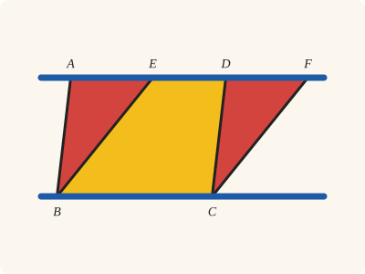
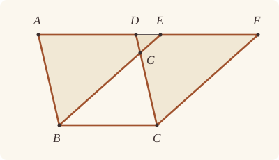
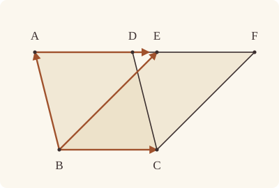

<!-- Generated by scripts/render.py. Do not edit by hand. -->

[Book I](index.md) · [← I.34](34.md) · [I.36 →](36.md)

# Book I, Proposition 35

*Parallelograms on the same base and in the same parallels are equal*

[Euclid's proof](#euclids-proof) · [In Lean](#in-lean) · [What it rests on](#what-it-rests-on) · [Mishnah](#mishnah)

> Parallelograms which are on the same base and in the same parallels are equal to one another.

**In Lean:** ✅ proved, as Euclid states it · Euclid's argument

<p align="center"></p>

<p align="center"><em>The parallelograms ABCD, EBCF on base BC between the same parallels (blue), here with E between A and D, are equal: each is the yellow EBCD plus a red triangle, and the red triangles ABE, DCF are equal.</em></p>

## Euclid's proof

<p align="center"></p>

<p align="center"><em>Drawn for one case: AD and EF apart, with D between A and E, as in Heath's figure.</em></p>

Let ABCD, EBCF be parallelograms on the same base BC and in the same parallels AF, BC;

I say that ABCD is equal to the parallelogram EBCF.

For, since ABCD is a parallelogram,

AD is equal to BC. [I. 34]

For the same reason also

EF is equal to BC,

so that AD is also equal to EF; [C.N. 1]

and DE is common;

therefore the whole AE is equal to the whole DF. [C.N. 2]

But AB is also equal to DC; [I. 34]

therefore the two sides EA, AB are equal to the two sides FD, DC respectively,

and the angle FDC is equal to the angle EAB, the exterior to the interior; [I. 29]

therefore the base EB is equal to the base FC,

and the triangle EAB will be equal to the triangle FDC. [I. 4]

Let DGE be subtracted from each;

therefore the trapezium ABGD which remains is equal to the trapezium EGCF which remains. [C.N. 3]

Let the triangle GBC be added to each;

therefore the whole parallelogram ABCD is equal to the whole parallelogram EBCF. [C.N. 2]

Therefore etc.

Q. E. D.

## In Lean

| | |
|---|---|
| Proof | ✅ Proved |
| Statement | The whole enunciation. |
| Argument | Euclid's. |
| Reviewed | The statement and every passage of the argument read against Heath's text, at commit [`6552a1440`](https://github.com/dodecaplex-co/stoicheia/commit/6552a1440) ([the record](../../review/I/35.toml)) |

From [`Elements/BookI/Prop35.lean`](../../Elements/BookI/Prop35.lean). Euclid's sentences are the `--` comments, and our own notes are in `/- … -/`; the lines under each sentence are the Lean that carries it out. The list below marks where a lemma does a step Euclid takes for granted, where the Lean takes a case Euclid's figure leaves aside and where a step needs a word of its own; the `/- … -/` notes in the listing explain smaller adjustments.

**How the Lean follows the text**

- **A further case.** "I say that ABCD is equal to the parallelogram EBCF." Euclid argues one arrangement, with AD and EF apart; the Lean also takes Proclus' two others, E between A and D (`Prop35.between`) and E at D (`Prop35.same`). When E is A, F is D; otherwise `AreParallel.sameSideOf_or` puts E on C's side of AB, towards D, or A on C's side of EB; the Lean applies the three cases directly in the first direction and exchanges the parallelograms in the second, covering Euclid's arrangement with EF before AD as well as Proclus'.
- **Done by `Prop35.figure`.** "and DE is common…" Euclid lets his figure show that EB and DC meet at G between the parallels, and that E lies between D and F. `Prop35.figure` uses `AreParallel.cross_or` to rule out a crossing of EC and BD and obtain G on EB and DC, then proves E between D and F.
- **Done by `Tacit.len_add_of_between`.** "therefore the whole AE is equal to the whole DF." Euclid takes AE as AD and DE together, and DF as DE and EF together. The Lean uses `Tacit.len_add_of_between`, a rule we assume (System E, Diagram-segment 1), with D between A and E and E between D and F, to identify the sums that Common Notion 2 makes equal.
- **Done by `Tacit.between_of_between_right`.** "and the angle FDC is equal to the angle EAB…" Euclid treats F as lying beyond D from A, so that FDC is an exterior angle. The Lean puts D between A and F by `Tacit.between_of_between_right` (System E, Between 5), which Book Zero proves from collinear orders, length addition and Postulate 2 in `Elements/Figure/Incidence.lean`, and C and B on one side of AD by `AreParallel.sameSideOf` from BC parallel to AD; `Prop29.exterior` then gives FDC equal to DAB, while `OnRay.of_beyond` puts E on the ray from A through D since D lies between A and E, so `angle_onRay_left` identifies DAB with EAB.
- **Carried.** "therefore the base EB is equal to the base FC…" The Lean proves that the base EB equals FC here, as Euclid states it. Neither his proof nor ours uses it again: both go on by the equal triangles EAB and FDC.
- **Done by `area_cut`.** "Let DGE be subtracted from each…" Euclid takes each equal triangle as its remaining trapezium and DGE together. `area_cut` proves both divisions from D between A and E and the orders proved by `Prop35.figure`, so Common Notion 3 can remove DGE in the next sentence.
- **Done by `area_cut`.** "therefore the whole parallelogram ABCD is equal to the whole parallelogram EBCF." Euclid takes each parallelogram as its trapezium and GBC together. The Lean changes the diameter measuring ABCD with `Parallelogram.quadArea_rotate`, and `area_cut` proves both divisions, so the preceding addition by Common Notion 2 gives equal wholes.

<details><summary>Before the theorem, three lemmas: <code>Prop35.figure</code>, <code>Prop35.between</code> and <code>Prop35.same</code> (152 lines)</summary>

```lean
/-- Euclid's figure: with D between A and E, EB crosses DC at a point G
between the parallels, and E lies between D and F. -/
theorem Prop35.figure {A B C D E F : Point} (h₁ : Parallelogram A B C D)
    (h₂ : Parallelogram E B C F) {AF : Line} (hA : OnLine A AF) (hD : OnLine D AF)
    (hF : OnLine F AF) (hADE : Between A D E) :
    ∃ G : Point, Between E G B ∧ Between D G C ∧ Between D E F := by
  have hE : OnLine E AF := on_line_of_between hADE hA hD
  obtain ⟨BC, hB, hC⟩ := Postulate1 B C h₁.2.1
  have hAF_BC : Parallel AF BC := (h₁.2.parallel hB hC hD hA).symm
  have hED : E ≠ D := (ne_of_between (between_symm hADE))
  have hEDBC : AreParallel E D B C := AreParallel.of_parallel hED h₁.2.1 hE hD hB hC hAF_BC
  obtain ⟨DC, hD_DC, hC_DC⟩ := Postulate1 D C h₁.1.2.1.symm
  have hAB_DC : SameSide A B DC := h₁.1.sameSideOf.sameSide hC_DC hD_DC
  have hA_DC : ¬ OnLine A DC := not_on_line_of_same_side hAB_DC
  have hE_DC : ¬ OnLine E DC := fun hE' => hA_DC (on_line_of_between (between_symm hADE) hE' hD_DC)
  have hEB : ¬ SameSide E B DC := fun hs =>
    pasch3 hADE hD_DC (same_side_trans (same_side_symm hAB_DC) (same_side_symm hs))
  obtain ⟨G, hEGB, hDGC⟩ : ∃ G : Point, Between E G B ∧ Between D G C := by
    rcases hEDBC.cross_or with ⟨X, hEXC, hBXD⟩ | hG
    · have hX : ¬ OnLine X DC := fun hX => hE_DC (on_line_of_between (between_symm hEXC) hC_DC hX)
      exact absurd (same_side_trans (pasch2 (between_symm hEXC) hC_DC hX)
        (pasch2 (between_symm hBXD) hD_DC hX)) hEB
    · exact hG
  obtain ⟨EB, hE_EB, hB_EB⟩ := Postulate1 E B h₂.1.1
  have hG_EB : OnLine G EB := on_line_of_between_ends hEGB hE_EB hB_EB
  have hD_EB : ¬ OnLine D EB := fun hD' =>
    hAF_BC.symm.not_onLine hB ((line_unique hED hE_EB hD' hE hD) ▸ hB_EB)
  have hCF : SameSide C F EB := h₂.sameSideOf.sameSide hE_EB hB_EB
  have hDF : ¬ SameSide D F EB := fun hs =>
    pasch3 hDGC hG_EB (same_side_trans (same_side_symm hs) (same_side_symm hCF))
  refine ⟨G, hEGB, hDGC, ?_⟩
  obtain ⟨Y, hY_EB, hDYF⟩ := OppositeSides.exists_between
    ⟨hD_EB, not_on_line_of_same_side (same_side_symm hCF), hDF⟩
  have hY_AF : OnLine Y AF := on_line_of_between_ends hDYF hD hF
  have hAF_EB : AF ≠ EB := fun e => hAF_BC.not_onLine (e ▸ hB_EB) hB
  have : Y = E := Classical.byContradiction fun hYE =>
    hAF_EB (line_unique hYE hY_AF hE hY_EB hE_EB)
  exact this ▸ hDYF

/-- One case Euclid leaves out, which Proclus supplies, as Heath reports under I.35:
when E lies between A and D, D lies between E and F. The triangles
EAB, FDC are equal by I.34, I.29 and I.4; adding each to the trapezium EBCD
gives the two parallelograms. -/
theorem Prop35.between {A B C D E F : Point} (h₁ : Parallelogram A B C D) (h₂ : Parallelogram E B C F)
    {AF : Line} (hA : OnLine A AF) (hD : OnLine D AF) (hE : OnLine E AF) (hF : OnLine F AF)
    (hAED : Between A E D) :
    quadArea A B C D = quadArea E B C F := by
  obtain ⟨BC, hB, hC⟩ := Postulate1 B C h₁.2.1
  have hAF_BC : Parallel AF BC := (h₁.2.parallel hB hC hD hA).symm
  obtain ⟨hAD, hAB, -, -, -⟩ := Prop34 (A := A) (B := D) (C := B) (D := C) h₁
  obtain ⟨hEF, -, -, -, -⟩ := Prop34 (A := E) (B := F) (C := B) (D := C) h₂
  obtain ⟨DC, hD_DC, hC_DC⟩ := Postulate1 D C h₁.1.2.1.symm
  obtain ⟨AB, hA_AB, hB_AB⟩ := Postulate1 A B h₁.1.1
  have hED : E ≠ D := (ne_of_between (between_symm hAED)).symm
  have hAE : A ≠ E := ne_of_between hAED
  have hB_AF : ¬ OnLine B AF := hAF_BC.symm.not_onLine hB
  have hC_AF : ¬ OnLine C AF := hAF_BC.symm.not_onLine hC
  /- E and C lie on one side of AB, so the diameters AC, BE of ABCE cross. -/
  have hCD_AB : SameSide C D AB := h₁.sameSideOf.sameSide hA_AB hB_AB
  have hE_AB : ¬ OnLine E AB := fun h =>
    hB_AF ((line_unique hAE hA_AB h hA hE) ▸ hB_AB)
  have hED_AB : SameSide E D AB := pasch2 hAED hA_AB hE_AB
  have hEC_AB : SameSide E C AB := same_side_trans (same_side_symm hED_AB) (same_side_symm hCD_AB)
  have hAEBC : AreParallel A E B C := AreParallel.of_parallel hAE h₁.2.1 hA hE hB hC hAF_BC
  obtain ⟨Y, hAYC, hBYE⟩ : ∃ Y : Point, Between A Y C ∧ Between B Y E := by
    rcases hAEBC.cross_or with hY | ⟨Y, hAYB, hEYC⟩
    · exact hY
    · exact absurd hEC_AB (pasch3 hEYC (on_line_of_between_ends hAYB hA_AB hB_AB))
  /- E and B lie on one side of DC, so the diameters EC, BD of EBCD cross. -/
  have hAB_DC : SameSide A B DC := h₁.1.sameSideOf.sameSide hC_DC hD_DC
  have hE_DC : ¬ OnLine E DC := fun h =>
    hC_AF (by rw [line_unique hED hE hD h hD_DC]; exact hC_DC)
  have hEA_DC : SameSide E A DC := pasch2 (between_symm hAED) hD_DC hE_DC
  have hEB_DC : SameSide E B DC := same_side_trans (same_side_symm hEA_DC) hAB_DC
  have hEDBC : AreParallel E D B C := AreParallel.of_parallel hED h₁.2.1 hE hD hB hC hAF_BC
  obtain ⟨X, hEXC, hBXD⟩ : ∃ X : Point, Between E X C ∧ Between B X D := by
    rcases hEDBC.cross_or with hX | ⟨X, hEXB, hDXC⟩
    · exact hX
    · exact absurd hEB_DC (pasch3 hEXB (on_line_of_between_ends hDXC hD_DC hC_DC))
  /- So D lies on C's side of EB, as F does, and D lies between E and F. -/
  have hEBC : Triangle E B C := Triangle.of_line hB hC h₁.2.1 (hAF_BC.not_onLine hE) |>.cab
  have hCD_EB : SameSideOf C D E B := SameSideOf.of_cross hEXC hBXD hEBC
  have hFray : OnRay F E D :=
    OnRay.of_sameSideOf (h₂.sameSideOf.symm.trans hCD_EB) ⟨AF, hE, hD, hF⟩
      (ne_of_len_eq hEF h₁.2.1).symm
  have hED_lt : ‖E D‖ < ‖E F‖ := by
    rw [hEF, ← hAD, len_symm A D, len_symm E D]
    exact len_lt_of_between (between_symm hAED)
  have hEDF : Between E D F := (OnRay.self hED).between_of_len_lt hFray hED_lt
  have hADF : Between A D F :=
    between_symm (between_of_between_right (between_symm hEDF) (between_symm hAED))
  /- AE is equal to DF; I.4 then makes the triangles EAB, FDC equal. -/
  have hAE_DF : ‖A E‖ = ‖D F‖ := by
    refine CommonNotion3 (c := ‖E D‖) (d := ‖E D‖) ?_ rfl
    rw [len_add_of_between hAED, add_comm, len_add_of_between hEDF, hAD, hEF]
  have hFDC : ∠ F D C = ∠ E A B := by
    rw [Prop29.exterior h₁.1.symm.swap_left h₁.2.sameSideOf.symm (between_symm hADF),
      angle_onRay_left (OnRay.of_between hAED) h₁.triangle.ne₁₂.symm]
  have hAEB : Triangle A E B := Triangle.of_line hA hE hAE hB_AF
  have hDFC : Triangle D F C := Triangle.of_line hD hF (ne_of_between (between_symm hEDF)).symm hC_AF
  have h4 : △ A E B = △ D F C := (Prop4 hAEB hDFC hAE_DF hAB hFDC.symm).2.1
  /- As Proclus does, we add the triangles to the trapezium EBCD. -/
  have hL₁ : quadArea A B C D = △ B C E + △ A E B + △ C E D := by
    have hq : quadArea B C E A = quadArea A B C E := quadArea_rotate_of_cross hAYC hBYE
    unfold quadArea at hq ⊢
    rw [area_bac A C D, ← area_cut (A := C) hAED, area_bac C A E, ← add_assoc, ← hq,
      area_cba B E A]
  have hR₁ : quadArea E B C F = △ B C E + △ D F C + △ C E D := by
    unfold quadArea
    rw [area_bac E C F, ← area_cut (A := C) hEDF, area_bca E B C, area_bca C D F]
    ac_rfl
  rw [hL₁, hR₁, h4]

/-- The other case Euclid leaves out, which Proclus also supplies, though Heath does
not say how: when E is D, that point lies between A and F. The triangles ADB, DFC
are equal by I.34, I.29 and I.4, and we add the common triangle DBC to each to give
the two parallelograms. -/
theorem Prop35.same {A B C D F : Point} (h₁ : Parallelogram A B C D) (h₂ : Parallelogram D B C F)
    {AF : Line} (hA : OnLine A AF) (hD : OnLine D AF) (hF : OnLine F AF) :
    quadArea A B C D = quadArea D B C F := by
  obtain ⟨BC, hB, hC⟩ := Postulate1 B C h₁.2.1
  have hAF_BC : Parallel AF BC := (h₁.2.parallel hB hC hD hA).symm
  obtain ⟨hAD, hAB, -, -, -⟩ := Prop34 (A := A) (B := D) (C := B) (D := C) h₁
  obtain ⟨hDF, -, -, -, -⟩ := Prop34 (A := D) (B := F) (C := B) (D := C) h₂
  /- A and F lie on either side of DB, so D lies between them. -/
  obtain ⟨DB, hD_DB, hB_DB⟩ := Postulate1 D B h₂.1.1
  obtain ⟨X, hAXC, hBXD⟩ := h₁.cross
  have hX_DB : OnLine X DB := on_line_of_between_ends hBXD hB_DB hD_DB
  have hDA : D ≠ A := (ne_of_len_eq hAD h₁.2.1).symm
  have hA_DB : ¬ OnLine A DB := fun h =>
    hAF_BC.symm.not_onLine hB (by rw [line_unique hDA hD hA hD_DB h]; exact hB_DB)
  have hCF : SameSide C F DB := h₂.sameSideOf.sameSide hD_DB hB_DB
  have hAF : ¬ SameSide A F DB := fun hs =>
    pasch3 hAXC hX_DB (same_side_trans (same_side_symm hs) (same_side_symm hCF))
  have hADF : Between A D F := by
    obtain ⟨Y, hY_DB, hAYF⟩ := OppositeSides.exists_between
      ⟨hA_DB, not_on_line_of_same_side (same_side_symm hCF), hAF⟩
    have hY_AF : OnLine Y AF := on_line_of_between_ends hAYF hA hF
    have hAF_DB : AF ≠ DB := fun e => hAF_BC.symm.not_onLine hB (e ▸ hB_DB)
    have : Y = D := Classical.byContradiction fun hYD =>
      hAF_DB (line_unique hYD hY_AF hD hY_DB hD_DB)
    exact this ▸ hAYF
  have hFDC : ∠ F D C = ∠ D A B :=
    Prop29.exterior h₁.1.symm.swap_left h₁.2.sameSideOf.symm (between_symm hADF)
  have hB_AF : ¬ OnLine B AF := hAF_BC.symm.not_onLine hB
  have hC_AF : ¬ OnLine C AF := hAF_BC.symm.not_onLine hC
  have h4 : △ A D B = △ D F C :=
    (Prop4 (Triangle.of_line hA hD hDA.symm hB_AF) (Triangle.of_line hD hF
      (ne_of_between (between_symm hADF)).symm hC_AF) (hAD.trans hDF.symm) hAB hFDC.symm).2.1
  rw [← h₁.quadArea_rotate]
  unfold quadArea
  rw [area_cab B D A, area_acb A B D, h4, area_cab B C D, area_acb D C F]
```

</details>

```lean
/-- Parallelograms which are on the same base and in the same parallels are equal to one another. -/
theorem Prop35 {A B C D E F : Point} (h₁ : Parallelogram A B C D) (h₂ : Parallelogram E B C F)
    (hAF : ∃ L : Line, OnLine A L ∧ OnLine D L ∧ OnLine E L ∧ OnLine F L) :
    quadArea A B C D = quadArea E B C F := by
  -- Let ABCD, EBCF be parallelograms on the same base BC and in the same parallels AF, BC;
  obtain ⟨AF, hA, hD, hE, hF⟩ := hAF
  obtain ⟨BC, hB, hC⟩ := Postulate1 B C h₁.2.1
  -- I say that ABCD is equal to the parallelogram EBCF.
  /- Euclid takes the case where AD and EF have no point in common, with D between
     A and E. We give his argument in his letters, then cover the other orders. -/
  have euclid : ∀ {A D E F : Point}, Parallelogram A B C D → Parallelogram E B C F →
      OnLine A AF → OnLine D AF → OnLine F AF → Between A D E →
      quadArea A B C D = quadArea E B C F := by
    intro A D E F h₁ h₂ hA hD hF hADE
    have hE : OnLine E AF := on_line_of_between hADE hA hD
    -- For, since ABCD is a parallelogram,
    have hAF_BC : Parallel AF BC := (h₁.2.parallel hB hC hD hA).symm
    -- AD is equal to BC. [I. 34]
    have hAD : ‖A D‖ = ‖B C‖ := (Prop34 (A := A) (B := D) (C := B) (D := C) h₁).1
    -- For the same reason also
    -- EF is equal to BC,
    have hEF : ‖E F‖ = ‖B C‖ := (Prop34 (A := E) (B := F) (C := B) (D := C) h₂).1
    -- so that AD is also equal to EF; [C.N. 1]
    have hAD_EF : ‖A D‖ = ‖E F‖ := CommonNotion1 hAD hEF
    -- and DE is common;
    /- G lies between E and B and between D and C; E lies between D and F.
       These are the orders Euclid reads from his figure. -/
    obtain ⟨G, hEGB, hDGC, hDEF⟩ := Prop35.figure h₁ h₂ hA hD hF hADE
    -- therefore the whole AE is equal to the whole DF. [C.N. 2]
    have hAE_DF : ‖A E‖ = ‖D F‖ := by
      have := CommonNotion2 hAD_EF (rfl : ‖D E‖ = ‖D E‖)
      rw [len_add_of_between hADE, add_comm, len_add_of_between hDEF] at this
      exact this
    -- But AB is also equal to DC; [I. 34]
    have hAB : ‖A B‖ = ‖D C‖ := (Prop34 (A := A) (B := D) (C := B) (D := C) h₁).2.1
    -- therefore the two sides EA, AB are equal to the two sides FD, DC respectively,
    have hB_AF : ¬ OnLine B AF := hAF_BC.symm.not_onLine hB
    have hC_AF : ¬ OnLine C AF := hAF_BC.symm.not_onLine hC
    have hAEB : Triangle A E B := Triangle.of_line hA hE (ne_of_between_ends hADE) hB_AF
    have hDFC : Triangle D F C := Triangle.of_line hD hF (ne_of_between_ends hDEF) hC_AF
    -- and the angle FDC is equal to the angle EAB, the exterior to the interior; [I. 29]
    have hADF : Between A D F := between_of_between_right hADE hDEF
    have hFDC : ∠ F D C = ∠ E A B := by
      rw [Prop29.exterior h₁.1.symm.swap_left h₁.2.sameSideOf.symm (between_symm hADF),
        angle_onRay_left (OnRay.of_beyond hADE) h₁.triangle.ne₁₂.symm]
    -- therefore the base EB is equal to the base FC,
    have h4 := Prop4 hAEB hDFC hAE_DF hAB hFDC.symm
    have hEB_FC : ‖E B‖ = ‖F C‖ := h4.1
    -- and the triangle EAB will be equal to the triangle FDC. [I. 4]
    have htri : △ A E B = △ D F C := h4.2.1
    -- Let DGE be subtracted from each;
    /- ABGD is named from B, so that its diameter is BD. Each taking away is
       written as a cutting: the larger triangle is the trapezium and DGE together. -/
    have e₁ : △ A E B = quadArea B G D A + △ D G E := by
      unfold quadArea
      rw [area_cab A E B, ← area_cut (A := B) hADE, area_bca B D E, ← area_cut (A := D) hEGB,
        area_cba B G D, area_acb B D A, area_acb D G E]
      ac_rfl
    have e₂ : △ D F C = quadArea E G C F + △ D G E := by
      unfold quadArea
      rw [area_cab D F C, ← area_cut (A := C) hDEF, area_cba C D E, ← area_cut (A := E) hDGC,
        area_bac E C F, area_cab D G E]
      ac_rfl
    -- therefore the trapezium ABGD which remains is equal to the trapezium EGCF which
    -- remains. [C.N. 3]
    have trap : quadArea B G D A = quadArea E G C F :=
      CommonNotion3 (e₁.symm.trans (htri.trans e₂)) rfl
    -- Let the triangle GBC be added to each;
    have hsum := CommonNotion2 trap (rfl : △ G B C = △ G B C)
    -- therefore the whole parallelogram ABCD is equal to the whole parallelogram EBCF. [C.N. 2]
    have hL : quadArea A B C D = quadArea B G D A + △ G B C := by
      rw [← h₁.quadArea_rotate]
      unfold quadArea
      rw [area_acb B C D, ← area_cut (A := B) hDGC, area_acb B G D, area_bac G B C]
      ac_rfl
    have hR : quadArea E B C F = quadArea E G C F + △ G B C := by
      unfold quadArea
      rw [area_cab E B C, ← area_cut (A := C) hEGB, area_cab E G C, area_cab G B C]
      ac_rfl
    rw [hL, hR, hsum]
  /- E may also fall between A and D, or at either end. The helpers add equal
     triangles to the common part: to the trapezium EBCD, as Heath reports Proclus
     doing, or to the triangle DBC when E is D. When E is A, equal lengths on the
     same ray make F equal to D. -/
  have oneway : ∀ {A D E F : Point}, Parallelogram A B C D → Parallelogram E B C F →
      OnLine A AF → OnLine D AF → OnLine E AF → OnLine F AF → (E = A ∨ SameSideOf C E A B) →
      quadArea A B C D = quadArea E B C F := by
    intro A D E F h₁ h₂ hA hD hE hF hdir
    obtain ⟨hAD, -, -, -, -⟩ := Prop34 (A := A) (B := D) (C := B) (D := C) h₁
    obtain ⟨hEF, -, -, -, -⟩ := Prop34 (A := E) (B := F) (C := B) (D := C) h₂
    rcases hdir with rfl | hCE
    · /- E is A, and so F is D. -/
      have hFray : OnRay F E D :=
        OnRay.of_sameSideOf (h₂.sameSideOf.symm.trans h₁.sameSideOf) ⟨AF, hE, hD, hF⟩
          (h₂.sameSideOf.symm.triangle.ne₁₃.symm)
      rw [hFray.eq_of_len_eq (hEF.trans hAD.symm)]
    · have hEA : E ≠ A := hCE.symm.triangle.ne₁₃.symm
      have hEray : OnRay E A D :=
        OnRay.of_sameSideOf (hCE.symm.trans h₁.sameSideOf) ⟨AF, hA, hD, hE⟩ hEA
      by_cases hED : E = D
      · subst hED
        exact Prop35.same h₁ h₂ hA hE hF
      · rcases between_cases hEray.1 (Ne.symm hED) hEA.symm hA hD hE with h | h | h
        · exact euclid h₁ h₂ hA hD hF h
        · exact absurd (between_symm h) hEray.2.2.2
        · exact Prop35.between h₁ h₂ hA hD hE hF h
  /- Exchanging the parallelograms covers the other direction along AF. -/
  have harea : quadArea A B C D = quadArea E B C F := by
    by_cases hEA : E = A
    · exact oneway h₁ h₂ hA hD hE hF (Or.inl hEA)
    · have hAF_BC : Parallel AF BC := (h₁.2.parallel hB hC hD hA).symm
      rcases (AreParallel.of_parallel (Ne.symm hEA) h₁.2.1 hA hE hB hC hAF_BC).sameSideOf_or with h | h
      · exact oneway h₁ h₂ hA hD hE hF (Or.inr h)
      · exact (oneway h₂ h₁ hE hF hA hD (Or.inr h)).symm
  -- Therefore etc.
  exact harea
  -- Q. E. D.
```

## What it rests on

| | |
|---|---|
| Heath's references | [I.4](04.md), [I.29](29.md), [I.34](34.md); C.N. 1, 2, 3 |
| Lean cites | [I.4](04.md), [I.29](29.md), [I.34](34.md) |
| Postulates | 1, 2, 3, 4, 5 |
| Definitions taken as axioms | Def. I.15 |
| Common Notions | 1, 2, 3, 4, 5 |
| Tacit rules | 37 (listed below) |
| Its own Lean calls | Postulate 1; 10 tacit rules |
| Through lemmas | Postulates 2 and 3; Def. I.15; 24 tacit rules |

Some of these come in through lemmas [shared](../../CERTIFICATE.md#shared-steps) by many proofs: [`Prop29.exterior`](../../Elements/BookI/Prop29.lean#L160) (I.29).

_Postulates, definitions, Common Notions and tacit rules: all that this proof rests on, counting those of the propositions it cites. The last two rows say which of the postulates, definitions and tacit rules its own Lean calls, in the proof or a helper written for it, and which it does not call but reaches through lemmas, of Book Zero or shared (a proposition it cites may rest on these too); the rest come in only through the propositions it cites or the Common Notions._

<details><summary>The 37 tacit rules beneath this proof, counting those of the propositions it cites</summary>

_(used here) marks a rule this proof's own Lean calls, in the proof or a helper written for it; (through …) marks one its own Lean does not call but reaches through the lemmas named, of [Book Zero](../../Elements/Figure) or shared, though a proposition it cites may rest on it too; and a rule with no mark comes in only through a proposition it cites or a Common Notion. The names in brackets are System E's: an Intersection rule says when straight lines and circles must meet, and an Intersections rule takes a point where they do (see [Book I's introduction](index.md))._

**Reading the figure**

- [`between_cases`](../../Elements/Foundations/Tacit/Diagram.lean#L54) (used here): Of three different points on a straight line, one is between the other two. (Between 6)
- [`between_symm`](../../Elements/Foundations/Tacit/Diagram.lean#L47) (used here): If B is between A and C, it is between C and A. (Between 1)
- [`circles_meet`](../../Elements/Foundations/Tacit/Diagram.lean#L91) (through [`AreParallel.cross_or`](../../Elements/Figure/Parallelograms.lean#L117), [`AreParallel.sameSideOf_or`](../../Elements/Figure/Parallelograms.lean#L177), [`OnRay.between_of_len_lt`](../../Elements/Figure/Rays.lean#L123) and 20 other lemmas): If each circle passes through a point inside the other, the circles cut one another. This is the step Euclid takes for granted in I.1. (Intersection 5)
- [`circles_meet_same_side`](../../Elements/Foundations/Tacit/Constructions.lean#L79) (through [`AreParallel.cross_or`](../../Elements/Figure/Parallelograms.lean#L117), [`AreParallel.sameSideOf_or`](../../Elements/Figure/Parallelograms.lean#L177), [`OnRay.between_of_len_lt`](../../Elements/Figure/Rays.lean#L123) and 20 other lemmas): Two circles that cut one another do so on each side of the straight line through their centres. (Intersections 8)
- [`exists_point`](../../Elements/Foundations/Tacit/Constructions.lean#L35) (through [`AreParallel.cross_or`](../../Elements/Figure/Parallelograms.lean#L117), [`AreParallel.sameSideOf_or`](../../Elements/Figure/Parallelograms.lean#L177), [`Parallelogram.cross`](../../Elements/Figure/Parallelograms.lean#L191) and 9 other lemmas): Let a point be taken. (Points 1)
- [`exists_point_inside_circle`](../../Elements/Foundations/Tacit/Constructions.lean#L42) (through [`AreParallel.cross_or`](../../Elements/Figure/Parallelograms.lean#L117), [`AreParallel.sameSideOf_or`](../../Elements/Figure/Parallelograms.lean#L177), [`OnRay.between_of_len_lt`](../../Elements/Figure/Rays.lean#L123) and 20 other lemmas): Let a point be taken inside the circle α. (Points 8)
- [`exists_point_on_line`](../../Elements/Foundations/Tacit/Constructions.lean#L38) (through [`AreParallel.cross_or`](../../Elements/Figure/Parallelograms.lean#L117), [`AreParallel.sameSideOf_or`](../../Elements/Figure/Parallelograms.lean#L177), [`OnRay.between_of_len_lt`](../../Elements/Figure/Rays.lean#L123) and 20 other lemmas): Let a point be taken on the straight line L. (Points 2)
- [`line_circle_between`](../../Elements/Foundations/Tacit/Constructions.lean#L67) (through [`AreParallel.cross_or`](../../Elements/Figure/Parallelograms.lean#L117), [`AreParallel.sameSideOf_or`](../../Elements/Figure/Parallelograms.lean#L177), [`OnRay.between_of_len_lt`](../../Elements/Figure/Rays.lean#L123) and 20 other lemmas): A straight line through a point B inside a circle, heading out to a point C outside it, cuts the circle between B and C. (Intersections 4)
- [`line_circle_beyond`](../../Elements/Foundations/Tacit/Constructions.lean#L73) (through [`AreParallel.cross_or`](../../Elements/Figure/Parallelograms.lean#L117), [`AreParallel.sameSideOf_or`](../../Elements/Figure/Parallelograms.lean#L177), [`OnRay.between_of_len_lt`](../../Elements/Figure/Rays.lean#L123) and 20 other lemmas): A straight line through a point B inside a circle, produced beyond B away from C, cuts the circle there. (Intersections 5)
- [`line_unique`](../../Elements/Foundations/Tacit/Diagram.lean#L41) (used here): Two points determine a straight line. (Generalities 1)
- [`lines_meet_of_opposite_sides`](../../Elements/Foundations/Tacit/Diagram.lean#L86) (through [`AreParallel.cross_or`](../../Elements/Figure/Parallelograms.lean#L117), [`AreParallel.sameSideOf`](../../Elements/Figure/Parallels.lean#L121), [`AreParallel.sameSideOf_or`](../../Elements/Figure/Parallelograms.lean#L177) and 4 other lemmas): A straight line joining points on opposite sides of L crosses L. (Intersection 1)
- [`not_between_of_between`](../../Elements/Foundations/Tacit/Diagram.lean#L50) (through [`AreParallel.cross_or`](../../Elements/Figure/Parallelograms.lean#L117), [`AreParallel.sameSideOf_or`](../../Elements/Figure/Parallelograms.lean#L177), [`OnRay.between_of_len_lt`](../../Elements/Figure/Rays.lean#L123) and 25 other lemmas): If B is between A and C, then A is not between B and C. (Between 1)
- [`not_on_line_of_same_side`](../../Elements/Foundations/Tacit/Diagram.lean#L60) (used here): Points on one side of a straight line are not on it. (Same side 3)
- [`pasch2`](../../Elements/Foundations/Tacit/Diagram.lean#L71) (used here): If B is between A and C, A is on L and B is off it, then B and C are on the same side of L: a straight line that leaves L at A does not cross it again. (Pasch 2)
- [`same_side_trans`](../../Elements/Foundations/Tacit/Diagram.lean#L64) (used here): Two points on the same side of a straight line as a third point are on the same side as each other. (Same side 4)

**Lengths, angles and areas**

- [`angle_add_of_inside`](../../Elements/Foundations/Tacit/Transfer.lean#L47) (through [`AreParallel.cross_or`](../../Elements/Figure/Parallelograms.lean#L117), [`AreParallel.sameSideOf_or`](../../Elements/Figure/Parallelograms.lean#L177), [`OnRay.of_sameSideOf`](../../Elements/Figure/Angles.lean#L188) and 3 other lemmas): If D lies within the angle BAC, then BAC is made up of BAD and DAC. (Diagram-angle 2)
- [`angle_eq_of_same_rays`](../../Elements/Foundations/Tacit/Transfer.lean#L54) (through [`Prop29.exterior`](../../Elements/BookI/Prop29.lean#L160) and [`angle_onRay_left`](../../Elements/Figure/Angles.lean#L42)): The angle doesn't change if its arms are traced through other points on the same rays. (Diagram-angle 4)
- [`angle_symm`](../../Elements/Foundations/Tacit/Metric.lean#L30): The angle ABC is the angle CBA. (Metric 4)
- [`area_add_of_between`](../../Elements/Foundations/Tacit/Transfer.lean#L70) (through [`Parallelogram.quadArea_rotate`](../../Elements/Figure/Parallelograms.lean#L202), [`area_acb`](../../Elements/Figure/Areas.lean#L70), [`area_bac`](../../Elements/Figure/Areas.lean#L73) and 3 other lemmas): Cutting a triangle in two from a vertex adds up. (Diagram-area 2)
- [`area_congruent`](../../Elements/Foundations/Tacit/Metric.lean#L44): Triangles equal in all their sides and angles are equal in area. Euclid uses this without comment once he has shown two triangles congruent. (Metric 9)
- [`area_degenerate`](../../Elements/Foundations/Tacit/Metric.lean#L36) (through [`Parallelogram.quadArea_rotate`](../../Elements/Figure/Parallelograms.lean#L202), [`area_acb`](../../Elements/Figure/Areas.lean#L70), [`area_bac`](../../Elements/Figure/Areas.lean#L73) and 3 other lemmas): A "triangle" with a repeated corner has no area. (Metric 6)
- [`area_eq_zero_of_on_line`](../../Elements/Foundations/Tacit/Transfer.lean#L62) (through [`Parallelogram.quadArea_rotate`](../../Elements/Figure/Parallelograms.lean#L202), [`area_acb`](../../Elements/Figure/Areas.lean#L70), [`area_bac`](../../Elements/Figure/Areas.lean#L73) and 3 other lemmas): A "triangle" whose corners lie on one straight line has no area. (Diagram-area 1)
- [`area_rotate`](../../Elements/Foundations/Tacit/Metric.lean#L39) (through [`Parallelogram.quadArea_rotate`](../../Elements/Figure/Parallelograms.lean#L202), [`area_acb`](../../Elements/Figure/Areas.lean#L70), [`area_bac`](../../Elements/Figure/Areas.lean#L73) and 5 other lemmas): The triangle ABC is the triangle CAB. (Metric 8)
- [`len_add_of_between`](../../Elements/Foundations/Tacit/Transfer.lean#L27) (used here): If B is between A and C, then AB and BC together make up AC. (Diagram-segment 1)
- [`len_self`](../../Elements/Foundations/Tacit/Metric.lean#L24) (through [`AreParallel.cross_or`](../../Elements/Figure/Parallelograms.lean#L117), [`AreParallel.sameSideOf_or`](../../Elements/Figure/Parallelograms.lean#L177), [`OnRay.between_of_len_lt`](../../Elements/Figure/Rays.lean#L123) and 24 other lemmas): The "straight line" from a point to itself has no length. (Metric 1)
- [`len_symm`](../../Elements/Foundations/Tacit/Metric.lean#L27) (used here): The straight line AB is the straight line BA. (Metric 3)
- [`radius_ne_zero`](../../Elements/Foundations/Tacit/Metric.lean#L62) (through [`AreParallel.cross_or`](../../Elements/Figure/Parallelograms.lean#L117), [`AreParallel.sameSideOf_or`](../../Elements/Figure/Parallelograms.lean#L177), [`OnRay.between_of_len_lt`](../../Elements/Figure/Rays.lean#L123) and 26 other lemmas): A circle's radius is not nothing: the straight line from the centre to a point on the circle has some length. A rule of our own, not one of System E's: every circle is drawn with a centre and a distance (Postulate 3).
- [`same_ray_of_angle_eq_zero`](../../Elements/Foundations/Tacit/Transfer.lean#L42) (through [`AreParallel.cross_or`](../../Elements/Figure/Parallelograms.lean#L117), [`AreParallel.sameSideOf_or`](../../Elements/Figure/Parallelograms.lean#L177), [`OnRay.of_sameSideOf`](../../Elements/Figure/Angles.lean#L188) and 3 other lemmas): If the angle BAC is nothing, C lies on the ray from A through B. (Diagram-angle 1)

**Superposition**

- [`superposition`](../../Elements/Foundations/Tacit/Superposition.lean#L52): **Superposition.** A hypothetical placement of a triangle on a given ray and side permits a restricted derivation of metric equalities about the figure already given. The derivation introduces no further objects, cites each geometric law it uses, and exports no symbol of the placement.

**Rules of magnitude**

- [`add_assoc`](../../Elements/Foundations/Tacit/Magnitudes.lean#L23) (used here): Adding three magnitudes in a row, it makes no difference whether the first two or the last two are added first. (System E §3.5)
- [`add_comm`](../../Elements/Foundations/Tacit/Magnitudes.lean#L26) (used here): The order of adding does not matter. (System E §3.5)
- [`add_lt_add_right`](../../Elements/Foundations/Tacit/Magnitudes.lean#L45) (through [`OnRay.between_of_len_lt`](../../Elements/Figure/Rays.lean#L123), [`Parallelogram.quadArea_rotate`](../../Elements/Figure/Parallelograms.lean#L202), [`Prop29.exterior`](../../Elements/BookI/Prop29.lean#L160) and 6 other lemmas): Adding the same thing to both sides keeps "less than". (System E §3.5)
- [`add_zero`](../../Elements/Foundations/Tacit/Magnitudes.lean#L29) (through [`Parallelogram.quadArea_rotate`](../../Elements/Figure/Parallelograms.lean#L202), [`area_cut`](../../Elements/Figure/Areas.lean#L104) and [`quadArea_rotate_of_cross`](../../Elements/Figure/Areas.lean#L171)): Adding nothing changes nothing. (System E §3.5)
- [`lt_irrefl`](../../Elements/Foundations/Tacit/Magnitudes.lean#L32) (through [`AreParallel.cross_or`](../../Elements/Figure/Parallelograms.lean#L117), [`AreParallel.sameSideOf_or`](../../Elements/Figure/Parallelograms.lean#L177), [`OnRay.between_of_len_lt`](../../Elements/Figure/Rays.lean#L123) and 21 other lemmas): No magnitude is less than itself. (System E §3.5)
- [`lt_trans`](../../Elements/Foundations/Tacit/Magnitudes.lean#L35) (through [`AreParallel.cross_or`](../../Elements/Figure/Parallelograms.lean#L117), [`AreParallel.sameSideOf_or`](../../Elements/Figure/Parallelograms.lean#L177), [`OnRay.between_of_len_lt`](../../Elements/Figure/Rays.lean#L123) and 20 other lemmas): What is less than the less is less still. (System E §3.5)
- [`lt_trichotomy`](../../Elements/Foundations/Tacit/Magnitudes.lean#L39) (through [`AreParallel.cross_or`](../../Elements/Figure/Parallelograms.lean#L117), [`AreParallel.sameSideOf_or`](../../Elements/Figure/Parallelograms.lean#L177), [`OnRay.between_of_len_lt`](../../Elements/Figure/Rays.lean#L123) and 25 other lemmas): Of two magnitudes, one is less, or they are equal, or the other is less. (System E §3.5)
- [`not_lt_zero`](../../Elements/Foundations/Tacit/Magnitudes.lean#L42) (through [`AreParallel.cross_or`](../../Elements/Figure/Parallelograms.lean#L117), [`AreParallel.sameSideOf_or`](../../Elements/Figure/Parallelograms.lean#L177), [`OnRay.between_of_len_lt`](../../Elements/Figure/Rays.lean#L123) and 25 other lemmas): Nothing is less than zero. (System E §3.5)

</details>

## Mishnah

_Our commentary: why Euclid's proof, and ours, look as they do._

**"Equality in a new sense."** So Heath heads his note. Until now equal figures were congruent, but here figures "are inferred to be *equal* which are equal in *area* or in *content* but need not be of the same *form*" (Heath, vol. 1, p. 327). I.34, I.29 and I.4 make the triangles EAB, FDC equal; Euclid takes DGE from each and adds GBC to what remains. Beneath Common Notions 2 and 3 Heath finds "the further *tacit* assumption that it is indifferent to *what part* or from *what part* of the same or equal areas the same or equal areas are added or subtracted" (vol. 1, p. 328).

**"He allows this to appear from the figure simply."** Euclid names the triangle DGE without saying that, "in the case which he takes (where AD, EF have no point in common), BE, CD must meet at a point G between the two parallels" (Heath, vol. 1, p. 327). The rest of the proof depends on G. Taking DGE from EAB leaves the trapezium ABGD in his figure. Our areas are magnitudes, and a figure's area is the sum of the triangles it is divided into. To write EAB as ABGD and DGE together, we need D between A and E and G between E and B. We prove the crossing in `Prop35.figure`: D lies between A and E, so E is across DC from A and therefore from B. With ED parallel to BC, the diameters BE and CD of DBCE cross at G. The same step puts E between D and F, as "the whole DF" requires. Each subtraction and addition of areas then uses triangles divided in two by a straight line from a corner. A parallelogram's own area is `quadArea`, the two triangles its diameter divides it into. Its outline is convex (`Parallelogram.convexOutline`), so that sum is also its area as a figure given by its outline alone (`Parallelogram.outline_area`), the measure I.45 and II.14 give any rectilineal figure.

Proclus, "observing that Euclid has given only the most difficult of the three possible cases, adds the other two with separate proofs" (Heath, vol. 1, p. 328). When E falls between A and D, he adds the equal triangles to the trapezium EBCD, and so do we; when E falls at D, we add the equal triangles ADB, DFC to the triangle DBC. Exchanging the parallelograms covers each case the other way round. Proclus also counts I.35 among the paradoxes of mathematics, "since the uninstructed might well regard it as impossible that the area of the parallelograms should remain the same while the length of the sides … may increase indefinitely" (Heath, vol. 1, p. 329). Following Geminus, he puts the cause in "the height of the parallels, which remains the same" (Heath, vol. 1, p. 331).

**The modern way.** For vectors $\mathbf{u}$ and $\mathbf{v}$ in the plane write $\mathbf{u} \times \mathbf{v} = u_{1}v_{2} - u_{2}v_{1}$, their cross product, the determinant of their coordinates. The parallelogram on $\mathbf{u}$ and $\mathbf{v}$ has area $|\mathbf{u} \times \mathbf{v}|$, and $\mathbf{u} \times \mathbf{u} = 0$. With E on AF, parallel to BC, $\mathrm{E - B} = \mathrm{(A - B)} + t\mathrm{(C - B)}$ for some real $t$, so $|\mathrm{(C - B)} \times \mathrm{(E - B)}| = |\mathrm{(C - B)} \times \mathrm{(A - B)}|$: one base, one height, one area.

<p align="center"></p>

## Further reading

- Robin Hartshorne's [*Geometry: Euclid and Beyond*](https://doi.org/10.1007/978-0-387-22676-7) (2000) turns "equality in a new sense", equal area without equal form, into a theory of area in ch. 5, "Area" (also on [I.1](01.md)).
- Felix Klein's lectures of 1908, [*Elementary Mathematics from a Higher Standpoint, Volume II: Geometry*](https://doi.org/10.1007/978-3-662-49445-5) (2016), point out that Euclid has no axioms of betweenness, which is why where G falls needs saying at all (also on [I.10](10.md)).

[Book I](index.md) · [← I.34](34.md) · [I.36 →](36.md)

---

<sub>Euclid's text: T. L. Heath, *The Thirteen Books of Euclid's Elements*, vol. 1 (Cambridge, 1908), pp. 326–327; [scan leaves n346–n347](https://archive.org/details/thirteenbookseu02heibgoog/page/n346); [figure on n347](https://archive.org/details/thirteenbookseu02heibgoog/page/n347). Public domain.</sub>

<sub>The tacit rules follow the System E of Jeremy Avigad, Edward Dean and John Mumma, read alongside LeanEuclid (Logan Murphy, Kaiyu Yang, Jialiang Sun, Zhaoyu Li, Anima Anandkumar and Xujie Si).</sub>
