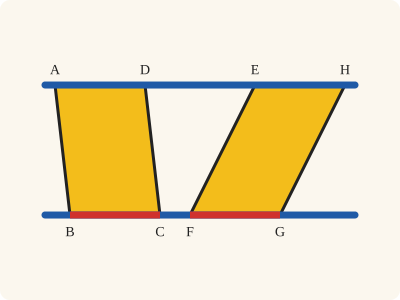
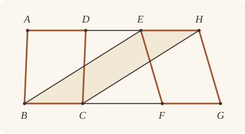

<!-- Generated by scripts/render.py. Do not edit by hand. -->

[Book I](index.md) · [← I.35](35.md) · [I.37 →](37.md)

# Book I, Proposition 36

*Parallelograms on equal bases and in the same parallels are equal*

[Euclid's proof](#euclids-proof) · [In Lean](#in-lean) · [What it rests on](#what-it-rests-on) · [Mishnah](#mishnah)

> Parallelograms which are on equal bases and in the same parallels are equal to one another.

**In Lean:** ✅ proved, as Euclid states it · Euclid's argument

<p align="center"></p>

<p align="center"><em>The parallelograms ABCD, EFGH on equal bases BC, FG (red) and between the same parallels (blue) are equal (yellow), however differently they lean.</em></p>

## Euclid's proof

<p align="center"></p>

<p align="center"><em>Drawn for one case: the bases BC and FG apart, with C and H on the same side of BE.</em></p>

Let ABCD, EFGH be parallelograms which are on equal bases BC, FG and in the same parallels AH, BG;

I say that the parallelogram ABCD is equal to EFGH.

For let BE, CH be joined.

Then, since BC is equal to FG,

while FG is equal to EH,

BC is also equal to EH. [C.N. 1]

But they are also parallel.

And EB, HC join them;

but straight lines joining equal and parallel straight lines (at the extremities which are) in the same directions (respectively) are equal and parallel. [I. 33]

Therefore EBCH is a parallelogram. [I. 34]

And it is equal to ABCD;

for it has the same base BC with it, and is in the same parallels BC, AH with it. [I. 35]

For the same reason also EFGH is equal to the same EBCH; [I. 35]

so that the parallelogram ABCD is also equal to EFGH. [C.N. 1]

Therefore etc.

Q. E. D.

## In Lean

| | |
|---|---|
| Proof | ✅ Proved |
| Statement | The whole enunciation. |
| Argument | Euclid's. |
| Reviewed | The statement and every passage of the argument read against Heath's text, at commit [`21526a6a`](https://github.com/jackChallis/stoicheia/commit/21526a6a) ([the record](../../review/I/36.toml)) |

From [`Elements/BookI/Prop36.lean`](../../Elements/BookI/Prop36.lean). Euclid's sentences are the `--` comments, and our own notes are in `/- … -/`; the lines under each sentence are the Lean that carries it out. The list below marks where a lemma does a step Euclid takes for granted, where the Lean takes a case Euclid's figure leaves aside and where the statement already gives a step; the `/- … -/` notes in the listing explain smaller adjustments.

**How the Lean follows the text**

- **A further case.** "I say that the parallelogram ABCD is equal to EFGH." Euclid draws EH running the same way as BC, with C and H on one side of BE. The Lean uses `AreParallel.sameSideOf_or` to cover both directions, reading EFGH as HGFE in the other case and applying the same argument with its area unchanged.
- **Already given.** "For let BE, CH be joined." Euclid joins the ends of BC and EH. The Lean names these straight lines by their ends, so I.33 can prove them equal and parallel without drawing separate straight lines here.
- **Done by `Prop34`.** "while FG is equal to EH…" Euclid takes the opposite sides FG and EH of the parallelogram EFGH as equal. The Lean applies I.34 to EFGH.
- **Done by `AreParallel.of_parallel`.** "Therefore EBCH is a parallelogram." Euclid concludes that EBCH is a parallelogram, where Heath's reference is I.34. The Lean uses the definition: I.33 gives BE parallel to CH and `AreParallel.of_parallel` gives BC parallel to EH from the given parallels; I.34 supplies FG equal to EH above.

```lean
/-- Parallelograms which are on equal bases and in the same parallels are equal to one another. -/
theorem Prop36 {A B C D E F G H : Point} (h₁ : Parallelogram A B C D) (h₂ : Parallelogram E F G H)
    (hbase : ‖B C‖ = ‖F G‖)
    (hAH : ∃ L : Line, OnLine A L ∧ OnLine D L ∧ OnLine E L ∧ OnLine H L)
    (hBG : ∃ L : Line, OnLine B L ∧ OnLine C L ∧ OnLine F L ∧ OnLine G L) :
    quadArea A B C D = quadArea E F G H := by
  -- Let ABCD, EFGH be parallelograms which are on equal bases BC, FG and in the same parallels
  -- AH, BG;
  obtain ⟨AH, hA, hD, hE, hH⟩ := hAH
  obtain ⟨BG, hB, hC, hF, hG⟩ := hBG
  have hpar : Parallel AH BG := (h₁.2.parallel hB hC hD hA).symm
  -- I say that the parallelogram ABCD is equal to EFGH.
  /- Euclid's case: EH runs the same way as BC, so C and H lie on one side of BE.
     We give his argument first, then turn the lettering round for the other case. -/
  have key : ∀ {E F G H : Point}, Parallelogram E F G H → ‖B C‖ = ‖F G‖ →
      OnLine E AH → OnLine H AH → OnLine F BG → OnLine G BG → SameSideOf C H B E →
      quadArea A B C D = quadArea E F G H := by
    intro E F G H h₂ hbase hE hH hF hG
    -- For let BE, CH be joined.
    -- Then, since BC is equal to FG,
    have hBC_FG : ‖B C‖ = ‖F G‖ := hbase
    -- while FG is equal to EH,
    have hEH : ‖E H‖ = ‖F G‖ := (Prop34 (A := E) (B := H) (C := F) (D := G) h₂).1
    -- BC is also equal to EH. [C.N. 1]
    have hBC_EH : ‖B C‖ = ‖E H‖ := CommonNotion1 hBC_FG hEH
    -- But they are also parallel.
    have hBCEH : AreParallel B C E H :=
      AreParallel.of_parallel h₁.2.1 h₂.2.2.1.symm hB hC hE hH hpar.symm
    -- And EB, HC join them;
    intro hdir
    -- but straight lines joining equal and parallel straight lines (at the extremities which
    -- are) in the same directions (respectively) are equal and parallel. [I. 33]
    have h33 := Prop33 hBCEH hBC_EH hdir
    -- Therefore EBCH is a parallelogram. [I. 34]
    /- Both pairs of opposite sides are parallel, which is the definition of a
       parallelogram. -/
    have hEBCH : Parallelogram E B C H :=
      ⟨h33.2.swap_left,
        AreParallel.of_parallel h₁.2.1 h₂.2.2.1 hB hC hH hE hpar.symm⟩
    -- And it is equal to ABCD;
    have e₁ : quadArea A B C D = quadArea E B C H := by
      -- for it has the same base BC with it, and is in the same parallels BC, AH with it. [I. 35]
      exact Prop35 h₁ hEBCH ⟨AH, hA, hD, hE, hH⟩
    -- For the same reason also EFGH is equal to the same EBCH; [I. 35]
    have harea : quadArea F E H G = quadArea B E H C :=
      Prop35 h₂.reverse.rotate.rotate.rotate hEBCH.reverse.rotate.rotate.rotate
        ⟨BG, hF, hG, hB, hC⟩
    /- This time the common base is EH. Both areas are turned back to their given
       names: a parallelogram has one area, whichever diameter measures it. -/
    have e₂ : quadArea E F G H = quadArea E B C H := calc
      quadArea E F G H = quadArea F G H E := h₂.quadArea_rotate.symm
      _ = quadArea F E H G := (quadArea_reverse F G H E).symm
      _ = quadArea B E H C := harea
      _ = quadArea B C H E := quadArea_reverse B C H E
      _ = quadArea E B C H := hEBCH.quadArea_rotate
    -- so that the parallelogram ABCD is also equal to EFGH. [C.N. 1]
    exact CommonNotion1 e₁ e₂
  /- EH runs the same way as BC, or the other way. In the second case EFGH is
     read as HGFE, and the same argument applies without changing its area. -/
  have hEHBC : AreParallel E H B C :=
    AreParallel.of_parallel h₂.2.2.1.symm h₁.2.1 hE hH hB hC hpar
  have hequal : quadArea A B C D = quadArea E F G H := by
    rcases hEHBC.sameSideOf_or with hs | hs
    · exact key h₂ hbase hE hH hF hG hs.swap
    · rw [key h₂.reverse.rotate (hbase.trans (len_symm F G)) hH hE hG hF hs.swap,
        quadArea_reverse, quadArea_rotate₂, h₂.quadArea_rotate]
  -- Therefore etc.
  exact hequal
  -- Q. E. D.
```

## What it rests on

| | |
|---|---|
| Heath's references | [I.33](33.md), [I.34](34.md), [I.35](35.md); C.N. 1 |
| Lean cites | [I.33](33.md), [I.34](34.md), [I.35](35.md) |
| Postulates | 1, 2, 3, 4, 5 |
| Definitions taken as axioms | Def. I.15 |
| Common Notions | 1, 2, 3, 4, 5 |
| Tacit rules | 37 (listed below) |
| Its own Lean calls | 1 tacit rule |
| Through lemmas | Postulates 1, 2 and 3; Def. I.15; 32 tacit rules |

_Postulates, definitions, Common Notions and tacit rules: all that this proof rests on, counting those of the propositions it cites. The last two rows say which of the postulates, definitions and tacit rules its own Lean calls, in the proof or a helper written for it, and which it does not call but reaches through lemmas, of Book Zero or shared (a proposition it cites may rest on these too); the rest come in only through the propositions it cites or the Common Notions._

<details><summary>The 37 tacit rules beneath this proof, counting those of the propositions it cites</summary>

_(used here) marks a rule this proof's own Lean calls, in the proof or a helper written for it; (through …) marks one its own Lean does not call but reaches through the lemmas named, of [Book Zero](../../Elements/Figure) or shared, though a proposition it cites may rest on it too; and a rule with no mark comes in only through a proposition it cites or a Common Notion. The names in brackets are System E's: an Intersection rule says when straight lines and circles must meet, and an Intersections rule takes a point where they do (see [Book I's introduction](index.md))._

**Reading the figure**

- [`between_cases`](../../Elements/Foundations/Tacit/Diagram.lean#L54) (through [`AreParallel.sameSideOf_or`](../../Elements/Figure/Parallelograms.lean#L177), [`Parallelogram.quadArea_rotate`](../../Elements/Figure/Parallelograms.lean#L202) and [`quadArea_reverse`](../../Elements/Figure/Areas.lean#L155)): Of three different points on a straight line, one is between the other two. (Between 6)
- [`between_symm`](../../Elements/Foundations/Tacit/Diagram.lean#L47) (through [`AreParallel.sameSideOf_or`](../../Elements/Figure/Parallelograms.lean#L177), [`Parallelogram.quadArea_rotate`](../../Elements/Figure/Parallelograms.lean#L202) and [`quadArea_reverse`](../../Elements/Figure/Areas.lean#L155)): If B is between A and C, it is between C and A. (Between 1)
- [`circles_meet`](../../Elements/Foundations/Tacit/Diagram.lean#L91) (through [`AreParallel.sameSideOf_or`](../../Elements/Figure/Parallelograms.lean#L177), [`Parallelogram.quadArea_rotate`](../../Elements/Figure/Parallelograms.lean#L202) and [`quadArea_reverse`](../../Elements/Figure/Areas.lean#L155)): If each circle passes through a point inside the other, the circles cut one another. This is the step Euclid takes for granted in I.1. (Intersection 5)
- [`circles_meet_same_side`](../../Elements/Foundations/Tacit/Constructions.lean#L79) (through [`AreParallel.sameSideOf_or`](../../Elements/Figure/Parallelograms.lean#L177), [`Parallelogram.quadArea_rotate`](../../Elements/Figure/Parallelograms.lean#L202) and [`quadArea_reverse`](../../Elements/Figure/Areas.lean#L155)): Two circles that cut one another do so on each side of the straight line through their centres. (Intersections 8)
- [`exists_point`](../../Elements/Foundations/Tacit/Constructions.lean#L35) (through [`AreParallel.sameSideOf_or`](../../Elements/Figure/Parallelograms.lean#L177), [`Parallelogram.quadArea_rotate`](../../Elements/Figure/Parallelograms.lean#L202) and [`quadArea_reverse`](../../Elements/Figure/Areas.lean#L155)): Let a point be taken. (Points 1)
- [`exists_point_inside_circle`](../../Elements/Foundations/Tacit/Constructions.lean#L42) (through [`AreParallel.sameSideOf_or`](../../Elements/Figure/Parallelograms.lean#L177), [`Parallelogram.quadArea_rotate`](../../Elements/Figure/Parallelograms.lean#L202) and [`quadArea_reverse`](../../Elements/Figure/Areas.lean#L155)): Let a point be taken inside the circle α. (Points 8)
- [`exists_point_on_line`](../../Elements/Foundations/Tacit/Constructions.lean#L38) (through [`AreParallel.sameSideOf_or`](../../Elements/Figure/Parallelograms.lean#L177), [`Parallelogram.quadArea_rotate`](../../Elements/Figure/Parallelograms.lean#L202) and [`quadArea_reverse`](../../Elements/Figure/Areas.lean#L155)): Let a point be taken on the straight line L. (Points 2)
- [`line_circle_between`](../../Elements/Foundations/Tacit/Constructions.lean#L67) (through [`AreParallel.sameSideOf_or`](../../Elements/Figure/Parallelograms.lean#L177), [`Parallelogram.quadArea_rotate`](../../Elements/Figure/Parallelograms.lean#L202) and [`quadArea_reverse`](../../Elements/Figure/Areas.lean#L155)): A straight line through a point B inside a circle, heading out to a point C outside it, cuts the circle between B and C. (Intersections 4)
- [`line_circle_beyond`](../../Elements/Foundations/Tacit/Constructions.lean#L73) (through [`AreParallel.sameSideOf_or`](../../Elements/Figure/Parallelograms.lean#L177), [`Parallelogram.quadArea_rotate`](../../Elements/Figure/Parallelograms.lean#L202) and [`quadArea_reverse`](../../Elements/Figure/Areas.lean#L155)): A straight line through a point B inside a circle, produced beyond B away from C, cuts the circle there. (Intersections 5)
- [`line_unique`](../../Elements/Foundations/Tacit/Diagram.lean#L41) (through [`AreParallel.of_parallel`](../../Elements/Figure/Parallels.lean#L84), [`AreParallel.sameSideOf_or`](../../Elements/Figure/Parallelograms.lean#L177), [`Parallelogram.quadArea_rotate`](../../Elements/Figure/Parallelograms.lean#L202) and 1 other lemma): Two points determine a straight line. (Generalities 1)
- [`lines_meet_of_opposite_sides`](../../Elements/Foundations/Tacit/Diagram.lean#L86) (through [`AreParallel.sameSideOf_or`](../../Elements/Figure/Parallelograms.lean#L177) and [`Parallelogram.quadArea_rotate`](../../Elements/Figure/Parallelograms.lean#L202)): A straight line joining points on opposite sides of L crosses L. (Intersection 1)
- [`not_between_of_between`](../../Elements/Foundations/Tacit/Diagram.lean#L50) (through [`AreParallel.sameSideOf_or`](../../Elements/Figure/Parallelograms.lean#L177), [`Parallelogram.quadArea_rotate`](../../Elements/Figure/Parallelograms.lean#L202) and [`quadArea_reverse`](../../Elements/Figure/Areas.lean#L155)): If B is between A and C, then A is not between B and C. (Between 1)
- [`not_on_line_of_same_side`](../../Elements/Foundations/Tacit/Diagram.lean#L60) (through [`AreParallel.sameSideOf_or`](../../Elements/Figure/Parallelograms.lean#L177), [`Parallelogram.quadArea_rotate`](../../Elements/Figure/Parallelograms.lean#L202) and [`quadArea_reverse`](../../Elements/Figure/Areas.lean#L155)): Points on one side of a straight line are not on it. (Same side 3)
- [`pasch2`](../../Elements/Foundations/Tacit/Diagram.lean#L71) (through [`AreParallel.sameSideOf_or`](../../Elements/Figure/Parallelograms.lean#L177), [`Parallelogram.quadArea_rotate`](../../Elements/Figure/Parallelograms.lean#L202) and [`quadArea_reverse`](../../Elements/Figure/Areas.lean#L155)): If B is between A and C, A is on L and B is off it, then B and C are on the same side of L: a straight line that leaves L at A does not cross it again. (Pasch 2)
- [`same_side_trans`](../../Elements/Foundations/Tacit/Diagram.lean#L64) (through [`AreParallel.sameSideOf_or`](../../Elements/Figure/Parallelograms.lean#L177), [`Parallelogram.quadArea_rotate`](../../Elements/Figure/Parallelograms.lean#L202) and [`quadArea_reverse`](../../Elements/Figure/Areas.lean#L155)): Two points on the same side of a straight line as a third point are on the same side as each other. (Same side 4)

**Lengths, angles and areas**

- [`angle_add_of_inside`](../../Elements/Foundations/Tacit/Transfer.lean#L47) (through [`AreParallel.sameSideOf_or`](../../Elements/Figure/Parallelograms.lean#L177) and [`Parallelogram.quadArea_rotate`](../../Elements/Figure/Parallelograms.lean#L202)): If D lies within the angle BAC, then BAC is made up of BAD and DAC. (Diagram-angle 2)
- [`angle_eq_of_same_rays`](../../Elements/Foundations/Tacit/Transfer.lean#L54): The angle doesn't change if its arms are traced through other points on the same rays. (Diagram-angle 4)
- [`angle_symm`](../../Elements/Foundations/Tacit/Metric.lean#L30): The angle ABC is the angle CBA. (Metric 4)
- [`area_add_of_between`](../../Elements/Foundations/Tacit/Transfer.lean#L70) (through [`Parallelogram.quadArea_rotate`](../../Elements/Figure/Parallelograms.lean#L202) and [`quadArea_reverse`](../../Elements/Figure/Areas.lean#L155)): Cutting a triangle in two from a vertex adds up. (Diagram-area 2)
- [`area_congruent`](../../Elements/Foundations/Tacit/Metric.lean#L44): Triangles equal in all their sides and angles are equal in area. Euclid uses this without comment once he has shown two triangles congruent. (Metric 9)
- [`area_degenerate`](../../Elements/Foundations/Tacit/Metric.lean#L36) (through [`Parallelogram.quadArea_rotate`](../../Elements/Figure/Parallelograms.lean#L202) and [`quadArea_reverse`](../../Elements/Figure/Areas.lean#L155)): A "triangle" with a repeated corner has no area. (Metric 6)
- [`area_eq_zero_of_on_line`](../../Elements/Foundations/Tacit/Transfer.lean#L62) (through [`Parallelogram.quadArea_rotate`](../../Elements/Figure/Parallelograms.lean#L202) and [`quadArea_reverse`](../../Elements/Figure/Areas.lean#L155)): A "triangle" whose corners lie on one straight line has no area. (Diagram-area 1)
- [`area_rotate`](../../Elements/Foundations/Tacit/Metric.lean#L39) (through [`Parallelogram.quadArea_rotate`](../../Elements/Figure/Parallelograms.lean#L202), [`quadArea_reverse`](../../Elements/Figure/Areas.lean#L155) and [`quadArea_rotate₂`](../../Elements/Figure/Areas.lean#L161)): The triangle ABC is the triangle CAB. (Metric 8)
- [`len_add_of_between`](../../Elements/Foundations/Tacit/Transfer.lean#L27) (through [`AreParallel.sameSideOf_or`](../../Elements/Figure/Parallelograms.lean#L177), [`Parallelogram.quadArea_rotate`](../../Elements/Figure/Parallelograms.lean#L202) and [`quadArea_reverse`](../../Elements/Figure/Areas.lean#L155)): If B is between A and C, then AB and BC together make up AC. (Diagram-segment 1)
- [`len_self`](../../Elements/Foundations/Tacit/Metric.lean#L24) (through [`AreParallel.sameSideOf_or`](../../Elements/Figure/Parallelograms.lean#L177), [`Parallelogram.quadArea_rotate`](../../Elements/Figure/Parallelograms.lean#L202) and [`quadArea_reverse`](../../Elements/Figure/Areas.lean#L155)): The "straight line" from a point to itself has no length. (Metric 1)
- [`len_symm`](../../Elements/Foundations/Tacit/Metric.lean#L27) (used here): The straight line AB is the straight line BA. (Metric 3)
- [`radius_ne_zero`](../../Elements/Foundations/Tacit/Metric.lean#L62) (through [`AreParallel.sameSideOf_or`](../../Elements/Figure/Parallelograms.lean#L177), [`Parallelogram.quadArea_rotate`](../../Elements/Figure/Parallelograms.lean#L202) and [`quadArea_reverse`](../../Elements/Figure/Areas.lean#L155)): A circle's radius is not nothing: the straight line from the centre to a point on the circle has some length. A rule of our own, not one of System E's: every circle is drawn with a centre and a distance (Postulate 3).
- [`same_ray_of_angle_eq_zero`](../../Elements/Foundations/Tacit/Transfer.lean#L42) (through [`AreParallel.sameSideOf_or`](../../Elements/Figure/Parallelograms.lean#L177) and [`Parallelogram.quadArea_rotate`](../../Elements/Figure/Parallelograms.lean#L202)): If the angle BAC is nothing, C lies on the ray from A through B. (Diagram-angle 1)

**Superposition**

- [`superposition`](../../Elements/Foundations/Tacit/Superposition.lean#L52): **Superposition.** A hypothetical placement of a triangle on a given ray and side permits a restricted derivation of metric equalities about the figure already given. The derivation introduces no further objects, cites each geometric law it uses, and exports no symbol of the placement.

**Rules of magnitude**

- [`add_assoc`](../../Elements/Foundations/Tacit/Magnitudes.lean#L23) (through [`Parallelogram.quadArea_rotate`](../../Elements/Figure/Parallelograms.lean#L202) and [`quadArea_reverse`](../../Elements/Figure/Areas.lean#L155)): Adding three magnitudes in a row, it makes no difference whether the first two or the last two are added first. (System E §3.5)
- [`add_comm`](../../Elements/Foundations/Tacit/Magnitudes.lean#L26) (through [`AreParallel.sameSideOf_or`](../../Elements/Figure/Parallelograms.lean#L177), [`Parallelogram.quadArea_rotate`](../../Elements/Figure/Parallelograms.lean#L202), [`quadArea_reverse`](../../Elements/Figure/Areas.lean#L155) and 1 other lemma): The order of adding does not matter. (System E §3.5)
- [`add_lt_add_right`](../../Elements/Foundations/Tacit/Magnitudes.lean#L45) (through [`Parallelogram.quadArea_rotate`](../../Elements/Figure/Parallelograms.lean#L202) and [`quadArea_reverse`](../../Elements/Figure/Areas.lean#L155)): Adding the same thing to both sides keeps "less than". (System E §3.5)
- [`add_zero`](../../Elements/Foundations/Tacit/Magnitudes.lean#L29) (through [`Parallelogram.quadArea_rotate`](../../Elements/Figure/Parallelograms.lean#L202)): Adding nothing changes nothing. (System E §3.5)
- [`lt_irrefl`](../../Elements/Foundations/Tacit/Magnitudes.lean#L32) (through [`AreParallel.sameSideOf_or`](../../Elements/Figure/Parallelograms.lean#L177), [`Parallelogram.quadArea_rotate`](../../Elements/Figure/Parallelograms.lean#L202) and [`quadArea_reverse`](../../Elements/Figure/Areas.lean#L155)): No magnitude is less than itself. (System E §3.5)
- [`lt_trans`](../../Elements/Foundations/Tacit/Magnitudes.lean#L35) (through [`AreParallel.sameSideOf_or`](../../Elements/Figure/Parallelograms.lean#L177), [`Parallelogram.quadArea_rotate`](../../Elements/Figure/Parallelograms.lean#L202) and [`quadArea_reverse`](../../Elements/Figure/Areas.lean#L155)): What is less than the less is less still. (System E §3.5)
- [`lt_trichotomy`](../../Elements/Foundations/Tacit/Magnitudes.lean#L39) (through [`AreParallel.sameSideOf_or`](../../Elements/Figure/Parallelograms.lean#L177), [`Parallelogram.quadArea_rotate`](../../Elements/Figure/Parallelograms.lean#L202) and [`quadArea_reverse`](../../Elements/Figure/Areas.lean#L155)): Of two magnitudes, one is less, or they are equal, or the other is less. (System E §3.5)
- [`not_lt_zero`](../../Elements/Foundations/Tacit/Magnitudes.lean#L42) (through [`AreParallel.sameSideOf_or`](../../Elements/Figure/Parallelograms.lean#L177), [`Parallelogram.quadArea_rotate`](../../Elements/Figure/Parallelograms.lean#L202) and [`quadArea_reverse`](../../Elements/Figure/Areas.lean#L155)): Nothing is less than zero. (System E §3.5)

</details>

## Mishnah

_Our commentary: why Euclid's proof, and ours, look as they do._

Euclid joins BE and CH, and the figure EBCH they close is a parallelogram with a base in common with each of the given ones: BC with ABCD, and EH with EFGH. I.35 makes it equal to each, and Common Notion 1 makes the two equal to one another. Equal bases do as well as one base, once a third parallelogram bridges them.

**Where does I.34 come in?** Heath's reference for "Therefore EBCH is a parallelogram" is I.34, but that step asks for no proposition: both pairs of opposite sides are parallel, and that is what a parallelogram is. The step that does use I.34 stands a few lines up, with no reference: "while FG is equal to EH", the opposite sides of EFGH. That equality is what lets I.33 make EB and HC equal and parallel, once C and H lie on one side of BE; when they do not, we read EFGH as HGFE.

Each use of I.35 may fall in any of its cases: on the base BC, the sides AD and EH may overlap or meet at an end, and on the base EH, so may BC and FG. So I.36 rests on the cases that Proclus adds under I.35 as well as on Euclid's, and our I.35 proves them all. Heath gives I.36 no note of its own, but among Heron's comments he finds "Distinctions of a number of particular *cases* of Euclid's propositions according as the figure is drawn in one way or in another. Of this class are the different cases of I. 35, 36" (vol. 1, p. 22). Proclus' notes on I.36 and I.37 seem to have lost the end of the one and the beginning of the other, and the manuscripts run them together, as Heath notes under I.37 (vol. 1, p. 332).

## Further reading

- David Hilbert rebuilds the theory of plane areas behind I.35–I.41, with nothing left to the picture, in ch. IV, "The Theory of Plane Areas", of [*The Foundations of Geometry*](https://www.gutenberg.org/ebooks/17384) (1902, free online), his book of the axioms Euclid took for granted.
- One parallelogram can be cut into pieces that rebuild another on an equal base in the same parallels, and V. G. Boltyanskii's [*Equivalent and Equidecomposable Figures*](https://store.doverpublications.com/collections/math-algebra/products/9780486170053) (2007, in one Dover volume with *Hyperbolic Functions* and *Configuration Theorems*; first published 1963), a slim book written for readers with only school geometry, shows when and how.

[Book I](index.md) · [← I.35](35.md) · [I.37 →](37.md)

---

<sub>Euclid's text: T. L. Heath, *The Thirteen Books of Euclid's Elements*, vol. 1 (Cambridge, 1908), p. 331; [scan leaf n351](https://archive.org/details/thirteenbookseu02heibgoog/page/n351); [figure on n351](https://archive.org/details/thirteenbookseu02heibgoog/page/n351). Public domain.</sub>

<sub>The tacit rules follow the System E of Jeremy Avigad, Edward Dean and John Mumma, read alongside LeanEuclid (Logan Murphy, Kaiyu Yang, Jialiang Sun, Zhaoyu Li, Anima Anandkumar and Xujie Si).</sub>
