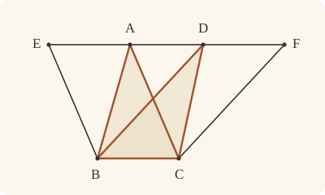

<!-- Generated by scripts/render.py. Do not edit by hand. -->

[Book I](index.md) · [← I.36](36.md) · [I.38 →](38.md)

# Book I, Proposition 37

*Triangles on the same base and in the same parallels are equal*

[Euclid's proof](#euclids-proof) · [In Lean](#in-lean) · [What it rests on](#what-it-rests-on) · [Mishnah](#mishnah)

> Triangles which are on the same base and in the same parallels are equal to one another.

**In Lean:** ✅ proved, as Euclid states it · Euclid's argument

<p align="center"></p>

<p align="center"><em>The triangles ABC, DBC on the same base BC and between the same parallels (blue) are equal; so when the part they share (yellow) is taken away, the pieces left over (red) are equal too.</em></p>

## Euclid's proof

<p align="center"></p>

<p align="center"><em>Drawn for one case: the vertices A and D apart.</em></p>

Let ABC, DBC be triangles on the same base BC and in the same parallels AD, BC;

I say that the triangle ABC is equal to the triangle DBC.

Let AD be produced in both directions to E, F; through B let BE be drawn parallel to CA, [I. 31] and through C let CF be drawn parallel to BD. [I. 31]

Then each of the figures EBCA, DBCF is a parallelogram; and they are equal, for they are on the same base BC and in the same parallels BC, EF. [I. 35]

Moreover the triangle ABC is half of the parallelogram EBCA; for the diameter AB bisects it. [I. 34]

And the triangle DBC is half of the parallelogram DBCF; for the diameter DC bisects it. [I. 34]

[But the halves of equal things are equal to one another.]

Therefore the triangle ABC is equal to the triangle DBC.

Therefore etc.

Q. E. D.

## In Lean

| | |
|---|---|
| Proof | ✅ Proved |
| Statement | The whole enunciation. "In the same parallels" is read as two whole parallel straight lines, so the vertices A and D may be one point, as I.41 needs. |
| Argument | Euclid's. |
| Reviewed | The statement and every passage of the argument read against Heath's text, at commit [`e8b6113`](https://github.com/jackChallis/stoicheia/commit/e8b6113) ([the record](../../review/I/37.toml)) |

From [`Elements/BookI/Prop37.lean`](../../Elements/BookI/Prop37.lean). Euclid's sentences are the `--` comments, and our own notes are in `/- … -/`; the lines under each sentence are the Lean that carries it out. The list below marks where a lemma does a step Euclid takes for granted and where the statement already gives a step; the `/- … -/` notes in the listing explain smaller adjustments.

**How the Lean follows the text**

- **Already given.** "Let AD be produced in both directions to E, F…" Euclid produces AD in both directions. The statement already supplies the whole straight line through A and D, even when the vertices coincide; the following parallels determine E and F on it.
- **Done by `Prop31.parallelogram`.** "through B let BE be drawn parallel to CA…" Euclid draws BE and CF and reads their meetings E and F with AD from the figure. `Prop31.parallelogram` uses I.31 and `Prop30.meet` (I.30, which Heath does not cite here) to find both points on the whole straight line AD and prove that ACBE and DBCF are parallelograms, which Euclid's next sentence asserts without a reason, naming ACBE as EBCA.
- **Done by `Magnitude.eq_of_add_self_eq`.** "But the halves of equal things are equal to one another." Euclid infers that the triangles are equal because they are halves of equal parallelograms; the bracketed sentence states the principle this inference needs, but Heath reports that Heiberg judges its words interpolated. `Magnitude.eq_of_add_self_eq` proves the step from the order of magnitudes: if one half were less, its double would be less too.

```lean
/-- Triangles which are on the same base and in the same parallels are equal to one another. -/
theorem Prop37 {A B C D : Point} (hABC : Triangle A B C) (hDBC : Triangle D B C)
    (hpar : ∃ L M : Line, Parallel L M ∧ OnLine A L ∧ OnLine D L ∧ OnLine B M ∧ OnLine C M) :
    △ A B C = △ D B C := by
  -- Let ABC, DBC be triangles on the same base BC and in the same parallels AD, BC;
  obtain ⟨AD, BC, hAD_BC, hA, hD, hB, hC⟩ := hpar
  -- I say that the triangle ABC is equal to the triangle DBC.
  -- Let AD be produced in both directions to E, F; through B let BE be drawn parallel to
  -- CA, [I. 31] and through C let CF be drawn parallel to BD. [I. 31]
  /- E and F are where the parallels BE and CF meet the whole straight line AD
     (`Prop31.parallelogram`). -/
  obtain ⟨E, hE, hACBE⟩ := Prop31.parallelogram hAD_BC hA hC hB hABC.ne₂₃.symm
  obtain ⟨F, hF, hDBCF⟩ := Prop31.parallelogram hAD_BC hD hB hC hDBC.ne₂₃
  -- Then each of the figures EBCA, DBCF is a parallelogram; and they are equal, for they are
  -- on the same base BC and in the same parallels BC, EF. [I. 35]
  have hEBCA : Parallelogram E B C A := hACBE.reverse.rotate
  have h35 : quadArea E B C A = quadArea D B C F :=
    Prop35 hEBCA hDBCF ⟨AD, hE, hA, hD, hF⟩
  -- Moreover the triangle ABC is half of the parallelogram EBCA; for the diameter AB bisects
  -- it. [I. 34]
  have h₁ : quadArea E B C A = △ A B C + △ A B C := by
    rw [← hEBCA.quadArea_rotate, area_bca A B C]
    exact Prop34.bisect hEBCA.rotate
  -- And the triangle DBC is half of the parallelogram DBCF; for the diameter DC bisects
  -- it. [I. 34]
  have h₂ : quadArea D B C F = △ D B C + △ D B C := Prop34.bisect hDBCF
  -- [But the halves of equal things are equal to one another.]
  have heq : △ A B C = △ D B C := Magnitude.eq_of_add_self_eq (h₁.symm.trans (h35.trans h₂))
  -- Therefore the triangle ABC is equal to the triangle DBC.
  exact heq
  -- Therefore etc.
  -- Q. E. D.
```

## What it rests on

| | |
|---|---|
| Heath's references | [I.31](31.md), [I.34](34.md), [I.35](35.md) |
| Lean cites | [I.30](30.md), [I.31](31.md), [I.34](34.md), [I.35](35.md) |
| Postulates | 1, 2, 3, 4, 5 |
| Definitions taken as axioms | Def. I.15 |
| Common Notions | 1, 2, 3, 4, 5 |
| Tacit rules | 59 (listed below) |
| Its own Lean calls | none |
| Through lemmas | Postulate 1; 31 tacit rules |

Some of these come in through lemmas [shared](../../CERTIFICATE.md#shared-steps) by many proofs: [`Prop31.parallelogram`](../../Elements/BookI/HelpersParallels.lean#L83) (I.30, I.31); [`Prop34.bisect`](../../Elements/BookI/Prop34.lean#L100) (I.34).

_Postulates, definitions, Common Notions and tacit rules: all that this proof rests on, counting those of the propositions it cites. The last two rows say which of the postulates, definitions and tacit rules its own Lean calls, in the proof or a helper written for it, and which it does not call but reaches through lemmas, of Book Zero or shared (a proposition it cites may rest on these too); the rest come in only through the propositions it cites or the Common Notions._

<details><summary>The 59 tacit rules beneath this proof, counting those of the propositions it cites</summary>

_(used here) marks a rule this proof's own Lean calls, in the proof or a helper written for it; (through …) marks one its own Lean does not call but reaches through the lemmas named, of [Book Zero](../../Elements/Figure) or shared, though a proposition it cites may rest on it too; and a rule with no mark comes in only through a proposition it cites or a Common Notion. The names in brackets are System E's: an Intersection rule says when straight lines and circles must meet, and an Intersections rule takes a point where they do (see [Book I's introduction](index.md))._

**Reading the figure**

- [`between_cases`](../../Elements/Foundations/Tacit/Diagram.lean#L74) (through [`Parallelogram.quadArea_rotate`](../../Elements/Figure/Parallelograms.lean#L200)): Of three different points on a straight line, one is between the other two. (Between 6)
- [`between_of_between_left`](../../Elements/Foundations/Tacit/Diagram.lean#L66): If B is between A and C, and D is between A and B, then D is between A and C. (Between 4)
- [`between_of_between_right`](../../Elements/Foundations/Tacit/Diagram.lean#L70): If B is between A and C, and C is between B and D, then B is between A and D. (Between 5)
- [`between_symm`](../../Elements/Foundations/Tacit/Diagram.lean#L43) (through [`Parallelogram.quadArea_rotate`](../../Elements/Figure/Parallelograms.lean#L200)): If B is between A and C, it is between C and A. (Between 1)
- [`centre_inside`](../../Elements/Foundations/Tacit/Diagram.lean#L35): The centre of a circle is inside it. (Generalities 3)
- [`circles_meet`](../../Elements/Foundations/Tacit/Diagram.lean#L201): If each circle passes through a point inside the other, the circles cut one another. This is the step Euclid takes for granted in I.1. (Intersection 5)
- [`circles_meet_of_on_inside_outside`](../../Elements/Foundations/Tacit/Diagram.lean#L195): Two circles cut one another if the first passes through a point A inside the second, and a point B outside the second is inside or on the first. (Intersection 4, in LeanEuclid's corrected form)
- [`circles_meet_same_side`](../../Elements/Foundations/Tacit/Constructions.lean#L81): Two circles that cut one another do so on each side of the straight line through their centres. (Intersections 8)
- [`exists_point`](../../Elements/Foundations/Tacit/Constructions.lean#L26) (through [`Parallelogram.quadArea_rotate`](../../Elements/Figure/Parallelograms.lean#L200) and [`Triangle.ne₂₃`](../../Elements/Figure/Triangles.lean#L29)): Let a point be taken. (Points 1)
- [`exists_point_between`](../../Elements/Foundations/Tacit/Constructions.lean#L38): Let a point be taken between B and C. (Points 3)
- [`exists_point_on_line`](../../Elements/Foundations/Tacit/Constructions.lean#L29) (through [`Prop31.parallelogram`](../../Elements/BookI/HelpersParallels.lean#L83)): Let a point be taken on the straight line L. (Points 2)
- [`exists_point_on_line_off_line`](../../Elements/Foundations/Tacit/Constructions.lean#L34) (through [`Prop31.parallelogram`](../../Elements/BookI/HelpersParallels.lean#L83)): Let a point be taken on L, not on the different straight line M. (Points 2, with "distinct from M")
- [`exists_point_opposite_side`](../../Elements/Foundations/Tacit/Constructions.lean#L46): Let a point be taken on the other side of L from B. (Points 6)
- [`inside_not_on`](../../Elements/Foundations/Tacit/Diagram.lean#L38): A point inside a circle is not on it. (Generalities 4)
- [`line_circle_between`](../../Elements/Foundations/Tacit/Constructions.lean#L69): A straight line through a point B inside a circle, heading out to a point C outside it, cuts the circle between B and C. (Intersections 4)
- [`line_circle_beyond`](../../Elements/Foundations/Tacit/Constructions.lean#L75): A straight line through a point B inside a circle, produced beyond B away from C, cuts the circle there. (Intersections 5)
- [`line_unique`](../../Elements/Foundations/Tacit/Diagram.lean#L28) (through [`Parallelogram.quadArea_rotate`](../../Elements/Figure/Parallelograms.lean#L200) and [`Prop31.parallelogram`](../../Elements/BookI/HelpersParallels.lean#L83)): Two points determine a straight line. (Generalities 1)
- [`lines_meet_of_opposite_sides`](../../Elements/Foundations/Tacit/Diagram.lean#L179) (through [`Parallelogram.quadArea_rotate`](../../Elements/Figure/Parallelograms.lean#L200)): A straight line joining points on opposite sides of L crosses L. (Intersection 1)
- [`ne_of_between`](../../Elements/Foundations/Tacit/Diagram.lean#L46) (through [`Parallelogram.quadArea_rotate`](../../Elements/Figure/Parallelograms.lean#L200)): A point between two others differs from the first. (Between 1)
- [`ne_of_between_ends`](../../Elements/Foundations/Tacit/Diagram.lean#L49) (through [`Parallelogram.quadArea_rotate`](../../Elements/Figure/Parallelograms.lean#L200)): The ends of a finite straight line differ. (Between 1)
- [`not_between_of_between`](../../Elements/Foundations/Tacit/Diagram.lean#L52): If B is between A and C, then A is not between B and C. (Between 1)
- [`not_between_of_between_between`](../../Elements/Foundations/Tacit/Diagram.lean#L79): If B is between A and C, and also between A and D, then B is not between C and D: C and D lie on the same side of B. (Between 7)
- [`not_on_line_of_same_side`](../../Elements/Foundations/Tacit/Diagram.lean#L92) (through [`Parallelogram.quadArea_rotate`](../../Elements/Figure/Parallelograms.lean#L200)): Points on one side of a straight line are not on it. (Same side 3)
- [`on_line_of_between`](../../Elements/Foundations/Tacit/Diagram.lean#L56) (through [`Parallelogram.quadArea_rotate`](../../Elements/Figure/Parallelograms.lean#L200)): A straight line through A and B, with B between A and C, passes through C. (Between 2)
- [`on_line_of_between_ends`](../../Elements/Foundations/Tacit/Diagram.lean#L61) (through [`Parallelogram.quadArea_rotate`](../../Elements/Figure/Parallelograms.lean#L200) and [`Prop31.parallelogram`](../../Elements/BookI/HelpersParallels.lean#L83)): A straight line through A and C passes through every point between them. (Between 3)
- [`pasch2`](../../Elements/Foundations/Tacit/Diagram.lean#L111) (through [`Parallelogram.quadArea_rotate`](../../Elements/Figure/Parallelograms.lean#L200)): If B is between A and C, A is on L and B is off it, then B and C are on the same side of L: a straight line that leaves L at A does not cross it again. (Pasch 2)
- [`pasch3`](../../Elements/Foundations/Tacit/Diagram.lean#L114) (through [`Parallelogram.quadArea_rotate`](../../Elements/Figure/Parallelograms.lean#L200)): A straight line through a point between A and C separates them. (Pasch 3)
- [`pasch4`](../../Elements/Foundations/Tacit/Diagram.lean#L119) (through [`Parallelogram.quadArea_rotate`](../../Elements/Figure/Parallelograms.lean#L200)): If two different straight lines L and M meet at B, and A and C are points of M, different from each other and from B, that are not on the same side of L, then B is between A and C. (Pasch 4)
- [`same_side_or`](../../Elements/Foundations/Tacit/Diagram.lean#L99): A straight line has only two sides. (Same side 5)
- [`same_side_refl`](../../Elements/Foundations/Tacit/Diagram.lean#L85) (through [`Parallelogram.quadArea_rotate`](../../Elements/Figure/Parallelograms.lean#L200)): A point off a straight line is on the same side of it as itself. (Same side 1)
- [`same_side_symm`](../../Elements/Foundations/Tacit/Diagram.lean#L89) (through [`Parallelogram.quadArea_rotate`](../../Elements/Figure/Parallelograms.lean#L200)): If A is on the same side of a straight line as B, then B is on the same side as A. (Same side 2)
- [`same_side_trans`](../../Elements/Foundations/Tacit/Diagram.lean#L96) (through [`Parallelogram.quadArea_rotate`](../../Elements/Figure/Parallelograms.lean#L200)): Two points on the same side of a straight line as a third point are on the same side as each other. (Same side 4)
- [`triple_incidence1`](../../Elements/Foundations/Tacit/Diagram.lean#L131) (through [`Parallelogram.quadArea_rotate`](../../Elements/Figure/Parallelograms.lean#L200)): Take B on L, C on M and D on N, three straight lines through A. If C lies within the angle BAD (on D's side of L and on B's side of N), then B and D are not on the same side of M: the straight line AC separates them. (Triple incidence 1)
- [`triple_incidence2`](../../Elements/Foundations/Tacit/Diagram.lean#L139): Take B on L, C on M and D on N, three straight lines through A, with B other than A and D off M. If C and D are on the same side of L, and B and D are not on the same side of M, then B and C are on the same side of N: C lies within the angle BAD. (Triple incidence 2)

**Lengths, angles and areas**

- [`angle_add_of_inside`](../../Elements/Foundations/Tacit/Transfer.lean#L54): If D lies within the angle BAC, then BAC is made up of BAD and DAC. (Diagram-angle 2)
- [`angle_eq_of_same_rays`](../../Elements/Foundations/Tacit/Transfer.lean#L72): The angle doesn't change if its arms are traced through other points on the same rays. (Diagram-angle 4)
- [`angle_symm`](../../Elements/Foundations/Tacit/Metric.lean#L26): The angle ABC is the angle CBA. (Metric 4)
- [`area_add_of_between`](../../Elements/Foundations/Tacit/Transfer.lean#L88) (through [`Parallelogram.quadArea_rotate`](../../Elements/Figure/Parallelograms.lean#L200)): Cutting a triangle in two from a vertex adds up. (Diagram-area 2)
- [`area_congruent`](../../Elements/Foundations/Tacit/Metric.lean#L43): Triangles equal in all their sides and angles are equal in area. Euclid uses this without comment once he has shown two triangles congruent. (Metric 9)
- [`area_degenerate`](../../Elements/Foundations/Tacit/Metric.lean#L32) (through [`Parallelogram.quadArea_rotate`](../../Elements/Figure/Parallelograms.lean#L200)): A "triangle" with a repeated corner has no area. (Metric 6)
- [`area_eq_zero_of_on_line`](../../Elements/Foundations/Tacit/Transfer.lean#L80) (through [`Parallelogram.quadArea_rotate`](../../Elements/Figure/Parallelograms.lean#L200)): A "triangle" whose corners lie on one straight line has no area. (Diagram-area 1)
- [`area_rotate`](../../Elements/Foundations/Tacit/Metric.lean#L35) (through [`Parallelogram.quadArea_rotate`](../../Elements/Figure/Parallelograms.lean#L200), [`Prop34.bisect`](../../Elements/BookI/Prop34.lean#L100) and [`area_bca`](../../Elements/Figure/Areas.lean#L61)): The triangle ABC is the triangle CAB. (Metric 8)
- [`area_swap`](../../Elements/Foundations/Tacit/Metric.lean#L38) (through [`Parallelogram.quadArea_rotate`](../../Elements/Figure/Parallelograms.lean#L200) and [`Prop34.bisect`](../../Elements/BookI/Prop34.lean#L100)): The triangle ABC is the triangle ACB. (Metric 8)
- [`eq_of_len_eq_zero`](../../Elements/Foundations/Tacit/Metric.lean#L17): A finite straight line with distinct ends has length. (Metric 1)
- [`inside_of_len_lt`](../../Elements/Foundations/Tacit/Transfer.lean#L33): A point nearer the centre than the circumference is inside. (Diagram-segment 4)
- [`len_add_of_between`](../../Elements/Foundations/Tacit/Transfer.lean#L21): If B is between A and C, then AB and BC together make up AC. (Diagram-segment 1)
- [`len_lt_of_inside`](../../Elements/Foundations/Tacit/Transfer.lean#L37): A point inside is nearer the centre than the circumference. (Diagram-segment 4)
- [`len_self`](../../Elements/Foundations/Tacit/Metric.lean#L20): The "straight line" from a point to itself has no length. (Metric 1)
- [`len_symm`](../../Elements/Foundations/Tacit/Metric.lean#L23): The straight line AB is the straight line BA. (Metric 3)
- [`same_ray_of_angle_eq_zero`](../../Elements/Foundations/Tacit/Transfer.lean#L49): If the angle BAC is nothing, C lies on the ray from A through B. (Diagram-angle 1)

**Superposition**

- [`superposition`](../../Elements/Foundations/Tacit/Superposition.lean#L48): **Superposition.** A hypothetical placement of a triangle on a given ray and side permits a restricted derivation of metric equalities about the figure already given. The derivation introduces no further objects, cites each geometric law it uses, and exports no symbol of the placement.

**Laws of magnitude**

- [`add_assoc`](../../Elements/Foundations/Tacit/Magnitudes.lean#L23) (through [`Parallelogram.quadArea_rotate`](../../Elements/Figure/Parallelograms.lean#L200)): Adding three magnitudes in a row, it makes no difference whether the first two or the last two are added first. (System E §3.5)
- [`add_comm`](../../Elements/Foundations/Tacit/Magnitudes.lean#L26) (through [`Magnitude.eq_of_add_self_eq`](../../Elements/Figure/Areas.lean#L52) and [`Parallelogram.quadArea_rotate`](../../Elements/Figure/Parallelograms.lean#L200)): The order of adding does not matter. (System E §3.5)
- [`add_lt_add_right`](../../Elements/Foundations/Tacit/Magnitudes.lean#L45) (through [`Magnitude.eq_of_add_self_eq`](../../Elements/Figure/Areas.lean#L52)): Adding the same thing to both sides keeps "less than". (System E §3.5)
- [`add_zero`](../../Elements/Foundations/Tacit/Magnitudes.lean#L29) (through [`Parallelogram.quadArea_rotate`](../../Elements/Figure/Parallelograms.lean#L200)): Adding nothing changes nothing. (System E §3.5)
- [`lt_irrefl`](../../Elements/Foundations/Tacit/Magnitudes.lean#L32) (through [`Magnitude.eq_of_add_self_eq`](../../Elements/Figure/Areas.lean#L52)): No magnitude is less than itself. (System E §3.5)
- [`lt_trans`](../../Elements/Foundations/Tacit/Magnitudes.lean#L35) (through [`Magnitude.eq_of_add_self_eq`](../../Elements/Figure/Areas.lean#L52)): What is less than the less is less still. (System E §3.5)
- [`lt_trichotomy`](../../Elements/Foundations/Tacit/Magnitudes.lean#L39) (through [`Magnitude.eq_of_add_self_eq`](../../Elements/Figure/Areas.lean#L52)): Of two magnitudes, one is less, or they are equal, or the other is less. (System E §3.5)
- [`not_lt_zero`](../../Elements/Foundations/Tacit/Magnitudes.lean#L42): Nothing is less than zero. (System E §3.5)

</details>

## Mishnah

_Our commentary: what Euclid assumes, what Lean made us say out loud, and how the result looks by modern means._

Euclid completes each triangle to a parallelogram on BC, with parallels through B and C. I.35 makes the parallelograms equal, I.34 makes each triangle half of its own, and so the triangles are equal. J. L. Heiberg brackets that last step, and Heath gives his reason: "Here and in the next proposition Heiberg brackets the words 'But the halves of equal things are equal to one another' on the ground that, since the *Common Notion* which asserted this fact was interpolated at a very early date (before the time of Theon), it is probable that the words here were interpolated at the same time" (vol. 1, p. 332).

**"A little argument."** Heiberg took the halves to follow from Common Notion 3. Paul Tannery, Heath reports, "acutely observes" that they are no inference from it: they want a *reductio ad absurdum* through Common Notion 2. Even then, Heath adds, "a little argument would be necessary in addition to the reference to *Common Notion* 2" (vol. 1, p. 224), though he thinks Euclid would have taken it as obvious. Our tacit rules of magnitude say nothing of halves, so we prove the little argument in [Book Zero](../../Elements/Figure), as `Magnitude.eq_of_add_self_eq`: were one half less than the other, its double would be less too. Bracketed or not, the step has to be taken.

The area stays while the sides stretch, for triangles as for parallelograms: "Thus the *perimeter* in parallelograms or triangles is of itself no criterion as to their area" (Heath, vol. 1, p. 332). Proclus tells of members of communistic societies of his day "who cheated their fellow members by giving them land of greater perimeter but less area than they took themselves", and about 130 B.C. Polybius "said that there were people who could not understand that camps of the same periphery might have different capacities" (Heath, vol. 1, p. 333).

**What if A and D are one point?** Our statement reads "in the same parallels" as two whole straight lines, so A and D may coincide, as I.41 will want; the "AD" that Euclid produces is then the parallel through the vertices. He takes it from the figure that BE and CF meet it, and our I.35 covers wherever they fall.

**The modern way.** With the cross product of [I.35](35.md), twice the area of the triangle ABC is $\lvert\mathrm{(C - B)} \times \mathrm{(A - B)}\rvert$. Putting $\mathrm{D} = \mathrm{A} + t\mathrm{(C - B)}$ adds $t\mathrm{(C - B)} \times \mathrm{(C - B)} = 0$ to the cross product, so sliding the vertex along the parallel leaves the area alone.

## Further reading

- Ch. 6, "The determinant", of Grant Sanderson's animated [*Essence of linear algebra*](https://www.3blue1brown.com/topics/linear-algebra) (2016, free online) shows that the determinant behind the cross product of the modern way is signed area.
- A computer can prove geometry theorems by keeping track of the areas of triangles, much as I.35–I.41 do, and Shang-Ching Chou, Xiao-Shan Gao and Jing-Zhong Zhang's [*Machine Proofs in Geometry*](https://doi.org/10.1142/2196) (1994) shows how this area method finds short, readable proofs.

[Book I](index.md) · [← I.36](36.md) · [I.38 →](38.md)

---

<sub>Euclid's text: T. L. Heath, *The Thirteen Books of Euclid's Elements*, vol. 1 (Cambridge, 1908), p. 332; [scan leaf n352](https://archive.org/details/thirteenbookseu02heibgoog/page/n352); [figure on n352](https://archive.org/details/thirteenbookseu02heibgoog/page/n352). Public domain.</sub>

<sub>The tacit rules follow the System E of Jeremy Avigad, Edward Dean and John Mumma, read alongside LeanEuclid (Logan Murphy, Kaiyu Yang, Jialiang Sun, Zhaoyu Li, Anima Anandkumar and Xujie Si).</sub>
