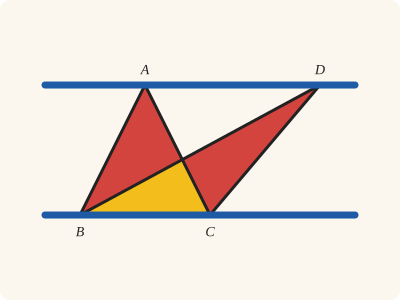

<!-- Generated by scripts/render.py. Do not edit by hand. -->

[Book I](index.md) · [← I.36](36.md) · [I.38 →](38.md)

# Book I, Proposition 37

*Triangles on the same base*

> Triangles which are on the same base and in the same parallels are equal to one another.

<p align="center"></p>

<p align="center"><em>Two triangles on the same base with their tips on the same parallel (blue) are equal: take away the part they share (yellow) and the pieces left over (red) are equal too.</em></p>

## Euclid's proof

Let ABC, DBC be triangles on the same base BC and in the same parallels AD, BC;

I say that the triangle ABC is equal to the triangle DBC.

Let AD be produced in both directions to E, F; through B let BE be drawn parallel to CA, [I. 31] and through C let CF be drawn parallel to BD. [I. 31]

Then each of the figures EBCA, DBCF is a parallelogram; and they are equal, for they are on the same base BC and in the same parallels BC, EF. [I. 35]

Moreover the triangle ABC is half of the parallelogram EBCA; for the diameter AB bisects it. [I. 34]

And the triangle DBC is half of the parallelogram DBCF; for the diameter DC bisects it. [I. 34]

[But the halves of equal things are equal to one another.]

Therefore the triangle ABC is equal to the triangle DBC.

Therefore etc.

Q. E. D.

## In Lean

🚧 Sketched: Euclid's sentences are in place, the Lean steps are still to come

From [`Elements/BookI/Prop37.lean`](../../Elements/BookI/Prop37.lean). Euclid's sentences are the `--` comments; the lines under each one are the Lean that carries it out.

```lean
/-- Triangles which are on the same base and in the same parallels are equal to one another. -/
theorem Prop37 {A B C D : Point} (hABC : Triangle A B C) (hDBC : Triangle D B C)
    (hpar : AreParallel A D B C) :
    △ A B C = △ D B C := by
  -- Let ABC, DBC be triangles on the same base BC and in the same parallels AD, BC;
  -- I say that the triangle ABC is equal to the triangle DBC.
  -- Let AD be produced in both directions to E, F; through B let BE be drawn parallel to
  -- CA, [I. 31] and through C let CF be drawn parallel to BD. [I. 31]
  -- Then each of the figures EBCA, DBCF is a parallelogram; and they are equal, for they are
  -- on the same base BC and in the same parallels BC, EF. [I. 35]
  -- Moreover the triangle ABC is half of the parallelogram EBCA; for the diameter AB bisects
  -- it. [I. 34]
  -- And the triangle DBC is half of the parallelogram DBCF; for the diameter DC bisects
  -- it. [I. 34]
  -- [But the halves of equal things are equal to one another.]
  -- Therefore the triangle ABC is equal to the triangle DBC.
  -- Therefore etc.
  -- Q. E. D.
  sorry
```

## What it rests on

_Not yet proved in Lean, so not yet known._

## Mishnah

_Commentary to come._

---

<sub>Euclid's text: T. L. Heath, The Thirteen Books of Euclid's Elements, vol. 1 (Cambridge, 1908), p. 332; scan leaf n352; figure on n352. Public domain.</sub>
