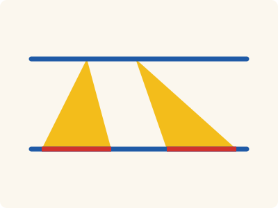
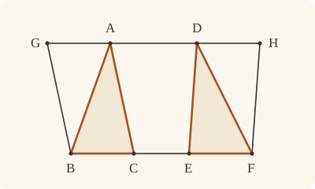

<!-- Generated by scripts/render.py. Do not edit by hand. -->

[Book I](index.md) · [← I.37](37.md) · [I.39 →](39.md)

# Book I, Proposition 38

*Triangles on equal bases and in the same parallels are equal*

[Euclid's proof](#euclids-proof) · [In Lean](#in-lean) · [What it rests on](#what-it-rests-on) · [Mishnah](#mishnah)

> Triangles which are on equal bases and in the same parallels are equal to one another.

**In Lean:** ✅ proved, as Euclid states it · Euclid's argument

<p align="center"></p>

<p align="center"><em>The triangles ABC, DEF on equal bases BC, EF (red) and between the same parallels (blue) are equal in area (yellow), however differently they lean.</em></p>

## Euclid's proof

<p align="center"></p>

<p align="center"><em>Drawn for one case: the bases BC and EF apart, and the vertices A and D apart.</em></p>

Let ABC, DEF be triangles on equal bases BC, EF and in the same parallels BF, AD;

I say that the triangle ABC is equal to the triangle DEF.

For let AD be produced in both directions to G, H; through B let BG be drawn parallel to CA, [I. 31] and through F let FH be drawn parallel to DE.

Then each of the figures GBCA, DEFH is a parallelogram; and GBCA is equal to DEFH; for they are on equal bases BC, EF and in the same parallels BF, GH. [I. 36]

Moreover the triangle ABC is half of the parallelogram GBCA; for the diameter AB bisects it. [I. 34]

And the triangle FED is half of the parallelogram DEFH; for the diameter DF bisects it. [I. 34]

[But the halves of equal things are equal to one another.]

Therefore the triangle ABC is equal to the triangle DEF.

Therefore etc.

Q. E. D.

## In Lean

| | |
|---|---|
| Proof | ✅ Proved |
| Statement | The whole enunciation. "In the same parallels" is read as two whole parallel straight lines, so the vertices A and D may be one point, as I.42 needs. |
| Argument | Euclid's. |
| Reviewed | The statement and every passage of the argument read against Heath's text, at commit [`bedbba23e`](https://github.com/jackChallis/stoicheia/commit/bedbba23e) ([the record](../../review/I/38.toml)) |

From [`Elements/BookI/Prop38.lean`](../../Elements/BookI/Prop38.lean). Euclid's sentences are the `--` comments, and our own notes are in `/- … -/`; the lines under each sentence are the Lean that carries it out. The list below marks where a lemma does a step Euclid takes for granted and where the statement already gives a step; the `/- … -/` notes in the listing explain smaller adjustments.

**How the Lean follows the text**

- **Already given.** "For let AD be produced in both directions to G, H…" Euclid produces AD in both directions. The statement already gives the whole straight line through A and D, so the Lean needs no extension here.
- **Done by `Prop31.parallelogram`.** "through B let BG be drawn parallel to CA…" Euclid draws BG and FH and takes their meetings with AD at G and H from the figure, then calls GBCA and DEFH parallelograms without giving a reason. The Lean uses `Prop31.parallelogram` to draw the parallels by I.31, prove their meetings by I.30, for which Heath gives no reference here, and establish both parallelograms for the next sentence.
- **Done by `Magnitude.eq_of_add_self_eq`.** "But the halves of equal things are equal to one another." Euclid passes from equal parallelograms to equal triangles without stating or proving that halves of equal things are equal; J. L. Heiberg brackets the sentence that states this as an interpolation. The Lean applies `Magnitude.eq_of_add_self_eq`, which rules out unequal halves by comparing their doubles using the order and addition laws for magnitudes.

```lean
/-- Triangles which are on equal bases and in the same parallels are equal to one another. -/
theorem Prop38 {A B C D E F : Point} (hABC : Triangle A B C) (hDEF : Triangle D E F)
    (hbase : ‖B C‖ = ‖E F‖)
    (hpar : ∃ L M : Line, Parallel L M ∧ OnLine A L ∧ OnLine D L ∧
      OnLine B M ∧ OnLine C M ∧ OnLine E M ∧ OnLine F M) :
    △ A B C = △ D E F := by
  -- Let ABC, DEF be triangles on equal bases BC, EF and in the same parallels BF, AD;
  obtain ⟨AD, BF, hAD_BF, hA, hD, hB, hC, hE, hF⟩ := hpar
  -- I say that the triangle ABC is equal to the triangle DEF.
  -- For let AD be produced in both directions to G, H; through B let BG be drawn parallel to
  -- CA, [I. 31] and through F let FH be drawn parallel to DE.
  /- G and H are where the parallels BG and FH meet AD (`Prop31.parallelogram`). -/
  obtain ⟨G, hG, hACBG⟩ := Prop31.parallelogram hAD_BF hA hC hB hABC.ne₂₃.symm
  obtain ⟨H, hH, hDEFH⟩ := Prop31.parallelogram hAD_BF hD hE hF hDEF.ne₂₃
  -- Then each of the figures GBCA, DEFH is a parallelogram; and GBCA is equal to DEFH; for
  -- they are on equal bases BC, EF and in the same parallels BF, GH. [I. 36]
  have hGBCA : Parallelogram G B C A := hACBG.reverse.rotate
  have h36 : quadArea G B C A = quadArea D E F H :=
    Prop36 hGBCA hDEFH hbase ⟨AD, hG, hA, hD, hH⟩ ⟨BF, hB, hC, hE, hF⟩
  -- Moreover the triangle ABC is half of the parallelogram GBCA; for the diameter AB bisects
  -- it. [I. 34]
  have h₁ : quadArea G B C A = △ A B C + △ A B C := by
    rw [← hGBCA.quadArea_rotate, area_bca A B C]
    exact Prop34.bisect hGBCA.rotate
  -- And the triangle FED is half of the parallelogram DEFH; for the diameter DF bisects
  -- it. [I. 34]
  have h₂ : quadArea D E F H = △ F E D + △ F E D := by
    rw [area_cba F E D]
    exact Prop34.bisect hDEFH
  -- [But the halves of equal things are equal to one another.]
  have heq : △ A B C = △ F E D := Magnitude.eq_of_add_self_eq (h₁.symm.trans (h36.trans h₂))
  -- Therefore the triangle ABC is equal to the triangle DEF.
  rw [heq, area_cba F E D]
  -- Therefore etc.
  -- Q. E. D.
```

## What it rests on

| | |
|---|---|
| Heath's references | [I.31](31.md), [I.34](34.md), [I.36](36.md) |
| Lean cites | [I.30](30.md), [I.31](31.md), [I.34](34.md), [I.36](36.md) |
| Postulates | 1, 2, 3, 4, 5 |
| Definitions taken as axioms | Def. I.15 |
| Common Notions | 1, 2, 3, 4, 5 |
| Tacit rules | 38 (listed below) |
| Its own Lean calls | none |
| Through lemmas | Postulates 1, 2 and 3; Def. I.15; 34 tacit rules |

Some of these come in through lemmas [shared](../../CERTIFICATE.md#shared-steps) by many proofs: [`Prop31.parallelogram`](../../Elements/BookI/HelpersParallels.lean#L83) (I.30, I.31); [`Prop34.bisect`](../../Elements/BookI/Prop34.lean#L101) (I.34).

_Postulates, definitions, Common Notions and tacit rules: all that this proof rests on, counting those of the propositions it cites. The last two rows say which of the postulates, definitions and tacit rules its own Lean calls, in the proof or a helper written for it, and which it does not call but reaches through lemmas, of Book Zero or shared (a proposition it cites may rest on these too); the rest come in only through the propositions it cites or the Common Notions._

<details><summary>The 38 tacit rules beneath this proof, counting those of the propositions it cites</summary>

_(used here) marks a rule this proof's own Lean calls, in the proof or a helper written for it; (through …) marks one its own Lean does not call but reaches through the lemmas named, of [Book Zero](../../Elements/Figure) or shared, though a proposition it cites may rest on it too; and a rule with no mark comes in only through a proposition it cites or a Common Notion. The names in brackets are System E's: an Intersection rule says when straight lines and circles must meet, and an Intersections rule takes a point where they do (see [Book I's introduction](index.md))._

**Reading the figure**

- [`between_cases`](../../Elements/Foundations/Tacit/Diagram.lean#L54) (through [`Parallelogram.quadArea_rotate`](../../Elements/Figure/Parallelograms.lean#L202), [`Prop34.bisect`](../../Elements/BookI/Prop34.lean#L101) and [`area_cba`](../../Elements/Figure/Areas.lean#L77)): Of three different points on a straight line, one is between the other two. (Between 6)
- [`between_of_inside_chord`](../../Elements/Foundations/Tacit/Diagram.lean#L81) (through [`Parallelogram.quadArea_rotate`](../../Elements/Figure/Parallelograms.lean#L202), [`Prop31.parallelogram`](../../Elements/BookI/HelpersParallels.lean#L83), [`Prop34.bisect`](../../Elements/BookI/Prop34.lean#L101) and 1 other lemma): A straight line through a point inside a circle has that point between the points where it meets the circle. (Circle 1)
- [`between_symm`](../../Elements/Foundations/Tacit/Diagram.lean#L47) (through [`Parallelogram.quadArea_rotate`](../../Elements/Figure/Parallelograms.lean#L202), [`Prop34.bisect`](../../Elements/BookI/Prop34.lean#L101) and [`area_cba`](../../Elements/Figure/Areas.lean#L77)): If B is between A and C, it is between C and A. (Between 1)
- [`circles_meet`](../../Elements/Foundations/Tacit/Diagram.lean#L94) (through [`Parallelogram.quadArea_rotate`](../../Elements/Figure/Parallelograms.lean#L202), [`Prop31.parallelogram`](../../Elements/BookI/HelpersParallels.lean#L83), [`Prop34.bisect`](../../Elements/BookI/Prop34.lean#L101) and 1 other lemma): If each circle passes through a point inside the other, the circles cut one another. This is the step Euclid takes for granted in I.1. (Intersection 5)
- [`circles_meet_same_side`](../../Elements/Foundations/Tacit/Constructions.lean#L79) (through [`Parallelogram.quadArea_rotate`](../../Elements/Figure/Parallelograms.lean#L202), [`Prop31.parallelogram`](../../Elements/BookI/HelpersParallels.lean#L83), [`Prop34.bisect`](../../Elements/BookI/Prop34.lean#L101) and 1 other lemma): Two circles that cut one another do so on each side of the straight line through their centres. (Intersections 8)
- [`exists_point`](../../Elements/Foundations/Tacit/Constructions.lean#L35) (through [`Parallelogram.quadArea_rotate`](../../Elements/Figure/Parallelograms.lean#L202), [`Prop34.bisect`](../../Elements/BookI/Prop34.lean#L101), [`Triangle.ne₂₃`](../../Elements/Figure/Triangles.lean#L29) and 1 other lemma): Let a point be taken. (Points 1)
- [`exists_point_inside_circle`](../../Elements/Foundations/Tacit/Constructions.lean#L42) (through [`Parallelogram.quadArea_rotate`](../../Elements/Figure/Parallelograms.lean#L202), [`Prop31.parallelogram`](../../Elements/BookI/HelpersParallels.lean#L83), [`Prop34.bisect`](../../Elements/BookI/Prop34.lean#L101) and 1 other lemma): Let a point be taken inside the circle α. (Points 8)
- [`exists_point_on_line`](../../Elements/Foundations/Tacit/Constructions.lean#L38) (through [`Parallelogram.quadArea_rotate`](../../Elements/Figure/Parallelograms.lean#L202), [`Prop31.parallelogram`](../../Elements/BookI/HelpersParallels.lean#L83), [`Prop34.bisect`](../../Elements/BookI/Prop34.lean#L101) and 1 other lemma): Let a point be taken on the straight line L. (Points 2)
- [`line_circle_between`](../../Elements/Foundations/Tacit/Constructions.lean#L67) (through [`Parallelogram.quadArea_rotate`](../../Elements/Figure/Parallelograms.lean#L202), [`Prop31.parallelogram`](../../Elements/BookI/HelpersParallels.lean#L83), [`Prop34.bisect`](../../Elements/BookI/Prop34.lean#L101) and 1 other lemma): A straight line through a point B inside a circle, heading out to a point C outside it, cuts the circle between B and C. (Intersections 4)
- [`line_circle_beyond`](../../Elements/Foundations/Tacit/Constructions.lean#L73) (through [`Parallelogram.quadArea_rotate`](../../Elements/Figure/Parallelograms.lean#L202), [`Prop31.parallelogram`](../../Elements/BookI/HelpersParallels.lean#L83), [`Prop34.bisect`](../../Elements/BookI/Prop34.lean#L101) and 1 other lemma): A straight line through a point B inside a circle, produced beyond B away from C, cuts the circle there. (Intersections 5)
- [`line_unique`](../../Elements/Foundations/Tacit/Diagram.lean#L41) (through [`Parallelogram.quadArea_rotate`](../../Elements/Figure/Parallelograms.lean#L202), [`Prop31.parallelogram`](../../Elements/BookI/HelpersParallels.lean#L83), [`Prop34.bisect`](../../Elements/BookI/Prop34.lean#L101) and 1 other lemma): Two points determine a straight line. (Generalities 1)
- [`lines_meet_of_opposite_sides`](../../Elements/Foundations/Tacit/Diagram.lean#L89) (through [`Parallelogram.quadArea_rotate`](../../Elements/Figure/Parallelograms.lean#L202)): A straight line joining points on opposite sides of L crosses L. (Intersection 1)
- [`not_between_of_between`](../../Elements/Foundations/Tacit/Diagram.lean#L50) (through [`Parallelogram.quadArea_rotate`](../../Elements/Figure/Parallelograms.lean#L202), [`Prop31.parallelogram`](../../Elements/BookI/HelpersParallels.lean#L83), [`Prop34.bisect`](../../Elements/BookI/Prop34.lean#L101) and 1 other lemma): If B is between A and C, then A is not between B and C. (Between 1)
- [`not_on_line_of_same_side`](../../Elements/Foundations/Tacit/Diagram.lean#L60) (through [`Parallelogram.quadArea_rotate`](../../Elements/Figure/Parallelograms.lean#L202), [`Prop31.parallelogram`](../../Elements/BookI/HelpersParallels.lean#L83), [`Prop34.bisect`](../../Elements/BookI/Prop34.lean#L101) and 1 other lemma): Points on one side of a straight line are not on it. (Same side 3)
- [`pasch2`](../../Elements/Foundations/Tacit/Diagram.lean#L71) (through [`Parallelogram.quadArea_rotate`](../../Elements/Figure/Parallelograms.lean#L202), [`Prop31.parallelogram`](../../Elements/BookI/HelpersParallels.lean#L83), [`Prop34.bisect`](../../Elements/BookI/Prop34.lean#L101) and 1 other lemma): If B is between A and C, A is on L and B is off it, then B and C are on the same side of L: a straight line that leaves L at A does not cross it again. (Pasch 2)
- [`same_side_trans`](../../Elements/Foundations/Tacit/Diagram.lean#L64) (through [`Parallelogram.quadArea_rotate`](../../Elements/Figure/Parallelograms.lean#L202), [`Prop31.parallelogram`](../../Elements/BookI/HelpersParallels.lean#L83), [`Prop34.bisect`](../../Elements/BookI/Prop34.lean#L101) and 1 other lemma): Two points on the same side of a straight line as a third point are on the same side as each other. (Same side 4)

**Lengths, angles and areas**

- [`angle_add_of_inside`](../../Elements/Foundations/Tacit/Transfer.lean#L47) (through [`Parallelogram.quadArea_rotate`](../../Elements/Figure/Parallelograms.lean#L202)): If D lies within the angle BAC, then BAC is made up of BAD and DAC. (Diagram-angle 2)
- [`angle_eq_of_same_rays`](../../Elements/Foundations/Tacit/Transfer.lean#L54): The angle doesn't change if its arms are traced through other points on the same rays. (Diagram-angle 4)
- [`angle_symm`](../../Elements/Foundations/Tacit/Metric.lean#L27): The angle ABC is the angle CBA. (Metric 4)
- [`area_add_of_between`](../../Elements/Foundations/Tacit/Transfer.lean#L70) (through [`Parallelogram.quadArea_rotate`](../../Elements/Figure/Parallelograms.lean#L202), [`Prop34.bisect`](../../Elements/BookI/Prop34.lean#L101) and [`area_cba`](../../Elements/Figure/Areas.lean#L77)): Cutting a triangle in two from a vertex adds up. (Diagram-area 2)
- [`area_congruent`](../../Elements/Foundations/Tacit/Metric.lean#L41): Triangles equal in all their sides and angles are equal in area. Euclid uses this without comment once he has shown two triangles congruent. (Metric 9)
- [`area_degenerate`](../../Elements/Foundations/Tacit/Metric.lean#L33) (through [`Parallelogram.quadArea_rotate`](../../Elements/Figure/Parallelograms.lean#L202), [`Prop34.bisect`](../../Elements/BookI/Prop34.lean#L101) and [`area_cba`](../../Elements/Figure/Areas.lean#L77)): A "triangle" with a repeated corner has no area. (Metric 6)
- [`area_eq_zero_of_on_line`](../../Elements/Foundations/Tacit/Transfer.lean#L62) (through [`Parallelogram.quadArea_rotate`](../../Elements/Figure/Parallelograms.lean#L202), [`Prop34.bisect`](../../Elements/BookI/Prop34.lean#L101) and [`area_cba`](../../Elements/Figure/Areas.lean#L77)): A "triangle" whose corners lie on one straight line has no area. (Diagram-area 1)
- [`area_rotate`](../../Elements/Foundations/Tacit/Metric.lean#L36) (through [`Parallelogram.quadArea_rotate`](../../Elements/Figure/Parallelograms.lean#L202), [`Prop34.bisect`](../../Elements/BookI/Prop34.lean#L101), [`area_bca`](../../Elements/Figure/Areas.lean#L64) and 1 other lemma): The triangle ABC is the triangle CAB. (Metric 8)
- [`circle_eq`](../../Elements/Foundations/Tacit/Transfer.lean#L30) (through [`Parallelogram.quadArea_rotate`](../../Elements/Figure/Parallelograms.lean#L202), [`Prop31.parallelogram`](../../Elements/BookI/HelpersParallels.lean#L83), [`Prop34.bisect`](../../Elements/BookI/Prop34.lean#L101) and 1 other lemma): A circle is fixed by its centre and its radius. (Diagram-segment 2)
- [`len_add_of_between`](../../Elements/Foundations/Tacit/Transfer.lean#L27) (through [`Parallelogram.quadArea_rotate`](../../Elements/Figure/Parallelograms.lean#L202), [`Prop31.parallelogram`](../../Elements/BookI/HelpersParallels.lean#L83), [`Prop34.bisect`](../../Elements/BookI/Prop34.lean#L101) and 1 other lemma): If B is between A and C, then AB and BC together make up AC. (Diagram-segment 1)
- [`len_self`](../../Elements/Foundations/Tacit/Metric.lean#L21) (through [`Parallelogram.quadArea_rotate`](../../Elements/Figure/Parallelograms.lean#L202), [`Prop31.parallelogram`](../../Elements/BookI/HelpersParallels.lean#L83), [`Prop34.bisect`](../../Elements/BookI/Prop34.lean#L101) and 1 other lemma): The "straight line" from a point to itself has no length. (Metric 1)
- [`len_symm`](../../Elements/Foundations/Tacit/Metric.lean#L24) (through [`Parallelogram.quadArea_rotate`](../../Elements/Figure/Parallelograms.lean#L202), [`Prop31.parallelogram`](../../Elements/BookI/HelpersParallels.lean#L83), [`Prop34.bisect`](../../Elements/BookI/Prop34.lean#L101) and 1 other lemma): The straight line AB is the straight line BA. (Metric 3)
- [`same_ray_of_angle_eq_zero`](../../Elements/Foundations/Tacit/Transfer.lean#L42) (through [`Parallelogram.quadArea_rotate`](../../Elements/Figure/Parallelograms.lean#L202)): If the angle BAC is nothing, C lies on the ray from A through B. (Diagram-angle 1)

**Superposition**

- [`superposition`](../../Elements/Foundations/Tacit/Superposition.lean#L52): **Superposition.** A hypothetical placement of a triangle on a given ray and side permits a restricted derivation of metric equalities about the figure already given. The derivation introduces no further objects, cites each geometric law it uses, and exports no symbol of the placement.

**Laws of magnitude**

- [`add_assoc`](../../Elements/Foundations/Tacit/Magnitudes.lean#L23) (through [`Parallelogram.quadArea_rotate`](../../Elements/Figure/Parallelograms.lean#L202), [`Prop34.bisect`](../../Elements/BookI/Prop34.lean#L101) and [`area_cba`](../../Elements/Figure/Areas.lean#L77)): Adding three magnitudes in a row, it makes no difference whether the first two or the last two are added first. (System E §3.5)
- [`add_comm`](../../Elements/Foundations/Tacit/Magnitudes.lean#L26) (through [`Magnitude.eq_of_add_self_eq`](../../Elements/Figure/Areas.lean#L55), [`Parallelogram.quadArea_rotate`](../../Elements/Figure/Parallelograms.lean#L202), [`Prop31.parallelogram`](../../Elements/BookI/HelpersParallels.lean#L83) and 2 other lemmas): The order of adding does not matter. (System E §3.5)
- [`add_lt_add_right`](../../Elements/Foundations/Tacit/Magnitudes.lean#L45) (through [`Magnitude.eq_of_add_self_eq`](../../Elements/Figure/Areas.lean#L55), [`Parallelogram.quadArea_rotate`](../../Elements/Figure/Parallelograms.lean#L202), [`Prop34.bisect`](../../Elements/BookI/Prop34.lean#L101) and 1 other lemma): Adding the same thing to both sides keeps "less than". (System E §3.5)
- [`add_zero`](../../Elements/Foundations/Tacit/Magnitudes.lean#L29) (through [`Parallelogram.quadArea_rotate`](../../Elements/Figure/Parallelograms.lean#L202)): Adding nothing changes nothing. (System E §3.5)
- [`lt_irrefl`](../../Elements/Foundations/Tacit/Magnitudes.lean#L32) (through [`Magnitude.eq_of_add_self_eq`](../../Elements/Figure/Areas.lean#L55), [`Parallelogram.quadArea_rotate`](../../Elements/Figure/Parallelograms.lean#L202), [`Prop31.parallelogram`](../../Elements/BookI/HelpersParallels.lean#L83) and 2 other lemmas): No magnitude is less than itself. (System E §3.5)
- [`lt_trans`](../../Elements/Foundations/Tacit/Magnitudes.lean#L35) (through [`Magnitude.eq_of_add_self_eq`](../../Elements/Figure/Areas.lean#L55), [`Parallelogram.quadArea_rotate`](../../Elements/Figure/Parallelograms.lean#L202), [`Prop31.parallelogram`](../../Elements/BookI/HelpersParallels.lean#L83) and 2 other lemmas): What is less than the less is less still. (System E §3.5)
- [`lt_trichotomy`](../../Elements/Foundations/Tacit/Magnitudes.lean#L39) (through [`Magnitude.eq_of_add_self_eq`](../../Elements/Figure/Areas.lean#L55), [`Parallelogram.quadArea_rotate`](../../Elements/Figure/Parallelograms.lean#L202), [`Prop31.parallelogram`](../../Elements/BookI/HelpersParallels.lean#L83) and 2 other lemmas): Of two magnitudes, one is less, or they are equal, or the other is less. (System E §3.5)
- [`not_lt_zero`](../../Elements/Foundations/Tacit/Magnitudes.lean#L42) (through [`Parallelogram.quadArea_rotate`](../../Elements/Figure/Parallelograms.lean#L202), [`Prop31.parallelogram`](../../Elements/BookI/HelpersParallels.lean#L83), [`Prop34.bisect`](../../Elements/BookI/Prop34.lean#L101) and 1 other lemma): Nothing is less than zero. (System E §3.5)

</details>

## Mishnah

_Our commentary: what Euclid assumes, what Lean made us say out loud, and how the result looks by modern means._

I.38 is I.37 with the triangles set apart, on equal bases BC and EF. Euclid completes the parallelograms GBCA and DEFH, which I.36 now makes equal, and the diameters AB and DF halve them (I.34). Heiberg brackets the sentence on halves here too, as Heath notes under I.37, and `Magnitude.eq_of_add_self_eq`, the little argument told on [I.37](37.md), takes the step again.

**"Assumed in order to prove VI. 1."** Proclus thought Euclid had proved all four of I.35–I.38 at once in VI.1, where triangles and parallelograms of the same altitude are to one another as their bases, "for of course to be of the same altitude is equivalent to being in the same parallels"; most readers, he says, had missed it (Heath, vol. 1, p. 334). Heath answers: "It is true that VI. 1 generalises these propositions, but it must be observed that it does not prove the propositions themselves, as Proclus seems to imply; they are in fact assumed in order to prove VI. 1" (vol. 1, p. 334). The equalities come first, and Book VI's ratios are built on them.

Heron, in an-Nairīzī, places here a theorem Proclus gives under I.24. When two triangles have two sides equal to two sides, "*if the sum of the two angles contained by the equal sides is equal to two right angles, the two triangles are equal to one another*" (Heath, vol. 1, p. 334); if the sum is less, the one with the greater angle is the greater, and if more, the one with the less. For the first case Heron copies one triangle onto a side of the other, its vertex on the parallel to that side through the other's, and I.37 makes them equal. I.24 compared the bases of such triangles; Heron compares their areas.

## Further reading

- Cutting and pasting always works for polygons of equal area, as here, but fails for solids, and Martin Aigner and Günter M. Ziegler show why in "Hilbert's third problem: decomposing polyhedra", a chapter of their collection of proofs chosen for their beauty, [*Proofs from THE BOOK*](https://link.springer.com/book/10.1007/978-3-662-57265-8) (2018).
- Ian Mueller's [*Philosophy of Mathematics and Deductive Structure in Euclid's Elements*](https://openlibrary.org/books/OL7640284M) (2006) charts, book by book, what each proof rests on, and so the order Heath insists on: these equalities first, and the ratios of VI.1 built on them (also on [I.18](18.md)).

[Book I](index.md) · [← I.37](37.md) · [I.39 →](39.md)

---

<sub>Euclid's text: T. L. Heath, *The Thirteen Books of Euclid's Elements*, vol. 1 (Cambridge, 1908), pp. 333–334; [scan leaves n353–n354](https://archive.org/details/thirteenbookseu02heibgoog/page/n353); [figure on n353](https://archive.org/details/thirteenbookseu02heibgoog/page/n353). Public domain.</sub>

<sub>The tacit rules follow the System E of Jeremy Avigad, Edward Dean and John Mumma, read alongside LeanEuclid (Logan Murphy, Kaiyu Yang, Jialiang Sun, Zhaoyu Li, Anima Anandkumar and Xujie Si).</sub>
