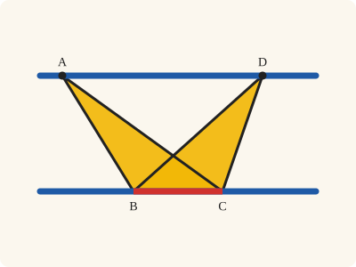
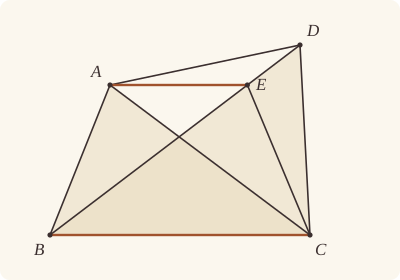
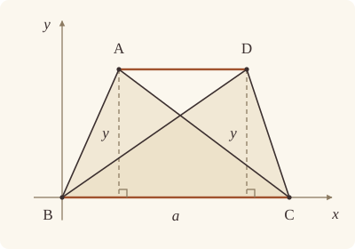

<!-- Generated by scripts/render.py. Do not edit by hand. -->

[Book I](index.md) · [← I.38](38.md) · [I.40 →](40.md)

# Book I, Proposition 39

*Equal triangles on the same base are in the same parallels*

[Euclid's proof](#euclids-proof) · [In Lean](#in-lean) · [What it rests on](#what-it-rests-on) · [Mishnah](#mishnah)

> Equal triangles which are on the same base and on the same side are also in the same parallels.

**In Lean:** ✅ proved, as Euclid states it · Euclid's argument

<p align="center"></p>

<p align="center"><em>If the triangles ABC, DBC on the same base BC (red), and on the same side of it, are equal in area (yellow), the straight line AD through their tips is parallel to the base (blue).</em></p>

## Euclid's proof

<p align="center"></p>

<p align="center"><em>Drawn for one case: E on BD between B and D, as in Heath's figure. AE is drawn level, as the proof supposes; Heath draws AD level. Like Heath's, this figure draws Euclid's impossible supposition: AE parallel to BC with E strictly between B and D, while the triangles ABC and DBC are assumed equal in area. Their drawn areas are unequal.</em></p>

Let ABC, DBC be equal triangles which are on the same base BC and on the same side of it;

[I say that they are also in the same parallels.]

And [For] let AD be joined;

I say that AD is parallel to BC.

For, if not, let AE be drawn through the point A parallel to the straight line BC, [I. 31] and let EC be joined.

Therefore the triangle ABC is equal to the triangle EBC; for it is on the same base BC with it and in the same parallels. [I. 37]

But ABC is equal to DBC; therefore DBC is also equal to EBC, [C.N. 1] the greater to the less: which is impossible.

Therefore AE is not parallel to BC.

Similarly we can prove that neither is any other straight line except AD; therefore AD is parallel to BC.

Therefore etc.

## In Lean

| | |
|---|---|
| Proof | ✅ Proved |
| Statement | The whole enunciation. Our statement takes A and D apart, so that AD names a straight line, and reads "in the same parallels" as AD parallel to BC. |
| Argument | Euclid's. Euclid's reductio: supposing AD not parallel to BC makes the parallel through A meet BD away from D. I.37 and Common Notion 1 give equal areas, contradicted by a strict area comparison in either order on the ray from B through D. |
| Reviewed | The statement and every passage of the argument read against Heath's text, at commit [`ece9c2d71`](https://github.com/jackChallis/stoicheia/commit/ece9c2d71) ([the record](../../review/I/39.toml)) |

From [`Elements/BookI/Prop39.lean`](../../Elements/BookI/Prop39.lean). Euclid's sentences are the `--` comments, and our own notes are in `/- … -/`; the lines under each sentence are the Lean that carries it out. The list below marks where a lemma does a step Euclid takes for granted, where several sentences share one step, where the Lean takes a case Euclid's figure leaves aside and where the statement already gives a step; the `/- … -/` notes in the listing explain smaller adjustments.

**How the Lean follows the text**

- **Already given.** "I say that they are also in the same parallels." The statement gives the goal, AD parallel to BC. The distinct vertices A and D name AD; its parallelism remains to be proved, so nothing is drawn here.
- **Done by `Prop30.meet`.** "and let EC be joined." Euclid takes E where the parallel through A meets BD. The Lean proves that this meeting exists by I.30 (`Prop30.meet`), then joins EC by Postulate 1.
- **A further case.** "But ABC is equal to DBC…" The same-side hypothesis puts E on the ray from B through D, and the contrary supposition excludes E = D. If E is between B and D, EBC is less than DBC; if E is beyond D, DBC is less than EBC, so either order contradicts their equal areas.
- **Carried together.** "Therefore AE is not parallel to BC." The preceding strict-area contradiction rules out the proposed parallel meeting BD away from D.
- **Carried together.** "Similarly we can prove that neither is any other straight line except AD…" The same contradiction excludes any proposed parallel through A meeting BD away from D, discharging the supposition that AD is not parallel to BC. The final step returns this conclusion.

```lean
/-- Equal triangles which are on the same base and on the same side are also in the same parallels. -/
theorem Prop39 {A B C D : Point} (hABC : Triangle A B C) (hDBC : Triangle D B C)
    (heq : △ A B C = △ D B C) (hside : SameSideOf A D B C) (hAD : A ≠ D) :
    AreParallel A D B C := by
  -- Let ABC, DBC be equal triangles which are on the same base BC and on the same side of it;
  obtain ⟨BC, hB, hC⟩ := Postulate1 B C hABC.ne₂₃
  -- [I say that they are also in the same parallels.]
  -- And [For] let AD be joined;
  /- AD names the straight line through the distinct vertices A and D; that it is
     parallel to BC remains to be proved. -/
  -- I say that AD is parallel to BC.
  have hpar : AreParallel A D B C := by
    -- For, if not, let AE be drawn through the point A parallel to the straight line BC, [I. 31]
    refine Classical.byContradiction fun hnot => ?_
    /- The parallel through A is the straight line K (`Prop31.line`), which Euclid
       calls AE once E has been found. -/
    obtain ⟨K, hA_K, hKBC⟩ := Prop31.line (hABC.bca.off_line hB hC)
    -- and let EC be joined.
    /- E is where the parallel meets BD (`Prop30.meet`). -/
    obtain ⟨BD, hB_BD, hD_BD⟩ := Postulate1 B D hDBC.ne₁₂.symm
    have hD_BC : ¬ OnLine D BC := hDBC.bca.off_line hB hC
    have hBD_BC : BD ≠ BC := fun e => hD_BC (e ▸ hD_BD)
    obtain ⟨E, hE_BD, hE_K⟩ := Prop30.meet hKBC hB hB_BD hBD_BC
    have hE_BC : ¬ OnLine E BC := hKBC.not_onLine hE_K
    have hEBC : Triangle E B C := (Triangle.of_line hB hC hABC.ne₂₃ hE_BC).cab
    obtain ⟨EC, hE_EC, hC_EC⟩ := Postulate1 E C hEBC.ne₁₃
    -- Therefore the triangle ABC is equal to the triangle EBC; for it is on the same base BC
    -- with it and in the same parallels. [I. 37]
    have h37 : △ A B C = △ E B C :=
      Prop37 hABC hEBC ⟨K, BC, hKBC, hA_K, hE_K, hB, hC⟩
    -- But ABC is equal to DBC; therefore DBC is also equal to EBC, [C.N. 1] the greater to the
    -- less: which is impossible.
    have h1 : △ D B C = △ E B C := CommonNotion1 heq.symm h37.symm
    /- The parallel puts E on A's side of BC, hence on D's side. Since E is on
       BD, it lies on the ray from B through D. -/
    have hEB : E ≠ B := fun e => hE_BC (e ▸ hB)
    have hED_side : SameSideOf E D B C :=
      (SameSideOf.of_line hABC.ne₂₃ hB hC (hKBC.sameSide hE_K hA_K)).trans hside
    have hray : OnRay E B D :=
      OnRay.of_sameSideOf hED_side ⟨BD, hB_BD, hD_BD, hE_BD⟩ hEB
    /- If E were D, the parallel through A would be AD, contrary to the supposition. -/
    have hED : E ≠ D := fun e => hnot
      (AreParallel.of_parallel hAD hABC.ne₂₃ hA_K (e ▸ hE_K) hB hC hKBC)
    /- In Heath's figure E is between B and D, so EBC is the less. The same-side
       condition excludes B between E and D. If E is beyond D, DBC is the less:
       the other order gives the same contradiction by `area_lt_of_cut`. -/
    rcases between_cases hEB.symm hED hDBC.ne₁₂.symm hB_BD hE_BD hD_BD with h | h | h
    · have hless := area_lt_of_cut hDBC.cba h
      rw [← area_cba E B C, ← area_cba D B C] at hless
      exact Magnitude.ne_of_lt hless h1.symm
    · exact hray.2.2.2 h
    · have hless := area_lt_of_cut hEBC.cba h
      rw [← area_cba D B C, ← area_cba E B C] at hless
      exact Magnitude.ne_of_lt hless h1
  -- Therefore AE is not parallel to BC.
  -- Similarly we can prove that neither is any other straight line except AD; therefore AD is
  -- parallel to BC.
  /- The contradiction excludes a proposed parallel meeting BD away from D,
     and discharges the supposition that AD is not parallel to BC. -/
  -- Therefore etc.
  exact hpar
```

## What it rests on

| | |
|---|---|
| Heath's references | [I.31](31.md), [I.37](37.md); C.N. 1 |
| Lean cites | [I.30](30.md), [I.31](31.md), [I.37](37.md) |
| Postulates | 1, 2, 3, 4, 5 |
| Definitions taken as axioms | Def. I.15 |
| Common Notions | 1, 2, 3, 4, 5 |
| Tacit rules | 39 (listed below) |
| Its own Lean calls | Postulate 1; 1 tacit rule |
| Through lemmas | Postulates 2 and 3; Def. I.15; 34 tacit rules |

Some of these come in through lemmas [shared](../../CERTIFICATE.md#shared-steps) by many proofs: [`Prop30.meet`](../../Elements/BookI/HelpersParallels.lean#L41) (I.30); [`Prop31.line`](../../Elements/BookI/Prop31.lean#L79) (I.31).

_Postulates, definitions, Common Notions and tacit rules: all that this proof rests on, counting those of the propositions it cites. The last two rows say which of the postulates, definitions and tacit rules its own Lean calls, in the proof or a helper written for it, and which it does not call but reaches through lemmas, of Book Zero or shared (a proposition it cites may rest on these too); the rest come in only through the propositions it cites or the Common Notions._

<details><summary>The 39 tacit rules beneath this proof, counting those of the propositions it cites</summary>

_(used here) marks a rule this proof's own Lean calls, in the proof or a helper written for it; (through …) marks one its own Lean does not call but reaches through the lemmas named, of [Book Zero](../../Elements/Figure) or shared, though a proposition it cites may rest on it too; and a rule with no mark comes in only through a proposition it cites or a Common Notion. The names in brackets are System E's: an Intersection rule says when straight lines and circles must meet, and an Intersections rule takes a point where they do (see [Book I's introduction](index.md))._

**Reading the figure**

- [`between_cases`](../../Elements/Foundations/Tacit/Diagram.lean#L54) (used here): Of three different points on a straight line, one is between the other two. (Between 6)
- [`between_of_inside_chord`](../../Elements/Foundations/Tacit/Diagram.lean#L81) (through [`OnRay.of_sameSideOf`](../../Elements/Figure/Angles.lean#L188), [`Prop31.line`](../../Elements/BookI/Prop31.lean#L79), [`SameSideOf.trans`](../../Elements/Figure/Sides.lean#L55) and 2 other lemmas): A straight line through a point inside a circle has that point between the points where it meets the circle. (Circle 1)
- [`between_symm`](../../Elements/Foundations/Tacit/Diagram.lean#L47) (through [`OnRay.of_sameSideOf`](../../Elements/Figure/Angles.lean#L188), [`area_cba`](../../Elements/Figure/Areas.lean#L77) and [`area_lt_of_cut`](../../Elements/Figure/Areas.lean#L118)): If B is between A and C, it is between C and A. (Between 1)
- [`circles_meet`](../../Elements/Foundations/Tacit/Diagram.lean#L94) (through [`OnRay.of_sameSideOf`](../../Elements/Figure/Angles.lean#L188), [`Prop31.line`](../../Elements/BookI/Prop31.lean#L79), [`SameSideOf.trans`](../../Elements/Figure/Sides.lean#L55) and 2 other lemmas): If each circle passes through a point inside the other, the circles cut one another. This is the step Euclid takes for granted in I.1. (Intersection 5)
- [`circles_meet_same_side`](../../Elements/Foundations/Tacit/Constructions.lean#L79) (through [`OnRay.of_sameSideOf`](../../Elements/Figure/Angles.lean#L188), [`Prop31.line`](../../Elements/BookI/Prop31.lean#L79), [`SameSideOf.trans`](../../Elements/Figure/Sides.lean#L55) and 2 other lemmas): Two circles that cut one another do so on each side of the straight line through their centres. (Intersections 8)
- [`exists_point`](../../Elements/Foundations/Tacit/Constructions.lean#L35) (through [`Triangle.ne₁₂`](../../Elements/Figure/Triangles.lean#L22), [`Triangle.ne₁₃`](../../Elements/Figure/Triangles.lean#L36), [`Triangle.ne₂₃`](../../Elements/Figure/Triangles.lean#L29) and 2 other lemmas): Let a point be taken. (Points 1)
- [`exists_point_inside_circle`](../../Elements/Foundations/Tacit/Constructions.lean#L42) (through [`OnRay.of_sameSideOf`](../../Elements/Figure/Angles.lean#L188), [`Prop31.line`](../../Elements/BookI/Prop31.lean#L79), [`SameSideOf.trans`](../../Elements/Figure/Sides.lean#L55) and 2 other lemmas): Let a point be taken inside the circle α. (Points 8)
- [`exists_point_on_line`](../../Elements/Foundations/Tacit/Constructions.lean#L38) (through [`OnRay.of_sameSideOf`](../../Elements/Figure/Angles.lean#L188), [`Prop30.meet`](../../Elements/BookI/HelpersParallels.lean#L41), [`Prop31.line`](../../Elements/BookI/Prop31.lean#L79) and 3 other lemmas): Let a point be taken on the straight line L. (Points 2)
- [`line_circle_between`](../../Elements/Foundations/Tacit/Constructions.lean#L67) (through [`OnRay.of_sameSideOf`](../../Elements/Figure/Angles.lean#L188), [`Prop31.line`](../../Elements/BookI/Prop31.lean#L79), [`SameSideOf.trans`](../../Elements/Figure/Sides.lean#L55) and 2 other lemmas): A straight line through a point B inside a circle, heading out to a point C outside it, cuts the circle between B and C. (Intersections 4)
- [`line_circle_beyond`](../../Elements/Foundations/Tacit/Constructions.lean#L73) (through [`OnRay.of_sameSideOf`](../../Elements/Figure/Angles.lean#L188), [`Prop31.line`](../../Elements/BookI/Prop31.lean#L79), [`SameSideOf.trans`](../../Elements/Figure/Sides.lean#L55) and 2 other lemmas): A straight line through a point B inside a circle, produced beyond B away from C, cuts the circle there. (Intersections 5)
- [`line_unique`](../../Elements/Foundations/Tacit/Diagram.lean#L41) (through [`AreParallel.of_parallel`](../../Elements/Figure/Parallels.lean#L84), [`OnRay.of_sameSideOf`](../../Elements/Figure/Angles.lean#L188), [`Prop30.meet`](../../Elements/BookI/HelpersParallels.lean#L41) and 5 other lemmas): Two points determine a straight line. (Generalities 1)
- [`lines_meet_of_opposite_sides`](../../Elements/Foundations/Tacit/Diagram.lean#L89) (through [`Parallel.sameSide`](../../Elements/Figure/Parallels.lean#L54)): A straight line joining points on opposite sides of L crosses L. (Intersection 1)
- [`not_between_of_between`](../../Elements/Foundations/Tacit/Diagram.lean#L50) (through [`OnRay.of_sameSideOf`](../../Elements/Figure/Angles.lean#L188), [`Prop31.line`](../../Elements/BookI/Prop31.lean#L79), [`SameSideOf.trans`](../../Elements/Figure/Sides.lean#L55) and 2 other lemmas): If B is between A and C, then A is not between B and C. (Between 1)
- [`not_on_line_of_same_side`](../../Elements/Foundations/Tacit/Diagram.lean#L60) (through [`OnRay.of_sameSideOf`](../../Elements/Figure/Angles.lean#L188), [`Prop31.line`](../../Elements/BookI/Prop31.lean#L79), [`SameSideOf.trans`](../../Elements/Figure/Sides.lean#L55) and 2 other lemmas): Points on one side of a straight line are not on it. (Same side 3)
- [`pasch2`](../../Elements/Foundations/Tacit/Diagram.lean#L71) (through [`OnRay.of_sameSideOf`](../../Elements/Figure/Angles.lean#L188), [`Prop31.line`](../../Elements/BookI/Prop31.lean#L79), [`area_cba`](../../Elements/Figure/Areas.lean#L77) and 1 other lemma): If B is between A and C, A is on L and B is off it, then B and C are on the same side of L: a straight line that leaves L at A does not cross it again. (Pasch 2)
- [`same_side_trans`](../../Elements/Foundations/Tacit/Diagram.lean#L64) (through [`OnRay.of_sameSideOf`](../../Elements/Figure/Angles.lean#L188), [`Prop31.line`](../../Elements/BookI/Prop31.lean#L79), [`SameSideOf.trans`](../../Elements/Figure/Sides.lean#L55) and 2 other lemmas): Two points on the same side of a straight line as a third point are on the same side as each other. (Same side 4)

**Lengths, angles and areas**

- [`angle_add_of_inside`](../../Elements/Foundations/Tacit/Transfer.lean#L47) (through [`OnRay.of_sameSideOf`](../../Elements/Figure/Angles.lean#L188)): If D lies within the angle BAC, then BAC is made up of BAD and DAC. (Diagram-angle 2)
- [`angle_eq_of_same_rays`](../../Elements/Foundations/Tacit/Transfer.lean#L54): The angle doesn't change if its arms are traced through other points on the same rays. (Diagram-angle 4)
- [`angle_symm`](../../Elements/Foundations/Tacit/Metric.lean#L30): The angle ABC is the angle CBA. (Metric 4)
- [`area_add_of_between`](../../Elements/Foundations/Tacit/Transfer.lean#L70) (through [`area_cba`](../../Elements/Figure/Areas.lean#L77) and [`area_lt_of_cut`](../../Elements/Figure/Areas.lean#L118)): Cutting a triangle in two from a vertex adds up. (Diagram-area 2)
- [`area_congruent`](../../Elements/Foundations/Tacit/Metric.lean#L44): Triangles equal in all their sides and angles are equal in area. Euclid uses this without comment once he has shown two triangles congruent. (Metric 9)
- [`area_degenerate`](../../Elements/Foundations/Tacit/Metric.lean#L36) (through [`area_cba`](../../Elements/Figure/Areas.lean#L77) and [`area_lt_of_cut`](../../Elements/Figure/Areas.lean#L118)): A "triangle" with a repeated corner has no area. (Metric 6)
- [`area_eq_zero_of_on_line`](../../Elements/Foundations/Tacit/Transfer.lean#L62) (through [`area_cba`](../../Elements/Figure/Areas.lean#L77) and [`area_lt_of_cut`](../../Elements/Figure/Areas.lean#L118)): A "triangle" whose corners lie on one straight line has no area. (Diagram-area 1)
- [`area_rotate`](../../Elements/Foundations/Tacit/Metric.lean#L39) (through [`area_cba`](../../Elements/Figure/Areas.lean#L77) and [`area_lt_of_cut`](../../Elements/Figure/Areas.lean#L118)): The triangle ABC is the triangle CAB. (Metric 8)
- [`circle_eq`](../../Elements/Foundations/Tacit/Transfer.lean#L30) (through [`OnRay.of_sameSideOf`](../../Elements/Figure/Angles.lean#L188), [`Prop31.line`](../../Elements/BookI/Prop31.lean#L79), [`SameSideOf.trans`](../../Elements/Figure/Sides.lean#L55) and 2 other lemmas): A circle is fixed by its centre and its radius. (Diagram-segment 2)
- [`len_add_of_between`](../../Elements/Foundations/Tacit/Transfer.lean#L27) (through [`OnRay.of_sameSideOf`](../../Elements/Figure/Angles.lean#L188), [`Prop31.line`](../../Elements/BookI/Prop31.lean#L79), [`SameSideOf.trans`](../../Elements/Figure/Sides.lean#L55) and 2 other lemmas): If B is between A and C, then AB and BC together make up AC. (Diagram-segment 1)
- [`len_self`](../../Elements/Foundations/Tacit/Metric.lean#L24) (through [`OnRay.of_sameSideOf`](../../Elements/Figure/Angles.lean#L188), [`Prop31.line`](../../Elements/BookI/Prop31.lean#L79), [`SameSideOf.trans`](../../Elements/Figure/Sides.lean#L55) and 2 other lemmas): The "straight line" from a point to itself has no length. (Metric 1)
- [`len_symm`](../../Elements/Foundations/Tacit/Metric.lean#L27) (through [`OnRay.of_sameSideOf`](../../Elements/Figure/Angles.lean#L188), [`Prop31.line`](../../Elements/BookI/Prop31.lean#L79), [`SameSideOf.trans`](../../Elements/Figure/Sides.lean#L55) and 2 other lemmas): The straight line AB is the straight line BA. (Metric 3)
- [`on_line_of_area_eq_zero`](../../Elements/Foundations/Tacit/Transfer.lean#L66) (through [`area_lt_of_cut`](../../Elements/Figure/Areas.lean#L118)): A triangle with no area has its corners on one straight line. (Diagram-area 1)
- [`same_ray_of_angle_eq_zero`](../../Elements/Foundations/Tacit/Transfer.lean#L42) (through [`OnRay.of_sameSideOf`](../../Elements/Figure/Angles.lean#L188)): If the angle BAC is nothing, C lies on the ray from A through B. (Diagram-angle 1)

**Superposition**

- [`superposition`](../../Elements/Foundations/Tacit/Superposition.lean#L52): **Superposition.** A hypothetical placement of a triangle on a given ray and side permits a restricted derivation of metric equalities about the figure already given. The derivation introduces no further objects, cites each geometric law it uses, and exports no symbol of the placement.

**Laws of magnitude**

- [`add_assoc`](../../Elements/Foundations/Tacit/Magnitudes.lean#L23) (through [`area_cba`](../../Elements/Figure/Areas.lean#L77) and [`area_lt_of_cut`](../../Elements/Figure/Areas.lean#L118)): Adding three magnitudes in a row, it makes no difference whether the first two or the last two are added first. (System E §3.5)
- [`add_comm`](../../Elements/Foundations/Tacit/Magnitudes.lean#L26) (through [`OnRay.of_sameSideOf`](../../Elements/Figure/Angles.lean#L188), [`Prop31.line`](../../Elements/BookI/Prop31.lean#L79), [`SameSideOf.trans`](../../Elements/Figure/Sides.lean#L55) and 2 other lemmas): The order of adding does not matter. (System E §3.5)
- [`add_lt_add_right`](../../Elements/Foundations/Tacit/Magnitudes.lean#L45) (through [`area_cba`](../../Elements/Figure/Areas.lean#L77) and [`area_lt_of_cut`](../../Elements/Figure/Areas.lean#L118)): Adding the same thing to both sides keeps "less than". (System E §3.5)
- [`add_zero`](../../Elements/Foundations/Tacit/Magnitudes.lean#L29) (through [`area_lt_of_cut`](../../Elements/Figure/Areas.lean#L118)): Adding nothing changes nothing. (System E §3.5)
- [`lt_irrefl`](../../Elements/Foundations/Tacit/Magnitudes.lean#L32) (through [`Magnitude.ne_of_lt`](../../Elements/Figure/Lengths.lean#L42), [`OnRay.of_sameSideOf`](../../Elements/Figure/Angles.lean#L188), [`Prop31.line`](../../Elements/BookI/Prop31.lean#L79) and 3 other lemmas): No magnitude is less than itself. (System E §3.5)
- [`lt_trans`](../../Elements/Foundations/Tacit/Magnitudes.lean#L35) (through [`OnRay.of_sameSideOf`](../../Elements/Figure/Angles.lean#L188), [`Prop31.line`](../../Elements/BookI/Prop31.lean#L79), [`SameSideOf.trans`](../../Elements/Figure/Sides.lean#L55) and 2 other lemmas): What is less than the less is less still. (System E §3.5)
- [`lt_trichotomy`](../../Elements/Foundations/Tacit/Magnitudes.lean#L39) (through [`OnRay.of_sameSideOf`](../../Elements/Figure/Angles.lean#L188), [`Prop31.line`](../../Elements/BookI/Prop31.lean#L79), [`SameSideOf.trans`](../../Elements/Figure/Sides.lean#L55) and 2 other lemmas): Of two magnitudes, one is less, or they are equal, or the other is less. (System E §3.5)
- [`not_lt_zero`](../../Elements/Foundations/Tacit/Magnitudes.lean#L42) (through [`OnRay.of_sameSideOf`](../../Elements/Figure/Angles.lean#L188), [`Prop31.line`](../../Elements/BookI/Prop31.lean#L79), [`SameSideOf.trans`](../../Elements/Figure/Sides.lean#L55) and 2 other lemmas): Nothing is less than zero. (System E §3.5)

</details>

## Mishnah

_Our commentary: what Euclid assumes, what Lean made us say out loud, and how the result looks by modern means._

In Heath's words, "This theorem is of course the *partial* converse of I. 37" (vol. 1, p. 337): I.37's base and its conclusion, equal areas, are the hypotheses here, and its parallels the conclusion. One hypothesis is new. "The additional qualification in this proposition that the triangles must be *on the same side* of the base is necessary because it is not, as in I. 37, involved in the other hypotheses" (Heath, vol. 1, p. 337): equal triangles on opposite sides of BC need not make AD parallel to BC.

Proclus remarks, Heath reports, "that Euclid only converts I. 37 and I. 38 relative to triangles, and omits the converses of I. 35, 36 about parallelograms as unnecessary because it is easy to see that the method would be the same, and therefore the reader may properly be left to prove them for himself" (vol. 1, p. 337). Proclus counts I.40 among Euclid's; [I.40](40.md) tells why Heath prints it in brackets. One sentence of I.39 is in brackets too, "I say that they are also in the same parallels." J. L. Heiberg proved from a papyrus fragment, Heath reports, that it was added by someone "who did not observe that the words 'And let AD be joined' are part of the *setting-out*" (vol. 1, p. 337). Taking those words for the construction, the interpolator thought the thing to be proved should be stated first, and altered "And" into "For".

**"The greater to the less."** Heath's figure puts E between B and D, where EBC is plainly a part of DBC. The proof is, as Proclus points out, "equally easy" when the parallel meets BD produced beyond D (Heath, vol. 1, p. 337), and then DBC is the less; our proof takes both orders, and the same side of BC rules out the third.

**The modern way.** Put $\mathrm{B} = (0, 0)$ and $\mathrm{C} = (a, 0)$, with $a \gt 0$: a triangle on BC with its vertex at $(x, y)$ has area $\tfrac{1}{2}a|y|$. Equal areas give equal $|y|$, and the same side of BC gives $y$ one sign, so A and D are at one height and AD is parallel to BC.

<p align="center"></p>

## Further reading

- Coordinates, in which a triangle's height becomes the number y, owe much to René Descartes, and [*The Geometry of René Descartes*](https://archive.org/details/geometryofrenede0000davi_t0j4) (1925, free online), David Eugene Smith and Marcia L. Latham's translation, shows him turning ruler-and-compass problems into equations.
- Euclid's "if not" and "which is impossible" make a proof by contradiction: our Lean writes it with `Classical.byContradiction`, and Daniel J. Velleman's [*How To Prove It with Lean*](https://djvelleman.github.io/HTPIwL/) (free online) teaches it as the tactic `by_contra`, in §3.2, "Proofs Involving Negations and Conditionals" (also on [I.19](19.md)).

[Book I](index.md) · [← I.38](38.md) · [I.40 →](40.md)

---

<sub>Euclid's text: T. L. Heath, *The Thirteen Books of Euclid's Elements*, vol. 1 (Cambridge, 1908), p. 336; [scan leaf n356](https://archive.org/details/thirteenbookseu02heibgoog/page/n356); [figure on n356](https://archive.org/details/thirteenbookseu02heibgoog/page/n356). Public domain.</sub>

<sub>The tacit rules follow the System E of Jeremy Avigad, Edward Dean and John Mumma, read alongside LeanEuclid (Logan Murphy, Kaiyu Yang, Jialiang Sun, Zhaoyu Li, Anima Anandkumar and Xujie Si).</sub>
