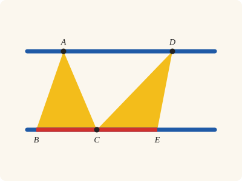
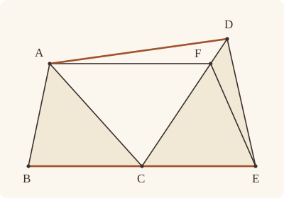
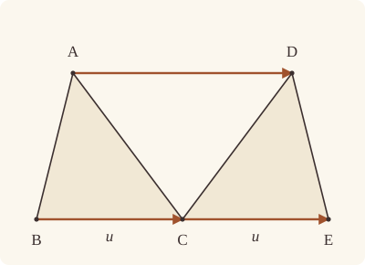

<!-- Generated by scripts/render.py. Do not edit by hand. -->

[Book I](index.md) · [← I.39](39.md) · [I.41 →](41.md)

# Book I, Proposition 40

*Equal triangles on equal bases are in the same parallels*

[Euclid's proof](#euclids-proof) · [In Lean](#in-lean) · [What it rests on](#what-it-rests-on) · [Mishnah](#mishnah)

> [Equal triangles which are on equal bases and on the same side are also in the same parallels.

_Heath prints this whole proposition in square brackets; the mishnah tells why._

**In Lean:** ✅ proved, as the text states it · the argument Heath prints

<p align="center"></p>

<p align="center"><em>If the triangles ABC, CDE on equal bases BC, CE (red) in one straight line, and on the same side of it, are equal in area (yellow), the straight line AD through their tips is parallel to BE (blue).</em></p>

## Euclid's proof

<p align="center"></p>

<p align="center"><em>Drawn for one case: the bases BC and CE meeting at C, with F on CD between C and D, as in Heath's figure. Heath draws AD level and AF sloping; our drawing puts AF level, as the proof supposes. Like Heath's, this figure draws Euclid's impossible supposition: AF parallel to BE with F strictly between C and D, while the triangles ABC and DCE on equal bases BC and CE are assumed equal in area. Their drawn areas are unequal.</em></p>

Let ABC, CDE be equal triangles on equal bases BC, CE and on the same side.

I say that they are also in the same parallels.

For let AD be joined;

I say that AD is parallel to BE.

For, if not, let AF be drawn through A parallel to BE [I. 31], and let FE be joined.

Therefore the triangle ABC is equal to the triangle FCE; for they are on equal bases BC, CE and in the same parallels BE, AF. [I. 38]

But the triangle ABC is equal to the triangle DCE; therefore the triangle DCE is also equal to the triangle FCE, [C.N. 1] the greater to the less: which is impossible.

Therefore AF is not parallel to BE.

Similarly we can prove that neither is any other straight line except AD; therefore AD is parallel to BE.

Therefore etc.

Q. E. D.]

## In Lean

| | |
|---|---|
| Proof | ✅ Proved, and its companions `Prop40.general` ([I.40 general](40.md#general)), `Prop40.join` ([I.40 join](40.md#join)) and `Prop40.special` ([I.40 special](40.md#special)) |
| Statement | The whole enunciation. `Prop40.general` takes equal bases anywhere on one straight line, `Prop40.join` gives AD parallel to the bases' line; `Prop40` keeps BC, CE end to end. |
| Argument | The argument Heath prints. Heath prints the whole proposition in brackets, as an interpolation (vol. 1, p. 338). The proof follows I.39's reductio with I.38 for I.37: assuming AD is not parallel to BE makes F distinct from D, and either order on CD contradicts equal areas. `Prop40.general` follows the same reductio for equal bases anywhere on one straight line, including coincident vertices. |
| Reviewed | The statement and every passage of the argument read against Heath's text, at commit [`a6253fb01`](https://github.com/dodecaplex-co/stoicheia/commit/a6253fb01) ([the record](../../review/I/40.toml)) |

From [`Elements/BookI/Prop40.lean`](../../Elements/BookI/Prop40.lean). Euclid's sentences are the `--` comments, and our own notes are in `/- … -/`; the lines under each sentence are the Lean that carries it out. The list below marks where a lemma does a step Euclid takes for granted, where several sentences share one step, where the Lean takes a case Euclid's figure leaves aside and where the statement already gives a step; the `/- … -/` notes in the listing explain smaller adjustments.

**How the Lean follows the text**

- **Already given.** "I say that they are also in the same parallels." The statement gives the goal, AD parallel to BE. The distinct vertices A and D name AD; its parallelism remains to be proved, so nothing is drawn here.
- **Done by `Prop30.meet`.** "For, if not, let AF be drawn through A parallel to BE…" Euclid draws AF parallel to BE and takes its meeting with CD at F from the figure. The Lean draws the parallel by I.31 (`Prop31.line`) and proves the meeting by I.30 (`Prop30.meet`); FE is named by its ends, as a side of the triangle FCE, so the Lean draws nothing for the join and does not call Postulate 1 for it. The join is drawn in the text and is not needed by the formal proof.
- **A further case.** "But the triangle ABC is equal to the triangle DCE…" If F lies between C and D, FCE is less than DCE; if F lies beyond D, DCE is less than FCE. Both contradict the equal areas, and the same-side condition excludes the opposite ray.
- **Carried together.** "Therefore AF is not parallel to BE." The preceding contradiction rules out the supposed parallel through A meeting CD away from D.
- **Carried together.** "Similarly we can prove that neither is any other straight line except AD…" The same reductio excludes any proposed parallel through A meeting CD away from D, in either order, so AD is parallel to BE; the closing sentences need no Lean of their own.

```lean
/-- Equal triangles which are on equal bases and on the same side are also in the same parallels. -/
theorem Prop40 {A B C D E : Point} (hABC : Triangle A B C) (hCDE : Triangle C D E)
    (hBCE : Between B C E) (hbase : ‖B C‖ = ‖C E‖) (heq : △ A B C = △ C D E)
    (hside : SameSideOf A D B E) (hAD : A ≠ D) :
    AreParallel A D B E := by
  -- Let ABC, CDE be equal triangles on equal bases BC, CE and on the same side.
  have hBE : B ≠ E := ne_of_between_ends hBCE
  obtain ⟨BE, hB, hE⟩ := Postulate1 B E hBE
  have hC : OnLine C BE := on_line_of_between_ends hBCE hB hE
  have hA_BE : ¬ OnLine A BE := hABC.bca.off_line hB hC
  have hD_BE : ¬ OnLine D BE := hCDE.acb.off_line hC hE
  -- I say that they are also in the same parallels.
  -- For let AD be joined;
  /- AD names the straight line through the distinct vertices A and D; that it is
     parallel to BE remains to be proved. -/
  -- I say that AD is parallel to BE.
  have hpar : AreParallel A D B E := by
    -- For, if not, let AF be drawn through A parallel to BE [I. 31], and let FE be joined.
    refine Classical.byContradiction fun hnot => ?_
    /- The parallel through A is the straight line K (`Prop31.line`), and F is where
       it meets CD (`Prop30.meet`). FE is named by its ends, as a side of the
       triangle FCE, so nothing is drawn for the join. -/
    obtain ⟨K, hA_K, hKBE⟩ := Prop31.line hA_BE
    obtain ⟨CD, hC_CD, hD_CD⟩ := Postulate1 C D hCDE.ne₁₂
    obtain ⟨F, hF_CD, hF_K⟩ :=
      Prop30.meet hKBE hC hC_CD (fun e => hD_BE (e ▸ hD_CD))
    have hF_BE : ¬ OnLine F BE := hKBE.not_onLine hF_K
    have hFCE : Triangle F C E := (Triangle.of_line hC hE hCDE.ne₁₃ hF_BE).cab
    -- Therefore the triangle ABC is equal to the triangle FCE; for they are on equal bases BC,
    -- CE and in the same parallels BE, AF. [I. 38]
    have h38 : △ A B C = △ F C E :=
      Prop38 hABC hFCE hbase ⟨K, BE, hKBE, hA_K, hF_K, hB, hC, hC, hE⟩
    -- But the triangle ABC is equal to the triangle DCE; therefore the triangle DCE is also
    -- equal to the triangle FCE, [C.N. 1] the greater to the less: which is impossible.
    have h1 : △ D C E = △ F C E :=
      CommonNotion1 ((area_bac C D E).symm.trans heq.symm) h38.symm
    /- F and D lie on the same side of CE, which is the straight line BE.
       Thus F lies on the ray from C through D. -/
    have hFD_side : SameSideOf F D C E :=
      SameSideOf.of_line hCDE.ne₁₃ hC hE
        (((SameSideOf.of_line hBE hB hE (hKBE.sameSide hF_K hA_K)).trans hside).sameSide hB hE)
    have hray : OnRay F C D :=
      OnRay.of_sameSideOf hFD_side ⟨CD, hC_CD, hD_CD, hF_CD⟩ (fun e => hF_BE (e ▸ hC))
    /- If F were D, the parallel through A would be AD, contrary to the supposition. -/
    have hFD : F ≠ D := fun e => hnot
      (AreParallel.of_parallel hAD hBE hA_K (e ▸ hF_K) hB hE hKBE)
    have hCF : C ≠ F := fun e => hF_BE (e ▸ hC)
    /- Euclid's case has F between C and D, making FCE less than DCE.
       Beyond D, DCE is less than FCE. The same-side condition excludes the opposite ray. -/
    rcases between_cases hCF hFD hCDE.ne₁₂ hC_CD hF_CD hD_CD with h | h | h
    · have hless := area_lt_of_cut hCDE.bac.cba h
      rw [← area_cba F C E, ← area_cba D C E] at hless
      exact Magnitude.ne_of_lt hless h1.symm
    · exact hray.2.2.2 h
    · have hless := area_lt_of_cut hFCE.cba h
      rw [← area_cba D C E, ← area_cba F C E] at hless
      exact Magnitude.ne_of_lt hless h1
  -- Therefore AF is not parallel to BE.
  -- Similarly we can prove that neither is any other straight line except AD; therefore AD is
  -- parallel to BE.
  -- Therefore etc.
  -- Q. E. D.]
  exact hpar
```

<a name="general"></a><a name="join"></a><a name="special"></a>

<details><summary>After the theorem, its companions, <code>Prop40.general</code>, <code>Prop40.join</code> and <code>Prop40.special</code> (92 lines)</summary>

```lean
/-- **I.40, general** (companion of I.40). Equal triangles ABC, DEF on equal bases BC, EF
of one straight line L, and on the same side of it, are in the same parallels: A and D lie
on one straight line parallel to L. The bases may be apart, touching, overlapping or one,
and named either way along L; the vertices may be one point, and then the parallel is the
one through it. -/
theorem Prop40.general {A B C D E F : Point} {L : Line} (hABC : Triangle A B C)
    (hDEF : Triangle D E F) (hB : OnLine B L) (hC : OnLine C L) (hE : OnLine E L)
    (hF : OnLine F L) (hbase : ‖B C‖ = ‖E F‖) (heq : △ A B C = △ D E F)
    (hside : SameSide A D L) :
    ∃ M : Line, Parallel M L ∧ OnLine A M ∧ OnLine D M := by
  /- Suppose there is no parallel to L containing both A and D. -/
  refine Classical.byContradiction fun hnot => ?_
  /- "Let ABC, CDE be equal triangles": here the second triangle is DEF,
     and both bases lie on L. Each vertex is off that straight line. -/
  have hA_L : ¬ OnLine A L := hABC.bca.off_line hB hC
  have hD_L : ¬ OnLine D L := hDEF.bca.off_line hE hF
  /- "let AF be drawn through A parallel to BE [I. 31]": K is the parallel
     through A to the straight line L carrying both bases. -/
  obtain ⟨K, hA_K, hKL⟩ := Prop31.line hA_L
  /- "and let FE be joined": G, playing Euclid's F, is where K meets ED, as
     his F lies on CD (`Prop30.meet`). His FE is our GF, which closes the
     triangle GEF, his FCE. -/
  obtain ⟨ED, hE_ED, hD_ED⟩ := Postulate1 E D hDEF.ne₁₂.symm
  obtain ⟨G, hG_ED, hG_K⟩ :=
    Prop30.meet hKL hE hE_ED (fun e => hD_L (e ▸ hD_ED))
  have hG_L : ¬ OnLine G L := hKL.not_onLine hG_K
  have hGEF : Triangle G E F := (Triangle.of_line hE hF hDEF.ne₂₃ hG_L).cab
  /- "the triangle ABC is equal to the triangle FCE": ABC and GEF have equal
     bases on L and their vertices on K, so I.38 gives equal areas. -/
  have h38 : △ A B C = △ G E F :=
    Prop38 hABC hGEF hbase ⟨K, L, hKL, hA_K, hG_K, hB, hC, hE, hF⟩
  /- "the triangle DCE is also equal to the triangle FCE, [C.N. 1]":
     DEF and GEF are each equal to ABC. -/
  have h1 : △ D E F = △ G E F := CommonNotion1 heq.symm h38.symm
  /- "the greater to the less: which is impossible": G and A lie on the
     same side of L, hence G is on D's side. On ED this puts G on the ray
     from E through D. -/
  have hGD_L : SameSide G D L := same_side_trans (hKL.sameSide hA_K hG_K) hside
  have hGD_side : SameSideOf G D E F := SameSideOf.of_line hDEF.ne₂₃ hE hF hGD_L
  have hray : OnRay G E D :=
    OnRay.of_sameSideOf hGD_side ⟨ED, hE_ED, hD_ED, hG_ED⟩ (fun e => hG_L (e ▸ hE))
  /- If G were D, K would contain both vertices, even when A and D coincide,
     contrary to the supposition. -/
  have hGE : G ≠ E := fun e => hG_L (e ▸ hE)
  have hGD : G ≠ D := fun e => hnot ⟨K, hKL, hA_K, e ▸ hG_K⟩
  /- Between E and D, GEF is less than DEF; beyond D, DEF is less than GEF.
     Either order contradicts their equality, and the same-side condition excludes
     the opposite ray. -/
  rcases between_cases hGE.symm hGD hDEF.ne₁₂.symm hE_ED hG_ED hD_ED with h | h | h
  · have hless := area_lt_of_cut hDEF.cba h
    rw [← area_cba G E F, ← area_cba D E F] at hless
    exact Magnitude.ne_of_lt hless h1.symm
  · exact hray.2.2.2 h
  · have hless := area_lt_of_cut hGEF.cba h
    rw [← area_cba D E F, ← area_cba G E F] at hless
    exact Magnitude.ne_of_lt hless h1

/-- **I.40, the join** (companion of I.40). Under the hypotheses of `Prop40.general`, when
the vertices A and D are two points, the straight line AD joining them is parallel to the
base BC: Euclid's "AD is parallel to BE". -/
theorem Prop40.join {A B C D E F : Point} {L : Line} (hABC : Triangle A B C)
    (hDEF : Triangle D E F) (hB : OnLine B L) (hC : OnLine C L) (hE : OnLine E L)
    (hF : OnLine F L) (hbase : ‖B C‖ = ‖E F‖) (heq : △ A B C = △ D E F)
    (hside : SameSide A D L) (hAD : A ≠ D) :
    AreParallel A D B C := by
  /- "For let AD be joined": the general statement puts A and D on one
     parallel M to L, and the two distinct vertices determine that straight line. -/
  obtain ⟨M, hM, hA_M, hD_M⟩ :=
    Prop40.general hABC hDEF hB hC hE hF hbase heq hside
  /- "therefore AD is parallel to BE": the distinct points A and D name M,
     and the distinct ends B and C of the first base name L. -/
  exact AreParallel.of_parallel hAD hABC.ne₂₃ hA_M hD_M hB hC hM

/-- **I.40, special** (companion of I.40). The statement of `Prop40`, with the bases BC, CE
end to end, derived from `Prop40.general`: it shows that the general statement contains
Euclid's configuration. The second triangle, CDE, is the triangle DCE on the base
CE, and L is the straight line BE. -/
theorem Prop40.special {A B C D E : Point} (hABC : Triangle A B C) (hCDE : Triangle C D E)
    (hBCE : Between B C E) (hbase : ‖B C‖ = ‖C E‖) (heq : △ A B C = △ C D E)
    (hside : SameSideOf A D B E) (hAD : A ≠ D) :
    AreParallel A D B E := by
  have hBE : B ≠ E := ne_of_between_ends hBCE
  obtain ⟨BE, hB, hE⟩ := Postulate1 B E hBE
  have hC : OnLine C BE := on_line_of_between_ends hBCE hB hE
  obtain ⟨M, hM, hA_M, hD_M⟩ :=
    Prop40.general hABC hCDE.bac hB hC hC hE hbase (heq.trans (area_bac C D E))
      (hside.sameSide hB hE)
  exact AreParallel.of_parallel hAD hBE hA_M hD_M hB hE hM

/-- The check: `Prop40.special` has the statement of `Prop40` (checked by Lean, up to
unfolding definitions). -/
example : type_of% @Elements.BookI.Prop40 := @Prop40.special
```

</details>

## What it rests on

| | Proposition | `Prop40.general` | `Prop40.join` | `Prop40.special` |
|---|---|---|---|---|
| Heath's references | [I.31](31.md), [I.38](38.md); C.N. 1 | none | none | none |
| Lean cites | [I.30](30.md), [I.31](31.md), [I.38](38.md) | [I.30](30.md), [I.31](31.md), [I.38](38.md) | [I.40 general](40.md#general) | [I.40 general](40.md#general) |
| Postulates | 1, 2, 3, 4, 5 | 1, 2, 3, 4, 5 | 1, 2, 3, 4, 5 | 1, 2, 3, 4, 5 |
| Definitions taken as axioms | Def. I.15 | Def. I.15 | Def. I.15 | Def. I.15 |
| Common Notions | 1, 2, 3, 4, 5 | 1, 2, 3, 4, 5 | 1, 2, 3, 4, 5 | 1, 2, 3, 4, 5 |
| Tacit rules | 38 (listed below) | 38 (listed below) | 38 (listed below) | 38 (listed below) |
| Its own Lean calls | Postulate 1; 1 tacit rule | Postulate 1; 2 tacit rules | none | Postulate 1 |
| Through lemmas | Postulates 2 and 3; Def. I.15; 33 tacit rules | Postulates 2 and 3; Def. I.15; 32 tacit rules | Postulate 1; 2 tacit rules | Postulates 2 and 3; Def. I.15; 29 tacit rules |

Some of these come in through lemmas [shared](../../CERTIFICATE.md#shared-steps) by many proofs: [`Prop30.meet`](../../Elements/BookI/HelpersParallels.lean#L41) (I.30); [`Prop31.line`](../../Elements/BookI/Prop31.lean#L79) (I.31).

_Postulates, definitions, Common Notions and tacit rules: all that each proof rests on, counting those of the propositions it cites. The last two rows say which of the postulates, definitions and tacit rules its own Lean calls, in the proof or a helper written for it, and which it does not call but reaches through lemmas, of Book Zero or shared (a proposition it cites may rest on these too); the rest come in only through the propositions it cites or the Common Notions._

<details><summary>The 38 tacit rules beneath this proof, counting those of the propositions it cites</summary>

_(used here) marks a rule this proof's own Lean calls, in the proof or a helper written for it; (through …) marks one its own Lean does not call but reaches through the lemmas named, of [Book Zero](../../Elements/Figure) or shared, though a proposition it cites may rest on it too; and a rule with no mark comes in only through a proposition it cites or a Common Notion. The names in brackets are System E's: an Intersection rule says when straight lines and circles must meet, and an Intersections rule takes a point where they do (see [Book I's introduction](index.md))._

**Reading the figure**

- [`between_cases`](../../Elements/Foundations/Tacit/Diagram.lean#L54) (used here): Of three different points on a straight line, one is between the other two. (Between 6)
- [`between_symm`](../../Elements/Foundations/Tacit/Diagram.lean#L47) (through [`OnRay.of_sameSideOf`](../../Elements/Figure/Angles.lean#L188), [`area_bac`](../../Elements/Figure/Areas.lean#L73), [`area_cba`](../../Elements/Figure/Areas.lean#L77) and 1 other lemma): If B is between A and C, it is between C and A. (Between 1)
- [`circles_meet`](../../Elements/Foundations/Tacit/Diagram.lean#L91) (through [`OnRay.of_sameSideOf`](../../Elements/Figure/Angles.lean#L188), [`Prop31.line`](../../Elements/BookI/Prop31.lean#L79), [`SameSideOf.trans`](../../Elements/Figure/Sides.lean#L55) and 4 other lemmas): If each circle passes through a point inside the other, the circles cut one another. This is the step Euclid takes for granted in I.1. (Intersection 5)
- [`circles_meet_same_side`](../../Elements/Foundations/Tacit/Constructions.lean#L79) (through [`OnRay.of_sameSideOf`](../../Elements/Figure/Angles.lean#L188), [`Prop31.line`](../../Elements/BookI/Prop31.lean#L79), [`SameSideOf.trans`](../../Elements/Figure/Sides.lean#L55) and 4 other lemmas): Two circles that cut one another do so on each side of the straight line through their centres. (Intersections 8)
- [`exists_point`](../../Elements/Foundations/Tacit/Constructions.lean#L35) (through [`Triangle.ne₁₂`](../../Elements/Figure/Triangles.lean#L22), [`Triangle.ne₁₃`](../../Elements/Figure/Triangles.lean#L36), [`area_bac`](../../Elements/Figure/Areas.lean#L73) and 2 other lemmas): Let a point be taken. (Points 1)
- [`exists_point_inside_circle`](../../Elements/Foundations/Tacit/Constructions.lean#L42) (through [`OnRay.of_sameSideOf`](../../Elements/Figure/Angles.lean#L188), [`Prop31.line`](../../Elements/BookI/Prop31.lean#L79), [`SameSideOf.trans`](../../Elements/Figure/Sides.lean#L55) and 4 other lemmas): Let a point be taken inside the circle α. (Points 8)
- [`exists_point_on_line`](../../Elements/Foundations/Tacit/Constructions.lean#L38) (through [`OnRay.of_sameSideOf`](../../Elements/Figure/Angles.lean#L188), [`Prop30.meet`](../../Elements/BookI/HelpersParallels.lean#L41), [`Prop31.line`](../../Elements/BookI/Prop31.lean#L79) and 5 other lemmas): Let a point be taken on the straight line L. (Points 2)
- [`line_circle_between`](../../Elements/Foundations/Tacit/Constructions.lean#L67) (through [`OnRay.of_sameSideOf`](../../Elements/Figure/Angles.lean#L188), [`Prop31.line`](../../Elements/BookI/Prop31.lean#L79), [`SameSideOf.trans`](../../Elements/Figure/Sides.lean#L55) and 4 other lemmas): A straight line through a point B inside a circle, heading out to a point C outside it, cuts the circle between B and C. (Intersections 4)
- [`line_circle_beyond`](../../Elements/Foundations/Tacit/Constructions.lean#L73) (through [`OnRay.of_sameSideOf`](../../Elements/Figure/Angles.lean#L188), [`Prop31.line`](../../Elements/BookI/Prop31.lean#L79), [`SameSideOf.trans`](../../Elements/Figure/Sides.lean#L55) and 4 other lemmas): A straight line through a point B inside a circle, produced beyond B away from C, cuts the circle there. (Intersections 5)
- [`line_unique`](../../Elements/Foundations/Tacit/Diagram.lean#L41) (through [`AreParallel.of_parallel`](../../Elements/Figure/Parallels.lean#L84), [`OnRay.of_sameSideOf`](../../Elements/Figure/Angles.lean#L188), [`Prop30.meet`](../../Elements/BookI/HelpersParallels.lean#L41) and 6 other lemmas): Two points determine a straight line. (Generalities 1)
- [`lines_meet_of_opposite_sides`](../../Elements/Foundations/Tacit/Diagram.lean#L86) (through [`Parallel.sameSide`](../../Elements/Figure/Parallels.lean#L54)): A straight line joining points on opposite sides of L crosses L. (Intersection 1)
- [`not_between_of_between`](../../Elements/Foundations/Tacit/Diagram.lean#L50) (through [`OnRay.of_sameSideOf`](../../Elements/Figure/Angles.lean#L188), [`Prop31.line`](../../Elements/BookI/Prop31.lean#L79), [`SameSideOf.trans`](../../Elements/Figure/Sides.lean#L55) and 5 other lemmas): If B is between A and C, then A is not between B and C. (Between 1)
- [`not_on_line_of_same_side`](../../Elements/Foundations/Tacit/Diagram.lean#L60) (through [`OnRay.of_sameSideOf`](../../Elements/Figure/Angles.lean#L188), [`Prop31.line`](../../Elements/BookI/Prop31.lean#L79), [`SameSideOf.trans`](../../Elements/Figure/Sides.lean#L55) and 4 other lemmas): Points on one side of a straight line are not on it. (Same side 3)
- [`pasch2`](../../Elements/Foundations/Tacit/Diagram.lean#L71) (through [`OnRay.of_sameSideOf`](../../Elements/Figure/Angles.lean#L188), [`Prop31.line`](../../Elements/BookI/Prop31.lean#L79), [`Tacit.on_line_of_between_ends`](../../Elements/Figure/RuleBase.lean#L153) and 3 other lemmas): If B is between A and C, A is on L and B is off it, then B and C are on the same side of L: a straight line that leaves L at A does not cross it again. (Pasch 2)
- [`same_side_trans`](../../Elements/Foundations/Tacit/Diagram.lean#L64) (through [`OnRay.of_sameSideOf`](../../Elements/Figure/Angles.lean#L188), [`Prop31.line`](../../Elements/BookI/Prop31.lean#L79), [`SameSideOf.trans`](../../Elements/Figure/Sides.lean#L55) and 4 other lemmas): Two points on the same side of a straight line as a third point are on the same side as each other. (Same side 4)

**Lengths, angles and areas**

- [`angle_add_of_inside`](../../Elements/Foundations/Tacit/Transfer.lean#L47) (through [`OnRay.of_sameSideOf`](../../Elements/Figure/Angles.lean#L188)): If D lies within the angle BAC, then BAC is made up of BAD and DAC. (Diagram-angle 2)
- [`angle_eq_of_same_rays`](../../Elements/Foundations/Tacit/Transfer.lean#L54): The angle doesn't change if its arms are traced through other points on the same rays. (Diagram-angle 4)
- [`angle_symm`](../../Elements/Foundations/Tacit/Metric.lean#L30): The angle ABC is the angle CBA. (Metric 4)
- [`area_add_of_between`](../../Elements/Foundations/Tacit/Transfer.lean#L70) (through [`area_bac`](../../Elements/Figure/Areas.lean#L73), [`area_cba`](../../Elements/Figure/Areas.lean#L77) and [`area_lt_of_cut`](../../Elements/Figure/Areas.lean#L118)): Cutting a triangle in two from a vertex adds up. (Diagram-area 2)
- [`area_congruent`](../../Elements/Foundations/Tacit/Metric.lean#L44): Triangles equal in all their sides and angles are equal in area. Euclid uses this without comment once he has shown two triangles congruent. (Metric 9)
- [`area_degenerate`](../../Elements/Foundations/Tacit/Metric.lean#L36) (through [`area_bac`](../../Elements/Figure/Areas.lean#L73), [`area_cba`](../../Elements/Figure/Areas.lean#L77) and [`area_lt_of_cut`](../../Elements/Figure/Areas.lean#L118)): A "triangle" with a repeated corner has no area. (Metric 6)
- [`area_eq_zero_of_on_line`](../../Elements/Foundations/Tacit/Transfer.lean#L62) (through [`area_bac`](../../Elements/Figure/Areas.lean#L73), [`area_cba`](../../Elements/Figure/Areas.lean#L77) and [`area_lt_of_cut`](../../Elements/Figure/Areas.lean#L118)): A "triangle" whose corners lie on one straight line has no area. (Diagram-area 1)
- [`area_rotate`](../../Elements/Foundations/Tacit/Metric.lean#L39) (through [`area_bac`](../../Elements/Figure/Areas.lean#L73), [`area_cba`](../../Elements/Figure/Areas.lean#L77) and [`area_lt_of_cut`](../../Elements/Figure/Areas.lean#L118)): The triangle ABC is the triangle CAB. (Metric 8)
- [`len_add_of_between`](../../Elements/Foundations/Tacit/Transfer.lean#L27) (through [`OnRay.of_sameSideOf`](../../Elements/Figure/Angles.lean#L188), [`Prop31.line`](../../Elements/BookI/Prop31.lean#L79), [`SameSideOf.trans`](../../Elements/Figure/Sides.lean#L55) and 5 other lemmas): If B is between A and C, then AB and BC together make up AC. (Diagram-segment 1)
- [`len_self`](../../Elements/Foundations/Tacit/Metric.lean#L24) (through [`OnRay.of_sameSideOf`](../../Elements/Figure/Angles.lean#L188), [`Prop31.line`](../../Elements/BookI/Prop31.lean#L79), [`SameSideOf.trans`](../../Elements/Figure/Sides.lean#L55) and 5 other lemmas): The "straight line" from a point to itself has no length. (Metric 1)
- [`len_symm`](../../Elements/Foundations/Tacit/Metric.lean#L27) (through [`OnRay.of_sameSideOf`](../../Elements/Figure/Angles.lean#L188), [`Prop31.line`](../../Elements/BookI/Prop31.lean#L79), [`SameSideOf.trans`](../../Elements/Figure/Sides.lean#L55) and 4 other lemmas): The straight line AB is the straight line BA. (Metric 3)
- [`on_line_of_area_eq_zero`](../../Elements/Foundations/Tacit/Transfer.lean#L66) (through [`area_lt_of_cut`](../../Elements/Figure/Areas.lean#L118)): A triangle with no area has its corners on one straight line. (Diagram-area 1)
- [`radius_ne_zero`](../../Elements/Foundations/Tacit/Metric.lean#L62) (through [`OnRay.of_sameSideOf`](../../Elements/Figure/Angles.lean#L188), [`Prop31.line`](../../Elements/BookI/Prop31.lean#L79), [`SameSideOf.trans`](../../Elements/Figure/Sides.lean#L55) and 5 other lemmas): A circle's radius is not nothing: the straight line from the centre to a point on the circle has some length. A rule of our own, not one of System E's: every circle is drawn with a centre and a distance (Postulate 3).
- [`same_ray_of_angle_eq_zero`](../../Elements/Foundations/Tacit/Transfer.lean#L42) (through [`OnRay.of_sameSideOf`](../../Elements/Figure/Angles.lean#L188)): If the angle BAC is nothing, C lies on the ray from A through B. (Diagram-angle 1)

**Superposition**

- [`superposition`](../../Elements/Foundations/Tacit/Superposition.lean#L52): **Superposition.** A hypothetical placement of a triangle on a given ray and side permits a restricted derivation of metric equalities about the figure already given. The derivation introduces no further objects, cites each geometric law it uses, and exports no symbol of the placement.

**Rules of magnitude**

- [`add_assoc`](../../Elements/Foundations/Tacit/Magnitudes.lean#L23) (through [`area_bac`](../../Elements/Figure/Areas.lean#L73), [`area_cba`](../../Elements/Figure/Areas.lean#L77) and [`area_lt_of_cut`](../../Elements/Figure/Areas.lean#L118)): Adding three magnitudes in a row, it makes no difference whether the first two or the last two are added first. (System E §3.5)
- [`add_comm`](../../Elements/Foundations/Tacit/Magnitudes.lean#L26) (through [`OnRay.of_sameSideOf`](../../Elements/Figure/Angles.lean#L188), [`Prop31.line`](../../Elements/BookI/Prop31.lean#L79), [`SameSideOf.trans`](../../Elements/Figure/Sides.lean#L55) and 5 other lemmas): The order of adding does not matter. (System E §3.5)
- [`add_lt_add_right`](../../Elements/Foundations/Tacit/Magnitudes.lean#L45) (through [`area_bac`](../../Elements/Figure/Areas.lean#L73), [`area_cba`](../../Elements/Figure/Areas.lean#L77) and [`area_lt_of_cut`](../../Elements/Figure/Areas.lean#L118)): Adding the same thing to both sides keeps "less than". (System E §3.5)
- [`add_zero`](../../Elements/Foundations/Tacit/Magnitudes.lean#L29) (through [`area_lt_of_cut`](../../Elements/Figure/Areas.lean#L118)): Adding nothing changes nothing. (System E §3.5)
- [`lt_irrefl`](../../Elements/Foundations/Tacit/Magnitudes.lean#L32) (through [`Magnitude.ne_of_lt`](../../Elements/Figure/Lengths.lean#L42), [`OnRay.of_sameSideOf`](../../Elements/Figure/Angles.lean#L188), [`Prop31.line`](../../Elements/BookI/Prop31.lean#L79) and 5 other lemmas): No magnitude is less than itself. (System E §3.5)
- [`lt_trans`](../../Elements/Foundations/Tacit/Magnitudes.lean#L35) (through [`OnRay.of_sameSideOf`](../../Elements/Figure/Angles.lean#L188), [`Prop31.line`](../../Elements/BookI/Prop31.lean#L79), [`SameSideOf.trans`](../../Elements/Figure/Sides.lean#L55) and 4 other lemmas): What is less than the less is less still. (System E §3.5)
- [`lt_trichotomy`](../../Elements/Foundations/Tacit/Magnitudes.lean#L39) (through [`OnRay.of_sameSideOf`](../../Elements/Figure/Angles.lean#L188), [`Prop31.line`](../../Elements/BookI/Prop31.lean#L79), [`SameSideOf.trans`](../../Elements/Figure/Sides.lean#L55) and 5 other lemmas): Of two magnitudes, one is less, or they are equal, or the other is less. (System E §3.5)
- [`not_lt_zero`](../../Elements/Foundations/Tacit/Magnitudes.lean#L42) (through [`OnRay.of_sameSideOf`](../../Elements/Figure/Angles.lean#L188), [`Prop31.line`](../../Elements/BookI/Prop31.lean#L79), [`SameSideOf.trans`](../../Elements/Figure/Sides.lean#L55) and 5 other lemmas): Nothing is less than zero. (System E §3.5)

</details>

## Mishnah

_Our commentary: why Euclid's proof, and ours, look as they do._

Heath prints the whole proposition in square brackets, from its heading "[Proposition 40." to the closing "Q. E. D.]", and says why: "Heiberg has proved by means of the papyrus-fragment mentioned in the last note that this proposition is an interpolation by some one who thought that there should be a proposition following I. 39 and related to it in the same way as I. 38 is related to I. 37, and I. 36 to I. 35" (vol. 1, p. 338).

The fragment J. L. Heiberg used, of the second or third century, holds I.39 and I.41 one after the other, "showing that I. 40 was wanting, whereas it is found in all the MSS. and is recognised by Proclus"; it was added "although Euclid nowhere uses I. 40, and therefore was not likely to include it" (Heath, vol. 1, p. 51). Heath takes the same hand to have slipped the bracketed sentence into I.39, and I.40 repeats that sentence and its "For" with no brackets of their own. Heath prints the proposition, and so do we. The argument is I.39's again, with the equal bases BC, CE for the one base and I.38 for I.37.

**Two bases that touch.** Our main theorem takes the figure as it stands, with BC and CE meeting at C, though the enunciation, like I.38's, allows any two equal bases on one straight line. Our I.38 lets the bases share C, and lets F, where the parallel through A meets CD, be A itself, so neither needs a case of its own. The companion `Prop40.general` follows the same reductio for equal bases apart, touching, overlapping or one, and allows the two vertices to coincide.

**The modern way.** Let $\mathbf{u} = \mathrm{C - B}$, which is also $\mathrm{E - C}$, and take the cross product of [I.35](35.md). A and D lie on one side of BE, so the signed areas $\tfrac{1}{2}\mathbf{u} \times \mathrm{(A - B)}$ and $\tfrac{1}{2}\mathbf{u} \times \mathrm{(D - C)}$ have one sign. Their difference is $\tfrac{1}{2}\mathbf{u} \times \mathrm{(D - A)}$, since $\mathbf{u} \times \mathbf{u} = 0$, so equal areas make $\mathrm{D - A}$ a multiple of $\mathbf{u}$, and AD is parallel to BE.

<p align="center"></p>

## Further reading

- A proposition added by a later hand and kept ever since is one moment in the long life of the *Elements*, which Benjamin Wardhaugh's [*Encounters with Euclid*](https://press.princeton.edu/books/hardcover/9780691211695/encounters-with-euclid) (2021) follows from papyri and manuscripts to printed books and classrooms: a history of Euclid's text and of the scribes, translators, teachers and readers who carried it.
- The cross product of the modern way is reckoned from coordinates, and ch. 3, "Coordinates", of John Stillwell's [*The Four Pillars of Geometry*](https://doi.org/10.1007/0-387-29052-4) (2005) gives the plane its coordinates and writes its straight lines and circles as equations (also on [I.3](03.md)).

[Book I](index.md) · [← I.39](39.md) · [I.41 →](41.md)

---

<sub>Euclid's text: T. L. Heath, *The Thirteen Books of Euclid's Elements*, vol. 1 (Cambridge, 1908), pp. 337–338; [scan leaves n357–n358](https://archive.org/details/thirteenbookseu02heibgoog/page/n357); [figure on n357](https://archive.org/details/thirteenbookseu02heibgoog/page/n357). Public domain.</sub>

<sub>The tacit rules follow the System E of Jeremy Avigad, Edward Dean and John Mumma, read alongside LeanEuclid (Logan Murphy, Kaiyu Yang, Jialiang Sun, Zhaoyu Li, Anima Anandkumar and Xujie Si).</sub>
