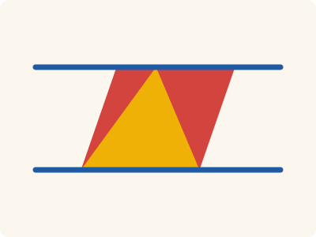
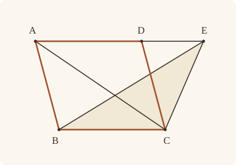

<!-- Generated by scripts/render.py. Do not edit by hand. -->

[Book I](index.md) · [← I.40](40.md) · [I.42 →](42.md)

# Book I, Proposition 41

*The parallelogram is double of the triangle*

[Euclid's proof](#euclids-proof) · [In Lean](#in-lean) · [What it rests on](#what-it-rests-on) · [Mishnah](#mishnah)

> If a parallelogram have the same base with a triangle and be in the same parallels, the parallelogram is double of the triangle.

**In Lean:** ✅ proved, as Euclid states it · Euclid's argument

<p align="center"></p>

<p align="center"><em>On the same base BC and between the same parallels (blue), here with E between A and D, the parallelogram ABCD is double of the triangle EBC (yellow): the two corners left over (red) together are equal to the triangle.</em></p>

## Euclid's proof

<p align="center"></p>

<p align="center"><em>Drawn for one case: E on AD produced beyond D, as in Heath's figure.</em></p>

For let the parallelogram ABCD have the same base BC with the triangle EBC, and let it be in the same parallels BC, AE;

I say that the parallelogram ABCD is double of the triangle BEC.

For let AC be joined.

Then the triangle ABC is equal to the triangle EBC; for it is on the same base BC with it and in the same parallels BC, AE. [I. 37]

But the parallelogram ABCD is double of the triangle ABC; for the diameter AC bisects it; [I. 34] so that the parallelogram ABCD is also double of the triangle EBC.

Therefore etc.

Q. E. D.

## In Lean

| | |
|---|---|
| Proof | ✅ Proved |
| Statement | The whole enunciation. E may be any point of the straight line AD, at A or at D among them. |
| Argument | Euclid's. |
| Reviewed | The statement and every passage of the argument read against Heath's text, at commit [`ddf3d618`](https://github.com/jackChallis/stoicheia/commit/ddf3d618) ([the record](../../review/I/41.toml)) |

From [`Elements/BookI/Prop41.lean`](../../Elements/BookI/Prop41.lean). Euclid's sentences are the `--` comments, and our own notes are in `/- … -/`; the lines under each sentence are the Lean that carries it out. The list below marks where the statement already gives a step; the `/- … -/` notes in the listing explain smaller adjustments.

**How the Lean follows the text**

- **Already given.** "I say that the parallelogram ABCD is double of the triangle BEC." The statement gives the goal, and AC needs no drawing: `quadArea A B C D` already measures ABCD by its diameter AC, as the triangles ABC and ACD together.

```lean
/-- If a parallelogram have the same base with a triangle and be in the same parallels, the
parallelogram is double of the triangle. -/
theorem Prop41 {A B C D E : Point} (hABCD : Parallelogram A B C D) (hE : Collinear A D E) :
    quadArea A B C D = △ B E C + △ B E C := by
  -- For let the parallelogram ABCD have the same base BC with the triangle EBC,
  -- and let it be in the same parallels BC, AE;
  obtain ⟨AE, hA_AE, hD_AE, hE_AE⟩ := hE
  obtain ⟨BC, hB, hC⟩ := Postulate1 B C hABCD.2.1
  have hpar : Parallel AE BC := (hABCD.2.parallel hB hC hD_AE hA_AE).symm
  -- I say that the parallelogram ABCD is double of the triangle BEC.
  -- For let AC be joined.
  /- The area `quadArea A B C D` already measures ABCD by its diameter AC,
     as the triangles ABC and ACD together. -/
  -- Then the triangle ABC is equal to the triangle EBC;
  -- for it is on the same base BC with it and in the same parallels BC, AE. [I. 37]
  have hEBC : Triangle E B C :=
    (Triangle.of_line hB hC hABCD.2.1 (hpar.not_onLine hE_AE)).cab
  have h37 : △ A B C = △ E B C :=
    Prop37 hABCD.triangle hEBC ⟨AE, BC, hpar, hA_AE, hE_AE, hB, hC⟩
  -- But the parallelogram ABCD is double of the triangle ABC;
  -- for the diameter AC bisects it; [I. 34]
  have h34 : quadArea A B C D = △ A B C + △ A B C := Prop34.bisect hABCD
  -- so that the parallelogram ABCD is also double of the triangle EBC.
  rw [h34, h37, area_bac E B C]
  -- Therefore etc.
  -- Q. E. D.
```

## What it rests on

| | |
|---|---|
| Heath's references | [I.34](34.md), [I.37](37.md) |
| Lean cites | [I.34](34.md), [I.37](37.md) |
| Postulates | 1, 2, 3, 4, 5 |
| Definitions taken as axioms | Def. I.15 |
| Common Notions | 1, 2, 3, 4, 5 |
| Tacit rules | 37 (listed below) |
| Its own Lean calls | Postulate 1 |
| Through lemmas | Postulates 2 and 3; Def. I.15; 29 tacit rules |

Some of these come in through lemmas [shared](../../CERTIFICATE.md#shared-steps) by many proofs: [`Prop34.bisect`](../../Elements/BookI/Prop34.lean#L101) (I.34).

_Postulates, definitions, Common Notions and tacit rules: all that this proof rests on, counting those of the propositions it cites. The last two rows say which of the postulates, definitions and tacit rules its own Lean calls, in the proof or a helper written for it, and which it does not call but reaches through lemmas, of Book Zero or shared (a proposition it cites may rest on these too); the rest come in only through the propositions it cites or the Common Notions._

<details><summary>The 37 tacit rules beneath this proof, counting those of the propositions it cites</summary>

_(used here) marks a rule this proof's own Lean calls, in the proof or a helper written for it; (through …) marks one its own Lean does not call but reaches through the lemmas named, of [Book Zero](../../Elements/Figure) or shared, though a proposition it cites may rest on it too; and a rule with no mark comes in only through a proposition it cites or a Common Notion. The names in brackets are System E's: an Intersection rule says when straight lines and circles must meet, and an Intersections rule takes a point where they do (see [Book I's introduction](index.md))._

**Reading the figure**

- [`between_cases`](../../Elements/Foundations/Tacit/Diagram.lean#L54) (through [`Prop34.bisect`](../../Elements/BookI/Prop34.lean#L101) and [`area_bac`](../../Elements/Figure/Areas.lean#L73)): Of three different points on a straight line, one is between the other two. (Between 6)
- [`between_symm`](../../Elements/Foundations/Tacit/Diagram.lean#L47) (through [`Prop34.bisect`](../../Elements/BookI/Prop34.lean#L101) and [`area_bac`](../../Elements/Figure/Areas.lean#L73)): If B is between A and C, it is between C and A. (Between 1)
- [`circles_meet`](../../Elements/Foundations/Tacit/Diagram.lean#L94) (through [`Prop34.bisect`](../../Elements/BookI/Prop34.lean#L101) and [`area_bac`](../../Elements/Figure/Areas.lean#L73)): If each circle passes through a point inside the other, the circles cut one another. This is the step Euclid takes for granted in I.1. (Intersection 5)
- [`circles_meet_same_side`](../../Elements/Foundations/Tacit/Constructions.lean#L79) (through [`Prop34.bisect`](../../Elements/BookI/Prop34.lean#L101) and [`area_bac`](../../Elements/Figure/Areas.lean#L73)): Two circles that cut one another do so on each side of the straight line through their centres. (Intersections 8)
- [`exists_point`](../../Elements/Foundations/Tacit/Constructions.lean#L35) (through [`Prop34.bisect`](../../Elements/BookI/Prop34.lean#L101) and [`area_bac`](../../Elements/Figure/Areas.lean#L73)): Let a point be taken. (Points 1)
- [`exists_point_inside_circle`](../../Elements/Foundations/Tacit/Constructions.lean#L42) (through [`Prop34.bisect`](../../Elements/BookI/Prop34.lean#L101) and [`area_bac`](../../Elements/Figure/Areas.lean#L73)): Let a point be taken inside the circle α. (Points 8)
- [`exists_point_on_line`](../../Elements/Foundations/Tacit/Constructions.lean#L38) (through [`Prop34.bisect`](../../Elements/BookI/Prop34.lean#L101) and [`area_bac`](../../Elements/Figure/Areas.lean#L73)): Let a point be taken on the straight line L. (Points 2)
- [`line_circle_between`](../../Elements/Foundations/Tacit/Constructions.lean#L67) (through [`Prop34.bisect`](../../Elements/BookI/Prop34.lean#L101) and [`area_bac`](../../Elements/Figure/Areas.lean#L73)): A straight line through a point B inside a circle, heading out to a point C outside it, cuts the circle between B and C. (Intersections 4)
- [`line_circle_beyond`](../../Elements/Foundations/Tacit/Constructions.lean#L73) (through [`Prop34.bisect`](../../Elements/BookI/Prop34.lean#L101) and [`area_bac`](../../Elements/Figure/Areas.lean#L73)): A straight line through a point B inside a circle, produced beyond B away from C, cuts the circle there. (Intersections 5)
- [`line_unique`](../../Elements/Foundations/Tacit/Diagram.lean#L41) (through [`Prop34.bisect`](../../Elements/BookI/Prop34.lean#L101), [`Triangle.of_line`](../../Elements/Figure/Triangles.lean#L82) and [`area_bac`](../../Elements/Figure/Areas.lean#L73)): Two points determine a straight line. (Generalities 1)
- [`lines_meet_of_opposite_sides`](../../Elements/Foundations/Tacit/Diagram.lean#L89): A straight line joining points on opposite sides of L crosses L. (Intersection 1)
- [`not_between_of_between`](../../Elements/Foundations/Tacit/Diagram.lean#L50) (through [`Prop34.bisect`](../../Elements/BookI/Prop34.lean#L101) and [`area_bac`](../../Elements/Figure/Areas.lean#L73)): If B is between A and C, then A is not between B and C. (Between 1)
- [`not_on_line_of_same_side`](../../Elements/Foundations/Tacit/Diagram.lean#L60) (through [`Prop34.bisect`](../../Elements/BookI/Prop34.lean#L101) and [`area_bac`](../../Elements/Figure/Areas.lean#L73)): Points on one side of a straight line are not on it. (Same side 3)
- [`pasch2`](../../Elements/Foundations/Tacit/Diagram.lean#L71) (through [`Prop34.bisect`](../../Elements/BookI/Prop34.lean#L101) and [`area_bac`](../../Elements/Figure/Areas.lean#L73)): If B is between A and C, A is on L and B is off it, then B and C are on the same side of L: a straight line that leaves L at A does not cross it again. (Pasch 2)
- [`same_side_trans`](../../Elements/Foundations/Tacit/Diagram.lean#L64) (through [`Prop34.bisect`](../../Elements/BookI/Prop34.lean#L101) and [`area_bac`](../../Elements/Figure/Areas.lean#L73)): Two points on the same side of a straight line as a third point are on the same side as each other. (Same side 4)

**Lengths, angles and areas**

- [`angle_add_of_inside`](../../Elements/Foundations/Tacit/Transfer.lean#L47): If D lies within the angle BAC, then BAC is made up of BAD and DAC. (Diagram-angle 2)
- [`angle_eq_of_same_rays`](../../Elements/Foundations/Tacit/Transfer.lean#L54): The angle doesn't change if its arms are traced through other points on the same rays. (Diagram-angle 4)
- [`angle_symm`](../../Elements/Foundations/Tacit/Metric.lean#L30): The angle ABC is the angle CBA. (Metric 4)
- [`area_add_of_between`](../../Elements/Foundations/Tacit/Transfer.lean#L70) (through [`Prop34.bisect`](../../Elements/BookI/Prop34.lean#L101) and [`area_bac`](../../Elements/Figure/Areas.lean#L73)): Cutting a triangle in two from a vertex adds up. (Diagram-area 2)
- [`area_congruent`](../../Elements/Foundations/Tacit/Metric.lean#L44): Triangles equal in all their sides and angles are equal in area. Euclid uses this without comment once he has shown two triangles congruent. (Metric 9)
- [`area_degenerate`](../../Elements/Foundations/Tacit/Metric.lean#L36) (through [`Prop34.bisect`](../../Elements/BookI/Prop34.lean#L101) and [`area_bac`](../../Elements/Figure/Areas.lean#L73)): A "triangle" with a repeated corner has no area. (Metric 6)
- [`area_eq_zero_of_on_line`](../../Elements/Foundations/Tacit/Transfer.lean#L62) (through [`Prop34.bisect`](../../Elements/BookI/Prop34.lean#L101) and [`area_bac`](../../Elements/Figure/Areas.lean#L73)): A "triangle" whose corners lie on one straight line has no area. (Diagram-area 1)
- [`area_rotate`](../../Elements/Foundations/Tacit/Metric.lean#L39) (through [`Prop34.bisect`](../../Elements/BookI/Prop34.lean#L101) and [`area_bac`](../../Elements/Figure/Areas.lean#L73)): The triangle ABC is the triangle CAB. (Metric 8)
- [`len_add_of_between`](../../Elements/Foundations/Tacit/Transfer.lean#L27) (through [`Prop34.bisect`](../../Elements/BookI/Prop34.lean#L101) and [`area_bac`](../../Elements/Figure/Areas.lean#L73)): If B is between A and C, then AB and BC together make up AC. (Diagram-segment 1)
- [`len_self`](../../Elements/Foundations/Tacit/Metric.lean#L24) (through [`Prop34.bisect`](../../Elements/BookI/Prop34.lean#L101) and [`area_bac`](../../Elements/Figure/Areas.lean#L73)): The "straight line" from a point to itself has no length. (Metric 1)
- [`len_symm`](../../Elements/Foundations/Tacit/Metric.lean#L27) (through [`Prop34.bisect`](../../Elements/BookI/Prop34.lean#L101) and [`area_bac`](../../Elements/Figure/Areas.lean#L73)): The straight line AB is the straight line BA. (Metric 3)
- [`radius_ne_zero`](../../Elements/Foundations/Tacit/Metric.lean#L62) (through [`Prop34.bisect`](../../Elements/BookI/Prop34.lean#L101) and [`area_bac`](../../Elements/Figure/Areas.lean#L73)): A circle's radius is not nothing: the straight line from the centre to a point on the circle has some length. A rule of our own, not one of System E's: every circle is drawn with a centre and a distance (Postulate 3).
- [`same_ray_of_angle_eq_zero`](../../Elements/Foundations/Tacit/Transfer.lean#L42): If the angle BAC is nothing, C lies on the ray from A through B. (Diagram-angle 1)

**Superposition**

- [`superposition`](../../Elements/Foundations/Tacit/Superposition.lean#L52): **Superposition.** A hypothetical placement of a triangle on a given ray and side permits a restricted derivation of metric equalities about the figure already given. The derivation introduces no further objects, cites each geometric law it uses, and exports no symbol of the placement.

**Laws of magnitude**

- [`add_assoc`](../../Elements/Foundations/Tacit/Magnitudes.lean#L23) (through [`Prop34.bisect`](../../Elements/BookI/Prop34.lean#L101) and [`area_bac`](../../Elements/Figure/Areas.lean#L73)): Adding three magnitudes in a row, it makes no difference whether the first two or the last two are added first. (System E §3.5)
- [`add_comm`](../../Elements/Foundations/Tacit/Magnitudes.lean#L26) (through [`Prop34.bisect`](../../Elements/BookI/Prop34.lean#L101) and [`area_bac`](../../Elements/Figure/Areas.lean#L73)): The order of adding does not matter. (System E §3.5)
- [`add_lt_add_right`](../../Elements/Foundations/Tacit/Magnitudes.lean#L45) (through [`Prop34.bisect`](../../Elements/BookI/Prop34.lean#L101) and [`area_bac`](../../Elements/Figure/Areas.lean#L73)): Adding the same thing to both sides keeps "less than". (System E §3.5)
- [`add_zero`](../../Elements/Foundations/Tacit/Magnitudes.lean#L29): Adding nothing changes nothing. (System E §3.5)
- [`lt_irrefl`](../../Elements/Foundations/Tacit/Magnitudes.lean#L32) (through [`Prop34.bisect`](../../Elements/BookI/Prop34.lean#L101) and [`area_bac`](../../Elements/Figure/Areas.lean#L73)): No magnitude is less than itself. (System E §3.5)
- [`lt_trans`](../../Elements/Foundations/Tacit/Magnitudes.lean#L35) (through [`Prop34.bisect`](../../Elements/BookI/Prop34.lean#L101) and [`area_bac`](../../Elements/Figure/Areas.lean#L73)): What is less than the less is less still. (System E §3.5)
- [`lt_trichotomy`](../../Elements/Foundations/Tacit/Magnitudes.lean#L39) (through [`Prop34.bisect`](../../Elements/BookI/Prop34.lean#L101) and [`area_bac`](../../Elements/Figure/Areas.lean#L73)): Of two magnitudes, one is less, or they are equal, or the other is less. (System E §3.5)
- [`not_lt_zero`](../../Elements/Foundations/Tacit/Magnitudes.lean#L42) (through [`Prop34.bisect`](../../Elements/BookI/Prop34.lean#L101) and [`area_bac`](../../Elements/Figure/Areas.lean#L73)): Nothing is less than zero. (System E §3.5)

</details>

## Mishnah

_Our commentary: what Euclid assumes, what Lean made us say out loud, and how the result looks by modern means._

Joining AC, Euclid needs just two steps: I.37 slides the triangle's vertex from E to A along the parallel, and the diameter AC halves the parallelogram, by I.34. He uses the result at once. I.42 builds a parallelogram equal to a triangle with it, and in I.47 it makes each square on the sides, and each piece of the square on the base, double of a triangle. Our I.37 lets its two vertices be one point, so one argument serves wherever E falls on the straight line AD, at A or at D among them.

On this proposition, Heath reports, Proclus considers "the area of a *trapezium* (a quadrilateral with only one pair of opposite sides parallel)", and proves this: "*If a triangle be formed by joining the middle point of either of the non-parallel sides to the extremities of the opposite side, the area of the trapezium is always double of that of the triangle*" (vol. 1, p. 338). He produces a straight line from one end of the opposite side through the middle point until it meets the other parallel side, produced; the two small triangles at the middle point are equal (I.26), so the trapezium is equal to one large triangle, and the triangle of the theorem is half of it, by I.38 (Heath, vol. 1, p. 339). The end of his note is lost, as Heath remarks under I.43.

## Further reading

- Bart Braden's ["The Surveyor's Area Formula"](https://web.archive.org/web/20140629065751/https://www.maa.org/sites/default/files/pdf/pubs/Calc_Articles/ma063.pdf) (1986, free online) is a twelve-page article on the "shoelace" formula, which takes the corners of a field and hands back its area. The formula joins one point to the ends of each side, adds or takes away each triangle so made, and takes each as half of a parallelogram, the relation I.41 proves, worked out in coordinates.
- Proclus' trapezium becomes a triangle when one small triangle is moved, and Greg N. Frederickson's [*Dissections: Plane & Fancy*](https://www.cs.purdue.edu/homes/gnf/book.html) (1997) is a picture book of such cutting and rebuilding.

[Book I](index.md) · [← I.40](40.md) · [I.42 →](42.md)

---

<sub>Euclid's text: T. L. Heath, *The Thirteen Books of Euclid's Elements*, vol. 1 (Cambridge, 1908), p. 338; [scan leaf n358](https://archive.org/details/thirteenbookseu02heibgoog/page/n358); [figure on n358](https://archive.org/details/thirteenbookseu02heibgoog/page/n358). Public domain.</sub>

<sub>The tacit rules follow the System E of Jeremy Avigad, Edward Dean and John Mumma, read alongside LeanEuclid (Logan Murphy, Kaiyu Yang, Jialiang Sun, Zhaoyu Li, Anima Anandkumar and Xujie Si).</sub>
