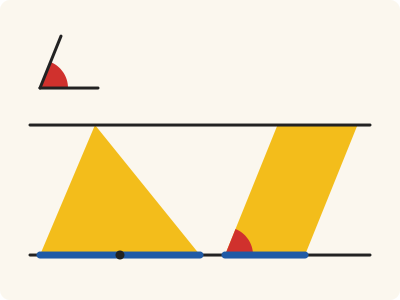
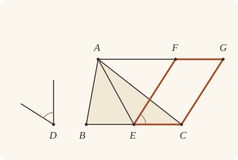

<!-- Generated by scripts/render.py. Do not edit by hand. -->

[Book I](index.md) · [← I.41](41.md) · [I.43 →](43.md)

# Book I, Proposition 42

*A parallelogram equal to a given triangle, in a given angle*

[Euclid's proof](#euclids-proof) · [In Lean](#in-lean) · [What it rests on](#what-it-rests-on) · [Mishnah](#mishnah)

> To construct, in a given rectilineal angle, a parallelogram equal to a given triangle.

**In Lean:** ✅ proved, as Euclid states it · Euclid's argument

<p align="center"></p>

<p align="center"><em>A parallelogram FECG as big as the triangle ABC (yellow), in any angle D you like (red): stand it on EC, half the base BC (blue), between the same parallels.</em></p>

## Euclid's proof

<p align="center"></p>

<p align="center"><em>Drawn for one case: A on FG produced beyond F, as in Heath's figure.</em></p>

Let ABC be the given triangle, and D the given rectilineal angle; thus it is required to construct in the rectilineal angle D a parallelogram equal to the triangle ABC.

Let BC be bisected at E, and let AE be joined; on the straight line EC, and at the point E on it, let the angle CEF be constructed equal to the angle D; [I. 23] through A let AG be drawn parallel to EC, and [I. 31] through C let CG be drawn parallel to EF.

Then FECG is a parallelogram.

And, since BE is equal to EC, the triangle ABE is also equal to the triangle AEC, for they are on equal bases BE, EC and in the same parallels BC, AG; [I. 38] therefore the triangle ABC is double of the triangle AEC.

But the parallelogram FECG is also double of the triangle AEC, for it has the same base with it and is in the same parallels with it; [I. 41] therefore the parallelogram FECG is equal to the triangle ABC.

And it has the angle CEF equal to the given angle D.

Therefore the parallelogram FECG has been constructed equal to the given triangle ABC, in the angle CEF which is equal to D.

Q. E. F.

## In Lean

| | |
|---|---|
| Proof | ✅ Proved |
| Statement | The whole enunciation. |
| Argument | Euclid's. |
| Reviewed | The statement and every passage of the argument read against Heath's text, at commit [`a91d97b4`](https://github.com/jackChallis/stoicheia/commit/a91d97b4) ([the record](../../review/I/42.toml)) |

From [`Elements/BookI/Prop42.lean`](../../Elements/BookI/Prop42.lean). Euclid's sentences are the `--` comments, and our own notes are in `/- … -/`; the lines under each sentence are the Lean that carries it out. The list below marks where a lemma does a step Euclid takes for granted, where the statement already gives a step and where a step needs a word of its own; the `/- … -/` notes in the listing explain smaller adjustments.

**How the Lean follows the text**

- **Done by `Prop10`.** "Let BC be bisected at E…" Euclid bisects BC at E without a reference in Heath's text. The Lean uses I.10, which puts E between B and C and makes BE equal to EC.
- **Already given.** "and let AE be joined…" Our triangles ABE and AEC are named by their corners, so no straight line AE is drawn.
- **Done by `Prop30.meet`.** "through A let AG be drawn parallel to EC…" Euclid draws the parallel through A and takes F where it meets the arm of the angle at E. The Lean draws the parallel by I.31 and finds F with `Prop30.meet`, using I.30, for which Heath gives no reference here.
- **Done by `Prop31.parallelogram`.** "through C let CG be drawn parallel to EF." Euclid takes G where the parallel through C meets AG. `Prop31.parallelogram` draws that parallel by I.31, finds G with `Prop30.meet` (I.30), and proves that FECG is a parallelogram.
- **Done by `area_cut`.** "therefore the triangle ABC is double of the triangle AEC." Euclid takes ABC as ABE and AEC together. `area_cut` proves that division from E between B and C, and the equality from I.38 makes the whole double of AEC.
- **Carried.** "And it has the angle CEF equal to the given angle D." Euclid identifies CEF with the angle constructed by I.23. Beneath the construction of AG, the Lean uses `Parallel.sameSide` and `OnRay.of_sameSideOf` to put F on the constructed arm from E; `angle_eq_of_onRay` then gives the angle here.

```lean
/-- To construct, in a given rectilineal angle, a parallelogram equal to a given triangle. -/
theorem Prop42 {A B C D₁ D D₂ : Point} (hABC : Triangle A B C) (hD : Triangle D₁ D D₂) :
    ∃ E F G : Point, Between B E C ∧ SameSideOf F A B C ∧ Parallelogram F E C G ∧
      ∠ C E F = ∠ D₁ D D₂ ∧ quadArea F E C G = △ A B C := by
  -- Let ABC be the given triangle, and D the given rectilineal angle; thus it is required to
  -- construct in the rectilineal angle D a parallelogram equal to the triangle ABC.
  -- Let BC be bisected at E,
  obtain ⟨E, hBEC, hBE⟩ := Prop10 hABC.ne₂₃
  obtain ⟨BC, hB, hC⟩ := Postulate1 B C hABC.ne₂₃
  have hA_BC : ¬ OnLine A BC := hABC.bca.off_line hB hC
  have hE : OnLine E BC := on_line_of_between_ends hBEC hB hC
  have hEC : E ≠ C := (ne_of_between (between_symm hBEC)).symm
  -- and let AE be joined;
  /- The triangles ABE and AEC are named by their corners; the join needs no
     further object in Lean. -/
  -- on the straight line EC, and at the point E on it, let the angle CEF be constructed equal
  -- to the angle D; [I. 23]
  have hECA : Triangle E C A := Triangle.of_line hE hC hEC hA_BC
  obtain ⟨F₁, C₁, hC₁, hF₁, hang⟩ := Prop23 hEC hD hECA
  /- C₁ lies on the ray EC, and F₁ on A's side of EC. The parallel through A
     will determine F on the ray from E through F₁. -/
  -- through A let AG be drawn parallel to EC, and [I. 31]
  obtain ⟨AG, hA_AG, hAG⟩ := Prop31.line hA_BC
  /- The straight line through E and F₁ meets AG by I.30. Both F and F₁ lie on
     A's side of BC, so F is on the constructed ray. -/
  have hEF₁ : E ≠ F₁ := hF₁.triangle.ne₁₃
  obtain ⟨EF, hE_EF, hF₁_EF⟩ := Postulate1 E F₁ hEF₁
  have hEF_BC : EF ≠ BC := fun e => (hF₁.triangle.off_line hE hC) (e ▸ hF₁_EF)
  obtain ⟨F, hF_EF, hF_AG⟩ := Prop30.meet hAG hE hE_EF hEF_BC
  have hFA : SameSide F A BC := hAG.sameSide hF_AG hA_AG
  have hFE : F ≠ E := fun e => hAG.not_onLine hF_AG (e ▸ hE)
  have hFray : OnRay F E F₁ :=
    OnRay.of_sameSideOf ((SameSideOf.of_line hEC hE hC hFA).trans hF₁.symm)
      ⟨EF, hE_EF, hF₁_EF, hF_EF⟩ hFE
  -- through C let CG be drawn parallel to EF.
  /- It meets AG at G (`Prop31.parallelogram`). -/
  obtain ⟨G, hG_AG, hpar⟩ := Prop31.parallelogram hAG hF_AG hE hC hEC
  -- Then FECG is a parallelogram.
  have hFECG : Parallelogram F E C G := hpar
  -- And, since BE is equal to EC, the triangle ABE is also equal to the triangle AEC, for they
  -- are on equal bases BE, EC and in the same parallels BC, AG; [I. 38]
  have hABE : Triangle A B E := (Triangle.of_line hB hE (ne_of_between hBEC) hA_BC).cab
  have hAEC : Triangle A E C := hECA.cab
  have h38 : △ A B E = △ A E C :=
    Prop38 hABE hAEC hBE ⟨AG, BC, hAG, hA_AG, hA_AG, hB, hE, hE, hC⟩
  -- therefore the triangle ABC is double of the triangle AEC.
  have hABC_double : △ A B C = △ A E C + △ A E C := by
    rw [← area_cut (A := A) hBEC, h38]
  -- But the parallelogram FECG is also double of the triangle AEC, for it has the same base
  -- with it and is in the same parallels with it; [I. 41]
  have h41 : quadArea F E C G = △ E A C + △ E A C :=
    Prop41 hFECG ⟨AG, hF_AG, hG_AG, hA_AG⟩
  have hFECG_double : quadArea F E C G = △ A E C + △ A E C := by
    rw [h41, ← area_bac A E C]
  -- therefore the parallelogram FECG is equal to the triangle ABC.
  have hequal : quadArea F E C G = △ A B C := CommonNotion1 hFECG_double hABC_double
  -- And it has the angle CEF equal to the given angle D.
  have hCEF : ∠ C E F = ∠ D₁ D D₂ :=
    (angle_eq_of_onRay hC₁.symm hFray).trans ((angle_symm hC₁.2.1 hEF₁.symm).trans hang)
  -- Therefore the parallelogram FECG has been constructed equal to the given triangle ABC, in
  -- the angle CEF which is equal to D.
  exact ⟨E, F, G, hBEC, SameSideOf.of_line hABC.ne₂₃ hB hC hFA, hFECG, hCEF, hequal⟩
  -- Q. E. F.
```

## What it rests on

| | |
|---|---|
| Heath's references | [I.23](23.md), [I.31](31.md), [I.38](38.md), [I.41](41.md) |
| Lean cites | [I.10](10.md), [I.23](23.md), [I.30](30.md), [I.31](31.md), [I.38](38.md), [I.41](41.md) |
| Postulates | 1, 2, 3, 4, 5 |
| Definitions taken as axioms | Def. I.15 |
| Common Notions | 1, 2, 3, 4, 5 |
| Tacit rules | 59 (listed below) |
| Its own Lean calls | Postulate 1; 4 tacit rules |
| Through lemmas | 17 tacit rules |

Some of these come in through lemmas [shared](../../CERTIFICATE.md#shared-steps) by many proofs: [`Prop30.meet`](../../Elements/BookI/HelpersParallels.lean#L41) (I.30); [`Prop31.parallelogram`](../../Elements/BookI/HelpersParallels.lean#L83) (I.30, I.31); [`Prop31.line`](../../Elements/BookI/Prop31.lean#L79) (I.31).

_Postulates, definitions, Common Notions and tacit rules: all that this proof rests on, counting those of the propositions it cites. The last two rows say which of the postulates, definitions and tacit rules its own Lean calls, in the proof or a helper written for it, and which it does not call but reaches through lemmas, of Book Zero or shared (a proposition it cites may rest on these too); the rest come in only through the propositions it cites or the Common Notions._

<details><summary>The 59 tacit rules beneath this proof, counting those of the propositions it cites</summary>

_(used here) marks a rule this proof's own Lean calls, in the proof or a helper written for it; (through …) marks one its own Lean does not call but reaches through the lemmas named, of [Book Zero](../../Elements/Figure) or shared, though a proposition it cites may rest on it too; and a rule with no mark comes in only through a proposition it cites or a Common Notion. The names in brackets are System E's: an Intersection rule says when straight lines and circles must meet, and an Intersections rule takes a point where they do (see [Book I's introduction](index.md))._

**Reading the figure**

- [`between_cases`](../../Elements/Foundations/Tacit/Diagram.lean#L73): Of three different points on a straight line, one is between the other two. (Between 6)
- [`between_of_between_left`](../../Elements/Foundations/Tacit/Diagram.lean#L65): If B is between A and C, and D is between A and B, then D is between A and C. (Between 4)
- [`between_of_between_right`](../../Elements/Foundations/Tacit/Diagram.lean#L69): If B is between A and C, and C is between B and D, then B is between A and D. (Between 5)
- [`between_symm`](../../Elements/Foundations/Tacit/Diagram.lean#L42) (used here): If B is between A and C, it is between C and A. (Between 1)
- [`centre_inside`](../../Elements/Foundations/Tacit/Diagram.lean#L34): The centre of a circle is inside it. (Generalities 3)
- [`circles_meet`](../../Elements/Foundations/Tacit/Diagram.lean#L176): If each circle passes through a point inside the other, the circles cut one another. This is the step Euclid takes for granted in I.1. (Intersection 5)
- [`circles_meet_of_on_inside_outside`](../../Elements/Foundations/Tacit/Diagram.lean#L170): Two circles cut one another if the first passes through a point A inside the second, and a point B outside the second is inside or on the first. (Intersection 4, in LeanEuclid's corrected form)
- [`circles_meet_same_side`](../../Elements/Foundations/Tacit/Constructions.lean#L94): Two circles that cut one another do so on each side of the straight line through their centres. (Intersections 8)
- [`exists_point`](../../Elements/Foundations/Tacit/Constructions.lean#L29) (through [`Triangle.ne₁₃`](../../Elements/Figure/Triangles.lean#L36) and [`Triangle.ne₂₃`](../../Elements/Figure/Triangles.lean#L29)): Let a point be taken. (Points 1)
- [`exists_point_between`](../../Elements/Foundations/Tacit/Constructions.lean#L41): Let a point be taken between B and C. (Points 3)
- [`exists_point_on_line`](../../Elements/Foundations/Tacit/Constructions.lean#L32) (through [`Prop30.meet`](../../Elements/BookI/HelpersParallels.lean#L41), [`Prop31.line`](../../Elements/BookI/Prop31.lean#L79) and [`Prop31.parallelogram`](../../Elements/BookI/HelpersParallels.lean#L83)): Let a point be taken on the straight line L. (Points 2)
- [`exists_point_on_line_off_line`](../../Elements/Foundations/Tacit/Constructions.lean#L37) (through [`Prop30.meet`](../../Elements/BookI/HelpersParallels.lean#L41) and [`Prop31.parallelogram`](../../Elements/BookI/HelpersParallels.lean#L83)): Let a point be taken on L, not on the different straight line M. (Points 2, with "distinct from M")
- [`exists_point_opposite_side`](../../Elements/Foundations/Tacit/Constructions.lean#L49): Let a point be taken on the other side of L from B. (Points 6)
- [`inside_not_on`](../../Elements/Foundations/Tacit/Diagram.lean#L37): A point inside a circle is not on it. (Generalities 4)
- [`line_circle_between`](../../Elements/Foundations/Tacit/Constructions.lean#L82): A straight line through a point B inside a circle, heading out to a point C outside it, cuts the circle between B and C. (Intersections 4)
- [`line_circle_beyond`](../../Elements/Foundations/Tacit/Constructions.lean#L88): A straight line through a point B inside a circle, produced beyond B away from C, cuts the circle there. (Intersections 5)
- [`line_unique`](../../Elements/Foundations/Tacit/Diagram.lean#L30) (through [`Prop30.meet`](../../Elements/BookI/HelpersParallels.lean#L41), [`Prop31.line`](../../Elements/BookI/Prop31.lean#L79), [`Prop31.parallelogram`](../../Elements/BookI/HelpersParallels.lean#L83) and 2 other lemmas): Two points determine a straight line. (Generalities 1)
- [`lines_meet_of_opposite_sides`](../../Elements/Foundations/Tacit/Diagram.lean#L159) (through [`Parallel.sameSide`](../../Elements/Figure/Parallels.lean#L52)): A straight line joining points on opposite sides of L crosses L. (Intersection 1)
- [`ne_of_between`](../../Elements/Foundations/Tacit/Diagram.lean#L45) (used here): A point between two others differs from the first. (Between 1)
- [`ne_of_between_ends`](../../Elements/Foundations/Tacit/Diagram.lean#L48) (through [`area_cut`](../../Elements/Figure/Areas.lean#L101)): The ends of a finite straight line differ. (Between 1)
- [`not_between_of_between`](../../Elements/Foundations/Tacit/Diagram.lean#L51): If B is between A and C, then A is not between B and C. (Between 1)
- [`not_between_of_between_between`](../../Elements/Foundations/Tacit/Diagram.lean#L78): If B is between A and C, and also between A and D, then B is not between C and D: C and D lie on the same side of B. (Between 7)
- [`not_on_line_of_same_side`](../../Elements/Foundations/Tacit/Diagram.lean#L91) (through [`OnRay.of_sameSideOf`](../../Elements/Figure/Angles.lean#L186) and [`SameSideOf.triangle`](../../Elements/Figure/Sides.lean#L59)): Points on one side of a straight line are not on it. (Same side 3)
- [`on_line_of_between`](../../Elements/Foundations/Tacit/Diagram.lean#L55): A straight line through A and B, with B between A and C, passes through C. (Between 2)
- [`on_line_of_between_ends`](../../Elements/Foundations/Tacit/Diagram.lean#L60) (used here): A straight line through A and C passes through every point between them. (Between 3)
- [`pasch2`](../../Elements/Foundations/Tacit/Diagram.lean#L110): If B is between A and C, A is on L and B is off it, then B and C are on the same side of L: a straight line that leaves L at A does not cross it again. (Pasch 2)
- [`pasch3`](../../Elements/Foundations/Tacit/Diagram.lean#L113) (through [`OnRay.of_sameSideOf`](../../Elements/Figure/Angles.lean#L186)): A straight line through a point between A and C separates them. (Pasch 3)
- [`pasch4`](../../Elements/Foundations/Tacit/Diagram.lean#L118): If two different straight lines L and M meet at B, and A and C are points of M, different from each other and from B, that are not on the same side of L, then B is between A and C. (Pasch 4)
- [`same_side_or`](../../Elements/Foundations/Tacit/Diagram.lean#L98): A straight line has only two sides. (Same side 5)
- [`same_side_refl`](../../Elements/Foundations/Tacit/Diagram.lean#L84): A point off a straight line is on the same side of it as itself. (Same side 1)
- [`same_side_symm`](../../Elements/Foundations/Tacit/Diagram.lean#L88) (through [`OnRay.of_sameSideOf`](../../Elements/Figure/Angles.lean#L186), [`SameSideOf.symm`](../../Elements/Figure/Sides.lean#L49) and [`SameSideOf.trans`](../../Elements/Figure/Sides.lean#L53)): If A is on the same side of a straight line as B, then B is on the same side as A. (Same side 2)
- [`same_side_trans`](../../Elements/Foundations/Tacit/Diagram.lean#L95) (through [`SameSideOf.trans`](../../Elements/Figure/Sides.lean#L53)): Two points on the same side of a straight line as a third point are on the same side as each other. (Same side 4)
- [`triple_incidence1`](../../Elements/Foundations/Tacit/Diagram.lean#L130): Take B on L, C on M and D on N, three straight lines through A. If C lies within the angle BAD (on D's side of L and on B's side of N), then B and D are not on the same side of M: the straight line AC separates them. (Triple incidence 1)
- [`triple_incidence2`](../../Elements/Foundations/Tacit/Diagram.lean#L138): Take B on L, C on M and D on N, three straight lines through A, with B other than A and D off M. If C and D are on the same side of L, and B and D are not on the same side of M, then B and C are on the same side of N: C lies within the angle BAD. (Triple incidence 2)

**Lengths, angles and areas**

- [`angle_add_of_inside`](../../Elements/Foundations/Tacit/Transfer.lean#L55): If D lies within the angle BAC, then BAC is made up of BAD and DAC. (Diagram-angle 2)
- [`angle_eq_of_same_rays`](../../Elements/Foundations/Tacit/Transfer.lean#L62) (through [`angle_eq_of_onRay`](../../Elements/Figure/Angles.lean#L31)): The angle doesn't change if its arms are traced through other points on the same rays. (Diagram-angle 4)
- [`angle_symm`](../../Elements/Foundations/Tacit/Metric.lean#L26) (used here): The angle ABC is the angle CBA. (Metric 4)
- [`area_add_of_between`](../../Elements/Foundations/Tacit/Transfer.lean#L78) (through [`area_cut`](../../Elements/Figure/Areas.lean#L101)): Cutting a triangle in two from a vertex adds up. (Diagram-area 2)
- [`area_congruent`](../../Elements/Foundations/Tacit/Metric.lean#L43): Triangles equal in all their sides and angles are equal in area. Euclid uses this without comment once he has shown two triangles congruent. (Metric 9)
- [`area_degenerate`](../../Elements/Foundations/Tacit/Metric.lean#L32) (through [`area_cut`](../../Elements/Figure/Areas.lean#L101)): A "triangle" with a repeated corner has no area. (Metric 6)
- [`area_eq_zero_of_on_line`](../../Elements/Foundations/Tacit/Transfer.lean#L70) (through [`area_cut`](../../Elements/Figure/Areas.lean#L101)): A "triangle" whose corners lie on one straight line has no area. (Diagram-area 1)
- [`area_rotate`](../../Elements/Foundations/Tacit/Metric.lean#L35) (through [`area_bac`](../../Elements/Figure/Areas.lean#L70) and [`area_cut`](../../Elements/Figure/Areas.lean#L101)): The triangle ABC is the triangle CAB. (Metric 8)
- [`area_swap`](../../Elements/Foundations/Tacit/Metric.lean#L38) (through [`area_bac`](../../Elements/Figure/Areas.lean#L70) and [`area_cut`](../../Elements/Figure/Areas.lean#L101)): The triangle ABC is the triangle ACB. (Metric 8)
- [`eq_of_len_eq_zero`](../../Elements/Foundations/Tacit/Metric.lean#L17): A finite straight line with distinct ends has length. (Metric 1)
- [`inside_of_len_lt`](../../Elements/Foundations/Tacit/Transfer.lean#L34): A point nearer the centre than the circumference is inside. (Diagram-segment 4)
- [`len_add_of_between`](../../Elements/Foundations/Tacit/Transfer.lean#L22): If B is between A and C, then AB and BC together make up AC. (Diagram-segment 1)
- [`len_lt_of_inside`](../../Elements/Foundations/Tacit/Transfer.lean#L38): A point inside is nearer the centre than the circumference. (Diagram-segment 4)
- [`len_self`](../../Elements/Foundations/Tacit/Metric.lean#L20): The "straight line" from a point to itself has no length. (Metric 1)
- [`len_symm`](../../Elements/Foundations/Tacit/Metric.lean#L23): The straight line AB is the straight line BA. (Metric 3)
- [`same_ray_of_angle_eq_zero`](../../Elements/Foundations/Tacit/Transfer.lean#L50): If the angle BAC is nothing, C lies on the ray from A through B. (Diagram-angle 1)

**Superposition**

- [`superposition`](../../Elements/Foundations/Tacit/Superposition.lean#L48): **Superposition.** A hypothetical placement of a triangle on a given ray and side permits a restricted derivation of metric equalities about the figure already given. The derivation introduces no further objects, cites each geometric law it uses, and exports no symbol of the placement.

**Laws of magnitude**

- [`add_assoc`](../../Elements/Foundations/Tacit/Magnitudes.lean#L23): Adding three magnitudes in a row, it makes no difference whether the first two or the last two are added first. (System E §3.5)
- [`add_comm`](../../Elements/Foundations/Tacit/Magnitudes.lean#L26): The order of adding does not matter. (System E §3.5)
- [`add_lt_add_right`](../../Elements/Foundations/Tacit/Magnitudes.lean#L45): Adding the same thing to both sides keeps "less than". (System E §3.5)
- [`add_zero`](../../Elements/Foundations/Tacit/Magnitudes.lean#L29) (through [`area_cut`](../../Elements/Figure/Areas.lean#L101)): Adding nothing changes nothing. (System E §3.5)
- [`lt_irrefl`](../../Elements/Foundations/Tacit/Magnitudes.lean#L32): No magnitude is less than itself. (System E §3.5)
- [`lt_trans`](../../Elements/Foundations/Tacit/Magnitudes.lean#L35): What is less than the less is less still. (System E §3.5)
- [`lt_trichotomy`](../../Elements/Foundations/Tacit/Magnitudes.lean#L39): Of two magnitudes, one is less, or they are equal, or the other is less. (System E §3.5)
- [`not_lt_zero`](../../Elements/Foundations/Tacit/Magnitudes.lean#L42): Nothing is less than zero. (System E §3.5)

</details>

## Mishnah

_Our commentary: what Euclid assumes, what Lean made us say out loud, and how the result looks by modern means._

Here Euclid turns a triangle into a parallelogram of the same size, in any angle he is given. He halves the base BC at E (Heath gives no reference here: it is I.10) and builds the parallelogram FECG on EC, in the given angle and between the same parallels as the triangle. FECG is double of the triangle AEC, by I.41; so is ABC, since its halves ABE and AEC are equal, by I.38. I.44 will carry such a parallelogram onto any straight line, and I.45 will make one equal to any rectilineal figure, any figure bounded by straight lines.

**Why are the two doubles equal?** Euclid gives no reason. Some manuscripts give this a Common Notion of its own, that things double of the same thing are equal; Proclus excludes it, Heath reports, because it follows from Common Notion 1 (vol. 1, p. 223). We follow Proclus: each double is AEC added to itself, and Common Notion 1 makes them equal. Heath, agreeing with Paul Tannery, sees no reason to strike out the like words in I.47: "If they were interpolated, we should have expected to find the same interpolation in I. 42, where the axiom is *tacitly* assumed" (vol. 1, p. 224).

The given angle decides where F falls, so A may be F or G, or any other point of the straight line FG. One argument serves, for our I.41 asks only that A lie on that straight line.

## Further reading

- Where I.42 is heading, a square equal to any rectilineal figure, is told with its history in the chapter "Quadratures" of David S. Richeson's [*Tales of Impossibility*](https://doi.org/10.1515/9780691194233) (2019) (also on [I.9](09.md)).
- I.42 sets on its way the theorem that any two polygons of equal area can be cut into pieces that rebuild each other, and V. G. Boltyanskii proves it with school geometry alone in [*Equivalent and Equidecomposable Figures*](https://store.doverpublications.com/collections/math-algebra/products/9780486170053) (1963), the book described on [I.36](36.md); the link opens Dover's reprint, titled *Hyperbolic Functions*.

[Book I](index.md) · [← I.41](41.md) · [I.43 →](43.md)

---

<sub>Euclid's text: T. L. Heath, *The Thirteen Books of Euclid's Elements*, vol. 1 (Cambridge, 1908), pp. 339–340; [scan leaves n359–n360](https://archive.org/details/thirteenbookseu02heibgoog/page/n359); [figure on n359](https://archive.org/details/thirteenbookseu02heibgoog/page/n359). Public domain.</sub>

<sub>The tacit rules follow the System E of Jeremy Avigad, Edward Dean and John Mumma, read alongside LeanEuclid (Logan Murphy, Kaiyu Yang, Jialiang Sun, Zhaoyu Li, Anima Anandkumar and Xujie Si).</sub>
