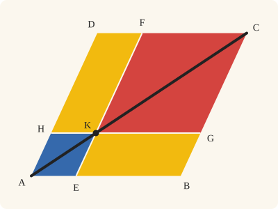
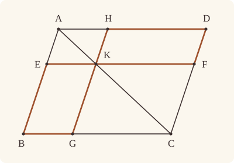
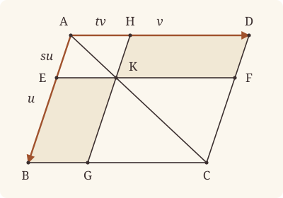

<!-- Generated by scripts/render.py. Do not edit by hand. -->

[Book I](index.md) · [← I.42](42.md) · [I.44 →](44.md)

# Book I, Proposition 43

*In any parallelogram the complements are equal*

[Euclid's proof](#euclids-proof) · [In Lean](#in-lean) · [What it rests on](#what-it-rests-on) · [Mishnah](#mishnah)

> In any parallelogram the complements of the parallelograms about the diameter are equal to one another.

**In Lean:** ✅ proved, as Euclid states it · Euclid's argument

<p align="center"></p>

<p align="center"><em>Cut the parallelogram ABCD, parallel to its sides, through any point K on its diagonal AC: the two pieces the diagonal misses, EBGK and HKFD (yellow), always have equal area.</em></p>

## Euclid's proof

<p align="center"></p>

Let ABCD be a parallelogram, and AC its diameter; and about AC let EH, FG be parallelograms, and BK, KD the so-called complements;

I say that the complement BK is equal to the complement KD.

For, since ABCD is a parallelogram, and AC its diameter, the triangle ABC is equal to the triangle ACD. [I. 34]

Again, since EH is a parallelogram, and AK is its diameter, the triangle AEK is equal to the triangle AHK.

For the same reason the triangle KFC is also equal to KGC.

Now, since the triangle AEK is equal to the triangle AHK, and KFC to KGC, the triangle AEK together with KGC is equal to the triangle AHK together with KFC. [C.N. 2]

And the whole triangle ABC is also equal to the whole ADC; therefore the complement BK which remains is equal to the complement KD which remains. [C.N. 3]

Therefore etc.

Q. E. D.

## In Lean

| | |
|---|---|
| Proof | ✅ Proved |
| Statement | The whole enunciation. The parallelograms about the diameter meet at a point K of AC, as Heath reads Euclid's words; Proclus's cases, apart or overlapping, are left to the commentary. |
| Argument | Euclid's. |
| Reviewed | The statement and every passage of the argument read against Heath's text, at commit [`40d340d`](https://github.com/jackChallis/stoicheia/commit/40d340d) ([the record](../../review/I/43.toml)) |

From [`Elements/BookI/Prop43.lean`](../../Elements/BookI/Prop43.lean). Euclid's sentences are the `--` comments, and our own notes are in `/- … -/`; the lines under each sentence are the Lean that carries it out. The list below marks where a lemma does a step Euclid takes for granted; the `/- … -/` notes in the listing explain smaller adjustments.

**How the Lean follows the text**

- **Done by `Prop43.cut`.** "therefore the complement BK which remains…" Euclid takes for granted that the triangle ABC is made up of AEK, the complement BK and KGC; the Lean proves it from the order of the points. Inside `Prop43.cut`, `OppositeSides.exists_between` finds where EG crosses BK and `Between.of_inside` puts the crossing between B and K, so `quadArea_rotate_of_cross` lets the cut use either diameter; the Lean cuts ADC as well before subtracting the equal parts.

<details><summary>Before the theorem, one lemma: <code>Prop43.cut</code> (54 lines)</summary>

```lean
/-- Euclid takes for granted that the triangle ABC is made up of AEK, the
complement BK and KGC. The diameters EG and BK of the complement cross, so either
measures its area; cutting the triangle then gives the three pieces. Only the
three betweennesses are needed, with no parallels. -/
theorem Prop43.cut {A B C E G K : Point} (hABC : Triangle A B C) (hK : Between A K C)
    (hE : Between A E B) (hG : Between B G C) :
    △ A B C = △ A E K + quadArea E B G K + △ K G C := by
  obtain ⟨AB, hA_AB, hB_AB⟩ := Postulate1 A B hABC.ne₁₂
  obtain ⟨AC, hA_AC, hC_AC⟩ := Postulate1 A C hABC.ne₁₃
  have hK_AC : OnLine K AC := on_line_of_between_ends hK hA_AC hC_AC
  have hC_AB : ¬ OnLine C AB := hABC.off_line hA_AB hB_AB
  have hB_AC : ¬ OnLine B AC := hABC.acb.off_line hA_AC hC_AC
  have hK_AB : ¬ OnLine K AB := fun h => hC_AB (on_line_of_between hK hA_AB h)
  have hBK : B ≠ K := fun e => hB_AC (e ▸ hK_AC)
  obtain ⟨BK, hB_BK, hK_BK⟩ := Postulate1 B K hBK
  have hA_BK : ¬ OnLine A BK := fun h =>
    hK_AB ((line_unique hABC.ne₁₂ h hB_BK hA_AB hB_AB) ▸ hK_BK)
  have hC_BK : ¬ OnLine C BK := fun h =>
    hA_BK (on_line_of_between (between_symm hK) h hK_BK)
  have hE_BK : ¬ OnLine E BK := fun h =>
    hA_BK (on_line_of_between (between_symm hE) hB_BK h)
  have hG_BK : ¬ OnLine G BK := fun h =>
    hC_BK (on_line_of_between hG hB_BK h)
  /- E lies on A's side of BK, and G on C's; BK separates A from C. -/
  have hEA : SameSide E A BK := pasch2 (between_symm hE) hB_BK hE_BK
  have hGC : SameSide G C BK := pasch2 hG hB_BK hG_BK
  have hEG : OppositeSides E G BK := ⟨hE_BK, hG_BK, fun hs =>
    pasch3 hK hK_BK (same_side_trans (same_side_symm (same_side_trans hEA hs)) hGC)⟩
  obtain ⟨X, hX_BK, hEXG⟩ := hEG.exists_between
  /- X lies on K's side of AB and B's side of AC, hence between B and K. -/
  have hE_AB : OnLine E AB := on_line_of_between_ends hE hA_AB hB_AB
  have hG_AB : ¬ OnLine G AB := fun h =>
    hC_AB (on_line_of_between hG hB_AB h)
  have hX_AB : ¬ OnLine X AB := fun h =>
    hG_AB (on_line_of_between hEXG hE_AB h)
  have hXC : SameSide X C AB :=
    same_side_trans (same_side_symm (pasch2 hEXG hE_AB hX_AB)) (pasch2 hG hB_AB hG_AB)
  have hXK : SameSide X K AB :=
    same_side_trans (same_side_symm hXC) (same_side_symm (pasch2 hK hA_AB hK_AB))
  have hE_AC : ¬ OnLine E AC := fun h => hB_AC (on_line_of_between hE hA_AC h)
  have hEB : SameSide E B AC := pasch2 hE hA_AC hE_AC
  have hGB : SameSide G B AC :=
    pasch2 (between_symm hG) hC_AC (fun h => hB_AC (on_line_of_between (between_symm hG) hC_AC h))
  have hXB : SameSide X B AC :=
    same_side_trans (pasch1 hEXG (same_side_trans (same_side_symm hEB) (same_side_symm hGB))) hEB
  have hBXK : Between B X K :=
    Between.of_inside hB_AB hK_AC ⟨BK, hB_BK, hX_BK, hK_BK⟩ hXK hXB
  /- Measure the complement by BK, then cut ABC along BK, KE and KG. -/
  have hq : quadArea B G K E = quadArea E B G K := quadArea_rotate_of_cross hEXG hBXK
  rw [← hq]
  unfold quadArea
  rw [area_bac A B C, ← area_cut (A := B) hK, area_cba B A K, ← area_cut (A := K) hE,
    area_bac B K C, ← area_cut (A := K) hG, area_cab A E K, area_cab B G K, area_bca B K E]
  ac_rfl
```

</details>

```lean
/-- In any parallelogram the complements of the parallelograms about the diameter are equal to one
another. -/
theorem Prop43 {A B C D E F G H K : Point} (hABCD : Parallelogram A B C D) (hK : Between A K C)
    (hE : Between A E B) (hG : Between B G C) (hF : Between C F D) (hH : Between D H A)
    (hEH : Parallelogram A E K H) (hFG : Parallelogram K G C F) :
    quadArea E B G K = quadArea H K F D := by
  -- Let ABCD be a parallelogram, and AC its diameter; and about AC let EH, FG be
  -- parallelograms, and BK, KD the so-called complements;
  -- I say that the complement BK is equal to the complement KD.
  -- For, since ABCD is a parallelogram, and AC its diameter, the triangle ABC is equal to the
  -- triangle ACD. [I. 34]
  have hABC_ACD : △ A B C = △ A C D := by
    have h := (Prop34 (A := B) (B := A) (C := C) (D := D) hABCD.rotate).2.2.2.2
    rw [area_bac B A C, area_cba D C A] at h
    exact h
  -- Again, since EH is a parallelogram, and AK is its diameter, the triangle AEK is equal to
  -- the triangle AHK.
  have hAEK_AHK : △ A E K = △ A H K := by
    have h := (Prop34 (A := E) (B := A) (C := K) (D := H) hEH.rotate).2.2.2.2
    rw [area_bac E A K, area_cab H K A] at h
    exact h
  -- For the same reason the triangle KFC is also equal to KGC.
  have hKFC_KGC : △ K F C = △ K G C := by
    have h := (Prop34 (A := G) (B := K) (C := C) (D := F) hFG.rotate).2.2.2.2
    rw [area_bac G K C, area_cab F C K] at h
    exact h.symm
  -- Now, since the triangle AEK is equal to the triangle AHK, and KFC to KGC, the triangle AEK
  -- together with KGC is equal to the triangle AHK together with KFC. [C.N. 2]
  have hsum : △ A E K + △ K G C = △ A H K + △ K F C :=
    CommonNotion2 hAEK_AHK hKFC_KGC.symm
  -- And the whole triangle ABC is also equal to the whole ADC; therefore the complement BK
  -- which remains is equal to the complement KD which remains. [C.N. 3]
  have hABC_ADC : △ A B C = △ A D C := hABC_ACD.trans (area_acb A C D)
  have hABC := Prop43.cut hABCD.triangle hK hE hG
  have hADC := Prop43.cut hABCD.reverse.triangle hK (between_symm hH) (between_symm hF)
  rw [quadArea_reverse H K F D] at hADC
  refine CommonNotion3 (c := △ A E K + △ K G C) (d := △ A H K + △ K F C) ?_ hsum
  calc
    quadArea E B G K + (△ A E K + △ K G C) = △ A B C := by rw [hABC]; ac_rfl
    _ = △ A D C := hABC_ADC
    _ = quadArea H K F D + (△ A H K + △ K F C) := by rw [hADC]; ac_rfl
  -- Therefore etc.
  -- Q. E. D.
```

## What it rests on

| | |
|---|---|
| Heath's references | [I.34](34.md); C.N. 2, 3 |
| Lean cites | [I.34](34.md) |
| Postulates | 1, 2, 3, 4, 5 |
| Definitions taken as axioms | Def. I.15 |
| Common Notions | 1, 2, 3, 4, 5 |
| Tacit rules | 56 (listed below) |
| Its own Lean calls | Postulate 1; 9 tacit rules |
| Through lemmas | 16 tacit rules |

_Postulates, definitions, Common Notions and tacit rules: all that this proof rests on, counting those of the propositions it cites. The last two rows say which of the postulates, definitions and tacit rules its own Lean calls, in the proof or a helper written for it, and which it does not call but reaches through lemmas, of Book Zero or shared (a proposition it cites may rest on these too); the rest come in only through the propositions it cites or the Common Notions._

<details><summary>The 56 tacit rules beneath this proof, counting those of the propositions it cites</summary>

_(used here) marks a rule this proof's own Lean calls, in the proof or a helper written for it; (through …) marks one its own Lean does not call but reaches through the lemmas named, of [Book Zero](../../Elements/Figure) or shared, though a proposition it cites may rest on it too; and a rule with no mark comes in only through a proposition it cites or a Common Notion. The names in brackets are System E's: an Intersection rule says when straight lines and circles must meet, and an Intersections rule takes a point where they do (see [Book I's introduction](index.md))._

**Reading the figure**

- [`between_cases`](../../Elements/Foundations/Tacit/Diagram.lean#L73) (through [`Between.of_inside`](../../Elements/Figure/Parallelograms.lean#L59)): Of three different points on a straight line, one is between the other two. (Between 6)
- [`between_of_between_left`](../../Elements/Foundations/Tacit/Diagram.lean#L65): If B is between A and C, and D is between A and B, then D is between A and C. (Between 4)
- [`between_of_between_right`](../../Elements/Foundations/Tacit/Diagram.lean#L69): If B is between A and C, and C is between B and D, then B is between A and D. (Between 5)
- [`between_symm`](../../Elements/Foundations/Tacit/Diagram.lean#L42) (used here): If B is between A and C, it is between C and A. (Between 1)
- [`centre_inside`](../../Elements/Foundations/Tacit/Diagram.lean#L34): The centre of a circle is inside it. (Generalities 3)
- [`circles_meet`](../../Elements/Foundations/Tacit/Diagram.lean#L176): If each circle passes through a point inside the other, the circles cut one another. This is the step Euclid takes for granted in I.1. (Intersection 5)
- [`circles_meet_same_side`](../../Elements/Foundations/Tacit/Constructions.lean#L78): Two circles that cut one another do so on each side of the straight line through their centres. (Intersections 8)
- [`exists_point`](../../Elements/Foundations/Tacit/Constructions.lean#L27) (through [`Triangle.ne₁₂`](../../Elements/Figure/Triangles.lean#L22) and [`Triangle.ne₁₃`](../../Elements/Figure/Triangles.lean#L36)): Let a point be taken. (Points 1)
- [`exists_point_between`](../../Elements/Foundations/Tacit/Constructions.lean#L39): Let a point be taken between B and C. (Points 3)
- [`exists_point_opposite_side`](../../Elements/Foundations/Tacit/Constructions.lean#L47): Let a point be taken on the other side of L from B. (Points 6)
- [`line_circle_between`](../../Elements/Foundations/Tacit/Constructions.lean#L66): A straight line through a point B inside a circle, heading out to a point C outside it, cuts the circle between B and C. (Intersections 4)
- [`line_circle_beyond`](../../Elements/Foundations/Tacit/Constructions.lean#L72): A straight line through a point B inside a circle, produced beyond B away from C, cuts the circle there. (Intersections 5)
- [`line_unique`](../../Elements/Foundations/Tacit/Diagram.lean#L30) (used here): Two points determine a straight line. (Generalities 1)
- [`lines_meet_of_opposite_sides`](../../Elements/Foundations/Tacit/Diagram.lean#L159) (through [`OppositeSides.exists_between`](../../Elements/Figure/Sides.lean#L117)): A straight line joining points on opposite sides of L crosses L. (Intersection 1)
- [`ne_of_between`](../../Elements/Foundations/Tacit/Diagram.lean#L45) (through [`area_cut`](../../Elements/Figure/Areas.lean#L101) and [`quadArea_rotate_of_cross`](../../Elements/Figure/Areas.lean#L168)): A point between two others differs from the first. (Between 1)
- [`ne_of_between_ends`](../../Elements/Foundations/Tacit/Diagram.lean#L48) (through [`area_cut`](../../Elements/Figure/Areas.lean#L101) and [`quadArea_rotate_of_cross`](../../Elements/Figure/Areas.lean#L168)): The ends of a finite straight line differ. (Between 1)
- [`not_between_of_between`](../../Elements/Foundations/Tacit/Diagram.lean#L51): If B is between A and C, then A is not between B and C. (Between 1)
- [`not_between_of_between_between`](../../Elements/Foundations/Tacit/Diagram.lean#L78): If B is between A and C, and also between A and D, then B is not between C and D: C and D lie on the same side of B. (Between 7)
- [`not_on_line_of_same_side`](../../Elements/Foundations/Tacit/Diagram.lean#L91) (through [`Between.of_inside`](../../Elements/Figure/Parallelograms.lean#L59)): Points on one side of a straight line are not on it. (Same side 3)
- [`on_line_of_between`](../../Elements/Foundations/Tacit/Diagram.lean#L55) (used here): A straight line through A and B, with B between A and C, passes through C. (Between 2)
- [`on_line_of_between_ends`](../../Elements/Foundations/Tacit/Diagram.lean#L60) (used here): A straight line through A and C passes through every point between them. (Between 3)
- [`pasch1`](../../Elements/Foundations/Tacit/Diagram.lean#L105) (used here): If A and C are on the same side of L, so is any point between them: if B is between A and C, then A and B are on the same side of L. (Pasch 1)
- [`pasch2`](../../Elements/Foundations/Tacit/Diagram.lean#L110) (used here): If B is between A and C, A is on L and B is off it, then B and C are on the same side of L: a straight line that leaves L at A does not cross it again. (Pasch 2)
- [`pasch3`](../../Elements/Foundations/Tacit/Diagram.lean#L113) (used here): A straight line through a point between A and C separates them. (Pasch 3)
- [`pasch4`](../../Elements/Foundations/Tacit/Diagram.lean#L118) (through [`OppositeSides.exists_between`](../../Elements/Figure/Sides.lean#L117)): If two different straight lines L and M meet at B, and A and C are points of M, different from each other and from B, that are not on the same side of L, then B is between A and C. (Pasch 4)
- [`same_side_or`](../../Elements/Foundations/Tacit/Diagram.lean#L98): A straight line has only two sides. (Same side 5)
- [`same_side_refl`](../../Elements/Foundations/Tacit/Diagram.lean#L84) (through [`OppositeSides.exists_between`](../../Elements/Figure/Sides.lean#L117)): A point off a straight line is on the same side of it as itself. (Same side 1)
- [`same_side_symm`](../../Elements/Foundations/Tacit/Diagram.lean#L88) (used here): If A is on the same side of a straight line as B, then B is on the same side as A. (Same side 2)
- [`same_side_trans`](../../Elements/Foundations/Tacit/Diagram.lean#L95) (used here): Two points on the same side of a straight line as a third point are on the same side as each other. (Same side 4)
- [`triple_incidence1`](../../Elements/Foundations/Tacit/Diagram.lean#L130): Take B on L, C on M and D on N, three straight lines through A. If C lies within the angle BAD (on D's side of L and on B's side of N), then B and D are not on the same side of M: the straight line AC separates them. (Triple incidence 1)
- [`triple_incidence2`](../../Elements/Foundations/Tacit/Diagram.lean#L138): Take B on L, C on M and D on N, three straight lines through A, with B other than A and D off M. If C and D are on the same side of L, and B and D are not on the same side of M, then B and C are on the same side of N: C lies within the angle BAD. (Triple incidence 2)

**Lengths, angles and areas**

- [`angle_add_of_inside`](../../Elements/Foundations/Tacit/Transfer.lean#L55): If D lies within the angle BAC, then BAC is made up of BAD and DAC. (Diagram-angle 2)
- [`angle_eq_of_same_rays`](../../Elements/Foundations/Tacit/Transfer.lean#L62): The angle doesn't change if its arms are traced through other points on the same rays. (Diagram-angle 4)
- [`angle_symm`](../../Elements/Foundations/Tacit/Metric.lean#L26): The angle ABC is the angle CBA. (Metric 4)
- [`area_add_of_between`](../../Elements/Foundations/Tacit/Transfer.lean#L78) (through [`area_cut`](../../Elements/Figure/Areas.lean#L101) and [`quadArea_rotate_of_cross`](../../Elements/Figure/Areas.lean#L168)): Cutting a triangle in two from a vertex adds up. (Diagram-area 2)
- [`area_congruent`](../../Elements/Foundations/Tacit/Metric.lean#L43): Triangles equal in all their sides and angles are equal in area. Euclid uses this without comment once he has shown two triangles congruent. (Metric 9)
- [`area_degenerate`](../../Elements/Foundations/Tacit/Metric.lean#L32) (through [`area_cut`](../../Elements/Figure/Areas.lean#L101) and [`quadArea_rotate_of_cross`](../../Elements/Figure/Areas.lean#L168)): A "triangle" with a repeated corner has no area. (Metric 6)
- [`area_eq_zero_of_on_line`](../../Elements/Foundations/Tacit/Transfer.lean#L70) (through [`area_cut`](../../Elements/Figure/Areas.lean#L101) and [`quadArea_rotate_of_cross`](../../Elements/Figure/Areas.lean#L168)): A "triangle" whose corners lie on one straight line has no area. (Diagram-area 1)
- [`area_rotate`](../../Elements/Foundations/Tacit/Metric.lean#L35) (through [`area_bac`](../../Elements/Figure/Areas.lean#L70), [`area_bca`](../../Elements/Figure/Areas.lean#L61), [`area_cab`](../../Elements/Figure/Areas.lean#L64) and 3 other lemmas): The triangle ABC is the triangle CAB. (Metric 8)
- [`area_swap`](../../Elements/Foundations/Tacit/Metric.lean#L38) (through [`area_acb`](../../Elements/Figure/Areas.lean#L67), [`area_bac`](../../Elements/Figure/Areas.lean#L70), [`area_cba`](../../Elements/Figure/Areas.lean#L74) and 3 other lemmas): The triangle ABC is the triangle ACB. (Metric 8)
- [`eq_of_len_eq_zero`](../../Elements/Foundations/Tacit/Metric.lean#L17): A finite straight line with distinct ends has length. (Metric 1)
- [`inside_of_len_lt`](../../Elements/Foundations/Tacit/Transfer.lean#L34): A point nearer the centre than the circumference is inside. (Diagram-segment 4)
- [`len_add_of_between`](../../Elements/Foundations/Tacit/Transfer.lean#L22): If B is between A and C, then AB and BC together make up AC. (Diagram-segment 1)
- [`len_lt_of_inside`](../../Elements/Foundations/Tacit/Transfer.lean#L38): A point inside is nearer the centre than the circumference. (Diagram-segment 4)
- [`len_self`](../../Elements/Foundations/Tacit/Metric.lean#L20): The "straight line" from a point to itself has no length. (Metric 1)
- [`len_symm`](../../Elements/Foundations/Tacit/Metric.lean#L23): The straight line AB is the straight line BA. (Metric 3)
- [`same_ray_of_angle_eq_zero`](../../Elements/Foundations/Tacit/Transfer.lean#L50): If the angle BAC is nothing, C lies on the ray from A through B. (Diagram-angle 1)

**Superposition**

- [`superposition`](../../Elements/Foundations/Tacit/Superposition.lean#L48): **Superposition.** A hypothetical placement of a triangle on a given ray and side permits a restricted derivation of metric equalities about the figure already given. The derivation introduces no further objects, cites each geometric law it uses, and exports no symbol of the placement.

**Laws of magnitude**

- [`add_assoc`](../../Elements/Foundations/Tacit/Magnitudes.lean#L23) (through [`Magnitude.instAssociative`](../../Elements/Figure/Areas.lean#L33) and [`quadArea_rotate_of_cross`](../../Elements/Figure/Areas.lean#L168)): Adding three magnitudes in a row, it makes no difference whether the first two or the last two are added first. (System E §3.5)
- [`add_comm`](../../Elements/Foundations/Tacit/Magnitudes.lean#L26) (through [`Magnitude.instCommutative`](../../Elements/Figure/Areas.lean#L37), [`quadArea_reverse`](../../Elements/Figure/Areas.lean#L152) and [`quadArea_rotate_of_cross`](../../Elements/Figure/Areas.lean#L168)): The order of adding does not matter. (System E §3.5)
- [`add_lt_add_right`](../../Elements/Foundations/Tacit/Magnitudes.lean#L45): Adding the same thing to both sides keeps "less than". (System E §3.5)
- [`add_zero`](../../Elements/Foundations/Tacit/Magnitudes.lean#L29) (through [`area_cut`](../../Elements/Figure/Areas.lean#L101) and [`quadArea_rotate_of_cross`](../../Elements/Figure/Areas.lean#L168)): Adding nothing changes nothing. (System E §3.5)
- [`lt_irrefl`](../../Elements/Foundations/Tacit/Magnitudes.lean#L32): No magnitude is less than itself. (System E §3.5)
- [`lt_trans`](../../Elements/Foundations/Tacit/Magnitudes.lean#L35): What is less than the less is less still. (System E §3.5)
- [`lt_trichotomy`](../../Elements/Foundations/Tacit/Magnitudes.lean#L39): Of two magnitudes, one is less, or they are equal, or the other is less. (System E §3.5)
- [`not_lt_zero`](../../Elements/Foundations/Tacit/Magnitudes.lean#L42): Nothing is less than zero. (System E §3.5)

</details>

## Mishnah

_Our commentary: what Euclid assumes, what Lean made us say out loud, and how the result looks by modern means._

About the diameter AC of the parallelogram ABCD stand two smaller parallelograms, EH and FG, meeting at a point K of AC, and the complements BK and KD fill up the rest. Their Greek name means, in Heath's rendering, "the figures put in to fill up (interstices)", and Euclid's "so-called" tells Heath that the term "was not new, though it might not be universally known" (vol. 1, p. 341). The proof is I.34 three times over: AC halves ABCD, AK halves EH, and KC halves FG. Common Notion 2 adds the two small halves on each side of AC, Common Notion 3 takes them from the halves of the whole, and the complements are left equal. I.44 is built on this.

Euclid takes for granted that the triangle ABC is made up of the triangle AEK, the complement BK and the triangle KGC, so that BK is what remains. We prove it from the order of the points alone (`Prop43.cut`). Our area of a four-sided figure is measured along a diameter, while the cut runs along the other one, BK; but the two diameters of the complement cross, at a point Euclid never needed to name, so either will do, and the proof of the cut never uses that the complements are parallelograms.

**Must the complements be parallelograms?** In Euclid's figure the parallelograms about the diameter meet at K, and our statement asks for that. Proclus lets them stand apart or overlap, and then, Heath notes, "the complements need not be parallelograms" (vol. 1, p. 341): apart, they have five sides; overlapping, each is, as Heath counts it, a parallelogram less a triangle. Proclus says Euclid needed no definition of a complement, the name being "simply suggested by the facts", and Heath sums up: "In all the cases it is easy to show, as Proclus does, that the complements are still equal" (vol. 1, p. 341).

**The modern way.** Put A at the origin, with $\vec{u} = \mathrm{B - A}$, $\vec{v} = \mathrm{D - A}$ and $\mathrm{K} = s\vec{u} + t\vec{v}$, where $s$ and $t$ lie between $0$ and $1$. With the cross product of [I.35](35.md), the complements BK and KD have areas $(1 - s)t\lvert\vec{u} \times \vec{v}\rvert$ and $s(1 - t)\lvert\vec{u} \times \vec{v}\rvert$, equal exactly when $s = t$, that is, when K lies on AC. Euclid proves that K on AC makes them equal; the converse is not his.

<p align="center"></p>

## Further reading

- The step Euclid takes from his figure, that ABC is made up of AEK, BK and KGC, is the kind of thing Kenneth Manders' essay ["The Euclidean Diagram (1995)"](https://doi.org/10.1093/acprof:oso/9780199296453.003.0005) (2008) says a figure may be trusted to show (also on [I.21](21.md)).
- Roger B. Nelsen's [*Proofs Without Words*](https://doi.org/10.1090/clrm/001) (1993) has page after page of pictures like this one that prove a fact at a glance, in the section "Geometry & Algebra".

[Book I](index.md) · [← I.42](42.md) · [I.44 →](44.md)

---

<sub>Euclid's text: T. L. Heath, *The Thirteen Books of Euclid's Elements*, vol. 1 (Cambridge, 1908), p. 340; [scan leaf n360](https://archive.org/details/thirteenbookseu02heibgoog/page/n360); [figure on n360](https://archive.org/details/thirteenbookseu02heibgoog/page/n360). Public domain.</sub>

<sub>The tacit rules follow the System E of Jeremy Avigad, Edward Dean and John Mumma, read alongside LeanEuclid (Logan Murphy, Kaiyu Yang, Jialiang Sun, Zhaoyu Li, Anima Anandkumar and Xujie Si).</sub>
