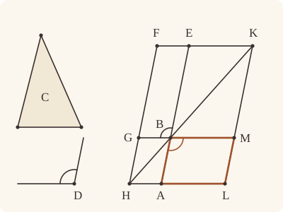

<!-- Generated by scripts/render.py. Do not edit by hand. -->

[Book I](index.md) · [← I.43](43.md) · [I.45 →](45.md)

# Book I, Proposition 44

*A parallelogram applied to a given straight line*

[Euclid's proof](#euclids-proof) · [In Lean](#in-lean) · [What it rests on](#what-it-rests-on) · [Mishnah](#mishnah)

> To a given straight line to apply, in a given rectilineal angle, a parallelogram equal to a given triangle.

**In Lean:** ✅ proved, as Euclid states it · Euclid's argument

<p align="center"></p>

<p align="center"><em>To lay the triangle (yellow) on a straight line (blue), set an equal parallelogram at its end and draw the diagonal through that corner: the piece across the diagonal stands on the straight line, in the same angle (red), and is equal too.</em></p>

## Euclid's proof

<p align="center"></p>

Let AB be the given straight line, C the given triangle and D the given rectilineal angle; thus it is required to apply to the given straight line AB, in an angle equal to the angle D, a parallelogram equal to the given triangle C.

Let the parallelogram BEFG be constructed equal to the triangle C, in the angle EBG which is equal to D [I. 42]; let it be placed so that BE is in a straight line with AB; let FG be drawn through to H, and let AH be drawn through A parallel to either BG or EF. [I. 31]

Let HB be joined.

Then, since the straight line HF falls upon the parallels AH, EF, the angles AHF, HFE are equal to two right angles. [I. 29]

Therefore the angles BHG, GFE are less than two right angles; and straight lines produced indefinitely from angles less than two right angles meet; [Post. 5] therefore HB, FE, when produced, will meet.

Let them be produced and meet at K; through the point K let KL be drawn parallel to either EA or FH, [I. 31] and let HA, GB be produced to the points L, M.

Then HLKF is a parallelogram, HK is its diameter, and AG, ME are parallelograms, and LB, BF the so-called complements, about HK; therefore LB is equal to BF. [I. 43]

But BF is equal to the triangle C; therefore LB is also equal to C. [C.N. 1]

And, since the angle GBE is equal to the angle ABM, [I. 15] while the angle GBE is equal to D, the angle ABM is also equal to the angle D.

Therefore the parallelogram LB equal to the given triangle C has been applied to the given straight line AB, in the angle ABM which is equal to D.

Q. E. F.

## In Lean

| | |
|---|---|
| Proof | ✅ Proved |
| Statement | The whole enunciation. The parallelogram stands on whichever side of AB a given point names. |
| Argument | Euclid's. |
| Reviewed | The statement and the argument read against Heath's text, for every departure from Euclid, at commit [`9d0bdcb`](https://github.com/jackChallis/stoicheia/commit/9d0bdcb) ([the record](../../review/I/44.toml)) |

From [`Elements/BookI/Prop44.lean`](../../Elements/BookI/Prop44.lean). Euclid's sentences are the `--` comments, and our own notes are in `/- … -/`; the lines under each sentence are the Lean that carries it out. The list below marks where a lemma does a step Euclid takes for granted; the `/- … -/` notes in the listing explain smaller adjustments.

**How the Lean follows the text**

- **Done by `Prop44.place`.** "let it be placed so that BE is in a straight line with AB…" Our foundations keep superposition for I.4 and I.8, so nothing is moved: `Prop44.place` builds a parallelogram equal to I.42's where Euclid places his, with I.2, I.23, I.31, I.4 and I.34.

<details><summary>Before the theorem, one lemma: <code>Prop44.place</code> (52 lines)</summary>

```lean
/-- "Let it be placed so that BE is in a straight line with AB." Euclid moves the
parallelogram made by I.42 into place without a word, as if picking it up. Our
foundations move a figure only by superposition, kept for I.4 and I.8, so we
build an equal one where Euclid puts his. Given the
parallelogram PQRS, with its angle RQP, and a straight line AB: produce AB to
E, making BE equal to QR [I. 2]; at B on BE construct the angle EBG equal
to the angle RQP, on the side of X [I. 23], with BG equal to QP [I. 2];
through G and E draw parallels to BE and BG [I. 31], meeting at F
(`Prop30.meet`). Then BEFG is a parallelogram, and it is equal to PQRS, for each
is double a triangle [I. 34], and the triangles GBE and PQR are equal [I. 4]. -/
theorem Prop44.place {A B X P Q R S : Point} (hAB : A ≠ B) (hX : ¬ Collinear A B X)
    (h : Parallelogram P Q R S) :
    ∃ E F G : Point, Between A B E ∧ SameSideOf G X A B ∧ Parallelogram B E F G ∧
      ∠ E B G = ∠ R Q P ∧ quadArea B E F G = quadArea P Q R S := by
  have hPQR : Triangle P Q R := h.triangle
  obtain ⟨AB, hA_AB, hB_AB⟩ := Postulate1 A B hAB
  have hX_AB : ¬ OnLine X AB := fun hX' => hX ⟨AB, hA_AB, hB_AB, hX'⟩
  /- We produce AB to E, with BE equal to QR. -/
  obtain ⟨E₁, hABE₁⟩ := produce hAB
  obtain ⟨K₁, hBK₁⟩ := Prop2 B Q R hPQR.ne₂₃
  obtain ⟨E, hE, hBE⟩ := OnRay.exists_len_eq (ne_of_len_eq hBK₁ hPQR.ne₂₃)
    (ne_of_between (between_symm hABE₁)).symm
  have hABE : Between A B E := hE.between hABE₁
  have hBE_QR : ‖B E‖ = ‖Q R‖ := hBE.trans hBK₁
  have hE_AB : OnLine E AB := on_line_of_between hABE hA_AB hB_AB
  have hBE_ne : B ≠ E := (ne_of_between (between_symm hABE)).symm
  /- At B on BE, the angle EBG equal to the angle RQP, on X's side, with BG
     equal to QP. -/
  have hX' : ¬ Collinear B E X := fun ⟨K, hB_K, hE_K, hX_K⟩ =>
    hX_AB ((line_unique hBE_ne hB_K hE_K hB_AB hE_AB) ▸ hX_K)
  obtain ⟨G₁, E₂, hE₂, hG₁, hang⟩ := Prop23 hBE_ne hPQR.cba hX'
  obtain ⟨K₂, hBK₂⟩ := Prop2 B Q P hPQR.ne₁₂.symm
  obtain ⟨G, hG, hBG⟩ :=
    OnRay.exists_len_eq (ne_of_len_eq hBK₂ hPQR.ne₁₂.symm) hG₁.triangle.ne₁₃
  have hBG_QP : ‖B G‖ = ‖Q P‖ := hBG.trans hBK₂
  have hGX : SameSideOf G X B E := SameSideOf.of_onRay hG hG₁
  have hEBG : ∠ E B G = ∠ R Q P :=
    (angle_eq_of_onRay hE₂.symm hG).trans ((angle_symm hE₂.2.1 hG₁.triangle.ne₁₃.symm).trans hang)
  have hBEG : Triangle B E G := hGX.triangle
  /- Through G a parallel to BE, through E a parallel to BG, meeting at F. -/
  obtain ⟨ℓ₁, hG_ℓ₁, hℓ₁⟩ := Prop31.line (hBEG.off_line hB_AB hE_AB)
  obtain ⟨F, -, hGBEF⟩ := Prop31.parallelogram hℓ₁ hG_ℓ₁ hB_AB hE_AB hBE_ne
  have hBEFG : Parallelogram B E F G := hGBEF.rotate
  /- Each parallelogram is double a triangle, and the triangles are equal. -/
  have hGBE : ∠ G B E = ∠ P Q R := by
    rw [angle_symm hBEG.ne₁₃.symm hBE_ne.symm, hEBG, angle_symm hPQR.ne₂₃.symm hPQR.ne₁₂]
  have htri : △ B G E = △ Q P R := (Prop4 hBEG.acb hPQR.bac hBG_QP hBE_QR hGBE).2.1
  refine ⟨E, F, G, hABE, ?_, hBEFG, hEBG, ?_⟩
  · exact SameSideOf.of_line hAB hA_AB hB_AB (hGX.sameSide hB_AB hE_AB)
  · rw [← hBEFG.quadArea_rotate, ← quadArea_rotate₂ E F G B,
      Prop34.bisect hBEFG.rotate.rotate.rotate, Prop34.bisect h, area_bac G B E, htri,
      ← area_bac P Q R]
```

</details>

```lean
/-- To a given straight line to apply, in a given rectilineal angle, a parallelogram equal to a
given triangle. -/
theorem Prop44 {A B C₁ C₂ C₃ D₁ D D₂ P : Point} (hAB : A ≠ B) (hC : Triangle C₁ C₂ C₃)
    (hD : Triangle D₁ D D₂) (hP : ¬ Collinear A B P) :
    ∃ L M : Point, SameSideOf M P A B ∧ Parallelogram A B M L ∧
      ∠ A B M = ∠ D₁ D D₂ ∧ quadArea A B M L = △ C₁ C₂ C₃ := by
  -- Let AB be the given straight line, C the given triangle and D the given rectilineal angle;
  -- thus it is required to apply to the given straight line AB, in an angle equal to the angle
  -- D, a parallelogram equal to the given triangle C.
  obtain ⟨AB, hA_AB, hB_AB⟩ := Postulate1 A B hAB
  -- Let the parallelogram BEFG be constructed equal to the triangle C, in the angle EBG which
  -- is equal to D [I. 42];
  obtain ⟨E₀, F₀, G₀, -, -, h42, hang42, harea42⟩ := Prop42 hC hD
  -- let it be placed so that BE is in a straight line with AB;
  /- G goes on the side away from P, so that the complement will stand on P's side. -/
  obtain ⟨X, hXP, -⟩ := exists_oppositeSidesOf (show Triangle A B P from hP) []
  obtain ⟨E, F, G, hABE, hGX, hBEFG, hEBG, harea⟩ := Prop44.place hAB hXP.triangle h42
  have hE_AB : OnLine E AB := on_line_of_between hABE hA_AB hB_AB
  have hBE : B ≠ E := (ne_of_between (between_symm hABE)).symm
  have hBG : B ≠ G := hBEFG.2.2.1.symm
  obtain ⟨BG, hB_BG, hG_BG⟩ := Postulate1 B G hBG
  obtain ⟨EF, hE_EF, hF_EF⟩ := Postulate1 E F hBEFG.2.1
  obtain ⟨FG, hF_FG, hG_FG⟩ := Postulate1 F G hBEFG.1.2.1
  have hAB_FG : Parallel AB FG := hBEFG.1.parallel hB_AB hE_AB hF_FG hG_FG
  have hEF_BG : Parallel EF BG := hBEFG.2.parallel hE_EF hF_EF hG_BG hB_BG
  have hG_AB : ¬ OnLine G AB := hAB_FG.symm.not_onLine hG_FG
  -- let FG be drawn through to H, and let AH be drawn through A parallel to either BG or EF.
  -- [I. 31]
  have hA_BG : ¬ OnLine A BG := fun h =>
    hG_AB ((line_unique hAB.symm hB_BG h hB_AB hA_AB) ▸ hG_BG)
  obtain ⟨AH, hA_AH, hAH_BG⟩ := Prop31.line hA_BG
  have hFG_BG : FG ≠ BG := fun e => hAB_FG.not_onLine hB_AB (e ▸ hB_BG)
  obtain ⟨H, hH_FG, hH_AH⟩ := Prop30.meet hAH_BG hG_BG hG_FG hFG_BG
  have hHGF : Between H G F := hABE.of_sameSide hB_BG (hAH_BG.sameSide hH_AH hA_AH)
    (hEF_BG.sameSide hF_EF hE_EF) hG_BG ⟨FG, hH_FG, hG_FG, hF_FG⟩
  have hAE : A ≠ E := ne_of_between_ends hABE
  have hAH_EF_ne : AH ≠ EF := fun e =>
    hAB_FG.not_onLine ((line_unique hAE hA_AB hE_AB (e ▸ hA_AH) hE_EF) ▸ hF_EF) hF_FG
  have hAH_EF : Parallel AH EF := Prop30.parallel hAH_BG hEF_BG hAH_EF_ne
  have hAH : A ≠ H := fun e => hAB_FG.not_onLine hA_AB (e ▸ hH_FG)
  have hHF : H ≠ F := fun e => hAH_EF.not_onLine hH_AH (e ▸ hF_EF)
  -- Let HB be joined.
  have hHB : H ≠ B := fun e => hAB_FG.not_onLine hB_AB (e ▸ hH_FG)
  obtain ⟨HB, hH_HB, hB_HB⟩ := Postulate1 H B hHB
  -- Then, since the straight line HF falls upon the parallels AH, EF, the angles AHF, HFE are
  -- equal to two right angles. [I. 29]
  have hAE_FG : SameSide A E FG := hAB_FG.sameSide hA_AB hE_AB
  have hAHFE : AreParallel H A F E :=
    AreParallel.of_parallel hAH.symm hBEFG.2.1.symm hH_AH hA_AH hF_EF hE_EF hAH_EF
  have h29 : ∠ A H F + ∠ H F E = ∟ + ∟ :=
    Prop29.interior hAHFE (SameSideOf.of_line hHF hH_FG hF_FG hAE_FG)
  -- Therefore the angles BHG, GFE are less than two right angles;
  have hBE_AH : SameSide B E AH := pasch2 hABE hA_AH (fun h => hAH_BG.not_onLine h hB_BG)
  have hEF_AH : SameSide E F AH := hAH_EF.symm.sameSide hE_EF hF_EF
  have hBF_HA : SameSideOf B F H A :=
    SameSideOf.of_line hAH.symm hH_AH hA_AH (same_side_trans (same_side_symm hBE_AH) hEF_AH)
  have hBA_HF : SameSideOf B A H F :=
    SameSideOf.of_line hHF hH_FG hF_FG (hAB_FG.sameSide hB_AB hA_AB)
  have hAHF : ∠ A H F = ∠ A H B + ∠ B H F := angle_add_of_within hBF_HA hBA_HF
  have hlt : ∠ B H F + ∠ H F E < ∟ + ∟ :=
    calc ∠ B H F + ∠ H F E < (∠ B H F + ∠ H F E) + ∠ A H B :=
          CommonNotion5 hBF_HA.triangle.bac.angle_pos
      _ = ∟ + ∟ := by rw [← h29, hAHF]; ac_rfl
  have hBHG : ∠ B H G = ∠ B H F := angle_onRay_right (OnRay.of_between hHGF) hHB.symm
  have hGFE : ∠ G F E = ∠ H F E := angle_onRay_left (OnRay.of_between (between_symm hHGF)) hBEFG.2.1
  have hlt' : ∠ B H G + ∠ G F E < ∟ + ∟ := by rw [hBHG, hGFE]; exact hlt
  -- and straight lines produced indefinitely from angles less than two right angles meet;
  -- [Post. 5] therefore HB, FE, when produced, will meet.
  have hmeet : ∃ K : Point, OnLine K HB ∧ OnLine K EF ∧ SameSide K B FG :=
    Postulate5 hB_HB hH_HB hH_FG hF_FG hF_EF hE_EF hHF
      (hAB_FG.sameSide hB_AB hE_AB) (by rw [← hBHG, ← hGFE]; exact hlt')
  -- Let them be produced and meet at K;
  obtain ⟨K, hK_HB, hK_EF, hKB⟩ := hmeet
  have hH_AB : ¬ OnLine H AB := hAB_FG.symm.not_onLine hH_FG
  have hH_BG : ¬ OnLine H BG := hAH_BG.not_onLine hH_AH
  have hK_BG : ¬ OnLine K BG := hEF_BG.not_onLine hK_EF
  have hK_FG : ¬ OnLine K FG := not_on_line_of_same_side hKB
  have hK_AB : ¬ OnLine K AB := fun hK => by
    by_cases hKE : K = E
    · subst hKE
      exact hH_AB ((line_unique hBE hB_HB hK_HB hB_AB hK) ▸ hH_HB)
    · exact hAB_FG.not_onLine ((line_unique hKE hK_EF hE_EF hK hE_AB) ▸ hF_EF) hF_FG
  -- through the point K let KL be drawn parallel to either EA or FH, [I. 31]
  obtain ⟨KL, hK_KL, hKL_FG⟩ := Prop31.line hK_FG
  have hKL_AB : Parallel KL AB :=
    Prop30.parallel hKL_FG hAB_FG (fun e => hK_AB (e ▸ hK_KL))
  -- and let HA, GB be produced to the points L, M.
  have hAH_FG : AH ≠ FG := fun e => hAH_BG.not_onLine (e ▸ hG_FG) hG_BG
  obtain ⟨L, hL_AH, hL_KL⟩ := Prop30.meet hKL_FG hH_FG hH_AH hAH_FG
  obtain ⟨M, hM_BG, hM_KL⟩ := Prop30.meet hKL_FG hG_FG hG_BG hFG_BG.symm
  /- The parallels carry the order A, B, E to every crossing straight line. -/
  have hHBK : Between H B K := hHGF.of_sameSide hG_BG (same_side_refl hH_BG)
    (hEF_BG.sameSide hK_EF hF_EF) hB_BG ⟨HB, hH_HB, hB_HB, hK_HB⟩
  have hFEK : Between F E K := hHBK.of_sameSide hB_AB (hAB_FG.symm.sameSide hF_FG hH_FG)
    (same_side_refl hK_AB) hE_AB ⟨EF, hF_EF, hE_EF, hK_EF⟩
  have hKML : Between K M L := (between_symm hHBK).of_sameSide hB_BG (same_side_refl hK_BG)
    (hAH_BG.sameSide hL_AH hH_AH) hM_BG ⟨KL, hK_KL, hM_KL, hL_KL⟩
  have hLAH : Between L A H := (between_symm hHBK).of_sameSide hB_AB
    (hKL_AB.sameSide hL_KL hK_KL) (same_side_refl hH_AB) hA_AB ⟨AH, hL_AH, hA_AH, hH_AH⟩
  have hGBM : Between G B M := hHBK.of_sameSide hB_AB (hAB_FG.symm.sameSide hG_FG hH_FG)
    (hKL_AB.sameSide hM_KL hK_KL) hB_AB ⟨BG, hG_BG, hB_BG, hM_BG⟩
  -- Then HLKF is a parallelogram, HK is its diameter, and AG, ME are parallelograms, and LB,
  -- BF the so-called complements, about HK;
  have hKL : K ≠ L := fun e => hAH_EF.not_onLine (e ▸ hL_AH) hK_EF
  have hLH : L ≠ H := fun e => hKL_FG.not_onLine hL_KL (e ▸ hH_FG)
  have hHG : H ≠ G := fun e => hAH_BG.not_onLine hH_AH (e ▸ hG_BG)
  have hKM : K ≠ M := fun e => hK_BG (e ▸ hM_BG)
  have hMB : M ≠ B := fun e => hKL_AB.not_onLine hM_KL (e ▸ hB_AB)
  have hML : M ≠ L := fun e => hAH_BG.not_onLine (e ▸ hL_AH) hM_BG
  have hLA' : L ≠ A := fun e => hKL_AB.not_onLine hL_KL (e ▸ hA_AB)
  have hHLKF : Parallelogram H L K F :=
    ⟨AreParallel.of_parallel hLH.symm (ne_of_between_ends hFEK).symm
        hH_AH hL_AH hK_EF hF_EF hAH_EF,
      AreParallel.of_parallel hKL.symm hHF.symm hL_KL hK_KL hF_FG hH_FG hKL_FG⟩
  have hHABG : Parallelogram H A B G :=
    ⟨AreParallel.of_parallel hAH.symm hBG hH_AH hA_AH hB_BG hG_BG hAH_BG,
      AreParallel.of_parallel hAB hHG.symm hA_AB hB_AB hG_FG hH_FG hAB_FG⟩
  have hBMKE : Parallelogram B M K E :=
    ⟨AreParallel.of_parallel hMB.symm (ne_of_between (between_symm hFEK))
        hB_BG hM_BG hK_EF hE_EF hEF_BG.symm,
      AreParallel.of_parallel hKM.symm hBE.symm hM_KL hK_KL hE_AB hB_AB hKL_AB⟩
  have hABML : Parallelogram A B M L :=
    ⟨AreParallel.of_parallel hAB hML hA_AB hB_AB hM_KL hL_KL hKL_AB.symm,
      AreParallel.of_parallel hMB.symm hLA' hB_BG hM_BG hL_AH hA_AH hAH_BG.symm⟩
  -- therefore LB is equal to BF. [I. 43]
  have h43 : quadArea A L M B = quadArea G B E F :=
    Prop43 hHLKF hHBK (between_symm hLAH) (between_symm hKML) (between_symm hFEK)
      (between_symm hHGF) hHABG hBMKE
  have hLB_BF : quadArea A B M L = quadArea B E F G := by
    rw [← quadArea_reverse A B M L, h43, quadArea_rotate₂ E F G B, hBEFG.quadArea_rotate]
  -- But BF is equal to the triangle C;
  have hBF_C : quadArea B E F G = △ C₁ C₂ C₃ := harea.trans harea42
  -- therefore LB is also equal to C. [C.N. 1]
  have hLB_C : quadArea A B M L = △ C₁ C₂ C₃ := CommonNotion1 hLB_BF hBF_C.symm
  -- And, since the angle GBE is equal to the angle ABM, [I. 15]
  have hGBE_ABM : ∠ G B E = ∠ A B M := (Prop15 hABE hGBM fun ⟨ℓ, hA_ℓ, hE_ℓ, hG_ℓ⟩ =>
    hG_AB ((line_unique hAE hA_ℓ hE_ℓ hA_AB hE_AB) ▸ hG_ℓ)).2
  -- while the angle GBE is equal to D,
  have hGBE_D : ∠ G B E = ∠ D₁ D D₂ := by
    rw [angle_symm hBG.symm hBE.symm, hEBG, hang42]
  -- the angle ABM is also equal to the angle D.
  have hABM_D : ∠ A B M = ∠ D₁ D D₂ := hGBE_ABM.symm.trans hGBE_D
  -- Therefore the parallelogram LB equal to the given triangle C has been applied to the given
  -- straight line AB, in the angle ABM which is equal to D.
  have hGP : OppositeSidesOf G P A B := hGX.trans_opposite hXP
  have hGM : OppositeSidesOf G M A B :=
    OppositeSidesOf.of_between (Triangle.of_line hA_AB hB_AB hAB hG_AB) hGBM
  exact ⟨L, M, OppositeSidesOf.sameSideOf hGM hGP, hABML, hABM_D, hLB_C⟩
  -- Q. E. F.
```

## What it rests on

| | |
|---|---|
| Heath's references | [I.15](15.md), [I.29](29.md), [I.31](31.md), [I.42](42.md), [I.43](43.md); Post. 5; C.N. 1 |
| Lean cites | [I.2](02.md), [I.4](04.md), [I.15](15.md), [I.23](23.md), [I.29](29.md), [I.30](30.md), [I.31](31.md), [I.34](34.md), [I.42](42.md), [I.43](43.md) |
| Postulates | 1, 2, 3, 4, 5 |
| Definitions taken as axioms | Def. I.15 |
| Common Notions | 1, 2, 3, 4, 5 |
| Tacit rules | 61 (listed below) |

Some of these come in through lemmas [shared](../../CERTIFICATE.md#shared-steps) by many proofs: [`Prop29.interior`](../../Elements/BookI/Prop29.lean#L152) (I.29); [`Prop30.meet`](../../Elements/BookI/HelpersParallels.lean#L41), [`Prop30.parallel`](../../Elements/BookI/HelpersParallels.lean#L62) (I.30); [`Prop31.parallelogram`](../../Elements/BookI/HelpersParallels.lean#L83) (I.30, I.31); [`Prop31.line`](../../Elements/BookI/Prop31.lean#L79) (I.31); [`Prop34.bisect`](../../Elements/BookI/Prop34.lean#L100) (I.34).

_Postulates, definitions, Common Notions and tacit rules: all that this proof rests on, counting those of the propositions it cites._

<details><summary>The 61 tacit rules beneath this proof, counting those of the propositions it cites</summary>

_(used here) marks a rule this proof calls on itself or through a lemma, its own, a shared one or one of [Book Zero](../../Elements/Figure)'s, and not only through a proposition it cites. The names in brackets are System E's: an Intersection rule says when straight lines and circles must meet, and an Intersections rule takes a point where they do (see [Book I's introduction](index.md))._

**Reading the figure**

- [`between_cases`](../../Elements/Foundations/Tacit/Diagram.lean#L74) (used here): Of three different points on a straight line, one is between the other two. (Between 6)
- [`between_of_between_left`](../../Elements/Foundations/Tacit/Diagram.lean#L66) (used here): If B is between A and C, and D is between A and B, then D is between A and C. (Between 4)
- [`between_of_between_right`](../../Elements/Foundations/Tacit/Diagram.lean#L70) (used here): If B is between A and C, and C is between B and D, then B is between A and D. (Between 5)
- [`between_symm`](../../Elements/Foundations/Tacit/Diagram.lean#L43) (used here): If B is between A and C, it is between C and A. (Between 1)
- [`centre_inside`](../../Elements/Foundations/Tacit/Diagram.lean#L35) (used here): The centre of a circle is inside it. (Generalities 3)
- [`circles_meet`](../../Elements/Foundations/Tacit/Diagram.lean#L201): If each circle passes through a point inside the other, the circles cut one another. This is the step Euclid takes for granted in I.1. (Intersection 5)
- [`circles_meet_of_on_inside_outside`](../../Elements/Foundations/Tacit/Diagram.lean#L195): Two circles cut one another if the first passes through a point A inside the second, and a point B outside the second is inside or on the first. (Intersection 4, in LeanEuclid's corrected form)
- [`circles_meet_same_side`](../../Elements/Foundations/Tacit/Constructions.lean#L81): Two circles that cut one another do so on each side of the straight line through their centres. (Intersections 8)
- [`exists_point`](../../Elements/Foundations/Tacit/Constructions.lean#L26) (used here): Let a point be taken. (Points 1)
- [`exists_point_between`](../../Elements/Foundations/Tacit/Constructions.lean#L38): Let a point be taken between B and C. (Points 3)
- [`exists_point_on_line`](../../Elements/Foundations/Tacit/Constructions.lean#L29) (used here): Let a point be taken on the straight line L. (Points 2)
- [`exists_point_on_line_off_line`](../../Elements/Foundations/Tacit/Constructions.lean#L34) (used here): Let a point be taken on L, not on the different straight line M. (Points 2, with "distinct from M")
- [`exists_point_opposite_side`](../../Elements/Foundations/Tacit/Constructions.lean#L46) (used here): Let a point be taken on the other side of L from B. (Points 6)
- [`inside_not_on`](../../Elements/Foundations/Tacit/Diagram.lean#L38): A point inside a circle is not on it. (Generalities 4)
- [`inside_of_between`](../../Elements/Foundations/Tacit/Diagram.lean#L161): A circle is "convex": between two points on or inside it, every point is inside. (Circle 2)
- [`line_circle_between`](../../Elements/Foundations/Tacit/Constructions.lean#L69): A straight line through a point B inside a circle, heading out to a point C outside it, cuts the circle between B and C. (Intersections 4)
- [`line_circle_beyond`](../../Elements/Foundations/Tacit/Constructions.lean#L75) (used here): A straight line through a point B inside a circle, produced beyond B away from C, cuts the circle there. (Intersections 5)
- [`line_unique`](../../Elements/Foundations/Tacit/Diagram.lean#L28) (used here): Two points determine a straight line. (Generalities 1)
- [`lines_meet_of_opposite_sides`](../../Elements/Foundations/Tacit/Diagram.lean#L179) (used here): A straight line joining points on opposite sides of L crosses L. (Intersection 1)
- [`ne_of_between`](../../Elements/Foundations/Tacit/Diagram.lean#L46) (used here): A point between two others differs from the first. (Between 1)
- [`ne_of_between_ends`](../../Elements/Foundations/Tacit/Diagram.lean#L49) (used here): The ends of a finite straight line differ. (Between 1)
- [`not_between_of_between`](../../Elements/Foundations/Tacit/Diagram.lean#L52) (used here): If B is between A and C, then A is not between B and C. (Between 1)
- [`not_between_of_between_between`](../../Elements/Foundations/Tacit/Diagram.lean#L79) (used here): If B is between A and C, and also between A and D, then B is not between C and D: C and D lie on the same side of B. (Between 7)
- [`not_on_line_of_same_side`](../../Elements/Foundations/Tacit/Diagram.lean#L92) (used here): Points on one side of a straight line are not on it. (Same side 3)
- [`on_line_of_between`](../../Elements/Foundations/Tacit/Diagram.lean#L56) (used here): A straight line through A and B, with B between A and C, passes through C. (Between 2)
- [`on_line_of_between_ends`](../../Elements/Foundations/Tacit/Diagram.lean#L61) (used here): A straight line through A and C passes through every point between them. (Between 3)
- [`pasch1`](../../Elements/Foundations/Tacit/Diagram.lean#L106): If A and C are on the same side of L, so is any point between them: if B is between A and C, then A and B are on the same side of L. (Pasch 1)
- [`pasch2`](../../Elements/Foundations/Tacit/Diagram.lean#L111) (used here): If B is between A and C, A is on L and B is off it, then B and C are on the same side of L: a straight line that leaves L at A does not cross it again. (Pasch 2)
- [`pasch3`](../../Elements/Foundations/Tacit/Diagram.lean#L114) (used here): A straight line through a point between A and C separates them. (Pasch 3)
- [`pasch4`](../../Elements/Foundations/Tacit/Diagram.lean#L119) (used here): If two different straight lines L and M meet at B, and A and C are points of M, different from each other and from B, that are not on the same side of L, then B is between A and C. (Pasch 4)
- [`same_side_or`](../../Elements/Foundations/Tacit/Diagram.lean#L99) (used here): A straight line has only two sides. (Same side 5)
- [`same_side_refl`](../../Elements/Foundations/Tacit/Diagram.lean#L85) (used here): A point off a straight line is on the same side of it as itself. (Same side 1)
- [`same_side_symm`](../../Elements/Foundations/Tacit/Diagram.lean#L89) (used here): If A is on the same side of a straight line as B, then B is on the same side as A. (Same side 2)
- [`same_side_trans`](../../Elements/Foundations/Tacit/Diagram.lean#L96) (used here): Two points on the same side of a straight line as a third point are on the same side as each other. (Same side 4)
- [`triple_incidence1`](../../Elements/Foundations/Tacit/Diagram.lean#L131) (used here): Take B on L, C on M and D on N, three straight lines through A. If C lies within the angle BAD (on D's side of L and on B's side of N), then B and D are not on the same side of M: the straight line AC separates them. (Triple incidence 1)
- [`triple_incidence2`](../../Elements/Foundations/Tacit/Diagram.lean#L139): Take B on L, C on M and D on N, three straight lines through A, with B other than A and D off M. If C and D are on the same side of L, and B and D are not on the same side of M, then B and C are on the same side of N: C lies within the angle BAD. (Triple incidence 2)

**Lengths, angles and areas**

- [`angle_add_of_inside`](../../Elements/Foundations/Tacit/Transfer.lean#L54) (used here): If D lies within the angle BAC, then BAC is made up of BAD and DAC. (Diagram-angle 2)
- [`angle_eq_of_same_rays`](../../Elements/Foundations/Tacit/Transfer.lean#L72) (used here): The angle doesn't change if its arms are traced through other points on the same rays. (Diagram-angle 4)
- [`angle_symm`](../../Elements/Foundations/Tacit/Metric.lean#L26) (used here): The angle ABC is the angle CBA. (Metric 4)
- [`area_add_of_between`](../../Elements/Foundations/Tacit/Transfer.lean#L88) (used here): Cutting a triangle in two from a vertex adds up. (Diagram-area 2)
- [`area_congruent`](../../Elements/Foundations/Tacit/Metric.lean#L43): Triangles equal in all their sides and angles are equal in area. Euclid uses this without comment once he has shown two triangles congruent. (Metric 9)
- [`area_degenerate`](../../Elements/Foundations/Tacit/Metric.lean#L32) (used here): A "triangle" with a repeated corner has no area. (Metric 6)
- [`area_eq_zero_of_on_line`](../../Elements/Foundations/Tacit/Transfer.lean#L80) (used here): A "triangle" whose corners lie on one straight line has no area. (Diagram-area 1)
- [`area_rotate`](../../Elements/Foundations/Tacit/Metric.lean#L35) (used here): The triangle ABC is the triangle CAB. (Metric 8)
- [`area_swap`](../../Elements/Foundations/Tacit/Metric.lean#L38) (used here): The triangle ABC is the triangle ACB. (Metric 8)
- [`eq_of_len_eq_zero`](../../Elements/Foundations/Tacit/Metric.lean#L17) (used here): A finite straight line with distinct ends has length. (Metric 1)
- [`inside_of_len_lt`](../../Elements/Foundations/Tacit/Transfer.lean#L33): A point nearer the centre than the circumference is inside. (Diagram-segment 4)
- [`len_add_of_between`](../../Elements/Foundations/Tacit/Transfer.lean#L21): If B is between A and C, then AB and BC together make up AC. (Diagram-segment 1)
- [`len_lt_of_inside`](../../Elements/Foundations/Tacit/Transfer.lean#L37): A point inside is nearer the centre than the circumference. (Diagram-segment 4)
- [`len_self`](../../Elements/Foundations/Tacit/Metric.lean#L20) (used here): The "straight line" from a point to itself has no length. (Metric 1)
- [`len_symm`](../../Elements/Foundations/Tacit/Metric.lean#L23): The straight line AB is the straight line BA. (Metric 3)
- [`same_ray_of_angle_eq_zero`](../../Elements/Foundations/Tacit/Transfer.lean#L49) (used here): If the angle BAC is nothing, C lies on the ray from A through B. (Diagram-angle 1)

**Superposition**

- [`superposition`](../../Elements/Foundations/Tacit/Superposition.lean#L30): **Superposition.** The triangle ABC can be applied to the straight line L with A on D, B on the ray from D through G, and C on the side of L where H is, without changing any side or angle.

**Laws of magnitude**

- [`add_assoc`](../../Elements/Foundations/Tacit/Magnitudes.lean#L23) (used here): Adding three magnitudes in a row, it makes no difference whether the first two or the last two are added first. (System E §3.5)
- [`add_comm`](../../Elements/Foundations/Tacit/Magnitudes.lean#L26) (used here): The order of adding does not matter. (System E §3.5)
- [`add_lt_add_right`](../../Elements/Foundations/Tacit/Magnitudes.lean#L45): Adding the same thing to both sides keeps "less than". (System E §3.5)
- [`add_zero`](../../Elements/Foundations/Tacit/Magnitudes.lean#L29) (used here): Adding nothing changes nothing. (System E §3.5)
- [`lt_irrefl`](../../Elements/Foundations/Tacit/Magnitudes.lean#L32): No magnitude is less than itself. (System E §3.5)
- [`lt_trans`](../../Elements/Foundations/Tacit/Magnitudes.lean#L35): What is less than the less is less still. (System E §3.5)
- [`lt_trichotomy`](../../Elements/Foundations/Tacit/Magnitudes.lean#L39) (used here): Of two magnitudes, one is less, or they are equal, or the other is less. (System E §3.5)
- [`not_lt_zero`](../../Elements/Foundations/Tacit/Magnitudes.lean#L42) (used here): Nothing is less than zero. (System E §3.5)

</details>

## Mishnah

_Our commentary: what Euclid assumes, what Lean made us say out loud, and how the result looks by modern means._

**"One of the most impressive in all geometry."** To apply a parallelogram to a straight line is to build it on that whole straight line. Euclid sets the parallelogram of I.42 beside AB as a complement in the larger parallelogram HLKF, and I.43 makes the other complement, standing on AB, equal to it. Heath judges that this proposition "will always remain one of the most impressive in all geometry" (vol. 1, p. 342), for the simplicity of its means and for their result: a parallelogram of any shape remade on a side "of any given length, e.g. a *unit* length" (vol. 1, p. 343).

**"The Muse of the Pythagoreans."** Proclus, citing Eudemus, calls the application of areas, with its exceeding and its falling-short, "discoveries of the Muse of the Pythagoreans" (Heath, vol. 1, p. 343). An area that overruns the straight line exceeds; one that leaves some of it over falls short. Apollonius took the names for the curves we still call conic sections, "designating one of these a *parabola* (application), another a *hyperbola* (exceeding) and another an *ellipse* (falling-short)" (Heath, vol. 1, p. 343). Proclus' example in numbers: an area of twelve feet, applied in a right angle to a straight line of four feet, has a breadth of three.

**"Let it be placed."** Euclid simply moves I.42's parallelogram to B. Superposition is one rule in our Lean, kept for I.4 and I.8, so we build an equal parallelogram where Euclid puts his, with constructions Book I already has (`Prop44.place`). A given point says on which side of AB the parallelogram is to stand, and the parallels carry the order of A, B, E to the straight lines crossing them.

**"HB, FE, when produced, will meet."** Here Euclid calls on Postulate 5 for the second and last time in Book I. I.29 makes the angles AHF, HFE together two right angles; HB splits the angle AHF, so BHG and GFE are less, by Common Notion 5, and the postulate gives K on B's side of FG. Charles Dodgson, defending Euclid's postulate, gave I.44 as an example of its use, as Heath reports under I.29.

**The modern way.** A parallelogram with sides a and b in the angle θ has area ab sin θ, so an area q applied to a has breadth q/(a sin θ). In oblique axes along BE and BM, with B at the origin, H = (−AB, −BG) and K = (BE, BM) lie on one straight line through B, so BM = BE·BG/AB, and AB·BM = BE·BG.

## Further reading

- For the story of applying areas before and after Euclid, Thomas L. Heath's [*A History of Greek Mathematics*](https://archive.org/details/cu31924008704219) (1921, free online), the place to follow a method back past the *Elements*.
- For the Babylonian way of solving problems with squares and rectangles, a cut-and-paste cousin of applying an area, Jens Høyrup's [*Algebra in Cuneiform*](https://www.mprl-series.mpg.de/textbooks/2/) (2017, free online), ch. 3, "The Fundamental Techniques for the Second Degree", a readable introduction.

[Book I](index.md) · [← I.43](43.md) · [I.45 →](45.md)

---

<sub>Euclid's text: T. L. Heath, *The Thirteen Books of Euclid's Elements*, vol. 1 (Cambridge, 1908), pp. 341–342; [scan leaves n361–n362](https://archive.org/details/thirteenbookseu02heibgoog/page/n361); [figure on n362](https://archive.org/details/thirteenbookseu02heibgoog/page/n362). Public domain.</sub>

<sub>The tacit rules follow the System E of Jeremy Avigad, Edward Dean and John Mumma, read alongside LeanEuclid (Logan Murphy, Kaiyu Yang, Jialiang Sun, Zhaoyu Li, Anima Anandkumar and Xujie Si).</sub>
