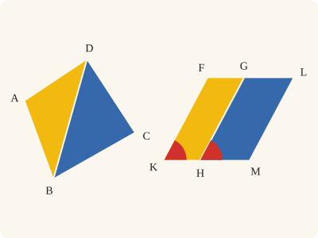
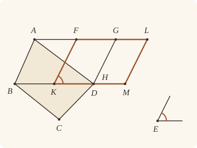

<!-- Generated by scripts/render.py. Do not edit by hand. -->

[Book I](index.md) · [← I.44](44.md) · [I.46 →](46.md)

# Book I, Proposition 45

*A parallelogram equal to a given rectilineal figure*

[Euclid's proof](#euclids-proof) · [In Lean](#in-lean) · [What it rests on](#what-it-rests-on) · [Mishnah](#mishnah)

> To construct, in a given rectilineal angle, a parallelogram equal to a given rectilineal figure.

**In Lean:** ✅ proved, as Euclid states it · Euclid's argument

<p align="center"></p>

<p align="center"><em>The straight-sided figure ABCD can be remade as a parallelogram KFLM, drawn apart as Heath draws it, in a chosen angle (red): divide ABCD into triangles by DB, and turn each one into a slice of equal area (yellow, blue).</em></p>

## Euclid's proof

<p align="center"></p>

<p align="center"><em>Drawn for one case: Euclid's figure ABCD, divided by DB into the two triangles ABD and DBC. H is drawn on D, as the Lean has it; Heath draws the parallelogram apart, as the figure at a glance does.</em></p>

Let ABCD be the given rectilineal figure and E the given rectilineal angle; thus it is required to construct, in the given angle E, a parallelogram equal to the rectilineal figure ABCD.

Let DB be joined, and let the parallelogram FH be constructed equal to the triangle ABD, in the angle HKF which is equal to E; [I. 42] let the parallelogram GM equal to the triangle DBC be applied to the straight line GH, in the angle GHM which is equal to E. [I. 44]

Then, since the angle E is equal to each of the angles HKF, GHM, the angle HKF is also equal to the angle GHM. [C.N. 1]

Let the angle KHG be added to each; therefore the angles FKH, KHG are equal to the angles KHG, GHM.

But the angles FKH, KHG are equal to two right angles; [I. 29] therefore the angles KHG, GHM are also equal to two right angles.

Thus, with a straight line GH, and at the point H on it, two straight lines KH, HM not lying on the same side make the adjacent angles equal to two right angles; therefore KH is in a straight line with HM. [I. 14]

And, since the straight line HG falls upon the parallels KM, FG, the alternate angles MHG, HGF are equal to one another. [I. 29]

Let the angle HGL be added to each; therefore the angles MHG, HGL are equal to the angles HGF, HGL. [C.N. 2]

But the angles MHG, HGL are equal to two right angles; [I. 29] therefore the angles HGF, HGL are also equal to two right angles. [C.N. 1]

Therefore FG is in a straight line with GL. [I. 14]

And, since FK is equal and parallel to HG, [I. 34] and HG to ML also, KF is also equal and parallel to ML; [C.N. 1; I. 30] and the straight lines KM, FL join them (at their extremities); therefore KM, FL are also equal and parallel. [I. 33]

Therefore KFLM is a parallelogram.

And, since the triangle ABD is equal to the parallelogram FH, and DBC to GM, the whole rectilineal figure ABCD is equal to the whole parallelogram KFLM.

Therefore the parallelogram KFLM has been constructed equal to the given rectilineal figure ABCD, in the angle FKM which is equal to the given angle E.

Q. E. F.

## In Lean

| | |
|---|---|
| Proof | ✅ Proved, and its companions `Prop45.outline` ([I.45 outline](45.md#outline)), `Prop45.append` ([I.45 append](45.md#append)), `Prop45.sum` ([I.45 sum](45.md#sum)), `Prop45.apart` ([I.45 apart](45.md#apart)), `Prop45.figure` ([I.45 figure](45.md#figure)) and `Prop45.fan` ([I.45 fan](45.md#fan)) |
| Statement | The whole enunciation. `Prop45` takes two triangles unchecked; `Prop45.outline` covers any rectilineal figure by its boundary; others take checked divisions, sums or a triangle more. |
| Argument | Euclid's. Euclid shows two triangles. The companions repeat his second step for each triangle after the first, as Oliver Byrne draws it for three: `Prop45.append` is the second half of his proof, with the parallelogram so far given in place of the one I.42 makes, and `Prop45.sum` applies it to one triangle after another, any triangles, which need not make a figure. `Prop45.outline` takes the figure by its boundary alone, represented by an outline, any number of sides, with holes, separate pieces or contacts at corners if it has them: Book Zero divides it into triangles that do not overlap, no point inside two of them (`Figures.division_exists`), `Prop45.apart` makes their parallelogram, and their sum is the figure's area, the same for every division (`Figures.area_eq`, from the content theorem `Figures.Apart.area_eq_of_same_region`, after David Hilbert's theory of content). |
| Representation | The main theorem is an area-sum theorem: it takes ABD and DBC unchecked, and they may overlap. It represents Euclid's pictured division when A and C lie on opposite sides of DB; that checked case is `Prop45.fan` for the corners D, A, B, C. `Prop45.outline` takes the figure by its outline alone (`Figures.Outline`), with no division supplied. The older companions take a figure given with a checked division into triangles, and make the parallelogram equal to those triangles together, which is the figure's area, the same for every division: triangles that lie apart, no point inside two of them (`Prop45.apart`); triangles glued edge to edge in a suitable order, for a figure with one boundary (`Prop45.figure`); or Euclid's and Byrne's, from one corner, neighbours on opposite sides of the straight line they share and the angles at that corner together less than four right angles, which `Fitted.fan` shows fit together (`Prop45.fan`); their figure is the one bounded by the closed line through the corners in order (`Prop45.fan_boundary`). |
| Reviewed | The statement and every passage of the argument read against Heath's text, at commit [`a973c8726`](https://github.com/jackChallis/stoicheia/commit/a973c8726) ([the record](../../review/I/45.toml)) |

From [`Elements/BookI/Prop45.lean`](../../Elements/BookI/Prop45.lean). Euclid's sentences are the `--` comments, and our own notes are in `/- … -/`; the lines under each sentence are the Lean that carries it out. The list below marks where a lemma does a step Euclid takes for granted and where a step needs a word of its own; the `/- … -/` notes in the listing explain smaller adjustments.

**How the Lean follows the text**

- **Carried.** "Let DB be joined, and let the parallelogram FH be constructed equal to the triangle ABD…" I.42 builds FH on half of BD itself, so H falls on D: the Lean writes D wherever Euclid writes H, and its parallelogram KFLM overlaps ABCD.
- **Done by `SameSideOf.trans_opposite`.** "Thus, with a straight line GH…" Euclid applies I.14 because KH and HM do not lie on the same side of GH. The Lean makes it so: it applies I.44's parallelogram to GH on the side away from K, and `SameSideOf.trans_opposite` puts M on the other side of GH from K. I.14 then puts H between K and M (D for H in the Lean).
- **Done by `quadArea_add_of_parallelograms`.** "And, since the triangle ABD is equal to the parallelogram FH…" Euclid takes FH and GM together as KFLM, equal to the two triangles of ABCD. With H between K and M and G between F and L from the two applications of I.14, `quadArea_add_of_parallelograms` joins the areas; the Lean writes D for H and takes ABCD as the sum of ABD and DBC, unchecked. For a figure given by its outline, the step from triangles to the whole figure is proved: the figure has a division into triangles that lie apart (`Figures.division_exists`), and every such division gives one sum, its area (`Figures.Apart.area_eq_of_same_region`, `Figures.area_eq`), so `Prop45.outline` makes the parallelogram equal to the figure itself.

```lean
/-- To construct, in a given rectilineal angle, a parallelogram equal to a given rectilineal figure. -/
theorem Prop45 {A B C D E₁ E E₂ : Point} (hABD : Triangle A B D) (hDBC : Triangle D B C)
    (hE : Triangle E₁ E E₂) :
    ∃ K F L M : Point, Parallelogram K F L M ∧ ∠ F K M = ∠ E₁ E E₂ ∧
      quadArea K F L M = △ A B D + △ D B C := by
  -- Let ABCD be the given rectilineal figure and E the given rectilineal angle; thus it is
  -- required to construct, in the given angle E, a parallelogram equal to the rectilineal
  -- figure ABCD.
  -- Let DB be joined, and let the parallelogram FH be constructed equal to the triangle ABD,
  -- in the angle HKF which is equal to E; [I. 42] let the parallelogram GM equal to the
  -- triangle DBC be applied to the straight line GH, in the angle GHM which is equal to
  -- E. [I. 44]
  /- I.42 builds on half of the triangle's own base, so KH lies along BD and H
     falls on D: the Lean writes D wherever Euclid writes H, and in our figure KFLM
     overlaps ABCD. K lies between B and D, and F is on A's side of BD. -/
  obtain ⟨K, F, G, -, -, hFKHG, hHKF, hFH⟩ := Prop42 hABD hE
  have hGHK : Triangle G D K := hFKHG.1.symm.swap_right.triangle.bac
  /- I.44's point for the side is taken across GH from K, so that KH and HM are
     "not lying on the same side", as I.14 will ask. -/
  obtain ⟨P, hPK, -⟩ := exists_oppositeSidesOf hGHK []
  obtain ⟨L, M, hMP, hGHML, hGHM, hGM⟩ := Prop44 hGHK.ne₁₂ hDBC hE hPK.triangle
  have hMK : OppositeSidesOf M K G D := hMP.trans_opposite hPK
  have hKD : K ≠ D := hGHK.ne₂₃.symm
  have hGD : G ≠ D := hGHK.ne₁₂
  have hFK : F ≠ K := hFKHG.1.1
  -- Then, since the angle E is equal to each of the angles HKF, GHM, the angle HKF is also
  -- equal to the angle GHM. [C.N. 1]
  have hHKF_GHM : ∠ D K F = ∠ G D M := CommonNotion1 hHKF hGHM
  -- Let the angle KHG be added to each; therefore the angles FKH, KHG are equal to the angles
  -- KHG, GHM.
  have hsum₁ : ∠ F K D + ∠ K D G = ∠ K D G + ∠ G D M := by
    rw [angle_symm hFK hKD.symm, hHKF_GHM, add_comm]
  -- But the angles FKH, KHG are equal to two right angles; [I. 29] therefore the angles KHG,
  -- GHM are also equal to two right angles.
  have hFG_KH : SameSideOf F G K D := hFKHG.rotate.sameSideOf.symm
  have h29a : ∠ F K D + ∠ K D G = ∟ + ∟ := Prop29.interior hFKHG.1.swap_left hFG_KH
  have hKHG_GHM : ∠ K D G + ∠ G D M = ∟ + ∟ := hsum₁.symm.trans h29a
  -- Thus, with a straight line GH, and at the point H on it, two straight lines KH, HM not
  -- lying on the same side make the adjacent angles equal to two right angles; therefore KH is
  -- in a straight line with HM. [I. 14]
  have hKHM : Between K D M := Prop14 hMK.symm (by
    rw [angle_symm hGD hKD]
    exact hKHG_GHM)
  -- And, since the straight line HG falls upon the parallels KM, FG, the alternate angles MHG,
  -- HGF are equal to one another. [I. 29]
  have hFK_HG : SameSideOf F K D G := hFKHG.rotate.rotate.sameSideOf
  have hMD : M ≠ D := ne_of_between (between_symm hKHM)
  obtain ⟨KM, hK_KM, hM_KM⟩ := Postulate1 K M (ne_of_between_ends hKHM)
  have hD_KM : OnLine D KM := on_line_of_between_ends hKHM hK_KM hM_KM
  obtain ⟨FG, hF_FG, hG_FG⟩ := Postulate1 F G hFKHG.2.2.1.symm
  have hKM_FG : Parallel KM FG := hFKHG.2.parallel hK_KM hD_KM hG_FG hF_FG
  have hMHGF : AreParallel M D G F :=
    AreParallel.of_parallel hMD hFKHG.2.2.1 hM_KM hD_KM hG_FG hF_FG hKM_FG
  have hMF : OppositeSidesOf M F D G := (hFK_HG.trans_opposite hMK.symm.swap).symm
  have hMHG_HGF : ∠ M D G = ∠ D G F := Prop29.alternate hMHGF hMF
  -- Let the angle HGL be added to each; therefore the angles MHG, HGL are equal to the angles
  -- HGF, HGL. [C.N. 2]
  have hsum₂ : ∠ M D G + ∠ D G L = ∠ D G F + ∠ D G L := CommonNotion2 hMHG_HGF rfl
  -- But the angles MHG, HGL are equal to two right angles; [I. 29] therefore the angles HGF,
  -- HGL are also equal to two right angles. [C.N. 1]
  have hML_HG : SameSideOf M L D G := hGHML.sameSideOf.swap
  have h29c : ∠ M D G + ∠ D G L = ∟ + ∟ := Prop29.interior hGHML.2.swap_right hML_HG
  have hHGF_HGL : ∠ D G F + ∠ D G L = ∟ + ∟ := CommonNotion1 hsum₂.symm h29c.symm
  -- Therefore FG is in a straight line with GL. [I. 14]
  have hFL : OppositeSidesOf F L D G :=
    hFK_HG.trans_opposite (hML_HG.symm.trans_opposite hMK.swap).symm
  have hFGL : Between F G L := Prop14 hFL hHGF_HGL
  -- And, since FK is equal and parallel to HG, [I. 34] and HG to ML also, KF is also equal and
  -- parallel to ML; [C.N. 1; I. 30] and the straight lines KM, FL join them (at their
  -- extremities); therefore KM, FL are also equal and parallel. [I. 33]
  obtain ⟨-, hFK_GH, -, -, -⟩ := Prop34 (A := F) (B := G) (C := K) (D := D) hFKHG
  obtain ⟨-, hGH_LM, -, -, -⟩ := Prop34 (A := G) (B := L) (C := D) (D := M) hGHML
  have hlen : ‖K F‖ = ‖M L‖ :=
    CommonNotion1 ((len_symm K F).trans hFK_GH) (hGH_LM.trans (len_symm L M)).symm
  obtain ⟨KF, hK_KF, hF_KF⟩ := Postulate1 K F hFK.symm
  obtain ⟨ML, hM_ML, hL_ML⟩ := Postulate1 M L hGHML.1.2.1
  obtain ⟨GD, hG_GD, hD_GD⟩ := Postulate1 G D hGD
  have hKF_GD : Parallel KF GD := hFKHG.1.swap_left.parallel hK_KF hF_KF hD_GD hG_GD
  have hML_GD : Parallel ML GD := hGHML.1.symm.parallel hM_ML hL_ML hG_GD hD_GD
  have hKF_ML : KF ≠ ML := fun e => by
    have hK_ML : OnLine K ML := e ▸ hK_KF
    have : ML = KM := line_unique (ne_of_between_ends hKHM) hK_ML hM_ML hK_KM hM_KM
    exact hML_GD.not_onLine (this ▸ hD_KM) hD_GD
  have hpar : AreParallel K F M L :=
    AreParallel.of_parallel hFK.symm hGHML.1.2.1 hK_KF hF_KF hM_ML hL_ML
      (Prop30.parallel hKF_GD hML_GD hKF_ML)
  have hdir : SameSideOf F L K M := by
    have hF : SameSide F G KM := hFG_KH.sameSide hK_KM hD_KM
    have hL : SameSide L G KM := hGHML.rotate.sameSideOf.sameSide hD_KM hM_KM
    exact SameSideOf.of_line (ne_of_between_ends hKHM) hK_KM hM_KM
      (same_side_trans (same_side_symm hF) (same_side_symm hL))
  obtain ⟨-, h33⟩ := Prop33 hpar hlen hdir
  -- Therefore KFLM is a parallelogram.
  have hKFLM : Parallelogram K F L M := ⟨hpar.swap_right, h33.symm.swap_right⟩
  -- And, since the triangle ABD is equal to the parallelogram FH, and DBC to GM, the whole
  -- rectilineal figure ABCD is equal to the whole parallelogram KFLM.
  have hwhole : quadArea K F L M = △ A B D + △ D B C := by
    rw [quadArea_add_of_parallelograms hFKHG.rotate.reverse hGHML.rotate.reverse hKHM hFGL,
      quadArea_reverse K D G F, hFKHG.quadArea_rotate, hFH,
      quadArea_reverse D M L G, hGHML.quadArea_rotate, hGM]
  -- Therefore the parallelogram KFLM has been constructed equal to the given rectilineal
  -- figure ABCD, in the angle FKM which is equal to the given angle E.
  refine ⟨K, F, L, M, hKFLM, ?_, hwhole⟩
  rw [angle_onRay_right (OnRay.of_beyond hKHM) hFK, angle_symm hFK hKD.symm]
  exact hHKF
  -- Q. E. F.
```

<a name="append"></a><a name="sum"></a><a name="apart"></a><a name="figure"></a><a name="fan"></a><a name="outline"></a>

<details><summary>After the theorem, its companions, <code>Prop45.append</code>, <code>Prop45.sum</code>, <code>Prop45.apart</code>, <code>Prop45.figure</code>, <code>Prop45.fan</code> and <code>Prop45.outline</code>; one more theorem later propositions use, <code>Fitted.fan</code>; 14 lemmas for its own proofs, <code>Fitted.fan.part</code>, <code>Fitted.fan.weaken</code>, <code>Fitted.fan.bounded</code>, <code>Fitted.fan.addition</code>, <code>Fitted.fan.growth</code>, <code>Fitted.fan.ray</code>, <code>Fitted.fan.rayOpposite</code>, <code>Fitted.fan.base</code>, <code>Fitted.fan.within</code>, <code>Fitted.fan.advance</code>, <code>Fitted.fan.positions</code>, <code>Fitted.fan.along</code>, <code>Fitted.fan.turn</code> and <code>Fitted.fan.sweep</code>; and one lemma beside the proposition, <code>Prop45.fan_boundary</code> (783 lines)</summary>

```lean
/-- **I.45, one more triangle** (companion of I.45). Given a parallelogram KFLM in the
given rectilineal angle E, and a triangle ABC, to construct a parallelogram in the same
angle equal to KFLM and ABC together: the second half of Euclid's proof, which applies a
parallelogram equal to the triangle to a side of the first [I. 44] and shows that the two
make one. -/
theorem Prop45.append {A B C K F L M E₁ E E₂ : Point} (hKFLM : Parallelogram K F L M)
    (hang : ∠ F K M = ∠ E₁ E E₂) (hABC : Triangle A B C) (hE : Triangle E₁ E E₂) :
    ∃ K' F' L' M' : Point, Parallelogram K' F' L' M' ∧ ∠ F' K' M' = ∠ E₁ E E₂ ∧
      quadArea K' F' L' M' = quadArea K F L M + △ A B C := by
  /- Here M is Euclid's H and L is G; the new corners L', M' are his L, M.
     Read the given parallelogram as FKML, and apply the new one to LM across
     that side from K, so that I.14 can join KM to MM'. -/
  have hFKML : Parallelogram F K M L := hKFLM.rotate.reverse
  have hLMK : Triangle L M K := hFKML.1.symm.swap_right.triangle.bac
  obtain ⟨P, hPK, -⟩ := exists_oppositeSidesOf hLMK []
  obtain ⟨L', M', hM'P, hLMM'L', hLMM', hadded⟩ :=
    Prop44 hLMK.ne₁₂ hABC hE hPK.triangle
  have hM'K : OppositeSidesOf M' K L M := hM'P.trans_opposite hPK
  have hKM : K ≠ M := hLMK.ne₂₃.symm
  have hLM : L ≠ M := hLMK.ne₁₂
  have hFK : F ≠ K := hFKML.1.1
  /- The angles FKM and LMM' both equal E. Add KML to each; I.29 makes
     the first pair two right angles, hence the second pair also. -/
  have hFKM_LMM' : ∠ F K M = ∠ L M M' := CommonNotion1 hang hLMM'
  have hsum₁ : ∠ F K M + ∠ K M L = ∠ K M L + ∠ L M M' := by
    rw [hFKM_LMM', add_comm]
  have hFL_KM : SameSideOf F L K M := hFKML.rotate.sameSideOf.symm
  have hFKM_KML : ∠ F K M + ∠ K M L = ∟ + ∟ :=
    Prop29.interior hFKML.1.swap_left hFL_KM
  have hKML_LMM' : ∠ K M L + ∠ L M M' = ∟ + ∟ :=
    hsum₁.symm.trans hFKM_KML
  /- K and M' lie on opposite sides of LM, and the angles KML, LMM' are two
     right angles, so I.14 puts KM in a straight line with MM', with M
     between K and M'. -/
  have hKMM' : Between K M M' := Prop14 hM'K.symm (by
    rw [angle_symm hLM hKM]
    exact hKML_LMM')
  /- ML falls on the parallels KM' and FL, so I.29 equates the alternate
     angles M'ML and MLF. -/
  have hFK_ML : SameSideOf F K M L := hFKML.rotate.rotate.sameSideOf
  have hM'M : M' ≠ M := ne_of_between (between_symm hKMM')
  obtain ⟨KM', hK_KM', hM'_KM'⟩ := Postulate1 K M' (ne_of_between_ends hKMM')
  have hM_KM' : OnLine M KM' := on_line_of_between_ends hKMM' hK_KM' hM'_KM'
  obtain ⟨FL, hF_FL, hL_FL⟩ := Postulate1 F L hFKML.2.2.1.symm
  have hKM'_FL : Parallel KM' FL := hFKML.2.parallel hK_KM' hM_KM' hL_FL hF_FL
  have hM'MLF : AreParallel M' M L F :=
    AreParallel.of_parallel hM'M hFKML.2.2.1 hM'_KM' hM_KM' hL_FL hF_FL hKM'_FL
  have hM'F : OppositeSidesOf M' F M L := (hFK_ML.trans_opposite hM'K.symm.swap).symm
  have hM'ML_MLF : ∠ M' M L = ∠ M L F := Prop29.alternate hM'MLF hM'F
  /- Add MLL' to each. I.29 makes M'ML and MLL' two right angles,
     so MLF and MLL' are two right angles too. -/
  have hsum₂ : ∠ M' M L + ∠ M L L' = ∠ M L F + ∠ M L L' :=
    CommonNotion2 hM'ML_MLF rfl
  have hM'L'_ML : SameSideOf M' L' M L := hLMM'L'.sameSideOf.swap
  have hM'ML_MLL' : ∠ M' M L + ∠ M L L' = ∟ + ∟ :=
    Prop29.interior hLMM'L'.2.swap_right hM'L'_ML
  have hMLF_MLL' : ∠ M L F + ∠ M L L' = ∟ + ∟ :=
    CommonNotion1 hsum₂.symm hM'ML_MLL'.symm
  /- F and L' lie on opposite sides of ML, so I.14 puts FL and LL'
     in one straight line. -/
  have hFL' : OppositeSidesOf F L' M L :=
    hFK_ML.trans_opposite (hM'L'_ML.symm.trans_opposite hM'K.swap).symm
  have hFLL' : Between F L L' := Prop14 hFL' hMLF_MLL'
  /- I.34 gives FK equal to LM and LM equal to L'M'. The outer sides FK
     and L'M' are parallel to LM, and are not one straight line, for that
     line would be KM', which meets LM at M; I.30 makes KF parallel to M'L'. -/
  obtain ⟨-, hFK_LM, -, -, -⟩ := Prop34 (A := F) (B := L) (C := K) (D := M) hFKML
  obtain ⟨-, hLM_L'M', -, -, -⟩ :=
    Prop34 (A := L) (B := L') (C := M) (D := M') hLMM'L'
  have hlen : ‖K F‖ = ‖M' L'‖ :=
    CommonNotion1 ((len_symm K F).trans hFK_LM) (hLM_L'M'.trans (len_symm L' M')).symm
  obtain ⟨KF, hK_KF, hF_KF⟩ := Postulate1 K F hFK.symm
  obtain ⟨M'L', hM'_M'L', hL'_M'L'⟩ := Postulate1 M' L' hLMM'L'.1.2.1
  obtain ⟨LM, hL_LM, hM_LM⟩ := Postulate1 L M hLM
  have hKF_LM : Parallel KF LM := hFKML.1.swap_left.parallel hK_KF hF_KF hM_LM hL_LM
  have hM'L'_LM : Parallel M'L' LM :=
    hLMM'L'.1.symm.parallel hM'_M'L' hL'_M'L' hL_LM hM_LM
  have hKF_M'L' : KF ≠ M'L' := fun e => by
    have hK_M'L' : OnLine K M'L' := e ▸ hK_KF
    have hline : M'L' = KM' :=
      line_unique (ne_of_between_ends hKMM') hK_M'L' hM'_M'L' hK_KM' hM'_KM'
    exact hM'L'_LM.not_onLine (hline ▸ hM_KM') hM_LM
  have hpar : AreParallel K F M' L' :=
    AreParallel.of_parallel hFK.symm hLMM'L'.1.2.1 hK_KF hF_KF hM'_M'L' hL'_M'L'
      (Prop30.parallel hKF_LM hM'L'_LM hKF_M'L')
  /- KM' and FL' join the equal parallels in the same direction. By I.33
     they too are parallel, completing the parallelogram KFL'M'. -/
  have hdir : SameSideOf F L' K M' := by
    have hF : SameSide F L KM' := hFL_KM.sameSide hK_KM' hM_KM'
    have hL' : SameSide L' L KM' := hLMM'L'.rotate.sameSideOf.sameSide hM_KM' hM'_KM'
    exact SameSideOf.of_line (ne_of_between_ends hKMM') hK_KM' hM'_KM'
      (same_side_trans (same_side_symm hF) (same_side_symm hL'))
  obtain ⟨-, h33⟩ := Prop33 hpar hlen hdir
  have hwhole : Parallelogram K F L' M' := ⟨hpar.swap_right, h33.symm.swap_right⟩
  /- The whole is the two parallelograms together, and the added one equals
     ABC. The ray KM' is the ray KM, so the angle at K remains E. -/
  have harea : quadArea K F L' M' = quadArea K F L M + △ A B C := by
    rw [quadArea_add_of_parallelograms hKFLM hLMM'L'.rotate.reverse hKMM' hFLL',
      quadArea_reverse M M' L' L, hLMM'L'.quadArea_rotate, hadded]
  refine ⟨K, F, L', M', hwhole, ?_, harea⟩
  rw [angle_onRay_right (OnRay.of_beyond hKMM') hFK]
  exact hang
/-- **I.45, any number of triangles** (companion of I.45). To construct, in a given
rectilineal angle E, a parallelogram equal to any number of given triangles taken together,
at least one: I.42 for the first, then `Prop45.append` for each of the rest, in order. The
triangles are any triangles, each with its corners off one straight line; they need not fit
together into one figure, and the statement claims nothing of a figure. -/
theorem Prop45.sum {E₁ E E₂ : Point} (ts : List (Point × Point × Point)) (hne : ts ≠ [])
    (hts : ∀ t ∈ ts, Triangle t.1 t.2.1 t.2.2) (hE : Triangle E₁ E E₂) :
    ∃ K F L M : Point, Parallelogram K F L M ∧ ∠ F K M = ∠ E₁ E E₂ ∧
      quadArea K F L M = Magnitude.sum (ts.map fun t => △ t.1 t.2.1 t.2.2) := by
  /- One triangle after another: a parallelogram in the angle E equal to X, with the
     triangles of `rest` added one at a time by `Prop45.append`. -/
  have step : ∀ (rest : List (Point × Point × Point)) (K F L M : Point) (X : Area),
      Parallelogram K F L M → ∠ F K M = ∠ E₁ E E₂ → quadArea K F L M = X →
      (∀ t ∈ rest, Triangle t.1 t.2.1 t.2.2) →
      ∃ K' F' L' M' : Point, Parallelogram K' F' L' M' ∧ ∠ F' K' M' = ∠ E₁ E E₂ ∧
        quadArea K' F' L' M' = X + Magnitude.sum (rest.map fun t => △ t.1 t.2.1 t.2.2) := by
    intro rest
    induction rest with
    | nil =>
      intro K F L M X hp hang harea _
      refine ⟨K, F, L, M, hp, hang, ?_⟩
      rw [harea]
      exact (add_zero X).symm
    | cons t rest ih =>
      intro K F L M X hp hang harea hts
      obtain ⟨K', F', L', M', hp', hang', harea'⟩ :=
        Prop45.append hp hang (hts t (List.mem_cons_self ..)) hE
      obtain ⟨K'', F'', L'', M'', hp'', hang'', harea''⟩ :=
        ih K' F' L' M' (X + △ t.1 t.2.1 t.2.2) hp' hang' (by rw [harea', harea])
          (fun s hs => hts s (List.mem_cons_of_mem _ hs))
      refine ⟨K'', F'', L'', M'', hp'', hang'', ?_⟩
      rw [harea'']
      exact add_assoc X (△ t.1 t.2.1 t.2.2) _
  match ts, hne, hts with
  | (A, B, C) :: rest, _, hts =>
    /- The first triangle, ABC, by I.42. Its parallelogram FGCH, with its angle at G equal
       to E, is named from G, as GFHC. -/
    have h₁ : Triangle A B C := hts (A, B, C) (List.mem_cons_self ..)
    obtain ⟨G, F, H, -, -, hp, hang, harea⟩ := Prop42 h₁ hE
    have hFG : F ≠ G := hp.1.1
    have hGC : G ≠ C := hp.2.1
    obtain ⟨K, F', L, M, hp', hang', harea'⟩ :=
      step rest G F H C (△ A B C) hp.reverse.rotate.rotate.rotate
        (by rw [angle_symm hFG hGC.symm]; exact hang)
        (by rw [quadArea_reverse G C H F, hp.quadArea_rotate, harea])
        (fun s hs => hts s (List.mem_cons_of_mem _ hs))
    exact ⟨K, F', L, M, hp', hang', harea'⟩

/-- **I.45, for a figure given with triangles that lie apart** (companion of I.45). To
construct, in a given rectilineal angle E, a parallelogram KFLM, its angle at K equal to E,
equal to a given rectilineal figure: the figure given with a checked division into
triangles, any division of it whose triangles lie apart, no point inside two of them
(`Apart`), and "equal to the figure" meaning equal to those triangles taken together
(`Apart.area`). The figure may have a hole, touch itself at a corner, or be in more than one
piece. It is `Prop45.sum` for the figure's triangles;
lying apart is what makes their sum the figure's. The statement speaks of the division given;
that every division of the figure gives the same sum is the content theorem
(`Apart.area_eq_of_same_region`), and the figure by its outline is `Prop45.outline`. -/
theorem Prop45.apart {E₁ E E₂ : Point} (R : Apart) (hE : Triangle E₁ E E₂) :
    ∃ K F L M : Point, Parallelogram K F L M ∧ ∠ F K M = ∠ E₁ E E₂ ∧
      quadArea K F L M = R.area :=
  Prop45.sum R.pieces R.ne R.triangle hE

/-- **I.45, for a figure with one boundary, given with triangles fitted together**
(companion of I.45). To construct, in a given rectilineal angle E, a parallelogram KFLM,
its angle at K equal to E, equal to a given rectilineal figure: the figure given with a
checked division into triangles, fitted together in a suitable order, each glued across a
side of an earlier one and meeting the earlier ones only along it (`Rectilineal`), and
"equal to the figure" meaning equal to those triangles taken together (`Rectilineal.area`). The figure may be convex or not, and need have no corner from
which the straight lines to the others divide it. It is `Prop45.apart` for the figure's
triangles, which lie apart (`Fitted.inside_pairwise`, `Rectilineal.toApart`). As there, the
statement speaks of the division given, and every division gives the same sum
(`Apart.area_eq_of_same_region`). -/
theorem Prop45.figure {E₁ E E₂ : Point} (R : Rectilineal) (hE : Triangle E₁ E E₂) :
    ∃ K F L M : Point, Parallelogram K F L M ∧ ∠ F K M = ∠ E₁ E E₂ ∧
      quadArea K F L M = R.area :=
  Prop45.apart R.toApart hE

end Elements.BookI

namespace Elements

/-! ## Euclid's and Byrne's division, checked

Euclid's DB, drawn from the corner D of ABCD, and Oliver Byrne's two straight lines from one
corner of his figure (1847, p. 46), divide it into triangles A₀A₁A₂, A₀A₂A₃, …, A₀Aₙ₋₁Aₙ from one
corner A₀. `Fitted.fan` says when those triangles are a figure in the sense of `Fitted`: each
two neighbouring triangles lie on opposite sides of the straight line A₀Aᵢ they share, and the
angles A₁A₀A₂, …, Aₙ₋₁A₀Aₙ together are less than four right angles. Without the two
conditions the triangles from A₀ may overlap or reach outside the figure, and their sum need
not equal the area of their union: a pentagon whose second and fourth corners lie on one side
of the straight line from the first corner to the third has three triangles from the first
corner together greater than it, and the first condition fails there. `Fitted.fan` says that
the triangles fit together into one figure; that this figure is the one bounded by the
closed line A₀A₁…AₙA₀, its corners in that order, and that the triangles divide exactly its
region, is the bridge `Prop45.fan_boundary`, at the end of this file.

Its proof goes by induction along the corners, each new triangle glued to the one before it
along A₀Aᵢ. It carries the sector at A₀ swept from the ray A₀A₁, in the one orientation the
condition on neighbours fixes, in three cases as the sum of the angles so far is less than two
right angles, equal to two, or greater; the bound of four right angles does its work only in
the last. It cites I.13, so it stands here, beside I.45 and before `Prop45.fan`, which uses
it, rather than in Book Zero. The helpers before it, `Fitted.fan.<word>`, each supply one of
its steps, named in its docstring.
-/

/-- If x and y together are less than z, then x alone is less than z, being not greater than
the whole (C.N. 5). -/
theorem Fitted.fan.part {k : Kind} {x y z : Magnitude k} (h : x + y < z) : x < z := by
  by_cases hy : y = 0
  · simpa only [hy, Tacit.add_zero] using h
  · exact Tacit.lt_trans (CommonNotion5 (Magnitude.pos_of_ne_zero hy)) h

/-- "Not greater than" carries on: if x is not greater than y, nor y than z, then x is not
greater than z. -/
theorem Fitted.fan.weaken {k : Kind} {x y z : Magnitude k}
    (hxy : x ≤ y) (hyz : y ≤ z) : x ≤ z := by
  intro hzx
  rcases Tacit.lt_trichotomy x y with h | h | h
  · exact hyz (Tacit.lt_trans hzx h)
  · exact hyz (h ▸ hzx)
  · exact hxy h

/-- If x is not greater than y, and y is less than z, then x is less than z. -/
theorem Fitted.fan.bounded {k : Kind} {x y z : Magnitude k}
    (hxy : x ≤ y) (hyz : y < z) : x < z := by
  rcases Tacit.lt_trichotomy x y with h | h | h
  · exact Tacit.lt_trans h hyz
  · exact h ▸ hyz
  · exact False.elim (hxy h)

/-- Adding the same thing keeps "not greater than": if y is not greater than z, then x and y
together are not greater than x and z together. -/
theorem Fitted.fan.addition {k : Kind} (x : Magnitude k) {y z : Magnitude k}
    (hyz : y ≤ z) : x + y ≤ x + z := by
  intro h
  exact hyz (Magnitude.lt_of_add_lt_add_left h)

/-- Something added makes nothing less: x and y together are not less than x. -/
theorem Fitted.fan.growth {k : Kind} (x y : Magnitude k) : x ≤ x + y := by
  intro h
  have h' : x + y < x + 0 := by simpa only [Tacit.add_zero] using h
  exact Tacit.not_lt_zero y (Magnitude.lt_of_add_lt_add_left h')

/-- If B lies on the ray from O through A, every point of the ray from O through B
lies on it too. This carries positions along a boundary ray. -/
theorem Fitted.fan.ray {O A B Y : Point} (hY : OnRay Y O B) (hB : OnRay B O A) :
    OnRay Y O A := by
  obtain ⟨L, hO, hA, hBL⟩ := hB.2.2.1
  exact ⟨hB.1, hY.2.1, ⟨L, hO, hA, hY.onLine hO hBL⟩,
    hY.not_between hB.symm⟩

/-- If B is on the other side of OA from D, so is every point of the ray from O through B.
This carries positions along rays in the second half-plane. -/
theorem Fitted.fan.rayOpposite {O A B D Y : Point}
    (hY : OnRay Y O B) (hBD : OppositeSidesOf B D O A) :
    OppositeSidesOf Y D O A := by
  obtain ⟨L, hO, hA⟩ := Postulate1 O A hBD.1
  have hBB : SameSideOf B B O A :=
    SameSideOf.of_line hBD.1 hO hA (Tacit.same_side_refl (hBD.oppositeSides hO hA).1)
  exact (SameSideOf.of_onRay hY hBB).trans_opposite hBD

/-- A point between B and C is on C's side of OB (System E, Pasch 2): the side BC of the
triangle OBC, in `Fitted.fan.within`. -/
theorem Fitted.fan.base {O B C Y : Point} (hOBC : Triangle O B C)
    (hBYC : Between B Y C) : SameSideOf Y C O B := by
  obtain ⟨L, hO, hB⟩ := Postulate1 O B hOBC.ne₁₂
  have hY : ¬ OnLine Y L := fun hY =>
    hOBC.off_line hO hB (Tacit.on_line_of_between hBYC hB hY)
  exact SameSideOf.of_line hOBC.ne₁₂ hO hB (Tacit.pasch2 hBYC hB hY)

/-- **A point within or on the triangle OBC** lies on the finite straight line OB, or on C's
side of OB, making with OB an angle not greater than BOC. O itself, the corners and the
sides are among the cases. -/
theorem Fitted.fan.within {O B C Y : Point} (hOBC : Triangle O B C)
    (hY : OnOrInsideTriangle Y O B C) :
    OnFiniteLine Y O B ∨ (SameSideOf Y C O B ∧ ∠ B O Y ≤ ∠ B O C) := by
  have hCC : SameSideOf C C O B := by
    obtain ⟨L, hO, hB⟩ := Postulate1 O B hOBC.ne₁₂
    exact SameSideOf.of_line hOBC.ne₁₂ hO hB
      (Tacit.same_side_refl (hOBC.off_line hO hB))
  rcases hY with hY | hY | hY | hY | rfl | rfl | rfl
  · /- Within the triangle: on C's side of OB and on B's side of OC, so within the angle
       BOC, which is made up of BOY and YOC. -/
    refine Or.inr ⟨hY.2.2, ?_⟩
    rw [angle_add_of_within hY.2.2 hY.2.1.swap]
    exact fan.growth _ _
  · exact Or.inl (Or.inr (Or.inr hY))
  · /- On the side BC: on C's side of OB, and BOC is made up of BOY and YOC. -/
    refine Or.inr ⟨fan.base hOBC hY, ?_⟩
    rw [angle_add_of_between hOBC.bca hY]
    exact fan.growth _ _
  · /- On the side CO: on the ray from O through C, where the angle is BOC itself. -/
    have hYC : OnRay Y O C := OnRay.of_between (Tacit.between_symm hY)
    refine Or.inr ⟨SameSideOf.of_onRay hYC hCC, ?_⟩
    rw [angle_onRay_right hYC hOBC.ne₁₂.symm]
    exact Tacit.lt_irrefl _
  · exact Or.inl (Or.inl rfl)
  · exact Or.inl (Or.inr (Or.inl rfl))
  · exact Or.inr ⟨hCC, Tacit.lt_irrefl _⟩

/-- **The half turn.** Let AO be produced beyond O to A', let B be off the straight line AA',
and let C be on the other side of OB from A, so that the ray OC turns on from OB, away from
OA. Then OC stays on B's side of AA', B is within the angle AOC, on A's side of OC, and the
angles AOB and BOC make up AOC; or C lies on OA', and AOB and BOC make two right angles
(I.13); or C passes beyond, to the other side of AA', B is on the same side of OC as A',
and AOB and BOC make two right angles and the angle A'OC (I.13). Triple incidence places
the rays; no straight angle is measured. -/
theorem Fitted.fan.advance {O A A' B C : Point} (hAOA' : Between A O A')
    (hOAB : Triangle O A B) (hAC : OppositeSidesOf A C O B) :
    (SameSideOf B C O A ∧ SameSideOf B A O C ∧
      ∠ A O B + ∠ B O C = ∠ A O C) ∨
    (Between A O C ∧ ∠ A O B + ∠ B O C = ∟ + ∟) ∨
    (OppositeSidesOf B C O A ∧ SameSideOf B A' O C ∧
      ∠ A O B + ∠ B O C = ∟ + ∟ + ∠ A' O C) := by
  obtain ⟨L, hOL, hAL⟩ := Postulate1 O A hOAB.ne₁₂
  have hA'L : OnLine A' L := Tacit.on_line_of_between hAOA' hAL hOL
  have hBL : ¬ OnLine B L := hOAB.off_line hOL hAL
  obtain ⟨M, hOM, hBM⟩ := Postulate1 O B hOAB.ne₁₃
  have hACM := hAC.oppositeSides hOM hBM
  have hOC : O ≠ C := hAC.symm.triangle.ne₁₃
  obtain ⟨N, hON, hCN⟩ := Postulate1 O C hOC
  by_cases hCL : OnLine C L
  · /- On OA, the side condition puts C beyond O from A, on the ray through A'. -/
    have hAOA'C : SameSideOf A' C O B :=
      hAC.sameSideOf_of_between hAOA'
    have hCA' : OnRay C O A' := OnRay.of_sameSideOf hAOA'C.symm
      ⟨L, hOL, hA'L, hCL⟩ hOC.symm
    have hAOC : Between A O C := hCA'.between hAOA'
    have hACB : Triangle A C B := Triangle.of_line hAL hCL
      (Tacit.ne_of_between_ends hAOC) hBL
    exact Or.inr (Or.inl ⟨hAOC, BookI.Prop13 hAOC hACB⟩)
  by_cases hBC : SameSide B C L
  · /- In one half-plane, OB lies within AOC by Triple incidence 2. -/
    have hABN : SameSide A B N := Tacit.triple_incidence2
      hOL hOM hON hAL hBM hCN hBC hACM.2.2 hACM.2.1 hOAB.ne₁₂.symm
    have hBC' := SameSideOf.of_line hOAB.ne₁₂ hOL hAL hBC
    have hBA_OC := SameSideOf.of_line hOC hON hCN (Tacit.same_side_symm hABN)
    exact Or.inl ⟨hBC', hBA_OC, (angle_add_of_within hBC' hBA_OC).symm⟩
  · /- Across OA, the produced ray OA' lies within BOC. I.13 accounts for the
       angles from OA through OB to OA', leaving the angle A'OC. -/
    have hBC' : OppositeSidesOf B C O A :=
      OppositeSidesOf.of_line hOAB.ne₁₂ hOL hAL ⟨hBL, hCL, hBC⟩
    have hA'C : SameSideOf A' C O B := hAC.sameSideOf_of_between hAOA'
    have hBA'N : SameSide B A' N := Tacit.triple_incidence2
      hOM hOL hON hBM hA'L hCN (hA'C.sameSide hOM hBM) hBC hCL hOAB.ne₁₃.symm
    have hBA' : SameSideOf B A' O C := SameSideOf.of_line hOC hON hCN hBA'N
    have hAA'B : Triangle A A' B := Triangle.of_line hAL hA'L
      (Tacit.ne_of_between_ends hAOA') hBL
    refine Or.inr (Or.inr ⟨hBC', hBA', ?_⟩)
    rw [angle_add_of_within hA'C hBA'.symm, ← Tacit.add_assoc,
      BookI.Prop13 hAOA' hAA'B]

/-- **The position of a point round O.** There is a measure p of where each point lies
round O, starting from the ray OA and turning towards D's side of OA: nothing on the ray
OA; the angle AOY at a point Y on D's side; two right angles on the ray OA', which is AO
produced beyond O; and two right angles together with A'OY at a point Y on the other side.
The two rays are given their positions outright, so that no straight angle, and no angle
at a repeated point, is ever measured: the axioms fix the size of neither. The measure is
chosen by cases, and the proof uses only these four properties of it. -/
theorem Fitted.fan.positions {O A A' D : Point} (hAOA' : Between A O A')
    (hOAD : Triangle O A D) :
    ∃ p : Point → Angle, ∀ Y : Point,
      (OnRay Y O A → p Y = 0) ∧
      (SameSideOf Y D O A → p Y = ∠ A O Y) ∧
      (OnRay Y O A' → p Y = ∟ + ∟) ∧
      (OppositeSidesOf Y D O A → p Y = ∟ + ∟ + ∠ A' O Y) := by
  classical
  let p : Point → Angle := fun Y =>
    if SameSideOf Y D O A then ∠ A O Y
    else if OppositeSidesOf Y D O A then ∟ + ∟ + ∠ A' O Y
    else if OnRay Y O A then 0 else ∟ + ∟
  obtain ⟨L, hO, hA⟩ := Postulate1 O A hOAD.ne₁₂
  have hA' : OnLine A' L := Tacit.on_line_of_between hAOA' hA hO
  refine ⟨p, ?_⟩
  intro Y
  have hline : OnLine Y L → ¬ SameSideOf Y D O A ∧ ¬ OppositeSidesOf Y D O A := by
    intro hY
    exact ⟨fun h => Tacit.not_on_line_of_same_side (h.sameSide hO hA) hY,
      fun h => (h.oppositeSides hO hA).1 hY⟩
  refine ⟨?_, ?_, ?_, ?_⟩
  · intro hY
    obtain ⟨hs, ho⟩ := hline (hY.onLine hO hA)
    simp only [p, ite_eq_right hs, ite_eq_right ho, ite_eq_left hY]
  · intro hY
    simp only [p, ite_eq_left hY]
  · intro hY
    obtain ⟨hs, ho⟩ := hline (hY.onLine hO hA')
    have hr : ¬ OnRay Y O A := fun h => h.2.2.2 (Tacit.between_symm (hY.between hAOA'))
    simp only [p, ite_eq_right hs, ite_eq_right ho, ite_eq_right hr]
  · intro hY
    have hs : ¬ SameSideOf Y D O A := fun h =>
      (hY.oppositeSides hO hA).2.2 (h.sameSide hO hA)
    simp only [p, ite_eq_right hs, ite_eq_left hY]

/-- Every point of the ray from O through B is at B's position, wherever B is: on D's side
of OA, on the ray OA', or on the other side. -/
theorem Fitted.fan.along {O A A' D B Y : Point} {p : Point → Angle}
    (hAOA' : Between A O A')
    (hposition : ∀ Y : Point,
      (OnRay Y O A → p Y = 0) ∧
      (SameSideOf Y D O A → p Y = ∠ A O Y) ∧
      (OnRay Y O A' → p Y = ∟ + ∟) ∧
      (OppositeSidesOf Y D O A → p Y = ∟ + ∟ + ∠ A' O Y))
    (hB : SameSideOf B D O A ∨ OnRay B O A' ∨ OppositeSidesOf B D O A)
    (hY : OnRay Y O B) : p Y = p B := by
  rcases hB with hBD | hBA' | hBD
  · rw [(hposition Y).2.1 (SameSideOf.of_onRay hY hBD), (hposition B).2.1 hBD]
    exact angle_onRay_right hY (Tacit.ne_of_between hAOA')
  · rw [(hposition Y).2.2.1 (fan.ray hY hBA'), (hposition B).2.2.1 hBA']
  · rw [(hposition Y).2.2.2 (fan.rayOpposite hY hBD), (hposition B).2.2.2 hBD,
      angle_onRay_right hY (Tacit.ne_of_between (Tacit.between_symm hAOA'))]

/-- **A step round O.** Let B be at position S, with the corner P before it behind B: on A's
side of OB when B is on D's side of OA, on D's side of OA when B is on the ray OA', and on
the same side of OB as A' when B is on the other side of OA. These are the three cases of
the running sum S: less than two right angles, exactly two, and more than two. If C is on the
other side of OB from P, and S together with the angle BOC is less than four right angles,
then C is at the position S together with BOC, and B is behind C in the same sense. In the
first case the step is the half turn from OA; in the second, OC leaves the ray OA' for the
other side; in the third, the half turn from OA', in which OC can neither come back to the
ray OA nor pass it, for the angles would make four right angles or more. That is the one
place the bound of four right angles is used. -/
theorem Fitted.fan.turn {O A A' D P B C : Point} {p : Point → Angle} {S : Angle}
    (hAOA' : Between A O A')
    (hposition : ∀ Y : Point,
      (OnRay Y O A → p Y = 0) ∧
      (SameSideOf Y D O A → p Y = ∠ A O Y) ∧
      (OnRay Y O A' → p Y = ∟ + ∟) ∧
      (OppositeSidesOf Y D O A → p Y = ∟ + ∟ + ∠ A' O Y))
    (hB : (SameSideOf B D O A ∧ SameSideOf P A O B) ∨
      (OnRay B O A' ∧ SameSideOf P D O A) ∨
      (OppositeSidesOf B D O A ∧ SameSideOf P A' O B))
    (hpB : p B = S) (hPC : OppositeSidesOf P C O B)
    (hS : S + ∠ B O C < ∟ + ∟ + (∟ + ∟)) :
    p C = S + ∠ B O C ∧
      ((SameSideOf C D O A ∧ SameSideOf B A O C) ∨
      (OnRay C O A' ∧ SameSideOf B D O A) ∨
      (OppositeSidesOf C D O A ∧ SameSideOf B A' O C)) := by
  obtain ⟨L, hOL, hAL⟩ := Postulate1 O A (Tacit.ne_of_between hAOA').symm
  have hA'L : OnLine A' L := Tacit.on_line_of_between hAOA' hAL hOL
  have hOA' : O ≠ A' := (Tacit.ne_of_between (Tacit.between_symm hAOA')).symm
  have hOBC : Triangle O B C := hPC.symm.triangle
  rcases hB with ⟨hBD, hPA⟩ | ⟨hBA', hPD⟩ | ⟨hBD, hPA'⟩
  · /- Less than two right angles: the position is the angle AOB. -/
    have hSB : S = ∠ A O B := hpB.symm.trans ((hposition B).2.1 hBD)
    have hAC : OppositeSidesOf A C O B := hPA.symm.trans_opposite hPC
    rcases fan.advance hAOA' hBD.triangle hAC with
      ⟨hBC, hBA, hsum⟩ | ⟨hAOC, hsum⟩ | ⟨hBC, hBA', hsum⟩
    · have hCD : SameSideOf C D O A := hBC.symm.trans hBD
      refine ⟨?_, Or.inl ⟨hCD, hBA⟩⟩
      rw [hSB, hsum]
      exact (hposition C).2.1 hCD
    · have hCA' : OnRay C O A' := OnRay.of_between_between hAOA' hAOC
      refine ⟨?_, Or.inr (Or.inl ⟨hCA', hBD⟩)⟩
      rw [hSB, hsum]
      exact (hposition C).2.2.1 hCA'
    · have hCD : OppositeSidesOf C D O A := (hBD.symm.trans_opposite hBC).symm
      refine ⟨?_, Or.inr (Or.inr ⟨hCD, hBA'⟩)⟩
      rw [hSB, hsum]
      exact (hposition C).2.2.2 hCD
  · /- Exactly two right angles: OB is the opposite ray from OA. -/
    have hSB : S = ∟ + ∟ := hpB.symm.trans ((hposition B).2.2.1 hBA')
    have hBL : OnLine B L := hBA'.onLine hOL hA'L
    have hPC' : OppositeSidesOf P C O A := OppositeSidesOf.of_line
      (Tacit.ne_of_between hAOA').symm hOL hAL (hPC.oppositeSides hOL hBL)
    have hCD : OppositeSidesOf C D O A := (hPD.symm.trans_opposite hPC').symm
    obtain ⟨N, hON, hCN⟩ := Postulate1 O C hOBC.ne₁₃
    have hA'N : ¬ OnLine A' N := fun h => hOBC.acb.off_line hON hCN (hBA'.onLine hON h)
    have hA'A' : SameSideOf A' A' O C := SameSideOf.of_line hOBC.ne₁₃ hON hCN
      (Tacit.same_side_refl hA'N)
    refine ⟨?_, Or.inr (Or.inr ⟨hCD, SameSideOf.of_onRay hBA' hA'A'⟩)⟩
    rw [hSB, angle_onRay_left hBA' hOBC.ne₁₃.symm]
    exact (hposition C).2.2.2 hCD
  · /- More than two right angles: measure the rest from OA produced through O. -/
    have hSB : S = ∟ + ∟ + ∠ A' O B := hpB.symm.trans ((hposition B).2.2.2 hBD)
    have hOA'B : Triangle O A' B := Triangle.of_line hOL hA'L hOA'
      (hBD.oppositeSides hOL hAL).1
    have hA'C : OppositeSidesOf A' C O B := hPA'.symm.trans_opposite hPC
    rcases fan.advance (Tacit.between_symm hAOA') hOA'B hA'C with
      ⟨hBC, hBA', hsum⟩ | ⟨_, hsum⟩ | ⟨_, _, hsum⟩
    · have hBC' : SameSideOf B C O A := SameSideOf.of_line
        (Tacit.ne_of_between hAOA').symm hOL hAL (hBC.sameSide hOL hA'L)
      have hCD : OppositeSidesOf C D O A := hBC'.symm.trans_opposite hBD
      refine ⟨?_, Or.inr (Or.inr ⟨hCD, hBA'⟩)⟩
      rw [hSB, Tacit.add_assoc, hsum]
      exact (hposition C).2.2.2 hCD
    · rw [hSB, Tacit.add_assoc, hsum] at hS
      exact False.elim (Tacit.lt_irrefl _ hS)
    · rw [hSB, Tacit.add_assoc, hsum, ← Tacit.add_assoc] at hS
      exact False.elim (Tacit.lt_irrefl _ (fan.part hS))

/-- **The new triangle lies beyond the region already swept**, save along its side OB. With
B at position S and P behind it, as in `Fitted.fan.turn`, every point within or on the
triangle OBC lies on the finite straight line OB, or is a point other than O at a position
greater than S and not greater than S together with the angle BOC. -/
theorem Fitted.fan.sweep {O A A' D P B C Y : Point} {p : Point → Angle} {S : Angle}
    (hAOA' : Between A O A')
    (hposition : ∀ Y : Point,
      (OnRay Y O A → p Y = 0) ∧
      (SameSideOf Y D O A → p Y = ∠ A O Y) ∧
      (OnRay Y O A' → p Y = ∟ + ∟) ∧
      (OppositeSidesOf Y D O A → p Y = ∟ + ∟ + ∠ A' O Y))
    (hB : (SameSideOf B D O A ∧ SameSideOf P A O B) ∨
      (OnRay B O A' ∧ SameSideOf P D O A) ∨
      (OppositeSidesOf B D O A ∧ SameSideOf P A' O B))
    (hpB : p B = S) (hPC : OppositeSidesOf P C O B)
    (hOBC : Triangle O B C) (hS : S + ∠ B O C < ∟ + ∟ + (∟ + ∟))
    (hY : OnOrInsideTriangle Y O B C) :
    OnFiniteLine Y O B ∨ (Y ≠ O ∧ S < p Y ∧ p Y ≤ S + ∠ B O C) := by
  rcases fan.within hOBC hY with hY | ⟨hYC, hBY⟩
  · exact Or.inl hY
  · /- Off OB, Y is on C's side of OB, and so on the other side from P: the step round O
       from B reaches Y at the position S together with BOY, which is greater than S,
       BOY being something, and not greater than S together with BOC. -/
    have hPY : OppositeSidesOf P Y O B := (hYC.trans_opposite hPC.symm).symm
    have hSY : S + ∠ B O Y ≤ S + ∠ B O C := fan.addition S hBY
    obtain ⟨hpY, _⟩ := fan.turn hAOA' hposition hB hpB hPY (fan.bounded hSY hS)
    refine Or.inr ⟨hYC.triangle.ne₁₃.symm, ?_, ?_⟩
    · rw [hpY]
      exact CommonNotion5 hYC.triangle.bac.angle_pos
    · rw [hpY]
      exact hSY

/-- **Euclid's and Oliver Byrne's division is a figure, when it is checked.** A figure given
by its corners A₀, A₁, A₂, …, Aₙ, the list `ps` being A₃, …, Aₙ, and divided by the straight
lines from A₀ into the triangles A₀A₁A₂, A₀A₂A₃, …, A₀Aₙ₋₁Aₙ, one on each side
`segments (A₁ :: A₂ :: ps)`. Suppose each is a triangle; each two neighbouring triangles,
A₀Aᵢ₋₁Aᵢ and A₀AᵢAᵢ₊₁, lie on opposite sides of the straight line A₀Aᵢ they share, that is,
Aᵢ₋₁ and Aᵢ₊₁ are on opposite sides of it (one condition for each of
`triples (A₁ :: A₂ :: ps)`); and the angles A₁A₀A₂, A₂A₀A₃, …, Aₙ₋₁A₀Aₙ at A₀ together are
less than four right angles. Then those triangles, in that order, are fitted together into
one figure: each is laid across the straight line A₀Aᵢ against the one before it, and meets
the earlier ones only along that straight line. The figure they make is the figure with
corners A₀, A₁, …, Aₙ in order round it: its boundary is the closed line A₀A₁…AₙA₀
(`Prop45.fan_boundary`, at the end of this file).

The two conditions are what make the triangles turn one way round A₀ and not come round on
themselves, so that they do not overlap. Euclid's ABCD, divided from D by DB, is the figure
with corners D, A, B, C: A and C are on opposite sides of DB, and the two angles at D,
each less than two right angles, are together less than four. -/
theorem Fitted.fan {A₀ A₁ A₂ : Point} {ps : List Point}
    (htri : ∀ s ∈ segments (A₁ :: A₂ :: ps), Triangle A₀ s.1 s.2)
    (hopp : ∀ t ∈ triples (A₁ :: A₂ :: ps), OppositeSidesOf t.1 t.2.2 A₀ t.2.1)
    (hA₀ : Magnitude.sum ((segments (A₁ :: A₂ :: ps)).map fun s => ∠ s.1 A₀ s.2) <
      ∟ + ∟ + (∟ + ∟)) :
    Fitted ((segments (A₁ :: A₂ :: ps)).map fun s => (A₀, s.1, s.2)) := by
  have hA₀A₁A₂ : Triangle A₀ A₁ A₂ := htri (A₁, A₂) (List.mem_cons_self ..)
  cases ps with
  | nil =>
    /- One triangle, A₀A₁A₂, is a figure. -/
    exact Fitted.single hA₀A₁A₂
  | cons C rest =>
    /- Produce A₁A₀ beyond A₀ to A₁', and measure the position of each point round A₀
       from the ray A₀A₁, turning towards A₂'s side (`Fitted.fan.positions`). -/
    obtain ⟨A₁', hA₁A₀A₁'⟩ := produce hA₀A₁A₂.ne₁₂.symm
    obtain ⟨p, hposition⟩ := fan.positions hA₁A₀A₁' hA₀A₁A₂
    /- The induction along the corners. Carry the triangles already fitted, `acc`; the
       last corner reached, B, at position S, the sum of their angles at A₀; and the
       corner P before it. Each point of the earlier triangles is A₀, or at a position
       not greater than S: it lies in the sector swept from the ray A₀A₁ to the ray A₀B,
       which is the closed angle A₁A₀B while S is less than two right angles, the closed
       half-plane on A₂'s side of A₁A₁' when S is two, and that half-plane together
       with the closed angle A₁'A₀B when S is more. P is behind B, and so fixes the side
       of A₀B on which the next corner lies. -/
    have step : ∀ (rest : List Point) (P B : Point)
        (acc : List (Point × Point × Point)) (S : Angle),
        Fitted acc → (A₀, P, B) ∈ acc →
        ((SameSideOf B A₂ A₀ A₁ ∧ SameSideOf P A₁ A₀ B) ∨
          (OnRay B A₀ A₁' ∧ SameSideOf P A₂ A₀ A₁) ∨
          (OppositeSidesOf B A₂ A₀ A₁ ∧ SameSideOf P A₁' A₀ B)) →
        p B = S →
        (∀ t ∈ acc, ∀ Y : Point, OnOrInsideTriangle Y t.1 t.2.1 t.2.2 →
          Y = A₀ ∨ p Y ≤ S) →
        (∀ s ∈ segments (B :: rest), Triangle A₀ s.1 s.2) →
        (∀ t ∈ triples (P :: B :: rest), OppositeSidesOf t.1 t.2.2 A₀ t.2.1) →
        S + Magnitude.sum ((segments (B :: rest)).map fun s => ∠ s.1 A₀ s.2) <
          ∟ + ∟ + (∟ + ∟) →
        Fitted (acc ++ (segments (B :: rest)).map fun s => (A₀, s.1, s.2)) := by
      intro rest
      induction rest with
      | nil =>
        /- No corner is left: the triangles fitted so far are the figure. -/
        intro P B acc S hacc _ _ _ _ _ _ _
        simpa only [segments, List.map, List.append_nil] using hacc
      | cons C rest ih =>
        intro P B acc S hacc hPB hB hpB hregion htri hopp hbound
        have hA₀BC : Triangle A₀ B C := htri (B, C) (List.mem_cons_self ..)
        have hPC : OppositeSidesOf P C A₀ B := hopp (P, B, C) (List.mem_cons_self ..)
        have hremaining : S + ∠ B A₀ C +
            Magnitude.sum ((segments (C :: rest)).map fun s => ∠ s.1 A₀ s.2) <
            ∟ + ∟ + (∟ + ∟) := by
          rw [Tacit.add_assoc]
          exact hbound
        have hSC : S + ∠ B A₀ C < ∟ + ∟ + (∟ + ∟) := fan.part hremaining
        obtain ⟨hpC, hC⟩ := fan.turn hA₁A₀A₁' hposition hB hpB hPC hSC
        /- The new triangle A₀BC meets the earlier ones only along A₀B: a point of
           it off the finite straight line A₀B is at a position greater than S
           (`Fitted.fan.sweep`, where the bound of four right angles does its work),
           while a point of an earlier triangle is A₀ or at a position not greater
           than S. -/
        have hmeet : ∀ Y : Point, OnOrInsideTriangle Y A₀ B C →
            ∀ t ∈ acc, OnOrInsideTriangle Y t.1 t.2.1 t.2.2 → OnFiniteLine Y A₀ B := by
          intro Y hY t ht hYt
          rcases fan.sweep hA₁A₀A₁' hposition hB hpB hPC hA₀BC hSC hY with
            hYB | ⟨hYA₀, hSY, _⟩
          · exact hYB
          · rcases hregion t ht Y hYt with hYA₀' | hYS
            · exact False.elim (hYA₀ hYA₀')
            · exact False.elim (hYS hSY)
        /- So A₀BC is glued to A₀PB along A₀B, C being on the other side of A₀B from
           P by the condition on neighbours. -/
        have hglue : Fitted (acc ++ [(A₀, B, C)]) :=
          Fitted.glue hacc hPB (Or.inr (Or.inr (Or.inr (Or.inr (Or.inl rfl)))))
            hPC.symm hmeet
        /- The region grows to the position of C. Old points keep their bound as S
           increases; on A₀B the position is S; the rest of the new triangle is at a
           position not greater than S together with the angle BA₀C. -/
        have hregion' : ∀ t ∈ acc ++ [(A₀, B, C)], ∀ Y : Point,
            OnOrInsideTriangle Y t.1 t.2.1 t.2.2 → Y = A₀ ∨ p Y ≤ S + ∠ B A₀ C := by
          intro t ht Y hY
          rcases List.mem_append.mp ht with ht | ht
          · rcases hregion t ht Y hY with hYA₀ | hYS
            · exact Or.inl hYA₀
            · exact Or.inr (fan.weaken hYS (fan.growth _ _))
          · rw [List.mem_singleton] at ht
            subst t
            rcases fan.sweep hA₁A₀A₁' hposition hB hpB hPC hA₀BC hSC hY with
              hYB | ⟨_, _, hYS⟩
            · rcases hYB with rfl | rfl | hA₀YB
              · exact Or.inl rfl
              · exact Or.inr (hpB ▸ fan.growth S (∠ Y A₀ C))
              · have hpY : p Y = S :=
                  (fan.along hA₁A₀A₁' hposition (Or.imp And.left (Or.imp And.left And.left) hB)
                    (OnRay.of_between hA₀YB)).trans hpB
                exact Or.inr (hpY ▸ fan.growth S (∠ B A₀ C))
            · exact Or.inr hYS
        have hnext := ih B C (acc ++ [(A₀, B, C)]) (S + ∠ B A₀ C) hglue
          (List.mem_append.mpr (Or.inr (List.mem_singleton_self _))) hC hpC hregion'
          (fun s hs => htri s (List.mem_cons_of_mem _ hs))
          (fun t ht => hopp t (List.mem_cons_of_mem _ ht)) hremaining
        simpa only [segments, List.map, List.append_assoc, List.cons_append,
          List.nil_append] using hnext
    /- The first triangle A₀A₁A₂ lies within the closed angle A₁A₀A₂, the region of
       positions not greater than the angle A₁A₀A₂, at which A₂ lies; A₁, on its own
       side of A₀A₂, is behind A₂. -/
    obtain ⟨L, hA₀L, hA₁L⟩ := Postulate1 A₀ A₁ hA₀A₁A₂.ne₁₂
    obtain ⟨M, hA₀M, hA₂M⟩ := Postulate1 A₀ A₂ hA₀A₁A₂.ne₁₃
    have hA₂A₂ : SameSideOf A₂ A₂ A₀ A₁ := SameSideOf.of_line
      hA₀A₁A₂.ne₁₂ hA₀L hA₁L (Tacit.same_side_refl (hA₀A₁A₂.off_line hA₀L hA₁L))
    have hA₁A₁ : SameSideOf A₁ A₁ A₀ A₂ := SameSideOf.of_line
      hA₀A₁A₂.ne₁₃ hA₀M hA₂M (Tacit.same_side_refl (hA₀A₁A₂.acb.off_line hA₀M hA₂M))
    have hfirst : ∀ t ∈ [(A₀, A₁, A₂)], ∀ Y : Point,
        OnOrInsideTriangle Y t.1 t.2.1 t.2.2 → Y = A₀ ∨ p Y ≤ ∠ A₁ A₀ A₂ := by
      intro t ht Y hY
      rw [List.mem_singleton] at ht
      subst t
      rcases fan.within hA₀A₁A₂ hY with hYA₁ | ⟨hYA₂, hYangle⟩
      · rcases hYA₁ with rfl | rfl | hA₀YA₁
        · exact Or.inl rfl
        · rw [(hposition Y).1 (OnRay.self hA₀A₁A₂.ne₁₂)]
          exact Or.inr (Tacit.not_lt_zero _)
        · rw [(hposition Y).1 (OnRay.of_between hA₀YA₁)]
          exact Or.inr (Tacit.not_lt_zero _)
      · rw [(hposition Y).2.1 hYA₂]
        exact Or.inr hYangle
    exact step (C :: rest) A₁ A₂ [(A₀, A₁, A₂)] (∠ A₁ A₀ A₂)
      (Fitted.single hA₀A₁A₂) (List.mem_singleton_self _) (Or.inl ⟨hA₂A₂, hA₁A₁⟩)
      ((hposition A₂).2.1 hA₂A₂) hfirst
      (fun s hs => htri s (List.mem_cons_of_mem _ hs)) hopp hA₀

end Elements

namespace Elements.BookI

open Tacit

/-- **I.45, for a figure divided from one corner** (companion of I.45), as Euclid and Oliver
Byrne divide it. A figure with corners A₀, A₁, A₂, …, Aₙ, the list `ps` being A₃, …, Aₙ
(empty for a triangle), divided by the straight lines from A₀ into the triangles A₀A₁A₂,
A₀A₂A₃, …, A₀Aₙ₋₁Aₙ, one on each side `segments (A₁ :: A₂ :: ps)`. The division is checked:
each piece is a triangle; each two neighbouring triangles A₀Aᵢ₋₁Aᵢ and A₀AᵢAᵢ₊₁ lie on
opposite sides of the straight line A₀Aᵢ they share (one condition for each of
`triples (A₁ :: A₂ :: ps)`); and the angles A₁A₀A₂, …, Aₙ₋₁A₀Aₙ together are less than four
right angles. Then those triangles, in that order, are fitted together into one figure
(`Fitted.fan`); and, given a rectilineal angle E, there is a parallelogram KFLM, its angle
at K equal to E, equal to that figure, that is, to the triangles taken together. The figure
is the one with corners A₀, A₁, …, Aₙ in order round it, bounded by that closed line
(`Prop45.fan_boundary`), and the triangles' sum is its area, the same for every division of
it (`area_eq`).

The first conclusion is what the two conditions are for: without them the triangles from
A₀ may overlap, and need not be fitted. The parallelogram alone would follow from each
piece being a triangle, by `Prop45.sum`.

Euclid's ABCD with DB joined is the figure with corners D, A, B, C, its triangles DAB and
DBC: A and C lie on opposite sides of DB. Byrne's figure has its corners listed from its
re-entrant corner, from which both his straight lines are drawn. -/
theorem Prop45.fan {A₀ A₁ A₂ E₁ E E₂ : Point} {ps : List Point}
    (htri : ∀ s ∈ segments (A₁ :: A₂ :: ps), Triangle A₀ s.1 s.2)
    (hopp : ∀ t ∈ triples (A₁ :: A₂ :: ps), OppositeSidesOf t.1 t.2.2 A₀ t.2.1)
    (hA₀ : Magnitude.sum ((segments (A₁ :: A₂ :: ps)).map fun s => ∠ s.1 A₀ s.2) <
      ∟ + ∟ + (∟ + ∟))
    (hE : Triangle E₁ E E₂) :
    ∃ R : Rectilineal,
      R.pieces = (segments (A₁ :: A₂ :: ps)).map (fun s => (A₀, s.1, s.2)) ∧
      ∃ K F L M : Point, Parallelogram K F L M ∧ ∠ F K M = ∠ E₁ E E₂ ∧
        quadArea K F L M = R.area :=
  ⟨⟨_, Fitted.fan htri hopp hA₀⟩, rfl, Prop45.figure _ hE⟩

/-- The check: the statement of `Prop45`, for the two triangles ABD, DBC, follows from
`Prop45.sum` for the list of those two (checked by Lean, up to unfolding definitions). -/
example : type_of% @Elements.BookI.Prop45 := by
  intro A B C D E₁ E E₂ hABD hDBC hE
  have hts : ∀ t ∈ [(A, B, D), (D, B, C)], Triangle t.1 t.2.1 t.2.2 := by
    intro t ht
    simp only [List.mem_cons, List.not_mem_nil, or_false] at ht
    rcases ht with rfl | rfl
    · exact hABD
    · exact hDBC
  obtain ⟨K, F, L, M, hp, hang, harea⟩ := Prop45.sum _ (List.cons_ne_nil _ _) hts hE
  refine ⟨K, F, L, M, hp, hang, ?_⟩
  rw [harea]
  simp only [List.map, Magnitude.sum, add_zero]

/-! ## A figure given by its outline

Euclid's "given rectilineal figure", given by its boundary alone, in the words of
`Foundations/Figures.lean`: an `Outline`, with no division or area supplied. Book Zero proves
that every outline has a division into triangles that lie apart (`division_exists`), and
that every division gives one sum, the figure's area (`Outline.area`, `area_eq`, from the
content theorem `Apart.area_eq_of_same_region`). So I.45 holds for every such figure
(`Prop45.outline`): divide it, apply Euclid's construction to the triangles
(`Prop45.apart`), and their sum is the figure's area. The bridge `Prop45.fan_boundary`, before
it, joins Euclid's and Byrne's checked fan to the outline through its corners. -/

open Elements.Figures

/-- **The checked fan's figure is bounded by its corners in order** (a bridge beside I.45).
Take the triangles from one corner O to the sides of the chain A, B, then further corners,
checked as in `Fitted.fan`: each a triangle, neighbours on opposite sides of the straight
line from O they share, and the angles at O together less than four right angles. Then the
closed line from O through A, B and the further corners in order, and back to O, is the one
contour of an outline, and the fan's triangles, which lie apart, divide exactly its region.
It cites I.13 through `Fitted.fan`, so it stands beside I.45, not in Book Zero. -/
theorem Prop45.fan_boundary {O A B : Point} {ps : List Point}
    (htri : ∀ s ∈ segments (A :: B :: ps), Triangle O s.1 s.2)
    (hopp : ∀ t ∈ triples (A :: B :: ps),
      OppositeSidesOf t.1 t.2.2 O t.2.1)
    (hang : Magnitude.sum ((segments (A :: B :: ps)).map
      fun s => ∠ s.1 O s.2) < ∟ + ∟ + (∟ + ∟)) :
    ∃ F : Outline, F.loops = [O :: A :: B :: ps] ∧
      ∃ R : Apart,
        R.pieces = (segments (A :: B :: ps)).map (fun s => (O, s.1, s.2)) ∧
        Divides F.Region R := by
  /- The triangles fit together (`Fitted.fan`, which cites I.13), so each meets the earlier
  ones only along the straight line from O across which it is glued
  (`FanBoundary.fitted_meet`). Glued onto the outline one at a time from the triangle OAB,
  each keeps it simple and adds exactly its own points to the region
  (`FanBoundary.fan_loop`). -/
  have hfit := Fitted.fan htri hopp hang
  obtain ⟨hs, hr⟩ := FanBoundary.fan_loop htri (FanBoundary.fitted_meet hfit)
  refine ⟨singleOutline _ hs, rfl, Rectilineal.toApart ⟨_, hfit⟩, rfl, fun X => ?_⟩
  rw [single_region]
  exact (hr X).symm

/-- **I.45, for a figure given by its outline** (companion of I.45, certificate name I.45
outline; the proposition in general). To construct, in a given rectilineal angle E, a
parallelogram KPLM, its angle at K equal to E, equal to a given rectilineal figure: the
figure given by its outline alone (`Outline`), with any number of sides, and holes, separate
pieces or contacts at corners if it has them; and "equal to the figure" meaning equal to its
area (`Outline.area`), which every division of it gives. The division is obtained by a
theorem (`division_exists`), Euclid's construction applied to its triangles
(`Prop45.apart`), and their sum is the outline's area (`area_eq`). -/
theorem Prop45.outline {E₁ E E₂ : Point} (F : Outline)
    (hE : Triangle E₁ E E₂) :
    ∃ K P L M : Point, Parallelogram K P L M ∧
      ∠ P K M = ∠ E₁ E E₂ ∧ quadArea K P L M = F.area := by
  obtain ⟨R, hR⟩ := division_exists F
  obtain ⟨K, P, L, M, hp, ha, he⟩ := Elements.BookI.Prop45.apart R hE
  exact ⟨K, P, L, M, hp, ha, he.trans (area_eq F R hR).symm⟩
```

</details>

## What it rests on

| | Proposition | `Prop45.apart` | `Prop45.append` | `Prop45.fan` | `Prop45.figure` | `Prop45.outline` | `Prop45.sum` |
|---|---|---|---|---|---|---|---|
| Heath's references | [I.14](14.md), [I.29](29.md), [I.30](30.md), [I.33](33.md), [I.34](34.md), [I.42](42.md), [I.44](44.md); C.N. 1, 2 | none | none | none | none | none | none |
| Lean cites | [I.14](14.md), [I.29](29.md), [I.30](30.md), [I.33](33.md), [I.34](34.md), [I.42](42.md), [I.44](44.md) | [I.45 sum](45.md#sum) | [I.14](14.md), [I.29](29.md), [I.30](30.md), [I.33](33.md), [I.34](34.md), [I.44](44.md) | [I.13](13.md), [I.45 figure](45.md#figure) | [I.45 apart](45.md#apart) | [I.45 apart](45.md#apart) | [I.42](42.md), [I.45 append](45.md#append) |
| Postulates | 1, 2, 3, 4, 5 | 1, 2, 3, 4, 5 | 1, 2, 3, 4, 5 | 1, 2, 3, 4, 5 | 1, 2, 3, 4, 5 | 1, 2, 3, 4, 5 | 1, 2, 3, 4, 5 |
| Definitions taken as axioms | Def. I.15 | Def. I.15 | Def. I.15 | Def. I.15 | Def. I.15 | Def. I.15 | Def. I.15 |
| Common Notions | 1, 2, 3, 4, 5 | 1, 2, 3, 4, 5 | 1, 2, 3, 4, 5 | 1, 2, 3, 4, 5 | 1, 2, 3, 4, 5 | 1, 2, 3, 4, 5 | 1, 2, 3, 4, 5 |
| Tacit rules | 37 (listed below) | 37 (listed below) | 37 (listed below) | 37 (listed below) | 37 (listed below) | 37 (listed below) | 37 (listed below) |
| Its own Lean calls | Postulate 1; 6 tacit rules | none | Postulate 1; 6 tacit rules | none | none | none | 3 tacit rules |
| Through lemmas | Postulates 2 and 3; Def. I.15; 29 tacit rules | none | Postulates 2 and 3; Def. I.15; 29 tacit rules | Postulates 1, 2 and 3; Def. I.15; 30 tacit rules | Postulates 1 and 3; Def. I.15; 19 tacit rules | Postulates 1, 2 and 3; Def. I.15; 33 tacit rules | Postulates 1, 2 and 3; Def. I.15; 31 tacit rules |

Some of these come in through lemmas [shared](../../CERTIFICATE.md#shared-steps) by many proofs: [`Fitted.fan`](../../Elements/BookI/Prop45.lean#L732) (I.13); [`Prop29.alternate`](../../Elements/BookI/Prop29.lean#L144), [`Prop29.interior`](../../Elements/BookI/Prop29.lean#L152) (I.29); [`Prop30.parallel`](../../Elements/BookI/HelpersParallels.lean#L62) (I.30).

_Postulates, definitions, Common Notions and tacit rules: all that each proof rests on, counting those of the propositions it cites. The last two rows say which of the postulates, definitions and tacit rules its own Lean calls, in the proof or a helper written for it, and which it does not call but reaches through lemmas, of Book Zero or shared (a proposition it cites may rest on these too); the rest come in only through the propositions it cites or the Common Notions._

<details><summary>The 37 tacit rules beneath this proof, counting those of the propositions it cites</summary>

_(used here) marks a rule this proof's own Lean calls, in the proof or a helper written for it; (through …) marks one its own Lean does not call but reaches through the lemmas named, of [Book Zero](../../Elements/Figure) or shared, though a proposition it cites may rest on it too; and a rule with no mark comes in only through a proposition it cites or a Common Notion. The names in brackets are System E's: an Intersection rule says when straight lines and circles must meet, and an Intersections rule takes a point where they do (see [Book I's introduction](index.md))._

**Reading the figure**

- [`between_cases`](../../Elements/Foundations/Tacit/Diagram.lean#L54) (through [`Parallelogram.quadArea_rotate`](../../Elements/Figure/Parallelograms.lean#L202), [`Prop29.alternate`](../../Elements/BookI/Prop29.lean#L144), [`Prop29.interior`](../../Elements/BookI/Prop29.lean#L152) and 2 other lemmas): Of three different points on a straight line, one is between the other two. (Between 6)
- [`between_symm`](../../Elements/Foundations/Tacit/Diagram.lean#L47) (used here): If B is between A and C, it is between C and A. (Between 1)
- [`circles_meet`](../../Elements/Foundations/Tacit/Diagram.lean#L94) (through [`OnRay.of_beyond`](../../Elements/Figure/Rays.lean#L41), [`OppositeSidesOf.symm`](../../Elements/Figure/Sides.lean#L87), [`Parallelogram.quadArea_rotate`](../../Elements/Figure/Parallelograms.lean#L202) and 8 other lemmas): If each circle passes through a point inside the other, the circles cut one another. This is the step Euclid takes for granted in I.1. (Intersection 5)
- [`circles_meet_same_side`](../../Elements/Foundations/Tacit/Constructions.lean#L79) (through [`OnRay.of_beyond`](../../Elements/Figure/Rays.lean#L41), [`OppositeSidesOf.symm`](../../Elements/Figure/Sides.lean#L87), [`Parallelogram.quadArea_rotate`](../../Elements/Figure/Parallelograms.lean#L202) and 8 other lemmas): Two circles that cut one another do so on each side of the straight line through their centres. (Intersections 8)
- [`exists_point`](../../Elements/Foundations/Tacit/Constructions.lean#L35) (through [`Parallelogram.quadArea_rotate`](../../Elements/Figure/Parallelograms.lean#L202), [`Prop29.alternate`](../../Elements/BookI/Prop29.lean#L144), [`Triangle.ne₁₂`](../../Elements/Figure/Triangles.lean#L22) and 4 other lemmas): Let a point be taken. (Points 1)
- [`exists_point_inside_circle`](../../Elements/Foundations/Tacit/Constructions.lean#L42) (through [`OnRay.of_beyond`](../../Elements/Figure/Rays.lean#L41), [`OppositeSidesOf.symm`](../../Elements/Figure/Sides.lean#L87), [`Parallelogram.quadArea_rotate`](../../Elements/Figure/Parallelograms.lean#L202) and 8 other lemmas): Let a point be taken inside the circle α. (Points 8)
- [`exists_point_on_line`](../../Elements/Foundations/Tacit/Constructions.lean#L38) (through [`OnRay.of_beyond`](../../Elements/Figure/Rays.lean#L41), [`OppositeSidesOf.symm`](../../Elements/Figure/Sides.lean#L87), [`Parallelogram.quadArea_rotate`](../../Elements/Figure/Parallelograms.lean#L202) and 9 other lemmas): Let a point be taken on the straight line L. (Points 2)
- [`line_circle_between`](../../Elements/Foundations/Tacit/Constructions.lean#L67) (through [`OnRay.of_beyond`](../../Elements/Figure/Rays.lean#L41), [`OppositeSidesOf.symm`](../../Elements/Figure/Sides.lean#L87), [`Parallelogram.quadArea_rotate`](../../Elements/Figure/Parallelograms.lean#L202) and 8 other lemmas): A straight line through a point B inside a circle, heading out to a point C outside it, cuts the circle between B and C. (Intersections 4)
- [`line_circle_beyond`](../../Elements/Foundations/Tacit/Constructions.lean#L73) (through [`OnRay.of_beyond`](../../Elements/Figure/Rays.lean#L41), [`OppositeSidesOf.symm`](../../Elements/Figure/Sides.lean#L87), [`Parallelogram.quadArea_rotate`](../../Elements/Figure/Parallelograms.lean#L202) and 8 other lemmas): A straight line through a point B inside a circle, produced beyond B away from C, cuts the circle there. (Intersections 5)
- [`line_unique`](../../Elements/Foundations/Tacit/Diagram.lean#L41) (used here): Two points determine a straight line. (Generalities 1)
- [`lines_meet_of_opposite_sides`](../../Elements/Foundations/Tacit/Diagram.lean#L89) (through [`Parallelogram.quadArea_rotate`](../../Elements/Figure/Parallelograms.lean#L202), [`Parallelogram.sameSideOf`](../../Elements/Figure/Parallelograms.lean#L49), [`Prop29.alternate`](../../Elements/BookI/Prop29.lean#L144) and 1 other lemma): A straight line joining points on opposite sides of L crosses L. (Intersection 1)
- [`not_between_of_between`](../../Elements/Foundations/Tacit/Diagram.lean#L50) (through [`OnRay.of_beyond`](../../Elements/Figure/Rays.lean#L41), [`OppositeSidesOf.symm`](../../Elements/Figure/Sides.lean#L87), [`Parallelogram.quadArea_rotate`](../../Elements/Figure/Parallelograms.lean#L202) and 11 other lemmas): If B is between A and C, then A is not between B and C. (Between 1)
- [`not_on_line_of_same_side`](../../Elements/Foundations/Tacit/Diagram.lean#L60) (through [`OnRay.of_beyond`](../../Elements/Figure/Rays.lean#L41), [`OppositeSidesOf.symm`](../../Elements/Figure/Sides.lean#L87), [`Parallelogram.quadArea_rotate`](../../Elements/Figure/Parallelograms.lean#L202) and 9 other lemmas): Points on one side of a straight line are not on it. (Same side 3)
- [`pasch2`](../../Elements/Foundations/Tacit/Diagram.lean#L71) (through [`OnRay.of_beyond`](../../Elements/Figure/Rays.lean#L41), [`Parallelogram.quadArea_rotate`](../../Elements/Figure/Parallelograms.lean#L202), [`Prop29.alternate`](../../Elements/BookI/Prop29.lean#L144) and 5 other lemmas): If B is between A and C, A is on L and B is off it, then B and C are on the same side of L: a straight line that leaves L at A does not cross it again. (Pasch 2)
- [`same_side_trans`](../../Elements/Foundations/Tacit/Diagram.lean#L64) (used here): Two points on the same side of a straight line as a third point are on the same side as each other. (Same side 4)

**Lengths, angles and areas**

- [`angle_add_of_inside`](../../Elements/Foundations/Tacit/Transfer.lean#L47) (through [`Parallelogram.quadArea_rotate`](../../Elements/Figure/Parallelograms.lean#L202), [`Prop29.alternate`](../../Elements/BookI/Prop29.lean#L144), [`exists_oppositeSidesOf`](../../Elements/Figure/Sides.lean#L179) and 1 other lemma): If D lies within the angle BAC, then BAC is made up of BAD and DAC. (Diagram-angle 2)
- [`angle_eq_of_same_rays`](../../Elements/Foundations/Tacit/Transfer.lean#L54) (through [`angle_onRay_right`](../../Elements/Figure/Angles.lean#L49)): The angle doesn't change if its arms are traced through other points on the same rays. (Diagram-angle 4)
- [`angle_symm`](../../Elements/Foundations/Tacit/Metric.lean#L30) (used here): The angle ABC is the angle CBA. (Metric 4)
- [`area_add_of_between`](../../Elements/Foundations/Tacit/Transfer.lean#L70) (through [`Parallelogram.quadArea_rotate`](../../Elements/Figure/Parallelograms.lean#L202), [`quadArea_add_of_parallelograms`](../../Elements/Figure/Parallelograms.lean#L215) and [`quadArea_reverse`](../../Elements/Figure/Areas.lean#L155)): Cutting a triangle in two from a vertex adds up. (Diagram-area 2)
- [`area_congruent`](../../Elements/Foundations/Tacit/Metric.lean#L44): Triangles equal in all their sides and angles are equal in area. Euclid uses this without comment once he has shown two triangles congruent. (Metric 9)
- [`area_degenerate`](../../Elements/Foundations/Tacit/Metric.lean#L36) (through [`Parallelogram.quadArea_rotate`](../../Elements/Figure/Parallelograms.lean#L202), [`quadArea_add_of_parallelograms`](../../Elements/Figure/Parallelograms.lean#L215) and [`quadArea_reverse`](../../Elements/Figure/Areas.lean#L155)): A "triangle" with a repeated corner has no area. (Metric 6)
- [`area_eq_zero_of_on_line`](../../Elements/Foundations/Tacit/Transfer.lean#L62) (through [`Parallelogram.quadArea_rotate`](../../Elements/Figure/Parallelograms.lean#L202), [`quadArea_add_of_parallelograms`](../../Elements/Figure/Parallelograms.lean#L215) and [`quadArea_reverse`](../../Elements/Figure/Areas.lean#L155)): A "triangle" whose corners lie on one straight line has no area. (Diagram-area 1)
- [`area_rotate`](../../Elements/Foundations/Tacit/Metric.lean#L39) (through [`Parallelogram.quadArea_rotate`](../../Elements/Figure/Parallelograms.lean#L202), [`quadArea_add_of_parallelograms`](../../Elements/Figure/Parallelograms.lean#L215) and [`quadArea_reverse`](../../Elements/Figure/Areas.lean#L155)): The triangle ABC is the triangle CAB. (Metric 8)
- [`len_add_of_between`](../../Elements/Foundations/Tacit/Transfer.lean#L27) (through [`OnRay.of_beyond`](../../Elements/Figure/Rays.lean#L41), [`OppositeSidesOf.symm`](../../Elements/Figure/Sides.lean#L87), [`Parallelogram.quadArea_rotate`](../../Elements/Figure/Parallelograms.lean#L202) and 10 other lemmas): If B is between A and C, then AB and BC together make up AC. (Diagram-segment 1)
- [`len_self`](../../Elements/Foundations/Tacit/Metric.lean#L24) (through [`OnRay.of_beyond`](../../Elements/Figure/Rays.lean#L41), [`OppositeSidesOf.symm`](../../Elements/Figure/Sides.lean#L87), [`Parallelogram.quadArea_rotate`](../../Elements/Figure/Parallelograms.lean#L202) and 10 other lemmas): The "straight line" from a point to itself has no length. (Metric 1)
- [`len_symm`](../../Elements/Foundations/Tacit/Metric.lean#L27) (used here): The straight line AB is the straight line BA. (Metric 3)
- [`radius_ne_zero`](../../Elements/Foundations/Tacit/Metric.lean#L62) (through [`OnRay.of_beyond`](../../Elements/Figure/Rays.lean#L41), [`OppositeSidesOf.symm`](../../Elements/Figure/Sides.lean#L87), [`Parallelogram.quadArea_rotate`](../../Elements/Figure/Parallelograms.lean#L202) and 10 other lemmas): A circle's radius is not nothing: the straight line from the centre to a point on the circle has some length. A rule of our own, not one of System E's: every circle is drawn with a centre and a distance (Postulate 3).
- [`same_ray_of_angle_eq_zero`](../../Elements/Foundations/Tacit/Transfer.lean#L42) (through [`Parallelogram.quadArea_rotate`](../../Elements/Figure/Parallelograms.lean#L202), [`Prop29.alternate`](../../Elements/BookI/Prop29.lean#L144), [`exists_oppositeSidesOf`](../../Elements/Figure/Sides.lean#L179) and 1 other lemma): If the angle BAC is nothing, C lies on the ray from A through B. (Diagram-angle 1)

**Superposition**

- [`superposition`](../../Elements/Foundations/Tacit/Superposition.lean#L48): **Superposition.** A hypothetical placement of a triangle on a given ray and side permits a restricted derivation of metric equalities about the figure already given. The derivation introduces no further objects, cites each geometric law it uses, and exports no symbol of the placement.

**Laws of magnitude**

- [`add_assoc`](../../Elements/Foundations/Tacit/Magnitudes.lean#L23) (through [`Parallelogram.quadArea_rotate`](../../Elements/Figure/Parallelograms.lean#L202), [`Prop29.alternate`](../../Elements/BookI/Prop29.lean#L144), [`Prop29.interior`](../../Elements/BookI/Prop29.lean#L152) and 2 other lemmas): Adding three magnitudes in a row, it makes no difference whether the first two or the last two are added first. (System E §3.5)
- [`add_comm`](../../Elements/Foundations/Tacit/Magnitudes.lean#L26) (used here): The order of adding does not matter. (System E §3.5)
- [`add_lt_add_right`](../../Elements/Foundations/Tacit/Magnitudes.lean#L45) (through [`Parallelogram.quadArea_rotate`](../../Elements/Figure/Parallelograms.lean#L202), [`Prop29.alternate`](../../Elements/BookI/Prop29.lean#L144), [`Prop29.interior`](../../Elements/BookI/Prop29.lean#L152) and 2 other lemmas): Adding the same thing to both sides keeps "less than". (System E §3.5)
- [`add_zero`](../../Elements/Foundations/Tacit/Magnitudes.lean#L29) (through [`Parallelogram.quadArea_rotate`](../../Elements/Figure/Parallelograms.lean#L202) and [`quadArea_add_of_parallelograms`](../../Elements/Figure/Parallelograms.lean#L215)): Adding nothing changes nothing. (System E §3.5)
- [`lt_irrefl`](../../Elements/Foundations/Tacit/Magnitudes.lean#L32) (through [`OnRay.of_beyond`](../../Elements/Figure/Rays.lean#L41), [`OppositeSidesOf.symm`](../../Elements/Figure/Sides.lean#L87), [`Parallelogram.quadArea_rotate`](../../Elements/Figure/Parallelograms.lean#L202) and 8 other lemmas): No magnitude is less than itself. (System E §3.5)
- [`lt_trans`](../../Elements/Foundations/Tacit/Magnitudes.lean#L35) (through [`OnRay.of_beyond`](../../Elements/Figure/Rays.lean#L41), [`OppositeSidesOf.symm`](../../Elements/Figure/Sides.lean#L87), [`Parallelogram.quadArea_rotate`](../../Elements/Figure/Parallelograms.lean#L202) and 8 other lemmas): What is less than the less is less still. (System E §3.5)
- [`lt_trichotomy`](../../Elements/Foundations/Tacit/Magnitudes.lean#L39) (through [`OnRay.of_beyond`](../../Elements/Figure/Rays.lean#L41), [`OppositeSidesOf.symm`](../../Elements/Figure/Sides.lean#L87), [`Parallelogram.quadArea_rotate`](../../Elements/Figure/Parallelograms.lean#L202) and 10 other lemmas): Of two magnitudes, one is less, or they are equal, or the other is less. (System E §3.5)
- [`not_lt_zero`](../../Elements/Foundations/Tacit/Magnitudes.lean#L42) (through [`OnRay.of_beyond`](../../Elements/Figure/Rays.lean#L41), [`OppositeSidesOf.symm`](../../Elements/Figure/Sides.lean#L87), [`Parallelogram.quadArea_rotate`](../../Elements/Figure/Parallelograms.lean#L202) and 10 other lemmas): Nothing is less than zero. (System E §3.5)

</details>

## Mishnah

_Our commentary: what Euclid assumes, what Lean made us say out loud, and how the result looks by modern means._

Euclid divides the figure into two triangles with DB. ABD goes to I.42, and DBC to I.44, which applies a parallelogram equal to it to GH, a side of the first. More sides mean more triangles, each applied in turn to the side the last one left. Our main theorem takes Euclid's two triangles, ABD and DBC, unchecked, and constructs in the angle E a parallelogram KFLM equal to their sum. It does not check that they make one figure; they do when A and C lie on opposite sides of DB, as in Euclid's figure. Naming the figure by its corners, as our `quadArea A B C D` does, would be no safer: that reads it along the other diameter, AC, which falls outside the figure when the corner at B or D points inwards, just as DB falls outside when the corner at A or C does.

**"The whole rectilineal figure ABCD."** Euclid adds ABD and DBC and calls the sum the figure. He takes two things for granted there: that a figure can be divided into triangles at all, and that every division gives the same whole, so that AC, dividing it into ABC and ACD, would give no other. David Hilbert proved independence for his measure of area; our content proof adapts that argument to triangle areas, while a separate proof supplies a division. The figure is given by its outline alone, finitely many closed lines of straight sides, so that it may have a corner pointing inwards, a hole or separate pieces: a point lies inside one of the closed lines when a ray from it, missing every corner, crosses its sides an odd number of times, and inside the figure when it lies inside an odd number of them. Every such figure has a division into triangles that do not overlap, no point inside two of them, and any two divisions that cover the same points have the same sum. So the figure has one area, and `Prop45.outline` makes the parallelogram equal to it: I.45 for any rectilineal figure, as Euclid's enunciation asks.

**Do the triangles fit?** The older companions take a figure given with a checked division into triangles: triangles that lie apart, or, as Euclid and Oliver Byrne divide it, triangles from one corner (`Prop45.fan`). They stay beside `Prop45.outline`, for a figure given with its division. In Euclid's figure, A and C lie on opposite sides of DB, so ABD and DBC meet along DB and nowhere else. Put A and C on the same side and the triangles overlap. With more corners, the straight lines from one corner can fold back or come round on themselves. A later triangle may then lie over an earlier one or reach outside the figure, so the triangles together no longer give the figure. For `Prop45.fan` we check two things: neighbouring triangles lie on opposite sides of the straight line they share, and their angles at the corner together make less than four right angles. The hardest step, `Fitted.fan`, proves that these conditions let the triangles fit together without overlap; fitted, they make the figure bounded by the closed line through the corners in order. The proof follows the triangles round the corner one at a time, measuring how far round each point lies. Our angles are never greater than two right angles, so a point that lies past the first side produced back through the corner is measured as two right angles together with its angle from that produced side. Euclid leaves this to his figure: four sides, two triangles, plainly apart.

Heath takes stock: "We have now learnt how to represent any rectilineal area, which can of course be resolved into triangles, by a single parallelogram having one side equal to any given straight line and one angle equal to any given rectilineal angle" (vol. 1, p. 347). A rectangle stands for a product, so applying one to a given straight line is, in his words, "the geometrical equivalent of algebraical *division*" (vol. 1, p. 347). The last step, a square equal to the figure, waits for II.14.

Proclus guesses that "it was in consequence of this problem that the ancient geometers were led to investigate the squaring of the circle as well" (Heath, vol. 1, p. 347): if any straight-sided figure can be made a parallelogram, why not a circle? Archimedes, he adds, proved a circle equal to the right-angled triangle whose sides about the right angle are the circle's radius and perimeter. But no construction with straight lines and circles can lay that perimeter out straight, as Ferdinand von Lindemann showed in 1882.

**The modern way.** With the cross product of [I.35](35.md), and with A and C on opposite sides of DB, as in Euclid's figure, the figure's area is $\tfrac{1}{2}|\mathrm{(B - A)} \times \mathrm{(D - A)}| + \tfrac{1}{2}|\mathrm{(B - D)} \times \mathrm{(C - D)}|$. Write $\varepsilon$ for the given angle E and $a$ for the common side $\mathrm{KF} = \mathrm{GH}$. A parallelogram with a side $a$ in the angle $\varepsilon$ has area $a$ times its other side times $\sin\varepsilon$, so the breadths KH and HM are the areas of the two triangles, each divided by $a\sin\varepsilon$, and KM, their sum, is the area of the whole figure divided by $a\sin\varepsilon$: Heath's division, done once for each triangle.

## Further reading

- That no ruler and compass can turn a circle into a square follows from the proof that π is transcendental, which Felix Klein gives in [*Famous Problems of Elementary Geometry*](https://archive.org/details/famousproblemsof00kleiiala) (1897, free online; also on [I.9](09.md)).
- Whether applying an area really is division, as Heath says, has been argued for fifty years, and Jens Høyrup's ["What is 'geometric algebra', and what has it been in historiography?"](https://doi.org/10.3934/Math.2017.1.128) (2017, free online) is a guided tour of the argument, and a gentle way into it.

[Book I](index.md) · [← I.44](44.md) · [I.46 →](46.md)

---

<sub>Euclid's text: T. L. Heath, *The Thirteen Books of Euclid's Elements*, vol. 1 (Cambridge, 1908), pp. 345–346; [scan leaves n365–n366](https://archive.org/details/thirteenbookseu02heibgoog/page/n365); [figure on n365](https://archive.org/details/thirteenbookseu02heibgoog/page/n365). Public domain.</sub>

<sub>The tacit rules follow the System E of Jeremy Avigad, Edward Dean and John Mumma, read alongside LeanEuclid (Logan Murphy, Kaiyu Yang, Jialiang Sun, Zhaoyu Li, Anima Anandkumar and Xujie Si).</sub>
